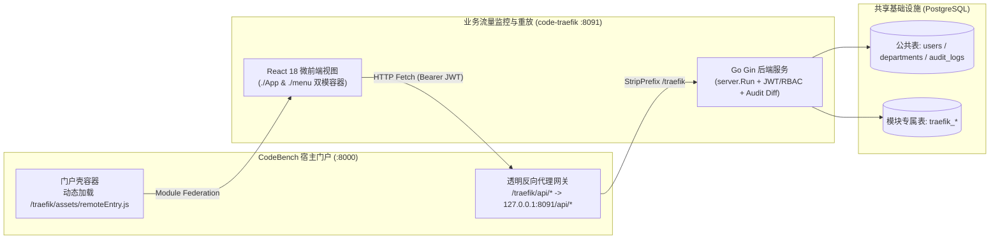

# 业务流量监控与重放 (`code-traefik`)

> 基于 CodeBench 微前端架构与 `code-common` 公共底座构建的 **业务流量监控与重放** 业务子系统。

本项目严格遵循 **SDD (Spec-Driven Development，规范驱动开发) + TDD (Test-Driven Development，测试驱动开发)** 工程模式：
**「特性边界明确 (`01-features`) -> 架构与模型定稿 (`02-design`) -> 接口契约与任务拆解 (`03-api` & `04-tasks`) -> TDD 测试先行与分阶段交付」**

---

## 1. 系统架构与微前端拓扑 (System Topology)



---

## 2. 目录结构 (Repository Layout)

```text
code-traefik/
├── docs/                # SDD + TDD 规范文档库 (00-prompt ~ 06-ops)
├── config/              # 配置加载与模块级元数据常量 (ModuleKey="traefik", TablePrefix="traefik_")
├── models/              # GORM 数据模型（统一使用 traefik_ 表前缀隔离）
├── handlers/            # HTTP 控制器、RBAC 权限拦截、字段级审计与物理隔离单元测试
├── frontend/            # React 18 + Vite 5 + Module Federation 前端工程
├── scripts/             # 自动化构建与辅助脚本
├── Makefile             # 标准构建、测试与代码检查入口
├── AGENTS.md            # AI Agent 协作准则与架构红线
└── README.md            # 项目概览与 SDD+TDD 路线图
```

完整文档规范与分层索引请查阅 [`docs/README.md`](./docs/README.md)。

---

## 3. SDD + TDD 研发路线图 (Lifecycle Checklist)

- [ ] **阶段一：特性清单与边界明确** (`docs/01-features/`)
  - [ ] [`01-feature-matrix.md`](./docs/01-features/01-feature-matrix.md)（业务愿景、`P0~P2` 功能矩阵、验收场景与 `Non-Goals`）
- [ ] **阶段二：系统架构与模型设计** (`docs/02-design/`)
  - [ ] [`01-system-architecture.md`](./docs/02-design/01-system-architecture.md)（双模运行架构、`traefik_*` 数据表结构设计与前后端分层）
- [ ] **阶段三：接口契约与 TDD 任务分解** (`docs/03-api/`, `docs/04-tasks/`)
  - [ ] [`01-http-api-contract.md`](./docs/03-api/01-http-api-contract.md)（RESTful API 契约、RBAC 权限矩阵与审计规范）
  - [ ] [`01-roadmap.md`](./docs/04-tasks/01-roadmap.md)（Milestone 1~4 依赖拓扑与 TDD 质量门禁）
  - [ ] [`02-m1-domain-model-and-api.md`](./docs/04-tasks/02-m1-domain-model-and-api.md)（Milestone 1 作战卡与 TDD 先行用例清单）
- [ ] **阶段四：工程实施、架构决策与运维验证** (`docs/05-adr/`, `docs/06-ops/`)
  - [ ] [`01-microfrontend-and-table-prefix-isolation.md`](./docs/05-adr/01-microfrontend-and-table-prefix-isolation.md)（ADR-01 架构决策记录）
  - [ ] [`01-verification-and-deployment-guide.md`](./docs/06-ops/01-verification-and-deployment-guide.md)（联调测试与生产部署手册）

---

## 4. 快速开始与常用命令

```bash
# 1. 生成本地配置文件（确保 database 与 auth.jwt_secret 与 code-bench 保持一致）
cp config.yaml.example config.yaml

# 2. 安装前端依赖、执行静态检查、运行单测并打包单二进制
make install && make lint && make test && make build

# 3. 启动服务（默认监听 :8091）
./code-traefik-server
```
