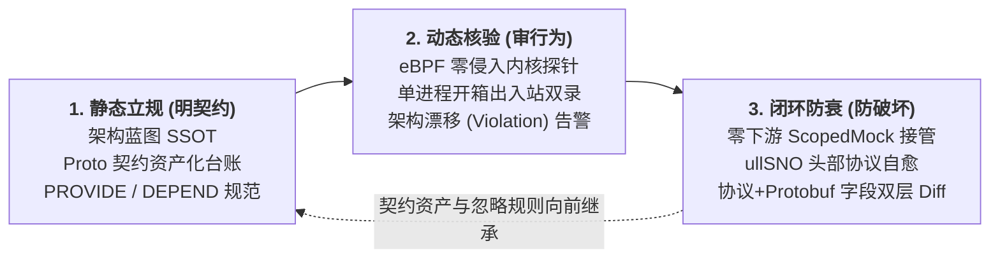
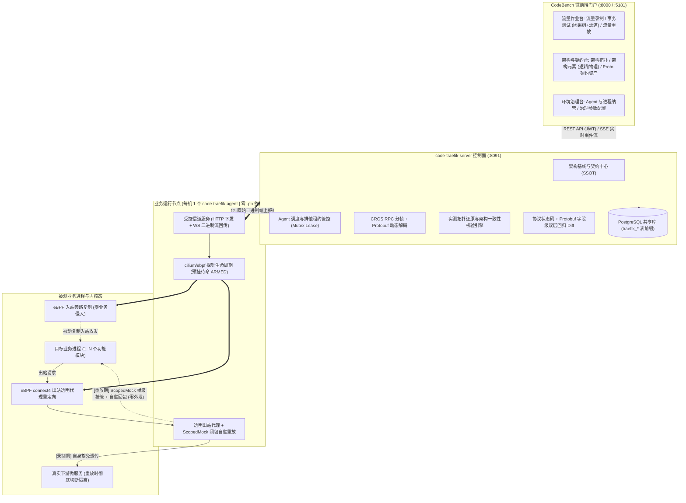

# 业务流量与接口契约治理平台 (`code-traefik`)

> **产品定位**：基于真实流量的活体契约、架构一致性与防劣化自愈平台（原“业务流量监控与重放”系统升维）  
> **当前版本**：`v0.1.0` | **服务标识**：`Code-Traefik` (`traefik`) | **专有协议**：DOPHI `CROS RPC` over IPv4 TCP

本项目基于 CodeBench 微前端架构与 `code-common` 公共底座构建，严格遵循 **SDD (Spec-Driven Development，规范驱动开发) + TDD (Test-Driven Development，测试驱动开发)** 工程模式：  
**「契约基线与特性边界 (`01-features`) ➔ 系统架构与数据模型 (`02-design`) ➔ 接口契约与任务拆解 (`03-api` & `04-tasks`) ➔ TDD 测试先行与分阶段交付」**

---

## 1. 产品本质与核心价值 (Core Essence & Values)

传统的接口与契约管理（Swagger、Postman、Proto 仓库等）普遍局限于**“设计态的静态文档”**，存在“文档与实现两张皮”、“无法感知生产实际调用”、“架构偷偷腐化漂移”及“跨微服务联调严重依赖完整下游环境”等系统性痛点。

`code-traefik` 的业务本质是**「以契约治理为核心、以运行态真实流量为活水、以零侵入仿真为闭环的活体契约与微服务架构治理平台」**：
* **“流量录制与重放”是底座技术手段**：提供零代码侵入、零业务改造成本的高保真交互采集与本地回放。
* **“契约治理、架构防漂移与防劣化闭环”是真正的业务目的**：



### 三大治理支柱 (Three Governance Pillars)

| 治理维度 | 核心解决的痛点 | 平台提供的能力与技术机制 |
| :--- | :--- | :--- |
| **① 接口资产与规范治理**<br/>*(Contract Assets & Specs)* | 接口口口相传、Proto 散落各处、微服务职责边界模糊、存在大量无人认领的僵尸接口 | 1. 建立**三级架构元素**（子系统 ➔ 功能组 ➔ 功能模块）与标准物理进程蓝图（SSOT）；<br/>2. 契约收敛至 Service 维度，全网 **`PROVIDE` 供给全局唯一**，`DEPEND` 显式依赖声明；<br/>3. **多 Protobuf 描述集资产台账**：支持跨描述集拓扑去重、消息体字段字典树透视、可视化 Diff 忽略基线与未认领“孤儿契约”闭环。 |
| **② 架构一致性与漂移治理**<br/>*(Architecture Drift Radar)* | 架构设计图与代码实际调用漂移，开发私自跨层调用、旁路直连，架构腐化无从察觉 | 1. **内核态 `cilium/ebpf` 动态探针**：零修改、零 SDK、不重启进程，亚秒级完成出入站双向无感采集；<br/>2. **实测拓扑自动还原**：依据 CROS RPC 报文提取 `(ascServiceName, ascOperation)` 动态反查模块归属；<br/>3. **架构一致性比对**：将实测调用与设计基线逐项核验，毫秒级红牌告警 **`Violation`（违规未声明调用）**、呈现 **`Uncovered`（未覆盖接口）**。 |
| **③ 契约级防劣化与自愈重放**<br/>*(Contract Regression & Healing)* | 跨模块回归测试依赖一整套下游环境；接口变更容易破坏兼容性导致线上故障 | 1. **零下游依赖因果闭包重放 (`ScopedMock`)**：单进程脱机运行，出口请求由局部因果池接管，**真实下游 0 字节外泄**；<br/>2. **二进制头部自愈**：自动改写应答 `ullSNO`、Trace 缓冲与发送时间戳，免除跨机器同步 Schema 负担；<br/>3. **双层语义 Diff 引擎**：自动比对协议状态码与 Protobuf 业务字段，精准定位破坏性改动。 |

---

## 2. 系统总体拓扑 (System Topology)

系统采用 **「控制面主框架 (`code-traefik-server`) + 独立数据面代理 (`code-traefik-agent`)」同仓双二进制物理防腐** 架构：



---

## 3. 目录结构 (Repository Layout)

```text
code-traefik/
├── docs/                # SDD + TDD 规范文档库 (00-prompt ~ 07-references)
├── cmd/
│   ├── server/          # 控制面入口 code-traefik-server（微前端托管、契约中心、Diff引擎）
│   └── agent/           # 数据面探针入口 code-traefik-agent（零数据库、零.pb、嵌入式eBPF）
├── pkg/
│   ├── crosrpc/         # CROS RPC 协议解析与分帧库（主控与 Agent 共享）
│   ├── ebpf/            # cilium/ebpf 内核探针、Socket 预热与三态出站代理
│   ├── replay/          # 零 .pb 二进制 ScopedMock 匹配与 ullSNO 自愈引擎
│   └── version/         # 规范化语义版本号与构建指纹
├── config/              # 配置加载与模块级元数据常量 (ModuleKey="traefik", TablePrefix="traefik_")
├── models/              # GORM 数据模型（强制 traefik_ 物理表前缀隔离）
├── handlers/            # HTTP 控制器、RBAC 权限守卫、审计 Diff 与物理隔离单元测试
├── frontend/            # React 18 + Vite 5 + Module Federation 微前端工程
├── scripts/             # 自动化构建与辅助脚本
├── Makefile             # 标准构建、测试与代码检查入口
├── AGENTS.md            # AI Agent 协作准则与架构红线
└── README.md            # 项目概览与 SDD+TDD 路线图
```

完整文档规范与分层索引请查阅 [`docs/README.md`](./docs/README.md)。

---

## 4. SDD + TDD 研发路线图 (Lifecycle Checklist)

- [x] **阶段一：特性清单与边界明确** (`docs/01-features/`)
  - [x] [`01-feature-matrix.md`](./docs/01-features/01-feature-matrix.md)（活体契约愿景、三层治理矩阵 `F-01~F-16`、验收场景 `SC-01~SC-08` 与 `Non-Goals`）
- [x] **阶段二：系统架构与模型设计** (`docs/02-design/`)
  - [x] [`01-system-architecture.md`](./docs/02-design/01-system-architecture.md)（主从协同、双模运行架构、微前端接入规范）
  - [x] [`02-data-plane-and-cros-rpc-engine.md`](./docs/02-design/02-data-plane-and-cros-rpc-engine.md)（CROS RPC 协议栈、eBPF 采集与二进制 Mock 引擎）
  - [x] [`03-architecture-elements-and-topology.md`](./docs/02-design/03-architecture-elements-and-topology.md)（三级架构模型 SSOT、模块服务契约与拓扑一致性核验）
  - [x] [`04-control-plane-and-web-console.md`](./docs/02-design/04-control-plane-and-web-console.md)（控制面调度、Protobuf 编解码与回归 Diff）
  - [x] [`05-database-schema.md`](./docs/02-design/05-database-schema.md)（15 张 `traefik_*` 物理表字典与按日范围分区设计）
- [x] **阶段三：接口契约与 TDD 任务分解** (`docs/03-api/`, `docs/04-tasks/`)
  - [x] [`01-http-api-contract.md`](./docs/03-api/01-http-api-contract.md)（RESTful API 契约、主从 HTTP/WS 信道协议与 RBAC 权限矩阵）
  - [x] [`01-roadmap.md`](./docs/04-tasks/01-roadmap.md)（Milestone 1~13 DAG 拓扑、特性矩阵覆盖与全局质量门禁）
  - [x] [`02-m1-crosrpc-and-domain-models.md`](./docs/04-tasks/02-m1-crosrpc-and-domain-models.md) ~ [`14-m13-packet-causality-call-tree-and-sequence-workbench.md`](./docs/04-tasks/14-m13-packet-causality-call-tree-and-sequence-workbench.md)
- [x] **阶段四：工程实施、架构决策与运维验证** (`docs/05-adr/`, `docs/06-ops/`)
  - [x] [`docs/05-adr/`](./docs/05-adr/)（ADR-01 ~ ADR-13 架构决策全景记录）
  - [x] [`01-verification-and-deployment-guide.md`](./docs/06-ops/01-verification-and-deployment-guide.md)（联调测试与生产部署手册）
  - [x] [`02-e2e-browser-test-and-ux-review.md`](./docs/06-ops/02-e2e-browser-test-and-ux-review.md)（E2E 黑盒走查与交互走查记录）

---

## 5. 快速开始与常用命令

```bash
# 1. 后端依赖安装与单元测试（含物理隔离数据库用例）
make test
TEST_DB_DSN="host=127.0.0.1 port=5432 user=postgres password=PWD dbname=postgres sslmode=disable" make test

# 2. 前端静态类型与代码质量检查
make lint

# 3. 编译打包（生成控制面与 Agent 二进制）并验证清理
make build && make clean

# 4. 启动控制面服务（默认监听 :8091）
./code-traefik-server
```

---

## 6. 🏷️ 版本历史 (Release History)

### v0.1.0 (2026-11-05)
* **🌟 战略定位升维**：明确从纯技术视角的“业务流量录制工具”升维为“**基于真实流量的活体契约与微服务架构治理平台**”，确立“接口资产治理”、“架构漂移雷达”与“无依赖自愈防劣化”三大价值支柱。
* **🧩 核心架构与微前端集成**：
  - 基于 CodeBench 微前端模块联邦规范设计，支持主控控制面（`code-traefik-server`）与数据面探针（`code-traefik-agent`）物理防腐隔离。
  - 前端基于 React 18 + Vite 5 + Module Federation，暴露 `./App` 与 `./menu` 双模接入点。
* **🛡️ 业务协议与契约治理**：
  - 聚焦明文 IPv4 TCP CROS RPC 二进制分帧与 SessionHead 会话头解析（支持 V01~V05 会话头演进）。
  - 支持 Protobuf 描述集（`.pb`）同名多版本管理、联合编译冲突门禁检测与接口级 Diff 忽略规则继承。
* **⚡ 协同录制与排他租约**：
  - 严格区分团队共享（`SHARED`）与个人私有（`PRIVATE`）作用域，实现 Agent 动态排他租约互斥（`409 Conflict` 防并发争抢）。
  - 采用基于 TCP 会话对的单往返双模持久化（`raw_req_packet` + `raw_rsp_packet` 及 `payload_json`）。
* **🔄 双层 Diff 对账与单包调试重放**：
  - 支持单包即时重放、序列号 `ullSNO` 自愈与基于多字段维度的结构化 Diff 对账引擎。
  - Agent 严格落实重放零外泄（`MOCK_MISS` 阻断）与探针卫生管理（退出自动卸载 eBPF）。
* **🏷️ 规范版本号体系**：
  - 建立统一的语义版本号（SemVer）与构建指纹规范（`pkg/version`），支持 `v0.1.0 (commit: <hash>, built: <time>)` 精准溯源。
