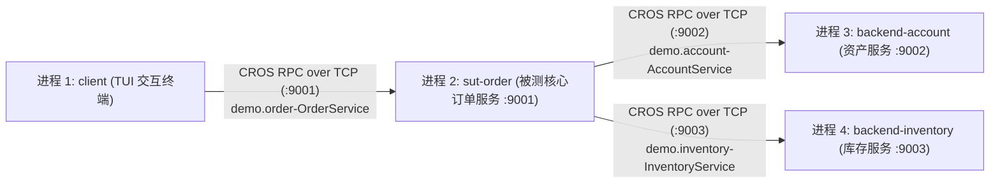

# CROS RPC 4 进程仿真微服务测试系统 (CROS RPC Benchmark Cluster)

> 本工程是基于 [`code-traefik/docs/07-references/01-cros-rpc-protocol-spec.md`](../docs/07-references/01-cros-rpc-protocol-spec.md) 协议规范构建的 4 进程分布式电商交易微服务系统，专门作为 `code-traefik` 流量监控、架构拓扑校验及离线 Mock 重放的标准靶场应用。

---

## 1. 系统架构与四进程拓扑



- **Client (`cmd/client`)**：交互式 TUI 控制台，支持数字快捷键触发预置业务场景、自定义表单输入、压力测试，并实时以四段解剖视窗展示底层 `SNO`、`TraceID`、时延、Protobuf JSON 与十六进制 HEX Dump。
- **SUT 订单网关 (`cmd/sut-order`)**：被测核心服务（监听 `:9001`）。接收 Client 指令，编排下游调用，负责两阶段库存锁定、金额扣除与逆向补偿回滚；透传调用链 `TraceKeyExt`。
- **Backend 1 账户资产服务 (`cmd/backend-account`)**：提供用户资金账本查询与扣款（监听 `:9002`）。
- **Backend 2 仓储库存履约服务 (`cmd/backend-inventory`)**：提供商品行情查询、库存预占锁定、实扣确认与回滚释放（监听 `:9003`）。

---

## 2. 快速开始与常用命令

### 2.1 编译与测试
```bash
# 1. 运行所有单元与全链路集成测试 (覆盖 5 大核心业务场景)
make test

# 2. 编译全部四个二进制文件到 bin/ 目录
make build
```

### 2.2 启动微服务集群
```bash
# 一键后台启动 3 个服务进程 (sut-order :9001, backend-account :9002, backend-inventory :9003)
make start
```

### 2.3 启动 TUI 交互式客户端
```bash
# 启动终端交互控制台与 SUT 交互
make run-client
```

### 2.4 停止微服务集群
```bash
# 停止所有后台进程并释放端口
make stop
```

---

## 3. TUI 客户端操作指南

进入客户端后，可使用键盘快捷键触发下列指令：

| 按键 | 指令名称 | 行为说明 | 预期业务状态 |
| :--- | :--- | :--- | :--- |
| `[1]` | **查询行情与资产** | 查询 Alice 可用余额（￥1000.00）与机械键盘实时行情（￥299.00，余量 10 件） | `SUCCESS` |
| `[2]` | **正向正常下单** | 购买 1 件机械键盘（预占库存 -> 扣减余额 -> 确认实物扣除） | `SUCCESS` (生成 `ORD-*` 订单) |
| `[3]` | **触发库存不足** | 申请购买 99 件 4K 电竞显示器（仅剩 2 件），SUT 快速熔断，不扣款 | `FAILED_STOCK` (Code 3002) |
| `[4]` | **触发余额不足并回滚** | 穷困买家 Bob (￥50.00) 购买 ￥299.00 机械键盘；预占库存成功后扣款失败，SUT 触发 `ReleaseStock` 补偿释放库存 | `FAILED_BALANCE` (Code 2002) |
| `[5]` | **查询上笔订单** | 获取此前下单成功的订单详情与履约状态 | `SUCCESS` |
| `[6]` | **取消订单与退款** | 取消上笔订单，触发全额退款入账与库存回退 | `SUCCESS` |
| `[7]` | **自定义参数下单** | 表单交互输入买家 UserID、商品 SKU 与购买数量 | 视参数而定 |
| `[8]` | **并发压力录制流** | 连续并发注入 10 笔混合订单，用于为 `code-traefik` 录制丰富的链路样本 | 批量汇总统计 |
| `[q]` | **退出终端** | 安全断开与 SUT 的长连接并退出 | — |

---

## 4. 与 `code-traefik` 平台的联动验证场景

1. **流量旁路录制**：
   在 `code-traefik` 控制台启动对 `sut-order` (PID) 的录制，TUI 按 `[2]` 或 `[8]` 注入流量。查看平台生成的 `traefik_traffic_records` 双向报文（入站 `:9001` 与出站 `:9002/:9003`）。
2. **架构一致性核验**：
   在 `code-traefik` 架构管理中录入 `order-core`、`account-core`、`inventory-core`，运行一致性检查，拓扑比对结果将为 `MATCH`。
3. **离线 Mock 重放与 `ullSNO` 自愈**：
   执行 `kill -9 $(pgrep -f backend-account) $(pgrep -f backend-inventory)` 强制关闭两个 Backend；通过 `code-traefik` 重放历史录制流量，观察 Agent 拦截出站请求并命中 Mock 帧、自动覆写 `ullSNO`，SUT 顺利完成业务逻辑！
