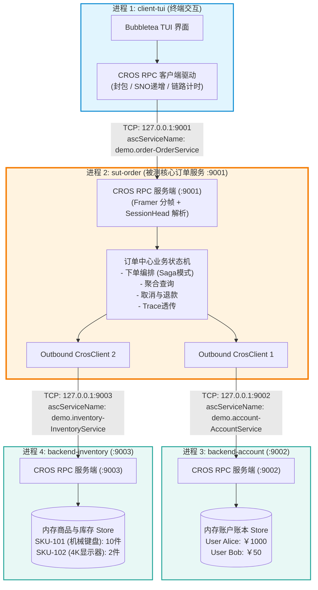
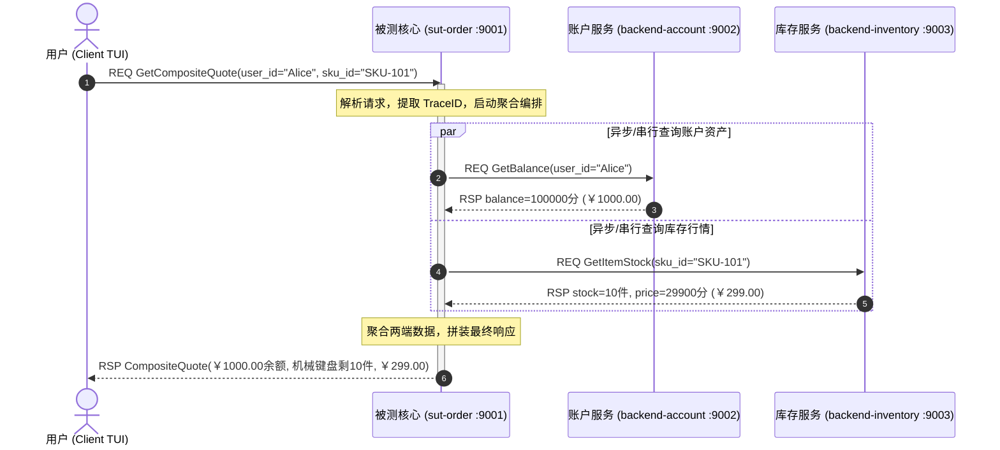
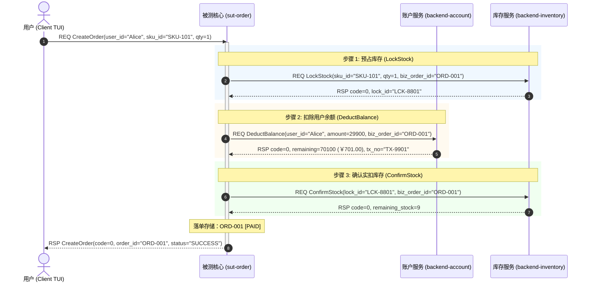
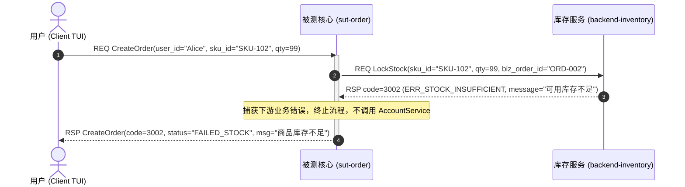
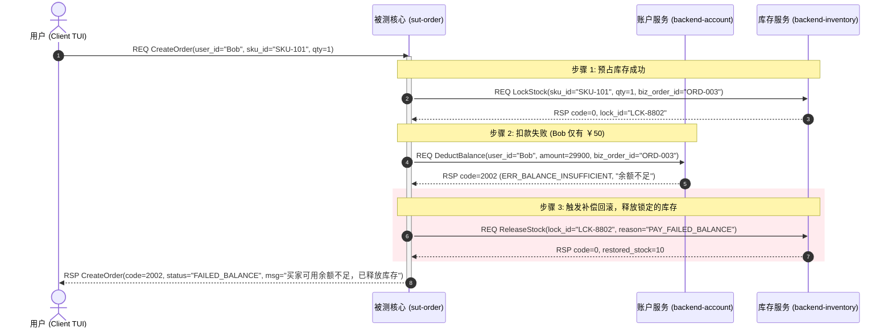
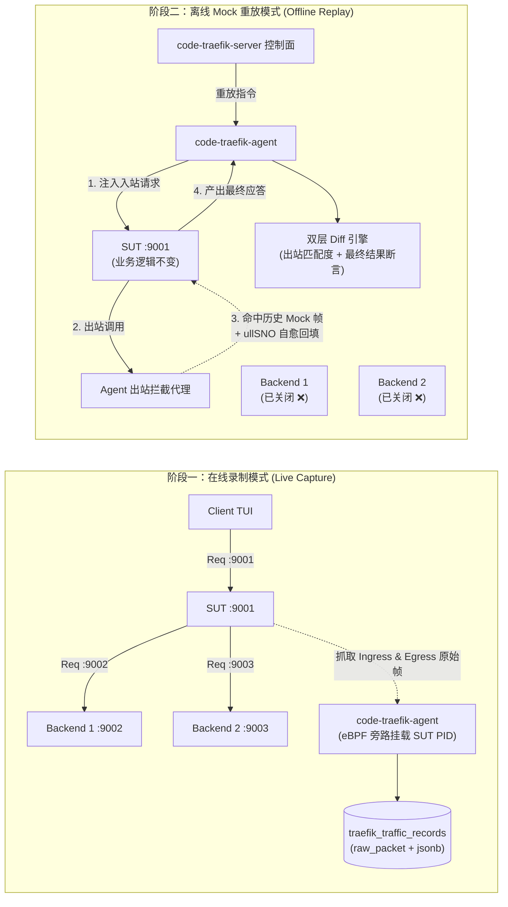

# CROS RPC 4进程仿真微服务测试系统方案建议书 (Demo App Proposal)

- **文档编号**：`01-cros-rpc-demo-app-proposal.md`
- **文档版本**：v1.0.0
- **编制日期**：2026-10-29
- **协议依据**：[`code-traefik/docs/07-references/01-cros-rpc-protocol-spec.md`](../../docs/07-references/01-cros-rpc-protocol-spec.md)
- **归属模块**：`code-traefik/demo` 业务仿真与全链路测试靶场
- **状态**：方案建议书 (Proposal - Ready for Review)

---

## 1. 方案背景与目标 (Background & Objectives)

### 1.1 背景
`code-traefik` 是专为 DOPHI 平台 **CROS RPC** 协议（24 字节公共头 `RPC_COMM_HEAD_S` + 请求/应答/管理会话头 + 扩展头 + Protobuf Payload）量身打造的业务流量监控、架构拓扑还原、录制采集与离线 Mock 重放平台。

为了全方位验证 `code-traefik` 的以下核心能力：
1. **eBPF 旁路无侵入入站/出站双向流量采集**（单 Agent 纳管目标进程，精准区分入站服务端口与出站重定向端口）；
2. **三级架构元素（子系统 → 功能组 → 功能模块）与契约拓扑一致性自动推导**；
3. **离线 Mock 重放与 `ullSNO` 自愈**（在下游依赖进程完全离线的情况下，SUT 进程依然能基于历史录制正常运行）；
4. **双层回归 Diff 判定**（出站 Mock 匹配度断言 + 最终入站返回结果的字段级差异识别）；

我们需要构建一套**高度拟真、协议原生对齐、自包含、可一键拉起**的 4 进程分布式微服务仿真系统。

### 1.2 四进程体系分工
本系统由四个完全独立的操作系统进程组成：

```
┌─────────────────────────────────────────────────────────────────────────────┐
│ 1. 终端交互进程 (Client TUI)                                                  │
│    - 提供交互式终端界面 (TUI)，供用户输入业务命令、调整参数、触发压测与异常           │
│    - 编码 CROS RPC 请求并发送至 SUT，接收响应并在界面可视化展示耗时、Trace、报文结构  │
└──────────────────────────────────────┬──────────────────────────────────────┘
                                       │ CROS RPC over TCP (:9001)
                                       ▼
┌─────────────────────────────────────────────────────────────────────────────┐
│ 2. 被测核心服务 (System Under Test, 简称 SUT)                                │
│    - 监听 Client 请求，负责业务编排、事务状态机流转与跨下游聚合                      │
│    - 处理过程中，作为 RPC Client 分别调用两个下游 Backend 进程                     │
│    - 【关键】：这是 code-traefik 监控、录制与离线 Mock 重放的唯一核心目标进程！         │
└───────────────────────┬─────────────────────────────┬───────────────────────┘
                        │ CROS RPC (:9002)            │ CROS RPC (:9003)
                        ▼                             ▼
┌──────────────────────────────────────┐  ┌───────────────────────────────────┐
│ 3. 下游支撑服务 1 (Backend 1)         │  │ 4. 下游执行服务 2 (Backend 2)     │
│    - 角色：查询与资产型服务            │  │    - 角色：状态变更与执行型履约服务 │
│    - 具备查询、校验、扣划、退款等能力   │  │    - 具备查验、预占锁定、确认扣减、 │
│    - 维护内存级状态，支持重置与状态查询 │  │      释放补偿等能力                │
└──────────────────────────────────────┘  └───────────────────────────────────┘
```

---

## 2. 业务领域选型对比与决策 (Business Domain Evaluation)

为了让该 Demo 具备最佳的测试价值、直观性与教学演示效果，我们对三种最具代表性的业务场景进行了可行性与契合度对比：

| 选型维度 | 方案一：分布式电商交易协同中心（推荐） | 方案二：云原生算力/容器调度编排系统 | 方案三：金融支付结算与反欺诈风控网关 |
| :--- | :--- | :--- | :--- |
| **业务易懂性** | ⭐⭐⭐⭐⭐（零心智负担，人尽皆知） | ⭐⭐⭐⭐（偏底层基础设施概念） | ⭐⭐⭐⭐（金融术语较多） |
| **SUT 角色定位** | `order-gateway`（订单交易中枢） | `vm-orchestrator`（算力调度中心） | `payment-gateway`（支付路由中枢） |
| **Backend 1 职责** | `account-service`（账户资产/钱包）<br/>*查余额、扣款、退还余额* | `cmdb-quota-service`（租户配额）<br/>*查配额、锁配额、释放配额* | `risk-engine`（实时风控特征中心）<br/>*设备指纹、反欺诈评分、黑名单* |
| **Backend 2 职责** | `inventory-service`（库存履约中心）<br/>*查库存、锁库存、减库存、释放库存* | `hypervisor-agent`（计算节点守护）<br/>*资源预留、创建容器、销毁容器* | `clearing-ledger`（核心清算总账）<br/>*核心记账分录、扣账、入账冲正* |
| **编排复杂度** | ⭐⭐⭐⭐⭐（支持并发查、串行锁扣、补偿回滚） | ⭐⭐⭐⭐（主要是校验与资源创建） | ⭐⭐⭐⭐（主要是风控前置校验与扣划） |
| **异常分支丰富度** | ⭐⭐⭐⭐⭐（库存不足、余额不足、重复下单、回滚） | ⭐⭐⭐⭐（配额不足、节点超载） | ⭐⭐⭐⭐（风控阻断、余额不足） |
| **重放 Diff 拟真度** | ⭐⭐⭐⭐⭐（商品价格折扣变更、订单状态变更） | ⭐⭐⭐⭐（IP/容器ID易漂移，不易做确定性Diff） | ⭐⭐⭐⭐（流水号变更） |

### 2.1 选型结论：采纳「方案一：分布式电商交易协同中心」
**理由**：
1. **天然的读写分离与下游专业化**：
   - Backend 1 (`account-service`) 专注用户资金与积分账本，提供资产维度的「读（查询）」与「写（扣划/返还）」；
   - Backend 2 (`inventory-service`) 专注商品与仓储库存，提供履约维度的「读（查询）」与「两阶段写（锁定预占/确认扣除/超时释放）」。
2. **经典的分布式事务与补偿场景**：
   - 下单流程天然需要协调两个微服务：SUT 先向 Backend 2 预占库存（保证商品可售），再向 Backend 1 扣除金额（保证买家可付）。如果买家余额不足，SUT 必须调用 Backend 2 释放库存进行事务补偿。这为 `code-traefik` 的多步骤录制、Mock 编排以及 `ullSNO` 自愈提供了最极致的真实用例！
3. **极佳的可视化表现力**：
   - 用户在 Client TUI 上可以直观查看：商品详情、库存数字、钱包余额的每一次增减变动，测试状态一目了然。

---

## 3. 四进程架构与网络规划 (Process Topology & Network Plan)

### 3.1 进程与端口拓扑



### 3.2 规范与约束对齐表 (Compliance with Specifications)

| 规范项 | 规范要求 | Demo App 落地设计 |
| :--- | :--- | :--- |
| **传输层协议** | 仅支持 IPv4 TCP 明文通信 | 4 个进程均绑定 `127.0.0.1` 环回或内网 IP，原生 TCP Socket |
| **魔术字与传输标识** | `CSE.TCP\x01`（8 字节，UINT64 `0x4353452E54435001`） | 公共头前 8 字节严格对齐 `crosrpc.MagicPrefix` + `TransportTCP` |
| **公共头格式** | 定长 24 字节大端序 `RPC_COMM_HEAD_S` | 复用 `pkg/crosrpc/comm_head.go`，严格填充 `SNO`, `Length`, `HeadLen`, `MsgType`, `IsPacked` |
| **服务名命名约定** | 遵循契约 A-07：`{package}-{serviceName}`（点分包名 + 中划线连接） | • 订单服务：`demo.order-OrderService`<br/>• 账户服务：`demo.account-AccountService`<br/>• 库存服务：`demo.inventory-InventoryService` |
| **API 操作名** | 遵循契约 A-07：`ascOperation` 与 Method 名字符串直接相等 | 如 `CreateOrder`、`GetOrderDetail`、`DeductBalance`、`LockStock` 等 |
| **调用链与扩展头** | 扩展头携带 Trace 信息 | 启用 `RPC_EXTEND_HEAD_TYPE_TRACE_KEY`，SUT 将 Client 请求中的 `TraceID` 提取并透传给 Backend 1 和 Backend 2，确保链路还原 |
| **Payload 格式** | Protobuf 序列化字节流 | 使用标准 Protocol Buffers v3 编译器生成 Go 结构体 |
| **三级架构映射** | 映射为 `code-traefik` 维护的 SSOT | • 子系统：`MallSubsystem`<br/>• 功能组：`OrderGroup`, `AssetGroup`, `FulfillmentGroup`<br/>• 功能模块：`order-core`, `account-core`, `inventory-core` |

---

## 4. Protobuf IDL 接口契约定义 (Service Contracts)

系统划分三个 Proto 文件，定义完整的业务请求与应答：

### 4.1 订单中枢契约 (`proto/order.proto`)
- **Package**: `demo.order`
- **ServiceName**: `OrderService` -> 线上传输名: `demo.order-OrderService`

```protobuf
syntax = "proto3";

package demo.order;
option go_package = "demo/pkg/proto/orderpb";

// 订单综合服务
service OrderService {
  // 综合聚合查询：同时查询用户资产与商品实时库存行情
  rpc GetCompositeQuote(CompositeQuoteReq) returns (CompositeQuoteRsp);
  // 提交订单（触发分布式编排：预占库存 -> 扣减余额 -> 确认库存）
  rpc CreateOrder(CreateOrderReq) returns (CreateOrderRsp);
  // 查询订单状态及履约明细
  rpc GetOrderDetail(OrderDetailReq) returns (OrderDetailRsp);
  // 取消订单（触发补偿回滚：退回余额 -> 释放库存）
  rpc CancelOrder(CancelOrderReq) returns (CancelOrderRsp);
}

message CompositeQuoteReq {
  string user_id = 1;
  string sku_id = 2;
}

message CompositeQuoteRsp {
  int32 code = 1;              // 0=成功, 其它=错误码
  string message = 2;
  string user_id = 3;
  int64 balance_cents = 4;     // 用户当前可用余额 (分)
  string sku_id = 5;
  string sku_name = 6;
  int64 unit_price_cents = 7;  // 商品单价 (分)
  int32 available_stock = 8;   // 当前剩余可售库存
}

message CreateOrderReq {
  string user_id = 1;
  string sku_id = 2;
  int32 quantity = 3;          // 购买数量
  string client_order_ref = 4; // 客户端防重幂等号
}

message CreateOrderRsp {
  int32 code = 1;
  string message = 2;
  string order_id = 3;
  int64 total_amount_cents = 4;
  string status = 5;           // SUCCESS, FAILED_STOCK, FAILED_BALANCE
  int64 created_at_unix = 6;
}

message OrderDetailReq {
  string order_id = 1;
}

message OrderDetailRsp {
  int32 code = 1;
  string message = 2;
  string order_id = 3;
  string user_id = 4;
  string sku_id = 5;
  int32 quantity = 6;
  int64 total_amount_cents = 7;
  string status = 8;
  int64 created_at_unix = 9;
}

message CancelOrderReq {
  string order_id = 1;
  string reason = 2;
}

message CancelOrderRsp {
  int32 code = 1;
  string message = 2;
  string order_id = 3;
  int64 refunded_amount_cents = 4;
  int32 released_stock = 5;
}
```

---

### 4.2 账户资产中心契约 (`proto/account.proto`)
- **Package**: `demo.account`
- **ServiceName**: `AccountService` -> 线上传输名: `demo.account-AccountService`

```protobuf
syntax = "proto3";

package demo.account;
option go_package = "demo/pkg/proto/accountpb";

// 账户资产服务
service AccountService {
  // 查询用户账户信息与可用余额
  rpc GetBalance(GetBalanceReq) returns (GetBalanceRsp);
  // 扣减账户余额
  rpc DeductBalance(DeductBalanceReq) returns (DeductBalanceRsp);
  // 退还/增加账户余额
  rpc RefundBalance(RefundBalanceReq) returns (RefundBalanceRsp);
  // 管理员充值/充正接口
  rpc DepositBalance(DepositBalanceReq) returns (DepositBalanceRsp);
}

message GetBalanceReq {
  string user_id = 1;
}

message GetBalanceRsp {
  int32 code = 1;              // 0=成功, 2001=用户不存在
  string message = 2;
  string user_id = 3;
  string user_name = 4;
  int64 balance_cents = 5;
}

message DeductBalanceReq {
  string user_id = 1;
  int64 amount_cents = 2;      // 扣减金额 (分)
  string biz_order_id = 3;     // 业务订单关联号
}

message DeductBalanceRsp {
  int32 code = 1;              // 0=成功, 2002=余额不足
  string message = 2;
  string user_id = 3;
  int64 remaining_balance = 4; // 扣减后剩余余额
  string tx_serial_no = 5;     // 交易记账流水号
}

message RefundBalanceReq {
  string user_id = 1;
  int64 amount_cents = 2;
  string biz_order_id = 3;
  string reason = 4;
}

message RefundBalanceRsp {
  int32 code = 1;
  string message = 2;
  string user_id = 3;
  int64 current_balance = 4;
  string refund_serial_no = 5;
}

message DepositBalanceReq {
  string user_id = 1;
  int64 amount_cents = 2;
}

message DepositBalanceRsp {
  int32 code = 1;
  string message = 2;
  int64 current_balance = 3;
}
```

---

### 4.3 仓储库存履约契约 (`proto/inventory.proto`)
- **Package**: `demo.inventory`
- **ServiceName**: `InventoryService` -> 线上传输名: `demo.inventory-InventoryService`

```protobuf
syntax = "proto3";

package demo.inventory;
option go_package = "demo/pkg/proto/inventorypb";

// 库存履约服务
service InventoryService {
  // 查询 SKU 详情及可售库存
  rpc GetItemStock(GetItemStockReq) returns (GetItemStockRsp);
  // 阶段 1：预占/锁定库存
  rpc LockStock(LockStockReq) returns (LockStockRsp);
  // 阶段 2A：确认扣减库存（订单支付成功）
  rpc ConfirmStock(ConfirmStockReq) returns (ConfirmStockRsp);
  // 阶段 2B：释放预占库存（支付失败或取消补偿）
  rpc ReleaseStock(ReleaseStockReq) returns (ReleaseStockRsp);
}

message GetItemStockReq {
  string sku_id = 1;
}

message GetItemStockRsp {
  int32 code = 1;              // 0=成功, 3001=商品不存在
  string message = 2;
  string sku_id = 3;
  string sku_name = 4;
  int64 unit_price_cents = 5;  // 单价 (分)
  int32 total_stock = 6;       // 总物理库存
  int32 locked_stock = 7;      // 当前已预占锁定量
  int32 available_stock = 8;   // 可用量 = total - locked
}

message LockStockReq {
  string sku_id = 1;
  int32 quantity = 2;          // 锁定件数
  string biz_order_id = 3;     // 关联订单号
}

message LockStockRsp {
  int32 code = 1;              // 0=成功, 3002=库存不足
  string message = 2;
  string lock_id = 3;          // 锁定授权凭证
  int32 locked_quantity = 4;
}

message ConfirmStockReq {
  string lock_id = 1;
  string biz_order_id = 2;
}

message ConfirmStockRsp {
  int32 code = 1;
  string message = 2;
  int32 remaining_stock = 3;
}

message ReleaseStockReq {
  string lock_id = 1;
  string reason = 2;
}

message ReleaseStockRsp {
  int32 code = 1;
  string message = 2;
  int32 restored_stock = 3;
}
```

---

## 5. 核心业务交互流程与时序 (Core Business Workflows)

### 场景 1：综合行情与资产联合查询 (Composite Query)
- **触发**：Client TUI 按 `[1]` 或触发 `GetCompositeQuote`
- **特点**：SUT 对外呈现聚合接口，内部发起 2 次独立出站 RPC（并发或串行）。



---

### 场景 2：正向正常下单流 (Happy Path - Distributed Order Creation)
- **触发**：Client TUI 按 `[2]` 提交购买 1 件机械键盘（总价 ￥299.00，Alice 余额 ￥1000.00，库存 10 件）
- **特点**：标准两阶段编排（Lock -> Deduct -> Confirm）。



---

### 场景 3：库存不足熔断分支 (Stock Insufficient Failure)
- **触发**：Client TUI 按 `[3]` 购买 99 件显示器（当前可用库存仅 2 件）
- **特点**：SUT 快速失败，不发起对 Account 的扣款调用，保护下游。



---

### 场景 4：余额不足触发补偿事务回滚 (Compensating Rollback Flow)
- **触发**：Client TUI 按 `[4]` 使用穷困用户 Bob (余额 ￥50.00) 购买 1 件机械键盘 (￥299.00)
- **特点**：预占库存成功，但扣款失败；SUT 必须发起 `ReleaseStock` 释放库存，完成最终一致性回滚。这是检验 `code-traefik` 录制多分支流量与离线 Mock 的黄金用例！



---

## 6. Client TUI 终端交互设计 (Terminal User Interface Spec)

### 6.1 选型与体验风格
- **技术栈**：采用 Go 原生极简高性能终端框架 **`charmbracelet/bubbletea`** + **`lipgloss`** 样式库。
- **运行方式**：单二进制控制台程序，自适应终端宽高，键盘驱动，零鼠标依赖。
- **视窗划分**：
  1. **Top Header**：服务连接状态（SUT 连通性红/绿指示灯、RTT 延迟、当前活跃用户标识）。
  2. **Left Panel (操作与参数区)**：
     - 数字快捷键区：`[1]` ~ `[6]` 一键触发预置典型场景；
     - 表单输入模式：按 `[c]` 弹出输入弹窗自定义 `user_id`, `sku_id`, `quantity`。
  3. **Right Top Panel (业务反馈明细)**：结构化展示 SUT 返回的 JSON 格式业务数据、业务错误码解释及订单状态标签。
  4. **Right Bottom Panel (CROS RPC 原始报文与 Trace 实时解剖台)**：
     - 显示该次交互对应的底层 CROS RPC 关键字段：`SNO`, `MsgType`, `HeadLen`, `PayloadLen`, `TraceID`, `SpanID`, 往返耗时；
     - 支持快捷键 `[Tab]` 在「Protobuf JSON」与「十六进制 HEX Dump」视窗之间快速切换！

### 6.2 TUI 界面草图 (ASCII UI Layout Mockup)

```text
┌────────────────────────────────────────────────────────────────────────────────────────────────────────┐
│ CROS RPC Benchmark Client [TUI]             Target: SUT 127.0.0.1:9001 ● Connected  RTT: 1.2ms         │
├─────────────────────────────────────┬──────────────────────────────────────────────────────────────────┤
│ [Quick Actions]                     │ [Latest Response Inspector]                                      │
│                                     │  Operation: CreateOrder                                          │
│  [1] Query Quote & Assets           │  Status:    SUCCESS (Code 0)                                     │
│  [2] Create Order (Happy Path)      │  OrderID:   ORD-20261029-001                                     │
│  [3] Buy with Insufficient Balance  │  Buyer:     Alice                                                │
│  [4] Buy Over-Stock (99x Display)   │  SKU:       SKU-101 (Mechanical Keyboard)                        │
│  [5] Cancel Order & Refund          │  Amount:    ￥299.00                                              │
│  [6] Concurrent Burst (20 reqs)     │  Summary:   Stock locked -> Balance deducted -> Order created!   │
│                                     ├──────────────────────────────────────────────────────────────────┤
│ [Custom Request Form] (Press 'c')   │ [CROS RPC Frame & Trace Inspector] (Press [Tab] for Hex/JSON)     │
│  User ID: [ Alice        ]          │  ┌─────────────────────────────────────────────────────────────┐ │
│  SKU ID:  [ SKU-101      ]          │  │ SNO:        #10042                                          │ │
│  Qty:     [ 1            ]          │  │ Magic:      CSE.TCP (Proto=1 TCP)                           │ │
│                                     │  │ HeadLen:    156 Bytes (RspHead V01)                         │ │
│ [Controls]                          │  │ Payload:    48 Bytes (Protobuf)                             │ │
│  [1-6] Trigger Preset  [c] Edit Form│  │ Service:    demo.order-OrderService                         │ │
│  [Tab] Switch Hex/JSON [q] Quit     │  │ TraceID:    0x7F2B00318C9A4102                              │ │
│                                     │  │ Elapse:     2.85 ms                                         │ │
│                                     │  └─────────────────────────────────────────────────────────────┘ │
└─────────────────────────────────────┴──────────────────────────────────────────────────────────────────┘
```

---

## 7. 被测核心进程 (SUT: Order Center) 编排与防腐设计

SUT 在测试体系中处于承上启下的**枢纽地位**，其架构需要兼顾**对外服务（Server）**与**对内代理（Client）**的双重身份：

### 7.1 双角色架构与长连接池
1. **服务端角色（Ingress）**：
   - 监听本地端口 `:9001`，基于 `crosrpc.StreamFramer` 分帧；
   - 收到网络字节包后，解析 24B `RPC_COMM_HEAD_S` 与 `RPC_REQ_HEAD_S`；
   - 提取会话头中的 `ascServiceName` 与 `ascOperation`，分发到具体的业务 Handler。
2. **客户端角色（Egress）**：
   - SUT 启动时分别与 Backend 1 (`127.0.0.1:9002`) 和 Backend 2 (`127.0.0.1:9003`) 建立 TCP 长连接（遵循关键假设 A-01）；
   - 使用原子自增生成出站请求的 `ullSNO`；
   - 严格封装 `RPC_REQ_HEAD_S` 并序列化 Protobuf 参数发送给 Backend。

### 7.2 全链路 Trace 透传与可观测性
- SUT 接收 Client 的请求时，读取扩展头中的 `RPC_DOTR_TRACE_HEAD_S`（或会话头中的 `aucTraceBuff`）；
- 若 Client 携带了 `TraceID`，SUT 往下游发送 RPC 请求时，将该 `TraceID` 原样写入出站扩展头，并将 `FatherSpanID` 设置为当前 SUT 的 `SpanID`；
- 使得 `code-traefik` 的流量监控能够 100% 还原跨进程三级拓扑链路：`Client -> SUT -> Backend 1 / Backend 2`！

---

## 8. 与 `code-traefik` 的联动与验证方案 (Testing & Verification with code-traefik)

该 Demo App 将作为 `code-traefik` 最重要的集成测试与演示场景，支撑四大核心验证流程：



### 8.1 验证场景 1：无侵入旁路录制与架构拓扑自动还原
1. 启动 4 个进程；
2. 在 `code-traefik` Web 控制台将 SUT 进程注册为目标；
3. 用户在 Client TUI 按 `[2]` 触发一次正向下单；
4. `code-traefik-agent` 通过内核 eBPF 探针自动捕获 SUT 的入站 `:9001` 报文以及出站 `:9002`, `:9003` 报文；
5. 主控自动解析 Protobuf，并在前端拓扑画布上画出：
   `demo.order-OrderService` -> 调用 -> `demo.account-AccountService` & `demo.inventory-InventoryService`。

### 8.2 验证场景 2：三级架构元素 SSOT 一致性核对
1. 架构师在 `code-traefik` 声明模块依赖规则：`order-core` 允许依赖 `account-core` 和 `inventory-core`；
2. 架构校验引擎以实测报文的 `(ascServiceName, ascOperation)` 与 `order-core` 进程端口比对；
3. 验证结果状态为 **MATCH**（合规，无非法或未纳管调用）。

### 8.3 验证场景 3：下游停机下的离线 Mock 重放与 `ullSNO` 自愈
1. **彻底关闭** 进程 3 (`backend-account`) 和进程 4 (`backend-inventory`)；
2. 在 `code-traefik` 上选中之前录制的 `ORD-001` 会话，启动单次或批量重放；
3. Agent 拦截 SUT 发往 `:9002` 和 `:9003` 的 TCP 出站连接；
4. Agent 基于 `(ascServiceName, ascOperation, PayloadHash)` 命中录制池中的应答包，将新产生的 `ullSNO` 自动覆写回应答帧的偏移 8~16 字节，回传给 SUT；
5. SUT 在下游全部断网的情况下，**成功完成业务处理**并向重放端返回完全相同的 Order 成功响应！

### 8.4 验证场景 4：代码变更与双层回归 Diff 报告
1. 开发者修改 SUT 代码：故意将购买单价打 8 折（`amount = amount * 0.8`），导致发送给 Account 的扣款金额变动；
2. 再次执行离线重放；
3. `code-traefik` 报告精准检测到：
   - 出站层：对 Account 发起的 `DeductBalance` 请求 Payload Hash 未精确匹配，回退至序列 Mock 或报错；
   - 最终应答层：`total_amount_cents` 发生字段级 Diff（预期 `29900` vs 实际 `23920`），直观标红展示！

---

## 9. Demo 工程目录规划与实现清单 (Directory Layout)

建议在 `code-traefik/demo` 目录下组织如下工程结构：

```text
code-traefik/demo/
├── docs/                               # 文档目录
│   └── 01-cros-rpc-demo-app-proposal.md # 本方案建议书
├── proto/                              # Protocol Buffers IDL 定义
│   ├── order.proto                     # 订单服务契约
│   ├── account.proto                   # 账户服务契约
│   └── inventory.proto                 # 库存服务契约
├── pkg/
│   ├── proto/                          # protoc 编译生成的 Go 结构体
│   │   ├── orderpb/
│   │   ├── accountpb/
│   │   └── inventorypb/
│   ├── crosframe/                      # 基于 code-traefik/pkg/crosrpc 封装的高级客户端与服务端脚手架
│   │   ├── client.go                   # 通用 CROS RPC TCP 客户端 (带连接池、SNO自增、Trace透传)
│   │   ├── server.go                   # 通用 CROS RPC TCP 服务端 (带 Framer、路由分发)
│   │   └── packet_builder.go           # 便捷拼装 Req/Rsp 公共头与会话头辅助类
│   └── mockdata/                       # 初始测试账户与商品测试数据种子
├── cmd/
│   ├── client/                         # 进程 1: TUI 交互式客户端入口
│   │   ├── main.go
│   │   ├── ui_model.go                 # Bubbletea 状态模型与键盘事件
│   │   └── ui_views.go                 # Lipgloss 视图渲染与报文视窗
│   ├── sut-order/                      # 进程 2: 被测核心订单服务入口 (:9001)
│   │   ├── main.go
│   │   └── order_service.go            # 订单业务编排、下游聚合与 Saga 补偿状态机
│   ├── backend-account/                # 进程 3: 账户服务入口 (:9002)
│   │   ├── main.go
│   │   └── account_service.go          # 内存账户余额管理
│   └── backend-inventory/              # 进程 4: 库存履约服务入口 (:9003)
│       ├── main.go
│       └── inventory_service.go        # 内存商品与库存预占/核销/释放管理
├── scripts/
│   ├── start_all.sh                    # 一键后台启动 4 个进程
│   └── stop_all.sh                     # 一键停止所有 demo 进程
├── Makefile                            # 编译 proto、构建 4 个二进制、运行测试
└── README.md                           # 快速上手与操作指引
```

---

## 10. 实施里程碑计划 (Phased Roadmap)

| 里程碑 | 目标与交付物 | 周期预估 | 验收标准 |
| :--- | :--- | :--- | :--- |
| **M1: 契约与协议脚手架** | 1. 编写 3 份 `.proto` 文件并生成 Go pb 代码<br/>2. 封装 `crosframe.Client` 与 `crosframe.Server` | 1 天 | 单元测试通过：能够通过 CROS RPC TCP 正常收发 Echo 请求 |
| **M2: 被测核心与双下游实现** | 1. 实现 `backend-account` 与 `backend-inventory`<br/>2. 实现 `sut-order` 编排、两阶段锁扣与补偿逻辑 | 1.5 天 | 自动化联调测试：Go Test 驱动 SUT 完成场景 1~4 全链路调用 |
| **M3: Client TUI 终端开发** | 1. 实现 Bubbletea 终端三栏交互界面<br/>2. 实现快捷键触发、参数自定义表单与 CROS RPC 实时报文解剖视窗 | 1 天 | 人机交互验证：在终端流畅通过快捷键完成交互并实时查看 SNO/TraceID/JSON |
| **M4: code-traefik 联调验收** | 1. 编写一键启动脚本并录入 `code-traefik` 架构元素<br/>2. 实施录制、架构拓扑还原、离线 Mock 重放与回归 Diff 全流程验证 | 1 天 | 在 code-traefik 平台上完成全流程黑盒演示，重放自愈成功率 100% |

---

## 11. 总结与建议行动项 (Conclusion & Next Steps)

本提案以**分布式电商交易协同中心（订单 + 账户 + 库存）**为核心业务载体，严格遵循 `code-traefik/docs/07-references/01-cros-rpc-protocol-spec.md` 协议规范，构建由 **Client TUI、SUT 订单中枢、Backend 账户服务、Backend 库存服务** 组成的 4 进程仿真集群。

该方案具有如下不可替代的优势：
1. **概念直观、无理解成本**：开发与测试人员无需耗费精力理解复杂冷门的业务规则；
2. **场景丰富、天然契合分布式测试**：涵盖单查、聚合查、两阶段事务、失败熔断、逆向补偿；
3. **完美对齐 code-traefik 核心能力**：完美支持 eBPF 旁路录制、架构一致性检验、全链路 Trace 还原与离线 Mock 重放验证。

### 建议后续行动项：
- [ ] 审阅并确认本建议书（包括业务领域、端口分配 `:9001/:9002/:9003` 及 `.proto` 接口定义）；
- [ ] 确认后，立即启动 **M1 里程碑**：在 `demo/proto` 创建 `.proto` 并编写基于 `pkg/crosrpc` 的网络收发脚手架。
