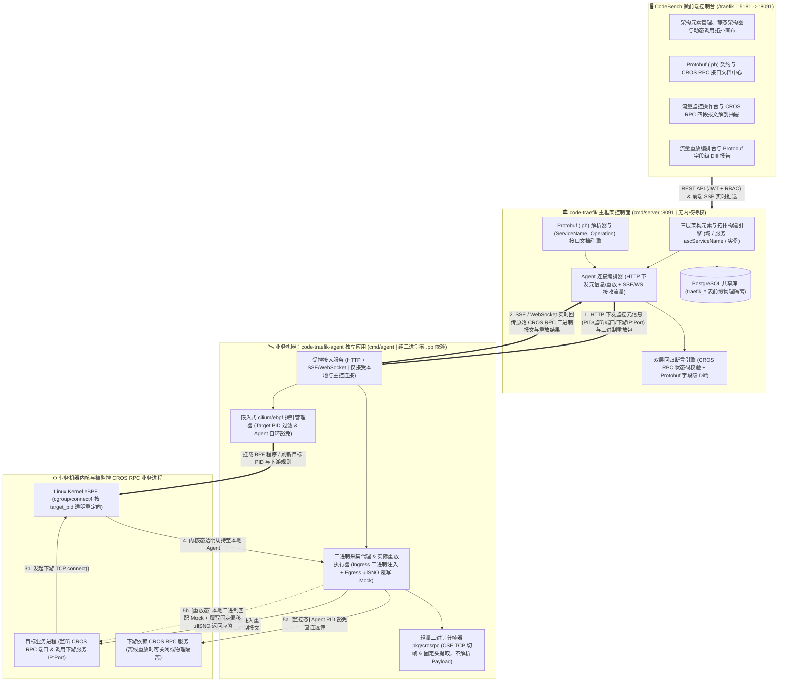

# 业务流量监控与重放 (`code-traefik`) 特性清单与需求范围界定规范 (Feature Matrix & Scope)

- **文档编号**：`01-feature-matrix.md`
- **文档版本**：v2.2.0
- **更新日期**：2026-10-28
- **当前阶段**：阶段一：特性清单与边界明确
- **状态**：定稿待审 (Ready for Review)

---

## 1. 系统愿景与产品定位 (Vision & Positioning)

### 1.1 项目愿景与整体构想
**业务流量监控与重放 (`code-traefik`)** 是挂载于 CodeBench 开发者综合工作台的核心业务子系统，**唯一且深度专精于业务实际使用的 DOPHI `CROS RPC` 网络通信协议**（由 `24B 公共消息头 RPC_COMM_HEAD_S` + `会话头 RPC_REQ/RSP/MNG_HEAD_S` + `0..N 段扩展消息头 Extend Head` + `序列化 Payload` 组成，不做任何其他无关协议扩展）。

为了解耦平台控制中心与业务运行机器的部署拓扑，并将内核特权与依赖收敛至最小边界，系统采用 **「控制面主框架 (`code-traefik-server`) + 独立纯二进制数据面代理 (`code-traefik-agent` / Sidecar)」同仓双二进制主从分离架构**：

1. **主框架控制面（`code-traefik`，保持在 `code-bench` 大家族内）**：
   - 作为全系统的统一操作入口与元数据大脑，提供微前端控制台（`/traefik`），独占管理**三层架构元素（子系统/域 -> 服务节点 [`ascServiceName`] -> 部署实例）** 与 **接口契约/文档（Protobuf `.pb` 描述集及 `(ascServiceName, ascOperation)` 接口映射）**，据此构建**静态系统架构图与动态服务调用拓扑**。
   - 承担**流量监控操作界面**、**Payload 明文解码**与**流量重放操作/回归报告界面**职责：主动连接本地或远端的 `Agent/Sidecar`，向其供给纯网络与进程级监控元信息（目标进程 PID/监听端口、下游依赖服务 `IP:Port` 列表等，**无需下发 `.pb`**），接收 Agent 收集的原始 CROS RPC 二进制报文完成 `.pb` 反序列化入库；重放时下发二进制重放任务包，并对回传的二进制应答执行协议头与 Protobuf 字段级双层 Diff 断言。
2. **流量监测与重放执行端（`code-traefik-agent` / Sidecar，独立纯二进制轻量应用）**：
   - 与主框架位于同一代码仓库（`cmd/agent`），编译为**零前端、零数据库、零 `.pb` Schema 依赖**的极简独立应用，直接运行在业务所在的机器上。
   - **受控连接边界**：仅接受来自本地（`127.0.0.1`）和远程 `code-traefik` 主控发起的 **HTTP + SSE / WebSocket** 连接（*第一阶段暂不实现动态 Token 鉴权，基于部署 IP 保密假设并辅以轻量源 IP 白名单校验；预留第二阶段 Token 授权机制*）。
   - **纯二进制收集与实际重放**：根据 `code-traefik` 供给的目标进程与端口元信息，通过内嵌 `cilium/ebpf` 探针在业务宿主机本地按 `PID` 实施零侵入拦截，仅依据 CROS RPC 24B 公共头完成流式切帧并将**完整原始二进制报文**收集上报给主控；收到模拟重放指令时，在本地**实际执行二进制请求注入、管理握手响应、下游依赖二进制匹配 Mock 以及固定偏移的请求序列号 `ullSNO` 自愈重写**。

### 1.2 核心价值主张 (Core Value Propositions)
1. **主从解耦与极简纯二进制 Agent（Zero Schema on Agent）**：同一代码仓构建 `code-traefik-server`（独占架构拓扑与 `.pb` 解码能力）与 `code-traefik-agent`（只收集与操作二进制数据，不感知业务 `.pb` 内容），既大幅降低业务机 CPU/内存开销，又彻底消除跨机同步 `.pb` 字典的耦合与一致性负担。
2. **100% 原生契合 `CROS RPC` 协议规范（零冗余协议扩展）**：严格遵循 CROS RPC 线性报文规范，原生解析 `"CSE.TCP" + ucProtocol` 魔术字、大端 `ullSNO` / `uiLength` / `usHeadLen` 分帧、多版本兼容会话头（自动提取目的服务名 `ascServiceName`、接口名 `ascOperation`、同步/异步/Oneway 类型、状态码 `uiStatusCode`/`ullStatusCode` 与三段收发时间戳）以及扩展头（`TraceID`/`SpanID`/`FatherSpanID` 调用链与服务端入队时间戳）。
3. **架构元素 + CROS RPC 原生寻址驱动的拓扑与接口文档**：天然打通静态架构模型（服务节点绑定 `ascServiceName`、接口文档绑定 `ascOperation` + `.pb`）与运行时 CROS RPC 报文头/DOTR Trace 扩展头，无需人工维护晦涩的数字操作码，即可自动生成可视化架构图、在线接口文档与实时调用拓扑。
4. **Agent 本地嵌入式 `cilium/ebpf` 引擎与防死锁自环豁免**：摒弃外部 Keploy 工具依赖，在 `Agent` 进程内直接挂载 `cilium/ebpf` 内核探针，按目标 `PID` 与下游 `IP:Port` 列表精准重定向连接，内置 `monitor_pid`（Agent 自身 PID）内核态自环豁免机制，彻底杜绝代理透传与重放死锁。
5. **Agent 纯二进制闭环重放与 `ullSNO` 偏移级自愈**：利用 CROS RPC 将所有每次运行变化的协议元数据集中在 `24 + usHeadLen` 之前的头部这一结构特性，Agent 在无需 `.pb` 的前提下直接通过会话头 `(ascServiceName, ascOperation)` + Payload 二进制切片（及录制调用次序）匹配 Mock，实时覆写应答公共头 Offset `8..15` 的 `ullSNO`，并由主控完成最终字段级回归 Diff 报告。

---

## 2. 系统目标拓扑与工作原理 (Target Architecture Overview)

---

## 3. 需求功能矩阵 (Feature Matrix)

特性优先级定义：
- **P0 (Must-Have)**：第一阶段核心基石特性，首期必须完整落地并具备 100% 自动化测试覆盖。
- **P1 (Should-Have)**：第二阶段规划特性（含 Agent Token 鉴权加固）与高阶增强能力。
- **P2 (Nice-to-Have)**：远期演进与大规模压测扩展特性。

---

### 3.1 架构元素建模、接口文档与可视化拓扑领域 (Architecture Elements, Interface Docs & Topology)

| 编号 | 特性名称 | 涉及组件 | 优先级 | 功能描述与技术规范 | TDD 验收指标 / 衡量标准 |
| :--- | :--- | :---: | :---: | :--- | :--- |
| **F-01** | **三层架构元素建模与上下游依赖管理 (`traefik_domains` / `traefik_services` / `traefik_instances`)** | `Server` `Frontend` `Models` | **P0** | 在 `code-traefik` 主框架建立完整的业务架构资产台账，采用三层粒度建模： 1. **子系统/域 (`traefik_domains`)**：划分业务领域、归属负责人与描述； 2. **服务节点 (`traefik_services` & `traefik_service_edges`)**：定义逻辑服务并与 CROS RPC 会话头中的 **`ascServiceName`（最大 64 字节目的服务名）** 绑定，维护关联 `.pb` 契约及**声明式上下游服务依赖关系**（无需任何冗余的多协议配置字段）； 3. **部署实例 (`traefik_instances`)**：绑定业务机器上的 `Agent` 接入地址（`host:port`）、目标进程定位策略（`PID` 或监听端口 `listen_port` / 进程名特征）及实例级下游真实 `IP:Port` 列表，支持 URL 分页与多维筛选。 | 1. 三层架构元素及上下游依赖边的 CRUD、`ascServiceName`/编码唯一性冲突拦截（`409`）、非法自依赖校验单测 100% 通过。 2. 删除仍绑定活跃监控实例的服务节点时安全拦截提示。 |
| **F-02** | **Protobuf (`.pb`) 契约注册与 CROS RPC 接口文档中心 (`traefik_proto_schemas`)** | `Server` `Frontend` `Models` | **P0** | 集中纳管 CROS RPC 接口层（`RPC_IDL_MSG_TYPE_PB`）使用的 Protobuf 编译描述集（`FileDescriptorSet` / `.pb`）并生成结构化接口文档： 1. 支持上传/更新 `.pb` 二进制描述文件（严格校验体积上限与 `protodesc` 结构合法性）； 2. **原生 `(ascServiceName, ascOperation)` 契约映射**：支持从 `.pb` 的 `ServiceDescriptor` / `MethodDescriptor` 自动推导或显式配置 **`(ascServiceName, ascOperation)` -> `(Req Message FullName, Rsp Message FullName)`** 映射表； 3. **结构化接口文档浏览**：自动反射提取服务接口列表、入参/出参 Message 嵌套树、字段名、Tag 编号、数据类型（含 `repeated`、`map`、`enum` 枚举值）及接口说明。 | 1. 上传合法 `.pb` 文件后，接口文档 API 准确返回按 `ascServiceName` / `ascOperation` 组织的接口清单与字段结构树；损坏或超限文件立即返回 `400`。 2. 未配置 `.pb` 或 `isPacked=0` 的报文在监控时自动保留完整 CROS RPC 头解析并降级展示 Payload Raw Hex，不中断链路。 |
| **F-03** | **可视化架构图与动态服务调用拓扑 (`Architecture & Call Topology`)** | `Server` `Frontend` | **P0** | 基于架构元素、接口契约与 CROS RPC 运行时报文构建双视角拓扑图： 1. **静态架构图**：根据子系统、服务节点（`ascServiceName`）、部署实例与依赖边生成可视化架构关系图，直观呈现监听端口、上下游依赖及接口数量； 2. **动态调用拓扑**：融合 Agent 实时捕获的 CROS RPC 报文头（`ascServiceName`、`ascOperation`、三段收发时间戳、`uiStatusCode`/`ullStatusCode`）与 DOTR 扩展头（`TraceID`/`SpanID`/`FatherSpanID`），在拓扑图上动态渲染调用流向、接口吞吐量、平均延迟、错误率及 Agent 在线状态，支持点击节点一键跳转接口文档、监控台或重放台。 | 1. 输入包含上中下游服务节点及 CROS RPC 录制流量的测试数据，拓扑接口准确聚合输出节点、有向调用边、延迟与错误率计数。 2. 拓扑画布严格使用 `--color-*` 语义 Token 适配亮/暗双模主题。 |

---

### 3.2 远程 Agent 管控信道与监控元信息供给领域 (Control-Agent Channel & Metadata Provisioning)

| 编号 | 特性名称 | 涉及组件 | 优先级 | 功能描述与技术规范 | TDD 验收指标 / 衡量标准 |
| :--- | :--- | :---: | :---: | :--- | :--- |
| **F-04** | **同仓独立 `Agent/Sidecar` 应用与 HTTP + SSE/WebSocket 受控信道** | `Server` `Agent` | **P0** | 同一代码仓库下提供 `cmd/server`（主控）与 `cmd/agent`（独立采集重放应用）双构建入口： 1. `Agent` 运行于业务机器，只接受来自本地（`127.0.0.1`）和远程 `code-traefik` 主控的连接； 2. **通信协议**：采用 **HTTP REST**（主控下发心跳探活、宿主机进程探查、监控元信息配置、重放任务启停）+ **SSE / WebSocket**（Agent 向主控实时流式推送捕获的 CROS RPC 报文事件与重放结果）； 3. **第一阶段连接控制**：首期暂不启用 Token 认证（视部署 IP 保密），内置轻量级源 IP 白名单中间件（`--allow-ips`，默认仅放行 `127.0.0.1` 及指定的 `code-traefik` 主机 IP），并在协议头预留鉴权扩展位（标注 `TODO(security)`）。 | 1. 本地集成单测中（强制监听 `127.0.0.1`），`Server` 通过 HTTP 下发指令并建立 SSE/WS 流，100% 实时接收 `Agent` 事件并支持断线状态感知。 2. 非白名单源 IP 请求访问 `Agent` 控制接口时返回 `403 Forbidden`。 |
| **F-05** | **架构驱动的监控元信息编排供给与目标进程动态定位** | `Server` `Agent` | **P0** | 当用户在主控侧对某服务实例开启监控时，`code-traefik` 自动从架构台账组装**纯网络与进程级监控元信息包 (`MonitorMetadataSpec`)** 供给目标 `Agent`： 1. **元信息内容**：目标进程 `PID`（或进程监听端口 `listen_port` / 进程名，由 Agent 在业务机本地扫描 `/proc` 自动反查实时 `PID`）、监听入口地址及下游依赖服务 `IP:Port` 列表（**Agent 仅收集原始二进制数据，无需下发 `.pb` 描述集与接口字典**）； 2. **远程进程探查与巡检**：支持主控请求 Agent 探查业务机器上的候选进程信息（`comm`、`cmdline`、监听端口与存活状态 `RUNNING`/`EXITED`）。 | 1. 主控下发包含监听端口与下游 `IP:Port` 列表的元信息后，Agent 准确解析出本机对应监听进程的真实 `PID` 并进入监控就绪态。 2. 目标进程退出或端口不存在时，Agent 向主控返回明确诊断状态码与可读原因。 |
| **F-06** | **Agent 远程连接 Token 授权安全加固（阶段二演进）** | `Server` `Agent` `Frontend` | **P1** | *（第一阶段暂不实现，列为阶段二演进）* 在 `code-traefik-agent` 中启用访问授权 Token 机制： 1. Agent 通过环境变量或安全配置加载高强度 Token（严禁代码硬编码）； 2. 主控纳管实例时配置对应凭据，所有 HTTP 控制指令与 SSE/WebSocket 握手均强制校验 `X-Traefik-Agent-Token`（常量时间比对 `subtle.ConstantTimeCompare`）。 | 启用 Token 开关后，未携带 Token 或携带错误 Token 的连接请求 100% 返回 `401 Unauthorized`。 |

---

### 3.3 Agent 嵌入式 eBPF 引擎与同仓共享 CROS RPC 协议栈领域 (Agent eBPF & CROS RPC Codec)

| 编号 | 特性名称 | 涉及组件 | 优先级 | 功能描述与技术规范 | TDD 验收指标 / 衡量标准 |
| :--- | :--- | :---: | :---: | :--- | :--- |
| **F-07** | **Agent 嵌入式 `cilium/ebpf` 按 PID 劫持与防死锁自环豁免** | `Agent` (`pkg/ebpf`) | **P0** | 在独立的 `code-traefik-agent` 进程内基于 `github.com/cilium/ebpf`（纯 Go BPF 汇编构建，零 Clang 依赖）挂载内核探针： 1. **精准匹配**：仅当发起网络连接的进程 `TGID (PID)` 命中监控元信息指定的 `target_pid`，且目标地址命中下游服务 `IP:Port` 列表时，才透明重定向至 Agent 本地代理；业务机上其他进程流量 100% 原样放行； 2. **Agent 自环豁免 (`monitor_pid`)**：将 `Agent` 自身 PID 写入 BPF Map，内核态识别 `current_tgid == monitor_pid` 时立即放行并递增 `stat_bypassed_self`，杜绝 Agent 透传下游或重放注入时自环死锁； 3. **双模自适应与退出自洁**：具备 `CAP_BPF`+`CAP_NET_ADMIN` 时运行于 `ebpf_kernel` 模式，无特权环境自动降级为 `userspace_proxy` 模式；监控停止或 Agent 退出时 100% 自动卸载内核钩子。 | 1. 业务机同时运行目标进程 `PID_A` 与无关进程 `PID_B`，仅 `PID_A` 发往下游端口的连接被重定向，`PID_B` 零干扰。 2. Agent 透传连接 `stat_bypassed_self` 准确累加；停止监控后确认 `Attached == false`。 |
| **F-08** | **`CROS RPC` 二进制分帧协议头库 (`pkg/crosrpc`) 与主控侧 Protobuf 解码器** | `Server` `Agent` (`pkg/crosrpc`) | **P0** | 严格遵循 `CROS RPC` 报文规范（唯一锁定该协议，不做其他协议扩展），按主从职责严格解耦分帧与解码： 1. **同仓共享纯二进制分帧与头解析库 (`pkg/crosrpc`，`Agent` 与 `Server` 共用，零 `.pb` 依赖)**：    - **24B 公共头 (`RPC_COMM_HEAD_S`) 分帧与重同步**：识别 8B `unMagicInfo`（7B `"CSE.TCP"` + 1B `ucProtocol`，支持流式前序脏字节逐字节扫描定位魔术字）；按大端序解析 `ullSNO (8B)`、`uiLength (4B, 不含公共头)`、`usHeadLen (2B, 会话头+扩展头总长)`、`ucMsgType (1B, [2, MNG_BUTT))`、`isPacked (1B)`；强制校验 `usHeadLen <= uiLength <= RPC_PAYLOAD_MAX_LEN (32MB-4KB) + usHeadLen` 及 `usHeadLen <= 65535`，彻底免疫 TCP 粘包与碎片半包，切出整包二进制字节流；    - **多版本兼容会话头 (`Session Head`) 与扩展头 (`Extend Head`) 解析**：遵循 `#pragma pack(4)` 与 `usHeadLen` 长度驱动的前/后向版本兼容机制，解析 `RPC_REQ_HEAD_S`（V00~V05：提取 `ascServiceName[64]`、`ascOperation[64]`、`ucReqType` 等）、`RPC_RSP_HEAD_S`（V00~V04：提取 `uiStatusCode`/`ullStatusCode`、三段收发时间戳、`usRspMsgNo`）、`RPC_MNG_HEAD_S`（`ucMsgType=5/6/7`）以及 `0~N` 段 `RPC_EXTEND_COMM_HEAD_S`（提取 `TraceID`/`SpanID`/`FatherSpanID` 与入队时间戳）； 2. **主控专属 Protobuf 动态编解码引擎 (`Server` 独占)**：仅在 `code-traefik-server` 内引入 `dynamicpb`，根据 `(ascServiceName, ascOperation)` 绑定的 `.pb` 描述集对偏移 `24 + usHeadLen` 之后的 Payload 二进制切片执行动态 JSON 解码与重编码。 | 1. 单测覆盖：含前序干扰字节的 `"CSE.TCP"` 魔术字扫描定位、1 Byte 碎片半包流、多包粘连流、V1 与 V5/V4 会话头兼容解析及扩展头解析；确认 `cmd/agent` 编译产物不依赖任何 `.pb` 注册表。 2. 非法 `ucMsgType` 或超限 `uiLength` / 畸形 `usHeadLen > uiLength` 报文 100% 安全拦截，零 panic / 零 OOM。 |

---

### 3.4 实时流量监测回传、Agent 实际重放与回归断言领域 (Traffic Monitoring, Agent Replay & Diff)

| 编号 | 特性名称 | 涉及组件 | 优先级 | 功能描述与技术规范 | TDD 验收指标 / 衡量标准 |
| :--- | :--- | :---: | :---: | :--- | :--- |
| **F-09** | **跨机 CROS RPC 二进制收集回传与主控解码落盘 (`traefik_traffic_records`)** | `Agent` `Server` `Models` | **P0** | 监控会话激活后： 1. `Agent` 仅按 CROS RPC 24B 公共头完成流式切帧，实时捕获目标进程的入站（`INGRESS`）与出站下游（`EGRESS`）**原始二进制报文**并通过 SSE/WebSocket 流式回传主控（Agent 不做任何 Payload 解码）； 2. **主控端解码与调用链关联**：主控解析三层协议头，同连接内按 **`ullSNO`** 精确配对 `REQ` 与 `RSP`（兼容 `ucReqType=3` Oneway 及 `RSP_SEG` 分片应答），利用扩展头 `TraceID`/`SpanID`/`FatherSpanID`（或活跃请求上下文）关联入站与 N 笔出站下游报文，并结合 `.pb` 字典将 Payload 反序列化为 **Protobuf JSON 明文**； 3. 在 `traefik_traffic_records` 中持久化完整头字段、Trace 三元组、Protobuf JSON 明文、Payload 二进制哈希及原始字节流。 | 1. 触发目标进程处理 CROS RPC 请求（含管理握手帧、同步下游调用及 Oneway 通知），Agent 收集的原始二进制帧 100% 回传主控、在主控端完成 `.pb` 解码并关联落库。 2. 支持按 `ascServiceName`、`ascOperation`、`ullSNO`、`TraceID`、状态码及关键词 URL 分页检索。 |
| **F-10** | **主控重放编排与 Agent 纯二进制实际重放 (`traefik_replay_tasks`)** | `Server` `Agent` `Frontend` | **P0** | 在**真实下游 CROS RPC 服务已关闭或物理隔离**的前提下，由主控编排二进制重放包、**`Agent` 在业务机本地实际执行重放**： 1. 主控将待重放的入站 CROS RPC **原始二进制请求报文**、关联的下游录制 **二进制 Mock 应答集合**（含必要的 `RPC_MNG_HEAD_S` 握手应答与业务 `RSP`/`RSP_SEG` 二进制帧）及目标监听端口下发给目标 `Agent`（无需下发 `.pb`）； 2. `Agent` 在业务机器本地向目标进程监听端口建立连接（自动完成必要的管理消息二进制握手）并写入重放请求字节流； 3. 当目标进程向下游 `IP:Port` 发起调用时，被 `Agent` 本地 eBPF/代理透明拦截并由本地二进制 Mock 引擎闭环应答； 4. `Agent` 收集目标进程返回的实际二进制应答报文（支持单包 `RSP` 或多段 `RSP_SEG`）与下游 Mock 命中明细原样回传主控。 | 在完全关闭模拟下游服务的情况下，通过主控触发重放任务，Agent 仅凭二进制重放包完成连接握手、请求注入与下游 Mock 拦截应答，命中率达 100%，目标进程正常返回业务应答。 |
| **F-11** | **Agent 零 `.pb` 二进制 Mock 匹配与固定偏移 `ullSNO` 自愈** | `Agent` (`pkg/replay`) | **P0** | 利用 CROS RPC **“所有协议层动态变化字段均位于 `24 + usHeadLen` 之前的头部，业务 Payload 位于 `24 + usHeadLen` 之后”** 的线性结构特征，使 Agent 在**完全不知晓 `.pb` 内容**的前提下实现智能 Mock 自愈： 1. **管理消息握手自动应答**：对目标进程连接下游初期发送的 `RPC_MNG_HEAD_S`（`ucMsgType=5/6/7` 鉴权/UUID 协商请求），自动匹配对应二进制管理应答并覆写匹配的 `ullSNO`； 2. **固定头寻址 + Payload 字节切片匹配**：提取下游请求会话头明文的 **`(ascServiceName, ascOperation)`** 与偏移 `24 + usHeadLen` 之后的 **Payload 原始二进制切片哈希** 匹配 Mock（天然跳过每次运行变化的公共头 `ullSNO`、会话头时间戳/UUID/幂等序号及扩展头动态 Trace/时间戳；若同一接口 Payload 含动态业务参数未精确命中，则按同接口录制调用次序兜底匹配）； 3. **固定偏移实时自愈重写**：命中二进制 Mock 应答帧后，Agent 直接在字节数组 Offset `8..15` 覆写当前下游请求的实际大端 **`ullSNO`**（并按固定偏移同步回填会话头 `aucTraceBuff` / `ullClientSendTime`）后写回目标进程 Socket。 | 即使目标进程在回放时生成全新的随机 `ullSNO`（如 `0x000000010009A2B3`）、新 TraceID 与新发送时间戳发起下游调用，Agent 在零 `.pb` 依赖下依然 100% 命中二进制 Mock 并返回携带一致 `ullSNO` 的应答帧，成功唤醒业务客户端。 |
| **F-12** | **CROS RPC 协议头级 + Protobuf 字段级双层回归 Diff 断言器** | `Server` `Frontend` | **P0** | 主控端收到 `Agent` 回传的重放实际应答报文（`Actual`）后，与录制基线报文（`Expected`）执行双层回归比对： 1. **第一层（CROS RPC 协议头与状态码校验）**：比对 `ucMsgType`、应答头返回码 `uiStatusCode` / `ullStatusCode`、分片序号 `usRspMsgNo`、`isPacked` 及 Payload 原始字节； 2. **第二层（Protobuf 语义字段级 Diff）**：当 Payload 字节存在差异时，自动反序列化为 JSON 结构树逐字段计算 `[]FieldDiff{FieldPath, ExpectedValue, ActualValue}`，自动豁免会话头/扩展头固有动态时间戳（`ullServerRecvTime`、`ullServerSendTime`、`ullServerEnqueueTime`）并支持配置忽略业务层动态字段。 | 当目标进程业务逻辑发生突变（如应答 `uiStatusCode` 变为非零错误码，或 Protobuf 字段 `discount_cents` 由 `6500` 变为 `6600`）时，重放报告精准判定 `FAILED` 并定位具体变异的头字段或 Protobuf 字段路径。 |

---

### 3.5 CodeBench 微前端操作界面与平台治理领域 (Portal Console, RBAC & Audit)

| 编号 | 特性名称 | 涉及组件 | 优先级 | 功能描述与技术规范 | TDD 验收指标 / 衡量标准 |
| :--- | :--- | :---: | :---: | :--- | :--- |
| **F-13** | **一体化微前端控制台（架构拓扑 / 接口文档 / CROS RPC 解剖台 / 重放台）** | `Frontend` `Server` | **P0** | 保持在 `code-bench` 微前端体系内（暴露 `./App` 与 `./menu`，兼容嵌入与独立双模运行），提供四大核心操作视图： 1. **架构与调用拓扑中心**：三层架构元素管理、服务架构图、基于 CROS RPC 流量的动态调用拓扑与 Agent 状态看板； 2. **CROS RPC 接口文档中心**：按 `ascServiceName` / `ascOperation` 检索 `.pb` 接口定义与 Message 字段树； 3. **流量监控台与 CROS RPC 四段报文解剖抽屉**：通过主控 `/api/events` SSE 实时展示监控流量，点击滑出右侧 `Drawer` 分段可视化呈现：**① 24B 公共头 (`RPC_COMM_HEAD_S` 偏移位图)**、**② 会话头 (`Req/Rsp/Mng` 字段明细与收发耗时拆解)**、**③ 扩展头 (`TraceID/SpanID/FatherSpanID` & 入队时间)**、**④ Protobuf JSON 明文与 16B 对齐 Raw Hex 对照**； 4. **流量重放操作台**：编排下发 Agent 重放任务，高亮展示协议头与 Protobuf 字段级回归 Diff。 | 1. 主控 `GET /api/health` 返回 `200 OK`；前端 `tsc --noEmit` 与 `eslint` 零警告通过。 2. 所有页面、拓扑画布与解剖抽屉 100% 使用 `theme.css` 的 `--color-*` 语义变量适配亮/暗双模主题，列表统一采用标准 5 页滑动窗口 URL 分页器。 |
| **F-14** | **多级 RBAC 权限守卫与全量字段级 Diff 操作审计** | `Server` `Frontend` | **P0** | 1. **RBAC 权限隔离**：集成 `commonAuth.AuthMiddleware` 与 `RequireAdmin("traefik_admin")`；普通认证用户可查看架构拓扑、查阅接口文档、观测流量及执行授权范围内的重放测试；架构元素增删改、Agent 实例配置与监控元信息下发、`.pb` 字典变更及全局设置（`/admin/settings`）仅限 `traefik_admin` 或 `super_admin` 操作； 2. **字段级操作审计**：主控侧所有写操作统一接入 `commonAudit.RecordDiff` 记录变更前后字段级 Diff。 | 1. 未认证请求返回 `401`；普通用户调用 `traefik_admin` 专属接口返回 `403 Forbidden`。 2. 修改架构元素、实例 Agent 配置或系统设置后，`audit_logs` 准确落盘字段级 Old/New Diff。 |

---

## 4. 核心业务验收场景矩阵 (Verification Scenarios)

为确保阶段四 TDD 测试先行具备清晰的端到端验收基线，定义以下 **7 大核心验收场景（`SC-01` ~ `SC-07`）**：

| 场景编号 | 场景名称 | 触发条件与输入特征 | 预期行为与 TDD 断言 |
| :--- | :--- | :--- | :--- |
| **SC-01** | **免密探针、未认证拦截与 RBAC 越权防护** | 1. 请求主控 `GET /api/health` 2. 无 JWT 请求受保护接口 3. 普通用户请求新增架构服务节点或修改 `.pb` 字典 | 1. 返回 `200 OK` 且 `service: "Code-Traefik"` 2. 返回 `401 Unauthorized` 3. 管理员守卫拦截返回 `403 Forbidden` |
| **SC-02** | **架构元素建模、`.pb` 接口文档解析与架构拓扑生成** | 管理员创建业务域与服务节点（绑定 `ascServiceName`），上传 `.pb` 描述文件映射 `ascOperation` 入参/出参 Message，绑定部署实例与 Agent 地址后查询拓扑与接口文档 | 成功返回按 `(ascServiceName, ascOperation)` 组织的结构化 Message 字段树；拓扑接口准确输出包含上下游有向依赖边的架构图数据，`RecordDiff` 记录创建审计 |
| **SC-03** | **主控连接 Agent 与纯网络/进程监控元信息下发** | 启动独立 `code-traefik-agent`（监听 `127.0.0.1`），主控从架构实例提取「目标进程/监听端口 + 下游 `IP:Port` 列表」（不下发 `.pb`）通过 HTTP 下发给 Agent 并建立 SSE/WS 流；同时模拟非白名单 IP 连接 Agent | 主控与 Agent 握手成功，Agent 准确加载监控元信息并定位目标进程 `PID`；非白名单源 IP 连接被 Agent 拒绝返回 `403` |
| **SC-04** | **`CROS RPC` 二进制流分帧、会话/扩展头解析与主控 `.pb` 解码** | 向共享 `pkg/crosrpc` 输入：带前序脏字节的 `"CSE.TCP"` 流、1 Byte 碎片半包流、多包粘连流、V1/V5 不同 `usHeadLen` 会话头、含 DOTR Trace 扩展头报文，以及 `usHeadLen > uiLength` 的畸形包 | `pkg/crosrpc` 在零 `.pb` 依赖下精准切出完整二进制包并提取 `ullSNO`、`ascServiceName`、`ascOperation`、`TraceID`，主控侧准确反序列化 Payload JSON；畸形报文被安全丢弃拦截 |
| **SC-05** | **Agent 嵌入式 eBPF 二进制收集、自环豁免与主控落库** | 激活实例监控，向目标业务进程发送 CROS RPC 请求（触发目标进程向下游发起 CROS RPC 调用） | Agent 收集入站与出站原始二进制报文并通过 SSE/WS 实时回传主控，主控完成 `.pb` 解码并按 `ullSNO` 与 `TraceID` 关联存入 `traefik_traffic_records`；Agent 自身透传连接被 `monitor_pid` 豁免 |
| **SC-06** | **主控编排二进制重放包、Agent 零 `.pb` 实际重放与 `ullSNO` 自愈** | 关闭真实下游依赖服务，在主控对录制记录发起重放任务（目标进程在回放时生成全新随机下游 `ullSNO` 与发送时间戳） | 主控下发纯二进制重放请求与 Mock 集合；Agent 在本地注入请求并拦截目标进程出站调用，按 `(ascServiceName, ascOperation)` + Payload 二进制切片命中 Mock，覆写应答头 Offset `8..15` 的 `ullSNO`，回放判定 `PASS` |
| **SC-07** | **目标进程业务逻辑突变与双层回归 Diff 检出** | 目标业务进程的应答状态码 `uiStatusCode` 异常或 Protobuf 计算结果发生突变（如折扣字段偏移），主控下发 Agent 执行重放验证 | Agent 回传实际应答报文后，主控双层断言器精准判定 `FAILED`，忽略固有的服务端收发时间戳差异，准确定位突变的状态码或具体 Protobuf 字段路径与期望/实际值 |

---

## 5. 非目标边界界定 (Non-Goals)

为了保持架构高内聚、职责纯粹并杜绝过度设计，明确**不做（Non-Goals）**以下内容：

- **Non-Goal 1（协议唯一性：仅支持 `CROS RPC` 协议，不做任何多协议扩展）**：业务数据面 100% 锁定公司实际使用的 **CROS RPC 协议**（`"CSE.TCP"` 24B 公共头 + Req/Rsp/Mng 会话头 + 扩展头 + Payload），**不设计可插拔的通用多协议扩展框架，不支持业务数据面的 HTTP/REST、标准 gRPC 或其他第三方私有协议**；在 CROS RPC 多通信底座中，聚焦经由内核 Socket 栈的流式底座（如 `TCP`、`Mesh`、`Domain` 明文流）与 Protobuf（`RPC_IDL_MSG_TYPE_PB`）载荷解码，不介入不经 Socket 的共享内存 `FRPC` 数据面。
- **Non-Goal 2（第一阶段暂不实现 Agent Token 鉴权体系）**：首期假设业务机器上 `Agent/Sidecar` 的部署 IP 保密，仅通过轻量源 IP 白名单限制只接受本地与指定 `code-traefik` 主控连接，暂不在第一阶段开发 Token 签发与握手鉴权（已列入第二阶段 `F-06 / P1`，代码预留 `TODO(security)`）。
- **Non-Goal 3（主控 `code-traefik-server` 不直接抓包或发重放包）**：主框架严格保持为无特权控制面与操作入口，不在 `code-traefik-server` 进程中挂载内核 eBPF 探针、不扫描主控本机业务 `/proc`、也不由主控跨网直接向业务进程发送 CROS RPC 重放报文——所有监测与重放执行均由独立的 `code-traefik-agent` 完成。
- **Non-Goal 4（彻底摒弃外部 Keploy 工具链与重复 Git Webhook 建设）**：不引入外部 Keploy 二进制；不重复建设代码仓 MR 接口变更 Webhook 追踪（该职责归属工作区既有的 `code-proto` 模块）。
- **Non-Goal 5（Agent 绝不直连数据库、不感知 `.pb` Schema，主控严守表前缀隔离）**：`code-traefik-agent` 保持纯无状态与零业务 Schema 感知（不连接 PostgreSQL、不持有任何数据库凭据、不接收或解析 `.pb` 文件，仅收集与重放原始二进制数据）；主控 `code-traefik-server` 在共享库中创建的所有业务表强制冠以 `traefik_` 前缀。
- **Non-Goal 6（不污染业务宿主机全局网络）**：Agent 内嵌 eBPF 探针严禁无差别劫持宿主机全局连接，严格限定在主控元信息指定的目标 `PID` 与下游 `IP:Port` 列表范围内。

---

## 6. 非功能性需求与安全防护红线 (NFR & Security Guardrails)

1. **CROS RPC 报文边界校验与防大包内存耗尽 (Wire Bounds & OOM Protection)**：
   - 分帧器严格执行 CROS RPC 长度契约校验：`usHeadLen <= 65535`、`ucMsgType ∈ [2, RPC_MSG_TYPE_MNG_BUTT)` 且 `usHeadLen <= uiLength <= RPC_PAYLOAD_MAX_LEN (32MB - 4096) + usHeadLen`（并支持配置采集缓冲单包保护阈值），遇到畸形长度字段立即丢弃并重置连接缓存，严防整数溢出或超大包 OOM；
   - 上传的 `.pb` 描述集文件强制实施体积上限（`<= 4MB`）与 `protodesc` 结构合法性校验；所有 API 入参执行严格白名单校验，强制使用 GORM 参数化查询，严禁任何 SQL 拼接或未校验系统命令调用。
2. **最小特权隔离与测试绑定安全 (Least Privilege & Safe Test Binding)**：
   - `code-traefik-server` 以普通非特权权限运行，严禁硬编码 JWT 密钥或凭据；仅 `code-traefik-agent` 按需使用 `CAP_BPF` / `CAP_NET_ADMIN`；
   - 在自动化单元测试与本地集成测试中，所有临时测试 Server、Mock Agent 与模拟 CROS RPC 业务端口**必须强制监听 `127.0.0.1`**（严禁在测试中监听 `0.0.0.0`）；对第一阶段暂缓的 Agent Token 鉴权能力保留显式 `TODO(security)` 标记。
3. **前端安全渲染与双模主题规范 (XSS Prevention & Theme Tokens)**：
   - 前端严格依赖 React JSX 原生自动转义（特别注意来自网络报文的 `ascServiceName`、`ascOperation`、`acProcName` 字符串均视为不可信外部输入），严禁使用 `dangerouslySetInnerHTML`、`innerHTML` 或原生 `alert()`/`confirm()`；
   - 所有界面、架构拓扑画布、接口文档树与 CROS RPC 四段报文解剖抽屉 100% 采用 `theme.css` 中的 `--color-*` 语义 Token 适配亮色（Light）与暗色（Dark）模式，严禁硬编码 `#fff`/`#000` 等绝对色值；分页列表统一采用 URL 状态同步的 5 页滑动窗口规范（`15/25/50/100`，默认 `25` 条/页）。
4. **并发安全与物理隔离数据库测试 (Concurrency & Isolated TestDB)**：
   - 主控与 Agent 之间的流式连接管理、SSE/WebSocket 广播中心及 BPF Map 读写必须并发安全，全量 Go 代码必须通过 `go test -race ./...`；
   - 所有涉及数据库读写的单元测试必须使用 `code-common/backend/testdb.SetupIsolatedDB(t)` 动态创建独立临时库并自动销毁，严禁指向生产或共享业务库。
5. **后台进程与内核探针卫生管理 (Process & Kernel Hygiene)**：
   - 在任何构建、单测或联调验证结束时，必须 100% 停止并释放拉起的后台进程（包括 `:8091` 主控、`:5181` 前端、临时测试 `Agent` 与模拟业务进程），并确保内核 eBPF 探针 100% 自动卸载，绝不残留端口占用或内核钩子。
