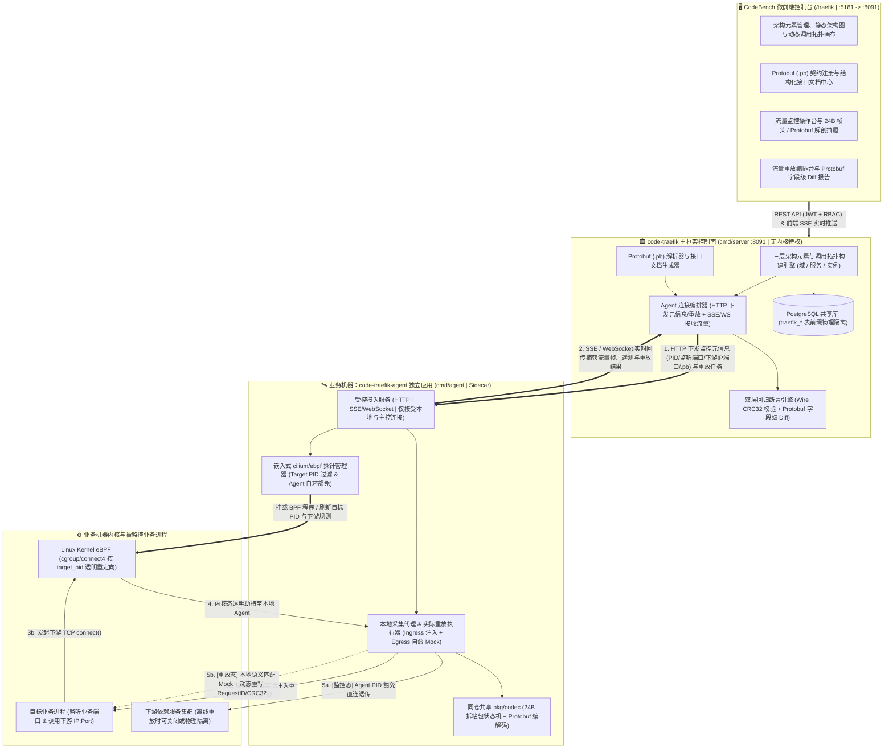

# 业务流量监控与重放 (`code-traefik`) 特性清单与需求范围界定规范 (Feature Matrix & Scope)

- **文档编号**：`01-feature-matrix.md`
- **文档版本**：v2.0.0
- **更新日期**：2026-10-28
- **当前阶段**：阶段一：特性清单与边界明确
- **状态**：定稿待审 (Ready for Review)

---

## 1. 系统愿景与产品定位 (Vision & Positioning)

### 1.1 项目愿景与整体构想
**业务流量监控与重放 (`code-traefik`)** 是挂载于 CodeBench 开发者综合工作台的核心业务子系统，专为采用 **私有二进制网络协议（原生 TCP + 自定义 24B 二进制帧头）+ Protobuf 字节码载荷** 的分布式业务系统打造。

为了彻底解耦控制中心与目标业务机器的物理部署耦合，并将内核高特权限制在最小边界内，系统采用 **「控制面主框架 (`code-traefik-server`) + 独立数据面代理 (`code-traefik-agent` / Sidecar)」同仓双二进制主从分离架构**：

1. **主框架控制面（`code-traefik`，保持在 `code-bench` 大家族内）**：
   - 作为全系统的统一操作入口与元数据大脑，提供微前端操作控制台（`/traefik`），集中管理**三层架构元素（子系统/域 -> 服务节点 -> 部署实例）**、**接口契约与结构化接口文档（Protobuf `.pb` 描述集与 `OpCode` 字典）**，据此构建**可视化架构图与动态服务调用拓扑**。
   - 同时承担**实时流量监控操作界面**与**流量重放编排/回归报告界面**职责：主动连接远端或本地的 `Agent/Sidecar`，向其供给监控所需的各类元信息（监控哪个进程、监听端口、下游服务 IP 与端口列表、关联 `.pb` 描述集等），下发重放指令，并对回传结果执行字段级 Diff 断言与审计落库。
2. **流量监测与重放执行端（`code-traefik-agent` / Sidecar，独立轻量应用）**：
   - 与主框架位于同一代码仓库（`cmd/agent`），编译为零前端、零数据库依赖的独立二进制，直接运行在目标业务所在的机器上。
   - **受控连接边界**：仅接受来自本地（`127.0.0.1`）和远程 `code-traefik` 主控发起的 **HTTP + SSE / WebSocket** 连接（*第一阶段暂不实现动态 Token 鉴权，基于部署 IP 保密假设并辅以基础源 IP 白名单校验；预留第二阶段 Token 授权机制*）。
   - **就近监测与实际重放**：根据 `code-traefik` 供给的监控元信息，通过内嵌原生 `cilium/ebpf` 内核探针在业务宿主机本地对目标进程实施零代码侵入的入站/出站流量监测；当收到模拟重放指令时，由 `Agent` 在业务机器本地**实际执行入站请求注入、出站下游透明劫持 Mock 以及动态 `RequestID` / `CRC32` 自愈重写**。

### 1.2 核心价值主张 (Core Value Propositions)
1. **主从解耦与同仓双产物协同（Monorepo Control + Agent）**：同一代码仓构建 `code-traefik-server`（无内核特权运行于平台侧）与 `code-traefik-agent`（按需特权运行于业务机侧），共享私有二进制协议与 Protobuf 编解码核心库（`pkg/codec`），实现“1 个控制中心跨机纳管 N 台业务宿主机”。
2. **架构元素与接口契约驱动的拓扑治理**：突破孤立抓包工具局限，在主框架沉淀「子系统/域 -> 服务节点 -> 部署实例」架构元素与 Protobuf `.pb` 接口文档，自动生成静态系统架构图，并融合 Agent 实时流量点亮动态调用拓扑，实现从“看架构/查接口”到“一键下发监控/重放”的无缝闭环。
3. **私有二进制协议 + Protobuf 字节码深度感知（Zero HTTP / Zero gRPC DataPlane）**：业务数据面原生解析 **24 字节定长大端二进制帧头（Magic / Version / OpCode / Flags / Status / RequestID / PayloadLen / CRC32）+ Protobuf 字节码载荷**，基于流式拆帧状态机彻底解决 TCP 粘包/半包，并将二进制载荷实时还原为结构化 JSON 明文与可视化接口文档。
4. **Agent 本地嵌入式 `cilium/ebpf` 引擎与防死锁自环豁免**：摒弃臃肿外部 Keploy 工具链，在 `Agent` 进程内直接挂载 `cilium/ebpf` 探针，按目标进程 `PID` 与下游 `IP:Port` 列表精准过滤劫持，内置 `monitor_pid`（Agent 自身 PID）内核态豁免机制，彻底杜绝代理透传与重放自环死锁。
5. **Agent 就近闭环重放与双层字段级回归 Diff**：重放阶段由业务机本地 `Agent` 实际注入请求并拦截下游调用，按 `OpCode` + Protobuf 业务语义匹配 Mock，实时重写动态 `RequestID` 与重算 `CRC32`；主控端汇总回传帧完成原始字节级与 Protobuf 字段级双层 Diff 断言，全面接入 CodeBench 微前端、RBAC 守卫与字段级审计。

---

## 2. 系统目标拓扑与工作原理 (Target Architecture Overview)

---

## 3. 需求功能矩阵 (Feature Matrix)

特性优先级定义：
- **P0 (Must-Have)**：第一阶段核心基石特性，首期必须完整落地并具备 100% 自动化测试覆盖。
- **P1 (Should-Have)**：第二阶段规划特性（含 Agent Token 鉴权加固）与高阶增强能力。
- **P2 (Nice-to-Have)**：远期演进与大规模压测扩展特性。

---

### 3.1 架构元素建模、接口文档与可视化拓扑领域 (Architecture Elements, Interface Docs & Topology)

| 编号 | 特性名称 | 涉及组件 | 优先级 | 功能描述与技术规范 | TDD 验收指标 / 衡量标准 |
| :--- | :--- | :---: | :---: | :--- | :--- |
| **F-01** | **三层架构元素建模与上下游依赖管理 (`traefik_domains` / `traefik_services` / `traefik_instances`)** | `Server` `Frontend` `Models` | **P0** | 在 `code-traefik` 主框架建立完整的业务架构资产台账，采用三层粒度建模： 1. **子系统/域 (`traefik_domains`)**：划分业务领域、负责人与描述； 2. **服务节点 (`traefik_services` & `traefik_service_edges`)**：定义逻辑服务编码、私有协议帧参数（如 `Magic`、`Version`）、关联接口契约（`.pb`）及**声明式上下游服务依赖关系**； 3. **部署实例 (`traefik_instances`)**：绑定运行机器上的 `Agent` 接入地址（`host:port`）、目标进程定位策略（`PID` 或监听端口 `listen_port` / 进程名特征）及实例级下游真实 `IP:Port` 列表，支持 URL 分页与多维筛选。 | 1. 三层架构元素及上下游依赖边的 CRUD、唯一编码冲突拦截（`409`）、环形或非法自依赖校验单测 100% 通过。 2. 删除仍绑定活跃监控实例的服务节点时安全拦截提示。 |
| **F-02** | **Protobuf (`.pb`) 契约注册与结构化接口文档中心 (`traefik_proto_schemas`)** | `Server` `Frontend` `Models` | **P0** | 集中纳管私有协议中的 Protobuf 编译描述集（`FileDescriptorSet` / `.pb`）并生成可读接口文档： 1. 支持上传/更新 `.pb` 二进制描述文件（严格校验体积上限与 `protodesc` 结构合法性），绑定所属服务节点及 **`OpCode` -> `Protobuf Message FullName`** 映射字典（区分 `INGRESS_REQ`、`INGRESS_RESP`、`EGRESS_REQ`、`EGRESS_RESP`）； 2. **结构化接口文档视图**：自动反射提取 Package、Message 嵌套树、字段名、Tag 编号、数据类型（含 `repeated`、`map`、`enum` 枚举项）并支持维护接口业务说明，供研发在线查阅接口契约。 | 1. 上传合法 `.pb` 文件后，接口文档 API 能完整返回结构化 Message 字段树与 `OpCode` 接口清单；上传损坏或超限文件立即返回 `400`。 2. 未配置 Schema 的未知 `OpCode` 在监控时平滑降级展示 Raw Hex，不中断链路。 |
| **F-03** | **可视化架构图与动态服务调用拓扑 (`Architecture & Call Topology`)** | `Server` `Frontend` | **P0** | 基于架构元素、接口信息与实时监控数据构建双视角拓扑图： 1. **静态架构图**：根据子系统、服务节点、部署实例与依赖边自动计算生成架构关系图，直观呈现各服务监听端口、上下游连接关系及绑定的 `.pb` 接口数量； 2. **动态调用拓扑**：叠加各实例 Agent 上报的实时流量统计（入/出站帧计数、调用延迟、异常状态、Agent 在线状态），支持在拓扑节点上直接选中实例一键跳转接口文档、开启流量监控或发起重放。 | 1. 给定包含上中下游 3 个服务节点及录制流量的测试数据集，拓扑聚合接口准确返回节点列表、有向调用边及实时统计计数。 2. 拓扑画布严格使用 `--color-*` 语义 Token 适配亮/暗双模主题。 |

---

### 3.2 远程 Agent 管控信道与监控元信息供给领域 (Control-Agent Channel & Metadata Provisioning)

| 编号 | 特性名称 | 涉及组件 | 优先级 | 功能描述与技术规范 | TDD 验收指标 / 衡量标准 |
| :--- | :--- | :---: | :---: | :--- | :--- |
| **F-04** | **同仓独立 `Agent/Sidecar` 应用与 HTTP + SSE/WebSocket 受控信道** | `Server` `Agent` | **P0** | 同一代码仓库下提供 `cmd/server`（主控）与 `cmd/agent`（独立采集重放应用）双构建目标： 1. `Agent` 运行于业务机器，只接受来自本地（`127.0.0.1`）和远程 `code-traefik` 主控的连接； 2. **通信协议**：采用 **HTTP REST**（接收主控心跳探活、进程探查、元信息下发、重放任务启停）+ **SSE / WebSocket**（向主控实时流式推送捕获帧事件与重放结果）； 3. **第一阶段连接控制**：首期暂不启用 Token 认证（视部署 IP 保密），内置轻量级源 IP 白名单中间件（`--allow-ips`，默认仅放行 `127.0.0.1` 及指定的 `code-traefik` 主机 IP），并在请求头预留鉴权扩展位（标注 `TODO(security)`）。 | 1. 本地联调单测中（强制绑定 `127.0.0.1`），`Server` 通过 HTTP 下发指令并建立 SSE/WS 流，100% 实时接收 `Agent` 事件并支持断线重连状态感知。 2. 非白名单源 IP 模拟请求访问 `Agent` 接口时返回 `403 Forbidden`。 |
| **F-05** | **架构驱动的监控元信息编排供给与目标进程动态定位** | `Server` `Agent` | **P0** | 当用户在主控侧对某服务实例开启监控时，`code-traefik` 自动从架构台账组装**监控元信息包 (`MonitorMetadataSpec`)** 供给目标 `Agent`： 1. **元信息内容**：目标进程 `PID`（或进程监听端口 `listen_port` / 进程名，由 Agent 在业务机本地扫描 `/proc` 自动反查实时 `PID`）、监听入口地址、下游依赖服务 `IP:Port` 列表、协议帧头魔数及关联 `.pb` 描述集字节码； 2. **远程进程探查与巡检**：支持主控请求 Agent 探查目标业务机器上的候选进程信息（`comm`、`cmdline`、监听端口与存活状态 `RUNNING`/`EXITED`）。 | 1. 主控下发包含监听端口与下游 `IP:Port` 列表的元信息后，Agent 能准确解析出本机对应监听进程的真实 `PID` 并进入监控就绪态。 2. 目标进程退出或端口不存在时，Agent 向主控返回明确诊断状态码与可读原因。 |
| **F-06** | **Agent 远程连接 Token 授权安全加固（阶段二演进）** | `Server` `Agent` `Frontend` | **P1** | *（第一阶段暂不实现，列为阶段二演进）* 在 `code-traefik-agent` 中引入访问授权 Token 机制： 1. Agent 通过环境变量或安全配置加载高强度 Token（严禁代码硬编码）； 2. 主控纳管实例时配置对应凭据，所有 HTTP 控制指令与 SSE/WebSocket 握手均强制校验 `X-Traefik-Agent-Token`（常量时间比对 `subtle.ConstantTimeCompare`），防止内网 IP 暴露后的未授权控制。 | 启用 Token 开关后，未携带 Token 或携带错误 Token 的连接请求 100% 返回 `401 Unauthorized`。 |

---

### 3.3 Agent 嵌入式 eBPF 引擎与同仓共享私有协议栈领域 (Agent eBPF & Shared Wire Codec)

| 编号 | 特性名称 | 涉及组件 | 优先级 | 功能描述与技术规范 | TDD 验收指标 / 衡量标准 |
| :--- | :--- | :---: | :---: | :--- | :--- |
| **F-07** | **Agent 嵌入式 `cilium/ebpf` 按 PID 劫持与防死锁自环豁免** | `Agent` (`pkg/ebpf`) | **P0** | 在独立的 `code-traefik-agent` 进程内基于 `github.com/cilium/ebpf`（纯 Go BPF 汇编构建，零 Clang 依赖）挂载内核探针： 1. **精准匹配**：仅当发起网络连接的进程 `TGID (PID)` 命中监控元信息指定的 `target_pid`，且目标地址命中下游服务 `IP:Port` 列表时，才透明重定向至 Agent 本地代理；业务机上其他进程流量 100% 原样放行； 2. **Agent 自环豁免 (`monitor_pid`)**：将 `Agent` 自身 PID 写入 BPF Map，内核态识别 `current_tgid == monitor_pid` 时立即放行并递增 `stat_bypassed_self`，杜绝 Agent 透传下游或重放注入时自环死锁； 3. **双模自适应与退出自洁**：有 `CAP_BPF`+`CAP_NET_ADMIN` 时运行于 `ebpf_kernel` 模式，无特权环境自动降级为 `userspace_proxy` 模式；监控停止或 Agent 退出时 100% 自动卸载内核钩子。 | 1. 业务机同时运行目标进程 `PID_A` 与无关进程 `PID_B`，仅 `PID_A` 发往下游端口的连接被重定向，`PID_B` 零干扰。 2. Agent 透传连接 `stat_bypassed_self` 准确累加；停止监控后确认 `Attached == false`。 |
| **F-08** | **同仓共享 24B 定长二进制帧拆粘包与确定性 Protobuf 编解码 (`pkg/codec`)** | `Server` `Agent` (`pkg/codec`) | **P0** | 主控与 Agent 共享 `pkg/codec` 核心协议栈，原生支持大端序（`binary.BigEndian`）**24 字节定长私有二进制帧头 + Protobuf 载荷**： - 帧头布局：`Magic(2B, 默认0xFB01)` / `Version(1B)` / `OpCode(1B)` / `Flags(1B)` / `Status(1B)` / `Reserved(2B)` / `RequestID(8B)` / `PayloadLen(4B, <=4MB)` / `CRC32(4B)`； - **流式拆粘包状态机**：基于 `io.ReadFull` 两阶段定长读取，彻底免疫 TCP 粘包（单次 Read 多帧）与碎片半包； - **确定性序列化**：封装 `proto.MarshalOptions{Deterministic: true}` 与单次原子写帧，确保含 `map` 字段消息的字节流与 `CRC32` 100% 确定一致。 | 1. 单测输入 1 Byte 逐字节碎片流与 10 帧粘连合包流，拆帧器 100% 准确还原独立业务帧。 2. 篡改任意 1 bit 载荷立即返回 `ErrChecksumMismatch`；超 `4MB` 畸形包立即阻断防 OOM；含 `map` 消息连续编码 1,000 次 `CRC32` 完全一致。 |

---

### 3.4 实时流量监测回传、Agent 实际重放与回归断言领域 (Traffic Monitoring, Agent Replay & Diff)

| 编号 | 特性名称 | 涉及组件 | 优先级 | 功能描述与技术规范 | TDD 验收指标 / 衡量标准 |
| :--- | :--- | :---: | :---: | :--- | :--- |
| **F-09** | **跨机全链路流量监测回传与结构化落盘 (`traefik_traffic_records`)** | `Agent` `Server` `Models` | **P0** | 监控会话（`MONITOR/RECORD` 模式）激活后： 1. `Agent` 实时捕获目标进程的入站请求/响应帧（`INGRESS`）与出站下游调用/响应帧（`EGRESS`），通过 SSE/WebSocket 流式回传至 `code-traefik` 主控； 2. 主控按 `RequestID` 关联同一调用链路的入站与出站报文，结合服务架构元素与 `.pb` 字典反序列化为 **Protobuf JSON 明文**，连同 24B 帧头全字段、语义签名（`semantic_hash`）、原始十六进制字节流（`raw_wire_hex`）及耗时落盘至 `traefik_traffic_records`。 | 1. 触发目标进程处理含下游调用的私有协议请求，Agent 捕获的入站与出站帧 100% 实时回传至主控、完成 `.pb` 解码并关联落库。 2. 支持按服务节点、实例、`OpCode`、`RequestID` 及关键词 URL 分页检索。 |
| **F-10** | **主控重放编排与 Agent 本地闭环实际重放 (`traefik_replay_tasks`)** | `Server` `Agent` `Frontend` | **P0** | 在**真实下游服务关闭或物理隔离**的场景下，由主控发起指令、**`Agent` 在业务机本地实际执行重放**： 1. 主控将选定的录制入站请求帧（`INGRESS_REQ`）、关联的下游录制 Mock 集、目标端口与关联 `.pb` 打包下发至目标机器 `Agent`； 2. `Agent` 实际向本机目标业务进程监听端口发送重放请求帧； 3. 目标进程向下游 `IP:Port` 发起调用时，被 `Agent` 本地 eBPF/代理透明拦截并由本地 Mock 引擎直接响应； 4. `Agent` 捕获目标进程最终响应帧及 Mock 命中轨迹并回传主控。 | 在完全关闭模拟下游服务的前提下，通过主控 API 触发远程/本地 Agent 重放任务，Agent 本地入站注入与出站 Mock 命中率达 100%，目标进程完整返回业务响应。 |
| **F-11** | **Agent 本地智能语义 Mock 匹配、动态 `RequestID` 重写与 `CRC32` 自愈** | `Agent` (`pkg/replay`) | **P0** | 解决私有二进制协议回放时每次运行生成动态 `RequestID` 导致静态字节匹配失效的问题： 1. **语义归一化匹配**：Agent 本地 Mock 引擎提取目标进程发出的下游请求 `OpCode` 与反序列化后的 Protobuf 业务字段计算语义签名匹配 Mock（自动忽略帧头动态变化的 `RequestID` 与 `Flags`）； 2. **本地实时帧自愈**：命中 Mock 响应模板后，Agent 即刻将响应帧头 Offset `8..15` 的 `RequestID` 重写为当前下游请求的实际 `RequestID`，重算 Offset `20..23` 的 `CRC32` 校验码后写回目标进程 Socket。 | 目标进程在回放时生成全新随机 `RequestID`（如 `88099`）发起下游请求，Agent 本地 Mock 100% 语义命中并返回携带 `RequestID=88099` 及合法 `CRC32` 的二进制响应帧。 |
| **F-12** | **原始字节级 + Protobuf 字段级双层回归 Diff 断言器** | `Server` `Frontend` | **P0** | 主控端收到 `Agent` 回传的重放实际响应帧（`Actual`）后，与录制基线帧（`Expected`）执行双层比对： 1. **第一层（Wire & CRC32 校验）**：比对帧头 `Status`、`PayloadLen`、`CRC32` 与原始字节流； 2. **第二层（Protobuf 字段级 Diff）**：存在差异时自动将基线帧与实际帧反序列化为 JSON 结构树，逐字段输出 `[]FieldDiff{FieldPath, ExpectedValue, ActualValue}`，支持配置忽略动态时间戳等非确定性字段。 | 当目标业务进程计价逻辑发生突变（如 `discount_cents` 由 `6500` 变为 `6600`）时，主控重放报告精准判定用例 `FAILED` 并定位偏移的具体 Protobuf 字段路径与期望/实际值。 |

---

### 3.5 CodeBench 微前端操作界面与平台治理领域 (Portal Console, RBAC & Audit)

| 编号 | 特性名称 | 涉及组件 | 优先级 | 功能描述与技术规范 | TDD 验收指标 / 衡量标准 |
| :--- | :--- | :---: | :---: | :--- | :--- |
| **F-13** | **一体化微前端控制台（架构拓扑 / 接口文档 / 流量监控 / 重放台）** | `Frontend` `Server` | **P0** | 保持在 `code-bench` 微前端体系内（暴露 `./App` 与 `./menu`，兼容嵌入与独立双模运行），提供四大核心视图： 1. **架构与调用拓扑中心**：三层架构元素管理、服务架构图、动态调用拓扑与 Agent 在线状态看板； 2. **接口文档中心**：按服务浏览 `.pb` 接口定义、`OpCode` 映射与 Message 字段结构； 3. **流量监控操作台与 24B 帧解剖抽屉**：通过主控 `/api/events` SSE 实时展示监控流量，点击滑出右侧 `Drawer` 色块化呈现 Offset `0..23` 帧头解剖图、Protobuf JSON 明文与 16B 对齐 Raw Hex； 4. **流量重放操作台**：批量/单笔编排重放任务、查看 Mock 命中明细与字段级高亮 Diff 对比视图。 | 1. 主控 `GET /api/health` 返回 `200 OK`；前端 `tsc --noEmit` 与 `eslint` 零警告通过。 2. 所有页面、拓扑画布与抽屉 100% 使用 `theme.css` 的 `--color-*` 语义变量适配亮/暗双模主题，列表遵循标准 5 页滑动窗口 URL 分页器。 |
| **F-14** | **多级 RBAC 权限守卫与全量字段级 Diff 操作审计** | `Server` `Frontend` | **P0** | 1. **RBAC 权限隔离**：集成 `commonAuth.AuthMiddleware` 与 `RequireAdmin("traefik_admin")`；普通认证用户可查看架构拓扑、查阅接口文档、观测流量及执行授权范围内的重放测试；架构元素增删改、Agent 连接配置与监控元信息下发、`.pb` 字典变更及全局设置（`/admin/settings`）仅限 `traefik_admin` 或 `super_admin` 操作； 2. **字段级操作审计**：主控侧所有写操作统一接入 `commonAudit.RecordDiff` 记录变更前后字段级 Diff。 | 1. 未认证请求返回 `401`；普通用户调用 `traefik_admin` 专属接口返回 `403 Forbidden`。 2. 修改架构元素、实例 Agent 配置或系统设置后，`audit_logs` 准确落盘字段级 Old/New Diff。 |

---

## 4. 核心业务验收场景矩阵 (Verification Scenarios)

为确保阶段四 TDD 测试先行具备清晰的端到端验收基线，定义以下 **7 大核心验收场景（`SC-01` ~ `SC-07`）**：

| 场景编号 | 场景名称 | 触发条件与输入特征 | 预期行为与 TDD 断言 |
| :--- | :--- | :--- | :--- |
| **SC-01** | **免密探针、未认证拦截与 RBAC 越权防护** | 1. 请求主控 `GET /api/health` 2. 无 JWT 请求受保护接口 3. 普通用户请求新增架构服务节点或修改 `.pb` 字典 | 1. 返回 `200 OK` 且 `service: "Code-Traefik"` 2. 返回 `401 Unauthorized` 3. 管理员守卫拦截返回 `403 Forbidden` |
| **SC-02** | **架构元素建模、`.pb` 接口文档解析与架构拓扑生成** | 管理员创建业务域与上下游服务节点，上传业务 `.pb` 描述文件并配置 `OpCode` 映射，绑定部署实例与 Agent 地址后请求拓扑与接口文档 API | 成功解析返回结构化 Message 字段文档树；拓扑接口准确输出包含上下游有向依赖边的架构图节点与连线数据，`RecordDiff` 记录创建审计 |
| **SC-03** | **主控连接 Agent 与监控元信息供给下发** | 启动独立 `code-traefik-agent`（绑定 `127.0.0.1`），主控从架构实例提取「目标进程/监听端口 + 下游 IP:Port 列表 + `.pb`」通过 HTTP 下发给 Agent 并建立 SSE/WS 流；同时模拟非白名单 IP 连接 Agent | 主控与 Agent 握手成功，Agent 准确加载监控元信息并定位目标进程 `PID`；非白名单源 IP 连接被 Agent 拒绝返回 `403` |
| **SC-04** | **私有 24B 帧拆粘包与确定性 Protobuf 编解码 (`pkg/codec`)** | 向共享 `pkg/codec` 输入单字节碎片流、多帧粘连流、含 `map` 字段消息及篡改 1 bit 的损坏帧 | 碎片流与粘包流 100% 拆出独立 24B 帧并动态反序列化为 JSON 明文；篡改帧立即触发 `ErrChecksumMismatch` |
| **SC-05** | **Agent 嵌入式 eBPF 流量监测、自环豁免与实时回传落库** | 激活实例监控，向目标业务进程发送私有二进制请求（触发目标进程调用下游服务） | Agent 捕获入站与出站二进制帧并通过 SSE/WS 流式回传主控，主控解码关联存入 `traefik_traffic_records`；Agent 自身透传连接被 `monitor_pid` 豁免，零死锁回环 |
| **SC-06** | **主控编排下发、Agent 本地实际重放与无下游自愈** | 关闭真实下游依赖服务，在主控对录制记录发起重放任务（目标进程在回放时生成全新随机下游 `RequestID`） | 主控将重放包下发 Agent；Agent 在本地注入请求并拦截目标进程出站调用，语义匹配 Mock 后动态重写 `RequestID` 与 `CRC32`，将最终响应回传主控，判定 `PASS` |
| **SC-07** | **目标进程业务逻辑突变与 Protobuf 字段级 Diff 检出** | 目标业务进程的计算逻辑发生回归突变（如折扣金额多减 100 分），主控下发 Agent 执行重放验证 | Agent 回传实际响应帧后，主控双层断言器精准判定 `FAILED`，并输出结构化字段级 Diff（定位 `discount_cents: expected 6500, actual 6600`），配置的动态时间戳字段可按规则豁免 |

---

## 5. 非目标边界界定 (Non-Goals)

为了保持架构高内聚、职责清晰并严格控制首期范围，明确**不做（Non-Goals）**以下内容：

- **Non-Goal 1（第一阶段暂不实现 Agent Token 鉴权体系）**：首期假设业务机器上 `Agent/Sidecar` 的部署 IP 保密，仅通过轻量源 IP 白名单限制只接受本地与指定 `code-traefik` 主控连接，暂不在第一阶段开发 Token 签发、轮换与握手鉴权（该特性已列入第二阶段 `F-06 / P1`，代码预留 `TODO(security)`）。
- **Non-Goal 2（主控 `code-traefik-server` 不直接抓包或发重放包）**：主框架严格保持为无特权控制面与操作入口，不在 `code-traefik-server` 进程中挂载内核 eBPF 探针、不扫描主控本机业务 `/proc`、也不由主控跨网直接向业务进程打重放流量——所有监测与重放执行均由独立的 `code-traefik-agent` 完成。
- **Non-Goal 3（彻底摒弃外部 Keploy 工具链）**：不引入、不包装外部 Keploy 二进制，所有内核态拦截、24B 拆帧与自愈 Mock 均由同仓 `code-traefik-agent` 内嵌 `cilium/ebpf` 与 Go 协议引擎原生实现。
- **Non-Goal 4（业务数据面不妥协为 HTTP/gRPC，不重复建设 Git Webhook）**：被监控业务进程间的数据面严格聚焦**原生 TCP + 24B 私有二进制帧 + Protobuf 载荷**（仅主控与 Agent 之间的管理通道使用 HTTP + SSE/WebSocket）；同时不重复建设代码仓 MR 接口变更 Webhook 追踪（该职责归属工作区既有的 `code-proto` 模块）。
- **Non-Goal 5（Agent 绝不直连数据库，主控严守表前缀隔离）**：`code-traefik-agent` 保持纯无状态运行，不连接 PostgreSQL、不持有任何数据库凭据；主控 `code-traefik-server` 在共享库中创建的所有业务表强制冠以 `traefik_` 前缀，复用平台公共认证与部门体系。
- **Non-Goal 6（不污染业务宿主机全局网络）**：Agent 内嵌 eBPF 探针严禁无差别劫持宿主机全局连接（如 SSH、DNS、数据库或非目标进程流量），严格限定在主控元信息指定的目标 `PID` 与下游 `IP:Port` 列表内。

---

## 6. 非功能性需求与安全防护红线 (NFR & Security Guardrails)

1. **输入白名单校验与防大包内存耗尽 (Input Validation & OOM Protection)**：
   - 私有二进制帧拆包器强制校验 `PayloadLen <= MaxPayloadSize (默认 4MB)`，遇到畸形超大帧或非法 `Magic` 立即阻断连接；
   - 上传的 `.pb` 描述集文件强制实施体积上限（`<= 2MB`）与 `protodesc` 结构合法性解析校验；所有 API 入参（IP、端口、枚举状态、分页参数）执行严格白名单校验，严禁任何 SQL 字符串拼接（强制使用 GORM 参数化查询）或未经校验的系统命令调用。
2. **最小特权隔离与测试绑定安全 (Least Privilege & Safe Test Binding)**：
   - `code-traefik-server` 以普通非特权权限运行，严禁硬编码 JWT 密钥或凭据；仅 `code-traefik-agent` 按需使用 `CAP_BPF` / `CAP_NET_ADMIN`；
   - 在自动化单元测试与本地集成测试中，所有临时测试 Server、Mock Agent 与模拟业务端口**必须强制监听 `127.0.0.1`**（严禁在测试中监听 `0.0.0.0`）；对第一阶段暂缓的 Agent Token 鉴权能力，在设计文档与协议实现处保留显式 `TODO(security)` 标记。
3. **前端安全渲染与双模主题规范 (XSS Prevention & Theme Tokens)**：
   - 前端严格依赖 React JSX 原生自动转义，严禁使用 `dangerouslySetInnerHTML`、`innerHTML` 或原生阻塞式 `alert()`/`confirm()`，严禁在控制台打印含 Token 或敏感凭据的对象；
   - 所有界面、架构拓扑画布、接口文档树与抽屉组件 100% 采用 `theme.css` 中的 `--color-*` 语义 Token 适配亮色（Light）与暗色（Dark）模式，严禁硬编码 `#fff`/`#000` 等绝对色值；分页列表统一采用 URL 状态同步的 5 页滑动窗口规范（`15/25/50/100`，默认 `25` 条/页）。
4. **并发安全与物理隔离数据库测试 (Concurrency & Isolated TestDB)**：
   - 主控与 Agent 之间的流式连接管理、SSE/WebSocket 广播中心及 BPF Map 读写必须并发安全，全量 Go 代码必须通过 `go test -race ./...`；
   - 所有涉及数据库读写的单元测试必须使用 `code-common/backend/testdb.SetupIsolatedDB(t)` 动态创建独立临时库并自动销毁，严禁指向生产或共享业务库。
5. **后台进程与内核探针卫生管理 (Process & Kernel Hygiene)**：
   - 在任何构建、单测或联调验证结束时，必须 100% 停止并释放拉起的后台进程（包括 `:8091` 主控、`:5181` 前端、临时测试 `Agent` 与模拟业务进程），并确保内核 eBPF 探针 100% 自动卸载，绝不残留端口占用或内核钩子。
