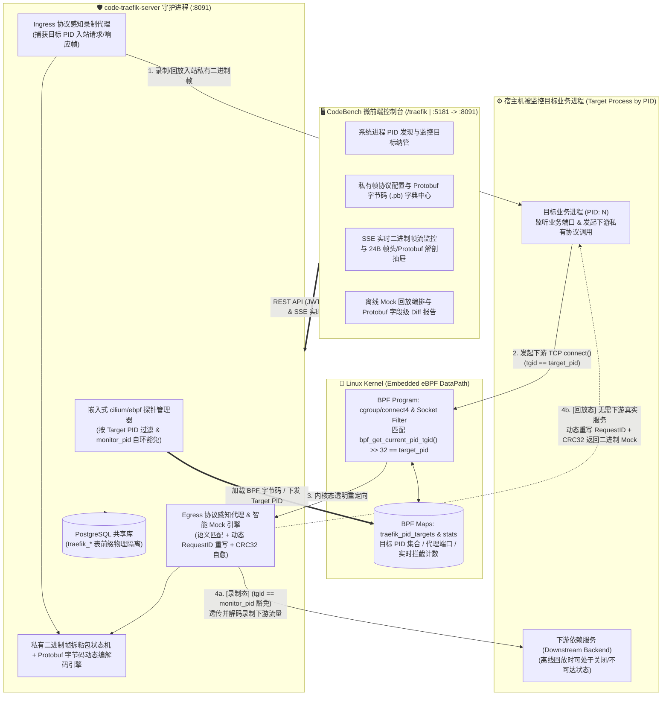

# 业务流量监控与重放 (`code-traefik`) 特性清单与需求范围界定规范 (Feature Matrix & Scope)

- **文档编号**：`01-feature-matrix.md`
- **文档版本**：v1.0.0
- **编制日期**：2026-10-27
- **当前阶段**：阶段一：特性清单与边界明确
- **状态**：定稿待审 (Ready for Review)

---

## 1. 系统愿景与产品定位 (Vision & Positioning)

### 1.1 项目愿景
**业务流量监控与重放 (`code-traefik`)** 是挂载于 CodeBench 开发者综合工作台的核心业务子系统。本项目专为采用 **私有二进制网络协议（Raw TCP + 自定义二进制帧头）+ Protobuf 字节码载荷** 的高性能业务服务打造，通过 **内嵌式原生 eBPF (`cilium/ebpf`) 内核探针**，对宿主机上 **按系统 PID 指定的目标业务进程** 进行零代码侵入的入站/出站流量监控、协议感知录制、下游依赖透明劫持 Mock 以及字段级回归回放验证。

在金融交易核心、高性能网关、工业控制及存量企业私有 RPC 体系中，服务间通信普遍直接基于原生 TCP Socket 传输自定义二进制帧与 Protobuf 序列化字节流（非 HTTP、非 gRPC）。通用开源工具（如 Keploy 等）受限于 HTTP 协议假设与静态盲字节流切片，无法解析私有二进制帧头与 Protobuf 载荷，也无法应对动态 `RequestID` 与 `CRC32` 校验。`code-traefik` 彻底摒弃外部黑盒工具依赖，将 **`cilium/ebpf` 内核级按 PID 流量劫持引擎**、**私有帧协议 + Protobuf 字节码动态编解码器** 与 **智能自愈回放引擎** 深度内嵌于单一 Go 服务二进制中，并通过 CodeBench 微前端控制台提供端到端可视化观测与回放实验闭环。

### 1.2 核心价值主张 (Core Value Propositions)
1. **嵌入式原生 eBPF 引擎（零外部工具依赖）**：基于 `github.com/cilium/ebpf` 直接在 `code-traefik-server` 进程内组装并挂载内核探针（`cgroup/connect4` / Socket 探针）与 BPF Map，彻底取代外部 Keploy 进程，实现内核态高性能流量拦截、遥测统计与生命周期自动卸载。
2. **基于系统 PID 的动态目标进程监控**：突破固定 Demo 进程的局限，支持直接扫描或指定宿主机上的**真实运行进程 PID**（解析 `/proc/<pid>` 进程元数据、监听端口与网络连接），在内核 eBPF 层按目标 `PID/TGID` 精准过滤与劫持其入站请求（Ingress）与出站下游调用（Egress），且内置 `monitor_pid` 内核态防死锁自环豁免机制。
3. **私有网络协议 + Protobuf 字节码深度感知（Zero HTTP / Zero gRPC）**：原生支持 **24 字节定长大端二进制帧头（Magic / Version / OpCode / Flags / Status / RequestID / PayloadLen / CRC32）+ Protobuf 序列化字节码**。支持动态加载与管理 **Protobuf 编译字节码描述集（`FileDescriptorSet` / `.pb`）** 及 `OpCode` 映射字典，基于流式拆帧状态机彻底免疫 TCP 粘包/半包，并将二进制载荷实时解码为结构化可读 JSON。
4. **智能语义 Mock 匹配与 `RequestID` / `CRC32` 自愈回放**：在离线回放模式下，通过 eBPF 将目标 PID 进程发往下游依赖的 TCP 连接透明重定向至内置 Mock 引擎；支持按 `OpCode` + 归一化 Protobuf 业务语义匹配 Mock，自动将当前请求的动态 `RequestID` 回填至响应帧头并重算 `CRC32` 校验值，实现无下游真实服务时的 100% 闭环回放与 Protobuf 字段级 Diff 断言。
5. **CodeBench 微前端双模集成与企业级治理**：既可作为远程联邦模块（`/traefik`）嵌入 CodeBench 门户，亦可独立运行（后端 `:8091` / 前端 `:5181`）；所有持久化表统一使用 `traefik_` 前缀物理隔离，全面接入 `traefik_admin` 多级 RBAC 守卫、字段级操作审计（`RecordDiff`）与亮/暗双模主题适配。

---

## 2. 系统目标拓扑与工作原理 (Target Architecture Overview)

---

## 3. 需求功能矩阵 (Feature Matrix)

特性优先级定义：
- **P0 (Must-Have)**：核心基石特性，首期必须完整落地并具备 100% 自动化测试覆盖。
- **P1 (Should-Have)**：重要业务增强、智能回放容错与深度诊断特性。
- **P2 (Nice-to-Have)**：远期演进与高阶压测分析扩展特性。

---

### 3.1 系统进程 PID 纳管与嵌入式 eBPF 流量劫持领域 (PID Target & Embedded eBPF Engine)

| 编号 | 特性名称 | 涉及层级 | 优先级 | 功能描述与技术规范 | TDD 验收指标 / 衡量标准 |
| :--- | :--- | :---: | :---: | :--- | :--- |
| **F-01** | **基于系统 PID 的目标进程发现与纳管 (`traefik_targets`)** | `Backend` `Frontend` `Models` | **P0** | 支持通过系统 PID 定位并纳管待监控的宿主机业务进程： 1. **宿主机进程探查接口**：扫描或按 PID 查询 `/proc/<pid>`（提取进程名 `comm`、启动命令行 `cmdline`、可执行文件路径 `exe`、工作目录 `cwd`、所属监听 TCP 端口列表及进程存活状态）； 2. **监控目标 CRUD**：将目标进程 `PID`、服务标识、监听入口地址（`ingress_addr`）、下游依赖地址列表（`egress_targets`）持久化至 `traefik_targets` 表，并支持 URL 分页与筛选； 3. **PID 生命周期巡检**：实时检测绑定 `PID` 是否存活（`RUNNING` / `EXITED`）或发生进程重启变更，支持动态更新绑定 PID。 | 1. 传入当前测试进程 PID，能准确解析进程名与命令信息；传入不存在的 PID 返回明确定位提示。 2. `traefik_targets` 的创建、PID/名称唯一性冲突（`409`）、更新、删除及分页筛选单测 100% 通过。 |
| **F-02** | **嵌入式 `cilium/ebpf` 内核探针加载与按 PID 精确过滤** | `Backend` (`ebpf`) | **P0** | 摒弃外部抓包进程，在 `code-traefik-server` 内直接通过 `github.com/cilium/ebpf`（纯 Go BPF 汇编指令构建，零外部 Clang 依赖）加载内核探针： 1. 通过 `bpf_get_current_pid_tgid() >> 32` 获取发起网络调用的进程 `TGID (PID)`； 2. 仅当发起连接的进程 `PID` 命中 BPF Map 中注册的**被监控目标 `target_pid`**（且目标地址匹配监控规则）时，才在内核态透明改写 `struct bpf_sock_addr` 的 `user_ip4` / `user_port` 重定向至本地协议感知代理； 3. 宿主机上其他非目标 PID 进程的网络通信 100% 原样放行，零干扰。 | 1. 启动模拟业务进程 `PID_A` 与无关进程 `PID_B`，仅将 `PID_A` 加入监控目标时，`PID_A` 的出站连接 100% 被透明重定向，`PID_B` 连接不受任何影响。 2. BPF Map 中的拦截计数器随 `PID_A` 调用精确递增。 |
| **F-03** | **内核态 `monitor_pid` 防死锁自环豁免机制** | `Backend` (`ebpf`) | **P0** | 在录制透传或回放发包过程中，`code-traefik-server` 自身（`monitor_pid = os.Getpid()`）需要向目标进程或下游真实服务发起 TCP 连接： 1. 启动时将 `monitor_pid` 写入内核 BPF Map； 2. BPF 程序检测到 `current_tgid == monitor_pid` 时，立即递增 `stat_bypassed_self` 并返回放行（`1`），从内核根源杜绝代理透传连接被再次劫持导致的无限死锁回环。 | 录制模式下代理进程向真实下游端口发起透传连接 100% 直连成功，`stat_bypassed_self` 计数准确累加，无自环连接耗尽问题。 |
| **F-04** | **内核 eBPF 探针安全生命周期与特权/非特权双模自适应** | `Backend` `Frontend` | **P0** | 1. **双模自适应**：在具备 `CAP_BPF` + `CAP_NET_ADMIN`（或 `root`）权限的宿主机中默认启用 **Kernel eBPF 透明劫持模式**；在无内核特权的受限容器或普通单测环境中，自动平滑降级为 **Userspace 透明代理模式**，确保全量 TDD 单元测试在任何环境 100% 可执行。 2. **资源自洁红线**：监控会话停止或服务收到 `SIGINT`/`SIGTERM` 退出时，100% 自动执行 `link.Close()` 与 `collection.Close()` 卸载内核探针与 BPF Map，绝不残留内核钩子污染宿主机网络。 | 1. 无论特权或非特权模式，监控状态 API 均准确上报当前引擎模式（`ebpf_kernel` / `userspace_proxy`）。 2. 停止监控后确认内核探针已完全卸载（`Attached = false`）。 |

---

### 3.2 私有二进制网络协议与 Protobuf 字节码协议栈领域 (Private Wire Protocol & Protobuf Bytecode)

| 编号 | 特性名称 | 涉及层级 | 优先级 | 功能描述与技术规范 | TDD 验收指标 / 衡量标准 |
| :--- | :--- | :---: | :---: | :--- | :--- |
| **F-05** | **24 字节定长私有二进制帧头契约与流式拆粘包状态机** | `Backend` (`codec`) | **P0** | 针对原生 TCP 私有二进制协议，内置标准大端字节序（`binary.BigEndian`）24 字节定长帧头编解码器： - `Magic (2B)`: 协议魔数（默认 `0xFB01`，支持按协议配置校验） - `Version (1B)`: 协议版本（`0x01`） - `OpCode (1B)`: 业务操作码（区分入站/出站请求与响应消息类型） - `Flags (1B)`: 标志位（确定性标记 `0x01`、调试追踪 `0x02` 等） - `Status (1B)`: 帧级状态码（`0x00` 正常，非零为协议层异常） - `Reserved (2B)`: 字节对齐保留位 `0x0000` - `RequestID (8B)`: `uint64` 全链路请求关联 ID - `PayloadLen (4B)`: `uint32` 载荷长度（硬上限 `MaxPayloadSize = 4MB` 防 OOM） - `CRC32 (4B)`: `uint32` Protobuf 载荷的 `crc32.ChecksumIEEE` 校验码。 基于 `io.ReadFull` 实现两阶段定长拆帧状态机，彻底解决 TCP **粘包（单次 Read 多帧）** 与 **半包（单帧分多次碎片 Read）** 问题。 | 1. 单测模拟极端单字节碎片流（1 Byte per Read）与 10 帧粘连合包流，拆帧器 100% 准确还原独立业务帧。 2. 篡改 Payload 任意 1 比特立即触发 `ErrChecksumMismatch`；非法魔数或超 4MB 大包立即拦截报错。 |
| **F-06** | **Protobuf 字节码描述集注册中心 (`traefik_proto_schemas`)** | `Backend` `Frontend` `Models` | **P0** | 支持对私有协议中承载的 **Protobuf 字节码 (`FileDescriptorSet` / `.pb` 二进制描述文件)** 进行动态纳管与解析： 1. 支持上传或注册编译后的 Protobuf Descriptor Set 字节码（Base64 / 二进制字节流），通过 `google.golang.org/protobuf/reflect/protodesc` 与 `dynamicpb` 在内存中动态构建消息反射注册表； 2. 配置 **`OpCode` -> `Protobuf Message FullName`** 映射字典（区分 `INGRESS_REQ`、`INGRESS_RESP`、`EGRESS_REQ`、`EGRESS_RESP`）； 3. 无需重新编译 `code-traefik-server`，即可对目标 PID 进程的私有 Protobuf 字节码载荷进行实时反序列化与动态编码。 | 1. 注册自定义 `.pb` 描述集字节码并绑定 `OpCode` 后，引擎可将原始二进制 Protobuf 载荷 100% 准确反序列化为可读 JSON Map。 2. 未配置 Schema 的未知 `OpCode` 自动降级保留 Raw Hex 与帧头元数据，不中断代理转发。 |
| **F-07** | **确定性 Protobuf 字节码序列化与帧级完整性封装** | `Backend` (`codec`) | **P1** | 封装 `proto.MarshalOptions{Deterministic: true}` 与单次系统调用原子写帧（`WriteFrame`）： 1. 保证包含 `map` 字段的 Protobuf 消息在多次序列化中生成 100% 相同的二进制字节流与 `CRC32`； 2. 将 24B 帧头与 Protobuf 载荷组装为连续内存切片后单次 `Write` 写入 TCP Socket，确保内核 eBPF 与网络层抓包边界清晰。 | 包含多键值对 `map<string, string>` 的动态 Protobuf 消息连续序列化 1,000 次，输出字节流与 `CRC32` 100% 逐字节一致。 |

---

### 3.3 协议感知流量录制、智能 Mock 与自愈回放领域 (Traffic Recording & Smart Replay)

| 编号 | 特性名称 | 涉及层级 | 优先级 | 功能描述与技术规范 | TDD 验收指标 / 衡量标准 |
| :--- | :--- | :---: | :---: | :--- | :--- |
| **F-08** | **目标 PID 全链路流量录制与结构化资产落盘 (`traefik_traffic_records`)** | `Backend` `Frontend` `Models` | **P0** | 开启目标 PID 的录制会话（`RECORD` 模式）后，透明捕获目标进程的**入站请求/响应帧（Ingress）**与**出站下游查询/响应帧（Egress）**： 1. 按 `RequestID` 自动关联同一调用链路的入站报文与 N 笔出站下游依赖报文； 2. 在 `traefik_traffic_records` 表中持久化结构化资产：目标 `PID`、会话批次、方向（`INGRESS`/`EGRESS`）、24B 帧头全字段明细（`OpCode`、`RequestID`、`CRC32` 等）、反序列化后的 **Protobuf 明文 JSON**、语义匹配哈希签名（`semantic_hash`）、原始十六进制字节流（`raw_wire_hex`）及调用耗时（ms）。 | 1. 触发目标 PID 进程处理私有协议请求（含下游调用与前置短路拦截分支），入站与出站二进制帧 100% 被捕获、解码并关联合并落库。 2. 支持按目标 PID、`OpCode`、`RequestID`、CRC32 状态及关键词分页检索录制记录。 |
| **F-09** | **脱离真实下游的 eBPF 离线 Mock 回放引擎 (`traefik_replay_tasks`)** | `Backend` `Frontend` `Models` | **P0** | 在**下游真实依赖服务已关闭或物理隔离**的前提下，对目标 PID 进程发起回放验证（`REPLAY` 模式）： 1. 回放驱动器将录制库中的入站请求帧（`INGRESS_REQ`）重放发送至目标 PID 监听端口； 2. 当目标 PID 进程执行业务逻辑并向其下游依赖发起 TCP `connect()` 时，嵌入式 eBPF 将连接透明劫持至本地 Egress Mock 引擎； 3. Mock 引擎直接返回录制期保存的下游二进制响应帧（`EGRESS_MOCK_RESP`），驱动目标 PID 跑完完整业务加工逻辑并返回最终响应。 | 在完全关闭模拟下游服务（Downstream Backend）的情况下，对目标 PID 执行回放任务，入站重放与出站 Mock 命中率达 100%，目标进程正常返回完整业务响应。 |
| **F-10** | **智能语义匹配、动态 `RequestID` 重写与 `CRC32` 自愈** | `Backend` (`replay`) | **P0** | 彻底解决私有二进制协议回放中“动态 `RequestID` 导致静态字节匹配失效与校验报错”的核心痛点： 1. **语义键匹配**：Egress Mock 引擎提取目标 PID 发出的下游请求帧 `OpCode` 与反序列化后的 Protobuf 业务字段，计算归一化语义签名匹配 Mock（自动忽略帧头中每次运行变化的 `RequestID` 和 `Flags`）； 2. **帧头动态重写与 `CRC32` 自愈**：命中 Mock 响应模板后，将响应帧头 Offset `8..15` 的 `RequestID` 动态改写为当前实际请求的 `RequestID`，并重新计算/校验 Offset `20..23` 的 `CRC32` 校验和后写回目标进程 Socket。 | 即使目标 PID 进程在回放时生成了全新的随机 `RequestID`（如 `99001`），Egress Mock 依然 100% 语义命中，且返回的二进制帧携带 `RequestID=99001` 与合法 `CRC32`，通过目标进程拆帧器校验。 |
| **F-11** | **原始字节级 + Protobuf 字段级双层回归 Diff 断言器** | `Backend` `Frontend` | **P0** | 回放完成后，将目标 PID 实际返回的响应帧（`Actual`）与录制基线帧（`Expected`）进行双层比对： 1. **第一层（Wire & CRC32 校验）**：比对帧头 `Status`、`PayloadLen`、`CRC32` 与原始二进制字节流； 2. **第二层（Protobuf 语义字段级 Diff）**：当二进制存在差异时，自动将基线帧与实际帧的 Protobuf 字节码反序列化为 JSON 树，逐字段计算结构化差异列表 `[]FieldDiff{FieldPath, ExpectedValue, ActualValue}`，并支持配置忽略非确定性动态字段（如时间戳 `processed_at_unix`）。 | 当目标 PID 进程的计价/折扣逻辑发生代码回归突变时，回放报告不仅检出 `CRC32` 变化，还能精确定位并返回发生偏移的具体 Protobuf 字段名与期望/实际值（如 `discount_cents: 6500 -> 6600`）。 |

---

### 3.4 实时可视化监控控制台与平台治理领域 (Real-Time Console, RBAC & Audit)

| 编号 | 特性名称 | 涉及层级 | 优先级 | 功能描述与技术规范 | TDD 验收指标 / 衡量标准 |
| :--- | :--- | :---: | :---: | :--- | :--- |
| **F-12** | **系统看板、PID 拓扑与 eBPF 实时遥测面板** | `Frontend` `Backend` | **P0** | 提供 `/api/health` 免密探针与 `/api/stats` 综合监控看板： - 实时展示当前纳管的目标进程 PID 存活状态、嵌入式 eBPF 探针模式与挂载状态（Program ID / Cgroup 路径）； - 实时汇总内核 BPF Map 遥测计数（累计捕获入站帧、劫持出站连接数、`monitor_pid` 自环豁免次数、回放任务通过率）。 | `GET /api/health` 返回 `200 OK`；看板卡片严格使用 `--color-*` 语义 Token，在亮/暗双模主题下无硬编码色值。 |
| **F-13** | **SSE 实时帧监控流与 24B 帧头/Protobuf 深度解剖抽屉** | `Frontend` `Backend` | **P0** | 1. **实时帧流推送 (`/api/events`)**：通过 SSE 向前端实时推送目标 PID 产生的每一笔二进制帧事件； 2. **24B 帧头字节解剖图**：点击任意流量记录滑出右侧详情 `Drawer`，按 Offset `0..23` 色块化展示 `Magic`、`Version`、`OpCode`、`Flags`、`Status`、`Reserved`、`RequestID`、`PayloadLen`、`CRC32` 的十六进制原值与十进制释义； 3. **Protobuf 明文与 Hex 对照**：并排展示反序列化后的 Protobuf JSON 明文、16 字节对齐的 Raw Wire Hex Dump，以及回放场景下的字段级高亮 Diff 视图。 | 开发者在页面点击任意录制帧或回放结果，抽屉组件能完整渲染 24 字节帧头位图、Protobuf JSON 明文及字段级 Diff 对比表。 |
| **F-14** | **多级 RBAC 权限守卫与字段级 Diff 操作审计** | `Backend` `Frontend` | **P0** | 1. **RBAC 权限隔离**：集成 `commonAuth.AuthMiddleware` 与 `RequireAdmin("traefik_admin")`；普通认证用户可查看流量、发起本人有权限的回放测试；目标 PID 探针挂载/解绑、Protobuf 字节码字典变更与全局模块参数（`/admin/settings`）仅限 `traefik_admin` 或 `super_admin` 操作； 2. **全量字段级审计**：所有写操作（目标 PID 纳管、Proto 字典更新、录制清理、回放执行、配置修改）统一接入 `commonAudit.RecordDiff` 落盘审计日志。 | 1. 未认证请求返回 `401`；普通用户调用管理员接口或越权删除他人目标返回 `403 Forbidden`。 2. 更新目标 PID 或配置后，审计表准确记录字段级 Old/New Diff。 |

---

## 4. 核心业务验收场景矩阵 (Verification Scenarios)

为确保 TDD 测试先行阶段具备明确的端到端验收基线，定义以下 **6 大核心验收场景（`SC-01` ~ `SC-06`）**：

| 场景编号 | 场景名称 | 触发条件与输入特征 | 预期行为与 TDD 断言 |
| :--- | :--- | :--- | :--- |
| **SC-01** | **免密探针、未认证拦截与 RBAC 越权防护** | 1. 请求 `GET /api/health` 2. 无 Token 请求受保护接口 3. 普通用户请求管理员专属配置或内核参数接口 | 1. 返回 `200 OK` 且 `service: "Code-Traefik"` 2. 返回 `401 Unauthorized` 3. 鉴权守卫直接拦截返回 `403 Forbidden` |
| **SC-02** | **按系统 PID 纳管目标进程与进程存活探测** | 认证用户调用进程扫描接口获取目标业务进程 `PID`，创建监控目标 `POST /api/targets`（含 `pid`、监听端口与下游地址），随后重复注册相同编码或查询分页列表 | 首次创建返回 `201` 并正确识别 `/proc/<pid>` 存活状态；重复编码返回 `409 Conflict`；修改绑定 PID 时 `RecordDiff` 准确记录变更前后 PID |
| **SC-03** | **私有 24B 帧拆粘包与 Protobuf 字节码动态解码** | 注册业务 `.pb` 描述集字节码与 `OpCode` 映射；向编解码引擎输入单字节碎片流、多帧粘连流及篡改 1 bit 的损坏帧 | 碎片流与粘包流 100% 准确拆出独立 24B 帧并反序列化出 Protobuf JSON 明文；篡改帧立即被 `CRC32` 校验拦截并返回 `ErrChecksumMismatch` |
| **SC-04** | **嵌入式 eBPF 按 PID 流量录制与自环豁免** | 开启目标 `PID` 的录制会话，向目标进程发送私有二进制请求（触发目标进程调用下游服务） | 入站请求/响应帧与出站下游查询/响应帧均被捕获并按 `RequestID` 关联存入 `traefik_traffic_records`；代理自身透传连接被 `monitor_pid` 豁免，零死锁回环 |
| **SC-05** | **无下游依赖离线回放与动态 `RequestID` / `CRC32` 自愈** | 关闭真实下游依赖服务，对目标 `PID` 启动离线回放任务（目标进程在回放时生成全新的随机下游 `RequestID`） | eBPF/代理拦截目标进程的出站调用，通过 Protobuf 语义匹配命中录制 Mock，动态重写响应帧头 `RequestID` 并重算 `CRC32`，回放任务 `100% PASS` |
| **SC-06** | **目标进程业务逻辑突变与 Protobuf 字段级 Diff 检出** | 目标 `PID` 进程的业务计算逻辑发生突变（如折扣金额多减 100 分）或返回非确定性字段，对其执行回放任务 | 回放断言器精准判定用例 `FAILED`，并输出结构化字段级 Diff（如定位 `discount_cents: expected 6500, actual 6600`），当配置忽略动态时间戳字段时可按规则豁免 |

---

## 5. 非目标边界界定 (Non-Goals)

为了保持系统边界清晰、架构高内聚并严格遵循工作区规范，本项目明确**不做（Non-Goals）**以下内容：

- **Non-Goal 1（彻底摒弃 Keploy）**：不再引入、包装或兼容外部 Keploy 工具链（不生成或解析 `keploy/mocks.yaml`），所有流量捕获、协议解析、Mock 劫持与回放比对 100% 由本项目内嵌的原生 `cilium/ebpf` 与 Go 协议引擎独立完成。
- **Non-Goal 2（不绑定固定 Demo 进程）**：不在业务代码中将监控对象硬编码为固定的演示进程，监控目标统一通过宿主机系统 **PID**（及关联的监听/下游端口规则）动态指定与纳管。
- **Non-Goal 3（不在业务数据面妥协为 HTTP/gRPC）**：被监控业务进程的数据面通信严格聚焦于 **原生 TCP + 私有二进制帧头 + Protobuf 字节码**，不要求业务进程改造为 HTTP/REST 或标准 gRPC。
- **Non-Goal 4（不破坏平台底座与表前缀隔离）**：不自建独立的用户认证或部门权限系统（统一复用 CodeBench 与 `code-common`）；绝不在共享 PostgreSQL 中创建任何不带 `traefik_` 前缀的数据库表。
- **Non-Goal 5（不污染宿主机全局网络）**：嵌入式 eBPF 探针严禁无差别拦截宿主机全局流量（如 SSH、DNS、数据库连接或非目标 PID 流量），必须严格限定在已激活监控的目标 `PID` 与指定端口范围内。

---

## 6. 非功能性需求与安全红线 (NFR & Security Guardrails)

1. **防大包内存耗尽保护 (OOM Protection)**：私有二进制帧拆包器强制校验 `PayloadLen <= MaxPayloadSize (默认 4MB)`，遇到畸形超大帧或非法 `Magic` 立即阻断连接并记录告警。
2. **并发安全与竞态零容忍**：BPF Map 读写、SSE 实时事件广播总线及流式连接池必须并发安全，全量后端代码必须通过 `go test -race ./...` 检验。
3. **物理隔离测试红线**：所有涉及数据库读写的单元测试必须使用 `code-common/backend/testdb.SetupIsolatedDB(t)` 在独立临时库中运行并自动销毁，严禁污染共享库。
4. **后台进程与内核探针卫生管理**：在任何测试、构建或调试验证结束时，必须 100% 释放后台进程、关闭测试监听端口（如 `:8091`、`:5181` 及临时测试端口）并卸载内核 eBPF 探针。
5. **双模主题与前端精简规范**：前端页面 100% 采用 `theme.css` 中的 `--color-*` 语义变量适配亮色（Light）与暗色（Dark）模式，严禁硬编码 `#fff`/`#000` 等绝对颜色；列表统一采用 URL 状态同步的 5 页滑动窗口分页器（`15/25/50/100`，默认 `25` 条/页）。
