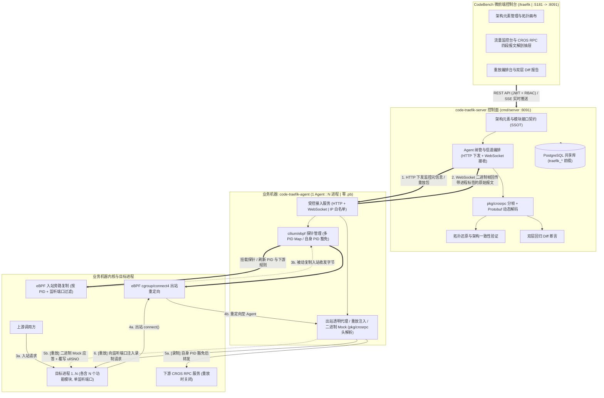
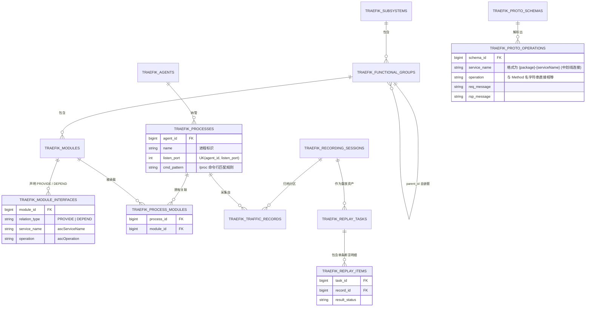

# 业务流量监控与重放 (`code-traefik`) 特性清单与需求范围界定规范 (Feature Matrix & Scope)

- **文档编号**：`01-feature-matrix.md`
- **文档版本**：v2.7.0
- **更新日期**：2026-10-29
- **当前阶段**：阶段一：特性清单与边界明确
- **状态**：定稿待审 (Ready for Review)
- **协议依据**：详见项目内置参考文档 [`docs/07-references/01-cros-rpc-protocol-spec.md`](../07-references/01-cros-rpc-protocol-spec.md)（文档编号：`01-cros-rpc-protocol-spec.md` v1.0.0，基于 DOPHI 平台 `cros_rpccore.ph` / `cros_rpctcp` 规范，本文所有字段名、偏移与取值均以该规范原文为准）

### 修订记录

| 版本 | 日期 | 修订要点 |
| :--- | :--- | :--- |
| v2.0.0 | 2026-10-27 | 重构为主控 + Agent 分离、架构拓扑驱动模型 |
| v2.1.0 | 2026-10-27 | 按 CROS RPC 协议规范收敛协议边界 |
| v2.2.0 | 2026-10-28 | 剥离 Agent 侧 `.pb` 依赖，收敛为纯二进制收集与重放 |
| v2.3.0 | 2026-10-28 | 支持单 Agent 多进程并发监控与任务级协同录制 |
| v2.4.0 | 2026-10-28 | 明确架构元素 SSOT、三级模型、模块级接口契约与多模块进程映射 |
| v2.5.0 | 2026-10-28 | 依据阶段一出口检视修订：新增「关键业务假设」；补充入站旁路采集与长连接前置条件；新增 Agent 实例纳管；PROVIDE 全局唯一与来源模块判定规则；重放结果状态与 Mock 未命中策略；`.pb` 版本管理；信道收敛为 HTTP + WebSocket；重排 P0/P1/P2；补充性能、存储保留与 eBPF 测试策略 NFR；补充术语表 |
| v2.5.1 | 2026-10-29 | 挂载项目内置协议规范 (docs/07-references/01-cros-rpc-protocol-spec.md)；明确服务名映射为 package 前缀全名 ({package}-{serviceName}，package 保持原有点分结构，以中划线连接)；依据协议原文固化 F-13 应答头回填字段清单 (ullSNO/aucTraceBuff/ullClientSendTime) 与精准偏移 |
| v2.6.0 | 2026-10-29 | 增补多人并发与双模持久化规范：Agent 与录制素材均划分公共级 (`SHARED`) 与个人级 (`PRIVATE`)，普通用户可自建自用私有 Agent（共享公共架构元素 SSOT）；确立 Agent 动态排他租约 (`Mutex Lease`，同 Agent 同时间仅 1 名用户操作，冲突返回 `409`)；支持有权限的录制素材在相同架构元素的进程间跨 Agent 重放；明确 `traefik_traffic_records` 采用 `raw_req_packet` / `raw_rsp_packet` (`bytea`) + `payload_json` (`jsonb`) 双模往返存储与双轨分发管道 |
| v2.7.0 | 2026-10-29 | 依据架构检视与用户批复修订：1. 明确管理员特权（`traefik_admin` 可穿透查看/审计所有 `PRIVATE` 素材与 Agent，普通用户严格防横向越权）；2. 明确共享环境（`SHARED` Agent）排他重放支持；3. 主控直接连接 Agent（内网互通）；4. 数据库表数量放开，规范化拆解为 13 张核心物理表（新增 `traefik_process_modules` 关联表与 `traefik_replay_items` 重放条目表）并引入 PostgreSQL 原生范围物理分区（`PARTITION BY RANGE (created_at)`）；5. 架构一致性验证结果扩充 `Not Monitored` 分类 |

---

## 1. 系统愿景与产品定位 (Vision & Positioning)

### 1.1 项目愿景
**业务流量监控与重放 (`code-traefik`)** 是挂载于 CodeBench 开发者综合工作台的业务子系统，**只服务于业务实际使用的 DOPHI `CROS RPC` 协议**（`24B 公共消息头 RPC_COMM_HEAD_S` + `会话头 RPC_REQ/RSP/MNG_HEAD_S` + `0..N 段扩展头` + `序列化 Payload`），不做任何其他协议扩展。

目标用户与痛点：

| 角色 | 痛点 | 本系统提供的能力 |
| :--- | :--- | :--- |
| 业务开发 / 测试工程师 | 联调与回归依赖完整下游环境，问题难以复现 | 录制一次真实业务任务，下游关闭后在测试环境离线重放并做字段级 Diff |
| 架构师 / 模块负责人 | 架构设计中的模块依赖与实际调用逐渐漂移，无从核对 | 维护三级架构元素与模块接口契约，用实测流量验证架构一致性 |
| 平台管理员 | 抓包工具需要业务进程改造或全机特权，风险大 | 每台机器 1 个零 Schema 依赖的 Agent，只作用于指定进程 |

系统采用 **「控制面主框架 (`code-traefik-server`) + 独立数据面代理 (`code-traefik-agent`)」同仓双二进制**架构：

1. **控制面 `code-traefik-server`**（保持在 `code-bench` 微前端家族内）：作为架构元素的单一真实源（SSOT，选型依据见 §2.2 与 Non-Goal 7），负责三级架构元素与接口契约建模、Agent 纳管、多进程协同录制编排、`.pb` 解码、架构一致性验证、重放编排与回归 Diff 报告。
2. **数据面 `code-traefik-agent`**（同仓 `cmd/agent`）：零前端、零数据库、零 `.pb` 依赖的守护进程，每台业务机器部署 1 个，同时监控本机多个目标进程（`1 Agent : N Processes`）；负责报文采集、原始二进制回传、本地重放注入、下游 Mock 与 `ullSNO` 自愈。

### 1.2 核心价值主张 (Core Value Propositions)
1. **单机多进程、零 Schema 的轻量 Agent**：同仓构建主控与 Agent；Agent 不感知 `.pb`，免除跨机同步 Schema 的负担。
2. **架构元素闭环与模块级一致性验证**：自主维护「子系统 → 功能组（树）→ 功能模块」与「1 进程 : N 模块」映射，以功能模块为接口契约主体；用实测报文的 `(ascServiceName, ascOperation)` 定位功能模块，还原跨进程调用关系并与声明的依赖比对。
3. **原生契合 CROS RPC**：原生解析 `"CSE.TCP" + ucProtocol` 魔术字、大端 `ullSNO`/`uiLength`/`usHeadLen` 分帧、多版本会话头与扩展头（Trace 信息、时间戳）。
4. **嵌入式 `cilium/ebpf` 引擎**：Agent 内挂载单套探针，入站被动旁路复制、出站透明重定向，基于 BPF Hash Map 做多 PID `O(1)` 过滤，Agent 自身 PID 内核态豁免防自环。
5. **零 `.pb` 的二进制重放与 `ullSNO` 自愈**：利用「每次运行都会变化的协议字段全部位于 `24 + usHeadLen` 之前」这一结构特征，Agent 以 `(ascServiceName, ascOperation)` + Payload 字节摘要匹配 Mock 并覆写 `ullSNO`；字段级回归 Diff 由主控完成。

---

## 2. 关键业务假设、系统拓扑与数据模型

### 2.1 关键业务假设 (Key Assumptions，已与业务方确认)

以下假设是本版需求边界的前提，任一假设被推翻都需要重新评审相关特性：

| 编号 | 假设 | 影响的特性 |
| :--- | :--- | :--- |
| **A-01** | 业务进程之间普遍使用 **CROS RPC 长连接**；录制 / 重放前**可以接受重启目标进程或触发重连** | F-08、F-09、F-11、F-12 |
| **A-02** | 每个操作系统进程**只监听 1 个** CROS RPC 端口 | F-02、F-08 |
| **A-03** | 同一部署域内（全局公共基线域，或单个私有 Agent 沙箱内）每个功能模块**只部署 1 份**（只属于 1 个进程，不存在同域多副本负载均衡）；允许个人私有 Agent 进程挂载公共架构模块用于独立测试与同构重放 | F-02、F-05、F-12 |
| **A-04** | 同一进程内的功能模块之间走**进程内函数调用**，不经过网络 | F-02、F-05 |
| **A-05** | 同一 `(ascServiceName, ascOperation)` **只由 1 个功能模块供给**（全局唯一） | F-02、F-03、F-05 |
| **A-06** | 重放**只在测试环境**执行；目标进程对 DB / MQ 等非 CROS RPC 依赖的副作用首期不处理（DB 中主要是很少变化的元数据） | F-12、Non-Goal 8 |
| **A-07** | 服务名匹配 Protobuf 的 package 前缀全名：`ascServiceName` 格式为 `{package}-{serviceName}`（package 原样保留其点分结构，与 Service 之间以中划线 `-` 连接）；`ascOperation` 与 Method 名称**字符串直接相等** | F-03、F-10 |
| **A-08** | 首期聚焦 REQ / RSP 业务调用；MNG 管理消息（`ucMsgType=5/6/7`）只做解析展示与原样回放，不做握手语义仿真 | F-12、F-13、Non-Goal 9 |

### 2.2 主从运行架构与网络交互拓扑

采集路径说明：
- **入站 (INGRESS)**：eBPF 按「目标 PID + 监听端口」**被动复制**收发字节，不代理、不改变业务链路（钩子选型于阶段二 ADR 定稿）。
- **出站 (EGRESS)**：`cgroup/connect4` 把目标 PID 访问已登记下游 `IP:Port` 的连接重定向到 Agent，录制时由 Agent 透传到真实下游并记录，重放时由 Agent 用 Mock 应答。
- **长连接前置条件 (A-01)**：出站重定向只对**下发监控之后新建的连接**生效。标准录制流程为「下发监控 → 重启目标进程或触发重连 → 执行业务任务 → 停止录制」。

### 2.3 架构元素与运行映射数据模型

**SSOT 选型依据**：`code-proto` 专注 Protobuf 仓库管理、`.proto` 解析与接口变更 MR 追踪，没有「子系统-功能组-功能模块」概念，也没有运行态进程映射；`code-bench` 只管理用户、组织与审计。两者都不能作为架构元素的可靠来源，因此由 `code-traefik` 在自己的 `traefik_*` 表中闭环维护。

下图只描述实体关系与关键约束，完整物理建模见阶段二 [`05-database-schema.md`](../02-design/05-database-schema.md)：

关键约束：
1. **三级逻辑架构**：子系统是顶层边界；功能组归属子系统，支持多级自嵌套（`parent_id` + `path` + `level`）；功能模块是最小契约单元，可挂在**任意层级**的功能组下。
2. **接口契约在功能模块层面**：`PROVIDE` 为模块对外实现的 CROS RPC 接口，`DEPEND` 为模块需要调用的下游接口，均以 `(ascServiceName, ascOperation)` 字符串表示。**`PROVIDE` 的 `(service_name, operation)` 全局唯一 (A-05)**；其中 `ascServiceName` 为 `{package}-{serviceName}`（package 原样保留其点分结构，与 Service 之间以中划线连接全名），`ascOperation` 为方法名。
3. **物理部署与规范化关联**：公共架构元素全局唯一共享；1 个进程通过 **`traefik_process_modules` 规范化物理关联表** 承载 N 个公共模块，同一部署域（全局公共基线或单个私有 Agent）内每个模块只属于 1 个进程 (A-03)；进程只有 1 个监听端口 (A-02)，同一 Agent 下端口互斥；PID 不落库为权威数据，由 Agent 按端口或 `cmd_pattern` 实时反查。
4. **`.pb` 与接口解耦**：模块接口不直接外键引用 `.pb`，解码时按 `(service_name, operation)` 查找当前生效的映射；每条流量记录保存解码所用的 schema 版本。

---

## 3. 需求功能矩阵 (Feature Matrix)

特性优先级定义：
- **P0 (Must-Have)**：首期主链路「建模 → 采集 → 解码 → 验证 → 重放 → Diff」必需；每条验收指标都必须有对应的自动化测试（特权类用例的执行方式见 NFR 6）。
- **P1 (Should-Have)**：第二阶段规划，含安全加固与体验增强。
- **P2 (Nice-to-Have)**：远期演进。

---

### 3.1 架构元素、接口契约与拓扑领域

| 编号 | 特性名称 | 涉及组件 | 优先级 | 功能描述与技术规范 | TDD 验收指标 |
| :--- | :--- | :---: | :---: | :--- | :--- |
| **F-01** | **三级架构元素建模**（`traefik_subsystems` / `traefik_functional_groups` / `traefik_modules`） | `Server` `Frontend` | **P0** | 1. 子系统：编码（全局唯一）、名称、负责人、描述； 2. 功能组：归属子系统，支持多级自嵌套，维护 `parent_id`、`level`、`path`、排序；编码在同一子系统内唯一；最大深度 8 级； 3. 功能模块：编码全局唯一，挂在任意层级的功能组下，冗余记录所属子系统； 4. 移动功能组时级联更新子孙节点的 `path` / `level`。 | 1. 三类元素 CRUD 单测全部通过； 2. 把功能组移到自身或其子孙下返回 `400`；超过最大深度返回 `400`； 3. 移动功能组后，所有子孙的 `path` / `level` 正确； 4. 删除非空功能组、或删除已声明接口的模块返回 `409`； 5. 编码重复返回 `409`。 |
| **F-02** | **进程部署映射与模块接口契约**（`traefik_processes` / `traefik_process_modules` / `traefik_module_interfaces`） | `Server` `Frontend` | **P0** | 1. 进程：归属 1 个 Agent（公共或个人私有），维护名称、唯一监听端口 (A-02)、`/proc` 命令行匹配规则并通过 `traefik_process_modules` 关联公共模块集合；全局公共基线下每个模块绑定 0..1 个基准进程，单个私有 Agent 内同一模块至多绑定 1 个进程 (A-03)，且私有进程挂载模块不篡改公共基线拓扑； 2. 模块接口：`PROVIDE` / `DEPEND` 两类，以 `(ascServiceName, ascOperation)` 字符串声明； 3. 约束：同一模块内 `(relation_type, service, operation)` 唯一；**`PROVIDE` 的 `(service, operation)` 全局唯一** (A-05)； 4. 静态依赖推导：模块 A 的 `DEPEND` 匹配到模块 B 的 `PROVIDE` 时生成边 `A → B`；匹配不到任何 `PROVIDE` 的 `DEPEND` 归入「外部 / 未登记系统」占位节点。 | 1. 同一 Agent 下监听端口重复或同一模块重复挂载到多进程返回 `409`； 2. 第二个模块声明已被供给的 `PROVIDE` 接口返回 `409`； 3. 静态依赖推导单测：正常边、外部占位边、同进程内两模块之间的边（标记为「进程内」）均正确，且个人私有进程不影响公共静态拓扑； 4. 删除正在录制或重放中的进程返回 `409`。 |
| **F-03** | **Protobuf 描述集注册与接口映射**（`traefik_proto_schemas` / `traefik_proto_operations`） | `Server` `Frontend` | **P0** | 1. 上传 `.pb`（`FileDescriptorSet`），校验体积 `<= 4MB` 与 `protodesc` 合法性；同名描述集每次上传生成新版本，可切换生效版本； 2. 从 `ServiceDescriptor` / `MethodDescriptor` 自动生成 `(ascServiceName, ascOperation) → (Req, Rsp Message)` 映射：服务名匹配 package 前缀全名，**`ascServiceName` 格式为 `{package}-{serviceName}`**（package 原样保留其点分结构，与 Service 之间以中划线 `-` 连接），**`ascOperation` 与 Method 名称直接对应** (A-07)； 3. 生效映射中 `(service, operation)` 全局唯一，冲突时拒绝激活； 4. 流量记录保存解码所用的 schema 版本，切换版本不改写历史解码结果（可手动重新解码）。 | 1. 合法 `.pb` 上传后，映射接口返回正确的 `(service, operation)` 清单（服务名包含 package 原样点分前缀并以中划线 `-` 连接全名）； 2. 损坏文件或超过 4MB 返回 `400`； 3. 激活与其他生效描述集存在 `(service, operation)` 冲突的版本返回 `409`； 4. 切换版本后，历史记录的 schema 版本字段保持不变。 |
| **F-04** | **静态架构拓扑视图** | `Server` `Frontend` | **P0** | 1. 逻辑视角：按「子系统 → 功能组树 → 功能模块」展开，绘制 F-02 推导的模块依赖边（含外部占位节点）； 2. 物理视角：「Agent（主机）→ 进程 → 承载的模块」部署归属图。 | 1. 拓扑 API 对给定建模数据返回期望的节点与边集合； 2. 画布只使用 `--color-*` 语义 Token，适配亮 / 暗主题。 |
| **F-05** | **实测调用拓扑还原与架构一致性验证** | `Server` `Frontend` | **P0** | 基于一次录制批次 (F-11) 的报文： 1. **目的模块定位**：按 `(ascServiceName, ascOperation)` 查唯一的 `PROVIDE` 模块；查不到时归为「未登记接口」； 2. **来源模块判定**（进程承载多个模块时）依次采用：① 出站请求的 `FatherSpanID` 关联到同进程某条入站请求所在的模块；② 该进程内**只有一个**模块声明了对应 `DEPEND`；③ 以上都不满足时，标记为「进程级归属」并给出候选模块集合； 3. **比对结果分类**：`Verified`（实测且已声明）、`Violation`（实测但未声明，架构漂移告警）、`Uncovered`（已声明但本次监控范围内未触发）、`Not Monitored`（目标进程未纳入本次录制监控，不属于未触发）、`Not Observable`（同进程内两模块之间的依赖，A-04 决定网络上不可见，不计入 Uncovered）、`Unattributed`（来源只能归到进程级）。 | 1. 输入预置的上中下游三进程录制数据集（含 1 条未声明调用、1 条同进程内依赖、1 条未监控进程依赖、1 条无 Trace 且多模块声明同一 `DEPEND` 的调用），验证 API 分别标出 `Violation`、`Not Observable`、`Not Monitored`、`Unattributed`，其余边为 `Verified` / `Uncovered`； 2. 每类结果都有独立的单测用例。 |

---

### 3.2 Agent 纳管与受控信道领域

| 编号 | 特性名称 | 涉及组件 | 优先级 | 功能描述与技术规范 | TDD 验收指标 |
| :--- | :--- | :---: | :---: | :--- | :--- |
| **F-06** | **Agent 公私域纳管与动态排他租约**（`traefik_agents`） | `Server` `Frontend` | **P0** | 1. **公私域归属**：Agent 分为公共级（`SHARED`，全团队可见共用）与个人级（`PRIVATE`，普通用户可自建管理，**仅创建人本人及管理员可见与使用**）；登记名称、唯一访问地址（`IP:Port`）、作用域与描述； 2. **主控直接连接**：主控运行于同一内网，直连各宿主机 Agent 开放的管控端口，并实施 SSRF 内网白名单校验与 Claim Code 动态认领防抢注； 3. **动态排他租约 (`Mutex Lease`)**：用户发起录制会话或重放任务时动态锁定目标 Agent，**同一台 Agent（无论 `SHARED` 还是 `PRIVATE`）同一时间只能由 1 名用户执行 1 项操作**；他人或并发任务争用时返回 `409 Conflict` 并提示当前持锁人与任务信息；任务结束、超时或 Agent 离线时自动释放租约，管理员支持强制解锁； 4. **双向租约对账心跳**：主控与 Agent 周期性心跳对账（默认 5s），下发期望租约并感知 `boot_id` 宿主机重启，快速收敛孤儿任务与失效租约。 | 1. 公共与私有 Agent CRUD 单测通过，地址重复返回 `409`；普通用户 B 访问或租用普通用户 A 的 `PRIVATE` Agent 返回 `403`；`traefik_admin` 可查看全部 `PRIVATE` Agent； 2. 用户 A 正在使用某 `SHARED` Agent 录制/重放时，用户 B 请求租用同一 Agent 返回 `409`；任务结束后用户 B 租用成功； 3. 停止 Mock Agent 后 3 个心跳周期内变为 `OFFLINE` 并自动释放悬空租约； 4. 协议主版本不一致返回明确错误码；删除仍纳管进程的 Agent 返回 `409`。 |
| **F-07** | **主控—Agent 受控信道（HTTP + WebSocket）** | `Server` `Agent` | **P0** | 1. 同仓双入口 `cmd/server` / `cmd/agent`； 2. **HTTP REST**：主控向 Agent 下发心跳、进程探查、监控元信息、录制启停、重放任务； 3. **WebSocket（二进制帧）**：主控连接 Agent，Agent 推送原始报文事件与重放结果；首期不实现 Agent 侧 SSE； 4. **背压与弹性**：Agent 为每个录制会话设置有界缓冲（默认 64MB），缓冲满时丢弃新帧并累计 `dropped_frames` 上报；信道断开后主控自动重连；主控失联超过宽限期（默认 5 分钟）时，Agent 自动停止全部监控并卸载探针； 5. **首期连接控制**：不启用 Token，源 IP 白名单中间件（`--allow-ips`，默认只放行 `127.0.0.1` 与配置的主控 IP），预留 `TODO(security)` 鉴权扩展位。 | 1. 本地集成测试（监听 `127.0.0.1`）中，主控通过 HTTP 下发并建立 WebSocket，完整收到 Agent 事件； 2. 非白名单源 IP 访问 Agent 返回 `403`； 3. 模拟主控消费阻塞，`dropped_frames` 正确累加且 Agent 内存不超过缓冲上限； 4. 断开信道后主控自动重连成功；超过宽限期后 Agent 探针已卸载。 |
| **F-08** | **多进程监控元信息供给、目标定位与存量连接诊断** | `Server` `Agent` | **P0** | 1. 主控按 Agent 聚合下发 `[]ProcessMonitorSpec`：进程 ID、监听端口、`cmd_pattern`、下游 `IP:Port` 列表（不下发 `.pb`）； 2. Agent 通过 `/proc` 按监听端口或命令行反查实时 PID；录制期间每 2s 复核一次，PID 变化（进程重启）时自动更新 BPF Map 并上报 `PROCESS_RESTARTED` 事件； 3. **存量连接诊断 (A-01)**：Agent 检测目标进程在监控开始前已经建立、指向已登记下游的连接，上报数量并提示「需重启目标进程或触发重连」； 4. 支持单独增删某个进程的监控，不影响其他进程； 5. 支持主控请求 Agent 探查候选进程列表（PID、命令行、监听端口）。 | 1. 向同一 Agent 下发 3 个进程，均正确定位 PID 并进入录制；停止其中 1 个，其余 2 个持续采集； 2. 录制期间重启某目标进程，Agent 上报 `PROCESS_RESTARTED`，新 PID 的流量继续被采集； 3. 预先建立长连接后再下发监控，Agent 上报存量连接数 ≥ 1； 4. 监听端口不存在时，上报该进程的 `NOT_FOUND` 诊断状态。 |

---

### 3.3 Agent 采集引擎与 CROS RPC 协议栈领域

| 编号 | 特性名称 | 涉及组件 | 优先级 | 功能描述与技术规范 | TDD 验收指标 |
| :--- | :--- | :---: | :---: | :--- | :--- |
| **F-09** | **Agent 嵌入式 `cilium/ebpf` 采集引擎**（`pkg/ebpf`） | `Agent` | **P0** | 基于 `github.com/cilium/ebpf` 在 Agent 内挂载单套探针，服务本机多个目标进程： 1. **多 PID 过滤**：BPF Hash Map 保存目标 PID 集合、监听端口与下游规则，`O(1)` 查找，支持运行期热增删；未命中的进程与连接原样放行； 2. **入站被动旁路复制**：对「目标 PID + 监听端口」上的连接复制收发字节到用户态（ring buffer），不代理、不改变入站链路； 3. **出站透明重定向**：`cgroup/connect4` 把目标 PID 访问已登记下游 `IP:Port` 的新建连接重定向到 Agent 本地代理，并保留原始目的地址； 4. **自环豁免**：Agent 自身 PID 写入 Map，内核态识别后直接放行并累计 `stat_bypassed_self`，保证同机被监控进程互调（`PID_A → PID_B`）不死锁，并同时录到 A 的出站与 B 的入站； 5. **特权要求与自洁**：必须具备 `CAP_BPF` + `CAP_NET_ADMIN`，否则拒绝开始录制并上报原因；全部监控停止或 Agent 退出（含 `SIGTERM`）时卸载全部钩子。 | 1. 同机运行 `PID_A`、`PID_B`（`A → B` 调用）与无关进程 `PID_C`：A 的出站、B 的入站都被录到，不死锁，`PID_C` 无任何重定向； 2. `stat_bypassed_self` 正确累加； 3. 无特权环境下开始录制返回明确错误； 4. 监控停止后 `Attached == false`，Agent 收到 `SIGTERM` 后无残留钩子。 |
| **F-10** | **CROS RPC 分帧与头解析库（`pkg/crosrpc`）及主控 Protobuf 解码** | `Server` `Agent` | **P0** | 1. **共享分帧与头解析库**（Agent 与主控共用，零 `.pb` 依赖）：    - 公共头：识别 8B `unMagicInfo`（7B `"CSE.TCP"` + 1B `ucProtocol`），遇到前序脏字节时逐字节扫描重新同步；大端解析 `ullSNO`、`uiLength`、`usHeadLen`、`ucMsgType`、`isPacked`；校验 `usHeadLen >= 会话头最小长度`、`usHeadLen <= uiLength <= RPC_PAYLOAD_MAX_LEN (32MB - 4KB) + usHeadLen`、`ucMsgType ∈ [2, RPC_MSG_TYPE_MNG_BUTT)`；正确处理粘包与半包；    - 会话头与扩展头：按 `#pragma pack(4)` 与 `usHeadLen` 长度判定版本（前 / 后向兼容），解析 `RPC_REQ_HEAD_S`（V00~V05：`ascServiceName[64]`、`ascOperation[64]`、`ucReqType` 等）、`RPC_RSP_HEAD_S`（V00~V04：`uiStatusCode` / `ullStatusCode`、收发时间戳、`usRspMsgNo`）、`RPC_MNG_HEAD_S`，以及 `0..N` 段扩展头（`TraceID` / `SpanID` / `FatherSpanID`、入队时间戳）； 2. **主控 Protobuf 解码**（只在主控引入 `dynamicpb`）：依据会话头中的 `ascServiceName`（格式为 `{package}-{serviceName}`）与 `ascOperation` 匹配 F-03 生效映射，对 `24 + usHeadLen` 之后的 Payload 做 JSON 解码与重编码；无映射或不可解码时保留完整头解析并以 Raw Hex 展示，不中断链路。 | 1. 单测覆盖：前序脏字节重新同步、逐字节碎片流、多包粘连流、V01 与 V05/V04 会话头、扩展头解析； 2. 非法 `ucMsgType`、超限 `uiLength`、`usHeadLen > uiLength`、`usHeadLen` 小于最小长度的报文全部被拒绝，无 panic、无超量分配（fuzz 测试运行 ≥ 60s 无崩溃）； 3. `cmd/agent` 的依赖图中不包含 `dynamicpb` / `protoregistry`； 4. 无 `.pb` 映射的报文解码结果为 Raw Hex，头字段完整。 |

---

### 3.4 录制、重放与回归断言领域

| 编号 | 特性名称 | 涉及组件 | 优先级 | 功能描述与技术规范 | TDD 验收指标 |
| :--- | :--- | :---: | :---: | :--- | :--- |
| **F-11** | **任务级多进程协同录制、双轨分发与双模物理分区归档**（`traefik_recording_sessions` / `traefik_traffic_records`） | `Server` `Agent` `Frontend` | **P0** | 面向「单次执行一个业务任务、同时录制链路上多个进程」的场景： 1. **录制批次与公私素材域**：选择同域（本人 `PRIVATE` 或空闲 `SHARED`）下多个进程原子获取 Agent 排他租约并创建批次，批次支持设为公共素材（`SHARED`）或个人素材（`PRIVATE`）；按 A-01 引导重启或重连目标进程；设最长时长（默认 30 分钟）与最大帧数（默认 10 万帧）上限，触发自动停录并释放租约； 2. **信封回传与双轨分发**：Agent 回传携带 `session_id`、`process_id`、`pid`、`direction`、`capture_time` 信封的二进制帧；主控接收后双轨分发至「实时前端 SSE 推送」与「异步 Worker 解析落盘管道」； 3. **无损 + 结构化双模物理分区落盘**：同一连接内按 `ullSNO` 配对 REQ / RSP（兼容 Oneway 与多段 `RSP_SEG`），在 `traefik_traffic_records` 中同行持久化无损二进制 `raw_req_packet` / `raw_rsp_packet`（`bytea`，离线重放唯一基石）与动态解码后的结构化 `payload_json`（`jsonb`）；母表采用 `PARTITION BY RANGE (created_at)` 按日分区，支持 30 天 TTL 零锁表毫秒级 `DROP TABLE` 清理；单帧超阈值截断保存并标记「不可重放」。 | 1. 两进程上下游协同录制触发 1 次业务请求：入站 / 出站往返均归档到对应 `process_id`，同一记录同时包含非空 `raw_req_packet`、`raw_rsp_packet` 与结构化 `payload_json`； 2. 普通用户 B 无法查看或订阅普通用户 A 的 `PRIVATE` 录制批次（返回 `403`/`404`），`traefik_admin` 可审计查看全部素材；支持按批次、作用域、子系统、模块、进程、`ascServiceName`、`ascOperation`、`ullSNO`、`TraceID` 筛选及 URL 分页； 3. 达到时长或帧数上限时自动停止并释放 Agent 租约，状态为 `COMPLETED_BY_LIMIT`； 4. 超阈值帧被标记为不可重放。 |
| **F-12** | **跨进程同构重放编排与 Agent 本地执行**（`traefik_replay_tasks` / `traefik_replay_items`） | `Server` `Agent` `Frontend` | **P0** | 在测试环境 (A-06)、下游已关闭或隔离的前提下： 1. **公私素材与同构进程匹配**：用户可选择任意有权限的录制批次（`SHARED` 公共素材或本人的 `PRIVATE` 素材）中某来源进程的 1..N 条 `INGRESS` 请求，投递到**承载相同公共架构元素（`Module`）**的目标进程上重放（支持公共素材投递到个人 `PRIVATE` Agent 进程，或空闲 `SHARED` Agent 进程重放），自动锁定目标 Agent 排他租约；架构元素不匹配返回 `400`； 2. **资产下发与执行**：主控提取 `raw_req_packet` 注入帧集合 + 来源进程录制期的 `EGRESS` `raw_rsp_packet` Mock 集合下发目标 Agent（零 `.pb`）；Agent 挂载出站重定向，引导重连 (A-01) 后按序注入请求（兼容 MNG 原样回放，A-08）； 3. **回收与租约释放**：回传目标进程实际应答（`RSP` / `RSP_SEG`）与 Mock 命中明细，结束后立即释放 Agent 租约；明细流式持久化至 `traefik_replay_items` 独立表； 4. **结果状态**：按 `ERROR > TIMEOUT > MOCK_MISS > FAILED > PASS` 聚合最高异常级别并保留每条请求独立明细（默认单请求超时 30s）。 | 1. 将 `SHARED` 录制批次的请求投递到用户本人 `PRIVATE` Agent 上承载相同模块的进程重放：下游全部命中 Mock，结果为 `PASS`；投递到未承载对应模块的异构进程返回 `400`； 2. 目标端口不可达结果为 `ERROR`，不应答超时结果为 `TIMEOUT`，且结束后 Agent 租约均已释放； 3. 用户尝试拿他人 `PRIVATE` 录制素材发起重放返回 `403`； 4. 单条请求结果写入 `traefik_replay_items`，支持按状态服务端分页检索。 |
| **F-13** | **Agent 零 `.pb` 二进制 Mock 匹配与 `ullSNO` 自愈**（`pkg/replay`） | `Agent` | **P0** | 1. **匹配键**：下游请求会话头中的 `(ascServiceName, ascOperation)` + `24 + usHeadLen` 之后 Payload 字节的哈希；由此天然忽略公共头 `ullSNO`、会话头时间戳与扩展头 Trace 等每次运行都会变化的字段； 2. **兜底匹配**：Payload 哈希未命中时，按同一接口的录制调用次序取下一条未使用的应答； 3. **未命中策略**：同一接口的录制应答已用完或不存在时，**不转发到真实下游、不返回应答**，记录 `MOCK_MISS` 明细（接口、Payload 摘要、时间），由目标进程自身的超时逻辑处理； 4. **自愈改写**：依据《CROS RPC 协议规范》（[`01-cros-rpc-protocol-spec.md`](../07-references/01-cros-rpc-protocol-spec.md)），命中后执行二进制自愈重写：    - **请求序列号**：在应答公共头偏移 `8..15` 覆写当前请求的大端 `ullSNO`；    - **Trace 缓冲回显**：将应答头 `RPC_RSP_HEAD_S` 偏移 `8..23` 的 `aucTraceBuff[16]` 覆写为请求头 `RPC_REQ_HEAD_S` 偏移 `144..159` 的对应值；    - **发送时间戳回显**：对 V3+ 版本的应答头，将偏移 `32..39` 的 `ullClientSendTime` 覆写为请求头偏移 `248..255` 的 `ullSendTimeStamp`；    - **服务与接口回显**：校验并确保应答头偏移 `56..119` 的 `ascServiceName` 与偏移 `120..183` 的 `ascOperation` 与请求一致；    - **多段应答支持**：`RSP_SEG` 分片逐片改写上述字段； 5. **Oneway**：`ucReqType` 为 Oneway 的请求只记录、不应答； 6. **MNG 帧** (A-08)：按 `ucMsgType` 取录制中的同类应答原样回放并覆写 `ullSNO`，没有则忽略。 | 1. 目标进程重放时生成全新的随机 `ullSNO`（如 `0x000000010009A2B3`）、新 TraceID 与新时间戳，Agent 仍命中 Mock，应答帧中的 `ullSNO`、`aucTraceBuff` 与 `ullClientSendTime` 与当前请求保持一致； 2. 同接口 Payload 含动态参数时按调用次序兜底命中； 3. 调用次数超过录制次数时产生 `MOCK_MISS` 明细，且没有任何流量流向真实下游； 4. 3 段 `RSP_SEG` 分片全部被正确改写。 |
| **F-14** | **协议头级 + Protobuf 字段级双层回归 Diff** | `Server` `Frontend` | **P0** | 把 Agent 回传的实际应答（`Actual`）与录制基线（`Expected`）比对： 1. **第一层（协议头）**：比对 `ucMsgType`、`uiStatusCode` / `ullStatusCode`、`usRspMsgNo`、`isPacked` 与 Payload 原始字节； 2. **第二层（Protobuf 字段）**：Payload 字节不同且有 `.pb` 映射时，解码为 JSON 树逐字段计算 `[]FieldDiff{FieldPath, Expected, Actual}`；没有 `.pb` 映射时只给出字节级 Diff； 3. **固定豁免**：会话头 / 扩展头中的服务端时间戳（`ullServerRecvTime`、`ullServerSendTime`、`ullServerEnqueueTime`）不参与比对； 4. **忽略规则**：可按接口 `(service, operation)` 配置忽略的字段路径，重放任务可临时追加； 5. **顺序语义**：`repeated` 字段按顺序比对，`map` 字段不考虑顺序。 | 1. 应答 `uiStatusCode` 变为非零，结果为 `FAILED` 并指出状态码字段； 2. `discount_cents` 由 `6500` 变为 `6600`，结果为 `FAILED` 并给出 `FieldPath` 与期望 / 实际值； 3. 只有服务端时间戳不同，结果为 `PASS`； 4. 被配置为忽略的字段不同，结果为 `PASS`；`map` 只是顺序不同，结果为 `PASS`。 |

---

### 3.5 微前端控制台与平台治理领域

| 编号 | 特性名称 | 涉及组件 | 优先级 | 功能描述与技术规范 | TDD 验收指标 |
| :--- | :--- | :---: | :---: | :--- | :--- |
| **F-15** | **一体化微前端控制台** | `Frontend` `Server` | **P0** | 在 `code-bench` 微前端体系内（暴露 `./App` 与 `./menu`，兼容嵌入与独立两种运行方式），提供： 1. **架构中心**：三级架构元素、模块接口、进程映射、Agent 管理，静态拓扑与一致性验证结果； 2. **流量监控台**：通过主控 `/api/events` SSE 实时展示流量；右侧 `Drawer` 分段展示 ① 24B 公共头偏移位图、② 会话头字段与收发耗时、③ 扩展头 Trace 与入队时间、④ Protobuf JSON 与 16B 对齐 Raw Hex 对照； 3. **重放台**：选择资产下发重放，展示结果状态、Mock 命中明细与双层 Diff； 4. `.pb` 管理：上传、版本切换与 `(service, operation)` 映射列表。 | 1. `tsc --noEmit` 与 `eslint` 零警告； 2. 解剖抽屉对预置报文正确展示四段内容（组件测试）； 3. 所有页面只使用 `--color-*` 语义 Token，列表使用标准 5 页滑动窗口 URL 分页（`15/25/50/100`，默认 `25`）。 |
| **F-16** | **RBAC 权限、公私域隔离与操作审计** | `Server` `Frontend` | **P0** | 1. **权限与资源隔离矩阵**（基于 `commonAuth.AuthMiddleware` 与 `RequireAdmin("traefik_admin")`）：    - **普通认证用户**：只读浏览公共架构元素、拓扑与 `.pb` 映射；自行创建、编辑、删除本人的个人 `PRIVATE` Agent 及其挂载公共架构模块的进程；在本人 `PRIVATE` Agent 或当前空闲的全局 `SHARED` Agent 上动态申请排他租约**发起/停止录制**与**发起重放**；管理本人的 `PRIVATE` 录制素材（支持共享为 `SHARED` 素材）并复用全量 `SHARED` 录制素材；严禁修改或租用他人 `PRIVATE` Agent 与他人 `PRIVATE` 录制素材；    - **`traefik_admin` / `super_admin`**：维护全局公共三级架构元素、接口契约、`SHARED` Agent 及其基准进程、`.pb` 上传与版本切换、公共 `SHARED` 录制素材治理、**穿透查看与审计全部用户的 `PRIVATE` Agent 与素材**、**强制释放异常占用的 Agent 租约**及模块全局设置； 2. **审计**：所有写操作记录字段级 Diff；录制启停、重放发起、Agent 租约获取与强制解锁均写入操作审计。 | 1. 未认证返回 `401`；普通用户修改公共架构元素、管理 `SHARED` Agent 或上传 `.pb` 返回 `403`；普通用户创建并使用本人 `PRIVATE` Agent 录制/重放成功，访问他人 `PRIVATE` 资源返回 `403`；`traefik_admin` 可审计查看他人 `PRIVATE` 详情； 2. 修改架构元素与 Agent 后 `audit_logs` 含完整字段级 Old/New Diff； 3. 录制启停、发起重放及管理员强制释放租约均产生对应审计记录。 |

---

### 3.6 演进规划 (P1 / P2 Backlog)

| 编号 | 特性名称 | 优先级 | 说明 |
| :--- | :--- | :---: | :--- |
| **F-17** | **Agent Token 鉴权加固** | **P1** | Agent 从环境变量或安全配置加载高强度 Token（禁止硬编码）；HTTP 指令与 WebSocket 握手校验 `X-Traefik-Agent-Token`（`subtle.ConstantTimeCompare`）。验收：Token 缺失或错误时返回 `401`。 |
| **F-18** | **结构化接口文档浏览** | **P1** | 基于 `.pb` 反射展示接口清单、入参 / 出参 Message 嵌套树、字段 Tag、类型（含 `repeated`、`map`、`enum`）及注释，可从模块详情跳转。与 `code-proto` 的区别：以运行时 `(ascServiceName, ascOperation)` 为视角，并与功能模块、流量记录关联，不管理 `.proto` 源码与 MR。 |
| **F-19** | **报文敏感字段脱敏与查看权限细分** | **P1** | 按字段路径配置脱敏规则；Payload 明文查看可限定角色。 |
| **F-20** | **录制批次一键回归套件** | **P2** | 把一个录制批次的多个进程、多条请求组织为回归套件批量重放，并汇总报告。 |
| **F-21** | **从 `code-proto` 导入 `.pb`** | **P2** | 通过 `code-proto` 已有接口拉取编译好的描述集，减少手动上传。 |
| **F-22** | **无特权用户态代理降级模式** | **P2** | 不具备 eBPF 特权时，由业务方把下游地址配置为 Agent 代理端口完成采集与重放。 |

---

## 4. 核心业务验收场景矩阵 (Verification Scenarios)

为阶段四 TDD 提供端到端验收基线，定义以下 **8 个核心场景（`SC-01` ~ `SC-08`）**：

| 场景编号 | 场景名称 | 触发条件与输入 | 预期行为与断言 |
| :--- | :--- | :--- | :--- |
| **SC-01** | **免密探针、未认证拦截与公私域 RBAC 越权** | 1. `GET /api/health` 2. 无 JWT 访问受保护接口 3. 普通用户新增公共架构元素、新增 `SHARED` Agent、上传 `.pb`、操作他人 `PRIVATE` Agent；`traefik_admin` 审计查看他人 `PRIVATE` 素材 | 1. `200 OK` 且 `service: "Code-Traefik"` 2. `401` 3. 普通用户越权操作返回 `403`；普通用户自建本人 `PRIVATE` Agent 成功 (`201`)；`traefik_admin` 成功查看他人 `PRIVATE` 详情 (`200`) |
| **SC-02** | **架构建模约束与静态拓扑推导** | 管理员创建子系统、三级嵌套功能组、模块，绑定进程，声明 `PROVIDE` / `DEPEND`；尝试把功能组移到其子孙下；尝试让第二个模块供给已被供给的接口；上传 `.pb` | 成环移动返回 `400`；重复供给返回 `409`；`.pb` 映射正确（自动按 `{package}-{serviceName}` 生成 `ascServiceName` 并绑定模块接口）；静态拓扑包含正常边、外部占位边与「进程内」边；审计记录完整 |
| **SC-03** | **Agent 纳管、排他租约、信道与白名单** | 启动 `code-traefik-agent`（监听 `127.0.0.1`），登记并建立排他租约下发监控；另一用户并发请求租用同一 Agent；模拟非白名单 IP 访问；停止 Agent | 握手成功并定位目标 PID；并发争用同一 Agent 返回 `409`；非白名单返回 `403`；Agent 停止后 3 个心跳周期内变为 `OFFLINE` 并自动释放租约 |
| **SC-04** | **CROS RPC 分帧与解码** | 向 `pkg/crosrpc` 输入：带前序脏字节的流、1 字节碎片流、多包粘连流、V01 / V05 会话头、含 Trace 扩展头的报文、`usHeadLen > uiLength` 的畸形包 | 正确切出完整帧并提取 `ullSNO`、`ascServiceName`、`ascOperation`、`TraceID`；主控正确解码 Payload；畸形帧被拒绝且无 panic |
| **SC-05** | **单 Agent 多进程协同录制与双模物理分区落盘** | 同一 Agent 下监控 `Process_A`（含 `Module_A`）与 `Process_B`（含 `Module_B`）；先建立一条存量长连接再下发监控；重启两进程后执行 `外部 → Process_A → Process_B` 业务请求 | 下发后上报存量连接诊断；重启后 A 的入站 / 出站、B 的入站都被采集且不死锁；`traefik_traffic_records` 分区母表同行归档 `raw_req_packet`、`raw_rsp_packet` 与 `payload_json` |
| **SC-06** | **架构一致性验证** | 使用 SC-05 的录制结果，静态模型中 `Module_A` 未声明对 `Module_B` 接口的依赖，另有一个已声明但未触发的依赖、一条同进程内依赖与一条指向未监控目标进程的依赖 | `A → B` 标为 `Violation`；未触发依赖标为 `Uncovered`；同进程内依赖标为 `Not Observable`；指向未监控进程依赖标为 `Not Monitored` |
| **SC-07** | **跨 Agent 同构进程零 `.pb` 重放与头部自愈** | 关闭下游，将 SC-05 公共录制批次中 `Process_A` 的请求投递到普通用户 `PRIVATE` Agent（或空闲 `SHARED` Agent）上同样承载 `Module_A` 的进程重放；目标进程生成全新随机 `ullSNO` 与时间戳 | 同构校验通过并获取目标 Agent 租约（若投递至未承载 `Module_A` 的进程则返回 `400`）；下游调用命中 Mock，应答 `ullSNO`、`aucTraceBuff` 与 `ullClientSendTime` 被正确覆写，结果为 `PASS`，明细写入 `traefik_replay_items` |
| **SC-08** | **业务突变与 Mock 未命中检出** | ① 修改目标进程使 `uiStatusCode` 非零或 `discount_cents` 变化；② 修改目标进程使其多调用一次下游接口 | ① 结果为 `FAILED`，定位到状态码或字段路径，服务端时间戳差异被忽略；② 结果为 `MOCK_MISS`，明细中包含多出的那次调用，且没有流量流向真实下游 |

---

## 5. 非目标边界界定 (Non-Goals)

明确**不做**以下内容：

- **Non-Goal 1（只支持 CROS RPC over IPv4 TCP 明文）**：不设计可插拔的多协议框架，不支持 HTTP/REST、gRPC 或其他私有协议；首期只覆盖经内核 Socket 的 **IPv4 TCP 明文**通信底座，不覆盖 `Mesh`、`Domain`（Unix Socket）、IPv6、TLS 加密流，也不介入不经 Socket 的共享内存 `FRPC`；Payload 只解码 Protobuf（`RPC_IDL_MSG_TYPE_PB`）。
- **Non-Goal 2（首期不实现 Agent Token 鉴权）**：首期基于部署 IP 保密 + 源 IP 白名单，Token 鉴权列为 `F-17 / P1`，代码预留 `TODO(security)`。
- **Non-Goal 3（主控不抓包、不发重放包）**：主控是无特权控制面，不挂载 eBPF、不扫描业务 `/proc`、不跨网直接向业务进程发送报文；监测与重放全部由 Agent 完成。
- **Non-Goal 4（不引入 Keploy，不重复建设 MR 追踪）**：不依赖外部 Keploy 工具链；接口变更 MR 追踪与 `.proto` 源码管理归属 `code-proto`。
- **Non-Goal 5（Agent 无状态、无 Schema）**：Agent 不连数据库、不持有数据库凭据、不接收或解析 `.pb`；主控所有业务表冠以 `traefik_` 前缀。
- **Non-Goal 6（不污染宿主机全局网络）**：eBPF 只作用于主控下发的目标 PID 集合、监听端口与下游 `IP:Port`，其余连接原样放行。
- **Non-Goal 7（不依赖外部系统同步架构元数据）**：`code-traefik` 是架构元素与拓扑的 SSOT，不与 `code-proto`、`code-bench` 建立元数据轮询或强同步。
- **Non-Goal 8（不隔离非 CROS RPC 依赖的副作用）**：重放只在测试环境执行 (A-06)；目标进程对 DB、缓存、MQ 等的访问不做 Mock 或回滚。
- **Non-Goal 9（不做 MNG 握手语义仿真）**：MNG 管理消息只解析展示并原样回放 (A-08)；含挑战—应答或一次性随机数的握手不保证重放成功。
- **Non-Goal 10（不支持容器 PID 命名空间与多副本模块）**：首期只支持宿主机 PID 命名空间内的进程；不支持同一功能模块多副本部署 (A-03)。

---

## 6. 非功能性需求与安全防护红线 (NFR & Security Guardrails)

1. **报文边界与防内存耗尽**：
   - 分帧器执行 F-10 的长度契约校验，畸形长度立即丢弃并重置该连接的缓存；单帧采集阈值可配置（默认 4MB），防止整数溢出与超大包 OOM；
   - `.pb` 上传限制 `<= 4MB` 并做 `protodesc` 校验；所有 API 入参白名单校验，只用 GORM 参数化查询，禁止 SQL 拼接与未校验的系统命令调用。
2. **性能基线（首期目标值，阶段二压测校准）**：

   | 指标 | 目标 |
   | :--- | :--- |
   | 出站透明代理附加延迟（同机，P99） | ≤ 1 ms |
   | Agent 常驻内存（不含会话缓冲，监控 ≤ 10 个进程） | ≤ 64 MB |
   | Agent CPU（1000 帧/s 采集） | ≤ 单核 10% |
   | 主控解析解码吞吐 | ≥ 2000 帧/s |
   | 采集到前端 SSE 展示延迟 | ≤ 1 s |

3. **数据存储与保留**：原始帧与解析结果存入主控 PostgreSQL 分区表；录制批次受时长 / 帧数上限约束（F-11）；流量数据默认保留 30 天（可配置），由主控定时任务执行子分区 `DROP TABLE` 物理释放（毫秒级、零锁表、零 WAL 膨胀），清理动作写审计。
4. **最小特权与测试绑定**：
   - 主控以非特权身份运行，禁止硬编码 JWT 密钥或凭据；只有 Agent 使用 `CAP_BPF` / `CAP_NET_ADMIN`；
   - 自动化测试中的临时主控、Mock Agent 与模拟 CROS RPC 服务一律监听 `127.0.0.1`，禁止 `0.0.0.0`。
5. **前端安全渲染与主题**：来自报文的 `ascServiceName`、`ascOperation`、`acProcName` 等字符串视为不可信输入，只依赖 React JSX 自动转义，禁止 `dangerouslySetInnerHTML`、`innerHTML` 与原生 `alert()` / `confirm()`；所有界面只使用 `theme.css` 中的 `--color-*` 语义 Token，禁止硬编码 `#fff` / `#000` 等色值。
6. **测试策略与隔离数据库**：
   - 全量 Go 代码通过 `go test -race ./...`；信道广播、BPF Map 读写、会话缓冲必须并发安全；
   - 涉及数据库的单测统一使用 `code-common/backend/testdb.SetupIsolatedDB(t)`，禁止指向生产或共享库；
   - **eBPF 特权用例**以独立 build tag（如 `ebpf`）隔离，在具备 `CAP_BPF` 的特权 runner 上执行；普通环境下自动 `t.Skip` 并给出原因；与内核无关的逻辑（规则计算、分帧、Mock 匹配、`ullSNO` 改写）必须在普通环境中有完整单测；
   - `pkg/crosrpc` 分帧器提供 Go fuzz 测试。
7. **后台进程与内核探针卫生**：构建、单测或联调结束时，停止全部后台进程（`:8091` 主控、`:5181` 前端、临时 Agent 与模拟业务进程），确认 eBPF 钩子全部卸载，不残留端口占用或内核钩子。

---

## 7. 术语表 (Glossary)

| 术语 | 说明 |
| :--- | :--- |
| **SSOT** | Single Source of Truth，单一真实源；本模块是架构元素的唯一权威来源 |
| **`RPC_COMM_HEAD_S`** | 24B 公共消息头，含魔术字 `unMagicInfo`、`ullSNO`、`uiLength`、`usHeadLen`、`ucMsgType`、`isPacked` |
| **`unMagicInfo`** | 8B 魔术字：7B `"CSE.TCP"` + 1B `ucProtocol` |
| **`ullSNO`** | 公共头偏移 `8..15` 的 8B 大端消息序号，用于同一连接内 REQ / RSP 配对 |
| **`uiLength`** | 公共头之后的报文长度（会话头 + 扩展头 + Payload），不含 24B 公共头 |
| **`usHeadLen`** | 会话头 + 扩展头总长度；Payload 从偏移 `24 + usHeadLen` 开始；同时用于判定会话头版本 |
| **`ucMsgType`** | 消息类型（REQ / RSP / RSP_SEG / MNG 等），合法范围 `[2, RPC_MSG_TYPE_MNG_BUTT)` |
| **`ucReqType`** | 请求类型：同步 / 异步 / Oneway（Oneway 不期待应答） |
| **`RSP_SEG`** | 分片应答，一个请求对应多段应答帧，以 `usRspMsgNo` 标识段序 |
| **MNG 消息** | 管理消息（`ucMsgType=5/6/7`），用于连接鉴权、UUID 协商等 |
| **DOTR 扩展头** | 携带分布式追踪信息（`TraceID` / `SpanID` / `FatherSpanID`）与入队时间戳的扩展头段 |
| **`FRPC`** | 基于共享内存、不经 Socket 的 CROS RPC 通信底座（不在本模块范围） |
| **INGRESS / EGRESS** | 目标进程监听端口上的入站报文 / 目标进程主动访问下游的出站报文 |
| **存量连接** | 下发监控之前已经建立的长连接，出站重定向对其无效 |
| **Mock 命中 / 未命中** | 重放时下游请求能否在录制应答集合中找到匹配项 |
