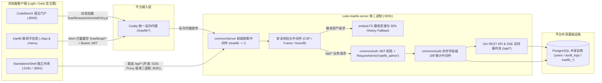
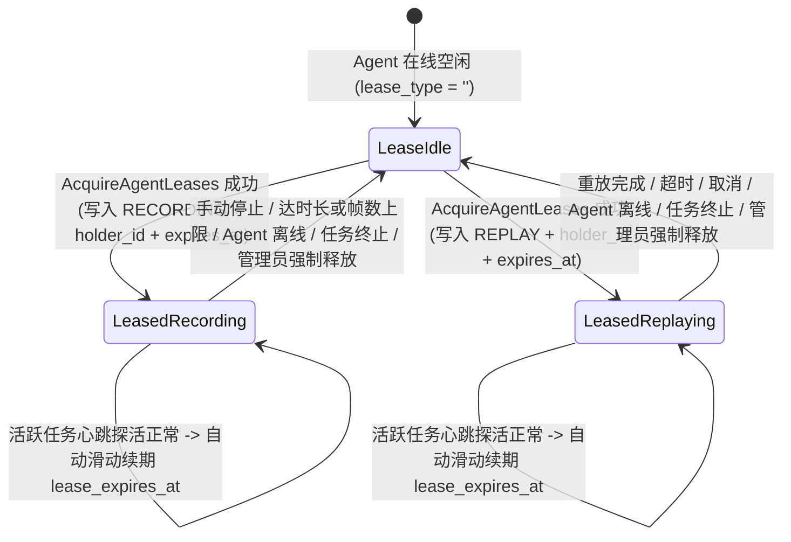
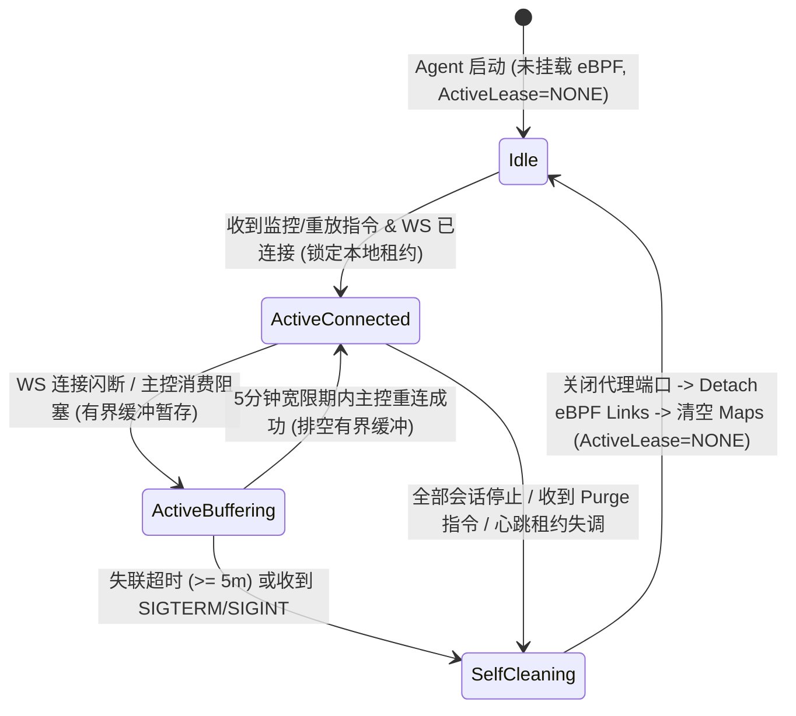
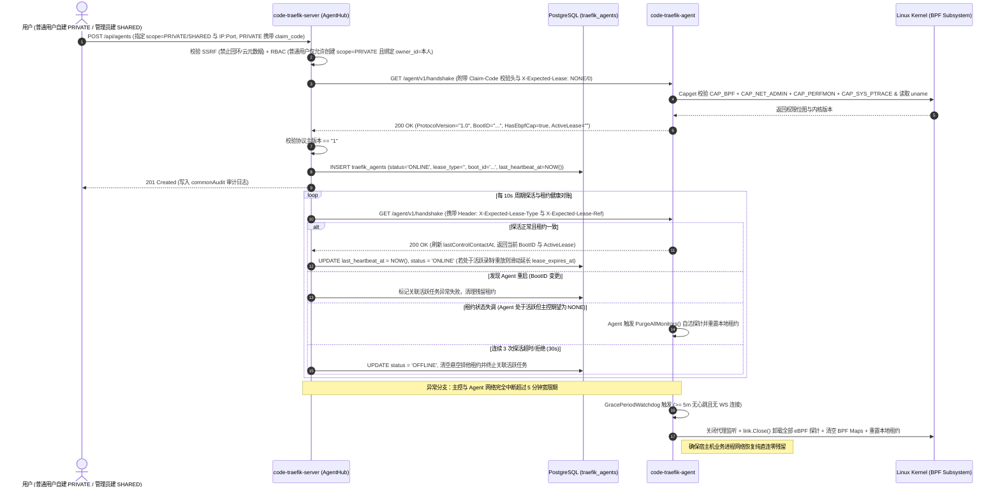
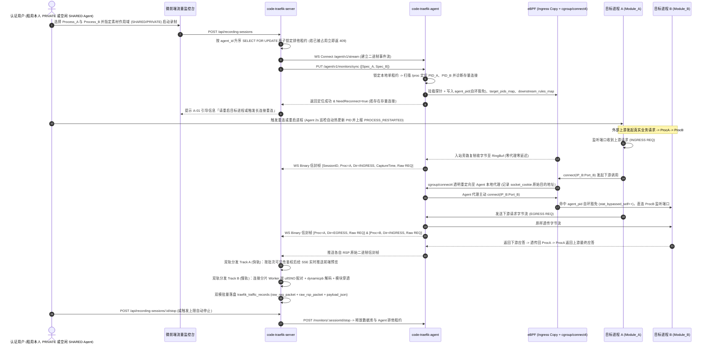
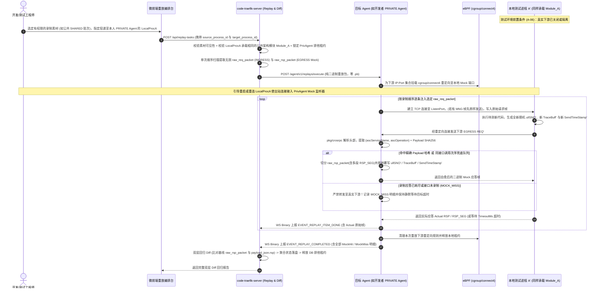

# 业务流量监控与重放 (`code-traefik`) 系统总体架构与主从协同设计

- **文档编号**：`01-system-architecture.md`
- **文档版本**：v1.2.0
- **更新日期**：2026-10-29
- **归属阶段**：阶段二：系统架构与数据模型设计 (`02-design`)
- **状态**：定稿待审 (Ready for Review)
- **上位基线**：[`01-feature-matrix.md`](../01-features/01-feature-matrix.md) (v2.6.0)、[`01-cros-rpc-protocol-spec.md`](../07-references/01-cros-rpc-protocol-spec.md) (v1.0.0)、[`02-ebpf-hook-and-dual-subsystem-adr.md`](../05-adr/02-ebpf-hook-and-dual-subsystem-adr.md)、[`03-control-plane-state-recovery-and-lease-reconciliation.md`](../05-adr/03-control-plane-state-recovery-and-lease-reconciliation.md)

---

## 1. 微前端双模运行拓扑 (Dual-Mode Micro-Frontend Topology)

控制面 `code-traefik-server` 遵循 CodeBench 微前端家族统一规范，通过 Go 1.16+ `//go:embed all:frontend/dist` 单二进制托管与 `@originjs/vite-plugin-federation` 模块联邦机制，无缝兼容**宿主门户嵌入**与**独立开发调试**双模运行。



### 1.1 双模运行路由与上下文契约

| 维度 | 门户嵌入模式 (`isEmbedded = true`) | 独立开发调试模式 (`isEmbedded = false`) |
| :--- | :--- | :--- |
| **入口识别** | 宿主传入 `props.isEmbedded = true` 或检测 `window.__POWERED_BY_PORTAL__ === true` | 直接访问 `http://192.168.56.18:5181/traefik/` 或 `http://192.168.56.18:8091/` |
| **导航与布局** | 宿主通过 `./menu` 渲染左侧二级导航，子应用仅挂载 `EmbeddedRoutes` 内容区 | 挂载 `StandaloneShell`（内置独立侧边栏、亮/暗主题切换与 `UnifiedLogin` 登录页） |
| **API 路径治理** | `setupFetchInterceptor({ appPrefix: '/traefik' })` 自动重写 `/api/*` 为 `/traefik/api/*` | 前端直接请求 `/api/*`，Vite Dev Server 代理至 `127.0.0.1:8091` 或由单二进制直接响应 |
| **后端前缀剥离** | `commonServer.Run(Options{ Prefix: "traefik" })` 自动剥离 `/traefik`，内部统一匹配 `/api/*` | 无需剥离或兼容 `/traefik` 访问，共享同一套 `RegisterAPIRoutes` 处理器 |
| **实时推送通道** | 基于 `fetch` + `ReadableStream` 请求 `/traefik/api/events`，通过 HTTP Header 携带 `Bearer JWT`（严禁 URL Query 传 Token） | 同样通过 Header 携带 `Bearer JWT` 订阅 `/api/events` SSE 实时流量与任务事件 |

---

## 2. 主从双子系统物理架构与代码分层 (Dual-Subsystem Architecture)

为彻底隔离「控制面元数据治理 / 动态解码」与「宿主机内核态流量采集 / 二进制重放」，系统在单仓库（Monorepo）下拆分为两个物理职责正交的可执行程序：**`code-traefik-server`** 与 **`code-traefik-agent`**。

### 2.1 双子系统物理职责与防腐边界

| 架构维度 | 控制面主控 (`cmd/server` -> `code-traefik-server`) | 数据面代理 (`cmd/agent` -> `code-traefik-agent`) |
| :--- | :--- | :--- |
| **部署拓扑与规模** | 集中式无特权部署（对接 CodeBench 网关与共享 PostgreSQL） | 每台受控业务宿主机部署 1 个守护进程（`1 Agent : N 目标进程`） |
| **操作系统特权** | 普通非特权用户运行，**零内核钩子、零业务宿主机 `/proc` 访问** | 需具备 `CAP_BPF` + `CAP_NET_ADMIN`（挂载 eBPF 与读取本机 `/proc`） |
| **持久化与状态** | 有状态：唯一连接 PostgreSQL（读写 11 张 `traefik_*` 表及共享表） | **完全无数据库**：不连任何 DB、不持有数据库凭据，仅维护运行期内存态 |
| **Protobuf 依赖** | 引入 `google.golang.org/protobuf/types/dynamicpb` 动态反序列化与语义 Diff | **零 `.pb` 依赖**：编译依赖图严禁出现 `dynamicpb` / `protoregistry` / `gorm` |
| **协议解析深度** | 调用 `pkg/crosrpc` 解析头 + 调用 `internal/server/decoder` 解码 Payload | 仅调用 `pkg/crosrpc` 解析 `24 + usHeadLen` 之前的协议头，Payload 视为不透明字节切片 |
| **录制与重放职责** | 批次协同编排、落盘归档、模块穿透定位、架构一致性验证、双层回归 Diff 报告 | 入站旁路复制、出站透明代理、重放连接注入、二进制 Mock 匹配与头部偏移自愈 |

### 2.2 工程目录分层与包依赖拓扑

```text
code-traefik/
├── cmd/
│   ├── server/main.go               # 控制面可执行入口：内嵌 frontend/dist，挂载 Gin、DB、Audit 与调度器
│   └── agent/main.go                # 数据面可执行入口：挂载 IP 白名单、eBPF 管理器、透明代理与重放器
├── pkg/                             # 主从共享或数据面独立无状态核心库（严禁反向依赖 internal/server 或 models）
│   ├── crosrpc/                     # 共享 CROS RPC 分帧状态机、24B 公共头、多版本会话头与扩展头解析库
│   ├── agentproto/                  # 主从 HTTP REST DTO 与 WebSocket 二进制信封帧编解码契约
│   ├── ebpf/                        # Agent 专属：cilium/ebpf 探针加载、BPF Map 热更新、/proc 扫描与自洁控制
│   └── replay/                      # Agent 专属：零 .pb 二进制 Mock 匹配器、请求注入器与应答头偏移自愈改写器
├── internal/
│   └── server/                      # Server 专属核心业务引擎
│       ├── hub/                     # Agent 连接池、10s 心跳探活、WebSocket 接收器与 SSE 广播中心
│       ├── recorder/                # 多进程协同录制编排器、REQ/RSP 配对器与异步批量落盘流水线
│       ├── decoder/                 # .pb 描述集注册校验、版本切换与 dynamicpb 动态编解码中心
│       ├── topology/                # 三级架构树治理、静态拓扑推导、报文穿透定位与架构一致性验证引擎
│       └── diff/                    # 协议头级 + Protobuf 语义字段级双层回归 Diff 断言与重放调度器
├── config/                          # Server 与 Agent 各自的配置结构体与安全默认值加载
├── models/                          # 11 张 traefik_* GORM 实体模型、索引迁移与级联校验辅助函数
├── handlers/                        # Server HTTP/SSE 控制器、参数白名单校验、RBAC 守卫与 commonAudit 接入
└── frontend/                        # React 18 + TypeScript + Vite 5 微前端控制台工程
```

> [!IMPORTANT]
> **编译期防腐门禁**：`cmd/agent`、`pkg/crosrpc`、`pkg/agentproto`、`pkg/ebpf`、`pkg/replay` 五个包的依赖闭包中严禁引入 `gorm.io/*`、`code-common/backend/gormdb` 及 `google.golang.org/protobuf/types/dynamicpb`。阶段四 CI 单测将通过 `go list -deps ./cmd/agent` 自动化断言该架构红线。

---

## 3. 多人并发模型：公私域资源共享与 Agent 动态排他租约 (Concurrency & Lease Model)

在团队多人并发研发测试场景下，系统采用 **「公共逻辑架构统一共享 + 物理 Agent 与录制素材公私二元划分 + Agent 动态排他租约 (Mutex Lease)」** 三层协同机制。

### 3.1 公私域资源归属与跨环境复用矩阵

| 资源类别 | 公共级 (`SHARED`) | 个人级 (`PRIVATE`) | 跨环境关联与安全边界 |
| :--- | :--- | :--- | :--- |
| **三级架构元素与 `.pb`** | **全局唯一公共 SSOT**（`traefik_admin` 维护，全体只读） | *不设私有架构元素* | 个人私有 Agent 上的测试进程直接挂载并复用公共功能模块（`Module`）与接口契约 |
| **数据面实例 (`Agent`)** | `traefik_admin` 登记管理；全团队可见，空闲时任意认证用户可申请排他租约进行录制或重放 | **普通用户可自建、编辑、删除本人的私有 Agent**；**创建人本人及 `traefik_admin` 可见**；普通用户之间严格防横向越权 | 他人普通用户尝试查看、修改或租用某用户的 `PRIVATE` Agent 拦截返回 `403 Forbidden`；管理员 (`traefik_admin`) 具备全团队可见、审计与故障解锁特权 |
| **录制流量素材 (`RecordingSession`)** | 全团队可见并可作为重放输入资产（支持将合格个人素材发布为 `SHARED`） | **仅录制发起人本人及 `traefik_admin` 可见**、管理与用于重放；普通用户之间严格隔离 | 只要用户对某录制素材有访问权（公共素材或本人素材），即可将其投递到任何有权限且**承载相同公共架构模块**的进程（含本人 `PRIVATE` Agent 进程，以及当前空闲的团队 `SHARED` 进程）上执行隔离重放 |

### 3.2 Agent 动态排他租约状态机 (`Agent Mutex Lease`)

由于录制与重放均需动态改写宿主机内核 eBPF `downstream_rules_map` 并可能引导目标进程重连（A-01），**同一台 Agent 在同一时刻严格限制只能由 1 名用户执行 1 项活跃操作（1 个录制批次 或 1 个重放任务）**。单次多进程协同录制允许同一名用户同时锁定该批次涉及的 1..M 台 Agent 及其上的多个进程。团队共享的 `SHARED` 环境同样支持执行离线重放，但在执行期间整机 Agent 同样被重放任务独占锁定，杜绝多人并发规则串扰。



* **多 Agent 升序原子加锁算法 (`AcquireAgentLeases`)**：
  1. 提取本次录制/重放涉及的全部 `agent_id` 去重并**严格按主键升序排序**（彻底消除并发交叉申请 `Agent_1, Agent_2` 与 `Agent_2, Agent_1` 导致的 PostgreSQL 行锁死锁）；
  2. 在数据库事务内执行 `SELECT * FROM traefik_agents WHERE id IN (?) ORDER BY id ASC FOR UPDATE`；
  3. 逐台校验：
     - ① **归属防越权**：若 `scope == 'PRIVATE' && owner_id != currentUser.ID && !currentUser.IsAdmin`，立即回滚并返回 **`403 Forbidden`**；
     - ② **探活健康与能力检查**：若 `status != 'ONLINE'` 或无 eBPF 权限，返回 `400/503`；
     - ③ **租约互斥冲突检查**：若存在未过期的活跃租约（`lease_type != '' && now < lease_expires_at`），回滚事务并返回 **`409 Conflict`**（响应体附带 `lease_holder_name`、`lease_type`、`lease_acquired_at`、`lease_expires_at`）；
     - ④ **租约惰性对账自愈**：若旧租约已超硬性安全期 `lease_expires_at`（默认任务最大时长 + `2 分钟` 缓冲），或主控后台检测到关联 Session/Task 已终止，执行惰性自愈清理后授予新租约。
* **租约滑动续期与对账看门狗**：在活跃录制或重放执行期间，主控与 Agent 的 10s 心跳探活正常成功时，主控自动执行 `UPDATE traefik_agents SET lease_expires_at = NOW() + INTERVAL '2 minutes'` 滑动续约，防止长耗时重放或大规模多帧录制任务被误判超时收回。
* **Agent 进程侧双重防御 (`SingleTenantGuard`)**：`cmd/agent` 在内存中同步维护唯一 `activeLease{Type, RefID}`，拒绝任何非当前活跃 `SessionID/TaskID` 的并发下发指令（返回 `409`），从而在物理上保证每台 Agent 任意时刻最多只存在 **1 个 64MB 有界会话缓冲**。

---

## 4. 主从管控通信信道协议规范 (Control & Data Channel Protocol)

主控与 Agent 之间采用 **「HTTP REST 控制下行 + WebSocket 二进制流事件上行」** 双通道协同协议（协议常量定义于 `pkg/agentproto`，首期主协议版本 `ProtocolVersion = "1.0"`）。网络拓扑基于**内网可达物理环境**，由主控主动直连各宿主机 Agent 的监听端口。

### 4.1 连接安全控制与内网准入基线

1. **内网直连拓扑与监听绑定**：
   - 生产环境中受控业务宿主机与主控部署在同一内部数据中心网络，主控直接连接各 Agent 实例；
   - Agent 启动参数支持 `--listen 0.0.0.0:9091`（测试环境强制绑定 `127.0.0.1:<port>`）与 `--allow-ips 127.0.0.1,192.168.0.0/16,10.0.0.0/8`（支持单 IP 与 CIDR 网段解析为 `[]netip.Prefix`）。
   - 进入 Agent 的所有 HTTP 请求及 WebSocket `Upgrade` 握手均直接提取底层 TCP `RemoteAddr` 的真实源 IP（忽略外部可伪造的 `X-Forwarded-For`），未命中白名单立即返回 `403 Forbidden` 并丢弃连接。
2. **主控 SSRF 防御与端点校验 (`AgentEndpointGuard`)**：
   - 主控在纳管或测试连接任何 Agent 时，在应用层严格执行 IP 白名单过滤与 SSRF 阻断：
     - ① 严禁配置为回环地址（`127.0.0.0/8`，本地联调测试环境显式开启 `--dev-allow-loopback` 除外）；
     - ② 严禁指向公有云/私有云元数据地址（如 `169.254.169.254`）及广播/组播段；
     - ③ 校验目标端口在合规端口范围（`1024..65535`）；探测超时统一为 `3s`，握手探测失败时返回通用错误提示，严禁将对端真实原始响应体透出给客户端。
3. **PRIVATE Agent 认领防抢注机制 (`Claim Code Guard`)**：
   - 为防止普通用户在共享网络中恶意探测或将他人已启动的宿主机 Agent 抢注为个人的 `PRIVATE` 资产，Agent 在启动时通过 `crypto/rand` 自动生成一次性 16 字节十六进制安全认领码（`ClaimCode`，打印于 Agent 本地终端日志及受保护的本地文件 `/var/run/code-traefik/claim.token`，仅宿主机拥有者可见）；
   - 普通用户在控制台纳管个人 `PRIVATE` Agent 时，除填写 `IP:Port` 外必须填写正确的 `ClaimCode`；主控在向 Agent 发送首次初始化校验时传递该认领码，Agent 内存比对一致后建立绑定关系，杜绝内网盲注与未授权窃听。
4. **WebSocket 流量与帧安全边界**：
   - 主控在升级接收 WebSocket 连接时，设置 `conn.SetReadLimit(int64(MaxFrameBytes) + 56 + 1024)`，防止畸形超大帧引起内存溢出；单 Agent 实例挂载滑动窗口速率限制器。

### 4.2 HTTP REST 控制下行接口契约 (`Server -> Agent`)

| 方法 | Agent 路由路径 | 调用时机与职责 | 核心请求 / 响应载荷 (`pkg/agentproto`) |
| :---: | :--- | :--- | :--- |
| `GET` | `/agent/v1/handshake` | 纳管校验、版本握手与每 10s 周期租约双向对账 | 请求头携带 `X-Expected-Lease-Type`、`X-Expected-Lease-Ref`；返回 `HandshakeResp`（含 `BootID`、`StartedAt`、`ActiveLeaseType`、`ActiveRefID`） |
| `GET` | `/agent/v1/processes/discover` | 用户/管理员探查候选业务进程 | 返回宿主机当前持有 IPv4 TCP `LISTEN` 端口的进程清单 `[]DiscoveredProcess{PID, ListenPort, Cmdline, ExeName}`（共享 Agent 仅管理员可查） |
| `PUT` | `/agent/v1/monitors/sync` | 持排他租约声明式下发或更新监控进程规格 | 请求 `SyncMonitorReq{SessionID, MaxFrameBytes, MaxBufferBytes, Processes: []ProcessMonitorSpec}`；若与当前内存活跃租约冲突返回 `409` |
| `DELETE` | `/agent/v1/monitors/:sessionId/processes/:processId` | 单独移除某进程的监控（不影响同机其他进程） | 从 BPF Map 热移除该进程的 PID 与下游规则；若已无任何活跃监控则自动卸载探针 |
| `POST` | `/agent/v1/monitors/:sessionId/stop` | 录制批次正常结束或触发上限停止 | 刷空该会话缓冲剩余帧，返回累计统计 `StopMonitorResp{CapturedFrames, DroppedFrames, BypassedSelfCount}` |
| `POST` | `/agent/v1/replays/execute` | 下发单进程离线隔离重放任务 | 请求 `ExecuteReplayReq{TaskID, ProcessSpec, TimeoutMs, IngressRequests, EgressMocks, MngMocks}`（纯二进制流切片传输，零 `.pb`） |
| `GET` | `/agent/v1/replays/:taskId/result` | 幂等轮询或重放完成后拉取任务最终汇总明细 | 返回 `ReplayTaskResultResp{TaskID, Status, TotalRequests, PassedRequests, MockHitCount, MockMissCount, Details}` |
| `POST` | `/agent/v1/replays/:taskId/cancel` | 用户手动中止正在执行的重放任务 | 立即关闭注入连接、卸载该重放任务的下游重定向规则并释放本地 Mock 监听器 |
| `POST` | `/agent/v1/purge` | 主控启动恢复、管理员强制解锁或租约失调自洁 | 幂等停录/停重放，关闭代理监听，调用 `link.Close()` 卸载全部探针，清空 BPF Maps 并置 `ActiveLease=NONE` |

核心管控结构体与心跳响应契约定义：

```go
package agentproto

// HandshakeResp 握手与心跳双向对账数据载荷
type HandshakeResp struct {
	AgentVersion    string    `json:"agent_version"`    // Agent 构建版本号
	ProtocolVersion string    `json:"protocol_version"` // 主协议版本，如 "1.0"
	BootID          string    `json:"boot_id"`          // Agent 实例重启 UUID，随进程生命周期刷新
	StartedAt       time.Time `json:"started_at"`       // 启动时刻
	KernelVersion   string    `json:"kernel_version"`   // 宿主机内核版本
	HasEbpfCap      bool      `json:"has_ebpf_cap"`     // 是否具备完整 eBPF 运行权限
	CapDetail       string    `json:"cap_detail"`       // 权限详情说明
	ActiveLeaseType string    `json:"active_lease_type"`// 当前内存持有的租约类型: "" | "RECORDING" | "REPLAY"
	ActiveRefID     uint64    `json:"active_ref_id"`    // 当前内存持有的 SessionID 或 TaskID
	UptimeSec       uint64    `json:"uptime_sec"`       // 运行秒数
}

// DownstreamEndpoint 描述目标进程允许访问并需被透明拦截的下游 CROS RPC 地址
type DownstreamEndpoint struct {
	IP   string `json:"ip"`   // IPv4 点分十进制地址，如 "192.168.56.19" 或 "127.0.0.1"
	Port uint16 `json:"port"` // 下游监听端口，1..65535
}

// ProcessMonitorSpec 单进程监控元信息（零 .pb Schema 依赖）
type ProcessMonitorSpec struct {
	ProcessID   uint64               `json:"process_id"`   // 主控 traefik_processes.id
	ListenPort  uint16               `json:"listen_port"`  // 唯一监听端口 (A-02)
	CmdPattern  string               `json:"cmd_pattern"`  // /proc/<pid>/cmdline 匹配表达式
	Downstreams []DownstreamEndpoint `json:"downstreams"`  // 静态拓扑推导 + 本批次纳管监听端点 + 显式登记端点
}

// ProcessDiagStatus 下发监控后的实时定位与存量长连接诊断结果
type ProcessDiagStatus struct {
	ProcessID        uint64 `json:"process_id"`
	Status           string `json:"status"`            // "MONITORING" | "NOT_FOUND" | "CAP_DENIED" | "ERROR"
	ResolvedPID      uint32 `json:"resolved_pid"`      // 实时定位到的 OS PID（未找到为 0）
	EstablishedConns int    `json:"established_conns"` // 指向已登记下游的存量 TCP_ESTABLISHED 连接数 (A-01)
	NeedReconnect    bool   `json:"need_reconnect"`    // EstablishedConns > 0 时为 true，提示重启或触发重连
	Message          string `json:"message"`
}
```

### 4.3 WebSocket 二进制流上行信封协议 (`Agent -> Server`)

主控在活跃录制或重放期间长连 Agent 的 `ws://<agent_endpoint>/agent/v1/stream`。为避免高频采集下 JSON + Base64 编码带来的 CPU 与带宽膨胀，WebSocket 统一使用 `BinaryMessage` 帧传输 **56 字节定长网络大端信封头 (`EnvelopeHeader`) + 变长载荷**。

```text
 0                   1                   2                   3
 0 1 2 3 4 5 6 7 8 9 0 1 2 3 4 5 6 7 8 9 0 1 2 3 4 5 6 7 8 9 0 1
+-+-+-+-+-+-+-+-+-+-+-+-+-+-+-+-+-+-+-+-+-+-+-+-+-+-+-+-+-+-+-+-+
|      Magic (0x4354 "CT")      |  ProtoVer (1) |   EventType   |  0..3
+-+-+-+-+-+-+-+-+-+-+-+-+-+-+-+-+-+-+-+-+-+-+-+-+-+-+-+-+-+-+-+-+
|                 SessionOrTaskID (uint64, BE)                  |  4..11
|                                                               |
+-+-+-+-+-+-+-+-+-+-+-+-+-+-+-+-+-+-+-+-+-+-+-+-+-+-+-+-+-+-+-+-+
|                    ProcessID (uint64, BE)                     |  12..19
|                                                               |
+-+-+-+-+-+-+-+-+-+-+-+-+-+-+-+-+-+-+-+-+-+-+-+-+-+-+-+-+-+-+-+-+
|                   CapturedPID (uint32, BE)                    |  20..23
+-+-+-+-+-+-+-+-+-+-+-+-+-+-+-+-+-+-+-+-+-+-+-+-+-+-+-+-+-+-+-+-+
|   Direction   |     Flags     |         Reserved (0)          |  24..27
+-+-+-+-+-+-+-+-+-+-+-+-+-+-+-+-+-+-+-+-+-+-+-+-+-+-+-+-+-+-+-+-+
|                  CapturedAtNs (int64, BE)                     |  28..35
|                                                               |
+-+-+-+-+-+-+-+-+-+-+-+-+-+-+-+-+-+-+-+-+-+-+-+-+-+-+-+-+-+-+-+-+
|                     SrcIPv4 (4 Bytes)                         |  36..39
+-+-+-+-+-+-+-+-+-+-+-+-+-+-+-+-+-+-+-+-+-+-+-+-+-+-+-+-+-+-+-+-+
|                     DstIPv4 (4 Bytes)                         |  40..43
+-+-+-+-+-+-+-+-+-+-+-+-+-+-+-+-+-+-+-+-+-+-+-+-+-+-+-+-+-+-+-+-+
|       SrcPort (uint16, BE)    |       DstPort (uint16, BE)    |  44..47
+-+-+-+-+-+-+-+-+-+-+-+-+-+-+-+-+-+-+-+-+-+-+-+-+-+-+-+-+-+-+-+-+
|                    ConnSeq (uint32, BE)                       |  48..51
+-+-+-+-+-+-+-+-+-+-+-+-+-+-+-+-+-+-+-+-+-+-+-+-+-+-+-+-+-+-+-+-+
|                   PayloadLen (uint32, BE)                     |  52..55
+-+-+-+-+-+-+-+-+-+-+-+-+-+-+-+-+-+-+-+-+-+-+-+-+-+-+-+-+-+-+-+-+
|             Payload Bytes (Raw CROS RPC Frame / JSON)         |  56..56+N
+-+-+-+-+-+-+-+-+-+-+-+-+-+-+-+-+-+-+-+-+-+-+-+-+-+-+-+-+-+-+-+-+
```

* **`Flags` 位掩码字段规范**：
  * `bit0 (0x01) = IS_TRUNCATED`：单帧超过 `MaxFrameBytes`（默认 4MB）发生物理截断，不可作为重放资产；
  * `bit1 (0x02) = REF_KIND`：标识关联资产类型（`0 = RECORDING_SESSION`，`1 = REPLAY_TASK`），彻底消除主键空间冲突导致串包；
  * `bit2 (0x04) = HAS_GAP`：底层内核 ringbuf 发生丢包或字节断流，提示用户态分帧器重新同步；
  * `bit3..7`：预留为 0。

* **`EventType` 枚举与租约校验守卫**：
  * 主控 `AgentHub` 收到任意 WebSocket 二进制帧后，核对信封偏移 `4..11` 的 `SessionOrTaskID` 及 `Flags.REF_KIND` 是否与该 Agent 当前持有的排他租约一致；过期或悬空会话的残帧直接丢弃；
  * `0x01 (EVENT_TRAFFIC_FRAME)`：采集到的单条完整（或截断）CROS RPC 原始帧；`Direction` 取值 `1 = INGRESS`、`2 = EGRESS`；
  * `0x02 (EVENT_PROCESS_LIFECYCLE)`：目标进程生命周期事件（如 `PROCESS_RESTARTED` 新旧 PID 切换、`PROCESS_EXITED`）；
  * `0x03 (EVENT_SESSION_STATS)`：每 2s 周期上报会话采集计数、当前缓冲水位与累计背压丢帧数 `dropped_frames`；
  * `0x04 (EVENT_REPLAY_ITEM_DONE)`：重放单条请求完成事件，携带实际捕获的 `RSP` / `RSP_SEG` 原始字节流或超时/连接错误状态；
  * `0x05 (EVENT_REPLAY_COMPLETED)`：重放任务汇总完成事件，携带完整 `MockHit` / `MockMiss` 明细列表；
  * `0x06 (EVENT_CONN_CLOSED)`：被监控连接正常或异常关闭事件，携带 `ConnKey`，驱动慢轨配对器立即刷出挂起的单向请求；
  * `0x07 (EVENT_SESSION_DRAINED)`：会话停止指令后所有内存积压帧已全部发送完毕的终结信号，主控收到后方可标记批次定稿并释放租约。

### 4.4 背压缓冲、断线重连、租约对账与探针安全自洁



1. **有界会话字节预算缓冲 (`BoundedSessionBuffer`)**：
   - Agent 为每个活跃录制批次分配独立的有界环形字节队列，容量上限默认 `64MB`（`--max-session-buffer-bytes=67108864`）。
   - 当 WebSocket 发送阻塞或闪断导致当前会话已驻留字节数 `usedBytes + frameLen > maxBytes` 时，采集协程执行 **非阻塞丢弃新帧 (`Drop-Newest`)**，原子递增 `session.droppedFrames.Add(1)`，绝不阻塞业务系统调用，也绝不突破 Agent 内存红线。
2. **主控指数退避自动重连**：
   - `AgentHub` 检测到 WebSocket 断开后立即启动重连循环（退避间隔 `500ms -> 1s -> 2s -> 5s` 封顶），重连成功后立即消费缓冲中积压的信封帧并同步最新 `dropped_frames`。
3. **心跳双向租约对账看门狗 (`DualLeaseReconcileWatchdog`)**：
   - 主控在每 10s 发起的探活心跳中带上主控数据库记录的期望租约状态（`X-Expected-Lease-Type` 与 `X-Expected-Lease-Ref`）；
   - Agent 收到后比对本地内存 `activeLease`：
     - 若主控下发期望为 `NONE` 但 Agent 处于活跃状态，说明主控已判定任务终止或发生故障恢复，Agent **立即触发 `PurgeAllMonitors()`** 卸载探针恢复业务裸连；
     - 若 Agent 返回的 `BootID` 与主控记录的不一致（Agent 发生了静默重启），主控感知后立即将正在执行的任务标记为异常失败，并回滚释放租约。
4. **主控单实例部署假设与启动恢复序列 (`ServerRecoveryPipeline`)**：
   - 本系统控制面采用**单实例部署**（保证内存 Hub、分片 Worker 与 SSE 广播池的权威一致性；多实例需另行接入集中式分布式锁）；
   - 主控进程启动时，在数据库事务内扫描处于 `RECORDING`、`STOPPING` 或 `REPLAYING` 状态的历史残留任务：
     - 并发向涉及的 Agent 下发 `POST /agent/v1/purge` 清理远端残余规则；
     - 将关联任务统一置为 `FAILED(SERVER_RESTART)` 终态，并清空所有 Agent 表上的排他租约列，杜绝因控制面重启导致的死锁挂死。

---

## 5. 三大核心业务全链路时序图 (End-to-End Sequence Diagrams)

### 5.1 场景一：公私域 Agent 纳管、能力握手、心跳探活与失联自洁时序



### 5.2 场景二：排他租约协同录制、双轨分发与双模落盘全链路时序



### 5.3 场景三：跨 Agent 同构进程隔离重放与双层 Diff 全链路时序



---

## 6. 系统级安全架构与验证计划基线 (Security Guardrails & Verification Plan)

依据工作区安全编码红线，阶段二架构冻结以下强制安全防护契约，并纳入阶段四自动化验收计划：

1. **认证、授权与会话安全**：
   - 控制面所有非公开 `/api/*` 接口（含 `/api/events` SSE 流）强制经 `commonAuth.AuthMiddleware` 校验 `HS256` JWT（显式拒绝 `none` 算法、强制校验 `exp` 过期时间）；`JWT_SECRET` 通过环境变量或密钥管理系统注入，严禁源码硬编码回退字面量（生产集群接入 KMS 标记见 `config/config.go` `TODO(security)`）。
   - 严禁在 URL Query 参数中传递 JWT 或任何凭据；前端登出时清空内存认证上下文并触发页面级重载跳转。
   - 独立密码登录（调试模式）复用平台 `bcrypt` 加盐哈希存储，预留 MFA 与泄露密码库检测扩展位（`// TODO(security): 企业生产门户统一走 OAuth2/OIDC + MFA 强认证`）。
   - **公私域防横向越权（Anti-IDOR）**：所有涉及 `PRIVATE` Agent、名下进程及 `PRIVATE` 录制素材的查询、修改、SSE 订阅与重放接口，普通用户之间强制在数据访问层校验 `owner_id == currentUser.ID`（未匹配返回 `403 Forbidden`）；管理员（`traefik_admin`）被授予全团队运维查看、审计、租约异常解锁与安全审查特权，严禁仅靠前端隐藏入口。
2. **输入校验、文件上传与命令执行零信任**：
   - `.pb` 描述集上传强制校验 `<= 4MB` 体积上限、校验 `FileDescriptorSet` 魔术结构与 `protodesc.NewFiles` 完整性；二进制内容直接存入 PostgreSQL `bytea` 字段，不落地宿主机可执行文件系统（病毒扫描外部网关集成留存 `// TODO(security): 接入企业制品防病毒扫描服务`）。
   - Agent 进程探查与连接诊断 100% 通过 Go 标准库只读解析 `/proc/<pid>/*` 虚拟文件，**全仓严禁调用 `os/exec` 拼接执行外部 Shell 命令**。
   - 数据库交互 100% 使用 GORM 参数化预编译查询，排序字段与状态枚举执行严格白名单校验，SQL 原始错误严禁透出至客户端响应。
3. **浏览器安全响应头与前端防 XSS**：
   - 控制面全局注入 `Content-Security-Policy: default-src 'self'; script-src 'self'; style-src 'self' 'unsafe-inline'; img-src 'self' data:; connect-src 'self'; object-src 'none'; frame-ancestors 'self'`（注：Vite 微前端样式注入需 `style-src 'unsafe-inline'`，`script-src` 严禁启用 `unsafe-inline` 或 `unsafe-eval`）、`X-Content-Type-Options: nosniff`、`X-Frame-Options: SAMEORIGIN`、`Permissions-Policy: camera=(), microphone=(), geolocation=()`，敏感 API 响应附加 `Cache-Control: no-store`，CORS 严格限定受信任门户域名白名单（严禁 `*`）并挂载 API 速率限制器。
   - 来自网络报文的 `ascServiceName`、`ascOperation`、`acProcName` 及 Protobuf 解码字符串均视为不可信外部输入，前端 100% 依赖 React JSX 原生文本转义，严禁使用 `dangerouslySetInnerHTML`、`innerHTML` 或原生 `alert()` / `confirm()`。
4. **测试绑定红线**：
   - 所有单元与集成测试中拉起的临时 `Server`、Mock `Agent`、模拟业务 TCP 服务及测试数据库均**强制仅监听 `127.0.0.1`**，严禁绑定 `0.0.0.0`；测试结束在 `t.Cleanup` 中确保端口与 eBPF 探针 100% 释放。
