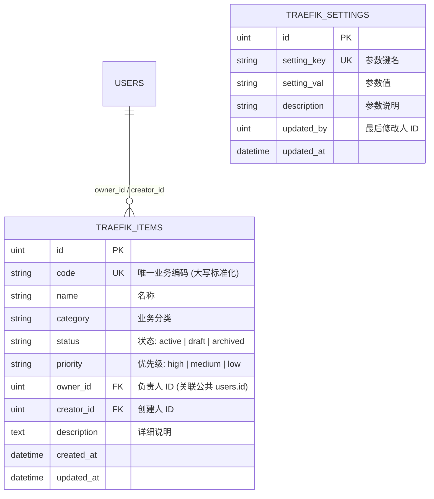

# 业务流量监控与重放 (`code-traefik`) 系统总体架构与数据模型设计

- **文档编号**：`01-system-architecture.md`
- **文档版本**：v0.1.0
- **编制日期**：2026-10-27
- **归属阶段**：阶段二：系统架构与模型设计

---

## 1. 微前端双模运行架构 (Dual-Mode Architecture)

`code-traefik` 采用前后端一体化单二进制内嵌（`go:embed`）+ Vite Module Federation 微前端联邦架构，无缝支持两种运行形态：

1. **门户嵌入模式 (`isEmbedded = true`)**：
   - CodeBench 宿主门户（`:8000`）通过网关配置挂载 `/traefik`，在运行时动态拉取 `/traefik/assets/remoteEntry.js` 的 `./menu` 与 `./App`。
   - 前端 `setupFetchInterceptor({{ appPrefix: '/traefik' }})` 自动将模块内的 `/api/*` 请求重写为 `/traefik/api/*` 并携带门户签发的 `Bearer JWT`。
   - 后端 `commonServer.Run` 自动剥离 `/traefik` 前缀，由同一套 Gin 路由处理器响应。
2. **独立开发调试模式 (`isEmbedded = false`)**：
   - 开发者直接访问 Vite 调试端口（`http://192.168.56.18:5181/traefik/`）或后端端口（`http://192.168.56.18:8091`）。
   - 自动渲染内置的 `StandaloneShell`（含独立调试侧边栏、亮/暗主题切换器与 `UnifiedLogin` 登录页）。

---

## 2. 数据库模型与表前缀隔离设计 (Database Schema)

本模块与 CodeBench 共享 PostgreSQL 数据库，所有模块自有表均强制以 **`traefik_`** 开头：

---

## 3. 代码分层与职责边界 (Package Layering)

| 层级 / 目录 | 核心文件 | 职责说明 |
| :--- | :--- | :--- |
| **配置层 (`config/`)** | `config.go` | 集中声明 `ModuleKey="traefik"`、`TablePrefix="traefik_"`、`AdminRole="traefik_admin"`、`DefaultPort=":8091"` 及 YAML 加载逻辑 |
| **模型层 (`models/`)** | `db.go`, `item.go` | GORM 连接池初始化、`AutoMigrate`、幂等种子数据初始化及业务结构体/白名单校验函数 |
| **控制层 (`handlers/`)** | `health.go`, `auth.go`, `item.go`, `settings.go` | HTTP 参数绑定、RBAC 权限校验、GORM 事务/查询编排、`commonAudit` 审计记录 |
| **前端视图 (`frontend/src/`)** | `App.tsx`, `menu.ts`, `pages/*` | 路由分发、侧边栏契约导出、基于 `--color-*` Token 的业务页面组件 |
