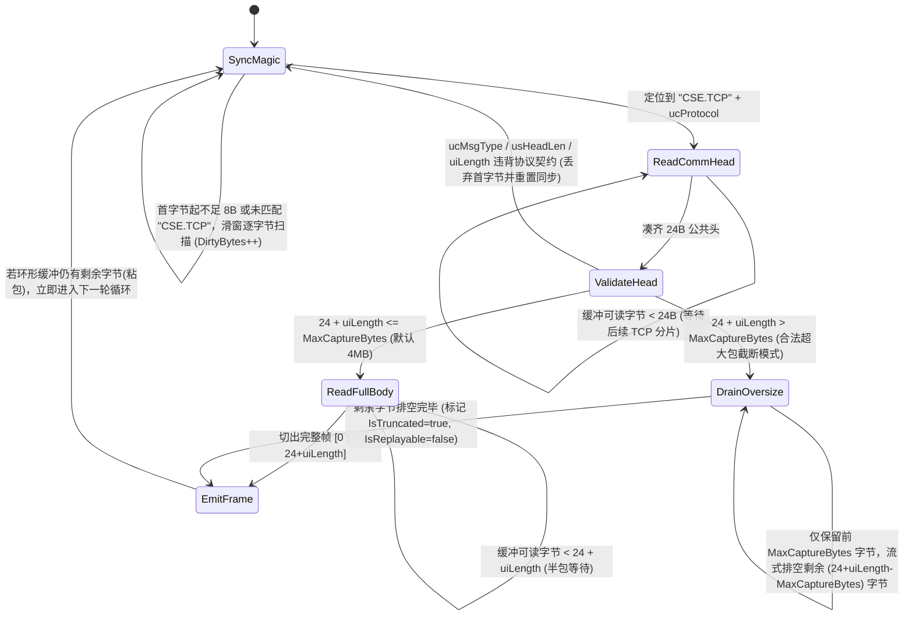
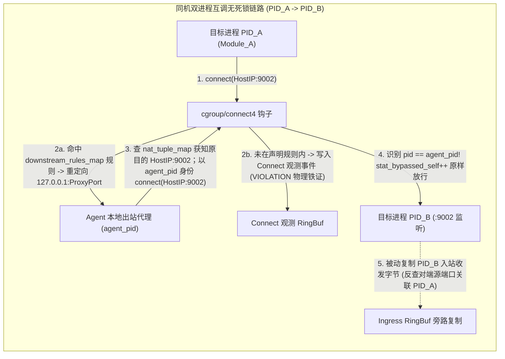
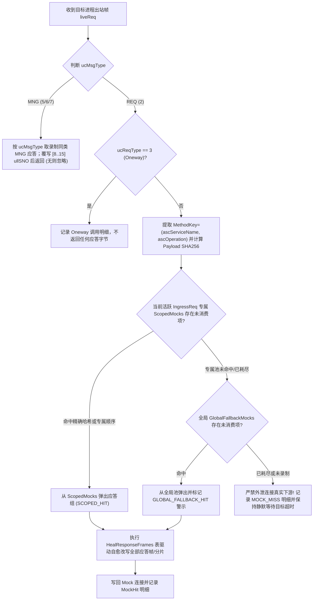

# 业务流量监控与重放 (`code-traefik`) 数据面引擎与 CROS RPC 协议栈设计

- **文档编号**：`02-data-plane-and-cros-rpc-engine.md`
- **文档版本**：v1.2.0
- **更新日期**：2026-10-29
- **归属阶段**：阶段二：系统架构与数据模型设计 (`02-design`)
- **状态**：定稿待审 (Ready for Review)
- **上位基线**：[`01-feature-matrix.md`](../01-features/01-feature-matrix.md) (v2.6.0)、[`01-cros-rpc-protocol-spec.md`](../07-references/01-cros-rpc-protocol-spec.md) (v1.0.0)、[`01-system-architecture.md`](./01-system-architecture.md)

---

## 1. 共享协议栈 `pkg/crosrpc` 设计（零 `.pb` 依赖）

`pkg/crosrpc` 为控制面（`cmd/server`）与数据面（`cmd/agent`）共用的底层纯 Go 协议解析库，严格遵循 DOPHI `cros_rpccore.ph` 网络大端序与 `#pragma pack(4)` 内存布局规范，**不引入任何 Protobuf 描述集或反射库**。

### 1.1 常量契约与 24B 公共头 (`RPC_COMM_HEAD_S`) 校验规则

```go
package crosrpc

const (
	MagicPrefix          = "CSE.TCP"               // 7B 固定魔术字 (0x43 0x53 0x45 0x2E 0x54 0x43 0x50)
	CommHeadLen          = 24                      // sizeof(RPC_COMM_HEAD_S)
	ExtendCommHeadLen    = 4                       // sizeof(RPC_EXTEND_COMM_HEAD_S)
	ServiceNameMaxLen    = 64                      // RPC_SERVICE_NAME_LEN
	OperationMaxLen      = 64                      // RPC_OPERATION_LEN
	ProcNameMaxLen       = 64                      // RPC_PROC_NAME_LEN
	TraceBuffLen         = 16                      // RPC_MSG_TRACE_BYTE_NUM
	MaxPayloadLen        = 32*1024*1024 - 4096     // RPC_PAYLOAD_MAX_LEN = 33,550,336 Bytes
	MaxExtendHeadType    = 63                      // RPC_EXTEND_HEAD_TYPE_BUTT

	TransportDefault     = uint8(0)                // RPC_TRANSPORT_DEFAULT
	TransportTCP         = uint8(1)                // RPC_TRANSPORT_TCP (本系统主要覆盖底座)

	MsgTypeReq           = uint8(2)                // RPC_MSG_TYPE_REQ
	MsgTypeRsp           = uint8(3)                // RPC_MSG_TYPE_RSP
	MsgTypeRspSeg        = uint8(4)                // RPC_MSG_TYPE_RSP_SEG
	MsgTypeMng           = uint8(5)                // RPC_MSG_TYPE_MNG
	MsgTypeMngReq        = uint8(6)                // RPC_MSG_TYPE_MNG_REQ
	MsgTypeUUIDReq       = uint8(7)                // RPC_MSG_TYPE_UUID_REQ
	MsgTypeButt          = uint8(15)               // RPC_MSG_TYPE_MNG_BUTT 合法上界(不含)

	ReqTypeSync          = uint8(1)                // 同步请求
	ReqTypeAsync         = uint8(2)                // 异步请求
	ReqTypeOneway        = uint8(3)                // 单向通知 (不期待应答)

	ExtTypeTraceKey      = uint8(0)                // RPC_EXTEND_HEAD_TYPE_TRACE_KEY
	ExtTypeTimeStamp     = uint8(1)                // RPC_EXTEND_HEAD_TYPE_TIME_STAMP
)
```

公共消息头线性偏移（Wire Offset `0..23`）合法性判定谓词 `ValidateCommHead(h CommHead)` 必须同时满足：
1. **魔术字与传输协议匹配**：`bytes.Equal(raw[0:7], []byte("CSE.TCP"))` 且 `h.TransportProto <= 1`（严格限定 TCP 明文底座 `0x01` 或缺省 `0x00`，杜绝未纳管非 TCP 杂散报文伪同步）；
2. **消息类型合法**：`2 <= h.MsgType && h.MsgType < 15`；
3. **最小会话头下界**：
   - `MsgType == 2 (REQ)`：`h.HeadLen >= 160`（`RPC_REQ_HEAD_V1_S` 最小长度）；
   - `MsgType == 3, 4 (RSP/RSP_SEG)`：`h.HeadLen >= 156`（`RPC_RSP_HEAD_V1_S` 最小长度）；
   - `MsgType == 5, 6, 7 (MNG)`：`h.HeadLen >= 88`（`RPC_MNG_HEAD_S` 定长 88B）；
4. **总长度与防溢出上界**：`uint32(h.HeadLen) <= h.Length` 且 `h.Length <= MaxPayloadLen + uint32(h.HeadLen)`。

### 1.2 流式分帧与滑动重同步状态机 (`StreamFramer`)

TCP 流式采集（尤其是连接中途介入或异常断包）会面临**前序脏字节、半包（Fragmentation）、粘包（Coalescing）与超采集阈值大包**四类场景。`StreamFramer` 为每条单向字节流（`(ConnKey, Direction)`）独立维护如下状态机：



> [!TIP]
> **合法超大包流式排空 (`DrainOversize`) vs 畸形包重同步的本质区分**：当 `uiLength` 符合 CROS RPC 规范（`<= 32MB`）但超过单帧落盘阈值（默认 `4MB`）时，绝不能直接清空缓冲重扫魔术字（否则 Payload 内部若碰巧出现 `"CSE.TCP"` 字面量会导致伪造分帧，或丢失紧随其后的正常粘包）。`DrainOversize` 精确按 `remainingToDiscard` 计数丢弃尾部字节，保证内存峰值不超过 `4MB` 的同时，使下一条报文完美对齐偏移 `0`。

### 1.3 多版本会话头（`#pragma pack(4)`）与扩展头长度驱动解析器

自 CROS RPC 2023.2 规范起，接收端采用**头长度驱动解析**代替硬编码版本号分支。解析器以 `frame[24 : 24+commHead.HeadLen]` 作为头部总切片：

#### 1.3.1 请求会话头 `RPC_REQ_HEAD_S` 精确字节布局（相对于偏移 `24`）

| 会话头内偏移 | 线上绝对偏移 | 长度 | 字段名 | C 类型 / 字节序 | 引入版本与累计结构体长度 |
| :---: | :---: | :---: | :--- | :--- | :--- |
| `0..1` | `24..25` | 2B | `usMsgStructVer` | `UINT16` (BE) | V00/V01 |
| `2..3` | `26..27` | 2B | `usReqHeadLen` | `UINT16` (BE) | V00/V01（指示本 Req 会话头实际字节数） |
| `4..7` | `28..31` | 4B | `uiDst2ndAddrId` | `UINT32` (BE) | V00/V01 |
| `8..71` | `32..95` | 64B | `ascServiceName` | `CHAR[64]` (`\0` 结尾) | V00/V01（格式 `{package}-{serviceName}`） |
| `72..135` | `96..159` | 64B | `ascOperation` | `CHAR[64]` (`\0` 结尾) | V00/V01（与 Protobuf Method 名相等） |
| `136` | `160` | 1B | `ucReqType` | `UINT8` | V00/V01（`1=Sync, 2=Async, 3=Oneway`） |
| `137` | `161` | 1B | `ucSubjectType` | `UINT8` | V00/V01 |
| `138..139` | `162..163` | 2B | `usRpcVer` | `UINT16` (BE) | V00/V01 |
| `140..143` | `164..167` | 4B | `uiSessionId` | `UINT32` (BE) | V00/V01 |
| **`144..159`** | **`168..183`** | **16B** | **`aucTraceBuff`** | `UCHAR[16]` | **V00/V01 终点 (`sizeof = 160B`)** |
| `160..167` | `184..191` | 8B | `ullIdempotentSeq` | `UINT64` (BE) | **V02 终点 (`sizeof = 168B`)** |
| `168..231` | `192..255` | 64B | `unSubjectName` | `CHAR[64]` / `UINT64` | **V03 终点 (`sizeof = 232B`)** |
| `232..239` | `256..263` | 8B | `ullClientUuid` | `UINT64` (BE) | V04 |
| `240..241` | `264..265` | 2B | `usUuidTimeoutS` | `UINT16` (BE) | V04 |
| `242..243` | `266..267` | 2B | `ucReserved[2]` | `UINT8[2]` | **V04 终点 (`sizeof = 244B`，4B 对齐无填充)** |
| `244..247` | `268..271` | 4B | `uiTimeOutSecondLimit` | `UINT32` (BE) | V05 |
| **`248..255`** | **`272..279`** | **8B** | **`ullSendTimeStamp`** | `UINT64` (BE) | **V05 终点 (`sizeof = 256B`)** |

#### 1.3.2 应答会话头 `RPC_RSP_HEAD_S` 表驱动布局规范（相对于会话头起始偏移）

为彻底消除解析端与重放自愈端因硬编码偏移导致的逻辑分歧，`pkg/crosrpc` 提供**权威表驱动布局结构体 (`RspLayout`)**：

| 会话头长度 (`usRspHeadLen`) | 结构体版本 | `aucTraceBuff` 范围 | `ullClientSendTime` 范围 | `ascServiceName` 范围 | `ascOperation` 范围 | `ullStatusCode` / `usRspMsgNo` 范围 |
| :---: | :---: | :---: | :---: | :---: | :---: | :---: |
| **`156 B`** | **V01 (兼容降级包)** | `[8..24]` | *无发送时间戳* | `[24..88]` (64B) | `[88..152]` (64B) | `usRspMsgNo`: `[152..154]` |
| **`164 B`** | **V02 (服务实例过渡包)** | `[8..24]` | *无发送时间戳* | `[32..96]` (64B) | `[96..160]` (64B) | `usRspMsgNo`: `[160..162]` |
| **`188 B`** | **V03 (定位性增强包)** | `[8..24]` | `[32..40]` (8B 大端) | `[56..120]` (64B) | `[120..184]` (64B) | `usRspMsgNo`: `[184..186]` |
| **`200 B`** | **V04 (现代标准结构)** | `[8..24]` | `[32..40]` (8B 大端) | `[56..120]` (64B) | `[120..184]` (64B) | `ullStatusCode`: `[184..192]`, `usRspMsgNo`: `[192..194]` |

`pkg/crosrpc` 统一导出 `LookupRspLayout(headLen int) (*RspLayout, error)`。若遇到未注册的非标长度，显式报错 `ErrUnknownRspLayout`，严禁使用盲目模糊推断。

#### 1.3.3 管理会话头 `RPC_MNG_HEAD_S`（`ucMsgType = 5/6/7`，定长 `88B`）

相对于偏移 `24`：`usRole` (`0..1`)、`usType` (`2..3`)、`bRspResult` (`4..7`, 4B `BOOL`)、`acProcName[64]` (`8..71`)、`uiProcRet` (`72..75`)、`bSvrAuthorize` (`76..79`, 4B `BOOL`)、`ucEnCryption` (`80`)、`ucEnIntegrity` (`81`)、`ucCipherSuite` (`82`)、`aucReserved[5]` (`83..87`)。

#### 1.3.4 扩展头链式解析器 (`24 + sessionHeadLen .. 24 + commHead.HeadLen`)

当 `commHead.HeadLen > sessionHeadLen` 时，对剩余头部切片循环读取：
1. 读取 4B `RPC_EXTEND_COMM_HEAD_S`：`extLen = BigEndian.Uint16(b[0:2])`，`extType = b[2]`；
2. 边界校验：`4 + int(extLen) <= len(remaining)` 且 `extType < 63` 且 `extLen % 8 == 0`（8 字节对齐约束）；若越界则终止扩展头解析并标记扩展头告警，不影响 Payload 起始偏移 `24 + commHead.HeadLen`；
3. 按 `extType` 提取已知扩展头（未知 `extType` 保留原始 Hex 前向兼容跳过）：
   - `extType == 0 (TRACE_KEY, extLen >= 32)`：大端读取 `TraceID = b[4:12]`、`SpanID = b[12:20]`、`FatherSpanID = b[20:28]`、`RecordSwitch = b[28]`；
   - `extType == 1 (TIME_STAMP, extLen >= 8)`：大端读取 `ServerEnqueueTime = b[4:12]`（回归 Diff 固定豁免）。

### 1.4 `pkg/crosrpc` 核心导出数据结构

```go
package crosrpc

// RspLayout 表驱动应答会话头字段区间
type RspLayout struct {
	Version              string
	HeadLen              int
	TraceBuffOffset      int
	TraceBuffLen         int
	ClientSendTimeOffset int // 0 表示当前版本无此字段
	ServiceNameOffset    int
	OperationOffset      int
	StatusCode64Offset   int // 0 表示当前版本仅有 32 位状态码
	RspMsgNoOffset       int
}

// LookupRspLayout 依据会话头实际字节数检索权威字段偏移映射
func LookupRspLayout(headLen int) (*RspLayout, error)

// ParsedPacket 表示单帧 CROS RPC 协议头完整解析结果（零 Payload 反序列化开销）
type ParsedPacket struct {
	Comm          CommHead       `json:"comm"`
	Req           *ReqHead       `json:"req,omitempty"`
	Rsp           *RspHead       `json:"rsp,omitempty"`
	Mng           *MngHead       `json:"mng,omitempty"`
	ExtendHeads   []ExtendHead   `json:"extend_heads,omitempty"`
	Trace         *TraceKeyExt   `json:"trace,omitempty"`
	ServerEnqueue *uint64        `json:"server_enqueue_time,omitempty"`
	PayloadOffset int            `json:"payload_offset"` // 恒等于 24 + int(Comm.HeadLen)
	PayloadLen    int            `json:"payload_len"`    // 实际保留帧中的 Payload 字节长度
	IsTruncated   bool           `json:"is_truncated"`
}

// SplitFrames 按 CROS RPC 24B 公共头 ("CSE.TCP" + 24 + uiLength) 无损切分连续拼接的多段帧切片
func SplitFrames(concatenated []byte) ([][]byte, error)
```

---

## 2. Agent 嵌入式 `cilium/ebpf` 采集引擎 (`pkg/ebpf`)

Agent 在进程内通过 `github.com/cilium/ebpf` 加载预编译的 CO-RE BPF 字节码（`bpf2go` 生成），单套探针同时服务宿主机上全部被纳管的目标业务进程（`1 Agent : N Processes`）。目标环境为现代 Linux 内核（Ubuntu/SUSE 等主流发行版，Linux Kernel `>= 5.8`，支持 `BPF_MAP_TYPE_RINGBUF`、`cgroup v2` 与 `bpf_link`）。

### 2.1 内核钩子矩阵与 BPF Maps 设计

（钩子选型权衡详见 [`docs/05-adr/02-ebpf-hook-and-dual-subsystem-adr.md`](../05-adr/02-ebpf-hook-and-dual-subsystem-adr.md)）

| BPF Map 名称 | Map 类型 | Key 结构 | Value 结构 | 容量上限 | 核心用途 |
| :--- | :--- | :--- | :--- | :---: | :--- |
| `agent_cfg_map` | `ARRAY` | `uint32 (0)` | `struct agent_cfg { uint32 agent_pid; uint16 proxy_port; uint16 mock_port; }` | `1` | 存储 Agent 自身 PID（自环豁免）与本地代理/Mock 端口 |
| `target_pids_map` | `HASH` | `uint32 pid` | `struct target_proc { uint64 session_id; uint64 process_id; uint16 listen_port; uint8 mode; }` | `1024` | `O(1)` 判定当前进程是否为被监控目标进程及监听端口 |
| `active_rw_args_map` | `HASH` | `uint64 tgid_pid` | `struct rw_args { void *buf; int32 fd; uint8 is_read; }` | `16384` | 系统调用 `sys_enter_*` 暂存用户空间缓冲区指针与文件描述符 |
| `ing_conn_map` | `LRU_HASH` | `struct pid_fd { uint32 pid; int32 fd; }` | `struct conn_tuple { uint32 src_ip; uint32 dst_ip; uint16 src_port; uint16 dst_port; uint32 conn_seq; uint64 stream_off_rx; uint64 stream_off_tx; }` | `65536` | 记录目标进程监听端口 `accept` 的入站连接 FD 四元组与流内累计字节偏移 |
| `downstream_rules_map` | `HASH` | `struct ds_key { uint64 process_id; uint32 dst_ip; uint16 dst_port; uint16 pad; }` | `struct ds_target { uint16 redirect_port; uint8 is_replay; uint8 pad; }` | `4096` | `O(1)` 匹配目标进程允许重定向的下游 `IP:Port`（录制转代理，重放转 Mock） |
| `cookie_orig_dst_map` | `LRU_HASH` | `uint64 sock_cookie` | `struct orig_dst { uint64 process_id; uint32 pid; uint32 orig_ip; uint16 orig_port; uint16 pad; }` | `65536` | `connect4` 阶段暂存 Socket Cookie 对应的原始下游目的地址 |
| `nat_tuple_map` | `LRU_HASH` | `struct client_addr { uint32 ip; uint16 port; uint16 pad; }` | `struct orig_dst` | `65536` | `sock_ops` 握手完成时按客户端临时端口归档，供用户态代理 `Accept` 反查 |
| `ing_ringbuf` | `RINGBUF` | - | 变长 `struct ing_data_event`（含 `stream_off` 累计偏移，单分片最大 32KB） | `16 MB` | 内核向用户态零拷贝异步投递入站收发字节流 |
| `connect_observe_ringbuf` | `RINGBUF` | - | `struct conn_observe_event { uint32 pid; uint32 dst_ip; uint16 dst_port; }` | `1 MB` | 内核向用户态投递目标进程发起的未声明出站连接事件（支撑 `VIOLATION` 检测） |
| `ebpf_stats_map` | `PERCPU_ARRAY` | `uint32 stat_idx` | `uint64 counter` | `8` | 统计 `stat_bypassed_self`、`stat_ringbuf_drops`、`stat_redirected` |

### 2.2 入站被动旁路复制机制 (`INGRESS Passive Copy`)

入站采集**完全不经过用户态代理**，对业务 TCP 链路零修改、零附加网络跳数：

1. **入站连接 FD 建表与存量预热**：
   - **增量连接**：挂载 `kretprobe/inet_csk_accept` 与 `tracepoint/syscalls/sys_exit_accept4` / `sys_exit_accept`，当 `pid` 命中 `target_pids_map` 且新建立的 IPv4 Socket 本地端口 `skc_num == target_proc.listen_port` 时，将 `(pid, ret_fd) -> conn_tuple` 写入 `ing_conn_map`。
   - **存量入站连接预热**：下发监控瞬间，Agent 在用户态扫描 `/proc/<pid>/fd` 与 `/proc/<pid>/net/tcp`，将已处于 `ESTABLISHED` 且本地端口等于 `listen_port` 的 `(pid, fd)` 预写入 `ing_conn_map`。
2. **收发字节旁路复制与暂存关联**：
   - 挂载系统调用跟踪点：`sys_enter/exit_read`、`sys_enter/exit_recvfrom`、`sys_enter/exit_recvmsg`、`sys_enter/exit_readv`（入站请求 `INGRESS REQ`）与 `sys_enter/exit_write`、`sys_enter/exit_sendto`、`sys_enter/exit_sendmsg`、`sys_enter/exit_writev`（入站应答 `INGRESS RSP`）。
   - **进入钩子 (`sys_enter_*`)**：提取 `tgid_pid = bpf_get_current_pid_tgid()`，快速判定 `pid` 是否在 `target_pids_map` 且 `fd` 在 `ing_conn_map` 中；命中则将缓冲区指针或 `iovec` 结构写入 `active_rw_args_map[tgid_pid]`。
   - **退出钩子 (`sys_exit_*`)**：从 `active_rw_args_map` 取出暂存参数并清理条目；若返回值 `ret_bytes > 0`，提取流内累计偏移 `stream_off`（原子加 `ret_bytes`），按最大 `32KB` 块调用 `bpf_probe_read_user` 拷贝数据并写入 `ing_ringbuf`。
3. **丢包感知与分帧重组 (`Gap-Aware StreamFramer`)**：
   - `struct ing_data_event` 明确包含字段 `uint64 stream_off` 与 `uint32 data_len`；
   - 用户态 `ebpf.IngressReader` 按 `(pid, conn_seq, stream_dir)` 维护期待接收偏移 `expected_off`；若 `stream_off != expected_off`，表明 ringbuf 满载丢包导致字节断流，分帧器立即标记 `HAS_GAP` 并清空当前半包缓存、重新扫描 `CSE.TCP` 魔术字对齐；该连接当前未完成的往返记录落盘标记 `is_replayable = false`，杜绝内容错乱报文污染重放资产。
   - 挂载 `sys_enter_close`：连接关闭时从 `ing_conn_map` 删除 `(pid, fd)`，并向用户态发送 `EVENT_CONN_CLOSED`。

### 2.3 出站透明重定向、自环豁免与未声明连接物理检出 (`EGRESS Redirect & Violation Detection`)



1. **内核态重定向与重放 Fail-Closed 算法（BPF C 核心逻辑）**：
   ```c
   SEC("cgroup/connect4")
   int cros_connect4(struct bpf_sock_addr *ctx) {
       if (ctx->family != AF_INET || (ctx->protocol != IPPROTO_TCP && ctx->protocol != 0))
           return 1;
       __u32 pid = bpf_get_current_pid_tgid() >> 32;
       struct agent_cfg *cfg = bpf_map_lookup_elem(&agent_cfg_map, &zero);
       if (!cfg) return 1;

       // 核心红线 1：Agent 自身进程发起的一切出站连接直接放行，杜绝同机互调死锁
       if (pid == cfg->agent_pid) {
           incr_stat(STAT_BYPASSED_SELF);
           return 1;
       }
       struct target_proc *tp = bpf_map_lookup_elem(&target_pids_map, &pid);
       if (!tp) return 1; // 非纳管目标进程，原样放行

       struct ds_key key = { .process_id = tp->process_id, .dst_ip = ctx->user_ip4, .dst_port = ctx->user_port };
       struct ds_target *dst = bpf_map_lookup_elem(&downstream_rules_map, &key);
       if (!dst) {
           // 兼容同机通过 127.0.0.1 访问已登记宿主机下游端口
           key.dst_ip = bpf_htonl(0x7f000001);
           dst = bpf_map_lookup_elem(&downstream_rules_map, &key);
       }

       // 未命中下游重定向规则分支
       if (!dst) {
           // 重放模式下执行 Fail-Closed：严禁未声明连接外泄到真实网络，直接拒绝建连
           if (tp->mode == MODE_REPLAY) {
               return 0; // 返回 0 (EPERM)，内核强制阻断连接
           }
           // 录制模式下：若访问已知业务端口或 CROS RPC 候选端口，投递观测事件以检出架构漂移 (VIOLATION)
           struct conn_observe_event obs = {
               .process_id = tp->process_id, .pid = pid,
               .dst_ip = ctx->user_ip4, .dst_port = ctx->user_port,
           };
           bpf_ringbuf_output(&connect_observe_ringbuf, &obs, sizeof(obs), 0);
           return 1; // 原样放行
       }

       __u64 cookie = bpf_get_socket_cookie(ctx);
       struct orig_dst od = {
           .process_id = tp->process_id, .pid = pid,
           .orig_ip = ctx->user_ip4, .orig_port = ctx->user_port,
       };
       bpf_map_update_elem(&cookie_orig_dst_map, &cookie, &od, BPF_ANY);

       ctx->user_ip4 = bpf_htonl(0x7f000001); // 重定向到 127.0.0.1 本地代理或 MockServer
       ctx->user_port = dst->redirect_port;
       incr_stat(STAT_REDIRECTED);
       return 1;
   }
   ```
2. **原始目的地址还原与同机 INGRESS 对端反查**：
   - 客户端建立连接时，在 `BPF_SOCK_OPS_ACTIVE_ESTABLISHED_CB` 取出 `orig_dst` 写入 `nat_tuple_map[{local_ip, local_port}]`；
   - **同机跨进程入站反查机制**：当目标进程 `B` 收到入站连接时，其客户端 IP 为本机 IP（或 `127.0.0.1`）；Agent 用户态读取宿主机 `/proc/net/tcp`，凭对端客户端临时端口查询对应 Socket inode，反查出所属进程 PID。若属于同机纳管进程 `A`，则精确绑定 `SrcProcessID = A.ID`，彻底解决未声明调用被误判为 `EXTERNAL_CALLER` 的盲区问题。

### 2.4 内核事件热监听、探针生命周期卫生与内存预算

1. **进程重启同步热更新 (`sched_process_exec`)**：
   - 为消除业务进程重启到 2s 巡检之间的长连接建连盲区，Agent 挂载 `tracepoint/sched/sched_process_exec`；
   - 当检测到执行的二进制路径或进程名命中被监控进程特征时，内核态**同步微秒级**将新 `PID` 写入 `target_pids_map`，使得业务进程初始化时发起的下游长连接能够 100% 被 `cgroup/connect4` 拦截；2s 间隔的 `ProcWatcher` 作为用户态辅助对账。
2. **完整特权集与内核探针卫生保证**：
   - Agent 启动时校验 Effective Capability 集合必须同时包含：**`CAP_BPF`、`CAP_NET_ADMIN`、`CAP_PERFMON` 与 `CAP_SYS_PTRACE`**（用于读取宿主机各目标进程 `/proc/<pid>/fd`）；
   - **基于 `bpf_link` 的零残留保证**：所有 cgroup 与 tracepoint 钩子必须通过 `cilium/ebpf/link` 挂载，**严禁将 Map 或 Program pin 到 bpffs**。当 Agent 正常退出、被 `SIGTERM` 或发生异常崩溃/OOM 时，操作系统自动回收进程持有的 link 文件描述符，所有内核探针瞬间自动脱落，绝不在宿主机留下悬挂钩子。
3. **Framer 全局内存预算池 (`GlobalFramerBudgetPool`)**：
   - Agent 单机所有被监控连接的 `StreamFramer` 共享一个最大为 `64MB` 的内存预算池；
   - 当遇到上千条长连接且并发分帧时，若全局使用量超过上限，按照 LRU 策略淘汰长时间无数据传输连接的分帧缓存，绝不突破 Agent 物理内存红线。

---

## 3. 零 `.pb` 纯二进制 Mock 匹配与自愈引擎 (`pkg/replay`)

在离线重放模式下，下游真实 CROS RPC 服务已关闭或网络隔离（A-06）。Agent 在本地独立完成**入站请求注入**与**出站下游二进制 Mock 自愈应答**，全流程无需知道 Payload 内部任何业务字段含义，天然支持将公共（`SHARED`）或个人（`PRIVATE`）录制素材投递到任意承载相同公共架构模块的目标进程（含开发者本人 `PRIVATE` Agent 上的本地测试进程）执行重放。

### 3.1 重放执行拓扑与请求注入器 (`ReplayExecutor`)

1. **挂载跨环境兼容隔离规则与 Fail-Closed 闭环**：
   - 主控在编译重放规格时，自动取「目标进程自身推导/登记的下游端点集合」与「源录制批次中观测到的全部 `EGRESS` 原始 `dst_addr`（`IP:Port`）集合」的**并集**下发 Agent；
   - Agent 将这些端点在 `downstream_rules_map` 中统一指向本地 `MockServer` 监听端口（`is_replay = 1`）。由于内核态 `connect4` 对未命中规则的出站连接执行 `Fail-Closed (return 0 EPERM)`，彻底杜绝待测新代码发起未录制的新下游连接逃逸至真实生产/测试网络；
   - **Mock 资产合格性门禁**：主控下发前严格剔除 `is_truncated == true`（超限截断帧）与 `exchange_type == 'REQ_ONLY'`（录制期挂起未等到应答帧）的记录，确保下发的下游 Mock 均为协议合规且分片完整的二进制数据。
2. **连接注入与多连接会话还原**：
   - Agent 注入器通过 `/proc/net/tcp` 探知目标进程绑定的实际监听地址（如特定网卡 IP 或 `127.0.0.1`）及 `ListenPort` 建立 TCP 注入连接（注入协程 `pid == agent_pid`，不受重定向影响）；
   - 若录制会话中存在前置 `MNG` 管理消息帧（A-08），注入器按原连接时序先发送入站 MNG 帧；
   - 按选定顺序逐条发送 `IngressRequests` 原始切片；每发送一条同步/异步请求（`ucReqType != 3`），在连接上的 `StreamFramer` 中等待相同 `ullSNO` 的应答帧（若收到 `ucMsgType == 4 (RSP_SEG)` 则持续收集各分片直至收到终结帧，单请求最长等待 `TimeoutMs` 默认 `30s`）。

### 3.2 分层作用域与双级无 Schema 二进制 Mock 匹配算法 (`ScopedMockMatcher`)

为杜绝单批次多请求因全局顺序兜底导致的“张冠李戴”（例如第 10 次请求因为带时间戳无法精确哈希命中，却意外弹出了第 1 次请求录制的旧应答），`pkg/replay` 采用**「因果链路局部优先 + 全局顺序兜底」**的分层匹配模型：

1. **局部作用域索引与切分**：
   - 主控在下发重放包时，基于入站请求的 `SpanID` 与出站请求的 `FatherSpanID`（或录制期请求往返时间窗口 `[req_ns, rsp_ns]`），将每条入站请求所引发的下游出站调用划归为该请求的专属局部池 `ScopedMocks[record_id]`；
   - 每个局部池内部构建 `ExactMap[MethodKey + PayloadSHA256] -> []MockRspFrames` 及 `SeqQueue[MethodKey] -> []MockRspFrames`；
   - 同时维护一个批次级只读全局兜底池 `GlobalFallbackMocks`。



### 3.3 基于 `RspLayout` 表驱动的原地二进制自愈覆写 (`HealResponseFrames`)

DOPHI CROS RPC 客户端在收到应答帧时，会严格核对公共头序列号 `ullSNO`、会话头回显的 `aucTraceBuff`、发送时间戳 `ullClientSendTime` 以及服务方法名。`pkg/replay` 严禁使用松散的手工偏移硬编码，必须统一调用 `pkg/crosrpc.LookupRspLayout` 表驱动检索并覆写：

```go
package replay

import (
	"encoding/binary"
	"errors"

	"code-traefik/pkg/crosrpc"
)

var (
	ErrFrameTooShort = errors.New("crosrpc frame length below minimum header")
)

// HealSingleResponseFrame 基于当前实时下游请求帧 liveReq，对单帧录制应答帧 mockRsp 执行表驱动原地头部自愈覆写
func HealSingleResponseFrame(liveReq []byte, mockRsp []byte) ([]byte, error) {
	if len(liveReq) < crosrpc.CommHeadLen || len(mockRsp) < crosrpc.CommHeadLen {
		return nil, ErrFrameTooShort
	}
	healed := make([]byte, len(mockRsp))
	copy(healed, mockRsp)

	// 1. 覆写公共头偏移 8..15 的 8B 大端请求序列号 ullSNO
	copy(healed[8:16], liveReq[8:16])

	// 读取双方会话头实际长度 (偏移 26..27: usReqHeadLen / usRspHeadLen, 大端)
	reqSessionLen := int(binary.BigEndian.Uint16(liveReq[26:28]))
	rspSessionLen := int(binary.BigEndian.Uint16(healed[26:28]))
	if reqSessionLen > len(liveReq)-crosrpc.CommHeadLen {
		reqSessionLen = len(liveReq) - crosrpc.CommHeadLen
	}
	if rspSessionLen > len(healed)-crosrpc.CommHeadLen {
		rspSessionLen = len(healed) - crosrpc.CommHeadLen
	}

	reqSession := liveReq[crosrpc.CommHeadLen : crosrpc.CommHeadLen+reqSessionLen]
	rspSession := healed[crosrpc.CommHeadLen : crosrpc.CommHeadLen+rspSessionLen]

	// 2. 依据 usRspHeadLen 检索权威字段偏移布局表 (V1~V4)
	layout, err := crosrpc.LookupRspLayout(rspSessionLen)
	if err != nil {
		return nil, err
	}

	// 3. 覆写 Trace 缓冲回显: RPC_RSP_HEAD_S[layout.TraceBuffOffset] <- RPC_REQ_HEAD_S[144..160] (aucTraceBuff[16])
	if reqSessionLen >= 160 && layout.TraceBuffOffset+layout.TraceBuffLen <= rspSessionLen {
		copy(rspSession[layout.TraceBuffOffset:layout.TraceBuffOffset+layout.TraceBuffLen], reqSession[144:160])
	}

	// 4. 覆写客户端发送时间戳回显 (V3+ 应答头):
	//    若实时请求为 V5+ (reqSessionLen >= 256)，回填 RPC_REQ_HEAD_S[248..256] 的 ullSendTimeStamp；
	//    若实时请求低于 V5 无发送时间戳，则清零该 8B
	if layout.ClientSendTimeOffset > 0 && layout.ClientSendTimeOffset+8 <= rspSessionLen {
		if reqSessionLen >= 256 {
			copy(rspSession[layout.ClientSendTimeOffset:layout.ClientSendTimeOffset+8], reqSession[248:256])
		} else {
			clear(rspSession[layout.ClientSendTimeOffset : layout.ClientSendTimeOffset+8])
		}
	}

	// 5. 校验并同步服务名与方法名回显
	if reqSessionLen >= 136 && layout.ServiceNameOffset+64 <= rspSessionLen && layout.OperationOffset+64 <= rspSessionLen {
		copy(rspSession[layout.ServiceNameOffset:layout.ServiceNameOffset+64], reqSession[8:72])
		copy(rspSession[layout.OperationOffset:layout.OperationOffset+64], reqSession[72:136])
	}

	return healed, nil
}
```

* **多段分片应答 (`RSP_SEG`) 连续切片自愈保障**：当一次下游调用录制有 $K$ 个响应片段（如 `RSP_SEG #0`, `RSP_SEG #1`, `RSP #2`）时，`HealResponseFrames` 按 `usRspMsgNo` 录制原序遍历全部 $K$ 个片段，逐片调用 `HealSingleResponseFrame(liveReq, seg_k)` 后依次写入 Mock Socket，确保分片流在客户端侧无缝重组。

* **多段分片应答 (`RSP_SEG`) 自愈保障**：当一次下游调用录制有 $K$ 个响应片段（如 `RSP_SEG #0`, `RSP_SEG #1`, `RSP #2`）时，`HealResponseFrames` 按 `usRspMsgNo` 录制原序遍历全部 $K$ 个片段，逐片调用 `HealSingleResponseFrame(liveReq, seg_k)` 后依次写入 Mock Socket，确保分片流在客户端侧无缝重组。
