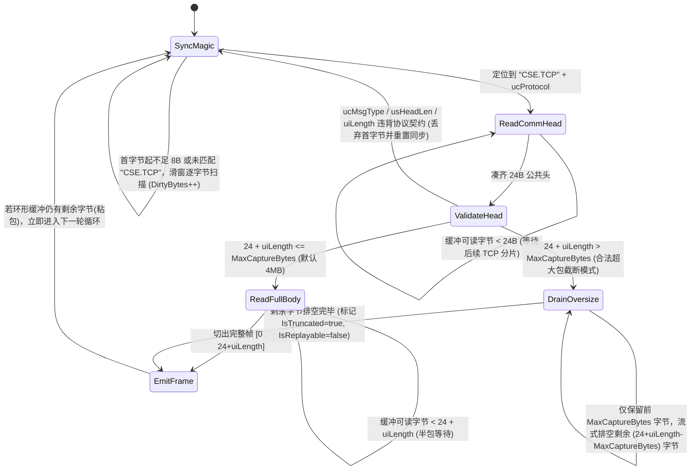
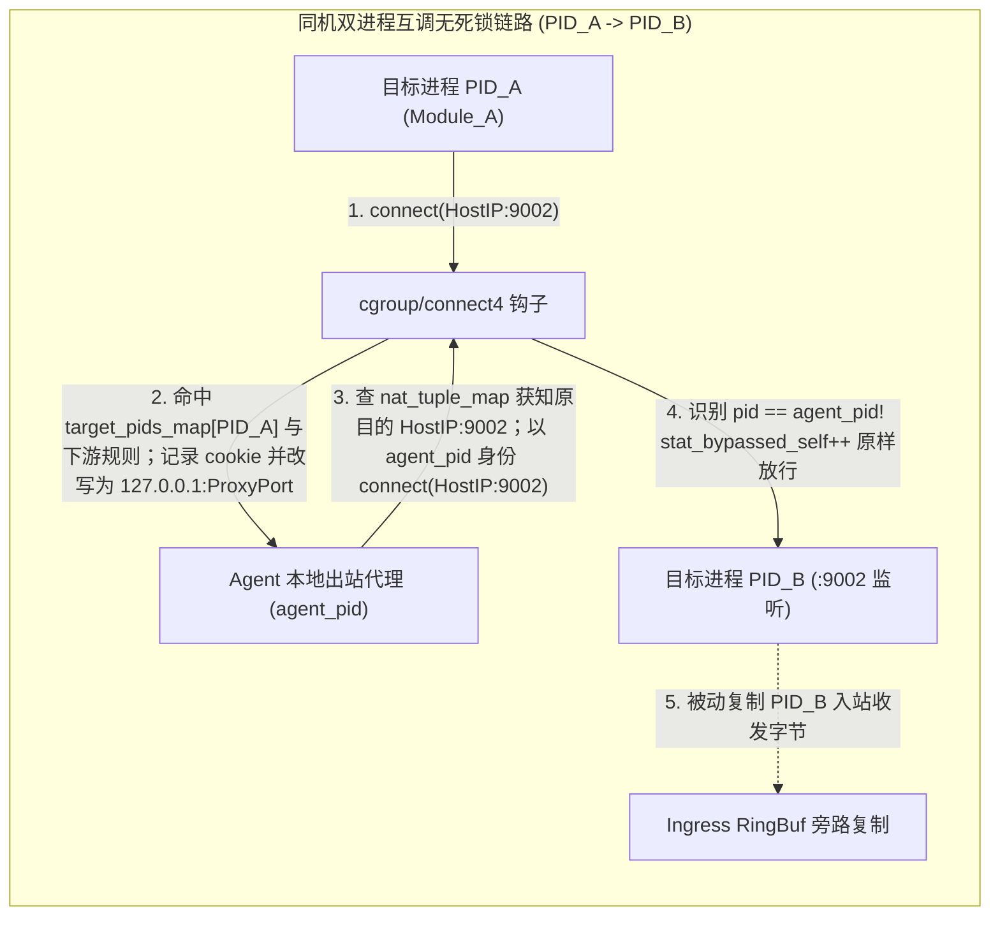
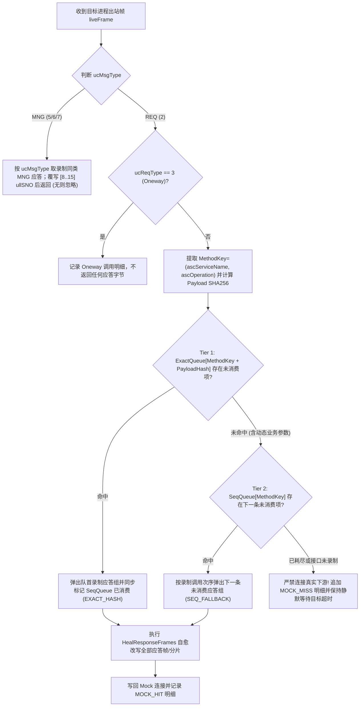

# 业务流量监控与重放 (`code-traefik`) 数据面引擎与 CROS RPC 协议栈设计

- **文档编号**：`02-data-plane-and-cros-rpc-engine.md`
- **文档版本**：v1.1.0
- **更新日期**：2026-10-29
- **归属阶段**：阶段二：系统架构与数据模型设计 (`02-design`)
- **状态**：已定稿 (Frozen)
- **上位基线**：[`01-feature-matrix.md`](../01-features/01-feature-matrix.md) (v2.6.0)、[`01-cros-rpc-protocol-spec.md`](../07-references/01-cros-rpc-protocol-spec.md) (v1.0.0)、[`01-system-architecture.md`](./01-system-architecture.md)

---

## 1. 共享协议栈 `pkg/crosrpc` 设计（零 `.pb` 依赖）

`pkg/crosrpc` 为控制面（`cmd/server`）与数据面（`cmd/agent`）共用的底层纯 Go 协议解析库，严格遵循 DOPHI `cros_rpccore.ph` 网络大端序与 `#pragma pack(4)` 内存布局规范，**不引入任何 Protobuf 描述集或反射库**。

### 1.1 常量契约与 24B 公共头 (`RPC_COMM_HEAD_S`) 校验规则

```go
package crosrpc

const (
	MagicPrefix          = "CSE.TCP"               // 7B 固定魔术字 (0x43 0x53 0x45 0x2E 0x54 0x43 0x50)
	CommHeadLen          = 24                      // sizeof(RPC_COMM_HEAD_S)
	ExtendCommHeadLen    = 4                       // sizeof(RPC_EXTEND_COMM_HEAD_S)
	ServiceNameMaxLen    = 64                      // RPC_SERVICE_NAME_LEN
	OperationMaxLen      = 64                      // RPC_OPERATION_LEN
	ProcNameMaxLen       = 64                      // RPC_PROC_NAME_LEN
	TraceBuffLen         = 16                      // RPC_MSG_TRACE_BYTE_NUM
	MaxPayloadLen        = 32*1024*1024 - 4096     // RPC_PAYLOAD_MAX_LEN = 33,550,336 Bytes
	MaxExtendHeadType    = 63                      // RPC_EXTEND_HEAD_TYPE_BUTT

	MsgTypeReq           = uint8(2)                // RPC_MSG_TYPE_REQ
	MsgTypeRsp           = uint8(3)                // RPC_MSG_TYPE_RSP
	MsgTypeRspSeg        = uint8(4)                // RPC_MSG_TYPE_RSP_SEG
	MsgTypeMng           = uint8(5)                // RPC_MSG_TYPE_MNG
	MsgTypeMngReq        = uint8(6)                // RPC_MSG_TYPE_MNG_REQ
	MsgTypeUUIDReq       = uint8(7)                // RPC_MSG_TYPE_UUID_REQ
	MsgTypeButt          = uint8(15)               // RPC_MSG_TYPE_MNG_BUTT 合法上界(不含)

	ReqTypeSync          = uint8(1)                // 同步请求
	ReqTypeAsync         = uint8(2)                // 异步请求
	ReqTypeOneway        = uint8(3)                // 单向通知 (不期待应答)

	ExtTypeTraceKey      = uint8(0)                // RPC_EXTEND_HEAD_TYPE_TRACE_KEY
	ExtTypeTimeStamp     = uint8(1)                // RPC_EXTEND_HEAD_TYPE_TIME_STAMP
)
```

公共消息头线性偏移（Wire Offset `0..23`）合法性判定谓词 `ValidateCommHead(h CommHead)` 必须同时满足：
1. **魔术字匹配**：`bytes.Equal(raw[0:7], []byte("CSE.TCP"))` 且 `ucProtocol <= 7`；
2. **消息类型合法**：`2 <= h.MsgType && h.MsgType < 15`；
3. **最小会话头下界**：
   - `MsgType == 2 (REQ)`：`h.HeadLen >= 160`（`RPC_REQ_HEAD_V1_S` 最小长度）；
   - `MsgType == 3, 4 (RSP/RSP_SEG)`：`h.HeadLen >= 156`（`RPC_RSP_HEAD_V1_S` 最小长度）；
   - `MsgType == 5, 6, 7 (MNG)`：`h.HeadLen >= 88`（`RPC_MNG_HEAD_S` 定长 88B）；
4. **总长度与防溢出上界**：`uint32(h.HeadLen) <= h.Length` 且 `h.Length <= MaxPayloadLen + uint32(h.HeadLen)`。

### 1.2 流式分帧与滑动重同步状态机 (`StreamFramer`)

TCP 流式采集（尤其是连接中途介入或异常断包）会面临**前序脏字节、半包（Fragmentation）、粘包（Coalescing）与超采集阈值大包**四类场景。`StreamFramer` 为每条单向字节流（`(ConnKey, Direction)`）独立维护如下状态机：



> [!TIP]
> **合法超大包流式排空 (`DrainOversize`) vs 畸形包重同步的本质区分**：当 `uiLength` 符合 CROS RPC 规范（`<= 32MB`）但超过单帧落盘阈值（默认 `4MB`）时，绝不能直接清空缓冲重扫魔术字（否则 Payload 内部若碰巧出现 `"CSE.TCP"` 字面量会导致伪造分帧，或丢失紧随其后的正常粘包）。`DrainOversize` 精确按 `remainingToDiscard` 计数丢弃尾部字节，保证内存峰值不超过 `4MB` 的同时，使下一条报文完美对齐偏移 `0`。

### 1.3 多版本会话头（`#pragma pack(4)`）与扩展头长度驱动解析器

自 CROS RPC 2023.2 规范起，接收端采用**头长度驱动解析**代替硬编码版本号分支。解析器以 `frame[24 : 24+commHead.HeadLen]` 作为头部总切片：

#### 1.3.1 请求会话头 `RPC_REQ_HEAD_S` 精确字节布局（相对于偏移 `24`）

| 会话头内偏移 | 线上绝对偏移 | 长度 | 字段名 | C 类型 / 字节序 | 引入版本与累计结构体长度 |
| :---: | :---: | :---: | :--- | :--- | :--- |
| `0..1` | `24..25` | 2B | `usMsgStructVer` | `UINT16` (BE) | V00/V01 |
| `2..3` | `26..27` | 2B | `usReqHeadLen` | `UINT16` (BE) | V00/V01（指示本 Req 会话头实际字节数） |
| `4..7` | `28..31` | 4B | `uiDst2ndAddrId` | `UINT32` (BE) | V00/V01 |
| `8..71` | `32..95` | 64B | `ascServiceName` | `CHAR[64]` (`\0` 结尾) | V00/V01（格式 `{package}-{serviceName}`） |
| `72..135` | `96..159` | 64B | `ascOperation` | `CHAR[64]` (`\0` 结尾) | V00/V01（与 Protobuf Method 名相等） |
| `136` | `160` | 1B | `ucReqType` | `UINT8` | V00/V01（`1=Sync, 2=Async, 3=Oneway`） |
| `137` | `161` | 1B | `ucSubjectType` | `UINT8` | V00/V01 |
| `138..139` | `162..163` | 2B | `usRpcVer` | `UINT16` (BE) | V00/V01 |
| `140..143` | `164..167` | 4B | `uiSessionId` | `UINT32` (BE) | V00/V01 |
| **`144..159`** | **`168..183`** | **16B** | **`aucTraceBuff`** | `UCHAR[16]` | **V00/V01 终点 (`sizeof = 160B`)** |
| `160..167` | `184..191` | 8B | `ullIdempotentSeq` | `UINT64` (BE) | **V02 终点 (`sizeof = 168B`)** |
| `168..231` | `192..255` | 64B | `unSubjectName` | `CHAR[64]` / `UINT64` | **V03 终点 (`sizeof = 232B`)** |
| `232..239` | `256..263` | 8B | `ullClientUuid` | `UINT64` (BE) | V04 |
| `240..241` | `264..265` | 2B | `usUuidTimeoutS` | `UINT16` (BE) | V04 |
| `242..243` | `266..267` | 2B | `ucReserved[2]` | `UINT8[2]` | **V04 终点 (`sizeof = 244B`，4B 对齐无填充)** |
| `244..247` | `268..271` | 4B | `uiTimeOutSecondLimit` | `UINT32` (BE) | V05 |
| **`248..255`** | **`272..279`** | **8B** | **`ullSendTimeStamp`** | `UINT64` (BE) | **V05 终点 (`sizeof = 256B`)** |

#### 1.3.2 应答会话头 `RPC_RSP_HEAD_S` 精确字节布局（相对于偏移 `24`）

现代协商结构（V02~V04，由 `usRspHeadLen` 判定可用字段边界；若遇老版本 `RPC_RSP_HEAD_V1_S` 降级包即 `usRspHeadLen == 156`，自动切换 V1 偏移映射 `ascServiceName=24..87`、`ascOperation=88..151`、`usRspMsgNo=152..153`）：

| 会话头内偏移 | 线上绝对偏移 | 长度 | 字段名 | C 类型 / 字节序 | 引入版本与说明 |
| :---: | :---: | :---: | :--- | :--- | :--- |
| `0..1` | `24..25` | 2B | `usMsgStructVer` | `UINT16` (BE) | V00~V04 |
| `2..3` | `26..27` | 2B | `usRspHeadLen` | `UINT16` (BE) | 本 Rsp 会话头实际字节数（V04 为 `200B`） |
| `4..7` | `28..31` | 4B | `uiStatusCode` | `UINT32` (BE) | 32 位状态返回码（`0` 表示成功） |
| **`8..23`** | **`32..47`** | **16B** | **`aucTraceBuff`** | `UCHAR[16]` | **回显请求头偏移 `144..159` 的 Trace 缓冲** |
| `24..27` | `48..51` | 4B | `uiSvrInstId` | `UINT32` (BE) | V02 服务实例 ID |
| `28..31` | `52..55` | 4B | `uiReserved` | `UINT32` (BE) | 预留对齐 |
| **`32..39`** | **`56..63`** | **8B** | **`ullClientSendTime`** | `UINT64` (BE) | **V03 引入：回显请求头偏移 `248..255` 发送时间** |
| `40..47` | `64..71` | 8B | `ullServerRecvTime` | `UINT64` (BE) | V03 服务端接收时间（回归 Diff 固定豁免） |
| `48..55` | `72..79` | 8B | `ullServerSendTime` | `UINT64` (BE) | V03 服务端发送时间（回归 Diff 固定豁免） |
| **`56..119`** | **`80..143`** | **64B** | **`ascServiceName`** | `CHAR[64]` | **回显目的服务名** |
| **`120..183`** | **`144..207`** | **64B** | **`ascOperation`** | `CHAR[64]` | **回显 API 名称** |
| `184..191` | `208..215` | 8B | `ullStatusCode` | `UINT64` (BE) | V04 引入：64 位状态返回码 |
| `192..193` | `216..217` | 2B | `usRspMsgNo` | `UINT16` (BE) | `RSP_SEG` 分片序号 |
| `194..199` | `218..223` | 6B | `aucReserved[6]` | `UINT8[6]` | **V04 终点 (`sizeof = 200B`)** |

#### 1.3.3 管理会话头 `RPC_MNG_HEAD_S`（`ucMsgType = 5/6/7`，定长 `88B`）

相对于偏移 `24`：`usRole` (`0..1`)、`usType` (`2..3`)、`bRspResult` (`4..7`, 4B `BOOL`)、`acProcName[64]` (`8..71`)、`uiProcRet` (`72..75`)、`bSvrAuthorize` (`76..79`, 4B `BOOL`)、`ucEnCryption` (`80`)、`ucEnIntegrity` (`81`)、`ucCipherSuite` (`82`)、`aucReserved[5]` (`83..87`)。

#### 1.3.4 扩展头链式解析器 (`24 + sessionHeadLen .. 24 + commHead.HeadLen`)

当 `commHead.HeadLen > sessionHeadLen` 时，对剩余头部切片循环读取：
1. 读取 4B `RPC_EXTEND_COMM_HEAD_S`：`extLen = BigEndian.Uint16(b[0:2])`，`extType = b[2]`；
2. 边界校验：`4 + int(extLen) <= len(remaining)` 且 `extType < 63` 且 `extLen % 8 == 0`（8 字节对齐约束）；若越界则终止扩展头解析并标记扩展头告警，不影响 Payload 起始偏移 `24 + commHead.HeadLen`；
3. 按 `extType` 提取已知扩展头（未知 `extType` 保留原始 Hex 前向兼容跳过）：
   - `extType == 0 (TRACE_KEY, extLen >= 32)`：大端读取 `TraceID = b[4:12]`、`SpanID = b[12:20]`、`FatherSpanID = b[20:28]`、`RecordSwitch = b[28]`；
   - `extType == 1 (TIME_STAMP, extLen >= 8)`：大端读取 `ServerEnqueueTime = b[4:12]`（回归 Diff 固定豁免）。

### 1.4 `pkg/crosrpc` 核心导出数据结构

```go
package crosrpc

// ParsedPacket 表示单帧 CROS RPC 协议头完整解析结果（零 Payload 反序列化开销）
type ParsedPacket struct {
	Comm          CommHead       `json:"comm"`
	Req           *ReqHead       `json:"req,omitempty"`
	Rsp           *RspHead       `json:"rsp,omitempty"`
	Mng           *MngHead       `json:"mng,omitempty"`
	ExtendHeads   []ExtendHead   `json:"extend_heads,omitempty"`
	Trace         *TraceKeyExt   `json:"trace,omitempty"`
	ServerEnqueue *uint64        `json:"server_enqueue_time,omitempty"`
	PayloadOffset int            `json:"payload_offset"` // 恒等于 24 + int(Comm.HeadLen)
	PayloadLen    int            `json:"payload_len"`    // 实际保留帧中的 Payload 字节长度
	IsTruncated   bool           `json:"is_truncated"`
}

// SplitFrames 按 CROS RPC 24B 公共头 ("CSE.TCP" + 24 + uiLength) 无损切分连续拼接的多段帧切片
// 供 Server 双模归档列 raw_rsp_packet（含多段 RSP_SEG + RSP）及 Agent 二进制重放包 EgressMocks 零拷贝还原单帧序列
func SplitFrames(concatenated []byte) ([][]byte, error)
```

---

## 2. Agent 嵌入式 `cilium/ebpf` 采集引擎 (`pkg/ebpf`)

Agent 在进程内通过 `github.com/cilium/ebpf` 加载预编译的 CO-RE BPF 字节码（`bpf2go` 生成），单套探针同时服务宿主机上全部被纳管的目标业务进程（`1 Agent : N Processes`）。

### 2.1 内核钩子矩阵与 BPF Maps 设计

（钩子选型权衡详见 [`docs/05-adr/02-ebpf-hook-and-dual-subsystem-adr.md`](../05-adr/02-ebpf-hook-and-dual-subsystem-adr.md)）

| BPF Map 名称 | Map 类型 | Key 结构 | Value 结构 | 容量上限 | 核心用途 |
| :--- | :--- | :--- | :--- | :---: | :--- |
| `agent_cfg_map` | `ARRAY` | `uint32 (0)` | `struct agent_cfg { uint32 agent_pid; uint16 proxy_port; uint16 mock_port; }` | `1` | 存储 Agent 自身 PID（自环豁免）与本地代理/Mock 端口 |
| `target_pids_map` | `HASH` | `uint32 pid` | `struct target_proc { uint64 session_id; uint64 process_id; uint16 listen_port; uint8 mode; }` | `1024` | `O(1)` 判定当前进程是否为被监控目标进程及监听端口 |
| `ing_conn_map` | `LRU_HASH` | `struct pid_fd { uint32 pid; int32 fd; }` | `struct conn_tuple { uint32 src_ip; uint32 dst_ip; uint16 src_port; uint16 dst_port; uint32 conn_seq; }` | `65536` | 记录目标进程监听端口 `accept` 的入站连接 FD 四元组 |
| `downstream_rules_map` | `HASH` | `struct ds_key { uint64 process_id; uint32 dst_ip; uint16 dst_port; uint16 pad; }` | `struct ds_target { uint16 redirect_port; uint8 is_replay; uint8 pad; }` | `4096` | `O(1)` 匹配某目标进程允许透明重定向的下游 `IP:Port` |
| `cookie_orig_dst_map` | `LRU_HASH` | `uint64 sock_cookie` | `struct orig_dst { uint64 process_id; uint32 pid; uint32 orig_ip; uint16 orig_port; uint16 pad; }` | `65536` | `connect4` 阶段暂存 Socket Cookie 对应的原始下游目的地址 |
| `nat_tuple_map` | `LRU_HASH` | `struct client_addr { uint32 ip; uint16 port; uint16 pad; }` | `struct orig_dst` | `65536` | `sock_ops` 握手完成时按客户端临时端口归档，供用户态代理 `Accept` 反查 |
| `ing_ringbuf` | `RINGBUF` | - | 变长 `struct ing_data_event`（单分片最大 32KB） | `16 MB` | 内核向用户态零拷贝异步投递入站收发字节流 |
| `ebpf_stats_map` | `PERCPU_ARRAY` | `uint32 stat_idx` | `uint64 counter` | `8` | 统计 `stat_bypassed_self`、`stat_ringbuf_drops`、`stat_redirected` |

### 2.2 入站被动旁路复制机制 (`INGRESS Passive Copy`)

入站采集**完全不经过用户态代理**，对业务 TCP 链路零修改、零附加网络跳数：

1. **入站连接 FD 建表**：
   - **增量连接**：挂载 `kretprobe/inet_csk_accept` 与 `tracepoint/syscalls/sys_exit_accept4`，当 `pid` 命中 `target_pids_map` 且新建立的 IPv4 Socket 本地端口 `skc_num == target_proc.listen_port` 时，将 `(pid, ret_fd) -> conn_tuple` 写入 `ing_conn_map`。
   - **存量入站连接预热**：下发监控瞬间，Agent 在用户态扫描 `/proc/<pid>/fd` 与 `/proc/<pid>/net/tcp`，将已处于 `ESTABLISHED` 且本地端口等于 `listen_port` 的 `(pid, fd)` 预写入 `ing_conn_map`。
2. **收发字节旁路复制**：
   - 挂载系统调用跟踪点：`sys_enter/exit_read`、`sys_enter/exit_recvfrom`、`sys_enter/exit_recvmsg`、`sys_enter/exit_readv`（捕获上游发往目标进程的 `INGRESS REQ`）与 `sys_enter/exit_write`、`sys_enter/exit_sendto`、`sys_enter/exit_sendmsg`、`sys_enter/exit_writev`（捕获目标进程回写上游的 `INGRESS RSP`）。
   - 执行路径：提取 `pid = bpf_get_current_pid_tgid() >> 32`，未命中 `target_pids_map` 立即返回（耗时 `< 20ns`）；再查 `ing_conn_map[{pid, fd}]`，未命中立即返回；系统调用成功返回字节数 `n > 0` 时，按 `32KB` 分块调用 `bpf_ringbuf_reserve` + `bpf_probe_read_user` 提交至 `ing_ringbuf`。若 `ing_ringbuf` 瞬时满载，仅递增 `stat_ringbuf_drops` 并直接返回，绝不阻塞业务系统调用。
   - 挂载 `sys_enter_close`：连接关闭时从 `ing_conn_map` 删除 `(pid, fd)` 并发送流结束通知。
3. **用户态分帧重组**：`ebpf.IngressReader` 消费 `ing_ringbuf`，按 `(pid, conn_seq, stream_dir)` 路由至对应的 `crosrpc.StreamFramer` 切出完整 `INGRESS` 原始帧，打上 `Direction = INGRESS` 信封推入会话缓冲。

### 2.3 出站透明重定向与自环豁免 (`EGRESS Redirect & Self-Bypass`)



1. **内核态重定向与自环豁免算法（BPF C 核心逻辑）**：
   ```c
   SEC("cgroup/connect4")
   int cros_connect4(struct bpf_sock_addr *ctx) {
       if (ctx->family != AF_INET || (ctx->protocol != IPPROTO_TCP && ctx->protocol != 0))
           return 1;
       __u32 pid = bpf_get_current_pid_tgid() >> 32;
       struct agent_cfg *cfg = bpf_map_lookup_elem(&agent_cfg_map, &zero);
       if (!cfg) return 1;

       // 核心红线：Agent 自身进程发起的一切出站连接直接放行，杜绝同机互调死锁
       if (pid == cfg->agent_pid) {
           incr_stat(STAT_BYPASSED_SELF);
           return 1;
       }
       struct target_proc *tp = bpf_map_lookup_elem(&target_pids_map, &pid);
       if (!tp) return 1; // 非纳管目标进程，原样放行

       struct ds_key key = { .process_id = tp->process_id, .dst_ip = ctx->user_ip4, .dst_port = ctx->user_port };
       struct ds_target *dst = bpf_map_lookup_elem(&downstream_rules_map, &key);
       if (!dst) {
           // 兼容同机通过 127.0.0.1 访问已登记宿主机下游端口的场景
           key.dst_ip = 0;
           dst = bpf_map_lookup_elem(&downstream_rules_map, &key);
           if (!dst) return 1; // DB / Redis / MQ 等非登记下游原样放行
       }

       __u64 cookie = bpf_get_socket_cookie(ctx);
       struct orig_dst od = {
           .process_id = tp->process_id, .pid = pid,
           .orig_ip = ctx->user_ip4, .orig_port = ctx->user_port,
       };
       bpf_map_update_elem(&cookie_orig_dst_map, &cookie, &od, BPF_ANY);

       ctx->user_ip4 = bpf_htonl(0x7f000001); // 127.0.0.1
       ctx->user_port = dst->redirect_port;   // 网络序代理端口或重放 Mock 端口
       incr_stat(STAT_REDIRECTED);
       return 1;
   }
   ```
2. **原始目的地址还原 (`sock_ops`)**：挂载 `BPF_CGROUP_SOCK_OPS`，在 `BPF_SOCK_OPS_ACTIVE_ESTABLISHED_CB` 回调中通过 `bpf_get_socket_cookie(skops)` 取出 `orig_dst`，以 `{skops->local_ip4, skops->local_port}` 为键写入 `nat_tuple_map`。Agent 本地代理 `Accept()` 后用 `RemoteAddr` `O(1)` 查表即可精确获知 `{process_id, pid, orig_ip, orig_port}`。
3. **录制态双向透传**：Agent 建立到 `orig_ip:orig_port` 的真实上游连接，使用双协程 `io.CopyBuffer` 全双工转发，同时将上行（`EGRESS REQ`）与下行（`EGRESS RSP`）字节旁路喂入各自的 `crosrpc.StreamFramer` 切帧回传。

### 2.4 单租约互斥守卫、多进程动态 PID 定位与探针卫生

1. **Agent 侧单租约并发互斥守卫 (`SingleTenantGuard`)**：
   - 与主控数据库侧的 `AcquireAgentLeases` 形成主从双重防御：`cmd/agent` 在内存互斥锁下维护唯一活跃租约 `activeLease{Type: NONE | RECORDING | REPLAY, RefID: uint64}`（通过 `GET /agent/v1/handshake` 实时回报主控对账）。
   - 当收到 `PUT /agent/v1/monitors/sync`（`SessionID`）或 `POST /agent/v1/replays/execute`（`TaskID`）时：仅当 `activeLease` 为空，或与当前活跃 `(Type, RefID)` 完全一致（同一录制批次内幂等重试或动态增减监控进程）时允许执行；若已被其他会话或任务占用，立即返回 **`409 Conflict`**，绝不覆写内核 `target_pids_map` 与 `downstream_rules_map`。
   - **内存边界硬保障**：因单台 Agent 同一时刻至多承载 1 个活跃会话，Agent 进程内的有界会话字节缓冲（默认 `64MB`）在物理上至多只存在 **1 份实例**，彻底消除多会话并发堆积导致的 OOM 风险。
2. **纯 Go `/proc` 进程定位与 2s 热巡检 (`ProcWatcher`)**：
   - 定位优先级：① 解析 `/proc/net/tcp` 查找本地 `st == 0A (TCP_LISTEN)` 且端口等于 `ListenPort` 的 Socket `inode`，再反查 `/proc/<pid>/fd/*` 定位精确 `PID`；② 若端口尚未就绪或需二次确认，读取 `/proc/<pid>/cmdline`（将 `\0` 替换为空格）与 `CmdPattern` 匹配。
   - 活跃录制期间每 `2s` 复核一次：若检测到某 `ProcessID` 的 `PID` 由 `oldPID` 变为 `newPID`（业务进程重启），立即在 `target_pids_map` 中插入 `newPID`、移除 `oldPID`，扫描预热 `ing_conn_map`，并通过 WebSocket 上报 `PROCESS_RESTARTED` 事件，确保重启后流量无缝续录。
3. **存量长连接诊断 (A-01)**：
   - 首次定位到 `PID` 时，扫描该进程的 FD Socket 表与 `/proc/<pid>/net/tcp`，统计 `st == 01 (TCP_ESTABLISHED)` 且远端 `rem_address` 命中 `Downstreams` 列表的存量连接数 `EstablishedConns`。若 `> 0`，置 `NeedReconnect = true` 返回给主控并在前端显著告警。
4. **特权预检与自洁保证**：
   - 调用 `unix.Capget` 校验当前进程 Effective 能力集同时包含 `CAP_BPF` 与 `CAP_NET_ADMIN`（老内核兼容 `CAP_SYS_ADMIN`）；缺失时拒绝挂载并返回 `CAP_DENIED`。
   - 单元测试通过 `//go:build ebpf` 隔离内核挂载用例；普通无特权 CI 运行全量分帧、规则计算、`/proc` 模拟目录解析与 Mock 自愈单测。

---

## 3. 零 `.pb` 纯二进制 Mock 匹配与自愈引擎 (`pkg/replay`)

在离线重放模式下，下游真实 CROS RPC 服务已关闭或网络隔离（A-06）。Agent 在本地独立完成**入站请求注入**与**出站下游二进制 Mock 自愈应答**，全流程无需知道 Payload 内部任何业务字段含义，天然支持将公共（`SHARED`）或个人（`PRIVATE`）录制素材投递到任意承载相同公共架构模块的目标进程（含开发者本人 `PRIVATE` Agent 上的本地测试进程）执行重放。

### 3.1 重放执行拓扑与请求注入器 (`ReplayExecutor`)

1. **挂载跨环境兼容隔离规则**：主控在编译 `ExecuteReplayReq.ProcessSpec.Downstreams` 时，自动取「目标进程自身推导/登记的下游端点集合」与「源录制批次中观测到的全部 `EGRESS` 原始 `dst_addr`（`IP:Port`）集合」的**并集**。Agent 将这些端点在 `downstream_rules_map` 中统一指向本地 `MockServer` 监听端口（`is_replay = 1`），确保跨 Agent 同构重放时无论本地测试进程连接原录制下游地址还是本地配置的下游地址，均被 100% 透明拦截至 `MockServer`。
2. **连接注入与 MNG 回放**：
   - `Injector` 向 `127.0.0.1:<ListenPort>` 发起 TCP 连接（其 `pid == agent_pid`，不受重定向影响）。
   - 若重放资产包中存在该连接前置的 `MNG` 请求帧（A-08），按原顺序写入并等待/跳过对端握手响应。
   - 按选定顺序逐条发送 `IngressRequests`（源自 `traefik_traffic_records.raw_req_packet`）原始字节流；每发送一条同步/异步请求（`ucReqType != 3`），在连接上的 `StreamFramer` 中等待相同 `ullSNO` 的应答帧（若收到 `ucMsgType == 4 (RSP_SEG)` 则持续收集各分片直至收到终结帧或达到录制分片数，单请求最长等待 `TimeoutMs` 默认 `30s`）。

### 3.2 双级无 Schema 二进制 Mock 匹配算法 (`BinaryMockMatcher`)

预加载阶段，主控将每条出站往返记录拼装为连续字节流 `append(raw_req_packet, raw_rsp_packet...)` 放入 `EgressMocks: [][]byte`。Agent 调用 `crosrpc.SplitFrames(pairBytes)` 无损还原出 `reqRaw = frames[0]` 与应答帧组 `rspFrames = frames[1:]`（支持单包 `RSP` 或多段连续 `RSP_SEG + RSP`），并提取：
- 接口键：`MethodKey = ReqHead.ServiceName + ":" + ReqHead.Operation`（例如 `"dophi.order.v1-TradeService:QueryStock"`）；
- 纯净载荷摘要：`PayloadSHA256 = sha256(reqRaw[24 + reqComm.HeadLen : 24 + reqComm.Length])`。

> **核心不变量**：每次运行动态变化的 `ullSNO`（偏移 `8..15`）、会话头 `aucTraceBuff` / `ullSendTimeStamp` 以及扩展头 `TraceID` / `SpanID` **全部位于 `24 + usHeadLen` 之前**！因此对偏移 `24 + usHeadLen` 之后的序列化 Payload 计算字节哈希，天然免疫一切运行态协议头噪声。

当目标进程在重放中向 `MockServer` 发出新的下游请求 `liveReq` 时，匹配优先级如下：



### 3.3 应答头原地二进制自愈覆写算法 (`HealResponseFrames`)

DOPHI CROS RPC 客户端在收到应答帧时，会严格核对公共头序列号 `ullSNO`、会话头回显的 `aucTraceBuff`、发送时间戳 `ullClientSendTime` 以及服务方法名，任一不匹配会导致客户端丢弃应答或报错。`pkg/replay` 对克隆后的每帧录制应答切片（单包 `RSP` 或 `RSP_SEG` 数组的每一片）执行以下确定性内存切片覆写：

```go
package replay

// HealSingleResponseFrame 基于当前实时下游请求帧 liveReq，对克隆出的单帧录制应答帧 mockRsp 执行原地头部自愈覆写
func HealSingleResponseFrame(liveReq []byte, mockRsp []byte) ([]byte, error) {
	if len(liveReq) < 24 || len(mockRsp) < 24 {
		return nil, ErrFrameTooShort
	}
	healed := make([]byte, len(mockRsp))
	copy(healed, mockRsp)

	// 1. 覆写公共头偏移 8..15 的 8B 大端请求序列号 ullSNO
	copy(healed[8:16], liveReq[8:16])

	// 读取双方会话头实际长度 (偏移 26..27: usReqHeadLen / usRspHeadLen, 大端)
	reqSessionLen := int(binary.BigEndian.Uint16(liveReq[26:28]))
	rspSessionLen := int(binary.BigEndian.Uint16(healed[26:28]))
	if reqSessionLen > len(liveReq)-24 {
		reqSessionLen = len(liveReq) - 24
	}
	if rspSessionLen > len(healed)-24 {
		rspSessionLen = len(healed) - 24
	}

	reqSession := liveReq[24 : 24+reqSessionLen]
	rspSession := healed[24 : 24+rspSessionLen]

	// 2. 覆写 Trace 缓冲回显: RPC_RSP_HEAD_S[8..23] <- RPC_REQ_HEAD_S[144..159] (aucTraceBuff[16])
	if reqSessionLen >= 160 && rspSessionLen >= 24 {
		copy(rspSession[8:24], reqSession[144:160])
	}

	// 3. 覆写客户端发送时间戳回显 (V3+ 应答头 rspSessionLen >= 188 具备偏移 32..39 ullClientSendTime):
	//    若实时请求为 V5+ (reqSessionLen >= 256)，回填 RPC_REQ_HEAD_S[248..255] 的 ullSendTimeStamp；
	//    若实时请求低于 V5 无发送时间戳，则清零该 8B 避免残留历史录制时间戳干扰客户端耗时统计
	if rspSessionLen >= 188 {
		if reqSessionLen >= 256 {
			copy(rspSession[32:40], reqSession[248:256])
		} else {
			clear(rspSession[32:40])
		}
	}

	// 4. 校验并同步服务名与方法名回显:
	//    现代 V3~V4 应答头 (rspSessionLen >= 188): ascServiceName 位于 [56..119], ascOperation 位于 [120..183]
	//    V2 过渡应答头 (rspSessionLen == 164): ascServiceName 位于 [32..95], ascOperation 位于 [96..159]
	//    V1 降级应答头 (rspSessionLen == 156): ascServiceName 位于 [24..87], ascOperation 位于 [88..151]
	if reqSessionLen >= 136 {
		switch {
		case rspSessionLen >= 188:
			copy(rspSession[56:120], reqSession[8:72])
			copy(rspSession[120:184], reqSession[72:136])
		case rspSessionLen == 164:
			copy(rspSession[32:96], reqSession[8:72])
			copy(rspSession[96:160], reqSession[72:136])
		case rspSessionLen == 156:
			copy(rspSession[24:88], reqSession[8:72])
			copy(rspSession[88:152], reqSession[72:136])
		}
	}

	return healed, nil
}
```

* **多段分片应答 (`RSP_SEG`) 自愈保障**：当一次下游调用录制有 $K$ 个响应片段（如 `RSP_SEG #0`, `RSP_SEG #1`, `RSP #2`）时，`HealResponseFrames` 按 `usRspMsgNo` 录制原序遍历全部 $K$ 个片段，逐片调用 `HealSingleResponseFrame(liveReq, seg_k)` 后依次写入 Mock Socket，确保分片流在客户端侧无缝重组。
