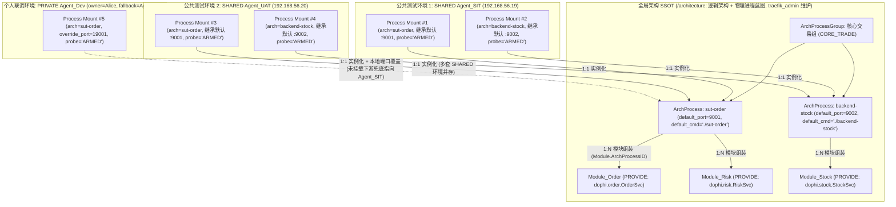
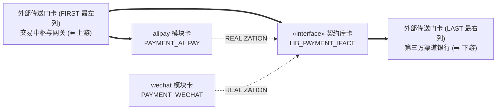
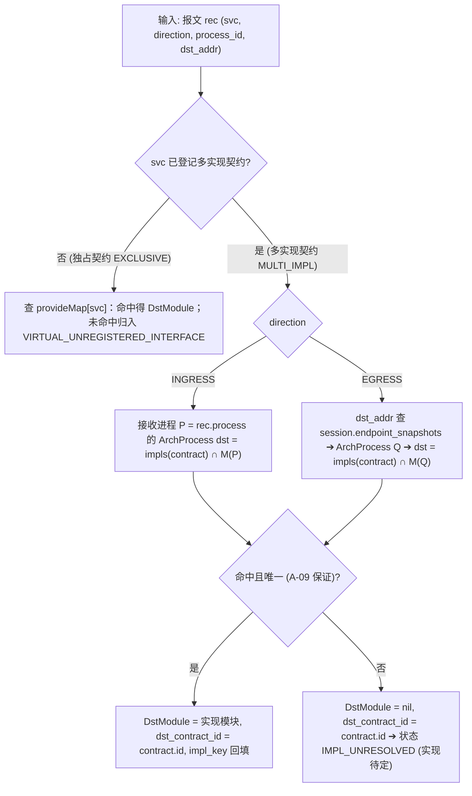
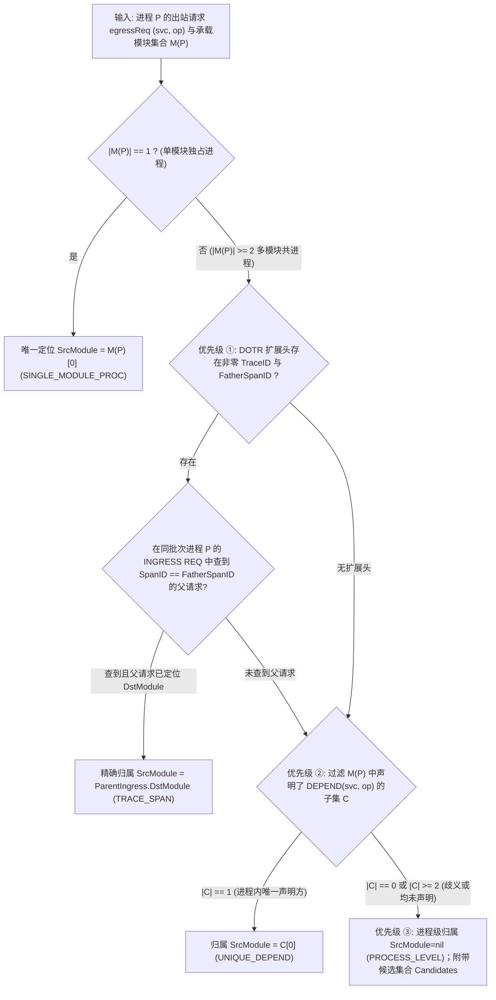
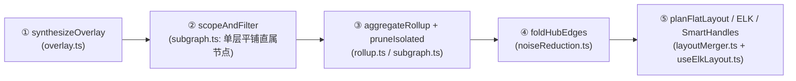

# 架构与活体契约治理 (`code-traefik`) 架构元素建模与拓扑一致性验证设计

- **文档编号**：`03-architecture-elements-and-topology.md`
- **文档版本**：v1.9.0
- **更新日期**：2026-11-14
- **归属阶段**：阶段二：系统架构与数据模型设计 (`02-design`)
- **状态**：M1~M22 已交付；M23~M26 已完成设计待实施 (Approved for M23~M26)
- **上位基线**：[`01-feature-matrix.md`](../01-features/01-feature-matrix.md) (v2.19.0)、[`01-system-architecture.md`](./01-system-architecture.md) (v1.8.0)、[`09-arch-process-ssot-and-ebpf-premount-standby-adr.md`](../05-adr/09-arch-process-ssot-and-ebpf-premount-standby-adr.md) (ADR-09 v1.1.0)、[`15-scalable-topology-focus-and-layout-persistence-adr.md`](../05-adr/15-scalable-topology-focus-and-layout-persistence-adr.md) (ADR-15 v1.3.0)、[`16-multi-implementation-service-contract-adr.md`](../05-adr/16-multi-implementation-service-contract-adr.md) (ADR-16 v2.0.0)、[`17-topology-single-layer-drilldown-and-layout-ux-adr.md`](../05-adr/17-topology-single-layer-drilldown-and-layout-ux-adr.md) (ADR-17 v1.1.0)、[`18-proto-full-lifecycle-and-git-mr-governance-adr.md`](../05-adr/18-proto-full-lifecycle-and-git-mr-governance-adr.md) (ADR-18 v1.2.0)
- **关联工程作战卡**：[`docs/04-tasks/21-m20-multi-implementation-service-contract.md`](../04-tasks/21-m20-multi-implementation-service-contract.md) (M20)、[`docs/04-tasks/22-m21-topology-single-layer-drilldown-and-layout-ux.md`](../04-tasks/22-m21-topology-single-layer-drilldown-and-layout-ux.md) (M21)、[`docs/04-tasks/23-m22-protocompile-layering-and-dependency-graph.md`](../04-tasks/23-m22-protocompile-layering-and-dependency-graph.md) (M22)

### 修订记录

| 版本 | 日期 | 修订说明 |
| :--- | :--- | :--- |
| v1.5.1 | 2026-11-09 | 依据 ADR-15 (v1.1.0) 增补 §6 大规模拓扑五段式渲染管线、作用域裁剪、有向 N-Hop 邻域、Hub 插头折叠与位置记忆双层持久化设计 |
| v1.6.0 | 2026-11-11 | 依据 ADR-16 (v1.0.0 / M20) 同步多实现服务契约建模与拓扑验证设计：1. §1.1/§1.3 补充 `module_kind ∈ {BUSINESS, CONTRACT_LIB}` 与库模块/契约删除与改类型保护；2. §2 修订 `A-05` 为分模式唯一并新增 §2.2 多实现服务契约（`traefik_service_contracts`、`impl_key`、`A-09` 进程互斥双入口守卫、分发依赖 `DISPATCH` 与存量迁移）；3. §3 补充 `A-03` 对 `CONTRACT_LIB` 的豁免、分发依赖下游推导、`endpoint_snapshots` 端点字典快照及重放兼容校验；4. §4 增补 `«interface»` 库卡、`REALIZATION` 边图层、逻辑视图默认按接口聚合 (`topo_contract_mode=AGG\|EXPAND`)、物理视图库模块豁免与 DTO 增量；5. §5 升级 `ResolveDestinationModule` v2 按目的进程消歧定位，将一致性比对从七分类扩展为八分类（新增第八类 `IMPL_UNRESOLVED` 实现待定），并补充双视图叠加挂载规则 |
| v1.7.0 | 2026-11-13 | 依据 [`ADR-17`](../05-adr/17-topology-single-layer-drilldown-and-layout-ux-adr.md) (v1.0.0 / M21) 同步拓扑单层平铺逐级下钻与 ELK 正交布局校准设计：1. §4.2 更新前端实时边汇总与单层代表节点规则（内部直属子容器代表 $R_{\text{in}}(u)$ 与跨界外部传送门卡 $R_{\text{ext}}(u)$，聚焦根自身不渲染外层包裹框）；2. §6 重构作用域裁剪与布局规范——ELK 统一单层 `layered` 参数（`nodeNodeBetweenLayers=110`、`FIRST/LAST` 约束）、CSS `border-box` 与 ELK `1:1` 尺寸契约、四向智能锚点 `selectOptimalHandles` 与多边标签偏移、按 `(view, focus_scope)` 分桶隔离且仅显式拖拽/图钉才锁定的位置记忆策略，以及 `${focusScope}::${extId}` 零 DDL 持久化兼容约定 |
| v1.7.1 | 2026-11-13 | 依据 [`ADR-17` (v1.1.0)](../05-adr/17-topology-single-layer-drilldown-and-layout-ux-adr.md) 架构检视意见加固 §4.2 与 §6：1. `scopeAndFilter` 固定「全子树过滤在前、单层投影在后」；2. 外部传送门卡强制 `FIRST/LAST` 贴边并在 `detectCycles` 中豁免 `EXTERNAL_CONTEXT` 假阳性环路；3. `pruneIsolated` 受控于 `hideIsolated === true` 且保留 `internalEdgeCount > 0` 的容器；4. 五类节点组件（补齐 `UnregisteredInterfaceNode.tsx`）`overflow: hidden`、四向双向 `<Handle>` 绑定及非 `right->left` 走线丢弃 ELK `bendPoints` 切换 `SmoothStep`；5. `${focusScope}::${extId}` 在 `extractPersistablePositions` 与 `diffLayoutAgainstGraph` 中的白名单兼容及 `SavedFilterState` 字段对齐 |
| v1.8.0 | 2026-11-13 | 依据 [`ADR-18` (v1.1.0)](../05-adr/18-proto-full-lifecycle-and-git-mr-governance-adr.md) (`M22`) 增补：1. §2.3 可配置架构层级 (`layer_level`) 校验规则与模块间有向环路检测守卫；2. §4.4 `GraphNode.Meta` 补充有效层级元数据；3. §6.5 `/topology` 客户端 SVG / PNG 导出设计 (`F-32`) |
| v1.9.0 | 2026-11-13 | 依据 [`ADR-18` (v1.2.0)](../05-adr/18-proto-full-lifecycle-and-git-mr-governance-adr.md) 检视意见修订 §2.3 与 §6.5：1. 明确更新入参使用 `*int` 区分「未传保持原值」与「传 `0` 显式豁免」、补充绑定多实现 `ContractID` 时对既有 `DISPATCH` 消费方的反向层级校核及 `CONTRACT_LIB` DIP 倒挂分层约定；2. §6.5 废弃易触发 Canvas 跨域污染或 CSS 变量丢失的 `<foreignObject>` 方案，改为基于画布模型数据的程序化纯矢量 `<svg>` + `getComputedStyle` 解析 `--color-*` Token + 离屏 2x `<canvas>` PNG 导出 |

---

## 1. 三级逻辑架构元素模型与树形治理 (`internal/server/topology`)

`code-traefik` 作为架构元素与运行映射的**唯一真实源（SSOT）**，采用「**子系统 (`Subsystem`) → 功能组多级树 (`FunctionalGroup`) → 功能模块 (`Module`)**」三级逻辑层次结构。

### 1.1 物化路径 (`Materialized Path`) 树编码模型

功能组支持在同一子系统内最大 **8 级**（`level ∈ [1, 8]`）自嵌套，功能模块可挂载在任意层级的功能组下：

```text
Subsystem [ID=1, Code="TRADE_SYS"]
 ├── FunctionalGroup [ID=10, Parent=nil, Level=1, Path="/10/", Code="ORDER_GRP"]
 │    ├── Module [ID=101, GroupID=10, SubsystemID=1, Code="MOD_ORDER_ENTRY"]   (直接挂在 1 级功能组)
 │    └── FunctionalGroup [ID=12, Parent=10, Level=2, Path="/10/12/", Code="PAY_SUBGRP"]
 │         └── Module [ID=102, GroupID=12, SubsystemID=1, Code="MOD_PAY_SETTLE"] (挂在 2 级功能组)
```

* **设计选型（主键 ID 物化路径 `"/<id1>/<id2>/"` 与模块类型 `module_kind`）**：
  1. 首尾强制带斜杠 `/`，使得子树前缀查询 `WHERE subsystem_id = ? AND path LIKE '/10/12/%'` 绝对精确，彻底消除 `'/10/12'` 误匹配 `'/10/120/'` 的部分前缀越界缺陷；
  2. 修改功能组名称或业务编码 `code` 时无需重写子孙节点的 `path`；
  3. 功能模块冗余维护 `subsystem_id`（始终强制等于其挂载功能组的 `subsystem_id`），使流量列表按子系统筛选无需多层 `JOIN`；
  4. **模块类型区分 (`module_kind ∈ {'BUSINESS', 'CONTRACT_LIB'}`，[`ADR-16`](../05-adr/16-multi-implementation-service-contract-adr.md))**：`traefik_modules` 通过 `module_kind`（默认 `'BUSINESS'`）区分「运行期业务模块 (`BUSINESS`)」与「编译期接口库模块 (`CONTRACT_LIB`)」。`CONTRACT_LIB` 模块留在三级逻辑树中维护所属子系统/功能组与负责人，作为多实现服务契约（`traefik_service_contracts`）的定义属主，**禁止绑定任何运行期 `ArchProcess`**（`CHECK (module_kind = 'BUSINESS' OR arch_process_id IS NULL)`），亦禁止直接创建运行期 `traefik_module_services` 或 `traefik_module_dependencies` 行（返回 `400 Bad Request`）。

### 1.2 功能组移动防成环校验与级联更新算法 (`MoveFunctionalGroup`)

当管理员将功能组 `G` 移动至同子系统内的新父节点 `NewParent`（`NewParent == nil` 表示提升为一级根功能组）时，为防止并发移动导致树形破损或幽灵环路，必须在事务首行获取子系统级排他咨询锁 `SELECT pg_advisory_xact_lock(subsystem_id)`，并在单个事务内执行校验与单条批量 SQL 原子重算：

```go
package topology

const MaxGroupTreeDepth = 8

// MoveFunctionalGroup 在单事务内串行化防成环与最大深度约束，并单条 SQL 原子级联更新子树 path 与 level
func MoveFunctionalGroup(tx *gorm.DB, groupID uint64, newParentID *uint64) error {
	var group models.FunctionalGroup
	if err := tx.First(&group, groupID).Error; err != nil {
		return ErrGroupNotFound // 404
	}

	// 1. 获取子系统粒度事务咨询锁，彻底消除同子系统并发移动成环与脏读
	if err := tx.Exec("SELECT pg_advisory_xact_lock(?)", group.SubsystemID).Error; err != nil {
		return err
	}

	// 2. 禁止移动到自身
	if newParentID != nil && *newParentID == group.ID {
		return ErrCycleMoveToSelf // 400 Bad Request
	}

	newLevel := 1
	newParentPath := "/"
	if newParentID != nil {
		var parent models.FunctionalGroup
		if err := tx.First(&parent, *newParentID).Error; err != nil {
			return ErrParentGroupNotFound // 404
		}
		// 3. 跨子系统移动拦截（功能组归属固定子系统）
		if parent.SubsystemID != group.SubsystemID {
			return ErrCrossSubsystemMove // 400 Bad Request
		}
		// 4. 递归防成环检测：若目标父节点的物化路径以当前节点路径为前缀，说明目标父节点是当前节点的子孙！
		if strings.HasPrefix(parent.Path, group.Path) {
			return ErrCycleMoveToDescendant // 400 Bad Request
		}
		newLevel = parent.Level + 1
		newParentPath = parent.Path
	}

	// 5. 子树最大相对深度计算与 8 级上限门禁校验
	var maxDescendantLevel int
	if err := tx.Model(&models.FunctionalGroup{}).
		Where("subsystem_id = ? AND path LIKE ?", group.SubsystemID, group.Path+"%").
		Select("COALESCE(MAX(level), ?)", group.Level).
		Scan(&maxDescendantLevel).Error; err != nil {
		return err
	}
	subtreeHeight := maxDescendantLevel - group.Level // 自身为 0，含一层子节点为 1
	if newLevel+subtreeHeight > MaxGroupTreeDepth {
		return ErrExceedMaxTreeDepth // 400 Bad Request (超过最大 8 级深度)
	}

	// 6. 原子更新当前节点父指针与整棵子树的物化路径与层级
	oldPrefix := group.Path
	newPrefix := fmt.Sprintf("%s%d/", newParentPath, group.ID)
	levelDelta := newLevel - group.Level

	if err := tx.Model(&models.FunctionalGroup{}).Where("id = ?", group.ID).
		Update("parent_id", newParentID).Error; err != nil {
		return err
	}

	// 利用数据库原生字符串替换与层级加算，单条 SQL 批量完成子树重算，杜绝逐行 Save 脏数据
	return tx.Exec(`
		UPDATE traefik_functional_groups 
		SET path = ? || SUBSTRING(path FROM ?),
		    level = level + ?
		WHERE subsystem_id = ? AND path LIKE ?`,
		newPrefix, len(oldPrefix)+1, levelDelta, group.SubsystemID, oldPrefix+"%",
	).Error
}
```

### 1.3 删除保护冲突矩阵 (`409 Conflict`)

- 删除子系统：若存在关联功能组或功能模块，拒绝删除并返回 `409`；
- 删除功能组：若存在子功能组（`parent_id = id`）或挂载的功能模块（`group_id = id`），拒绝删除并返回 `409`；
- 删除功能模块：若业务模块（`BUSINESS`）已声明被其他模块引用的 `PROVIDE` 服务契约或当前仍装载于某个架构标准进程（`arch_process_id IS NOT NULL`），或接口库模块（`CONTRACT_LIB`）名下已登记有多实现服务契约（`traefik_service_contracts.definer_module_id = id`），拒绝删除并返回 `409`；
- 修改功能模块类型（`module_kind`）：若接口库模块（`CONTRACT_LIB`）名下已有被登记的多实现服务契约（`traefik_service_contracts`），禁止改回 `BUSINESS`（返回 `409`）；若业务模块（`BUSINESS`）已绑定 `ArchProcess` 或已声明 `PROVIDE`/`DEPEND` 行，禁止改为 `CONTRACT_LIB`（返回 `409`）；
- 删除多实现服务契约（`traefik_service_contracts`）：若该契约仍被任何实现模块引用（`traefik_module_services.contract_id = id`）或仍被任何消费模块声明为分发依赖（`traefik_module_dependencies.contract_id = id`），通过外键 `ON DELETE RESTRICT` 与应用层门禁拒绝删除并返回 `409`（附带关联的实现模块与分发调用方列表）；
- 删除物理进程组 (`ArchProcessGroup`)：若组下仍存在标准架构进程（`ArchProcess`），拒绝删除并返回 `409`；
- 删除标准架构进程 (`ArchProcess`)：若当前已被任何宿主机 Agent 挂载实例化（`traefik_processes` 中存在引用）或被历史重放任务 `ReplayTask` 引用，拒绝删除并返回 `409`（附带已挂载环境 Agent 名称列表）。

---

## 2. 模块级服务供给与依赖契约 (Module Service Contracts)

功能模块是接口契约声明的最小业务单元，遵循 [`ADR-05`](../05-adr/05-hierarchical-topology-canvas-redesign.md)、[`ADR-06`](../05-adr/06-proto-schema-repository-and-field-inspection-adr.md) 与 [`ADR-16`](../05-adr/16-multi-implementation-service-contract-adr.md) 服务级（Service-Level）治理粒度，通过 `traefik_service_contracts`（多实现契约定义）、`traefik_module_services`（服务供给 / 契约实现）与 `traefik_module_dependencies`（服务依赖 / 分发依赖）三张表协同维护契约：
- **多实现契约定义（`traefik_service_contracts`，仅多实现契约需登记）**：由接口库模块（`module_kind = 'CONTRACT_LIB'`）定义会被多个进程模块共同实现的 CROS RPC 服务契约（`service_name`）；
- **`PROVIDE`（供给服务 / 实现契约，`traefik_module_services`，仅 `BUSINESS` 模块可声明）**：本业务功能模块对外实现的 CROS RPC 服务（`contract_id IS NULL` 为默认独占供给 `EXCLUSIVE`；`contract_id IS NOT NULL` 为实现某多实现契约 `MULTI_IMPL` 并携带业务身份 `impl_key`）；
- **`DEPEND`（依赖服务 / 分发依赖，`traefik_module_dependencies`，仅 `BUSINESS` 模块可声明）**：本业务功能模块运行期需要调用的下游内部具体服务实现（关联 `service_id`）、多实现契约分发调用（关联 `contract_id`，`DISPATCH`）或外部异构系统（`is_external = true`）。

### 2.1 `{package}.{serviceName}` 规范化命名契约 (A-07) 与分模式唯一性红线 (修订 A-05)

依据 DOPHI CROS RPC 框架运行时规范，线上报文 `RPC_REQ_HEAD_S` 中的 `ascServiceName` 与 `ascOperation` 严格满足以下映射公式：

$$\text{ascServiceName} = \begin{cases} \text{package} + \text{"."} + \text{serviceName}, & \text{package} \neq \text{""} \\ \text{serviceName}, & \text{package} = \text{""} \end{cases}, \quad \text{ascOperation} = \text{methodName}$$

| Protobuf 定义示例 | `package` 声明 | `service` 名称 | `rpc` 方法名 | 规范化 `service_name` (`ascServiceName`) | 规范化 `operation` (`ascOperation`) |
| :--- | :--- | :--- | :--- | :--- | :--- |
| `dophi/order/v1/trade.proto` | `dophi.order.v1` | `TradeService` | `CreateOrder` | `dophi.order.v1.TradeService` | `CreateOrder` |
| `cros/auth/session.proto` | `cros.auth` | `SessionMgr` | `VerifyTicket` | `cros.auth.SessionMgr` | `VerifyTicket` |

* **强校验规则**：
  1. `package` 与 `serviceName` **统一遵循点分连接规范**（`.`，与 `internal/server/decoder/registry.go` 动态解码注册表完全一致；若未声明 `package` 则直接采用 `serviceName`）；
  2. 受限于 CROS RPC 协议头 `CHAR[64]`（含末尾 `\0` 终止符），`service_name` 与 `operation` 字节长度均强制校验为 **`1..63` 位可见 ASCII 字符**（正则：`^[A-Za-z0-9._]{1,63}$` 与 `^[A-Za-z0-9_]{1,63}$`）。
  3. **唯一性红线（由 [`ADR-16`](../05-adr/16-multi-implementation-service-contract-adr.md) v2.0 修订 A-05）**：
     - **独占契约与自定义发布名实现全局唯一供给（`contract_id IS NULL OR is_custom_service_name = true`）**：对于独占服务，以及实现多实现契约但自定义了不同于契约原名的运行期发布服务名（如 `DH_SyncService`）的服务，其 `service_name` 在全库部分唯一索引 `uk_traefik_mod_svc_name_excl ON (service_name) WHERE contract_id IS NULL OR is_custom_service_name = true` 保护下保持全局唯一，且自定义发布名不得与任意 `ServiceContract.service_name` 冲突；
     - **多实现契约按 `(contract_id, impl_key)` 与 `(contract_id, module_id)` 唯一（`MULTI_IMPL`，`contract_id IS NOT NULL`）**：契约本身在 `traefik_service_contracts` 中按 `.pb` 原始 `service_name` 全局唯一（`uk_traefik_svc_contract_name`）；其下各实现行通过部分唯一索引 `uk_traefik_mod_svc_contract_impl` 与 `uk_traefik_mod_svc_contract_mod` 保证同一契约下每个 `impl_key` 唯一且同一模块对同一契约至多实现一次；
     - **消费依赖唯一性**：同一消费模块对同一内部具体服务实现唯一（`UNIQUE(consumer_module_id, service_id)`），对同一多实现分发契约唯一（`uk_traefik_dep_consumer_contract ON (consumer_module_id, contract_id) WHERE contract_id IS NOT NULL`），且同一消费方对同一契约不得同时声明分发依赖与具体实现依赖（`409 Conflict`）。

### 2.2 多实现服务契约、接口库建模与分发依赖 (`F-02.1`, [`ADR-16`](../05-adr/16-multi-implementation-service-contract-adr.md) v2.0)

面向「接口库模块 `FM A` 定义 Protobuf 服务 `pkg.IfaceSvc` ➔ 多个业务模块 `FM B / C / D` 各自实现该服务（可**沿用契约原名**在不同进程中运行，也可**自行定义唯一运行期发布名**如 `DH_SyncService`） ➔ 独立调度中心模块 `X` 分发调用」的生产形态，系统建立三层解耦契约模型：

1. **三方角色与表结构建模**：
   - **接口库模块 (`traefik_modules.module_kind = 'CONTRACT_LIB'`)**：作为设计期契约的定义属主，自身不是运行期部署单元。数据库层施加 `CHECK (module_kind = 'BUSINESS' OR arch_process_id IS NULL)`；调用 `BindModuleProcess` 或为其新增 `PROVIDE`/`DEPEND` 均返回 `400 Bad Request`；
   - **多实现服务契约表 (`traefik_service_contracts`，第 19 张核心业务表)**：
     - `service_name varchar(128) NOT NULL`（`uk_traefik_svc_contract_name`，对应 `.pb` 契约原名，格式校验同 A-07）；
     - `definer_module_id bigint NOT NULL`（FK `traefik_modules(id) ON DELETE RESTRICT`，应用层强制校验目标模块 `module_kind == 'CONTRACT_LIB'`，否则返回 `400`）；
     - `provide_mode varchar(16) NOT NULL DEFAULT 'MULTI_IMPL'`（`CHECK (provide_mode IN ('MULTI_IMPL'))`）；
     - `impl_key_label varchar(64) NOT NULL DEFAULT ''`（实现身份的业务标签说明，如「业务类型」、「渠道编码」）。
   - **服务实现表增量 (`traefik_module_services`)**：
     - 新增 `contract_id bigint NULL`（FK `traefik_service_contracts(id) ON DELETE RESTRICT`，`NULL` 表示独占契约 `EXCLUSIVE`）、`impl_key varchar(64) NOT NULL DEFAULT ''`（多实现必填，格式 `^[A-Za-z0-9._-]{1,64}$`）与 `is_custom_service_name boolean NOT NULL DEFAULT false`（标记是否自定义了不同于 `contract.service_name` 的运行期发布名）；
     - `service_name` 表示运行期线上实际发布的 `ascServiceName`（默认等于 `contract.service_name`，用户可自由修改为 `DH_SyncService` 等任意合法唯一名）；
     - 施加 `CHECK ((contract_id IS NULL AND impl_key = '') OR (contract_id IS NOT NULL AND impl_key <> ''))` 与 `CHECK (contract_id IS NOT NULL OR is_custom_service_name = false)`。
2. **跨表串行化不变量、解码别名与存量平滑迁移**：
   - 所有涉及 `service_name` 的契约创建与 `PROVIDE` 声明写事务，首行统一获取 `SELECT pg_advisory_xact_lock(hashtext(service_name))`：
     - ① 创建多实现契约时，若 `traefik_module_services` 中已存在同名独占行或同名自定义发布名实现，拒绝并返回 `409 Conflict`；
     - ② 创建实现时（传入 `contract_id`）：若未指定自定义 `service_name` 则默认等于 `contract.service_name`（`is_custom_service_name = false`）；若传入不同于 `contract.service_name` 的自定义发布名（`is_custom_service_name = true`），则校验其全系统全局唯一且不与任何 `ServiceContract.service_name` 冲突；
     - ③ **单份 `.pb` 解码别名映射 (`decoder.Registry`)**：内存编译池维护 `ServiceAliases`（自定义发布名 ➔ `.pb` 契约名）与独立 `ServiceIgnores`，实现单份 LIB `.pb` 透明解码所有自定义运行期发布名；
     - ④ **存量独占转多实现 / 挂接到既有契约**：提供「转换为多实现契约」（`POST /api/arch/service-contracts/convert`）与「将存量独占服务挂接到既有契约」（`POST /api/arch/service-contracts/:id/attach`，保留其原 `service_name` 如 `DH_SyncService` 与 `service_id`）。
3. **`A-09` 实现进程互斥守卫 (`AssertContractImplProcessDisjoint`)**：
   - 仅针对**同一契约下沿用契约原名（`is_custom_service_name = false`）**的同名共享实现模块，强制要求两两分属不同的 `ArchProcess`（从而使运行期「目的进程 ➔ 唯一实现模块」成为确定性映射）；
   - **自定义唯一发布名实现（`is_custom_service_name = true`）豁免 A-09**，允许部署在同一标准架构进程内；
   - 在**新增/编辑实现**与**绑定模块到标准进程**两个写入口执行 `AssertContractImplProcessDisjoint`，违反返回 `409 Conflict`。
4. **分发依赖 (`DISPATCH`) 建模 (`traefik_module_dependencies`)**：
   - 新增可空外键 `contract_id bigint NULL`（FK `traefik_service_contracts(id) ON DELETE RESTRICT`），语义为「调度方运行期可调用该多实现契约下的任意已登记实现」，新增或下线实现模块时无需修改调度方 `X` 的依赖声明；
   - 施加三选一排他约束：`CHECK (num_nonnulls(service_id, contract_id) + (is_external::int) = 1)`（内部具体实现 `service_id`、多实现契约分发 `contract_id`、外部系统 `is_external` 严格三选一）；
   - 同一消费方对同一契约同时声明分发依赖（`contract_id`）与具体实现依赖（指向该契约下某 `service_id`）时返回 `409 Conflict`（语义重复）。

### 2.3 可配置分层架构约束 (`layer_level`) 与循环依赖守卫 (`ADR-18` / M22)

为防止底层基础设施模块反向调用上层编排/网关模块造成架构腐化，同时**100% 兼容不配置分层的存量模块**，在 `traefik_subsystems` 与 `traefik_modules` 中引入可选整型字段 `layer_level ∈ [0, 99]`（更新 DTO 与服务端入参均使用 **`*int`** 可选指针，避免未传字段误将既有非零层级覆盖为 `0`）：

1. **有效层级计算规则 (`EffectiveLayerLevel`)**：
   - `0` 表示「未分层 / 不限制」（存量默认全为 `0`）；`> 0` 时数值越小代表越底层基础（示例：`10` 基础设施/底座、`20` 核心域服务、`30` 聚合编排、`40` 接入网关）；
   - 模块有效层级：若 `module.LayerLevel > 0` 则取 `module.LayerLevel`，否则继承所属 `subsystem.LayerLevel`。
2. **双场景层级约束守卫与 DIP 边界 (`AssertLayerDependencyValid`)**：
   - **普通调用依赖 (`DEPEND`，涵盖独占 `service_id` 与多实现分发 `contract_id`)**：仅当 `EffectiveLayer(consumer) > 0 && EffectiveLayer(targetProvider) > 0` 时触发校验，要求 **`EffectiveLayer(consumer) >= EffectiveLayer(targetProvider)`**（允许同层互调与上层调下层，**严禁下层模块向上层模块发起依赖**；对 `DISPATCH` 依赖同时校验接口库定义方及已知实现方，或在无实现时校验 `contract_lib` 定义方），违例返回 `409 Conflict` (`ERR_LAYER_VIOLATION`)；
   - **契约实现关系 (`REALIZATION`，`CONTRACT_LIB` ➔ 实现该 `ServiceContract` 的 `Module`，DIP 约束边界)**：对于依赖倒置（DIP）场景，建议接口库与基础域协同放在下层（或将不需要强分层约束的共享接口库 `layer_level` 保留为 `0` 即自动豁免）。在新增/修改多实现 `ModuleService` 时，若 `EffectiveLayer(implModule) > 0 && EffectiveLayer(definerContractLib) > 0`，强制校验 **`EffectiveLayer(implModule) >= EffectiveLayer(definerContractLib)`**（防底层模块越权实现上层业务接口库），违例返回 `409 Conflict` (`ERR_REALIZATION_LAYER_INVERSION`)；**同时**当 `ModuleService` 绑定 `ContractID` 时，必须在同事务内**反向校核所有既有通过 `DISPATCH` (`contract_id`) 消费该契约的消费方模块**：若 `EffectiveLayer(consumer) > 0 && EffectiveLayer(implModule) > 0` 且 `EffectiveLayer(consumer) < EffectiveLayer(implModule)`，立即阻断并返 `409 Conflict` (`ERR_LAYER_VIOLATION`)，防止后接入的高层实现击穿已登记的底层分发消费方分层约束；
   - **存量修改双向回溯保护**：管理员通过 `PUT /api/arch/subsystems/:id` 或 `PUT /api/arch/modules/:id` 调整 `layer_level` 时，在同一数据库事务内扫描受影响模块作为调用方/提供方/实现方的全部存量边；若变更导致已有依赖或契约实现层级倒挂，拒绝更新并返回 `409 Conflict` 附带冲突边列表。
3. **模块级循环依赖检测 (`AssertNoCyclicDependency`)**：
   - 在 `CreateModuleDependency` 创建内部依赖时（含 `service_id` 指向单个 `providerModuleID`，以及 `contract_id` 展开指向 `CONTRACT_LIB` 及其全部当前实现模块集合），从目标节点集出发沿既有 `traefik_module_dependencies` 出边执行有界 BFS/DFS 可达性搜索；
   - 若可达回 `consumerModuleID`，判定形成模块依赖闭环，立即阻断创建并返回 `409 Conflict` (`ERR_CYCLIC_DEPENDENCY`) 及完整环路路径（如 `MOD_A -> MOD_B -> MOD_A`）。外部未登记依赖 (`is_external=true`) 天然不构成内部回环。

---

## 3. 架构物理进程蓝图 SSOT、多环境 `1:1` 挂载覆盖与同构重放校验

### 3.1 全局物理进程蓝图 (`ArchProcessGroup -> ArchProcess`) 与多环境 `1:1` 挂载模型 (`1 台 Agent = 1 套独立环境`)

依据 [`ADR-09`](../05-adr/09-arch-process-ssot-and-ebpf-premount-standby-adr.md)，系统将**「标准业务进程蓝图（全局架构 SSOT）」**与**「环境宿主机进程挂载实例（Agent 运行态）」**彻底解耦为两层正交模型：
- 所有逻辑架构元素（`Subsystem`、`FunctionalGroup`、`Module`、`ModuleService`、`ModuleDependency`）与**物理进程蓝图（`ArchProcessGroup`、`ArchProcess` 及 `ArchProcess <-> Module` 组装关系）**均为全团队共享的**公共唯一真实源（SSOT）**，统一在 `/architecture`（`[逻辑架构 | 物理进程]`）中由 `traefik_admin` 维护，零 Agent 机器耦合；
- **1 台 `Agent` 代表 1 套独立的运行环境**（包含多套团队公共测试环境如 `SHARED Agent_SIT`、`SHARED Agent_UAT`，以及每位开发者个人的 `PRIVATE Agent_Dev`）。任意一套环境 `Agent` 均从已定义的 `ArchProcess` 树中 **`1:1` 勾选挂载进程**（`traefik_processes`），并按需施加上下文局部的本地覆盖配置：



核心领域不变量：
1. **单环境（单机）严格 `1:1` 单实例约束 (`UNIQUE(agent_id, arch_process_id)`)**：
   - 同一标准架构进程在单套环境（单个 `Agent`）上至多部署 1 个实例，数据库层以 `uk_traefik_proc_agent_arch` 强制保证不重复挂载；
   - **禁止自造野生进程与篡改模块组装**：Agent 挂载界面不提供自由新建进程名或自由增删 `FM` 模块入口；缺失的标准进程必须回到 `/architecture?tree=physical` 定义。
2. **有效运行参数继承、匹配语法契约与蓝图端口演进自动固化 (A-02)**：
   - 挂载实例的有效属性遵循**「本地覆盖优先 ➔ 架构蓝图默认兜底」**确定性公式：
     $$\text{EffectiveListenPort} = \text{OverrideListenPort} \neq \text{nil} \ ? \ *\text{OverrideListenPort} : \text{ArchProcess.DefaultListenPort}$$
     $$\text{EffectiveCmdPattern} = \text{OverrideCmdPattern} \neq \text{""} \ ? \ \text{OverrideCmdPattern} : \text{ArchProcess.DefaultCmdPattern}$$
     $$\text{EffectiveIP} = \text{AdvertiseIP} \neq \text{""} \ ? \ \text{AdvertiseIP} : \text{HostIP(Agent.Endpoint)}$$
     $$\text{EffectiveExtraDownstreams} = \text{Dedupe}(\text{ArchProcess.DefaultExtraDownstreams} \cup \text{Process.ExtraDownstreams})$$
   - **`cmd_pattern` 匹配语法与防 ReDoS 校验**：长度强制 `<= 256` 字符；默认按**精确子串包含**（`strings.Contains(cmdline, pattern)`）匹配 `/proc/<pid>/cmdline`（`\0` 替换为空格后）；若以显式前缀 `re:` 开头，则按 **Go `regexp` (RE2 线性时间引擎)** 编译匹配，主控在保存 `ArchProcess` 或 `Process` 覆盖参数时强制预执行 `regexp.Compile` 语法校验（非法正则返回 `400 Bad Request`）；
   - **同机非零端口互斥与蓝图变更自动固化**：同一 `agent_id` 下所有非零有效端口（`effective_listen_port > 0`）通过部分唯一索引 `uk_traefik_proc_agent_port` 严格互斥（同时允许并存多个 `0` 端口纯客户端进程）。当管理员在 `/architecture` 修改 `ArchProcess.DefaultListenPort`（由 $P_{\text{old}} \to P_{\text{new}}$）时，主控在单事务内自动检测各已挂载该蓝图的 Agent：若某挂载实例未设置覆盖端口（`override_listen_port IS NULL`）且 $P_{\text{new}} > 0$ 与该 Agent 同机其他已挂载进程的有效端口冲突，**自动将该冲突实例的 `override_listen_port` 固化为原有效端口 $P_{\text{old}}$**（并在响应 `auto_pinned_overrides` 中返回提示），既绝对不破坏个人/特定环境既有挂载，又保证全局蓝图自由演进。
3. **模块单归属、接口库 `CONTRACT_LIB` 豁免与多环境公私双域并存 (A-03 & A-09)**：
   - **架构层（A-03 对 `CONTRACT_LIB` 的豁免与 A-09 进程互斥）**：
     - **业务模块 (`module_kind = 'BUSINESS'`)**：1 个 `ArchProcess` 可组装承载 $N \ge 0$ 个 `BUSINESS` 模块（记录于 `traefik_modules.arch_process_id`），每个 `BUSINESS` 模块全局至多归属 **1 个** `ArchProcess`（尝试将已分配给进程 A 的模块重复绑给进程 B 时返回 `409 Conflict`）；且同一多实现契约的各个实现模块严禁绑定至同一 `ArchProcess`（遵循 `A-09`，见 §2.2）；
     - **接口库模块 (`module_kind = 'CONTRACT_LIB'`) 豁免 `A-03` 物理进程归属**：`CONTRACT_LIB` 是被编译链接进多处的纯契约定义载体，不是运行期部署单元。数据库层以 `CHECK (module_kind = 'BUSINESS' OR arch_process_id IS NULL)` 强制保证其 `arch_process_id` 恒为 `NULL`（尝试绑定进程返回 `400 Bad Request`），且在物理部署视图中不渲染（亦不归入「未部署」容器）；
   - **公共测试环境域 (`SHARED` Agent)**：`1 台 SHARED Agent = 1 套独立公共测试环境`（如 `SIT`、`UAT`、`准生产回归`），**支持多台不同的 `SHARED` Agent 各自 `1:1` 挂载同一个 `ArchProcess`**，互不排斥；
   - **个人私有域 (`PRIVATE` Agent)**：每位开发者本人的 `PRIVATE` Agent 作为独立隔离沙箱，同样自由 `1:1` 勾选挂载任意 `ArchProcess`，并可通过 `Agent.FallbackAgentID` 可选绑定某台 `SHARED` 公共环境 Agent 作为本地未启动下游的跨机连接兜底。
4. **动态 PID 非权威与统一七态预挂就绪快照**：操作系统 `PID` 随业务重启动态变化，不作为静态权威配置，由 Agent 在 `ARMED` 预挂待命及活跃录制期通过 `(EffectiveListenPort, EffectiveCmdPattern)` 实时扫描 `/proc` 获取，并将统一七态就绪诊断（`READY` / `NEED_RECONNECT` / `WAITING_PROC` / `MONITORING` / `DISARMED` / `OFFLINE` / `CAP_DENIED` 或 `ERROR`）回写至 `traefik_processes` 快照列。

### 3.2 多环境混合下游 `IP:Port` 自动推导算法 (`CompileProcessDownstreams` — 同机优先 + 绑定基线环境兜底) 与端点字典快照 (`endpoint_snapshots`)

当主控向 Agent 下发某挂载进程 `P`（所属环境 `Agent_X`，对应蓝图 `ArchProcess_Src`）的预挂载待命（`/monitors/arm`）、录制（`/monitors/sync`）或重放规格 `ProcessMonitorSpec` 时，自动聚合以下三层下游网络端点集合：

1. **已声明架构依赖混合端点（同环境同机优先 ➔ `FallbackAgentID` 绑定公共环境兜底）**：
   - 读取 `ArchProcess_Src` 承载的全部模块集合 $M(\text{ArchProcess\_Src})$ 及其内部依赖 `ModuleDependency`，定位目标供给模块所属的标准架构进程 `ArchProcess_Dst`（若依赖为 `contract_id != nil` 的分发依赖 `DISPATCH`，则自动展开为该契约当前已登记的全部实现模块并逐一提取各自所属的 `ArchProcess_Dst`）；
   - 若 `ArchProcess_Dst != ArchProcess_Src`：
     - **优先级 ①（同环境同机挂载实例优先）**：检查当前这台 `Agent_X` 上是否挂载了 `ArchProcess_Dst`（记为 `P_local`）；若存在且 `P_local.EffectiveListenPort > 0`，加入 `(EffectiveIP(P_local), P_local.EffectiveListenPort)` 及同机回环别名 `("127.0.0.1", P_local.EffectiveListenPort)`；
     - **优先级 ②（绑定公共基线环境兜底，严禁多环境盲目串绑）**：当同机未挂载 `ArchProcess_Dst`（如开发者仅在个人 `PRIVATE` Agent 启动单个待测微服务，或某套分片环境依赖公共底座 Agent）时：
       - 若 `Agent_X.FallbackAgentID != nil`，精确查找该绑定公共 `SHARED` 环境 Agent 上的挂载实例 `P_fallback`，若 `P_fallback.EffectiveListenPort > 0` 则加入 `(EffectiveIP(P_fallback), P_fallback.EffectiveListenPort)`；
       - 若 `Agent_X.FallbackAgentID == nil` 且全库所有 `SHARED` Agent 中**恰好仅有唯一 1 台**挂载了 `ArchProcess_Dst`，自动回退纳入该唯一公共实例端点；若存在 $\ge 2$ 套 `SHARED` 环境同时挂载了 `ArchProcess_Dst` 且未显式指定 `FallbackAgentID`，**绝不跨环境盲目合并其他 `SHARED` 环境 IP:Port**，彻底杜绝 `SIT` 与 `UAT` 跨环境串流！
2. **同机已挂载进程监听端口全集（`PeerListenEndpoints` & `ArmedDownstreams` 超集不变量）**：
   - **核心物理保障（解决未声明 `VIOLATION` 调用拦截盲区）**：在编译预挂待命规格与录制规格时，统一将同机 `Agent_X` 上**全部已挂载进程的非零有效监听端口**（含 `(EffectiveIP, Port)` 与 `("127.0.0.1", Port)`，剔除 `P` 自身端口）悉数并入 `Downstreams`，严格保持**预挂超集不变量**：
     $$\text{ArmedDownstreams}(P) \supseteq \text{ActiveRecordingDownstreams}(P, S)$$
   - 由此，无论模块 $A$ 源码是否声明了对同机模块 $B$ 的依赖，只要进程在 `ARMED` 预挂后建立连接，出站长连接在待命期即已 100% 接入 `EgressProxy` 纯透传，开启录制时无需任何重连即可 100% 捕获未声明跨进程 `VIOLATION` 调用！
3. **架构默认补充端点 + 本地覆盖补充端点 + 离线重放历史端点**：
   - 合并 `ArchProcess_Src.DefaultExtraDownstreams` 与 `P.ExtraDownstreams`；若为离线重放（`CompileReplayDownstreams`），额外并入源录制批次观测到的全部 `EGRESS` 原始 `dst_addr`（`IP:Port`）；最终按 `IP:Port` 稳定排序去重输出。
4. **录制时刻端点字典快照固化 (`RecordingSession.endpoint_snapshots`，[`ADR-16`](../05-adr/16-multi-implementation-service-contract-adr.md) §3.6)**：
   - 在创建录制批次、编译下游时，将上述第 1、2 步中**能唯一确定 `ArchProcess`** 的「网络端点 `IP:Port`（含同机 `127.0.0.1` 别名）➔ `ArchProcessID`」一次性固化至 `traefik_recording_sessions.endpoint_snapshots`（`jsonb NOT NULL DEFAULT '[]'`，匿名 `extra_downstreams` 不入字典），供 §5.1 多实现契约目的模块定位使用，确保事后环境挂载变更不会导致历史批次归属漂移：

```go
// EndpointSnapshotItem 录制时刻「网络端点 ➔ 标准架构进程」字典项 (固化于 RecordingSession.EndpointSnapshots)
type EndpointSnapshotItem struct {
	Endpoint      string `json:"endpoint"`        // "IP:Port"，含同机 127.0.0.1 别名
	ArchProcessID uint64 `json:"arch_process_id"`
	Source        string `json:"source"`          // LOCAL | FALLBACK | SHARED_UNIQUE
}
```

### 3.3 基于录制快照解耦的跨 Agent 同构进程重放兼容性校验 (`ValidateReplayProcessCompatibility`)

为确保某台环境 Agent 日后卸载 `Process` 挂载实例（`DELETE /api/processes/:id`）后，历史录制批次依然可以随时跨环境重放，录制批次创建时在 `RecordingSession.ProcessSnapshots` 中固化参与进程的蓝图快照 `ProcessSnapshotItem{ProcessID, ArchProcessID, Code, Name, ModuleIDs, ListenPort}`。兼容性校验优先读取批次快照，彻底解除对源 `traefik_processes` 存活状态的硬依赖；对于多实现契约的入站记录（[`ADR-16`](../05-adr/16-multi-implementation-service-contract-adr.md) §7.1），所需模块取**源进程快照中实现该契约的模块**（$\text{impls}(\text{contract}) \cap \text{sourceSnap.ModuleIDs}$），而非全局单一 `provideMap[svc]`：

```go
package topology

// ProcessSnapshotItem 固化在 RecordingSession.ProcessSnapshots 中的录制时刻进程蓝图快照
type ProcessSnapshotItem struct {
	ProcessID     uint64   `json:"process_id"`
	ArchProcessID uint64   `json:"arch_process_id"`
	Code          string   `json:"code"`
	Name          string   `json:"name"`
	ModuleIDs     []uint64 `json:"module_ids"`
	ListenPort    uint16   `json:"listen_port"`
}

// ValidateReplayProcessCompatibility 校验录制源进程选定报文能否安全重放到目标挂载进程 targetProc
func ValidateReplayProcessCompatibility(
	callerID uint,
	isAdmin bool,
	session *models.RecordingSession,
	selectedRecords []models.TrafficRecord,
	sourceSnap *ProcessSnapshotItem, // 优先从 session.ProcessSnapshots 按 source_process_id 提取（兼容回退现存 sourceProc）
	targetProc *models.Process,
	targetAgent *models.Agent,
	archProcModules map[uint64][]uint64, // key: ArchProcessID -> []ModuleID
	provideMap map[string]uint64,        // key: "serviceName" -> DstModuleID (EXCLUSIVE 独占契约)
	contractImplMods map[string][]uint64, // key: "serviceName" -> []ModuleID (MULTI_IMPL 多实现契约全体实现模块)
) error {
	// 1. 录制素材与目标 Agent 的公私域归属防越权校验 (Anti-IDOR)
	if session.Scope == models.ScopePrivate && session.OwnerID != callerID && !isAdmin {
		return ErrForbiddenPrivateSession // 403 Forbidden
	}
	if targetAgent.Scope == models.ScopePrivate && (targetAgent.OwnerID == nil || *targetAgent.OwnerID != callerID) && !isAdmin {
		return ErrForbiddenPrivateAgent // 403 Forbidden
	}
	if sourceSnap == nil {
		return ErrSourceProcessSnapshotNotFound // 400 Bad Request
	}

	// 2. 目标挂载进程必须具备有效监听端口 (> 0，纯客户端进程无法接收重放注入)
	if targetProc.EffectiveListenPort <= 0 {
		return ErrClientOnlyReplayTarget // 400 Bad Request
	}

	// 3. 原地同挂载实例 或 挂载同一标准架构进程蓝图 (ArchProcessID 相等) 天然 100% 同构兼容！
	if sourceSnap.ProcessID == targetProc.ID || sourceSnap.ArchProcessID == targetProc.ArchProcessID {
		return nil
	}

	// 4. 跨架构进程重构演进场景（如模块拆分迁移至新标准进程）：校验目标进程必须完整承载选定请求命中的全部公共架构模块
	targetModSet := toUint64Set(archProcModules[targetProc.ArchProcessID])
	sourceMods := toUint64Set(sourceSnap.ModuleIDs)
	if len(sourceMods) == 0 {
		sourceMods = toUint64Set(archProcModules[sourceSnap.ArchProcessID])
	}
	requiredMods := make(map[uint64]struct{})
	hasUnregisteredIface := false

	for _, rec := range selectedRecords {
		if implMods, isMulti := contractImplMods[rec.ServiceName]; isMulti {
			// 多实现契约 (ADR-16 §7.1): 优先取已定位的 rec.DstModuleID，否则取源进程快照中实现该契约的模块 (A-09 保证至多 1 个)
			matched := false
			if rec.DstModuleID != nil {
				requiredMods[*rec.DstModuleID] = struct{}{}
				matched = true
			} else {
				for _, mID := range implMods {
					if _, inSrc := sourceMods[mID]; inSrc {
						requiredMods[mID] = struct{}{}
						matched = true
					}
				}
			}
			if !matched {
				hasUnregisteredIface = true
			}
		} else if dstModID, ok := provideMap[rec.ServiceName]; ok {
			requiredMods[dstModID] = struct{}{}
		} else {
			hasUnregisteredIface = true
		}
	}

	if hasUnregisteredIface || len(requiredMods) == 0 {
		if len(sourceMods) == 0 || !isSubset(sourceMods, targetModSet) {
			return ErrIncompatibleReplayTargetModule // 400 Bad Request
		}
		return nil
	}

	if !isSubset(requiredMods, targetModSet) {
		return ErrIncompatibleReplayTargetModule // 400 Bad Request (附带缺失的公共模块编码明细)
	}
	return nil
}
```

---

## 4. 全系统分层复合架构拓扑推导与边汇总引擎 (`BuildTopologyGraph`)

依据 [`ADR-05`](../05-adr/05-hierarchical-topology-canvas-redesign.md) 与 [`ADR-16`](../05-adr/16-multi-implementation-service-contract-adr.md)，架构拓扑引擎从局部的单子系统扁平图全面升级为**全系统分层复合有向图（Hierarchical Compound Graph）**，统一支持**逻辑架构视角 (`LOGICAL`)** 与**物理部署视角 (`PHYSICAL`)**。后端单次输出全量层级节点（顶层 `depth=0` 直接为子系统或进程组，不下发冗余外层 `SYSTEM` 巨框）与原子叶子边，前端通过纯函数执行实时边汇总与按需下钻展开。

### 4.1 双重视角分层树模型（彻底去 Agent 化 & 多实现契约双模表达）

#### 1. 逻辑架构视角 (`view=LOGICAL`，`F-04.4` / [`ADR-16`](../05-adr/16-multi-implementation-service-contract-adr.md) §6.1)
```text
(画布根视口 Viewport)
 ├── Subsystem (depth=0 / L0: 业务子系统容器，如 TRADE_SYS, RISK_SYS)
 │    └── FunctionalGroup L1 (depth=1 / L1: 一级功能组容器)
 │         ├── FunctionalGroup L2...L8 (depth=2..8: 多级功能组自嵌套容器)
 │         │    ├── Module [BUSINESS] (叶子卡片: 最小运行期契约模块，实现多实现契约时附带 implements 元数据)
 │         │    └── Module [CONTRACT_LIB] («interface» 虚线边框库卡片: 定义多实现服务契约，展示契约数与实现数)
 │         └── Module (挂载于一级功能组下的模块)
 ├── ExternalContainer (depth=0 / L0: 外部依赖系统容器，仅存在外部依赖时生成)
 │    ├── ExternalSystem_A (按 external_system 名称实体化，如 WeChatPay)
 │    └── ExternalSystem_B (如 UnionPay)
 └── UnregisteredInterface (动态虚拟节点: 仅在一致性叠加层检出调用未登记接口时由前端按需注入)
```
> **外键对齐说明**：`traefik_modules.group_id` 为 `NOT NULL` 外键，合法模块均挂载于某级 `FunctionalGroup` 下；前端 `hierarchy.ts` 对异常缺失父功能组的数据保留回退挂载至 `sub_<SubsystemID>` 的防御性兜底。

* **逻辑视图多实现契约表达规则 (`F-04.4`)**：
  1. **接口库卡片 (`CONTRACT_LIB`)**：作为 `MODULE` 节点（`meta.module_kind = "CONTRACT_LIB"`），渲染为虚线边框 + `«interface»` 角标卡片，卡片内显示定义的契约数与已登记实现总数；
  2. **实现关系边图层 (`Kind = "REALIZATION"`)**：由各实现模块指向定义契约的库模块（`B / C / D ⇢ A`），采用 UML 实现线（虚线 + 空心三角）渲染，作为**独立可开关图层**；**不参与 Tarjan 强连通分量环路检测、不参与一致性状态叠加、与运行期调用边分开上卷**；
  3. **分发调用双模表达与默认聚合 (`topo_contract_mode=AGG|EXPAND`)**：
     - **默认模式「按接口聚合 (`topo_contract_mode=AGG`)」**：将调度方 `X` 对多实现契约的分发调用收敛为单条指向库模块 `A` 的虚拟调用边 `X ➔ A`，附带 `×N 实现` 徽章，一致性叠加时边状态取各实现边（及 `IMPL_UNRESOLVED`）中的最严重者，直观表达设计意图并抑制高扇出连线；
     - **切换模式「按实现展开 (`topo_contract_mode=EXPAND`)」**：工具栏支持一键切换，将分发调用展开为 `X ➔ B / C / D` 三条调用边，边标签展示 `pkg.IfaceSvc [b]`。

#### 2. 物理部署视角 (`view=PHYSICAL`，100% 源自架构物理进程蓝图 SSOT、彻底去 Agent 化、不渲染接口库)
> [!IMPORTANT]
> **物理拓扑去 Agent 化、库模块豁免与多环境可选端点叠加铁律（[`ADR-05`](../05-adr/05-hierarchical-topology-canvas-redesign.md)、[`ADR-09`](../05-adr/09-arch-process-ssot-and-ebpf-premount-standby-adr.md) & [`ADR-16`](../05-adr/16-multi-implementation-service-contract-adr.md)）**：`Agent` 仅作为环境宿主机上无状态的字节流采集探测器与 eBPF 探针载体，不是系统业务架构的构成元素。物理部署视图节点与连线骨架 **100% 直接由 `ArchProcessGroup -> ArchProcess -> Module(BUSINESS)` 架构物理进程蓝图推导生成**（即使尚未纳管任何 Agent 机器也能完整构建物理全景图！），**画布绝对不出现 `AGENT` 节点，且 `meta` 中严禁透出 `agent_id`**：
> - **接口库模块 (`CONTRACT_LIB`) 物理视图不渲染**：`CONTRACT_LIB` 本就不是运行期可部署实体，在物理视图中**完全不输出节点**，**亦严禁放入 `UndeployedContainer`（未部署容器）**；实现模块照常位于各自 `ArchProcess` 容器内，卡片附加标签「实现 `pkg.IfaceSvc [b]`」；分发调用在物理视图中**恒按实现展开**为真实的进程间连线 `PX ➔ PB / PC / PD`；
> - **默认纯蓝图态（未指定 `env_agent_id`）**：`meta.endpoint` 确定性输出 `:<default_listen_port>`（纯客户端为 `"client-only"`），并附带 `meta.mounted_shared_env_count`（已挂载该蓝图的公共环境数），避免多套 `SHARED` 环境并存时随机选取某台机器 IP 引发歧义；
> - **指定环境叠加态（传入可选查询参数 `env_agent_id`，调用方需对该 `SHARED` 或本人 `PRIVATE` 环境具备可见权，越权返 `403`）**：后端按该环境上的挂载实例富化填入 `EffectiveIP:EffectiveListenPort`（该环境未挂载时标记 `meta.env_mounted = false` 并回退显示 `:<default_listen_port>`），同时合并该环境挂载实例的 `extra_downstreams` 展示外部网络端点：

```text
(画布根视口 Viewport)
 ├── ProcessGroup (depth=0 / L0: 架构进程组容器，源自 traefik_arch_process_groups)
 │    └── Process (depth=1 / L1: 标准业务进程容器，源自 traefik_arch_processes，标识进程名与监听端点)
 │         └── Module [BUSINESS] (depth=2 / L2: 该标准架构进程组装承载的业务模块实例，多实现时展示「实现 pkg.IfaceSvc [b]」)
 ├── UndeployedContainer (depth=0 / L0: 尚未分配至任何标准架构进程的孤立 BUSINESS 模块容器 arch_process_id IS NULL；不含 CONTRACT_LIB)
 │    └── Module [BUSINESS] (depth=1: 未分配进程业务模块叶子卡片)
 ├── ExternalContainer (depth=0 / L0: 外部依赖与网络端点容器，按需生成)
 │    ├── ExternalSystem (承接模块声明的 is_external=true 业务外部系统)
 │    └── ExternalEndpoint (承接 ArchProcess.default_extra_downstreams 及公共挂载 extra_downstreams 的固定 IPv4:Port 端点)
 ├── UnregisteredInterface (动态虚拟节点: 一致性叠加层检出未登记接口时按需注入)
 └── ImplUnresolved (动态虚拟节点: 物理视图下多实现契约命中但目的实现无法定位时按需注入，展示「实现待定: pkg.IfaceSvc」)
```

### 4.2 前端实时边汇总算法 (Edge Rollup) 与单层平铺代表节点规则 (`ADR-17`)

后端接口一次性返回全系统架构节点与最细粒度的**模块/外部端点级原子叶子边**集合。依据 [`ADR-17`](../05-adr/17-topology-single-layer-drilldown-and-layout-ux-adr.md)，前端画布从「同屏多级框中框复合嵌套」演进为**「单层平铺逐级下钻 (Scoped Flat Canvas)」**：在任意聚焦作用域（全局 `GLOBAL` 或特定容器 `focusNodeId`）下，有向连线实时上卷连接至**当前画布可见的直接子节点代表或跨界外部传送门卡**：



#### 单层边汇总与排版核心不变量：
1. **单层代表节点映射 (`scopedRep(nodeId, focusNodeId)`)**：
   - **全局层 (`focusNodeId == null`)**：每个内部节点的代表为其所在顶层容器（`depth === 0`，如 `sub_1`、`pgrp_1`、`ext_sys_*`）；
   - **聚焦下钻层 (`focusNodeId != null`)**：
     - 若目标 $u \in V_{\text{in}}$（聚焦根后代），沿 `u.ancestors` 定位其在 `focusNode` 下`relativeDepth === 1` 的直接子祖先（即 `parent_id === focusNode.id` 的可见直接子节点）作为 $R_{\text{in}}(u)$；聚焦根自身仅作为顶栏面包屑展示，**画布不渲染包裹父框**；
     - 若目标 $u \notin V_{\text{in}}$（聚焦域外节点），沿 `LCA(u, focus)` 的直接子节点收敛为外部传送门卡 $R_{\text{ext}}(u)$（外部系统与动态虚拟节点单独成卡）；
2. **同容器内收敛 (Internal Dependency)**：若源与目标不同但落在聚焦域内同一个直接子容器（$S \neq T \land S_{\text{rep}} = T_{\text{rep}}$）：
   - **逻辑视图**：累计至该直接子容器卡片的 `内部依赖: N`（`internalEdgeCount`）徽章；
   - **物理视图**：若两端落在同一标准 `Process` 容器卡内，自动收敛为卡片徽章 `进程内调用: N`（契合 `A-04` 不经内核 Socket、物理不可观测语义）；
3. **跨卡片聚合边 (Rollup Edge) 与实现边分层**：若可见代表节点不同（$S_{\text{rep}} \neq T_{\text{rep}}$），将底层调用叶子边按有向对偶元组 `(S_rep, T_rep)` 归并为一条汇总边，附带聚合去重后的契约清单，线宽依据 $\log_2(\text{count} + 1)$ 动态缩放；`Kind == "REALIZATION"` 的实现关系边在独立图层内按 `(S_rep, T_rep, "REALIZATION")` 单独上卷，绝不与运行期调用边混并；
4. **环路标红 (Cycle Detection，豁免外部传送门聚合节点)**：在当前单层可见**内部架构节点**的**运行期调用有向图**（剔除 `REALIZATION` 实现关系边及 `EXTERNAL_CONTEXT` 外部传送门代表节点）上执行 Tarjan 强连通分量 (SCC) 算法，处于大小 $\ge 2$ 强连通分量内的汇总边标记 `isCycle = true` 并以 `--color-danger` 高亮报警（避免因外部容器聚合入边与出边产生 $M \leftrightarrow \text{Ext}$ 二元伪环假阳性告警）；
5. **扁平单层零嵌套与智能正交走线切换契约**：全部可见节点在 React Flow 中均为顶级平铺卡片（`parentId = undefined`），ELK 直接在扁平图上以 `nodeNodeBetweenLayers = 110px` 输出正交 `bendPoints`；当 `selectOptimalHandles` 计算出非默认 `right -> left` 的纵向（`bottom -> top` / `top -> bottom`）或反向（`left -> right`）锚点，或端点被用户手动固定位移时，`RollupEdge` 主动丢弃 ELK 面向左右侧预设的 `bendPoints` 并切换至 `getSmoothStepPath` 正交路由，彻底消除斜线拉扯与 U 型绕弯（不影响其余未位移的 `right -> left` 正交边）。

### 4.3 静态拓扑图完整 DTO 契约 (`TopologyGraphDTO`)

```go
package topology

// GraphNodeType 全系统分层拓扑节点类型枚举 (零 Agent)
type GraphNodeType string

const (
	NodeTypeSubsystem             GraphNodeType = "SUBSYSTEM"
	NodeTypeFunctionalGroup       GraphNodeType = "FUNCTIONAL_GROUP"
	NodeTypeModule                GraphNodeType = "MODULE"
	NodeTypeExternalContainer     GraphNodeType = "EXTERNAL_CONTAINER"
	NodeTypeExternalSystem        GraphNodeType = "EXTERNAL_SYSTEM"
	NodeTypeProcessGroup          GraphNodeType = "PROCESS_GROUP"
	NodeTypeProcess               GraphNodeType = "PROCESS"
	NodeTypeUndeployedContainer   GraphNodeType = "UNDEPLOYED_CONTAINER"
	NodeTypeExternalEndpoint      GraphNodeType = "EXTERNAL_ENDPOINT"
	NodeTypeUnregisteredInterface GraphNodeType = "UNREGISTERED_INTERFACE" // 前端一致性叠加态按需动态注入 (未登记接口)
	NodeTypeImplUnresolved        GraphNodeType = "IMPL_UNRESOLVED"        // 物理视图一致性叠加态按需动态注入 (多实现契约实现待定, ADR-16)
)

// ModuleContractImplItem 模块实现的多实现服务契约摘要 (挂载于 GraphNode.Meta["implements"])
type ModuleContractImplItem struct {
	ContractID  uint64 `json:"contract_id"`
	ServiceName string `json:"service_name"`
	ImplKey     string `json:"impl_key"`
}

// GraphNode 复合图节点传输对象
type GraphNode struct {
	ID        string         `json:"id"`                   // 唯一标识: "sub_1", "grp_10", "mod_101", "pgrp_交易核心", "proc_7"
	Type      GraphNodeType  `json:"type"`                 // 节点类型枚举（严禁出现 AGENT）
	ParentID  string         `json:"parent_id,omitempty"`  // 父节点 ID，顶层节点 (depth=0) 为空字符串
	Ancestors []string       `json:"ancestors"`            // 从顶层祖先至直接父节点的有序 ID 数组，加速前端 rep() 计算
	Depth     int            `json:"depth"`                // 所在层级深度 (0: 顶层子系统/进程组/虚拟根容器)
	EntityID  uint64         `json:"entity_id,omitempty"`  // 对应业务数据库主键 (Subsystem.ID, Module.ID, Process.ID)
	Code      string         `json:"code,omitempty"`       // 业务编码 (如 "TRADE_SYS", "MOD_ORDER")
	Name      string         `json:"name"`                 // 展示名称
	SortOrder int            `json:"sort_order"`           // 排序权重，供 ELK considerModelOrder 保持排版稳定
	Meta      map[string]any `json:"meta,omitempty"`       // 视图专有元数据 (如 layer_level, effective_layer_level, module_kind, implements: []ModuleContractImplItem, contract_count, impl_count, endpoint, listen_port, provide_count, owner_id, owner_name；SUBSYSTEM 与 MODULE 节点均输出 owner_id 供「我负责的」过滤；严禁含 agent_id)
}

// EdgeServiceItem 底层服务契约明细
type EdgeServiceItem struct {
	ServiceID    *uint64 `json:"service_id,omitempty"`
	ServiceName  string  `json:"service_name"`
	ContractID   *uint64 `json:"contract_id,omitempty"` // 多实现契约 ID (ADR-16)
	ImplKey      string  `json:"impl_key,omitempty"`    // 多实现业务身份标识，如 "b" (ADR-16)
	DependencyID uint64  `json:"dependency_id,omitempty"`
	Description  string  `json:"description,omitempty"`
}

// GraphEdge 原子叶子依赖边传输对象
type GraphEdge struct {
	ID             string            `json:"id"`                   // 如 "edge_m101_m102"、"edge_real_m102_m100" 或 "edge_ext_m101_WeChatPay"
	Kind           string            `json:"kind"`                 // CROSS_PROCESS | INTRA_PROCESS | EXTERNAL_UNREGISTERED | UNDEPLOYED | REALIZATION
	SourceNodeID   string            `json:"source_node_id"`       // 源叶子节点 ID ("mod_101" 或 "proc_7")
	TargetNodeID   string            `json:"target_node_id"`       // 目标叶子节点 ID ("mod_102" / "ext_sys_WeChatPay" / "ext_ep_10.0.0.8:3306")
	SrcModuleID    uint64            `json:"src_module_id,omitempty"`
	DstModuleID    *uint64           `json:"dst_module_id,omitempty"`
	SrcProcessID   *uint64           `json:"src_process_id,omitempty"`
	DstProcessID   *uint64           `json:"dst_process_id,omitempty"`
	ContractID     *uint64           `json:"contract_id,omitempty"` // 多实现服务契约 ID (ADR-16)
	ImplKey        string            `json:"impl_key,omitempty"`    // 目标实现模块的业务身份标识 (ADR-16)
	Services       []EdgeServiceItem `json:"services"`             // 聚合的底层服务调用清单
	ExternalSystem string            `json:"external_system,omitempty"`
}

// TopologyGraphDTO 全量架构拓扑图响应载荷
type TopologyGraphDTO struct {
	View         string      `json:"view"`          // LOGICAL | PHYSICAL
	ModelVersion string      `json:"model_version"` // 基于规范化 nodes+edges 计算的 SHA-256 内容指纹 (如 "v1-LOGICAL-9f86d081884c7d65")，100% 感知硬删除并作为 HTTP ETag
	// StructureVersion 仅对按 id 排序的 (id, parent_id) 树结构计算的 SHA-256 指纹 (如 "s1-LOGICAL-3a7bd3e2360a3d29")，
	// 不受边、module_kind、implements、REALIZATION 图层、topo_contract_mode、名称、描述与 env_agent_id 端点叠加影响，
	// 专供拓扑布局过期判定 (F-04.3, ADR-15 §4.3)，既有持久化布局无需迁移 (ADR-16 §6.3)
	StructureVersion string  `json:"structure_version"`
	Nodes        []GraphNode `json:"nodes"`
	Edges        []GraphEdge `json:"edges"`
}
```

---

## 5. 动态报文穿透定位与架构一致性验证引擎 (`VerifySessionTopology`)

基于一次多进程协同录制批次（`session_id`）采集到的全部业务请求报文（`ucMsgType == 2 (REQ)`），引擎自动穿透还原实际模块级调用图，并与当前静态架构契约执行逐边比对。

为消除慢轨并发连接分片处理时“父入站请求尚未落盘而出站调用已到达”的时序竞态，**来源模块判定在录制批次停止后，由后台离线批量对账引擎 (`OfflineBatchAttribution`) 统一归集全链路报文并执行结算**，保证父子 SpanID 因果关系的 100% 精确闭环。

### 5.1 目的模块穿透定位 (`ResolveDestinationModule` v2 — 独占直查 + 多实现按目的进程消歧)

依据分模式供给契约（修订后 `A-05` 与 `A-09`，[`ADR-16`](../05-adr/16-multi-implementation-service-contract-adr.md) §4），目的模块定位统一由 `ContractResolver.ResolveDestinationModule` 执行，同时回填 `traefik_traffic_records.dst_module_id` 与 `dst_contract_id`（后台离线批量对账 `OfflineBatchAttribution` 一并计算）：



* **分模式定位与消歧铁律**：
  1. **独占契约 (`EXCLUSIVE`，未在 `traefik_service_contracts` 登记)**：无论 `INGRESS` 或 `EGRESS`，直接以 `ascServiceName` 查 `provideMap[serviceName]`——命中则唯一定位 `DstModule`（`dst_contract_id = nil`）；未命中则归属至虚拟异常节点 `VIRTUAL_UNREGISTERED_INTERFACE`（「未登记接口」）；
  2. **多实现契约 (`MULTI_IMPL`，已在 `traefik_service_contracts` 登记)**：按**目的物理进程**消歧：
     - **`INGRESS` 入站报文**：直接取接收进程 `rec.process` 对应的标准架构进程 $P$，求该契约实现模块集合与 $P$ 承载模块集合的交集 $\text{impls}(\text{contract}) \cap M(P)$；
     - **`EGRESS` 出站报文**：以实测 `rec.dst_addr`（`IP:Port`）查找录制批次固化的端点字典 `session.endpoint_snapshots`（见 §3.2）解析出目的标准架构进程 $Q$，再求交集 $\text{impls}(\text{contract}) \cap M(Q)$；
     - **唯一性保障 (`A-09`)**：因同一多实现契约的各实现模块两两分属不同 `ArchProcess`，上述交集元素个数至多为 `1`；若命中唯一实现模块，则确定 `DstModule`、回填 `dst_module_id`、`dst_contract_id` 与对应 `impl_key`；
     - **未命中降级 (`IMPL_UNRESOLVED`)**：若 `dst_addr` 未命中 `endpoint_snapshots`（常见原因为调度中心注册表中的下游地址与挂载实例有效端点不一致，如跨 NAT 或未配置 `advertise_ip`，或对应实现进程未在任何可推导环境中挂载），则置 `DstModule = nil`、`dst_contract_id = &contract.ID`，归入第八类一致性状态 **`IMPL_UNRESOLVED`（实现待定）**；
  3. **`EGRESS` 优先、`INGRESS` 互证**：调度方 `X` 的出站记录仍为跨进程调用的唯一权威统计源（沿用 §5.2）；若实现方 `B` 也在同批次被协同监控，其入站记录按接收进程直接定位，作为双端闭环 (`VERIFIED`) 的互证依据。

### 5.2 来源模块判定与去重权威原则 (`ResolveSourceModule`)

在跨进程调用统计中，**严格以发起方目标进程的 `EGRESS` 出站记录为唯一权威统计源，接收方的 `INGRESS` 仅用于构建父 Span 索引与外部调用方统计，彻底消除同一次往返双重计数**：

对于目标进程 $P$ 发出的出站请求报文 `egressReq`（已知 $P$ 承载的模块集合为 $M(P)$，且依据该批次固化的 `SessionProcessSnapshot` 动态解析；若进程内模块声明了 `contract_id != nil` 的分发依赖，`dependMap` 自动将其展开为对该契约 `service_name` 的依赖声明，故优先级 ② `UNIQUE_DEPEND` 判定逻辑完全不变）：



> [!NOTE]
> **单模块进程前置收敛与同机反查**：
> 1. 当进程 $P$ 仅承载 1 个模块（$|M(P)| = 1$）时，即便未携带 Trace 且未声明 `DEPEND`，调用方在物理上也必然是唯一的 $M(P)[0]$。前置收敛保证单模块进程的违规外联被 100% 裁决为 **`VIOLATION`**；
> 2. 同机跨进程互调时，Agent 依据 Socket inode 反查确认发起方 PID 属于纳管进程，从而将对端 INGRESS 关联至发起方进程，避免误判为外部未知调用。

### 5.3 架构一致性八分类比对规则与算法（[`ADR-16`](../05-adr/16-multi-implementation-service-contract-adr.md) §5）

比对算法只针对**“源模块所在进程在本批次被纳管监控”**的静态依赖边进行评估，输出互斥完备的**八类**比对结果（既消除因未监控模块产生的虚假未覆盖噪音，又严密区分双端闭环验证、单端出站证实、来源端进程级待定 `UNATTRIBUTED` 与多实现目的端实现待定 `IMPL_UNRESOLVED`）：

* **多实现契约前置展开与越权判定规则**：
  1. **静态分发边展开**：调度方 `X` 的分发依赖 `X ➔ contract` 在比对前按当前已登记实现集合自动展开为 `X ➔ B`、`X ➔ C`、`X ➔ D` 多条静态边，每条边携带 `(contract_id, impl_key)`，并各自独立套用下表的 `VERIFIED / OUTBOUND_VERIFIED / UNCOVERED / NOT_MONITORED / NOT_OBSERVABLE` 判定；
  2. **实现级越权 (`VIOLATION`)**：若实测定位到实现模块 `C`，但调用方 `X` 既未声明对该契约的分发依赖（`contract_id`）、也未声明对实现 `C` 的具体实现依赖（`service_id`）——例如 `X` 仅声明直接依赖具体实现 `B` 却在运行期调用了 `C`——则 `X ➔ C` 严格裁决为 **`VIOLATION`**；
  3. **契约实现覆盖率**：定义为 $\text{已验证实现数 (VERIFIED + OUTBOUND\_VERIFIED)} / \text{本批次可观测实现数}$，在库模块契约详情与治理大盘中展示。

| 结果分类枚举 | 中文标签 | 严格判定条件 | 架构治理含义与 UI 视觉语义 |
| :--- | :--- | :--- | :--- |
| **`VERIFIED`** | 已验证合规 | ① 内部跨进程依赖（含展开后的多实现静态边）：源端与目标实现端均已纳管监控，且实测归属到 `SrcModule -> DstModule` 的跨进程调用 $\ge 1$；<br>② 外部服务依赖（`is_external=true`）：目标无法安装 Agent，源端实测出站调用 $\ge 1$ 即完成终点证实 | 架构设计与实测运行完全一致且形成闭环（`--color-success` 绿色实线） |
| **`OUTBOUND_VERIFIED`** | 单端已出站 | 静态声明为内部跨进程依赖（含多实现展开边），源端已监控且实测出站调用 $\ge 1$（多实现下 `dst_addr` 已由 `endpoint_snapshots` 定位到目标实现），但**目标供给方物理进程未加入本次监控批次** | 源端确凿发起了契约调用，但目标端处于观测盲区，提示纳管目标端以完成双端闭环（`--color-info` 青色虚线 `6 3`） |
| **`VIOLATION`** | 架构漂移越权 | 实测精确定位到 `SrcModule`，但 `SrcModule` **未声明**对应 `DEPEND`（含调用未登记接口、调用未声明的独占模块、或仅依赖具体实现 `B` 却调用同契约另一实现 `C`） | **高优架构漂移告警**：源码存在未备案的私自跨进程调用（`--color-danger` 红色告警实线） |
| **`UNCOVERED`** | 本次未触发 | 静态声明为跨进程依赖（含多实现展开边），源模块与目标供给/实现模块所在进程**均在本次协同监控集合中**，但本次任务未捕获该调用 | 依赖已就绪但当前业务测试用例未覆盖该调用路径（`--color-text-muted` 灰色虚线 `5 5`） |
| **`NOT_MONITORED`** | 目标未纳管 | 静态声明为跨进程依赖（含多实现展开边），源模块所在进程已被监控，**目标供给/实现模块所在物理进程未加入本次监控批次，且实测未捕获调用** | 物理上不可观测且未产生出站调用，**不计入 `UNCOVERED` 覆盖率分母**（`--color-text-muted` 浅灰点划线 `2 4`） |
| **`NOT_OBSERVABLE`** | 进程内不可观测 | 静态声明为同进程内两模块调用（依据该批次快照 `SrcModule` 与 `DstModule` 绑定在同一 `ProcessID`） | 物理上走函数调用不经过内核网络栈，**不计入 `UNCOVERED` 分母**（`--color-info` 蓝色徽章） |
| **`UNATTRIBUTED`** | 进程级待定归属 | 多模块进程发出的调用缺少父 Trace 且存在重复声明，来源端只能定位于 `Process_P -> DstModule` | 提示在源码中补充 DOTR Trace 扩展头或在架构中心收敛重复契约（`--color-warning` 琥珀色边） |
| **`IMPL_UNRESOLVED`** | 实现待定 | 实测调用的 `ascServiceName` 命中已登记多实现契约（`dst_contract_id IS NOT NULL`），但目的实现模块无法定位（`dst_module_id IS NULL`，如 `dst_addr` 未命中 `endpoint_snapshots` 或对应进程未挂载） | **不计入 `UNCOVERED` 分母**；卡片直接提示「为该环境的对应实现进程设置 `advertise_ip` 或挂载对应进程」（`--color-warning` 琥珀色虚线 `6 3`） |

#### 一致性验证响应 DTO 结构 (`ConsistencyReportDTO`)

```go
package topology

type VerificationStatus string

const (
	StatusVerified         VerificationStatus = "VERIFIED"
	StatusOutboundVerified VerificationStatus = "OUTBOUND_VERIFIED"
	StatusViolation        VerificationStatus = "VIOLATION"
	StatusUncovered        VerificationStatus = "UNCOVERED"
	StatusNotMonitored     VerificationStatus = "NOT_MONITORED"
	StatusNotObservable    VerificationStatus = "NOT_OBSERVABLE"
	StatusUnattributed     VerificationStatus = "UNATTRIBUTED"
	StatusImplUnresolved   VerificationStatus = "IMPL_UNRESOLVED" // 第八类一致性状态：多实现契约命中但目的实现待定 (ADR-16)
)

type ConsistencyEdgeResult struct {
	Status              VerificationStatus `json:"status"`
	SrcModuleID         *uint64            `json:"src_module_id,omitempty"`
	SrcProcessID        *uint64            `json:"src_process_id,omitempty"`
	CandidateModuleIDs  []uint64           `json:"candidate_module_ids,omitempty"`
	DstModuleID         *uint64            `json:"dst_module_id,omitempty"` // nil 表示未登记外部接口 或 IMPL_UNRESOLVED 实现待定
	ContractID          *uint64            `json:"contract_id,omitempty"`   // 多实现服务契约 ID (ADR-16)
	ImplKey             string             `json:"impl_key,omitempty"`      // 命中的多实现业务身份标识，如 "b" (ADR-16)
	ServiceName         string             `json:"service_name"`
	Operation           string             `json:"operation"`
	ObservedCallCount   int64              `json:"observed_call_count"`
	AttributionMode     string             `json:"attribution_mode,omitempty"`
	SampleTrafficRecID  *uint64            `json:"sample_traffic_record_id,omitempty"`
}

type ConsistencyReportDTO struct {
	SessionID             uint64                  `json:"session_id"`
	StaticModelVersion    time.Time               `json:"static_model_version"` // 静态架构版本快照时刻，模型变更时缓存自动失效
	VerifiedCount         int                     `json:"verified_count"`
	OutboundVerifiedCount int                     `json:"outbound_verified_count"`
	ViolationCount        int                     `json:"violation_count"`
	UncoveredCount        int                     `json:"uncovered_count"`
	NotMonitoredCount     int                     `json:"not_monitored_count"`
	NotObservableCount    int                     `json:"not_observable_count"`
	UnattributedCount     int                     `json:"unattributed_count"`
	ImplUnresolvedCount   int                     `json:"impl_unresolved_count"` // 第八类 IMPL_UNRESOLVED 边计数 (ADR-16)
	Edges                 []ConsistencyEdgeResult `json:"edges"`
}
```

### 5.4 拓扑画布一致性比对叠加层机制 (Consistency Canvas Overlay)

依据 [`ADR-05`](../05-adr/05-hierarchical-topology-canvas-redesign.md) 与 [`ADR-16`](../05-adr/16-multi-implementation-service-contract-adr.md)，架构一致性验证结果不再孤立于独立二级页签，而是作为静态拓扑画布上的**动态增强图层 (Overlay)**：

1. **静态边归并、动态违规边合成与 `UNATTRIBUTED` / `IMPL_UNRESOLVED` 双视图归属**：
   - **静态已声明边归并**：`VERIFIED / OUTBOUND_VERIFIED / UNCOVERED / NOT_MONITORED / NOT_OBSERVABLE` 按公共架构元素键 `(src_module_id, dst_module_id, service_name)` 精确绑定至静态叶子边（在逻辑视图默认 `topo_contract_mode=AGG` 按接口聚合模式下，同一 `contract_id` 的各实现边收敛绑定至 `X ➔ A` 契约虚拟边）；
   - **`VIOLATION` 动态叶子边合成**：因静态 `traefik_module_dependencies` 表中不存在未声明越权调用，叠加引擎自动将 `status == 'VIOLATION'` 的结果动态合成为临时告警叶子边并并入 `rollup` 输入边集触发 ELK 增量重排；若 `dst_module_id == nil` 且 `contract_id == nil`，自动注入虚拟节点 `VIRTUAL_UNREGISTERED_INTERFACE`（「未登记接口」）作为连线终点；
   - **`UNATTRIBUTED`（来源待定）跨视图归属降级**：因 `src_module_id == nil`，在物理视图 (`PHYSICAL`) 下直接挂载于源进程 `proc_<src_process_id>`（若为 `PRIVATE` 私有进程则映射至 `candidate_module_ids` 所属的公共物理容器）；在逻辑视图 (`LOGICAL`) 下取 `candidate_module_ids` 在逻辑层级树中的**最近公共祖先（LCA，如同一功能组或子系统）**作为源节点参与上卷，若候选模块跨多个顶层子系统无单一容器祖先，则收敛至画布顶部一致性摘要栏的「待定归属 (`N`)」独立徽章抽屉展示；
   - **`IMPL_UNRESOLVED`（目的实现待定）双视图挂载规则（[`ADR-16`](../05-adr/16-multi-implementation-service-contract-adr.md) §5）**：
     - **逻辑视图 (`LOGICAL`)**：挂载于调用方模块指向定义该契约的 `CONTRACT_LIB` 库模块的契约虚拟边 `X ➔ A` 上（在默认 `AGG` 聚合模式下直接合入 `X ➔ A` 虚拟边；在 `EXPAND` 按实现展开模式下，该虚拟边 `X ➔ A` 仅在存在 `IMPL_UNRESOLVED` 时按需出现以承载该告警）；
     - **物理视图 (`PHYSICAL`，不渲染库模块)**：动态注入虚拟节点 `VIRTUAL_IMPL_UNRESOLVED_<contract_id>`（节点类型 `IMPL_UNRESOLVED`，展示标题「实现待定: `pkg.IfaceSvc`」，注入方式与 `UNREGISTERED_INTERFACE` 一致），将 `IMPL_UNRESOLVED` 边挂载于源进程/模块 ➔ 该动态虚拟节点上；
2. **最差状态优先级收敛与实测调用热力**：
   - 当多个底层模块调用被上卷至折叠容器（如子系统间、进程组间）或在逻辑视图 `AGG` 模式下聚合至契约虚拟边 `X ➔ A` 时，汇总边状态严格遵循**最差优先级收敛**：
     $$\text{VIOLATION} \succ \text{UNATTRIBUTED} \succeq \text{IMPL\_UNRESOLVED} \succ \text{UNCOVERED} \succ \text{NOT\_MONITORED} \succ \text{NOT\_OBSERVABLE} \succ \text{OUTBOUND\_VERIFIED} \succ \text{VERIFIED}$$
   - 若某子系统间存在哪怕 1 条未声明的跨子系统调用，整条聚合连线即被渲染为 `--color-danger` 告警红实线并伴随脉冲动效；边标签同步展示实测调用总次数（如 `∑calls: 1,420`）；
3. **闭环穿透至公共四段解剖抽屉**：
   - 用户点击任何一条一致性边，右侧滑出 `EdgeDetailDrawer` 依赖明细抽屉（对 `IMPL_UNRESOLVED` 条目突出显示实测 `dst_addr` 与「为该环境的对应实现进程设置 `advertise_ip` / 挂载对应进程」修复指引）；点击任意包含 `SampleTrafficRecID` 的接口项，直接调用公共组件 `PacketAnatomyDrawer` 检视四段二进制报文（公共头位图、会话头拆解、DOTR Trace、Protobuf JSON 树与 Hex 字节），实现从“宏观架构违规”到“微观网络字节”的完整追溯闭环。

---

## 6. 单层平铺逐级下钻、ELK 正交布局校准与作用域持久化引擎 (`F-04.1`~`F-04.4`, [`ADR-15`](../05-adr/15-scalable-topology-focus-and-layout-persistence-adr.md)、[`ADR-16`](../05-adr/16-multi-implementation-service-contract-adr.md) & [`ADR-17`](../05-adr/17-topology-single-layer-drilldown-and-layout-ux-adr.md))

在 25 个子系统 × 10 个功能组 × 10 个功能模块（约 **2,775 个节点 + 5,000~10,000 条底层边**）的生产规模下，前端拓扑引擎采用「全量下发、前端五段式纯函数裁剪 + 单层平铺按需下钻」策略，彻底消除多级复合框中框嵌套导致的 ELK 间距挤压与视觉毛线团；后端由 `traefik_topology_layouts`（第 18 张表，连同 `traefik_service_contracts` 共 19 张核心业务表）零 DDL 变更地承载团队基准与个人书签双层持久化。

> [!IMPORTANT]
> 本节参数、单层下钻契约、1:1 `border-box` 尺寸表、ELK 间距参数、四向智能锚点及位置记忆规则以 [`ADR-17`](../05-adr/17-topology-single-layer-drilldown-and-layout-ux-adr.md) 为最新权威基准，配合 [`ADR-15` §6](../05-adr/15-scalable-topology-focus-and-layout-persistence-adr.md) 与 [`ADR-16` §6](../05-adr/16-multi-implementation-service-contract-adr.md) 协同落地。

### 6.1 五段式渲染管线与单层作用域裁剪 (`overlay.ts` → `subgraph.ts` → `rollup.ts` → `noiseReduction.ts` → `layoutMerger.ts`)



1. **① 一致性叠加与多实现契约模式合成 (`synthesizeOverlay`)**：保持从底层边与一致性报告合入动态 `VIOLATION / UNATTRIBUTED / IMPL_UNRESOLVED` 边与虚拟节点，执行 `topo_contract_mode=AGG|EXPAND` 投影与 `REALIZATION` 开关控制。
2. **② 单层作用域裁剪 (`scopeAndFilter`)**：**不删除原始 `nodeMap` 节点**，面向单层平铺视口计算可见集合与代表映射：

```typescript
export interface TopologyFilterState {
  focusNodeId: string | null;          // 聚焦域容器 ID ("sub_1", "grp_10", "pgrp_3", "proc_7")，null 代表 L0 全系统全景
  egoNodeId: string | null;            // 有向邻域追踪中心 ID
  egoHops: 1 | 2;                      // 有向邻域跳数，默认 1
  subsystemIds: string[];              // 顶层容器多选白名单 (空数组表示不过滤)
  onlyMyScope: boolean;                // 仅看当前登录用户负责的节点
  status: 'ALL' | 'ABNORMAL' | 'VIOLATION_ONLY';
  hideIsolated: boolean;               // 边上卷后隐藏孤立节点
  hubFold: boolean;                    // 是否开启 Hub 插头折叠
  contractMode?: 'AGG' | 'EXPAND';     // 逻辑视图多实现契约展示模式，默认 'AGG' (URL: topo_contract_mode, ADR-16)
  showRealization?: boolean;           // 逻辑视图是否显示 REALIZATION 实现关系边图层 (ADR-16)
}

export type NeighborDirection = 'UPSTREAM' | 'DOWNSTREAM' | 'BIDIRECTIONAL';

export interface ScopedGraph {
  visibleIds: Set<string>;                     // 当前单层可见平铺节点 ID 集合 (全为顶级节点, parentId=undefined)
  repOverrides: Record<string, string>;        // nodeId -> 当前层可见代表节点 ID (R_in 或 R_ext)
  relativeDepth: Record<string, number>;       // depth − 聚焦根 depth (聚焦层内节点均为 1)
  neighborMeta: Record<string, NeighborDirection>; // 外部传送门卡方向 (用于 FIRST / LAST 列约束与 UI 修饰)
  breadcrumbs: GraphNode[];                    // 根 → 当前聚焦根 的有序面包屑路径
  estimatedVisibleCount: number;               // 供统一可见规模守卫使用
}
```

#### 单层平铺核心裁剪规则 (`ADR-17 v1.1.0`)
1. **单层直属节点可见原则（无外层包裹框、废除全局层级滑杆与全展）**：
   - 全局层（`focusNodeId === null`）：`visibleIds` 仅包含顶层 `depth === 0` 节点（`SUBSYSTEM` / `PROCESS_GROUP` / `UNDEPLOYED_CONTAINER` / `EXTERNAL_*`），各子节点上卷至所属顶层容器；
   - 聚焦下钻层（`focusNodeId !== null`）：**聚焦根自身不加入 `visibleIds`**（其标题与层深展示在顶栏面包屑 `.code-arch-breadcrumb` 中）；内部节点仅保留 `node.parent_id === focusNodeId` 的**直接子节点（`relativeDepth === 1`）**，更深层后代通过 `repOverrides` 自动映射回所属直接子容器。所有进入画布的节点均平铺在根平面（`parentId = undefined`）。
2. **「全子树过滤在前、单层投影在后」的 `scopeAndFilter` 标准流水线顺序**：
   - **Step A（确定全量内部后代集合 $V_{\text{in}}$ 与跨界外部传送门 $R_{\text{ext}}$）**：在原始全量 `nodeMap` 与原子边集上提取聚焦根的全部后代 $V_{\text{in}}$ 及跨边界外部关联域；
   - **Step B（有向 N-Hop 邻域 `extractEgoNetwork`）**：若 `egoNodeId` 非空，在 $V_{\text{in}} \cup R_{\text{ext}}$ 与原子边上执行有向 BFS（上游反向扩展、下游正向扩展 `egoHops` 跳后取并集，不混向）；
   - **Step C（多维切片过滤 `applySliceFilters`）**：在完整后代节点与原子边集上执行 `subsystemIds`、`onlyMyScope`（命中子孙模块即保留其所属当前层直接子容器）与 `status`（`ABNORMAL` / `VIOLATION_ONLY`）过滤；
   - **Step D（单层直属代表投影 `projectToDirectChildren`）**：最后才将过滤存活的内部节点 $u \in V_{\text{in}}$ 投影至 `relativeDepth === 1` 的直接子节点代表 $R_{\text{in}}(u)$，生成最终 `visibleIds` 与 `repOverrides`。
3. **跨界外部传送门卡 (`resolveExternalRep`)**：对一端在 $V_{\text{in}}$、另一端 $u \notin V_{\text{in}}$ 的边（含 ① 合成的动态边），$R_{\text{ext}}(u)$ 取 $u$ 祖先链上 $\text{LCA}(u, \text{focus})$ 的直接子节点（无公共祖先时取顶层祖先；`EXTERNAL_*`、`VIRTUAL_*` 叶子单独成卡），注入 `visibleIds` 并写入 `neighborMeta[R_ext] ∈ {'UPSTREAM', 'DOWNSTREAM', 'BIDIRECTIONAL'}`；两端均在 $V_{\text{in}}$ 外的边剔除；点击/双击外部卡的 `[↗ 跳转至该域]` 即直接切换 `focusNodeId`。
4. **统一可见规模守卫 (`MAX_SAFE_VISIBLE_NODES = 150`)**：切换聚焦域（含极少数超大功能组直属 >150 个模块时）、开启 N-Hop 邻域或组合切片筛选时统一经 `applyVisibilityChange()` 预估 `visibleIds.size`，超 `150` 时弹窗引导「先过滤 / 仍要展示」。
5. **条件化孤立节点裁剪 (`pruneIsolated`)**：在 ③ `aggregateRollup` 之后，**仅当 `filter.hideIsolated === true` 时执行**；默认 `hideIsolated === false` 时完整保留当前层全部直属子节点（支撑空容器巡检与新建模块校验）；且当开启 `hideIsolated === true` 时，**凡 `internalEdgeCount > 0`（容器内部存在模块间依赖或进程内调用）的容器卡视为非孤立节点予以保留**。

### 6.2 1-Hop 聚光灯 (`Spotlight`)、Hub 插头折叠与语义 LOD

1. **三态聚光灯 (`computeSpotlightSet`)**：无选中时悬停（`100ms` 防抖）预览、单击选中锁定 1-Hop 关联节点与边（`UPSTREAM` / `DOWNSTREAM` 分色高亮），其余节点附加 `.code-arch-node--dimmed`（`0.2`）、边 `.code-arch-edge--dimmed`（`0.15`）；单击空白或 `Esc` 清除选中，继续按 `Esc` 或 `Backspace`（非输入态）返回上一级面包屑聚焦域。
2. **高扇入公共节点插头折叠 (`foldHubEdges`)**：开启 `hubFold` 时，对当前层入边不同调用方数量 `≥ HUB_CALLER_THRESHOLD (8)` 且不在 `expandedHubIds` 的节点折叠为调用方卡上的 `.code-arch-hub-pill`，**`VIOLATION / UNATTRIBUTED / IMPL_UNRESOLVED` 边豁免折叠**（`noiseReduction.ts` 中 `isAbnormalEdge` 显式纳入 `IMPL_UNRESOLVED`）。
3. **语义 LOD**：缩放 `< 0.45` / `0.45~0.85` / `≥ 0.85` 切换 `.code-arch-canvas--lod-macro` / `--lod-medium` / `--lod-detail`。

### 6.3 ELK 单层正交参数校准、1:1 `border-box` 盒模型、四向智能锚点与作用域位置记忆 (`layoutMerger.ts`)

1. **ELK 单层正交配置参数与外部传送门 `FIRST / LAST` 强制贴边约束**：
   - 因每个 `focusScope` 均为扁平单层图（零 `INCLUDE_CHILDREN` 嵌套），消除子容器缺失 `nodeNodeBetweenLayers` 回退 `20px` 造成的标签挤压，统一配置：
     - `elk.algorithm`: `'layered'`，`elk.direction`: `'RIGHT'`
     - `elk.spacing.nodeNode`: `'48'`（同层垂直间距 `48px`）
     - **`elk.layered.spacing.nodeNodeBetweenLayers`: `'110'`**（跨层水平间距 `110px`，足以容纳 `"1 契约"` / `"2 契约"` 等标签胶囊并保留两侧呼吸净空）
     - `elk.spacing.edgeNode`: `'36'`，`elk.spacing.edgeEdge`: `'24'`，`elk.layered.spacing.edgeNodeBetweenLayers`: `'36'`
     - `elk.edgeRouting`: `'ORTHOGONAL'`，`elk.layered.nodePlacement.strategy`: `'BRANDES_KOEPF'`
     - `elk.layered.crossingMinimization.semiInteractive`: `'true'`，`elk.layered.considerModelOrder.strategy`: `'NODES_AND_EDGES'`
   - **外部传送门卡方向列约束 (`layerConstraint`，杜绝混入中间列与伪环误报)**：
     - `UPSTREAM` $\rightarrow$ `elk.layered.layering.layerConstraint: 'FIRST'`（强制最左列）
     - `DOWNSTREAM` $\rightarrow$ `elk.layered.layering.layerConstraint: 'LAST'`（强制最右列）
     - `BIDIRECTIONAL` $\rightarrow$ 严禁无约束混入画布中间内部节点列：按入/出方向拆分为独立上游入站门卡（`FIRST`）与下游出站门卡（`LAST`），或按净流向强约束至 `'FIRST'`（当 $\text{inCount} \ge \text{outCount}$）或 `'LAST'`（当 $\text{outCount} > \text{inCount}$），确保所有外部传送门卡 100% 分布在画布左右两侧边缘列。

2. **CSS `border-box` 与 ELK 节点尺寸 `1:1` 严格对齐表（五类节点组件全覆盖）**：

| 节点渲染类别 | 适用节点类型与对应组件 (`nodes/*.tsx`) | ELK 宽高 (`width × height`) | CSS 盒模型约束 (`ArchCanvas.css`) |
| :--- | :--- | :---: | :--- |
| **容器卡** | `ContainerNode.tsx`：平铺渲染的 `SUBSYSTEM` / `FUNCTIONAL_GROUP` / `PROCESS_GROUP` / `PROCESS` / `UNDEPLOYED_CONTAINER` | **`260 × 96`** | `box-sizing: border-box; width: 260px; height: 96px; overflow: hidden;`（标题单行省略，徽章置底固定行高） |
| **功能模块卡** | `ModuleNode.tsx`：`MODULE`（含 `BUSINESS` 与 `«interface»` `CONTRACT_LIB`） | **`240 × 88`** | `box-sizing: border-box; width: 240px; height: 88px; overflow: hidden;`（彻底消除 `content-box` 导致的 16~26px 宽度溢出与多行撑破高度） |
| **外部传送门卡** | `ExternalContextNode.tsx`：聚焦态下跨界外部邻居 `EXTERNAL_CONTEXT` | **`240 × 104`** | `box-sizing: border-box; width: 240px; height: 104px; overflow: hidden;`（消除 `230px` vs `240px` 造成的右侧 `<Handle>` 悬空 10px 缺陷） |
| **外部系统/端点卡** | `ExternalNode.tsx`：`EXTERNAL_SYSTEM` / `EXTERNAL_ENDPOINT` | **`216 × 72`** | `box-sizing: border-box; width: 216px; height: 72px; overflow: hidden;` |
| **未登记/实现待定虚拟卡** | `UnregisteredInterfaceNode.tsx`：`UNREGISTERED_INTERFACE` / `IMPL_UNRESOLVED` (`VIRTUAL_*`) | **`216 × 72`** | `box-sizing: border-box; width: 216px; height: 72px; overflow: hidden;` |

3. **四向双向 `<Handle>` 挂载、智能锚点路由 (`selectOptimalHandles`) 与 `bendPoints` 切换规则**：
   - **四向双向 `<Handle>` 挂载**：上述全部 5 个节点组件在 `top` / `right` / `bottom` / `left` 四个方位均支持同时作为 `source` 与 `target` 连接点（每个方位挂载同坐标成对的 `type="source" id="src-<side>"` + `type="target" id="tgt-<side>"`，或开启 `ConnectionMode.Loose` 配合 `id="top|right|bottom|left"`），严禁单侧仅挂单一 `target` 或 `source` 导致纵向/反向连线锚点查找失败；
   - 连线计算根据源节点包围盒 $B_s$ 与目标节点包围盒 $B_t$ 的中心距 $(\Delta x, \Delta y)$ 动态选用最优走线口：
     - **垂直优先**：当 $|\Delta y| > |\Delta x| \times 1.15$ 且（两节点水平投影重叠或 $\Delta x < 40\text{px}$）时，$\Delta y > 0$ 选 `bottom -> top`，$\Delta y < 0$ 选 `top -> bottom`（典型覆盖 `REALIZATION` 实现模块在接口库正上方/正下方场景）；
     - **逆向直线**：当 $\Delta x < -40\text{px}$ 时选 `left -> right`（避免绕回卡片外侧）；
     - **标准正向**：其余默认 `right -> left`。
   - **ELK `bendPoints` 与 `SmoothStep` 切换边界**：ELK 在 `direction = 'RIGHT'` 下生成的 `bendPoints` 拐点默认从源右侧水平引出、向目标左侧水平汇入；因此**仅当边未标记 `isDegraded` 且 `selectOptimalHandles` 返回标准 `right -> left` 时才消费 ELK `bendPoints`**；一旦切换为纵向（`bottom -> top` / `top -> bottom`）、反向（`left -> right`）或端点发生手动位移，`layoutProcessor.ts` 即将该边的 `bendPoints` 置为 `undefined`，交由 `RollupEdge` 直接使用 `getSmoothStepPath` 从所选锚点垂直/水平正交引出。
   - **同锚点多边错位**：当 $K \ge 2$ 条非 ELK 拐点边（`SmoothStep`）汇聚于同一目标/源锚点（如 `left`）时，在 `RollupEdge` 中依据边在同组汇聚序列中的下标计算偏移量 $\text{offset} = (\text{idx} - (K - 1) / 2) \times 26\text{px}$ 错开标签与路由中心线，避免徽章互相覆盖。

4. **按作用域隔离的位置记忆与「仅显式固定才锁定」定律 (`planFlatLayout`)**：
   - **废除自动坐标全锁定**：`onPositionsComputed` 产出的 ELK 自动排布坐标**不写入 `pinned` 也不污染持久固定集**；当切换筛选条件（如 `AGG/EXPAND`、`REALIZATION`、状态快筛、邻域）或点击 `[✨ 自动整理]` 时，凡未显式 `pinned` 的节点一律交由 ELK 重新产出带正交 `bendPoints` 的干净排布（仅有固定节点时维持固定坐标并在相邻碰撞时触发 `resolveOverlapsBottomUp` 32px 间距推开）；
   - **显式锁定触发源**：仅用户拖拽结束（`onNodeDragStop`，同时对绝对坐标钳制并更新节点坐标）或点击卡片图钉（`📌`）将节点置入 `pinnedIds` 并记录其坐标；
   - **按 `(view, focus_scope)` 隔离**：会话位置记忆与 `localStorage` 草稿均按 `(view, focusScope)` 独立分桶存储，杜绝不同聚焦域之间坐标串扰；
   - **视口居中门禁與跨层搜索定位等待**：单次拖拽与图钉固定严禁 `fitView`；仅首次加载（无有效视口）、切换视图、`focusScope` 变更、点击 `[居中]` / `[✨ 自动整理]` 或应用书签时执行 `fitView`。当顶部搜索跨层选中深层节点触发 `focusScope` 切换时，`panToNodeRequest` 必须等待新作用域 ELK 布局完成（`!isLayouting` 且目标节点已挂载于 `flowNodes`）后再调用 `rfInstance.fitView({ nodes: [{ id: targetId }], maxZoom: 1.15, duration: 360 })` 并激活动画高亮。

5. **架构演进增量 Diff 合并与外部复合键白名单 (`diffLayoutAgainstGraph` + `placeNewNodes`)**：
   - `structure_version` 仅对 `(id, parent_id)` 计算；若变化，仅比对当前单层可见集合中存量节点与新建节点：已固定节点 100% 保持原位，新建直属子节点落位于空余网格并标注 `✨ 新增`；
   - **复合键 Diff 豁免**：`diffLayoutAgainstGraph` 遇到形如 `${scopeId}::${extId}` 的外部传送门位置键时，只要 `nodeMap.has(scopeId)` 为真即豁免归入 `staleIds`，避免误删其他聚焦域保存的外部传送门固定坐标。

### 6.4 位置层 + 视角层零 DDL 持久化兼容 (`layoutPersistence.ts`)

1. **内部节点坐标天然对齐**：在树模型中每个内部子节点（`sub_x`、`grp_x`、`mod_x`、`pgrp_x`、`proc_x`）仅属于唯一父容器（`GLOBAL` 或 `parent_id`），其单层平铺下的 `(x, y)` 仍以原节点 ID 作为键持久化至 `traefik_topology_layouts.node_positions`，与团队基准（`SHARED`）完全同构，**无需改动后端表结构或 API 字段**。
2. **作用域限定外部传送门卡键 (`scopedPositionKey`)**：若用户在某个下钻视图 `focusScope` 内拖拽固定了外部传送门卡 `extId`，写入个人书签/草稿时使用复合键 **`${focusScope}::${extId}`**（如 `sub_1::sub_2` 或 `grp_10::ext_sys_WeChatPay`，长度远低于后端校验上限 `128`）；`extractPersistablePositions` 放行已固定（`pinned: true`）的 `${focusScope}::${extId}` 键，保证外部卡在不同聚焦域中的左右排布位置各自独立、互不覆盖。
3. **书签 `filter_state` 前后端 Schema 对齐与加载优先级**：前端 `SavedFilterState` 序列化严格对齐后端 `models.SavedFilterState` JSON 字段（`subsystem_ids`, `only_my_scope`, `status`, `ego_node_id`, `ego_hops`, `hide_isolated`, `hub_fold`）；按 `URL 书签 ≻ 当前 (view, focus_scope) 默认书签 ≻ 团队基准 ≻ ELK` 加载；`localStorage` 草稿键扩展为按 `focusScope` 隔离（`traefik:topo:draft:${userId}:${view}:${focusScope}`），基准版本不一致时安全丢弃并提示。

### 6.5 客户端架构拓扑高清导出架构 (`F-32`, [`ADR-18`](../05-adr/18-proto-full-lifecycle-and-git-mr-governance-adr.md) / M22)

针对架构评审、方案汇报与文档归档场景，`/topology` 工具栏提供纯客户端「导出高清图 (`PNG` / `SVG`)」能力（与 `/schemas?tab=graph` 同源）：

1. **程序化纯矢量重建导出（零 `<foreignObject>` HTML 节点裁切与污染风险）**：鉴于 ReactFlow 画布节点本体为 HTML `DOM` 元素，直接克隆 DOM `.react-flow__viewport` 转 SVG 会触发 `<foreignObject>` 跨浏览器光栅化失败或缺失节点框体；改为在客户端 `exportTopology.ts` 直接消费当前可见子图布局产物（`flowNodes` 的 `position / width / height / label / status / kind` 与 `flowEdges` 的 `bendPoints` / 锚点坐标 / 标签 / 一致性状态），计算完整视口包围盒与内边距（`padding = 32px`），**程序化生成纯正交矢量 `<svg>` 元素树（`<rect>` / `<path>` / `<text>` / `<marker>`）**，支持高可编辑性与零失真缩放；
2. **CSS Semantic Token 静态内联解析**：生成导出 SVG 前，通过 `getComputedStyle(document.documentElement)` 读取当前激活亮/暗色 `--color-*` 语义 Token 的计算色值并静态写入图形 `fill` / `stroke` / `color` 属性（确保导出文件脱离浏览器 CSS 上下文独立打开时与当前主题视觉 100% 一致，且无任何 HTML 字符串拼接或 `dangerouslySetInnerHTML`）；
3. **高清离屏光栅化与 CSP 安全下载**：`SVG` 导出直接生成 UTF-8 `image/svg+xml` Blob；`PNG` 导出经同源 `SVG Data URL` 载入 `2x` 高分辨率离屏 `<canvas>` 光栅化生成 `image/png` Blob，通过 `URL.createObjectURL` 触发下载并立即 `revokeObjectURL` 释放内存（`cmd/server` CSP `img-src` 已允许 `data: blob:`）；文件命名遵循 `traefik-topology-{view}-{focus_scope}-{YYYYMMDD_HHmm}.svg|png`。
