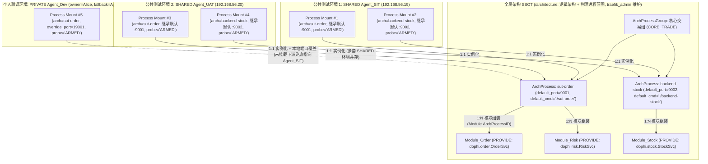
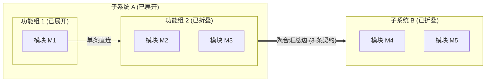
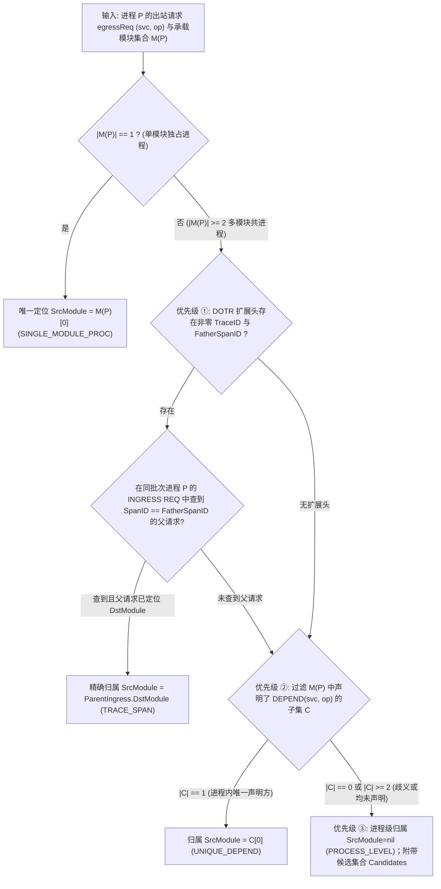

# 业务流量与接口契约治理 (`code-traefik`) 架构元素建模与拓扑一致性验证设计

- **文档编号**：`03-architecture-elements-and-topology.md`
- **文档版本**：v1.4.1
- **更新日期**：2026-11-02
- **归属阶段**：阶段二：系统架构与数据模型设计 (`02-design`)
- **状态**：已批准（待 M10 实施）(Approved for M10)
- **上位基线**：[`01-feature-matrix.md`](../01-features/01-feature-matrix.md) (v2.9.1)、[`01-system-architecture.md`](./01-system-architecture.md)、[`09-arch-process-ssot-and-ebpf-premount-standby-adr.md`](../05-adr/09-arch-process-ssot-and-ebpf-premount-standby-adr.md) (ADR-09 v1.1.0)

---

## 1. 三级逻辑架构元素模型与树形治理 (`internal/server/topology`)

`code-traefik` 作为架构元素与运行映射的**唯一真实源（SSOT）**，采用「**子系统 (`Subsystem`) → 功能组多级树 (`FunctionalGroup`) → 功能模块 (`Module`)**」三级逻辑层次结构。

### 1.1 物化路径 (`Materialized Path`) 树编码模型

功能组支持在同一子系统内最大 **8 级**（`level ∈ [1, 8]`）自嵌套，功能模块可挂载在任意层级的功能组下：

```text
Subsystem [ID=1, Code="TRADE_SYS"]
 ├── FunctionalGroup [ID=10, Parent=nil, Level=1, Path="/10/", Code="ORDER_GRP"]
 │    ├── Module [ID=101, GroupID=10, SubsystemID=1, Code="MOD_ORDER_ENTRY"]   (直接挂在 1 级功能组)
 │    └── FunctionalGroup [ID=12, Parent=10, Level=2, Path="/10/12/", Code="PAY_SUBGRP"]
 │         └── Module [ID=102, GroupID=12, SubsystemID=1, Code="MOD_PAY_SETTLE"] (挂在 2 级功能组)
```

* **设计选型（主键 ID 物化路径 `"/<id1>/<id2>/"`）**：
  1. 首尾强制带斜杠 `/`，使得子树前缀查询 `WHERE subsystem_id = ? AND path LIKE '/10/12/%'` 绝对精确，彻底消除 `'/10/12'` 误匹配 `'/10/120/'` 的部分前缀越界缺陷；
  2. 修改功能组名称或业务编码 `code` 时无需重写子孙节点的 `path`；
  3. 功能模块冗余维护 `subsystem_id`（始终强制等于其挂载功能组的 `subsystem_id`），使流量列表按子系统筛选无需多层 `JOIN`。

### 1.2 功能组移动防成环校验与级联更新算法 (`MoveFunctionalGroup`)

当管理员将功能组 `G` 移动至同子系统内的新父节点 `NewParent`（`NewParent == nil` 表示提升为一级根功能组）时，为防止并发移动导致树形破损或幽灵环路，必须在事务首行获取子系统级排他咨询锁 `SELECT pg_advisory_xact_lock(subsystem_id)`，并在单个事务内执行校验与单条批量 SQL 原子重算：

```go
package topology

const MaxGroupTreeDepth = 8

// MoveFunctionalGroup 在单事务内串行化防成环与最大深度约束，并单条 SQL 原子级联更新子树 path 与 level
func MoveFunctionalGroup(tx *gorm.DB, groupID uint64, newParentID *uint64) error {
	var group models.FunctionalGroup
	if err := tx.First(&group, groupID).Error; err != nil {
		return ErrGroupNotFound // 404
	}

	// 1. 获取子系统粒度事务咨询锁，彻底消除同子系统并发移动成环与脏读
	if err := tx.Exec("SELECT pg_advisory_xact_lock(?)", group.SubsystemID).Error; err != nil {
		return err
	}

	// 2. 禁止移动到自身
	if newParentID != nil && *newParentID == group.ID {
		return ErrCycleMoveToSelf // 400 Bad Request
	}

	newLevel := 1
	newParentPath := "/"
	if newParentID != nil {
		var parent models.FunctionalGroup
		if err := tx.First(&parent, *newParentID).Error; err != nil {
			return ErrParentGroupNotFound // 404
		}
		// 3. 跨子系统移动拦截（功能组归属固定子系统）
		if parent.SubsystemID != group.SubsystemID {
			return ErrCrossSubsystemMove // 400 Bad Request
		}
		// 4. 递归防成环检测：若目标父节点的物化路径以当前节点路径为前缀，说明目标父节点是当前节点的子孙！
		if strings.HasPrefix(parent.Path, group.Path) {
			return ErrCycleMoveToDescendant // 400 Bad Request
		}
		newLevel = parent.Level + 1
		newParentPath = parent.Path
	}

	// 5. 子树最大相对深度计算与 8 级上限门禁校验
	var maxDescendantLevel int
	if err := tx.Model(&models.FunctionalGroup{}).
		Where("subsystem_id = ? AND path LIKE ?", group.SubsystemID, group.Path+"%").
		Select("COALESCE(MAX(level), ?)", group.Level).
		Scan(&maxDescendantLevel).Error; err != nil {
		return err
	}
	subtreeHeight := maxDescendantLevel - group.Level // 自身为 0，含一层子节点为 1
	if newLevel+subtreeHeight > MaxGroupTreeDepth {
		return ErrExceedMaxTreeDepth // 400 Bad Request (超过最大 8 级深度)
	}

	// 6. 原子更新当前节点父指针与整棵子树的物化路径与层级
	oldPrefix := group.Path
	newPrefix := fmt.Sprintf("%s%d/", newParentPath, group.ID)
	levelDelta := newLevel - group.Level

	if err := tx.Model(&models.FunctionalGroup{}).Where("id = ?", group.ID).
		Update("parent_id", newParentID).Error; err != nil {
		return err
	}

	// 利用数据库原生字符串替换与层级加算，单条 SQL 批量完成子树重算，杜绝逐行 Save 脏数据
	return tx.Exec(`
		UPDATE traefik_functional_groups 
		SET path = ? || SUBSTRING(path FROM ?),
		    level = level + ?
		WHERE subsystem_id = ? AND path LIKE ?`,
		newPrefix, len(oldPrefix)+1, levelDelta, group.SubsystemID, oldPrefix+"%",
	).Error
}
```

### 1.3 删除保护冲突矩阵 (`409 Conflict`)

- 删除子系统：若存在关联功能组或功能模块，拒绝删除并返回 `409`；
- 删除功能组：若存在子功能组（`parent_id = id`）或挂载的功能模块（`group_id = id`），拒绝删除并返回 `409`；
- 删除功能模块：若已声明被其他模块引用的 `PROVIDE` 服务契约，或当前仍装载于某个架构标准进程（`arch_process_id IS NOT NULL`），拒绝删除并返回 `409`；
- 删除物理进程组 (`ArchProcessGroup`)：若组下仍存在标准架构进程（`ArchProcess`），拒绝删除并返回 `409`；
- 删除标准架构进程 (`ArchProcess`)：若当前已被任何宿主机 Agent 挂载实例化（`traefik_processes` 中存在引用）或被历史重放任务 `ReplayTask` 引用，拒绝删除并返回 `409`（附带已挂载环境 Agent 名称列表）。

---

## 2. 模块级服务供给与依赖契约 (Module Service Contracts)

功能模块是接口契约声明的最小业务单元，遵循 [`ADR-05`](../05-adr/05-hierarchical-topology-canvas-redesign.md) 与 [`ADR-06`](../05-adr/06-proto-schema-repository-and-field-inspection-adr.md) 服务级（Service-Level）治理粒度，通过 `traefik_module_services` 与 `traefik_module_dependencies` 两张表维护契约：
- **`PROVIDE`（供给服务，`traefik_module_services`）**：本功能模块对外实现的 CROS RPC 服务（`service_name`）；
- **`DEPEND`（依赖服务，`traefik_module_dependencies`）**：本功能模块运行期需要调用的下游内部 CROS RPC 服务（关联 `service_id`）或外部异构系统（`is_external = true`）。

### 2.1 `{package}.{serviceName}` 规范化命名契约 (A-07)

依据 DOPHI CROS RPC 框架运行时规范，线上报文 `RPC_REQ_HEAD_S` 中的 `ascServiceName` 与 `ascOperation` 严格满足以下映射公式：

$$\text{ascServiceName} = \begin{cases} \text{package} + \text{"."} + \text{serviceName}, & \text{package} \neq \text{""} \\ \text{serviceName}, & \text{package} = \text{""} \end{cases}, \quad \text{ascOperation} = \text{methodName}$$

| Protobuf 定义示例 | `package` 声明 | `service` 名称 | `rpc` 方法名 | 规范化 `service_name` (`ascServiceName`) | 规范化 `operation` (`ascOperation`) |
| :--- | :--- | :--- | :--- | :--- | :--- |
| `dophi/order/v1/trade.proto` | `dophi.order.v1` | `TradeService` | `CreateOrder` | `dophi.order.v1.TradeService` | `CreateOrder` |
| `cros/auth/session.proto` | `cros.auth` | `SessionMgr` | `VerifyTicket` | `cros.auth.SessionMgr` | `VerifyTicket` |

* **强校验规则**：
  1. `package` 与 `serviceName` **统一遵循点分连接规范**（`.`，与 `internal/server/decoder/registry.go` 动态解码注册表完全一致；若未声明 `package` 则直接采用 `serviceName`）；
  2. 受限于 CROS RPC 协议头 `CHAR[64]`（含末尾 `\0` 终止符），`service_name` 与 `operation` 字节长度均强制校验为 **`1..63` 位可见 ASCII 字符**（正则：`^[A-Za-z0-9._]{1,63}$` 与 `^[A-Za-z0-9_]{1,63}$`）。
  3. **唯一性红线**：
     - **全局唯一供给 (A-05)**：任意时刻同一 `service_name` 在全库 `traefik_module_services` 中至多只能被 **1 个**功能模块声明为 `PROVIDE`（`uk_traefik_mod_svc_name`）；第二个模块尝试声明相同 `service_name` 时立即拦截返回 `409 Conflict` 并附带已占用模块编码与名称；
     - 同一消费模块对同一内部服务的依赖声明唯一（`UNIQUE(consumer_module_id, service_id)`）。

---

## 3. 架构物理进程蓝图 SSOT、多环境 `1:1` 挂载覆盖与同构重放校验

### 3.1 全局物理进程蓝图 (`ArchProcessGroup -> ArchProcess`) 与多环境 `1:1` 挂载模型 (`1 台 Agent = 1 套独立环境`)

依据 [`ADR-09`](../05-adr/09-arch-process-ssot-and-ebpf-premount-standby-adr.md)，系统将**「标准业务进程蓝图（全局架构 SSOT）」**与**「环境宿主机进程挂载实例（Agent 运行态）」**彻底解耦为两层正交模型：
- 所有逻辑架构元素（`Subsystem`、`FunctionalGroup`、`Module`、`ModuleService`、`ModuleDependency`）与**物理进程蓝图（`ArchProcessGroup`、`ArchProcess` 及 `ArchProcess <-> Module` 组装关系）**均为全团队共享的**公共唯一真实源（SSOT）**，统一在 `/architecture`（`[逻辑架构 | 物理进程]`）中由 `traefik_admin` 维护，零 Agent 机器耦合；
- **1 台 `Agent` 代表 1 套独立的运行环境**（包含多套团队公共测试环境如 `SHARED Agent_SIT`、`SHARED Agent_UAT`，以及每位开发者个人的 `PRIVATE Agent_Dev`）。任意一套环境 `Agent` 均从已定义的 `ArchProcess` 树中 **`1:1` 勾选挂载进程**（`traefik_processes`），并按需施加上下文局部的本地覆盖配置：



核心领域不变量：
1. **单环境（单机）严格 `1:1` 单实例约束 (`UNIQUE(agent_id, arch_process_id)`)**：
   - 同一标准架构进程在单套环境（单个 `Agent`）上至多部署 1 个实例，数据库层以 `uk_traefik_proc_agent_arch` 强制保证不重复挂载；
   - **禁止自造野生进程与篡改模块组装**：Agent 挂载界面不提供自由新建进程名或自由增删 `FM` 模块入口；缺失的标准进程必须回到 `/architecture?tree=physical` 定义。
2. **有效运行参数继承、匹配语法契约与蓝图端口演进自动固化 (A-02)**：
   - 挂载实例的有效属性遵循**「本地覆盖优先 ➔ 架构蓝图默认兜底」**确定性公式：
     $$\text{EffectiveListenPort} = \text{OverrideListenPort} \neq \text{nil} \ ? \ *\text{OverrideListenPort} : \text{ArchProcess.DefaultListenPort}$$
     $$\text{EffectiveCmdPattern} = \text{OverrideCmdPattern} \neq \text{""} \ ? \ \text{OverrideCmdPattern} : \text{ArchProcess.DefaultCmdPattern}$$
     $$\text{EffectiveIP} = \text{AdvertiseIP} \neq \text{""} \ ? \ \text{AdvertiseIP} : \text{HostIP(Agent.Endpoint)}$$
     $$\text{EffectiveExtraDownstreams} = \text{Dedupe}(\text{ArchProcess.DefaultExtraDownstreams} \cup \text{Process.ExtraDownstreams})$$
   - **`cmd_pattern` 匹配语法与防 ReDoS 校验**：长度强制 `<= 256` 字符；默认按**精确子串包含**（`strings.Contains(cmdline, pattern)`）匹配 `/proc/<pid>/cmdline`（`\0` 替换为空格后）；若以显式前缀 `re:` 开头，则按 **Go `regexp` (RE2 线性时间引擎)** 编译匹配，主控在保存 `ArchProcess` 或 `Process` 覆盖参数时强制预执行 `regexp.Compile` 语法校验（非法正则返回 `400 Bad Request`）；
   - **同机非零端口互斥与蓝图变更自动固化**：同一 `agent_id` 下所有非零有效端口（`effective_listen_port > 0`）通过部分唯一索引 `uk_traefik_proc_agent_port` 严格互斥（同时允许并存多个 `0` 端口纯客户端进程）。当管理员在 `/architecture` 修改 `ArchProcess.DefaultListenPort`（由 $P_{\text{old}} \to P_{\text{new}}$）时，主控在单事务内自动检测各已挂载该蓝图的 Agent：若某挂载实例未设置覆盖端口（`override_listen_port IS NULL`）且 $P_{\text{new}} > 0$ 与该 Agent 同机其他已挂载进程的有效端口冲突，**自动将该冲突实例的 `override_listen_port` 固化为原有效端口 $P_{\text{old}}$**（并在响应 `auto_pinned_overrides` 中返回提示），既绝对不破坏个人/特定环境既有挂载，又保证全局蓝图自由演进。
3. **模块单归属与多环境公私双域并存 (A-03)**：
   - **架构层**：1 个 `ArchProcess` 可组装承载 $N \ge 0$ 个 `Module`（记录于 `traefik_modules.arch_process_id`），每个 `Module` 全局至多归属 **1 个** `ArchProcess`（尝试将已分配给进程 A 的模块重复绑给进程 B 时返回 `409 Conflict`）；
   - **公共测试环境域 (`SHARED` Agent)**：`1 台 SHARED Agent = 1 套独立公共测试环境`（如 `SIT`、`UAT`、`准生产回归`），**支持多台不同的 `SHARED` Agent 各自 `1:1` 挂载同一个 `ArchProcess`**，互不排斥；
   - **个人私有域 (`PRIVATE` Agent)**：每位开发者本人的 `PRIVATE` Agent 作为独立隔离沙箱，同样自由 `1:1` 勾选挂载任意 `ArchProcess`，并可通过 `Agent.FallbackAgentID` 可选绑定某台 `SHARED` 公共环境 Agent 作为本地未启动下游的跨机连接兜底。
4. **动态 PID 非权威与统一七态预挂就绪快照**：操作系统 `PID` 随业务重启动态变化，不作为静态权威配置，由 Agent 在 `ARMED` 预挂待命及活跃录制期通过 `(EffectiveListenPort, EffectiveCmdPattern)` 实时扫描 `/proc` 获取，并将统一七态就绪诊断（`READY` / `NEED_RECONNECT` / `WAITING_PROC` / `MONITORING` / `DISARMED` / `OFFLINE` / `CAP_DENIED` 或 `ERROR`）回写至 `traefik_processes` 快照列。

### 3.2 多环境混合下游 `IP:Port` 自动推导算法 (`CompileProcessDownstreams` — 同机优先 + 绑定基线环境兜底)

当主控向 Agent 下发某挂载进程 `P`（所属环境 `Agent_X`，对应蓝图 `ArchProcess_Src`）的预挂载待命（`/monitors/arm`）、录制（`/monitors/sync`）或重放规格 `ProcessMonitorSpec` 时，自动聚合以下三层下游网络端点集合：

1. **已声明架构依赖混合端点（同环境同机优先 ➔ `FallbackAgentID` 绑定公共环境兜底）**：
   - 读取 `ArchProcess_Src` 承载的全部模块集合 $M(\text{ArchProcess\_Src})$ 及其内部依赖 `ModuleDependency`，定位目标供给模块所属的标准架构进程 `ArchProcess_Dst`；
   - 若 `ArchProcess_Dst != ArchProcess_Src`：
     - **优先级 ①（同环境同机挂载实例优先）**：检查当前这台 `Agent_X` 上是否挂载了 `ArchProcess_Dst`（记为 `P_local`）；若存在且 `P_local.EffectiveListenPort > 0`，加入 `(EffectiveIP(P_local), P_local.EffectiveListenPort)` 及同机回环别名 `("127.0.0.1", P_local.EffectiveListenPort)`；
     - **优先级 ②（绑定公共基线环境兜底，严禁多环境盲目串绑）**：当同机未挂载 `ArchProcess_Dst`（如开发者仅在个人 `PRIVATE` Agent 启动单个待测微服务，或某套分片环境依赖公共底座 Agent）时：
       - 若 `Agent_X.FallbackAgentID != nil`，精确查找该绑定公共 `SHARED` 环境 Agent 上的挂载实例 `P_fallback`，若 `P_fallback.EffectiveListenPort > 0` 则加入 `(EffectiveIP(P_fallback), P_fallback.EffectiveListenPort)`；
       - 若 `Agent_X.FallbackAgentID == nil` 且全库所有 `SHARED` Agent 中**恰好仅有唯一 1 台**挂载了 `ArchProcess_Dst`，自动回退纳入该唯一公共实例端点；若存在 $\ge 2$ 套 `SHARED` 环境同时挂载了 `ArchProcess_Dst` 且未显式指定 `FallbackAgentID`，**绝不跨环境盲目合并其他 `SHARED` 环境 IP:Port**，彻底杜绝 `SIT` 与 `UAT` 跨环境串流！
2. **同机已挂载进程监听端口全集（`PeerListenEndpoints` & `ArmedDownstreams` 超集不变量）**：
   - **核心物理保障（解决未声明 `VIOLATION` 调用拦截盲区）**：在编译预挂待命规格与录制规格时，统一将同机 `Agent_X` 上**全部已挂载进程的非零有效监听端口**（含 `(EffectiveIP, Port)` 与 `("127.0.0.1", Port)`，剔除 `P` 自身端口）悉数并入 `Downstreams`，严格保持**预挂超集不变量**：
     $$\text{ArmedDownstreams}(P) \supseteq \text{ActiveRecordingDownstreams}(P, S)$$
   - 由此，无论模块 $A$ 源码是否声明了对同机模块 $B$ 的依赖，只要进程在 `ARMED` 预挂后建立连接，出站长连接在待命期即已 100% 接入 `EgressProxy` 纯透传，开启录制时无需任何重连即可 100% 捕获未声明跨进程 `VIOLATION` 调用！
3. **架构默认补充端点 + 本地覆盖补充端点 + 离线重放历史端点**：
   - 合并 `ArchProcess_Src.DefaultExtraDownstreams` 与 `P.ExtraDownstreams`；若为离线重放（`CompileReplayDownstreams`），额外并入源录制批次观测到的全部 `EGRESS` 原始 `dst_addr`（`IP:Port`）；最终按 `IP:Port` 稳定排序去重输出。

### 3.3 基于录制快照解耦的跨 Agent 同构进程重放兼容性校验 (`ValidateReplayProcessCompatibility`)

为确保某台环境 Agent 日后卸载 `Process` 挂载实例（`DELETE /api/processes/:id`）后，历史录制批次依然可以随时跨环境重放，录制批次创建时在 `RecordingSession.ProcessSnapshots` 中固化参与进程的蓝图快照 `ProcessSnapshotItem{ProcessID, ArchProcessID, Code, Name, ModuleIDs, ListenPort}`。兼容性校验优先读取批次快照，彻底解除对源 `traefik_processes` 存活状态的硬依赖：

```go
package topology

// ProcessSnapshotItem 固化在 RecordingSession.ProcessSnapshots 中的录制时刻进程蓝图快照
type ProcessSnapshotItem struct {
	ProcessID     uint64   `json:"process_id"`
	ArchProcessID uint64   `json:"arch_process_id"`
	Code          string   `json:"code"`
	Name          string   `json:"name"`
	ModuleIDs     []uint64 `json:"module_ids"`
	ListenPort    uint16   `json:"listen_port"`
}

// ValidateReplayProcessCompatibility 校验录制源进程选定报文能否安全重放到目标挂载进程 targetProc
func ValidateReplayProcessCompatibility(
	callerID uint,
	isAdmin bool,
	session *models.RecordingSession,
	selectedRecords []models.TrafficRecord,
	sourceSnap *ProcessSnapshotItem, // 优先从 session.ProcessSnapshots 按 source_process_id 提取（兼容回退现存 sourceProc）
	targetProc *models.Process,
	targetAgent *models.Agent,
	archProcModules map[uint64][]uint64, // key: ArchProcessID -> []ModuleID
	provideMap map[string]uint64,        // key: "serviceName" -> DstModuleID
) error {
	// 1. 录制素材与目标 Agent 的公私域归属防越权校验 (Anti-IDOR)
	if session.Scope == models.ScopePrivate && session.OwnerID != callerID && !isAdmin {
		return ErrForbiddenPrivateSession // 403 Forbidden
	}
	if targetAgent.Scope == models.ScopePrivate && (targetAgent.OwnerID == nil || *targetAgent.OwnerID != callerID) && !isAdmin {
		return ErrForbiddenPrivateAgent // 403 Forbidden
	}
	if sourceSnap == nil {
		return ErrSourceProcessSnapshotNotFound // 400 Bad Request
	}

	// 2. 目标挂载进程必须具备有效监听端口 (> 0，纯客户端进程无法接收重放注入)
	if targetProc.EffectiveListenPort <= 0 {
		return ErrClientOnlyReplayTarget // 400 Bad Request
	}

	// 3. 原地同挂载实例 或 挂载同一标准架构进程蓝图 (ArchProcessID 相等) 天然 100% 同构兼容！
	if sourceSnap.ProcessID == targetProc.ID || sourceSnap.ArchProcessID == targetProc.ArchProcessID {
		return nil
	}

	// 4. 跨架构进程重构演进场景（如模块拆分迁移至新标准进程）：校验目标进程必须完整承载选定请求命中的全部公共架构模块
	targetModSet := toUint64Set(archProcModules[targetProc.ArchProcessID])
	requiredMods := make(map[uint64]struct{})
	hasUnregisteredIface := false

	for _, rec := range selectedRecords {
		if dstModID, ok := provideMap[rec.ServiceName]; ok {
			requiredMods[dstModID] = struct{}{}
		} else {
			hasUnregisteredIface = true
		}
	}

	if hasUnregisteredIface || len(requiredMods) == 0 {
		sourceMods := toUint64Set(sourceSnap.ModuleIDs)
		if len(sourceMods) == 0 {
			sourceMods = toUint64Set(archProcModules[sourceSnap.ArchProcessID])
		}
		if len(sourceMods) == 0 || !isSubset(sourceMods, targetModSet) {
			return ErrIncompatibleReplayTargetModule // 400 Bad Request
		}
		return nil
	}

	if !isSubset(requiredMods, targetModSet) {
		return ErrIncompatibleReplayTargetModule // 400 Bad Request (附带缺失的公共模块编码明细)
	}
	return nil
}
```

---

## 4. 全系统分层复合架构拓扑推导与边汇总引擎 (`BuildTopologyGraph`)

依据 [`ADR-05`](../05-adr/05-hierarchical-topology-canvas-redesign.md)，架构拓扑引擎从局部的单子系统扁平图全面升级为**全系统分层复合有向图（Hierarchical Compound Graph）**，统一支持**逻辑架构视角 (`LOGICAL`)** 与**物理部署视角 (`PHYSICAL`)**。后端单次输出全量层级节点（顶层 `depth=0` 直接为子系统或进程组，不下发冗余外层 `SYSTEM` 巨框）与原子叶子边，前端通过纯函数执行实时边汇总与按需下钻展开。

### 4.1 双重视角分层树模型（彻底去 Agent 化）

#### 1. 逻辑架构视角 (`view=LOGICAL`)
```text
(画布根视口 Viewport)
 ├── Subsystem (depth=0 / L0: 业务子系统容器，如 TRADE_SYS, RISK_SYS)
 │    └── FunctionalGroup L1 (depth=1 / L1: 一级功能组容器)
 │         ├── FunctionalGroup L2...L8 (depth=2..8: 多级功能组自嵌套容器)
 │         │    └── Module (叶子卡片: 最小契约功能模块)
 │         └── Module (挂载于一级功能组下的模块)
 ├── ExternalContainer (depth=0 / L0: 外部依赖系统容器，仅存在外部依赖时生成)
 │    ├── ExternalSystem_A (按 external_system 名称实体化，如 WeChatPay)
 │    └── ExternalSystem_B (如 UnionPay)
 └── UnregisteredInterface (动态虚拟节点: 仅在一致性叠加层检出调用未登记接口时由前端按需注入)
```
> **外键对齐说明**：`traefik_modules.group_id` 为 `NOT NULL` 外键，合法模块均挂载于某级 `FunctionalGroup` 下；前端 `hierarchy.ts` 对异常缺失父功能组的数据保留回退挂载至 `sub_<SubsystemID>` 的防御性兜底。

#### 2. 物理部署视角 (`view=PHYSICAL`，100% 源自架构物理进程蓝图 SSOT、彻底去 Agent 化)
> [!IMPORTANT]
> **物理拓扑去 Agent 化与多环境可选端点叠加铁律（[`ADR-05`](../05-adr/05-hierarchical-topology-canvas-redesign.md) & [`ADR-09`](../05-adr/09-arch-process-ssot-and-ebpf-premount-standby-adr.md)）**：`Agent` 仅作为环境宿主机上无状态的字节流采集探测器与 eBPF 探针载体，不是系统业务架构的构成元素。物理部署视图节点与连线骨架 **100% 直接由 `ArchProcessGroup -> ArchProcess -> Module` 架构物理进程蓝图推导生成**（即使尚未纳管任何 Agent 机器也能完整构建物理全景图！），**画布绝对不出现 `AGENT` 节点，且 `meta` 中严禁透出 `agent_id`**：
> - **默认纯蓝图态（未指定 `env_agent_id`）**：`meta.endpoint` 确定性输出 `:<default_listen_port>`（纯客户端为 `"client-only"`），并附带 `meta.mounted_shared_env_count`（已挂载该蓝图的公共环境数），避免多套 `SHARED` 环境并存时随机选取某台机器 IP 引发歧义；
> - **指定环境叠加态（传入可选查询参数 `env_agent_id`，调用方需对该 `SHARED` 或本人 `PRIVATE` 环境具备可见权，越权返 `403`）**：后端按该环境上的挂载实例富化填入 `EffectiveIP:EffectiveListenPort`（该环境未挂载时标记 `meta.env_mounted = false` 并回退显示 `:<default_listen_port>`），同时合并该环境挂载实例的 `extra_downstreams` 展示外部网络端点：

```text
(画布根视口 Viewport)
 ├── ProcessGroup (depth=0 / L0: 架构进程组容器，源自 traefik_arch_process_groups)
 │    └── Process (depth=1 / L1: 标准业务进程容器，源自 traefik_arch_processes，标识进程名与监听端点)
 │         └── Module (depth=2 / L2: 该标准架构进程组装承载的功能模块实例 Module.arch_process_id)
 ├── UndeployedContainer (depth=0 / L0: 尚未分配至任何标准架构进程的孤立模块容器 arch_process_id IS NULL)
 │    └── Module (depth=1: 未分配进程模块叶子卡片)
 └── ExternalContainer (depth=0 / L0: 外部依赖与网络端点容器，按需生成)
      ├── ExternalSystem (承接模块声明的 is_external=true 业务外部系统)
      └── ExternalEndpoint (承接 ArchProcess.default_extra_downstreams 及公共挂载 extra_downstreams 的固定 IPv4:Port 端点)
```

### 4.2 前端实时边汇总算法 (Edge Rollup) 与复合坐标规则

后端接口一次性返回全系统架构节点与最细粒度的**模块/外部端点级原子叶子边**集合。在前端画布中，无论用户如何展开或折叠容器，有向连线始终动态聚合连接至**当前状态下两端最近的可见代表节点 (Representative Visible Ancestor)**：



#### 边汇总与复合排版核心不变量：
1. **代表节点查找 (`rep(nodeId)`)**：沿当前节点的 `ancestors[]` 路径从顶层根（`depth=0`）向下扫描，首个处于“折叠 (Collapsed)”状态的容器即为其可见代表节点；若其所有祖先均处于展开状态，则该叶子节点自身即为代表节点；
2. **同容器内收敛 (Internal Dependency)**：若源与目标的代表节点相同（$S_{\text{rep}} = T_{\text{rep}}$，即两端落在同一个折叠容器内部）：
   - **逻辑视图**：在折叠容器的标题栏徽章累计为「内部依赖: $N$」；
   - **物理视图**：若两端落在同一折叠 `Process` 容器内，自动收敛为进程卡片右上角的「进程内调用: $N$」徽章（契合 A-04 不经内核 Socket、物理不可观测语义）；
3. **跨容器聚合边 (Rollup Edge)**：若代表节点不同（$S_{\text{rep}} \neq T_{\text{rep}}$），将底层叶子边按有向对偶元组 `(S_rep, T_rep)` 归并为一条汇总边，附带聚合去重后的契约清单，线宽依据 $\log_2(\text{count} + 1)$ 动态缩放；
4. **环路标红 (Cycle Detection)**：在当前可见代表节点导出的有向图上执行 Tarjan 强连通分量 (SCC) 算法，处于大小 $\ge 2$ 强连通分量内的汇总边标记 `isCycle = true` 并以 `--color-danger` 高亮报警；
5. **React Flow v12 父先于子拓扑序与全局拐点换算**：输出给 React Flow 的可见节点必须按 `depth` 升序排列（确保 `parentId` 父容器先于子节点出现）；ELK `INCLUDE_CHILDREN` 输出的跨层边 `bendPoints` 必须累加所属 `containingNode` 的全局绝对坐标 `(absX, absY)`，且在节点被用户手动拖拽后自动退化为 `SmoothStep` 动态正交路径。

### 4.3 静态拓扑图完整 DTO 契约 (`TopologyGraphDTO`)

```go
package topology

// GraphNodeType 全系统分层拓扑节点类型枚举 (零 Agent)
type GraphNodeType string

const (
	NodeTypeSubsystem             GraphNodeType = "SUBSYSTEM"
	NodeTypeFunctionalGroup       GraphNodeType = "FUNCTIONAL_GROUP"
	NodeTypeModule                GraphNodeType = "MODULE"
	NodeTypeExternalContainer     GraphNodeType = "EXTERNAL_CONTAINER"
	NodeTypeExternalSystem        GraphNodeType = "EXTERNAL_SYSTEM"
	NodeTypeProcessGroup          GraphNodeType = "PROCESS_GROUP"
	NodeTypeProcess               GraphNodeType = "PROCESS"
	NodeTypeUndeployedContainer   GraphNodeType = "UNDEPLOYED_CONTAINER"
	NodeTypeExternalEndpoint      GraphNodeType = "EXTERNAL_ENDPOINT"
	NodeTypeUnregisteredInterface GraphNodeType = "UNREGISTERED_INTERFACE" // 前端一致性叠加态按需动态注入
)

// GraphNode 复合图节点传输对象
type GraphNode struct {
	ID        string         `json:"id"`                   // 唯一标识: "sub_1", "grp_10", "mod_101", "pgrp_交易核心", "proc_7"
	Type      GraphNodeType  `json:"type"`                 // 节点类型枚举（严禁出现 AGENT）
	ParentID  string         `json:"parent_id,omitempty"`  // 父节点 ID，顶层节点 (depth=0) 为空字符串
	Ancestors []string       `json:"ancestors"`            // 从顶层祖先至直接父节点的有序 ID 数组，加速前端 rep() 计算
	Depth     int            `json:"depth"`                // 所在层级深度 (0: 顶层子系统/进程组/虚拟根容器)
	EntityID  uint64         `json:"entity_id,omitempty"`  // 对应业务数据库主键 (Subsystem.ID, Module.ID, Process.ID)
	Code      string         `json:"code,omitempty"`       // 业务编码 (如 "TRADE_SYS", "MOD_ORDER")
	Name      string         `json:"name"`                 // 展示名称
	SortOrder int            `json:"sort_order"`           // 排序权重，供 ELK considerModelOrder 保持排版稳定
	Meta      map[string]any `json:"meta,omitempty"`       // 视图专有元数据 (如 endpoint, listen_port, provide_count, owner_name；严禁含 agent_id)
}

// EdgeServiceItem 底层服务契约明细
type EdgeServiceItem struct {
	ServiceID    *uint64 `json:"service_id,omitempty"`
	ServiceName  string  `json:"service_name"`
	DependencyID uint64  `json:"dependency_id,omitempty"`
	Description  string  `json:"description,omitempty"`
}

// GraphEdge 原子叶子依赖边传输对象
type GraphEdge struct {
	ID             string            `json:"id"`               // 如 "edge_m101_m102" 或 "edge_ext_m101_WeChatPay"
	Kind           string            `json:"kind"`             // CROSS_PROCESS | INTRA_PROCESS | EXTERNAL_UNREGISTERED | UNDEPLOYED
	SourceNodeID   string            `json:"source_node_id"`   // 源叶子节点 ID ("mod_101" 或 "proc_7")
	TargetNodeID   string            `json:"target_node_id"`   // 目标叶子节点 ID ("mod_102" / "ext_sys_WeChatPay" / "ext_ep_10.0.0.8:3306")
	SrcModuleID    uint64            `json:"src_module_id,omitempty"`
	DstModuleID    *uint64           `json:"dst_module_id,omitempty"`
	SrcProcessID   *uint64           `json:"src_process_id,omitempty"`
	DstProcessID   *uint64           `json:"dst_process_id,omitempty"`
	Services       []EdgeServiceItem `json:"services"`         // 聚合的底层服务调用清单
	ExternalSystem string            `json:"external_system,omitempty"`
}

// TopologyGraphDTO 全量架构拓扑图响应载荷
type TopologyGraphDTO struct {
	View         string      `json:"view"`          // LOGICAL | PHYSICAL
	ModelVersion string      `json:"model_version"` // 基于规范化 nodes+edges 计算的 SHA-256 内容指纹 (如 "v1-LOGICAL-9f86d081884c7d65")，100% 感知硬删除并作为 HTTP ETag
	Nodes        []GraphNode `json:"nodes"`
	Edges        []GraphEdge `json:"edges"`
}
```

---

## 5. 动态报文穿透定位与架构一致性验证引擎 (`VerifySessionTopology`)

基于一次多进程协同录制批次（`session_id`）采集到的全部业务请求报文（`ucMsgType == 2 (REQ)`），引擎自动穿透还原实际模块级调用图，并与当前静态架构契约执行逐边比对。

为消除慢轨并发连接分片处理时“父入站请求尚未落盘而出站调用已到达”的时序竞态，**来源模块判定在录制批次停止后，由后台离线批量对账引擎 (`OfflineBatchAttribution`) 统一归集全链路报文并执行结算**，保证父子 SpanID 因果关系的 100% 精确闭环。

### 5.1 目的模块穿透定位 (`ResolveDestinationModule`)

依据服务级全局唯一供给契约（A-05，`traefik_module_services`），无论报文来自 `INGRESS` 还是 `EGRESS`，直接以请求头 `ascServiceName` 查表 `ProvideMap[serviceName]`：
- **命中**：唯一定位到目标功能模块 `DstModule`（同时确定所属功能组与子系统）；
- **未命中**：归属至虚拟异常节点 `VIRTUAL_UNREGISTERED_INTERFACE`（「未登记接口」）。

### 5.2 来源模块判定与去重权威原则 (`ResolveSourceModule`)

在跨进程调用统计中，**严格以发起方目标进程的 `EGRESS` 出站记录为唯一权威统计源，接收方的 `INGRESS` 仅用于构建父 Span 索引与外部调用方统计，彻底消除同一次往返双重计数**：

对于目标进程 $P$ 发出的出站请求报文 `egressReq`（已知 $P$ 承载的模块集合为 $M(P)$，且依据该批次固化的 `SessionProcessSnapshot` 动态解析）：



> [!NOTE]
> **单模块进程前置收敛与同机反查**：
> 1. 当进程 $P$ 仅承载 1 个模块（$|M(P)| = 1$）时，即便未携带 Trace 且未声明 `DEPEND`，调用方在物理上也必然是唯一的 $M(P)[0]$。前置收敛保证单模块进程的违规外联被 100% 裁决为 **`VIOLATION`**；
> 2. 同机跨进程互调时，Agent 依据 Socket inode 反查确认发起方 PID 属于纳管进程，从而将对端 INGRESS 关联至发起方进程，避免误判为外部未知调用。

### 5.3 架构一致性六分类比对规则与算法

比对算法只针对**“源模块所在进程在本批次被纳管监控”**的静态依赖边进行评估，输出互斥完备的六类比对结果（彻底消除因未监控模块产生的虚假未覆盖噪音）：

| 结果分类枚举 | 中文标签 | 严格判定条件 | 架构治理含义与 UI 视觉语义 |
| :--- | :--- | :--- | :--- |
| **`VERIFIED`** | 已验证合规 | 静态声明跨进程依赖 `SrcModule --DEPEND--> (svc, op)`，且实测归属到 `SrcModule` 的跨进程调用 $\ge 1$ | 架构设计与实测运行完全一致（`--color-success` 绿色实线） |
| **`VIOLATION`** | 架构漂移越权 | 实测精确定位到 `SrcModule`，但 `SrcModule` **未声明**该 `DEPEND(svc, op)`（含调用未登记接口或已登记其他模块） | **高优架构漂移告警**：源码存在未备案的私自跨进程调用（`--color-danger` 红色告警实线） |
| **`UNCOVERED`** | 本次未触发 | 静态声明为跨进程依赖，源模块与目标供给模块所在进程**均在本次协同监控集合中**，但本次任务未捕获该调用 | 依赖已就绪但当前业务测试用例未覆盖该调用路径（`--color-text-muted` 灰色虚线） |
| **`NOT_MONITORED`** | 目标未纳管 | 静态声明为跨进程依赖，源模块所在进程已被监控，但**目标供给模块所在物理进程未加入本次监控批次** | 物理上不可观测，**不计入 `UNCOVERED` 覆盖率分母**（`--color-text-muted` 浅灰点划线） |
| **`NOT_OBSERVABLE`** | 进程内不可观测 | 静态声明为同进程内两模块调用（依据该批次快照 `SrcModule` 与 `DstModule` 绑定在同一 `ProcessID`） | 物理上走函数调用不经过内核网络栈，**不计入 `UNCOVERED` 分母**（`--color-info` 蓝色徽章） |
| **`UNATTRIBUTED`** | 进程级待定归属 | 多模块进程发出的调用缺少父 Trace 且存在重复声明，只能定位于 `Process_P -> DstModule` | 提示在源码中补充 DOTR Trace 扩展头或在架构中心收敛重复契约（`--color-warning` 琥珀色边） |

#### 一致性验证响应 DTO 结构 (`ConsistencyReportDTO`)

```go
package topology

type VerificationStatus string

const (
	StatusVerified      VerificationStatus = "VERIFIED"
	StatusViolation     VerificationStatus = "VIOLATION"
	StatusUncovered     VerificationStatus = "UNCOVERED"
	StatusNotMonitored  VerificationStatus = "NOT_MONITORED"
	StatusNotObservable VerificationStatus = "NOT_OBSERVABLE"
	StatusUnattributed  VerificationStatus = "UNATTRIBUTED"
)

type ConsistencyEdgeResult struct {
	Status              VerificationStatus `json:"status"`
	SrcModuleID         *uint64            `json:"src_module_id,omitempty"`
	SrcProcessID        *uint64            `json:"src_process_id,omitempty"`
	CandidateModuleIDs  []uint64           `json:"candidate_module_ids,omitempty"`
	DstModuleID         *uint64            `json:"dst_module_id,omitempty"` // nil 表示未登记外部接口
	ServiceName         string             `json:"service_name"`
	Operation           string             `json:"operation"`
	ObservedCallCount   int64              `json:"observed_call_count"`
	AttributionMode     string             `json:"attribution_mode,omitempty"`
	SampleTrafficRecID  *uint64            `json:"sample_traffic_record_id,omitempty"`
}

type ConsistencyReportDTO struct {
	SessionID          uint64                  `json:"session_id"`
	StaticModelVersion time.Time               `json:"static_model_version"` // 静态架构版本快照时刻，模型变更时缓存自动失效
	VerifiedCount      int                     `json:"verified_count"`
	ViolationCount     int                     `json:"violation_count"`
	UncoveredCount     int                     `json:"uncovered_count"`
	NotMonitoredCount  int                     `json:"not_monitored_count"`
	NotObservableCount int                     `json:"not_observable_count"`
	UnattributedCount  int                     `json:"unattributed_count"`
	Edges              []ConsistencyEdgeResult `json:"edges"`
}
```

### 5.4 拓扑画布一致性比对叠加层机制 (Consistency Canvas Overlay)

依据 [`ADR-05`](../05-adr/05-hierarchical-topology-canvas-redesign.md)，架构一致性验证结果不再孤立于独立二级页签，而是作为静态拓扑画布上的**动态增强图层 (Overlay)**：

1. **静态边归并、动态违规边合成与 `UNATTRIBUTED` 双视图归属**：
   - **静态已声明边归并**：`VERIFIED / UNCOVERED / NOT_MONITORED / NOT_OBSERVABLE` 按公共架构元素键 `(src_module_id, dst_module_id, service_name)` 精确绑定至静态叶子边（即使选定的是复用公共模块的个人 `PRIVATE` 录制批次亦可无损映射）；
   - **`VIOLATION` 动态叶子边合成**：因静态 `traefik_module_dependencies` 表中不存在未声明越权调用，叠加引擎自动将 `status == 'VIOLATION'` 的结果动态合成为临时告警叶子边并并入 `rollup` 输入边集触发 ELK 增量重排；若 `dst_module_id == nil`，自动注入虚拟节点 `VIRTUAL_UNREGISTERED_INTERFACE`（「未登记接口」）作为连线终点；
   - **`UNATTRIBUTED` 跨视图归属降级**：因 `src_module_id == nil`，在物理视图 (`PHYSICAL`) 下直接挂载于源进程 `proc_<src_process_id>`（若为 `PRIVATE` 私有进程则映射至 `candidate_module_ids` 所属的公共物理容器）；在逻辑视图 (`LOGICAL`) 下取 `candidate_module_ids` 在逻辑层级树中的**最近公共祖先（LCA，如同一功能组或子系统）**作为源节点参与上卷，若候选模块跨多个顶层子系统无单一容器祖先，则收敛至画布顶部一致性摘要栏的「待定归属 (`N`)」独立徽章抽屉展示；
2. **最差状态优先级收敛与实测调用热力**：
   - 当多个底层模块调用被上卷至折叠容器（如子系统间、进程组间）时，汇总边状态严格遵循**最差优先级收敛**：
     $$\text{VIOLATION} \succ \text{UNATTRIBUTED} \succ \text{UNCOVERED} \succ \text{NOT\_MONITORED} \succ \text{NOT\_OBSERVABLE} \succ \text{VERIFIED}$$
   - 若某子系统间存在哪怕 1 条未声明的跨子系统调用，整条聚合连线即被渲染为 `--color-danger` 告警红实线并伴随脉冲动效；边标签同步展示实测调用总次数（如 `∑calls: 1,420`）；
3. **闭环穿透至公共四段解剖抽屉**：
   - 用户点击任何一条一致性边，右侧滑出 `EdgeDetailDrawer` 依赖明细抽屉；点击任意包含 `SampleTrafficRecID` 的接口项，直接调用公共组件 `PacketAnatomyDrawer` 检视四段二进制报文（公共头位图、会话头拆解、DOTR Trace、Protobuf JSON 树与 Hex 字节），实现从“宏观架构违规”到“微观网络字节”的完整追溯闭环。

