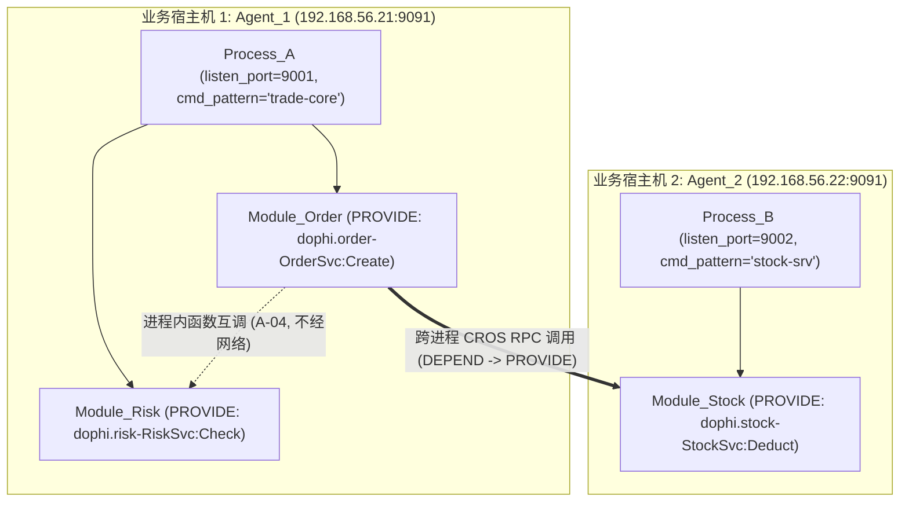
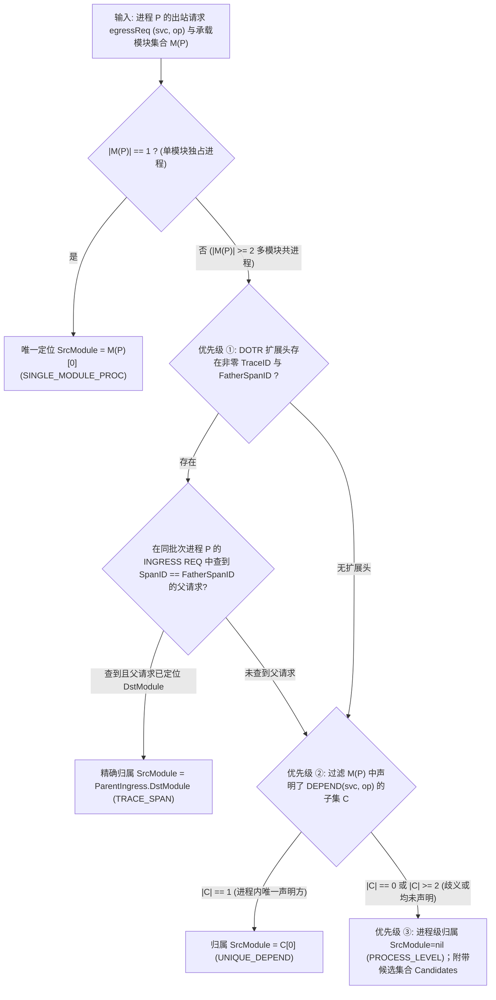

# 业务流量监控与重放 (`code-traefik`) 架构元素建模与拓扑一致性验证设计

- **文档编号**：`03-architecture-elements-and-topology.md`
- **文档版本**：v1.0.0
- **更新日期**：2026-10-29
- **归属阶段**：阶段二：系统架构与数据模型设计 (`02-design`)
- **状态**：已定稿 (Frozen)
- **上位基线**：[`01-feature-matrix.md`](../01-features/01-feature-matrix.md) (v2.5.1)、[`01-system-architecture.md`](./01-system-architecture.md)

---

## 1. 三级逻辑架构元素模型与树形治理 (`internal/server/topology`)

`code-traefik` 作为架构元素与运行映射的**唯一真实源（SSOT）**，采用「**子系统 (`Subsystem`) → 功能组多级树 (`FunctionalGroup`) → 功能模块 (`Module`)**」三级逻辑层次结构。

### 1.1 物化路径 (`Materialized Path`) 树编码模型

功能组支持在同一子系统内最大 **8 级**（`level ∈ [1, 8]`）自嵌套，功能模块可挂载在任意层级的功能组下：

```text
Subsystem [ID=1, Code="TRADE_SYS"]
 ├── FunctionalGroup [ID=10, Parent=nil, Level=1, Path="/10/", Code="ORDER_GRP"]
 │    ├── Module [ID=101, GroupID=10, SubsystemID=1, Code="MOD_ORDER_ENTRY"]   (直接挂在 1 级功能组)
 │    └── FunctionalGroup [ID=12, Parent=10, Level=2, Path="/10/12/", Code="PAY_SUBGRP"]
 │         └── Module [ID=102, GroupID=12, SubsystemID=1, Code="MOD_PAY_SETTLE"] (挂在 2 级功能组)
```

* **设计选型（主键 ID 物化路径 `"/<id1>/<id2>/"`）**：
  1. 首尾强制带斜杠 `/`，使得子树前缀查询 `WHERE subsystem_id = ? AND path LIKE '/10/12/%'` 绝对精确，彻底消除 `'/10/12'` 误匹配 `'/10/120/'` 的部分前缀越界缺陷；
  2. 修改功能组名称或业务编码 `code` 时无需重写子孙节点的 `path`；
  3. 功能模块冗余维护 `subsystem_id`（始终强制等于其挂载功能组的 `subsystem_id`），使流量列表按子系统筛选无需多层 `JOIN`。

### 1.2 功能组移动防成环校验与级联更新算法 (`MoveFunctionalGroup`)

当管理员将功能组 `G` 移动至同子系统内的新父节点 `NewParent`（`NewParent == nil` 表示提升为一级根功能组）时，在单个数据库可串行化/行锁事务内执行以下五步校验与重算：

```go
package topology

const MaxGroupTreeDepth = 8

// MoveFunctionalGroup 在单事务内校验防成环与最大深度约束，并原子级联更新子树 path 与 level
func MoveFunctionalGroup(tx *gorm.DB, groupID uint64, newParentID *uint64) error {
	var group models.FunctionalGroup
	if err := tx.Clauses(clause.Locking{Strength: "UPDATE"}).First(&group, groupID).Error; err != nil {
		return ErrGroupNotFound // 404
	}

	// 1. 禁止移动到自身
	if newParentID != nil && *newParentID == group.ID {
		return ErrCycleMoveToSelf // 400 Bad Request
	}

	newLevel := 1
	newParentPath := "/"
	if newParentID != nil {
		var parent models.FunctionalGroup
		if err := tx.Clauses(clause.Locking{Strength: "UPDATE"}).First(&parent, *newParentID).Error; err != nil {
			return ErrParentGroupNotFound // 404
		}
		// 2. 跨子系统移动拦截（功能组归属固定子系统）
		if parent.SubsystemID != group.SubsystemID {
			return ErrCrossSubsystemMove // 400 Bad Request
		}
		// 3. 递归防成环检测：若目标父节点的物化路径以当前节点路径为前缀，说明目标父节点是当前节点的子孙！
		if strings.HasPrefix(parent.Path, group.Path) {
			return ErrCycleMoveToDescendant // 400 Bad Request
		}
		newLevel = parent.Level + 1
		newParentPath = parent.Path
	}

	// 4. 子树最大相对深度计算与 8 级上限门禁校验
	var maxDescendantLevel int
	if err := tx.Model(&models.FunctionalGroup{}).
		Where("subsystem_id = ? AND path LIKE ?", group.SubsystemID, group.Path+"%").
		Select("COALESCE(MAX(level), ?)", group.Level).
		Scan(&maxDescendantLevel).Error; err != nil {
		return err
	}
	subtreeHeight := maxDescendantLevel - group.Level // 自身为 0，含一层子节点为 1
	if newLevel+subtreeHeight > MaxGroupTreeDepth {
		return ErrExceedMaxTreeDepth // 400 Bad Request (超过最大 8 级深度)
	}

	// 5. 计算新路径前缀与层级偏移，批量更新整棵子树
	oldPrefix := group.Path
	newPrefix := fmt.Sprintf("%s%d/", newParentPath, group.ID)
	levelDelta := newLevel - group.Level

	var descendants []models.FunctionalGroup
	if err := tx.Where("subsystem_id = ? AND path LIKE ?", group.SubsystemID, oldPrefix+"%").
		Find(&descendants).Error; err != nil {
		return err
	}
	for i := range descendants {
		node := &descendants[i]
		if node.ID == group.ID {
			node.ParentID = newParentID
		}
		node.Path = newPrefix + strings.TrimPrefix(node.Path, oldPrefix)
		node.Level = node.Level + levelDelta
		if err := tx.Save(node).Error; err != nil {
			return err
		}
	}
	return nil
}
```

### 1.3 删除保护冲突矩阵 (`409 Conflict`)

- 删除子系统：若存在关联功能组或功能模块，拒绝删除并返回 `409`；
- 删除功能组：若存在子功能组（`parent_id = id`）或挂载的功能模块（`group_id = id`），拒绝删除并返回 `409`；
- 删除功能模块：若已声明任何 `PROVIDE` / `DEPEND` 接口契约，拒绝删除并返回 `409`。

---

## 2. 模块级接口供给与依赖契约 (Module Interface Contracts)

功能模块是接口契约声明的最小业务单元，通过 `traefik_module_interfaces` 表维护两类关系：
- **`PROVIDE`（供给接口）**：本功能模块对外实现的 CROS RPC 服务方法；
- **`DEPEND`（依赖接口）**：本功能模块运行期需要调用的下游 CROS RPC 服务方法。

### 2.1 `{package}-{serviceName}` 规范化命名契约 (A-07)

依据 DOPHI CROS RPC 框架运行时规范，线上报文 `RPC_REQ_HEAD_S` 中的 `ascServiceName` 与 `ascOperation` 严格满足以下映射公式：

$$\text{ascServiceName} = \text{package} + \text{"-"} + \text{serviceName}, \quad \text{ascOperation} = \text{methodName}$$

| Protobuf 定义示例 | `package` 声明 | `service` 名称 | `rpc` 方法名 | 规范化 `service_name` (`ascServiceName`) | 规范化 `operation` (`ascOperation`) |
| :--- | :--- | :--- | :--- | :--- | :--- |
| `dophi/order/v1/trade.proto` | `dophi.order.v1` | `TradeService` | `CreateOrder` | `dophi.order.v1-TradeService` | `CreateOrder` |
| `cros/auth/session.proto` | `cros.auth` | `SessionMgr` | `VerifyTicket` | `cros.auth-SessionMgr` | `VerifyTicket` |

* **强校验规则**：
  1. `package` 内部**原样保留点分结构**（`.`），仅在 `package` 与 `serviceName` 交界处使用单个半角中划线 `-` 连接；
  2. 受限于 CROS RPC 协议头 `CHAR[64]`（含末尾 `\0` 终止符），`service_name` 与 `operation` 字节长度均强制校验为 **`1..63` 位可见 ASCII 字符**（正则：`^[A-Za-z0-9._-]{1,63}$` 与 `^[A-Za-z0-9_]{1,63}$`）。
  3. **唯一性红线**：
     - 同一模块内 `(module_id, relation_type, service_name, operation)` 唯一；
     - **全局唯一供给 (A-05)**：任意时刻同一 `(service_name, operation)` 在全库至多只能被 **1 个**功能模块声明为 `PROVIDE`；第二个模块尝试声明相同 `PROVIDE` 时立即拦截返回 `409 Conflict` 并附带已占用模块编码与名称。

---

## 3. 物理部署映射与监控下游规则自动编译

### 3.1 `Agent -> Process -> Module` 映射不变量



1. **端口互斥 (A-02)**：每个进程仅监听 1 个 CROS RPC 端口，同一 `agent_id` 下 `listen_port` 唯一（冲突返回 `409`）。
2. **单实例模块承载 (A-03)**：1 个进程可承载 $N \ge 1$ 个功能模块（`traefik_modules.process_id`），每个功能模块只绑定 `0..1` 个进程，不支持多副本部署。
3. **动态 PID 非权威原则**：操作系统 `PID` 随业务重启而变化，不写入数据库作为静态配置，由 Agent 依据 `(listen_port, cmd_pattern)` 实时扫描 `/proc` 获取并维护在内存运行态中。

### 3.2 进程级监控下游 `IP:Port` 自动推导算法 (`CompileProcessDownstreams`)

当主控向 Agent 下发某目标进程 `P` 的录制或重放规格 `ProcessMonitorSpec` 时，自动聚合 `P` 承载的所有模块所需的下游网络端点：

1. 查询 `P` 承载的模块集合 $M(P) = \{ m \mid m.\text{ProcessID} = P.\text{ID} \}$；
2. 收集 $M(P)$ 声明的全部 `DEPEND` 接口集合 $D(P)$；
3. 对每条 $(svc, op) \in D(P)$，在全局 `PROVIDE` 索引中查找供给模块 $m_{\text{prov}}$ 及其绑定的进程 $P_{\text{prov}}$：
   - 若 $P_{\text{prov}}$ 存在且 $P_{\text{prov}}.\text{ID} \neq P.\text{ID}$（排除同进程内互调 A-04）：
     - 加入端点 `(EffectiveIP(P_prov), P_prov.ListenPort)`（其中 `EffectiveIP` 优先取 `P_prov.AdvertiseIP`，为空则取所属 `Agent.HostIP()`）；
     - 若 $P_{\text{prov}}.\text{AgentID} == P.\text{AgentID}$（同机跨进程调用），同时注入回环别名 `("127.0.0.1", P_prov.ListenPort)`，确保无论业务代码连宿主机网卡 IP 还是 `127.0.0.1` 均被 `cgroup/connect4` 精确捕获；
4. 合并进程显式登记的外部下游地址列表 `P.ExtraDownstreams`（用于承接「外部 / 未登记系统」CROS RPC 服务），按 `IP:Port` 去重排序后输出。

---

## 4. 静态架构拓扑自动推导引擎 (`BuildStaticTopology`)

静态拓扑引擎同时输出**逻辑架构视角 (`LOGICAL`)** 与**物理部署视角 (`PHYSICAL`)** 两套有向图模型：

| 推导边分类 (`StaticEdgeKind`) | 触发条件 | 渲染语义与一致性验证行为 |
| :--- | :--- | :--- |
| **`CROSS_PROCESS`** | 模块 $A$ 的 `DEPEND(svc, op)` 命中模块 $B$ 的 `PROVIDE(svc, op)`，且 `A.ProcessID != B.ProcessID`（或至少一方未绑定同进程） | 实线跨进程依赖边；纳入网络层一致性覆盖核对 |
| **`INTRA_PROCESS`** | 模块 $A$ 的 `DEPEND(svc, op)` 命中模块 $B$ 的 `PROVIDE(svc, op)`，且 `A.ProcessID != nil && A.ProcessID == B.ProcessID` | 虚线标记 **「进程内调用」**；依据 A-04 不经过 Socket，验证时直接归为 `NOT_OBSERVABLE` |
| **`EXTERNAL_UNREGISTERED`** | 模块 $A$ 的 `DEPEND(svc, op)` 在全库找不到任何 `PROVIDE(svc, op)` | 指向全局虚拟占位节点 `VIRTUAL_EXTERNAL_SYSTEM`（「外部 / 未登记系统」） |

---

## 5. 动态报文穿透定位与架构一致性验证引擎 (`VerifySessionTopology`)

基于一次多进程协同录制批次（`session_id`）采集到的全部业务请求报文（`ucMsgType == 2 (REQ)`），引擎自动穿透还原实际模块级调用图，并与当前静态架构契约执行逐边比对。

### 5.1 目的模块穿透定位 (`ResolveDestinationModule`)

依据全局唯一供给假设（A-05），无论报文来自 `INGRESS` 还是 `EGRESS`，直接以请求头 `(ascServiceName, ascOperation)` 查表 `ProvideMap[serviceName + ":" + operation]`：
- **命中**：唯一定位到目标功能模块 `DstModule`（同时确定所属功能组与子系统）；
- **未命中**：归属至虚拟异常节点 `VIRTUAL_UNREGISTERED_INTERFACE`（「未登记接口」）。

### 5.2 来源模块三级判定算法 (`ResolveSourceModule`)

对于目标进程 $P$ 发出的出站请求报文 `egressReq`（已知 $P$ 承载的模块集合为 $M(P)$）：



> [!NOTE]
> **单模块进程前置收敛说明**：当进程 $P$ 仅承载 1 个模块（$|M(P)| = 1$）时，即便该调用未携带 DOTR Trace 扩展头且未声明 `DEPEND`（即发生了违规调用），其调用发起方在物理上也必然是唯一的 $M(P)[0]$。前置收敛保证了单模块进程的越权调用始终被精准判定为 `VIOLATION` 而非降级为 `UNATTRIBUTED`。对于仅在 `INGRESS` 侧观测到、而上游客户端不在本次纳管进程集合内的外部入站流量，来源标记为 `EXTERNAL_CALLER`（不计入内部模块越权，仅用于定位 `DstModule` 及构建 `IngressSpanMap` 供下游出站步骤 ① 关联）。

### 5.3 架构一致性五分类比对规则与算法

将「静态契约边集合 $E_{\text{static}}$」与「实测跨进程调用观测集合 $E_{\text{observed}}$」按 `(Src, Dst, ServiceName, Operation)` 键对齐，输出以下互斥且完备的五类结果：

| 结果分类枚举 | 中文标签 | 严格判定条件 | 架构治理含义与 UI 视觉语义 |
| :--- | :--- | :--- | :--- |
| **`VERIFIED`** | 已验证合规 | 静态存在跨进程声明 `SrcModule --DEPEND--> (svc, op)`，且实测精确归属到 `SrcModule` 的调用次数 $\ge 1$ | 架构设计与实测运行完全一致（`--color-success` 绿色实线） |
| **`VIOLATION`** | 架构漂移越权 | 实测精确归属到 `SrcModule`，但 `SrcModule` **未声明** `DEPEND(svc, op)`（含调用已登记模块或调用未登记接口） | **高优架构漂移告警**：存在代码私自调用下游未登记契约（`--color-danger` 红色高亮告警边） |
| **`UNCOVERED`** | 本次未触发 | 静态声明为跨进程依赖（非同进程），且本次录制批次中既无精确命中记录，也无候选包含该模块的进程级调用 | 接口声明存在但当前测试任务未覆盖该分支（`--color-text-muted` 灰色虚线） |
| **`NOT_OBSERVABLE`** | 进程内不可观测 | 静态声明 `SrcModule` 与 `DstModule` 绑定在同一非空 `ProcessID`（A-04 进程内直接函数调用） | 物理上不经内核网络栈，**不计入 `UNCOVERED` 分母**（`--color-info` 蓝色点划线徽章） |
| **`UNATTRIBUTED`** | 进程级待定归属 | 多模块进程发出的实测调用因缺少父 Trace 且多模块重复声明（或均未声明）同一 `DEPEND`，只能归属到 `Process_P` | 展示 `Process_P -> DstModule` 及候选模块列表 `CandidateModules`，提示补充 Trace 或收敛重复契约（`--color-warning` 琥珀色边） |

#### 一致性验证响应 DTO 结构 (`ConsistencyReportDTO`)

```go
package topology

type VerificationStatus string

const (
	StatusVerified      VerificationStatus = "VERIFIED"
	StatusViolation     VerificationStatus = "VIOLATION"
	StatusUncovered     VerificationStatus = "UNCOVERED"
	StatusNotObservable VerificationStatus = "NOT_OBSERVABLE"
	StatusUnattributed  VerificationStatus = "UNATTRIBUTED"
)

type ConsistencyEdgeResult struct {
	Status              VerificationStatus `json:"status"`
	SrcModuleID         *uint64            `json:"src_module_id,omitempty"`
	SrcProcessID        *uint64            `json:"src_process_id,omitempty"`
	CandidateModuleIDs  []uint64           `json:"candidate_module_ids,omitempty"`
	DstModuleID         *uint64            `json:"dst_module_id,omitempty"` // nil 表示未登记外部接口
	ServiceName         string             `json:"service_name"`
	Operation           string             `json:"operation"`
	ObservedCallCount   int64              `json:"observed_call_count"`
	AttributionMode     string             `json:"attribution_mode,omitempty"`
	SampleTrafficRecID  *uint64            `json:"sample_traffic_record_id,omitempty"`
}

type ConsistencyReportDTO struct {
	SessionID          uint64                  `json:"session_id"`
	VerifiedCount      int                     `json:"verified_count"`
	ViolationCount     int                     `json:"violation_count"`
	UncoveredCount     int                     `json:"uncovered_count"`
	NotObservableCount int                     `json:"not_observable_count"`
	UnattributedCount  int                     `json:"unattributed_count"`
	Edges              []ConsistencyEdgeResult `json:"edges"`
}
```
