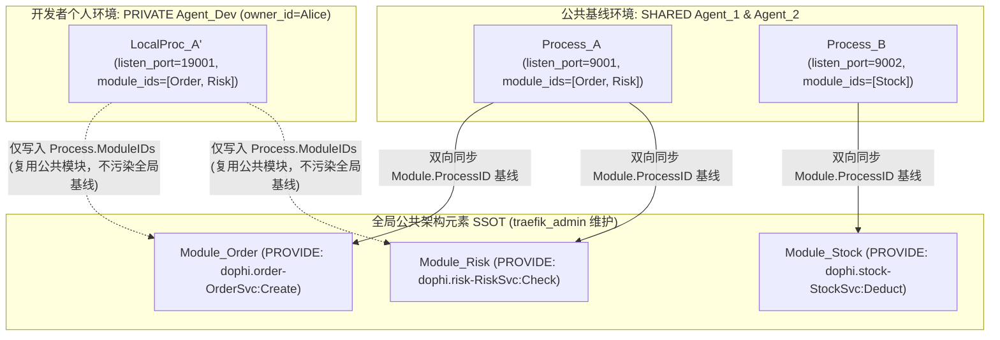
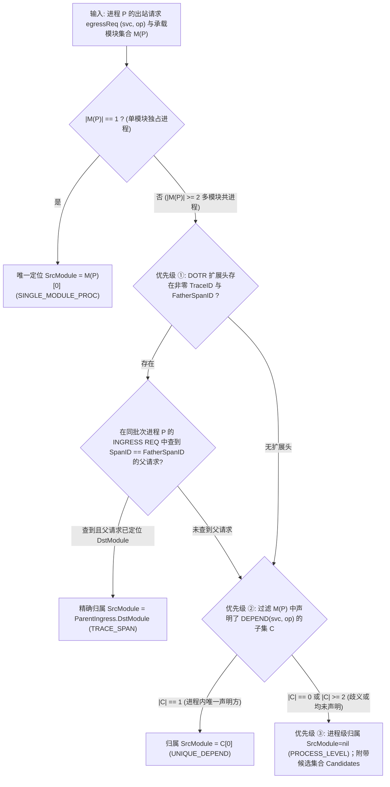

# 业务流量监控与重放 (`code-traefik`) 架构元素建模与拓扑一致性验证设计

- **文档编号**：`03-architecture-elements-and-topology.md`
- **文档版本**：v1.2.0
- **更新日期**：2026-10-29
- **归属阶段**：阶段二：系统架构与数据模型设计 (`02-design`)
- **状态**：定稿待审 (Ready for Review)
- **上位基线**：[`01-feature-matrix.md`](../01-features/01-feature-matrix.md) (v2.6.0)、[`01-system-architecture.md`](./01-system-architecture.md)

---

## 1. 三级逻辑架构元素模型与树形治理 (`internal/server/topology`)

`code-traefik` 作为架构元素与运行映射的**唯一真实源（SSOT）**，采用「**子系统 (`Subsystem`) → 功能组多级树 (`FunctionalGroup`) → 功能模块 (`Module`)**」三级逻辑层次结构。

### 1.1 物化路径 (`Materialized Path`) 树编码模型

功能组支持在同一子系统内最大 **8 级**（`level ∈ [1, 8]`）自嵌套，功能模块可挂载在任意层级的功能组下：

```text
Subsystem [ID=1, Code="TRADE_SYS"]
 ├── FunctionalGroup [ID=10, Parent=nil, Level=1, Path="/10/", Code="ORDER_GRP"]
 │    ├── Module [ID=101, GroupID=10, SubsystemID=1, Code="MOD_ORDER_ENTRY"]   (直接挂在 1 级功能组)
 │    └── FunctionalGroup [ID=12, Parent=10, Level=2, Path="/10/12/", Code="PAY_SUBGRP"]
 │         └── Module [ID=102, GroupID=12, SubsystemID=1, Code="MOD_PAY_SETTLE"] (挂在 2 级功能组)
```

* **设计选型（主键 ID 物化路径 `"/<id1>/<id2>/"`）**：
  1. 首尾强制带斜杠 `/`，使得子树前缀查询 `WHERE subsystem_id = ? AND path LIKE '/10/12/%'` 绝对精确，彻底消除 `'/10/12'` 误匹配 `'/10/120/'` 的部分前缀越界缺陷；
  2. 修改功能组名称或业务编码 `code` 时无需重写子孙节点的 `path`；
  3. 功能模块冗余维护 `subsystem_id`（始终强制等于其挂载功能组的 `subsystem_id`），使流量列表按子系统筛选无需多层 `JOIN`。

### 1.2 功能组移动防成环校验与级联更新算法 (`MoveFunctionalGroup`)

当管理员将功能组 `G` 移动至同子系统内的新父节点 `NewParent`（`NewParent == nil` 表示提升为一级根功能组）时，为防止并发移动导致树形破损或幽灵环路，必须在事务首行获取子系统级排他咨询锁 `SELECT pg_advisory_xact_lock(subsystem_id)`，并在单个事务内执行校验与单条批量 SQL 原子重算：

```go
package topology

const MaxGroupTreeDepth = 8

// MoveFunctionalGroup 在单事务内串行化防成环与最大深度约束，并单条 SQL 原子级联更新子树 path 与 level
func MoveFunctionalGroup(tx *gorm.DB, groupID uint64, newParentID *uint64) error {
	var group models.FunctionalGroup
	if err := tx.First(&group, groupID).Error; err != nil {
		return ErrGroupNotFound // 404
	}

	// 1. 获取子系统粒度事务咨询锁，彻底消除同子系统并发移动成环与脏读
	if err := tx.Exec("SELECT pg_advisory_xact_lock(?)", group.SubsystemID).Error; err != nil {
		return err
	}

	// 2. 禁止移动到自身
	if newParentID != nil && *newParentID == group.ID {
		return ErrCycleMoveToSelf // 400 Bad Request
	}

	newLevel := 1
	newParentPath := "/"
	if newParentID != nil {
		var parent models.FunctionalGroup
		if err := tx.First(&parent, *newParentID).Error; err != nil {
			return ErrParentGroupNotFound // 404
		}
		// 3. 跨子系统移动拦截（功能组归属固定子系统）
		if parent.SubsystemID != group.SubsystemID {
			return ErrCrossSubsystemMove // 400 Bad Request
		}
		// 4. 递归防成环检测：若目标父节点的物化路径以当前节点路径为前缀，说明目标父节点是当前节点的子孙！
		if strings.HasPrefix(parent.Path, group.Path) {
			return ErrCycleMoveToDescendant // 400 Bad Request
		}
		newLevel = parent.Level + 1
		newParentPath = parent.Path
	}

	// 5. 子树最大相对深度计算与 8 级上限门禁校验
	var maxDescendantLevel int
	if err := tx.Model(&models.FunctionalGroup{}).
		Where("subsystem_id = ? AND path LIKE ?", group.SubsystemID, group.Path+"%").
		Select("COALESCE(MAX(level), ?)", group.Level).
		Scan(&maxDescendantLevel).Error; err != nil {
		return err
	}
	subtreeHeight := maxDescendantLevel - group.Level // 自身为 0，含一层子节点为 1
	if newLevel+subtreeHeight > MaxGroupTreeDepth {
		return ErrExceedMaxTreeDepth // 400 Bad Request (超过最大 8 级深度)
	}

	// 6. 原子更新当前节点父指针与整棵子树的物化路径与层级
	oldPrefix := group.Path
	newPrefix := fmt.Sprintf("%s%d/", newParentPath, group.ID)
	levelDelta := newLevel - group.Level

	if err := tx.Model(&models.FunctionalGroup{}).Where("id = ?", group.ID).
		Update("parent_id", newParentID).Error; err != nil {
		return err
	}

	// 利用数据库原生字符串替换与层级加算，单条 SQL 批量完成子树重算，杜绝逐行 Save 脏数据
	return tx.Exec(`
		UPDATE traefik_functional_groups 
		SET path = ? || SUBSTRING(path FROM ?),
		    level = level + ?
		WHERE subsystem_id = ? AND path LIKE ?`,
		newPrefix, len(oldPrefix)+1, levelDelta, group.SubsystemID, oldPrefix+"%",
	).Error
}
```

### 1.3 删除保护冲突矩阵 (`409 Conflict`)

- 删除子系统：若存在关联功能组或功能模块，拒绝删除并返回 `409`；
- 删除功能组：若存在子功能组（`parent_id = id`）或挂载的功能模块（`group_id = id`），拒绝删除并返回 `409`；
- 删除功能模块：若已声明任何 `PROVIDE` / `DEPEND` 接口契约，拒绝删除并返回 `409`。

---

## 2. 模块级接口供给与依赖契约 (Module Interface Contracts)

功能模块是接口契约声明的最小业务单元，通过 `traefik_module_interfaces` 表维护两类关系：
- **`PROVIDE`（供给接口）**：本功能模块对外实现的 CROS RPC 服务方法；
- **`DEPEND`（依赖接口）**：本功能模块运行期需要调用的下游 CROS RPC 服务方法。

### 2.1 `{package}-{serviceName}` 规范化命名契约 (A-07)

依据 DOPHI CROS RPC 框架运行时规范，线上报文 `RPC_REQ_HEAD_S` 中的 `ascServiceName` 与 `ascOperation` 严格满足以下映射公式：

$$\text{ascServiceName} = \text{package} + \text{"-"} + \text{serviceName}, \quad \text{ascOperation} = \text{methodName}$$

| Protobuf 定义示例 | `package` 声明 | `service` 名称 | `rpc` 方法名 | 规范化 `service_name` (`ascServiceName`) | 规范化 `operation` (`ascOperation`) |
| :--- | :--- | :--- | :--- | :--- | :--- |
| `dophi/order/v1/trade.proto` | `dophi.order.v1` | `TradeService` | `CreateOrder` | `dophi.order.v1-TradeService` | `CreateOrder` |
| `cros/auth/session.proto` | `cros.auth` | `SessionMgr` | `VerifyTicket` | `cros.auth-SessionMgr` | `VerifyTicket` |

* **强校验规则**：
  1. `package` 内部**原样保留点分结构**（`.`），仅在 `package` 与 `serviceName` 交界处使用单个半角中划线 `-` 连接；
  2. 受限于 CROS RPC 协议头 `CHAR[64]`（含末尾 `\0` 终止符），`service_name` 与 `operation` 字节长度均强制校验为 **`1..63` 位可见 ASCII 字符**（正则：`^[A-Za-z0-9._-]{1,63}$` 与 `^[A-Za-z0-9_]{1,63}$`）。
  3. **唯一性红线**：
     - 同一模块内 `(module_id, relation_type, service_name, operation)` 唯一；
     - **全局唯一供给 (A-05)**：任意时刻同一 `(service_name, operation)` 在全库至多只能被 **1 个**功能模块声明为 `PROVIDE`；第二个模块尝试声明相同 `PROVIDE` 时立即拦截返回 `409 Conflict` 并附带已占用模块编码与名称。

---

## 3. 公私域物理部署映射、下游自动编译与跨 Agent 同构重放校验

### 3.1 公共架构 SSOT 与公私域 `Agent -> Process -> Module` 映射不变量

系统所有逻辑架构元素（`Subsystem`、`FunctionalGroup`、`Module`、`ModuleInterface`）均为全团队共享的**公共唯一真实源（SSOT）**；而物理运行载体 `Agent` 与 `Process` 则支持**公共基线域 (`SHARED`)** 与**个人开发域 (`PRIVATE`)** 双域挂载同一套公共功能模块：



1. **端口互斥 (A-02)**：每个进程仅监听 1 个 CROS RPC 端口，同一 `agent_id` 下 `listen_port` 唯一（冲突返回 `409`）。
2. **公私双域单实例模块承载 (A-03)**：
   - 1 个进程可承载 $N \ge 1$ 个公共功能模块（统一记录在 `traefik_processes.module_ids` JSONB 数组中）；
   - **公共基线环境 (`SHARED` Agent)**：`traefik_modules.process_id` 权威指向该模块在公共环境绑定的唯一 `SHARED` 进程（全局至多 `0..1` 个公共进程，不支持多副本部署），供全局静态物理拓扑视图（`BuildStaticTopology`）直接读取；
   - **个人私有环境 (`PRIVATE` Agent)**：普通用户在本人 `PRIVATE` Agent 下登记本地测试进程并勾选复用的公共 `Module` 时，仅写入该私有进程的 `traefik_processes.module_ids`，**绝不覆写全局 `traefik_modules.process_id`**（避免个人本地调试污染团队公共拓扑）；同时在同一台 `PRIVATE` Agent 内部同样强制校验同一 `Module` 至多绑定 1 个私有进程（重复绑定返回 `409 Conflict`）。
3. **动态 PID 非权威原则**：操作系统 `PID` 随业务重启而变化，不写入数据库作为静态配置，由 Agent 依据 `(listen_port, cmd_pattern)` 实时扫描 `/proc` 获取并维护在内存运行态中。

### 3.2 进程级监控下游 `IP:Port` 自动推导算法 (`CompileProcessDownstreams`)

当主控向 Agent 下发某目标进程 `P` 的录制或重放规格 `ProcessMonitorSpec` 时，为确保**不仅能拦截声明内的合规调用，还能物理捕获私自发起的未声明越权调用（检出 `VIOLATION`）**，主控自动聚合以下四层下游网络端点集合：

1. **已声明下游推导端点**：
   - 读取 `P` 承载的公共模块集合 $M(P)$ 及全部 `DEPEND` 接口集合 $D(P)$；
   - 对每条 $(svc, op) \in D(P)$，在全局 `PROVIDE` 索引中查出供给进程 $P_{\text{prov}}$；若 $P_{\text{prov}}.\text{ID} \neq P.\text{ID}$，加入 `(EffectiveIP(P_prov), P_prov.ListenPort)`；
2. **同机回环别名端点**：
   - 对同机运行的供给进程（`P_prov.AgentID == P.AgentID`），自动并入回环别名 `("127.0.0.1", P_prov.ListenPort)`；
3. **本批次协同监控监听端点全集 (`BatchListenEndpoints`)**：
   - **核心物理保障（解决未声明调用拦截盲区）**：将本次录制批次所纳管的**所有目标进程的监听端点**（剔除 `P` 自身端口）全部并入 `Downstreams`；即使模块 $A$ 源码未声明对模块 $B$ 的依赖，一旦 $A$ 发起跨进程调用 $B$，出站网络同样被 `cgroup/connect4` 透明重定向至 Agent 代理并完成采集，使 `VIOLATION` 在物理上 100% 具备可观测性！
4. **外部显式补充端点与离线重放历史端点**：
   - 合并进程登记的 `P.ExtraDownstreams`；若为离线重放，并入源录制批次观测到的全部 `EGRESS` 目的端点；最终按 `IP:Port` 去重输出。

### 3.3 跨 Agent 同构进程重放兼容性校验算法 (`ValidateReplayProcessCompatibility`)

为落实「任何有访问权限的公共（`SHARED`）或个人（`PRIVATE`）录制素材，均可在承载相同公共架构元素的目标进程上执行重放」，重放调度器在锁定 Agent 排他租约前执行如下校验：

```go
package topology

// ValidateReplayProcessCompatibility 校验录制源进程选定报文能否安全重放到目标进程 targetProc
func ValidateReplayProcessCompatibility(
	callerID uint,
	isAdmin bool,
	session *models.RecordingSession,
	selectedRecords []models.TrafficRecord,
	sourceProc *models.Process,
	targetProc *models.Process,
	targetAgent *models.Agent,
	provideMap map[string]uint64, // key: "serviceName:operation" -> DstModuleID
) error {
	// 1. 录制素材与目标 Agent 的公私域归属防越权校验 (Anti-IDOR)
	if session.Scope == models.ScopePrivate && session.OwnerID != callerID && !isAdmin {
		return ErrForbiddenPrivateSession // 403 Forbidden
	}
	if targetAgent.Scope == models.ScopePrivate && (targetAgent.OwnerID == nil || *targetAgent.OwnerID != callerID) && !isAdmin {
		return ErrForbiddenPrivateAgent // 403 Forbidden
	}

	// 2. 原地同进程重放天然兼容
	if sourceProc.ID == targetProc.ID {
		return nil
	}

	// 3. 跨进程/跨 Agent 重放：校验目标进程必须完整承载选定请求命中的全部公共架构模块
	targetModSet := toUint64Set(targetProc.ModuleIDs)
	requiredMods := make(map[uint64]struct{})
	hasUnregisteredIface := false

	for _, rec := range selectedRecords {
		key := rec.ServiceName + ":" + rec.Operation
		if dstModID, ok := provideMap[key]; ok {
			requiredMods[dstModID] = struct{}{}
		} else {
			hasUnregisteredIface = true
		}
	}

	// 若包含未登记接口，退化要求源进程声明的模块集合非空且被目标进程完全覆盖
	if hasUnregisteredIface || len(requiredMods) == 0 {
		sourceMods := toUint64Set(sourceProc.ModuleIDs)
		if len(sourceMods) == 0 || !isSubset(sourceMods, targetModSet) {
			return ErrIncompatibleReplayTargetModule // 400 Bad Request
		}
		return nil
	}

	if !isSubset(requiredMods, targetModSet) {
		return ErrIncompatibleReplayTargetModule // 400 Bad Request (附带缺失的公共模块编码明细)
	}
	return nil
}
```

---

## 4. 静态架构拓扑自动推导引擎 (`BuildStaticTopology`)

静态拓扑引擎同时输出**逻辑架构视角 (`LOGICAL`)** 与**物理部署视角 (`PHYSICAL`)** 两套有向图模型：

| 推导边分类 (`StaticEdgeKind`) | 触发条件 | 渲染语义与一致性验证行为 |
| :--- | :--- | :--- |
| **`CROSS_PROCESS`** | 模块 $A$ 的 `DEPEND(svc, op)` 命中模块 $B$ 的 `PROVIDE(svc, op)`，且 `A.ProcessID != B.ProcessID`（或至少一方未绑定同进程） | 实线跨进程依赖边；纳入网络层一致性覆盖核对 |
| **`INTRA_PROCESS`** | 模块 $A$ 的 `DEPEND(svc, op)` 命中模块 $B$ 的 `PROVIDE(svc, op)`，且 `A.ProcessID != nil && A.ProcessID == B.ProcessID` | 虚线标记 **「进程内调用」**；依据 A-04 不经过 Socket，验证时直接归为 `NOT_OBSERVABLE` |
| **`EXTERNAL_UNREGISTERED`** | 模块 $A$ 的 `DEPEND(svc, op)` 在全库找不到任何 `PROVIDE(svc, op)` | 指向全局虚拟占位节点 `VIRTUAL_EXTERNAL_SYSTEM`（「外部 / 未登记系统」） |

---

## 5. 动态报文穿透定位与架构一致性验证引擎 (`VerifySessionTopology`)

基于一次多进程协同录制批次（`session_id`）采集到的全部业务请求报文（`ucMsgType == 2 (REQ)`），引擎自动穿透还原实际模块级调用图，并与当前静态架构契约执行逐边比对。

为消除慢轨并发连接分片处理时“父入站请求尚未落盘而出站调用已到达”的时序竞态，**来源模块判定在录制批次停止后，由后台离线批量对账引擎 (`OfflineBatchAttribution`) 统一归集全链路报文并执行结算**，保证父子 SpanID 因果关系的 100% 精确闭环。

### 5.1 目的模块穿透定位 (`ResolveDestinationModule`)

依据全局唯一供给假设（A-05），无论报文来自 `INGRESS` 还是 `EGRESS`，直接以请求头 `(ascServiceName, ascOperation)` 查表 `ProvideMap[serviceName + ":" + operation]`：
- **命中**：唯一定位到目标功能模块 `DstModule`（同时确定所属功能组与子系统）；
- **未命中**：归属至虚拟异常节点 `VIRTUAL_UNREGISTERED_INTERFACE`（「未登记接口」）。

### 5.2 来源模块判定与去重权威原则 (`ResolveSourceModule`)

在跨进程调用统计中，**严格以发起方目标进程的 `EGRESS` 出站记录为唯一权威统计源，接收方的 `INGRESS` 仅用于构建父 Span 索引与外部调用方统计，彻底消除同一次往返双重计数**：

对于目标进程 $P$ 发出的出站请求报文 `egressReq`（已知 $P$ 承载的模块集合为 $M(P)$，且依据该批次固化的 `SessionProcessSnapshot` 动态解析）：



> [!NOTE]
> **单模块进程前置收敛与同机反查**：
> 1. 当进程 $P$ 仅承载 1 个模块（$|M(P)| = 1$）时，即便未携带 Trace 且未声明 `DEPEND`，调用方在物理上也必然是唯一的 $M(P)[0]$。前置收敛保证单模块进程的违规外联被 100% 裁决为 **`VIOLATION`**；
> 2. 同机跨进程互调时，Agent 依据 Socket inode 反查确认发起方 PID 属于纳管进程，从而将对端 INGRESS 关联至发起方进程，避免误判为外部未知调用。

### 5.3 架构一致性六分类比对规则与算法

比对算法只针对**“源模块所在进程在本批次被纳管监控”**的静态依赖边进行评估，输出互斥完备的六类比对结果（彻底消除因未监控模块产生的虚假未覆盖噪音）：

| 结果分类枚举 | 中文标签 | 严格判定条件 | 架构治理含义与 UI 视觉语义 |
| :--- | :--- | :--- | :--- |
| **`VERIFIED`** | 已验证合规 | 静态声明跨进程依赖 `SrcModule --DEPEND--> (svc, op)`，且实测归属到 `SrcModule` 的跨进程调用 $\ge 1$ | 架构设计与实测运行完全一致（`--color-success` 绿色实线） |
| **`VIOLATION`** | 架构漂移越权 | 实测精确定位到 `SrcModule`，但 `SrcModule` **未声明**该 `DEPEND(svc, op)`（含调用未登记接口或已登记其他模块） | **高优架构漂移告警**：源码存在未备案的私自跨进程调用（`--color-danger` 红色告警实线） |
| **`UNCOVERED`** | 本次未触发 | 静态声明为跨进程依赖，源模块与目标供给模块所在进程**均在本次协同监控集合中**，但本次任务未捕获该调用 | 依赖已就绪但当前业务测试用例未覆盖该调用路径（`--color-text-muted` 灰色虚线） |
| **`NOT_MONITORED`** | 目标未纳管 | 静态声明为跨进程依赖，源模块所在进程已被监控，但**目标供给模块所在物理进程未加入本次监控批次** | 物理上不可观测，**不计入 `UNCOVERED` 覆盖率分母**（`--color-text-tertiary` 浅灰点划线） |
| **`NOT_OBSERVABLE`** | 进程内不可观测 | 静态声明为同进程内两模块调用（依据该批次快照 `SrcModule` 与 `DstModule` 绑定在同一 `ProcessID`） | 物理上走函数调用不经过内核网络栈，**不计入 `UNCOVERED` 分母**（`--color-info` 蓝色徽章） |
| **`UNATTRIBUTED`** | 进程级待定归属 | 多模块进程发出的调用缺少父 Trace 且存在重复声明，只能定位于 `Process_P -> DstModule` | 提示在源码中补充 DOTR Trace 扩展头或在架构中心收敛重复契约（`--color-warning` 琥珀色边） |

#### 一致性验证响应 DTO 结构 (`ConsistencyReportDTO`)

```go
package topology

type VerificationStatus string

const (
	StatusVerified      VerificationStatus = "VERIFIED"
	StatusViolation     VerificationStatus = "VIOLATION"
	StatusUncovered     VerificationStatus = "UNCOVERED"
	StatusNotMonitored  VerificationStatus = "NOT_MONITORED"
	StatusNotObservable VerificationStatus = "NOT_OBSERVABLE"
	StatusUnattributed  VerificationStatus = "UNATTRIBUTED"
)

type ConsistencyEdgeResult struct {
	Status              VerificationStatus `json:"status"`
	SrcModuleID         *uint64            `json:"src_module_id,omitempty"`
	SrcProcessID        *uint64            `json:"src_process_id,omitempty"`
	CandidateModuleIDs  []uint64           `json:"candidate_module_ids,omitempty"`
	DstModuleID         *uint64            `json:"dst_module_id,omitempty"` // nil 表示未登记外部接口
	ServiceName         string             `json:"service_name"`
	Operation           string             `json:"operation"`
	ObservedCallCount   int64              `json:"observed_call_count"`
	AttributionMode     string             `json:"attribution_mode,omitempty"`
	SampleTrafficRecID  *uint64            `json:"sample_traffic_record_id,omitempty"`
}

type ConsistencyReportDTO struct {
	SessionID          uint64                  `json:"session_id"`
	StaticModelVersion time.Time               `json:"static_model_version"` // 静态架构版本快照时刻，模型变更时缓存自动失效
	VerifiedCount      int                     `json:"verified_count"`
	ViolationCount     int                     `json:"violation_count"`
	UncoveredCount     int                     `json:"uncovered_count"`
	NotMonitoredCount  int                     `json:"not_monitored_count"`
	NotObservableCount int                     `json:"not_observable_count"`
	UnattributedCount  int                     `json:"unattributed_count"`
	Edges              []ConsistencyEdgeResult `json:"edges"`
}
```
