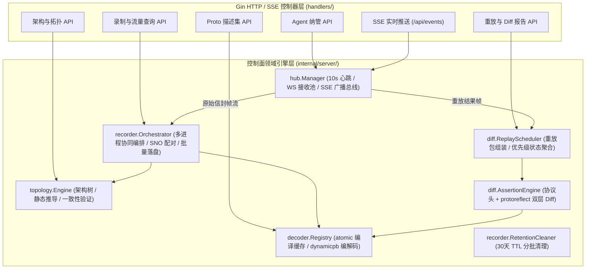
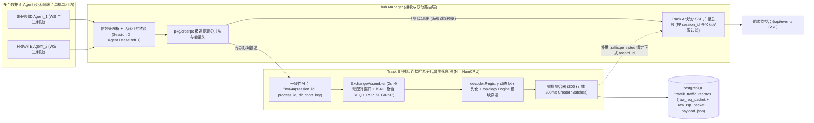

# 业务流量监控与重放 (`code-traefik`) 管理面服务、微前端控制台与回归断言设计

- **文档编号**：`04-control-plane-and-web-console.md`
- **文档版本**：v1.2.0
- **更新日期**：2026-10-29
- **归属阶段**：阶段二：系统架构与数据模型设计 (`02-design`)
- **状态**：定稿待审 (Ready for Review)
- **上位基线**：[`01-feature-matrix.md`](../01-features/01-feature-matrix.md) (v2.6.0)、[`01-system-architecture.md`](./01-system-architecture.md)、[`02-data-plane-and-cros-rpc-engine.md`](./02-data-plane-and-cros-rpc-engine.md)、[`03-architecture-elements-and-topology.md`](./03-architecture-elements-and-topology.md)

---

## 1. Server 控制面核心服务与调度编排 (`internal/server`)



### 1.1 多 Agent 信封路由与双轨分发管道 (`hub.Manager` & `recorder.Orchestrator`)

当多台公私域 Agent（`SHARED` 或个人 `PRIVATE`）同时处于不同用户的活跃会话时，Server 基于 56B `EnvelopeHeader` 执行租约核验与**「快轨 SSE 实时推送 + 慢轨异步配对双模落盘」**双轨无阻塞分流：



1. **周期心跳、离线熔断与悬空租约自愈**：
   - 后台协程按 `10s` 间隔并发探活所有已登记 Agent（`GET /agent/v1/handshake`，超时 `3s`），刷新 `status = 'ONLINE'`、`last_heartbeat_at` 并核对 `ActiveLeaseType / ActiveRefID`；
   - 连续 **3 个周期（30s）** 探活失败则将数据库状态切换为 `OFFLINE`，**自动释放该 Agent 上残留的排他租约**并将关联录制批次或重放任务置为异常终止，防止团队共享 Agent 发生死锁挂死。
2. **Track A 快轨（前端 SSE 实时预览推送）**：
   - 为每个已认证订阅者分配容量为 `128` 的缓冲 Channel；推送前严格校验订阅者对目标 `session_id` 的访问权（`PRIVATE` 批次仅推送给 `owner_id` 本人及 `traefik_admin`）；
   - Channel 瞬时满载时仅跳过实时预览通知，绝不反向阻塞 WebSocket 读取协程与 Track B 落盘管道，确保端到端呈现延迟 `<= 1s`。

### 1.2 排他租约录制编排与无损+结构化双模落盘流水线 (`recorder.Orchestrator`)

1. **多进程排他租约获取与协同下发**：
   - 校验发起人对所选 `target_process_ids` 所属 Agent 的访问权（普通用户可组合本人 `PRIVATE` Agent 与当前空闲的 `SHARED` Agent），按 `agent_id` 升序调用 `AcquireAgentLeases` 原子加锁（冲突立即返回 `409 Conflict` 及持锁人信息）；
   - 并发调用各 Agent `PUT /agent/v1/monitors/sync` 下发 `[]ProcessMonitorSpec`，汇总存量长连接诊断结果写入 `traefik_recording_sessions.process_diagnostics`；录制正常结束、触发上限或启动失败时，在统一收尾函数中原子释放全部 Agent 租约。
2. **双阈值自动停录守卫**：
   - 内存原子维护当前批次 `capturedFrames` 与启动定时器 `time.AfterFunc(MaxDuration)`（默认 `30 分钟` / `100,000 帧`）；任一阈值触发时自动向全部参与 Agent 发送 `/stop`、刷空配对窗口并释放租约，状态落盘为 **`COMPLETED_BY_LIMIT`**。
3. **Track B 慢轨：连接内 `ullSNO` 往返配对与双模归档 (`ExchangeAssembler`)**：
   - **无锁分片亲和**：按 `(session_id, process_id, direction, conn_key)` 哈希路由至固定 Worker，保证同一 TCP 连接上的 `REQ`、`RSP_SEG` 与 `RSP` 100% 由同一协程串行处理；
   - **单行往返聚合规则（Exchange-per-Row，目标吞吐 `>= 2000 帧/s`）**：
     - **`ONEWAY` 单向请求**（`ucMsgType == 2 && ucReqType == 3`）：无需等待应答，直接组装 `raw_req_packet = frame`、`raw_rsp_packet = nil`、`payload_json = {"req": reqObj, "rsp": null}`；
     - **标准 `UNARY` 与多段流式 `STREAM_RSP`**：收到 `REQ` 时暂存至 Worker 本地 `pendingMap[(process_id, direction, conn_key, sno)]`；后续收到 `ucMsgType == 4 (RSP_SEG)` 时按序追加分片字节至 `rspBuf` 并递增 `rsp_seg_count`；收到终结帧 `ucMsgType == 3 (RSP)` 时弹出配对项，无损拼接 `raw_rsp_packet`（可通过 `crosrpc.SplitFrames` 零歧义逐片还原），组装 `payload_json = {"req": reqObj, "rsp": rspObjOrSegArray}`，并精确计算微秒级往返耗时 `latency_us = (rspCapturedAtNs - reqCapturedAtNs) / 1000`；
     - **自适应配对超时与孤立帧兜底**：
       - 滑动配对超时时间基于报文会话头动态计算：取 `max(ReqHead.uiTimeOutSecondLimit, 30s)`；
       - 若收到 Agent 投递的 `EVENT_CONN_CLOSED` 连接关闭事件，立即刷空该连接的所有挂起请求，置为 `exchange_type = 'REQ_ONLY'` 落盘；
       - 连接中途切入捕获到的无头孤立应答以 `exchange_type = 'RSP_ORPHAN'` 落盘（`raw_req_packet = nil`）；连接管理帧以 `exchange_type = 'MNG'` 归档；
       - 每个 Worker 设立最大 `10000` 条挂起请求预算，防止慢连接恶意泄漏内存；
   - **微批写入**：每凑满 `200` 条往返记录或每 `200ms` 触发一次 GORM `CreateInBatches` 分区表写入。

### 1.3 跨 Agent 同构重放调度器与多请求明细持久化 (`diff.ReplayScheduler`)

1. **权限、同构兼容性与排他租约三重前置门禁**：
   - 校验选定的 `INGRESS` 往返记录均属于同一 `session_id` 与同一源进程 `source_process_id`，且 `is_replayable == true`（`raw_req_packet` 非空且未被 4MB 截断）；
   - 调用 `topology.ValidateReplayProcessCompatibility` 校验发起人对录制素材（`SHARED` 或本人 `PRIVATE`，管理员可全团队重用）及目标进程 `target_process_id` 所属 Agent 的权限，并验证 `target_process_id` 完整承载选定请求命中的全部公共架构模块（支持将公共回归流量投递至开发者个人 `PRIVATE` Agent 上的同构本地进程，或当前空闲的 `SHARED` Agent 进程）；
   - 对目标进程所属 Agent 获取 `REPLAY` 排他租约（若该 Agent 正在被录制或重放占用则立即返回 `409 Conflict`）。
2. **重放生命周期状态机与流式切片下发**：
   - **状态机流转**：`PENDING`（初始创建） -> `ARMED`（向 Agent 下发重定向规格与 Mock 预加载完成，此时提示 A-01 引导重启或重连） -> `INJECTING`（连接建立，按序注入请求切片） -> `COMPLETED / CANCELLED / FAILED`；
   - **单次扫描流式组装**：直接从 `traefik_traffic_records` 提取选定记录的 `raw_req_packet` 作为注入帧，并关联对应的局部 ScopedMock 集合及全局兜底 Mock 集合（严格过滤截断帧与 REQ_ONLY 帧），采用二进制分片流下发 Agent；
   - **双轨可靠回收与独立明细持久化**：
     - 重放执行进度与结果通过 WebSocket `EVENT_REPLAY_ITEM_DONE` 实时推送，同时支持通过 `GET /agent/v1/replays/:taskId/result` 幂等拉取；
     - 每条请求重放回收的实际原始应答帧（`actual_rsp_packet` bytea）及双层比对结果独立持久化至 **`traefik_replay_items`** 表，支持前端标准服务端分页查询与历史多次比对！
3. **多请求状态聚合优先级定律**：
   单条请求及整包重放任务的最终 `result_status` 严格遵循以下全序优先级取最高异常级别：

   $$\text{ERROR} \succ \text{TIMEOUT} \succ \text{MOCK\_MISS} \succ \text{FAILED} \succ \text{PASS}$$

### 1.4 历史流量保留期自动清理器 (`recorder.RetentionCleaner`)

每 `6 小时` 巡检一次超过保留期（默认 `30 天`，配置项 `traffic.retention_days`）且非活跃状态的录制批次，按每批 `5000` 行分批删除关联流量记录与过期会话，避免长事务锁表，并通过 `commonAudit.Push` 写入一条系统级清理审计记录。

---

## 2. IDL 描述集引擎与 `dynamicpb` 动态编解码 (`internal/server/decoder`)

### 2.1 `.pb` 描述集注册校验与多版本热切换

1. **上传校验流水线**：
   - 通过 `http.MaxBytesReader` 强制限制上传流 `<= 4MB (4,194,304 Bytes)`；
   - `proto.Unmarshal` 解析为 `descriptorpb.FileDescriptorSet`，再经 `protodesc.NewFiles(fds)` 构建完整 `protoregistry.Files` 验证依赖闭包合法性（损坏或缺失 import 依赖返回 `400 Bad Request`）；
   - 遍历全部 `FileDescriptor.Services()` 与 `ServiceDescriptor.Methods()`，严格按 **`service_name = string(file.Package()) + "-" + string(svc.Name())`**（无 `package` 时使用 `string(svc.Name())`）与 **`operation = string(method.Name())`** 生成操作映射行；
   - 同名描述集（`name` 相同）每次上传自动递增 `version = max(version) + 1`。
2. **激活冲突门禁 (`ActivateSchemaVersion`)**：
   - 激活某版本前，在事务内查询该版本的所有 `(service_name, operation)` 是否与**其他名称下当前已激活 (`is_active = true`)** 的描述集存在交集；若冲突则立即回滚并返回 `409 Conflict` 及冲突接口明细；
   - 校验通过后，将同名旧版本置为 `is_active = false`，目标版本及旗下 `traefik_proto_operations` 置为 `is_active = true`，并原子重建内存无锁注册表 `atomic.Pointer[CompiledRegistry]`。

### 2.2 动态编解码与历史版本不可变契约

- **动态解码 (`DecodePayloadToJSON`)**：按 `(serviceName, operation, msgType)` 查找生效的 `protoreflect.MessageDescriptor`，实例化 `dynamicpb.NewMessage(desc)` 执行 `proto.Unmarshal(payload)`，再以 `protojson.MarshalOptions{UseProtoNames: true, EmitUnpopulated: false}` 序列化为标准 JSON（注：ProtoJSON 标准自动将 64 位整数编码为十进制字符串，天然杜绝前端 JS `Number.MAX_SAFE_INTEGER` 精度截断）。
- **无映射优雅降级**：若未注册对应 `.pb` 或二进制反序列化失败，保留完整 CROS RPC 头解析结果，将 `decode_status` 置为 `NO_SCHEMA_RAW_HEX` 或 `DECODE_ERR_RAW_HEX`，前端自动切换纯 Hex 视图，绝不中断采集链路。
- **历史不可变与按需重解码**：落盘时快照记录当时使用的 `(schema_id, schema_version)`；后续切换 `.pb` 生效版本不会隐式篡改历史记录，用户可在流量详情抽屉显式点击「使用当前生效版本重新解码」。

---

## 3. 协议头级 + Protobuf 语义字段级双层回归 Diff 引擎 (`internal/server/diff`)

双层回归断言引擎对每条重放请求的录制基线应答组（`Expected`）与实际回收应答组（`Actual`）执行递进式精准比对：

### 3.1 第一层：CROS RPC 协议头与载荷字节快速比对

| 比对项 | 比对策略 | 差异判定结果 |
| :--- | :--- | :--- |
| **分片数量与类型** | 比对帧序列长度、`ucMsgType`（`RSP` vs `RSP_SEG`）、`usRspMsgNo`、`isPacked` | 不一致直接标记头层 `FAILED` |
| **业务返回状态码** | 比对 `uiStatusCode` 及 V4 `ullStatusCode`（例如 `0` 突变为错误码） | 不一致直接标记头层 `FAILED` 并高亮状态码字段 |
| **固定豁免头字段** | 服务端时间戳 `ullServerRecvTime`、`ullServerSendTime`、扩展头 `ullServerEnqueueTime`，以及客户端运行态回显 `ullSNO`、`aucTraceBuff`、`ullClientSendTime` | **永久豁免，不参与相等性断言** |
| **Payload 原始字节** | `bytes.Equal(expectedPayload, actualPayload)` | 若完全相等且头层通过，直接短路返回 **`PASS`**（跳过第二层开销） |

### 3.2 第二层：`protoreflect` 类型感知语义树 Diff 算法

当第一层协议头一致但 `Payload` 原始字节存在差异时（例如 `map` 序列化字节顺序不同、或包含被忽略的动态业务字段、或发生真实业务数值突变），触发第二层语义比对：

1. **无 `.pb` 映射降级**：直接计算并返回 `ByteDiffSummary`（期望长度、实际长度、首个差异字节偏移量 `FirstDiffOffset` 及前后 32B Hex 切片），判定为 `FAILED`。
2. **有 `.pb` 映射递归语义比对 (`DiffProtoMessages`)**：
   - **严格快照 Schema 版本锁定**：解码 `Actual` 原始载荷时，必须严格使用录制基线记录所归档的 `(schema_id, schema_version)`，杜绝因管理员激活新 IDL 版本导致回归基线漂移；
   - 将 `Expected` 与 `Actual` 分别反序列化为 `dynamicpb.Message`；
   - **未知字段防漏判机制**：通过 `protoreflect.Message.GetUnknown()` 提取双方原始载荷中未在当前 `.pb` 中声明的额外 Tag 字段；若 `Actual` 存在非空未知字节而 `Expected` 没有，记录 `FieldPath = "<unknown_fields>"`，判定为 **`FAILED`**（提示新代码引入了未备案的扩展字段，防止漏判）；
   - 合并生效忽略规则集合：`IgnoreMatcher = CompilePaths(Interface.DiffIgnorePaths ∪ Task.ExtraIgnorePaths)`（支持点分路径如 `header.server_time` 与数组通配路径如 `orders[*].trace_token`）；
   - 递归遍历 `Expected` 与 `Actual` 中所有被设置（`Has(fd)`）的 `protoreflect.FieldDescriptor`：
     - 若当前 `fieldPath` 命中 `IgnoreMatcher`，直接跳过；
     - **`fd.IsMap()`（无序键值语义，F-14.5）**：提取双方全部 Map Key 集合并排序遍历，仅当某 Key 缺失、多出或对应 Value 递归不等时记录 `FieldPath = path + "[" + keyStr + "]"`，**彻底免疫 Go/C++ Map 迭代乱序导致的字节差异**；
     - **`fd.IsList()`（`repeated` 严格保序语义，F-14.5）**：按索引 `i = 0 .. max(lenExp, lenAct)-1` 逐位比对，索引错位或长度不等均记录 `FieldPath = fmt.Sprintf("%s[%d]", path, i)`；
     - **嵌套 `MessageKind`**：拼接 `path + "." + string(fd.Name())` 递归下钻；
     - **标量与枚举类型**：精确比较原始值（浮点数处理 `-0.0 == +0.0` 与 `NaN`）。
   - **最终裁决**：若过滤忽略路径与 Map 顺序噪声后 `len(fieldDiffs) == 0`，则该请求最终裁决为 **`PASS`**！否则裁决为 **`FAILED`** 并输出完整 `[]FieldDiff`。

```go
package diff

type FieldDiff struct {
	FieldPath string `json:"field_path"` // 如 "pricing.discount_cents" 或 "items[2].sku_id"
	DiffKind  string `json:"diff_kind"`  // "MODIFIED" | "ADDED" | "REMOVED"
	Expected  any    `json:"expected"`   // 64 位整数统一格式化为 string 防前端精度丢失
	Actual    any    `json:"actual"`
}
```

---

## 4. 微前端控制台架构与组件设计 (`frontend/src/`)

### 4.1 模块联邦导出契约与路由矩阵

前端通过 `vite.config.ts` 固定 `base: '/traefik/'`，向外暴露 `./App` 与 `./menu`（`traefikMenuConfig`）：

| 菜单分组 | 子路由路径 (`MODULE_BASE_PATH = '/traefik'`) | 页面组件 | 可见角色 | URL Search Params 状态同步项 |
| :--- | :--- | :--- | :---: | :--- |
| **流量与架构** | `/architecture` | `ArchitectureWorkbenchPage` | 全体登录用户 | `tab` (`logical` \| `physical` \| `verify`), `subsystem_id`, `session_id` |
| **流量与架构** | `/traffic` | `TrafficMonitorWorkbenchPage` | 全体登录用户 | `scope` (`SHARED` \| `PRIVATE`), `session_id`, `subsystem_id`, `module_id`, `process_id`, `service_name`, `operation`, `sno`, `trace_id`, `keyword`, `page`, `page_size` |
| **流量与架构** | `/replay` | `ReplayWorkbenchPage` | 全体登录用户 | `session_id`, `target_process_id`, `status`, `page`, `page_size` |
| **流量与架构** | `/schemas` | `ProtoSchemaWorkbenchPage` | 全体登录用户 | `name`, `active_only`, `search`, `page`, `page_size` |
| **资源与治理** | `/agents` | `AgentManagementPage` | 全体登录用户 | `scope` (`SHARED` \| `PRIVATE`), `lease_state`, `status`, `search`, `page`, `page_size` |
| **资源与治理** | `/admin/settings` | `AdminSettingsPage` | `traefik_admin` | - |

> **通用分页硬约束**：所有分页列表统一复用 `@code/common` 的 `Pagination` 与 `usePaginationState`（同步至 `useSearchParams`），每页条数选项固定为 **`15 / 25 / 50 / 100`（默认 `25`）**，控件布局严格为 `[首页] [上一页] [5页连续数字滑动窗口] [下一页] [末页] [条/页下拉框]`。

### 4.2 核心工作台 React 组件分层树

```text
src/pages/
├── ArchitectureWorkbenchPage/             # 1. 架构中心与拓扑工作台
│   ├── SubsystemGroupTreePanel.tsx        # 左侧：子系统切换 + 8级功能组树（支持拖拽/弹窗移动与防成环提示）
│   ├── ModuleContractDetailPane.tsx       # 中部：功能模块详情、公共基线进程绑定器、PROVIDE/DEPEND 接口契约表
│   ├── StaticTopologyCanvas.tsx           # 画布：逻辑架构视图 / 公共物理进程归属视图切换（纯 --color-* Token 渲染）
│   └── ConsistencyVerifyOverlay.tsx       # 验证层：关联公共或本人私有录制批次叠加五类一致性验证结果
├── AgentManagementPage/                   # 2. 公私域 Agent 纳管与排他租约看板
│   ├── AgentScopeTabs.tsx                 # 切换「团队公共 Agent (SHARED)」与「我的私有 Agent (PRIVATE)」
│   ├── AgentLeaseStatusBadge.tsx          # 实时展示空闲 / 录制占用(持锁人+剩余TTL) / 重放占用，管理员支持强制解锁
│   └── ProcessModuleBinderModal.tsx       # 进程探查与挂载复用全局公共架构模块 (ModuleIDs) 配置弹窗
├── ProtoSchemaWorkbenchPage/              # 3. 接口文档与 IDL 描述集工作台
│   ├── SchemaUploadModal.tsx              # .pb 上传弹窗（<=4MB 预检、版本备注）
│   ├── SchemaVersionList.tsx              # 同名描述集多版本时间线与一键生效切换（409 冲突明细展示）
│   ├── OperationMappingTable.tsx          # {package}-{serviceName} 映射检索表 + 接口默认忽略路径编辑器
│   └── OperationDocDrawer.tsx             # 入参/出参 Message 字段树与模块关联抽屉（兼顾 P0 映射详情与 P1 F-18 演进槽位）
├── TrafficMonitorWorkbenchPage/           # 4. 协同录制与流量解剖工作台
│   ├── RecordingSessionBar.tsx            # 批次控制栏：公私域进程选择器(含租约冲突置灰提示)、素材作用域(SHARED/PRIVATE)、A-01 重连横幅
│   ├── LiveTrafficFilterForm.tsx          # 多维 URL 同步筛选器(含 payload_json GIN 关键字检索) + SSE 实时流暂停/继续开关
│   ├── TrafficRecordTable.tsx             # 往返归档主表（方向徽章、ExchangeType、往返耗时、穿透源/目模块标签）
│   └── PacketAnatomyDrawer/               # 右侧四段式 CROS RPC 深度解剖抽屉（支持单条往返内「请求帧 REQ <-> 应答帧 RSP」无缝切换）
│       ├── CommHeadBitmapCard.tsx         # ① 24B 公共头字节偏移位图可视化卡片
│       ├── SessionHeadDetailCard.tsx      # ② 会话头版本识别、字段表与客户端/服务端耗时拆解条
│       ├── ExtendHeadTraceCard.tsx        # ③ DOTR TraceID/SpanID/FatherSpanID 链路跳转与入队等待耗时
│       └── PayloadJsonHexSplitView.tsx    # ④ 左栏 payload_json.{req|rsp} 树 <-> 右栏 raw_{req|rsp}_packet 16B 对齐 Hex 对照
└── ReplayWorkbenchPage/                   # 5. 跨 Agent 同构离线重放与双层回归断言工作台
    ├── ReplayTaskCreatorModal.tsx         # 选定有权限的录制素材 -> 自动过滤承载相同公共模块的目标进程(含本人 PRIVATE Agent) -> 勾选请求
    ├── ReplayTaskTable.tsx                # 重放任务列表（PASS/FAILED/MOCK_MISS/TIMEOUT/ERROR 状态标签）
    └── ReplayReportDrawer/                # 重放回归报告详情抽屉
        ├── HeaderAssertionCard.tsx        # 第一层协议头断言结果卡片（状态码、消息类型、豁免时间戳说明）
        ├── ProtoFieldDiffTable.tsx        # 第二层语义字段级 Diff 表（FieldPath / Expected / Actual 高亮对比）
        └── MockHitMissTimeline.tsx        # 下游二进制 Mock 命中方式(精确哈希/顺序兜底)、自愈字段回显与 MOCK_MISS 告警表
```

### 4.3 四段报文解剖抽屉前后端 TypeScript DTO 契约 (`PacketAnatomyDTO`)

由于单行 `TrafficRecord` 同时归档无损 `raw_req_packet`、`raw_rsp_packet` 与结构化 `payload_json: {req, rsp}`，解剖抽屉一次加载即可在请求侧（`reqSide`）与应答侧（`rspSide`）之间零延迟切换。所有 `uint64` 字段在 JSON 契约中统一采用 **`string`**，严禁使用 `any`：

```typescript
// frontend/src/types/traffic.ts

export interface ByteSliceSegment {
  offsetStart: number;       // 起始字节偏移，如 0, 8, 16, 20, 22, 23
  byteLength: number;        // 字节长度
  fieldName: string;         // 如 "unMagicInfo", "ullSNO", "uiLength", "usHeadLen"
  rawHex: string;            // 如 "43 53 45 2E 54 43 50 01"
  displayValue: string;      // 如 '"CSE.TCP" + TCP(1)' 或 "0x000000010009A2B3"
}

/** ① 第一段：24B 公共头偏移位图与校验概览 */
export interface CommHeadAnatomyDTO {
  magicAscii: string;        // "CSE.TCP"
  transportProtocol: number; // 1 = TCP
  transportName: string;     // "RPC_TRANSPORT_TCP"
  snoDec: string;            // uint64 十进制字符串
  snoHex: string;            // "0x000000010009a2b3"
  uiLength: number;
  usHeadLen: number;
  ucMsgType: number;
  msgTypeName: string;       // "RPC_MSG_TYPE_REQ" | "RPC_MSG_TYPE_RSP" | ...
  isPacked: number;
  segments: ByteSliceSegment[]; // 精确覆盖偏移 0..23 的 6 个位图色块
}

/** ② 第二段：多版本会话头明细与阶段耗时计算 */
export interface SessionHeadAnatomyDTO {
  headKind: 'REQ' | 'RSP' | 'MNG';
  detectedVersion: string;   // 如 "V05 (256B)" 或 "V04 (200B)"
  sessionHeadLen: number;
  serviceName: string;       // "{package}-{serviceName}"
  operation: string;
  reqType?: number;          // 1=Sync, 2=Async, 3=Oneway
  uiStatusCode?: number;
  ullStatusCode?: string;
  rspMsgNo?: number;
  traceBuffHex?: string;     // 16B aucTraceBuff Hex
  timingBreakdownUs?: {      // V3+ RSP 自动拆解的微秒级耗时
    clientToServerUs?: number;
    serverProcessUs?: number; // ullServerSendTime - ullServerRecvTime
  };
  fields: Array<{ name: string; offsetRange: string; value: string }>;
}

/** ③ 第三段：0..N 段扩展头（DOTR Trace 与入队时间戳） */
export interface ExtendHeadAnatomyDTO {
  totalExtendBytes: number;
  trace?: {
    traceIdHex: string;      // 点击可一键筛选同批次全链路报文
    spanIdHex: string;
    fatherSpanIdHex: string;
    recordMsgSwitch: number;
  };
  serverEnqueueTime?: string;
  queueWaitUs?: number;      // 入队时间戳与处理开始时间差
  items: Array<{ ucType: number; typeName: string; usHeadLen: number; rawHex: string }>;
}

/** ④ 第四段：Protobuf 动态 JSON 与 16B 对齐 Raw Hex 对照 */
export interface PayloadAnatomyDTO {
  payloadOffset: number;     // 24 + usHeadLen
  payloadLength: number;
  isTruncated: boolean;
  isReplayable: boolean;
  decodeStatus: 'DECODED_JSON' | 'NO_SCHEMA_RAW_HEX' | 'DECODE_ERR_RAW_HEX' | 'TRUNCATED' | 'MNG_RAW';
  schemaName?: string;
  schemaVersion?: number;
  messageFullName?: string;
  decodedJson?: Record<string, unknown> | Array<Record<string, unknown>>; // 支持单包对象或多段 RSP_SEG 数组
  rawFrameHexLines: Array<{  // 基于 raw_req_packet / raw_rsp_packet 按每行 16B 切片对齐生成的对照行
    offsetHex: string;       // "00000018"
    hexCols: string;         // "00 05 01 00 00 00 00 01  64 6f 70 68 69 2e 6f 72"
    asciiCols: string;       // "........dophi.or"
    region: 'COMM_HEAD' | 'SESSION_HEAD' | 'EXTEND_HEAD' | 'PAYLOAD';
  }>;
}

/** 单侧报文四段完整解剖结构（用于 reqSide 或 rspSide） */
export interface FrameSideAnatomyDTO {
  commHead: CommHeadAnatomyDTO;
  sessionHead: SessionHeadAnatomyDTO;
  extendHead: ExtendHeadAnatomyDTO;
  payload: PayloadAnatomyDTO;
  segmentCount: number;      // REQ 恒为 1；STREAM_RSP 为实际拼接的 RSP_SEG + RSP 总段数
}

export interface PacketAnatomyDrawerDTO {
  recordId: string;
  sessionId: string;
  direction: 'INGRESS' | 'EGRESS';
  exchangeType: 'UNARY' | 'STREAM_RSP' | 'ONEWAY' | 'REQ_ONLY' | 'RSP_ORPHAN' | 'MNG';
  roundTripLatencyUs?: number;
  srcModuleName?: string;
  dstModuleName?: string;
  reqSide?: FrameSideAnatomyDTO; // RSP_ORPHAN 时为空
  rspSide?: FrameSideAnatomyDTO; // ONEWAY 或 REQ_ONLY 时为空
}
```

---

## 5. RBAC 权限矩阵与操作审计接入规范 (RBAC & Audit Governance)

### 5.1 角色权限守卫与公私域防越权矩阵

基于 `code-common/backend/auth` 的 `AuthMiddleware`（登录态校验）、`RequireAdmin("traefik_admin")` 以及资源层 `owner_id` 归属核验，严格划分以下权限边界：

| 业务资源与操作动作 | 免密访客 | 普通认证用户 (JWT) | 模块管理员 (`traefik_admin` / `super_admin`) |
| :--- | :---: | :---: | :---: |
| 健康检查 (`/api/health`) 与认证配置 (`/api/auth/*`) | 允许 | 允许 | 允许 |
| 查看公共三级架构元素、模块契约、静态拓扑与 `.pb` 映射列表 | `401` | **允许** | **允许** |
| 新增 / 修改 / 移动 / 删除公共架构元素、`.pb` 描述集管理 | `401` | `403` | **允许** |
| 查看公共 `SHARED` Agent 及实时租约状态；创建并全权管理**本人 `PRIVATE` Agent** 与名下进程（挂载公共模块） | `401` | **允许**（访问他人 `PRIVATE` Agent 返 `403`） | **允许**（全团队 `SHARED` 与各用户 `PRIVATE` Agent 均可见；负责创建/管理 `SHARED` 及强制释放异常租约） |
| 租用空闲的 `SHARED` Agent 或本人的 `PRIVATE` Agent **启动/停止录制** | `401` | **允许**（若目标 Agent 已被占用返 `409 Conflict`） | **允许**（同样遵守动态排他租约 `409` 互斥） |
| 查看 `SHARED` 录制素材及**本人的 `PRIVATE` 录制素材**；将本人 `PRIVATE` 素材发布为 `SHARED` 或删除本人 `PRIVATE` 素材 | `401` | **允许**（访问或删除他人 `PRIVATE` 素材返 `403`；删除公共 `SHARED` 素材返 `403`） | **允许**（全团队 `SHARED` 与所有用户的 `PRIVATE` 录制素材均可见与审计；可治理并删除无引用的素材） |
| **跨 Agent 同构离线重放**：选用有权限的 `SHARED` 或本人 `PRIVATE` 素材，投递至空闲 `SHARED` 或本人 `PRIVATE` Agent 的同模块进程 | `401` | **允许**（支持投递至本人私有或空闲共享环境，模块不匹配返 `400`，Agent 被占用返 `409`） | **允许**（具备跨公私域同构调度与故障恢复特权） |
| 修改模块全局治理参数 (`/api/admin/settings`) | `401` | `403` | **允许** |

### 5.2 `commonAudit` 字段级 Diff 与操作事件审计埋点字典

所有写操作控制器统一调用 `commonAudit.SetAuditContext(c, module, action, level, summary, targetType, targetID, targetName, beforeSnapshot, afterSnapshot)`，由 `commonAudit.Middleware("traefik")` 自动通过 `CalculateDiff` 生成字段级 `OldVal / NewVal` 写入平台共享 `audit_logs` 表：

| 审计子模块 (`module`) | 动作标识 (`action`) | 风险等级 | `before` / `after` 快照策略与必含上下文 |
| :--- | :--- | :---: | :--- |
| `traefik_arch` | `create` / `update` / `move` / `delete` | `P1` (删除) / `P2` | 传入变更前后的 `Subsystem` / `FunctionalGroup` / `Module` / `ModuleInterface` 结构体快照 |
| `traefik_agent` | `create` / `update` / `delete` / `force_unlock_lease` | `P1` | 传入 `Agent`（含 `scope`、`owner_id`、`endpoint`）或 `Process`（含 `listen_port`、`module_ids`）快照；管理员强制解锁记录原持锁人及原因 |
| `traefik_schema` | `upload` / `activate` / `delete` | `P1` | 记录描述集 `name`、`version`、`file_sha256` 及 `is_active` 切换前后版本对比（剔除大体积 `descriptor_bytes` 二进制字段避免膨胀审计表） |
| `traefik_record` | `start_session` / `stop_session` / `publish_session` / `delete_session` | `P1` | 操作事件审计：记录操作人、`session_no`、`scope`（`SHARED`/`PRIVATE`）、加锁的 `agent_id` 与 `process_id` 列表、停止原因 |
| `traefik_replay` | `execute_replay` / `cancel_replay` | `P2` | 操作事件审计：记录操作人、`task_no`、来源 `(session_id, source_process_id)`、目标 `(agent_id, target_process_id)` 与 `extra_ignore_paths` |
| `traefik_system` | `retention_cleanup` | `P2` | 后台定时任务直接调用 `commonAudit.Push` 记录清理过期批次数量与释放流量行数 |
