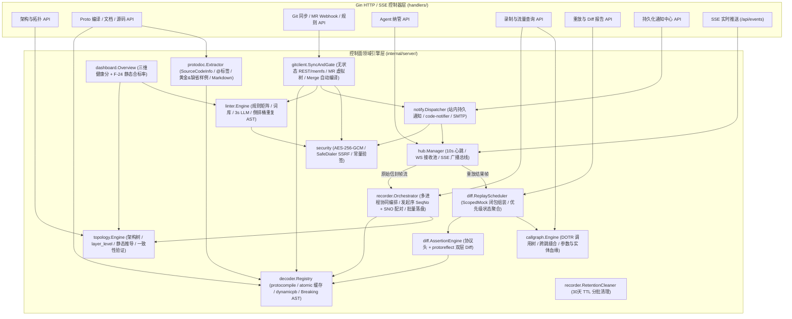
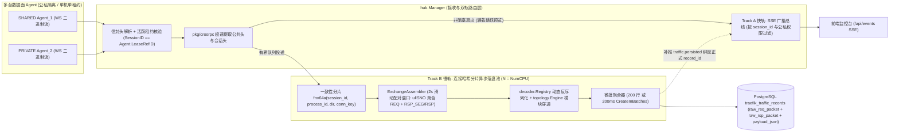

# 架构与活体契约治理 (`code-traefik`) 管理面服务、微前端控制台与回归断言设计

- **文档编号**：`04-control-plane-and-web-console.md`
- **文档版本**：v1.11.1
- **更新日期**：2026-11-14
- **归属阶段**：阶段二：系统架构与数据模型设计 (`02-design`)
- **状态**：M1~M23 已交付；M24~M26 已完成设计待实施 (Approved for M24~M26)
- **上位基线**：[`01-feature-matrix.md`](../01-features/01-feature-matrix.md) (v2.20.0)、[`01-system-architecture.md`](./01-system-architecture.md) (v1.8.1)、[`02-data-plane-and-cros-rpc-engine.md`](./02-data-plane-and-cros-rpc-engine.md)、[`03-architecture-elements-and-topology.md`](./03-architecture-elements-and-topology.md) (v1.9.0)、[`07-console-ia-restructuring-and-workflow-workbench-adr.md`](../05-adr/07-console-ia-restructuring-and-workflow-workbench-adr.md) (ADR-07)、[`08-recording-drawer-and-process-tree-selection-adr.md`](../05-adr/08-recording-drawer-and-process-tree-selection-adr.md) (ADR-08)、[`09-arch-process-ssot-and-ebpf-premount-standby-adr.md`](../05-adr/09-arch-process-ssot-and-ebpf-premount-standby-adr.md) (ADR-09 v1.1.0)、[`10-enhanced-proto-schema-file-management-adr.md`](../05-adr/10-enhanced-proto-schema-file-management-adr.md) (ADR-10 v1.1.0)、[`11-single-process-bidirectional-capture-and-recording-ux-adr.md`](../05-adr/11-single-process-bidirectional-capture-and-recording-ux-adr.md) (ADR-11 v1.0.0)、[`12-packet-causality-call-tree-and-sequence-ux-adr.md`](../05-adr/12-packet-causality-call-tree-and-sequence-ux-adr.md) (ADR-12 v1.0.0)、[`15-scalable-topology-focus-and-layout-persistence-adr.md`](../05-adr/15-scalable-topology-focus-and-layout-persistence-adr.md) (ADR-15 v1.3.0)、[`16-multi-implementation-service-contract-adr.md`](../05-adr/16-multi-implementation-service-contract-adr.md) (ADR-16 v2.0.0)、[`17-topology-single-layer-drilldown-and-layout-ux-adr.md`](../05-adr/17-topology-single-layer-drilldown-and-layout-ux-adr.md) (ADR-17 v1.1.0)、[`18-proto-full-lifecycle-and-git-mr-governance-adr.md`](../05-adr/18-proto-full-lifecycle-and-git-mr-governance-adr.md) (ADR-18 v1.3.0)

### 修订记录

| 版本 | 日期 | 作者 | 变更说明 |
| :--- | :--- | :--- | :--- |
| `v1.8.0` | `2026-11-11` | Architecture Team | 同步 ADR-16 (`v1.0.0`)：补充录制期 `endpoint_snapshots` 固化、多实现契约重放兼容性与 `dst_tag` 隔离；新增 §4.8 详细定义 `/architecture` 模块类型与「定义的接口」页签、`PROVIDE` 自动切换实现契约与 `impl_key`、`DEPEND` 分发/具体实现区分、`/topology` `«interface»` 库卡、`REALIZATION` 图层开关、`topo_contract_mode=AGG\|EXPAND`、第八类一致性状态 `IMPL_UNRESOLVED`（复用 `--color-warning`）与「实现待定」虚拟节点及 `/dashboard` 契约实现覆盖率 |
| `v1.9.0` | `2026-11-13` | Architecture Team | 同步 [`ADR-17`](../05-adr/17-topology-single-layer-drilldown-and-layout-ux-adr.md) (`v1.0.0` / `M21`)：更新 §4.1 `/topology` URL 状态参数、§4.2 `ArchCanvas` 组件树职责，并新增 §4.9 详细规范单层平铺逐级下钻面包屑导航、工具栏 4 组收纳 + `[⚙️ 筛选与图层]` Popover、三类 `1:1 border-box` 卡片、四向智能锚点路由、按作用域隔离的位置记忆与 `EdgeDetailDrawer` 节点中文名渲染 |
| `v1.9.1` | `2026-11-13` | Architecture Team | 依据 [`ADR-17` (`v1.1.0`)](../05-adr/17-topology-single-layer-drilldown-and-layout-ux-adr.md) 架构检视意见加固 §4.2 与 §4.9：1. §4.2 补齐 `UnregisteredInterfaceNode.tsx` 与状态宿主 `ArchTopologyTabPane.tsx`；2. §4.9 明确节点悬浮动作条（`arch-node-action-bar`）与 `Enter` 快捷键同步切换单层下钻、跨层搜索 `fitView` 后置等待 ELK 排版完成、五类节点四向双向 `<Handle>` 挂载以及非 `right->left` 走线丢弃 ELK `bendPoints` 切换 `SmoothStep` |
| `v1.10.0` | `2026-11-13` | Architecture Team | 依据 [`ADR-18` (`v1.1.0`)](../05-adr/18-proto-full-lifecycle-and-git-mr-governance-adr.md) (`M22~M25`) 全面补齐 Proto 全生命周期治理与 Git/MR 门禁设计 |
| `v1.11.0` | `2026-11-13` | Architecture Team | 依据 [`ADR-18` (`v1.2.0`)](../05-adr/18-proto-full-lifecycle-and-git-mr-governance-adr.md) (`M22~M26`) 全面检视修订：1. §1.6 拆分 `GitRepo (1:N) GitProtoBundle` 支持 Monorepo、新增 `:repoId` Webhook、`COALESCE(bundle_id,0)` 防 Fast-Forward 误丢、Bot 评论 `remote_comment_id` 原位更新与 `BASE_LIB` 传递闭包扩散通知；2. §1.8 升级 `SSEBroker(userID)` 定向推送，明确跨机 LAN `code-notifier` `NotifyPayload` 强制非空 `markdown_content` 与真实邮箱解析，支持 `outbound_trusted_cidrs` 与 `settings.go` 脱敏/审计占位；3. §4.1/§4.2 补齐双模 `WorkspaceUtilityHeader`（门户嵌入态+独立外壳 `NotificationBell`），§4.10 修正前端 JS 为基于 M21 基线 `<= 150KB gzip`（`<= 500KB` 原文）增量预算并补全 `GitRepoDTO.bundles`、`MRCheckRunDTO` 与 `email_status` TS 契约 |

---

## 1. Server 控制面核心服务与调度编排 (`internal/server`)



### 1.1 多 Agent 信封路由与双轨分发管道 (`hub.Manager` & `recorder.Orchestrator`)

当多台公私域 Agent（`SHARED` 或个人 `PRIVATE`）同时处于不同用户的活跃会话时，Server 基于 56B `EnvelopeHeader` 执行租约核验与**「快轨 SSE 实时推送 + 慢轨异步配对双模落盘」**双轨无阻塞分流：



1. **周期心跳、Single-Flight 自动预挂补齐 (`Auto-Rearm`)、离线熔断与悬空租约自愈**：
   - 后台协程按 `10s` 间隔并发探活所有已登记 Agent（`GET /agent/v1/handshake`，超时 `3s`），刷新 `status = 'ONLINE'`、`last_heartbeat_at`，核对 `ActiveLeaseType / ActiveRefID` 与规范化预挂载摘要 `ArmedDigest`；
   - **Single-Flight 版本化预挂对账与指数退避**：当在线且空闲（`lease_type == ''`）的 Agent 返回的 `ArmedDigest` 与 `traefik_agents.expected_armed_digest` 不一致或 `BootID` 刷新时，`hub.Manager` 在单机互斥锁 `rearmMu[agentID]` 保护下携带最新 `mounts_revision` 调用 `PUT /agent/v1/monitors/arm` 补齐待命探针并回写统一七态 `probe_status`；若遇 `CAP_DENIED`/`ERROR` 等持久性错误自动进入 `10s -> 30s -> 60s -> 300s` 指数退避（配置变更或手动触发立即重置退避）；
   - 连续 **3 个周期（30s）** 探活失败则将数据库状态切换为 `OFFLINE`、将该 Agent 名下挂载进程 `probe_status` 同步置为 `'OFFLINE'`，**自动释放残留排他租约**并将关联录制批次或重放任务置为异常终止，防止共享测试环境 Agent 发生死锁挂死。
2. **Track A 快轨（前端 SSE 实时预览推送）**：
   - 为每个已认证订阅者分配容量为 `128` 的缓冲 Channel；推送前严格校验订阅者对目标 `session_id` 的访问权（`PRIVATE` 批次仅推送给 `owner_id` 本人及 `traefik_admin`）；
   - Channel 瞬时满载时仅跳过实时预览通知，绝不反向阻塞 WebSocket 读取协程与 Track B 落盘管道，确保端到端呈现延迟 `<= 1s`。

### 1.2 预挂就绪零重启录制编排与无损+结构化双模落盘流水线 (`recorder.Orchestrator`)

1. **多进程排他租约获取、有序采集闸门与停录不断连**：
   - 校验发起人对所选 `target_process_ids` 所属环境 Agent 的访问权（普通用户可组合本人 `PRIVATE` Agent 与当前空闲的任意 `SHARED` 环境 Agent），固化 `process_snapshots` 进程蓝图快照（解耦日后卸载挂载实例）与 `endpoint_snapshots` 下游端点映射快照（`[{endpoint, arch_process_id, source}]`，供多实现服务契约 `EGRESS` 流量历史幂等定位目的实现模块，[`ADR-16`](../05-adr/16-multi-implementation-service-contract-adr.md)），按 `agent_id` 升序调用 `AcquireAgentLeases` 原子加锁（冲突立即返回 `409 Conflict` 及持锁人信息）；
   - 并发调用各 Agent `PUT /agent/v1/monitors/sync` 下发 `[]ProcessMonitorSpec`：Agent 实时复检 `/proc/<pid>/fd` 后按序先注入 `activeSessionID` 并开启 `EgressProxy` `CAPTURING` 分帧（目标 PID 默认全出站透明代理，即使仅挂载单个进程且 `Downstreams` 为空亦可自动录齐 `INGRESS + EGRESS`，[`ADR-11`](../05-adr/11-single-process-bidirectional-capture-and-recording-ux-adr.md)）、再预热存量已建立入站 FD 至 `ing_conn_map` 并动态挂载入站读写钩子（已 `ARMED` 进程 **0ms 零重启开录**，`DISARMED` 进程兜底临时挂载），将最新诊断写入 `traefik_recording_sessions.process_diagnostics`；WebSocket 读取协程将真实采集 `agt.ID` 透传至 `ExchangeAssembler.Feed(agt.ID, env, payload)`（禁止硬编码 `agent_id = 1`）；
   - 录制正常结束或触发上限时，严格调用 **`POST /agent/v1/monitors/{sessionId}/stop`**（携带路径参数 `sessionId`）：Agent 先卸载入站读写钩子 -> `200ms` 在途应答排空 -> 将 `EgressProxy` 拨回 `PASSTHROUGH` 并清零 `activeSessionID`（**不断开业务 TCP 长连接**） -> 发送 `EVENT_SESSION_DRAINED` 并释放本地 `RECORDING` 租约，主控在统一收尾函数中原子释放全部 DB 租约。
2. **双阈值自动停录守卫**：
   - 内存原子维护当前批次 `capturedFrames` 与启动定时器 `time.AfterFunc(MaxDuration)`（默认 `30 分钟` / `100,000 帧`）；任一阈值触发时自动向全部参与 Agent 发送 `/stop`、刷空配对窗口并释放租约，状态落盘为 **`COMPLETED_BY_LIMIT`**。
3. **Track B 慢轨：连接内 `ullSNO` 往返配对与双模归档 (`ExchangeAssembler`)**：
   - **无锁分片亲和**：按 `(session_id, process_id, direction, conn_key)` 哈希路由至固定 Worker，保证同一 TCP 连接上的 `REQ`、`RSP_SEG` 与 `RSP` 100% 由同一协程串行处理；
   - **单行往返聚合与发起序锚定规则（Exchange-per-Row，目标吞吐 `>= 2000 帧/s`，[`ADR-12`](../05-adr/12-packet-causality-call-tree-and-sequence-ux-adr.md)）**：
     - **请求到达瞬间原子分配发起序号 (`SeqNo`)**：每个活跃录制批次维护 `atomic.Int64` 序号器 `sessionSeq`；收到任意 `REQ` 首帧创建挂起项瞬间（以及 `ONEWAY`、`MNG`、`RSP_ORPHAN` 到达瞬间）立即执行 `seqNo = sessionSeq.Add(1)` 绑定至挂起上下文，彻底根治因下游 `EGRESS RSP` 先于父 `INGRESS RSP` 完成落盘而导致的列表父子倒挂；
     - **连接级 `MNG.acProcName` 对端身份缓存**：当某 `(session_id, process_id, conn_key)` 捕获到 `ucMsgType ∈ {5, 6, 7}` (`MNG`) 握手管理帧且 `MngHead.ProcName` 非空时，在 Worker 本地连接字典 `connPeerProc[connKey]` 中记忆对端自报进程名，并注入同连接后续往返记录的 `headers_json.meta.peer_proc_name`；
     - **`ONEWAY` 单向请求**（`ucMsgType == 2 && ucReqType == 3`）：无需等待应答，直接组装 `raw_req_packet = frame`、`raw_rsp_packet = nil`、`payload_json = {"req": reqObj, "rsp": null}`；
     - **标准 `UNARY` 与多段流式 `STREAM_RSP`**：收到 `REQ` 时携带已分配的 `seqNo` 暂存至 Worker 本地 `pendingMap[(process_id, direction, conn_key, sno)]`；后续收到 `ucMsgType == 4 (RSP_SEG)` 时按序追加分片字节至 `rspBuf` 并递增 `rsp_seg_count`；收到终结帧 `ucMsgType == 3 (RSP)` 时弹出配对项，无损拼接 `raw_rsp_packet`（可通过 `crosrpc.SplitFrames` 零歧义逐片还原），组装 `payload_json = {"req": reqObj, "rsp": rspObjOrSegArray}`，提取轻量调用图摘要 `headers_json.meta`（含 `peer_proc_name`、`biz_error`、`biz_status_summary` 及顶层实体主键摘要 `produced_entities / consumed_entities`），并精确计算微秒级往返耗时 `latency_us = (rspCapturedAtNs - reqCapturedAtNs) / 1000`；
     - **自适应配对超时与孤立帧兜底**：
       - 滑动配对超时时间基于报文会话头动态计算：取 `max(ReqHead.uiTimeOutSecondLimit, 30s)`；
       - 若收到 Agent 投递的 `EVENT_CONN_CLOSED` 连接关闭事件，立即刷空该连接的所有挂起请求，置为 `exchange_type = 'REQ_ONLY'` 落盘；
       - 连接中途切入捕获到的无头孤立应答以 `exchange_type = 'RSP_ORPHAN'` 落盘（`raw_req_packet = nil`）；连接管理帧以 `exchange_type = 'MNG'` 归档；
       - 每个 Worker 设立最大 `10000` 条挂起请求预算，防止慢连接恶意泄漏内存；
   - **微批写入**：每凑满 `200` 条往返记录或每 `200ms` 触发一次 GORM `CreateInBatches` 分区表写入。

### 1.3 跨 Agent 同构重放调度器与多请求明细持久化 (`diff.ReplayScheduler`)

1. **权限、快照解耦同构兼容性、就绪硬门禁与排他租约四重前置校验**：
   - 校验选定的 `INGRESS` 往返记录均属于同一 `session_id` 与同一源进程 `source_process_id`，且 `is_replayable == true`（`raw_req_packet` 非空且未被 4MB 截断）；
   - 调用基于 `session.ProcessSnapshots` 与统一 `ContractResolver` 解耦的 `topology.ValidateReplayProcessCompatibility`（即使源环境 Agent 日后已卸载原挂载实例亦不受阻碍；针对多实现服务契约的 `INGRESS` 流量，按录制时源进程快照 `sourceSnap` 中承载的具体实现模块 `M_impl` 核验目标进程同构性，不会要求目标进程包含其他进程的实现模块，[`ADR-16`](../05-adr/16-multi-implementation-service-contract-adr.md)），校验发起人对录制素材与目标进程 `target_process_id` 所属环境 Agent 的权限及模块同构性；
   - **重放零外泄前置硬门禁与历史 `EGRESS` 端点自动并集（[`ADR-11`](../05-adr/11-single-process-bidirectional-capture-and-recording-ux-adr.md) & [`ADR-16`](../05-adr/16-multi-implementation-service-contract-adr.md)）**：主控自动取「`CompileProcessDownstreams(target)` 静态推导下游端点（含展开 `DISPATCH` 多实现契约的全部实现进程端点并标记 `dst_tag = ArchProcess.Code`）$\cup$ 源录制批次中该源进程实测捕获的全部 `EGRESS` 记录 `DstAddr (IP:Port)`」合并写入 `ExecuteReplayReq.ProcessSpec.Downstreams`（使单进程零拓扑录制的素材同样 100% 闭环 Mock）；实时核验目标进程就绪态，若处于 `WAITING_PROC`（未启动）或持有指向该合并 Mock 端点集的未代理存量直连（`NEED_RECONNECT`, `established_conns > 0`），**直接拒绝启动重放并返回 `409 Conflict`**；
   - 对目标进程所属 Agent 获取 `REPLAY` 排他租约（冲突立即返回 `409 Conflict`）。
2. **重放生命周期状态机与既有代理连接零外泄 Mock 接管**：
   - **状态机流转**：`PENDING`（初始创建） -> `RUNNING`（目标进程已 `🟢 READY`，无需手动重启；Agent 将 `EgressProxy` 中该进程的既有长连接原子切入 `REPLAY_MOCK` 物理阻断真实下游写通道并按序注入请求切片） -> `COMPLETED / CANCELLED / FAILED`；
   - **按 `RecordID` 因果子树组装 `ScopedEgressMocks` 与 `dst_tag` 多实现隔离（[`ADR-12`](../05-adr/12-packet-causality-call-tree-and-sequence-ux-adr.md) & [`ADR-16`](../05-adr/16-multi-implementation-service-contract-adr.md)）**：从 `traefik_traffic_records` 按 `req_captured_at_ns ASC, seq_no ASC, id ASC` 提取选定 `INGRESS` 记录组装 `IngressItems: []ReplayIngressItem{RecordID, RawReq}`，并调用 `callgraph.BuildReplayClosure`：优先按同进程同 `trace_id` 的 DOTR `FatherSpanID` 子孙闭包（无 `trace_id` 时回退 `[req_ns - 500μs, rsp_ns + 500μs]` 包含时间窗）为每条 `INGRESS` 切分专属 `ScopedEgressMocks[recordID]`，将未归属合格 `EGRESS` 放入 `GlobalFallbackMocks`（严格剔除 `is_truncated == true`、`REQ_ONLY` 与空应答帧），并根据每条 `EGRESS` 记录归因的 `dst_module_id` 填充目标实现进程编码 `DstTag`（Agent 侧 `ScopedMockMatcher` 按 `service:operation@dst_tag` 优先匹配，无标签回退 `service:operation`，严守零 DB 零 `.pb` 红线），纯二进制下发 Agent；
   - **双轨可靠回收与独立明细持久化**：
     - 重放执行进度与结果通过 WebSocket `EVENT_REPLAY_ITEM_DONE` 实时推送，同时支持通过 `GET /agent/v1/replays/:taskId/result` 幂等拉取；
     - 每条请求重放回收的实际原始应答帧（`actual_rsp_packet` bytea）及双层比对结果独立持久化至 **`traefik_replay_items`** 表，支持前端标准服务端分页查询与历史多次比对！
3. **多请求状态聚合优先级定律**：
   单条请求及整包重放任务的最终 `result_status` 严格遵循以下全序优先级取最高异常级别：

   $$\text{ERROR} \succ \text{TIMEOUT} \succ \text{MOCK\_MISS} \succ \text{FAILED} \succ \text{PASS}$$

### 1.4 历史流量保留期自动清理器 (`recorder.RetentionCleaner`)

每 `6 小时` 巡检一次超过保留期（默认 `30 天`，配置项 `traffic.retention_days`）且非活跃状态的录制批次，按每批 `5000` 行分批删除关联流量记录与过期会话，避免长事务锁表，并通过 `commonAudit.Push` 写入一条系统级清理审计记录。

### 1.5 DOTR 因果调用树、跨进程跳点缝合与数据流血缘引擎 (`internal/server/callgraph`, [`ADR-12`](../05-adr/12-packet-causality-call-tree-and-sequence-ux-adr.md))

为支撑 `/debug` 默认「事务调用树 + 内联迷你甘特瀑布条」、交互式 UML 时序泳道图及有状态重放闭包预览，`internal/server/callgraph` 提供以下五大确定性纯算法能力：

1. **批量架构水合与连接短编号消歧 (`HydrateRecordSummaries`)**：
   - 一次性批量加载批次涉及的 `Module` 字典与 `RecordingSession.ProcessSnapshots`（辅以存活 `Process` 表兜底），`O(1)` 回填每条记录的 `src_module_name`、`dst_module_name`、`process_name`、`arch_process_name` 及 `headers_json.meta.peer_proc_name`（来自同连接 `MNG.acProcName`）；
   - 按连接首次出现时序为批次内每个唯一 `(process_id, conn_key)` 生成紧凑短编号 `Conn#1, Conn#2, ...`，消除不同 TCP 长连接各自独立递增 `ullSNO`（如两条不同连接均出现 `SNO=1002`）引发的视觉混淆。
2. **多进程 `EgressProxy` 跨跳合并缝合 (`StitchCrossProcessHops`)**：
   - 当同一录制批次纳管了上下游多个业务进程（$P_1 \rightarrow \text{EgressProxy} \rightarrow P_2$）时，`EgressProxy` 代拨会产生新客户端临时端口，导致 $P_1.\text{EGRESS}$ 与 $P_2.\text{INGRESS}$ 四元组不同；
   - **一级权威匹配 (`DOTR_EXACT`)**：在同一非空 `TraceID` 内，将满足 `i.Direction == INGRESS && i.ProcessID != e.ProcessID && (i.SpanID == e.SpanID || i.FatherSpanID == e.SpanID) && i.ServiceName == e.ServiceName && i.Operation == e.Operation` 且时间距离最近的单条未配对入站记录与出站记录 $e$ 双向缝合（记录 `linked_peer_record_id` 并估算单跳网络传输耗时 `net_hop_us = max(0, e.latency_us - i.latency_us)`）；
   - **二级指纹兜底 (`FINGERPRINT_INFERRED`)**：针对无 `TraceID` 报文，按 `(ServiceName, Operation, ReqPayloadSHA256, DstPort)` 相等且 `|i.ReqCapturedAtNs - e.ReqCapturedAtNs| <= 50ms` 缝合。
3. **DOTR 主路径调用树构建、同层兄弟分类与甘特坐标归一化 (`BuildTransactionTrees`)**：
   - **父子挂载与安全边界**：优先在同一 `TraceID` 内依据 `child.FatherSpanID == parent.SpanID`（兼容同进程内 `EGRESS` 继承入口 `INGRESS` 上下文）挂载子孙节点；无 `TraceID` 的孤儿 `EGRESS` 回退在同 `(session_id, process_id)` 内寻找满足 `[parent.ReqNs - 500μs, parent.RspNs + 500μs]` 的最内层入口 `INGRESS` 挂载（标记 `TEMPORAL_INFERRED`）；强制执行 `visited` 破环保护、最大树深 `max_depth = 16` 与单根事务返回子节点上限 `max_children = 200`；
   - **兄弟时序关系与软错误标记**：同父节点下按发起序比较相邻子调用区间，自动标注 `PARALLEL`（重叠 `> 50μs`）、`COMPENSATION`（位于前序异常或 `biz_error` 之后且方法名匹配 `Cancel* / Release* / Rollback* / Refund* / Unlock* / Compensate* / Revert*`）与 `SEQUENTIAL`；以根事务 `[rootStartNs, rootEndNs]` 为基准计算每个节点的 `waterfall_offset_pct (0..100)`、`waterfall_width_pct (0.5..100)`、净自身执行耗时 `self_exec_us` 与 `is_critical_path`；
   - **筛选保树语义**：当用户在 `/debug` 传入方法名、异常或关键字过滤命中深层子节点时，引擎自动保留其所属根事务及完整祖先链路（非命中兄弟可折叠或标记弱化），并严格以**根业务事务**为单位进行分页切片，确保同一事务绝不跨页割裂。
4. **单事务参数数据流血缘提取 (`ExtractParameterLineage`)**：
   - 面向单事务时序泳道接口按需触发（节点上限 `<= 200`，单 JSON 递归深度 `<= 6`、标量叶节点上限 `<= 500`）：遍历事务内按发起序排列的已解码 `payload_json.{req, rsp}`，当上游输入或前序子调用应答产出的非噪声标量值（关键标识字段 `*_id / *_no / *_code / *_key / *_token / sku*` 或长度 `>= 4` 的高熵字符串/业务长整型）在后续调用入参或最终入口出参中精确复现时，生成有向参数血缘边 `ParameterLineageEdgeDTO`。
5. **跨事务有状态业务实体生命线与重放闭包诊断 (`BuildEntityChains` & `BuildReplayClosurePreview`)**：
   - 基于批次各根事务 `headers_json.meta`（历史无 `meta` 小批次受控回退扫描顶层载荷）：当某根事务在 `rsp` 中首次产出某业务主键（`req` 未携带而 `rsp` 出现，如 `CreateOrder.rsp.order_id = "ORD_9981"`，角色 `PRODUCER`），后续根事务在 `req` 中携带同一键值（如 `GetOrderDetail / CancelOrder`，角色 `CONSUMER`），自动串联为跨事务实体生命线；
   - 当用户对任一 `CONSUMER` 入口记录请求 `GET /api/traffic-records/:id/replay-closure` 时，除返回其专属 `ScopedEgressMocks` 预览清单外，自动附带前置 `PRODUCER`（及中间状态变更事务）有序依赖链与一键连带回放推荐 `recommended_record_ids`。

### 1.6 Git 无状态客户端、Monorepo `1:N` Bundle 对账与 MR 四合一虚拟目录树门禁 (`internal/server/gitclient`, `F-21` / `F-29` / `F-31` / M25~M26)

1. **凭据加密、SSRF 信任白名单与双模无状态读取适配器**：
   - `GitRepo` 凭据（`PersonalAccessToken` / `BasicAuth` / `DeployKey`）与 `WebhookSecret` 经 `internal/server/security.AESGCM` 使用主密钥（**`TRAEFIK_CRYPTO_KEY`** `32B` 环境变量或 KMS 注入；生产环境禁止无密钥静默回退，测试期显式注入）加密存库；响应体与 `commonAudit` Diff 彻底隐藏密文与 `*_enc`/`*_sha256` 内部键，仅返回 `has_credentials` / `has_webhook_secret` / 脱敏 Hint；
   - 出站 HTTP/Git/Webhook/LLM/Notifier 通信强制注入 `security.SafeDialer`：永久硬阻断云元数据（`169.254.0.0/16`、`fe80::/10`、`100.100.100.200/32`），默认拦截未授权回环/私网 RFC1918，同时显式读取 `traefik_settings.outbound_trusted_cidrs` 信任白名单（放行企业内网 GitLab、内网 LLM 网关及**同内网另一台主机部署的 `code-notifier`**），并在 Dial/Control 阶段对解析后的目标 IP 二次核验防范 DNS 重绑定；优先通过托管平台 **REST API** 拉取树与文件流，通用 Git URL (`GENERIC`) 回退使用 `go-git` `memfs` (`memory.NewStorage()` + `memfs.New()`, `Depth: 1`) **纯内存浅克隆**，宿主机零残留。
2. **`GitRepo (1) -> GitProtoBundle (N)` 全量只读同步与 SHA256 对账 (`SyncGitRepo` / `ReconcileRepoConsistency`)**：
   - 将仓库连接凭据与编译打包单元正式拆分，单个 Monorepo `GitRepo` 可下挂多条 `GitProtoBundle`（各自定义 `proto_root_dir`、`proto_include_dirs`、`target_schema_name` UNIQUE、`target_category`）；创建单仓 `GitRepo` 支持内联一键建默认 Bundle；
   - 全量同步遍历远端默认分支下位于 Bundle `ProtoRootDir` 与 `ProtoIncludeDirs`（均经 `path.Clean` 防 `..` 穿越）内的全部 `.proto` 文件：对比各相对路径 SHA256 与 DB 现有 `traefik_proto_files`：新增或 SHA256 变更则写入新版本 `traefik_proto_file_versions`（记录 `CommitSHA`、`AuthorName`、`CommitMessage`、`CommittedAt`），远端已删除的路径标记 `is_deleted=true` 保留只读历史 Diff；随后触发 `protocompile` Compilation Bundle 编译写入新版 `ProtoSchema (source_type='GIT_SYNC', source_bundle_id=bundle.ID)` 并提取 `ProtoDocSymbol` 与静态检查报告，推送 SSE `git_sync.completed`；
   - 一致性对账接口为纯只读校验，比对远端 SHA256 与 DB `traefik_proto_files` 输出 `{in_sync, remote_only_files, db_only_files, modified_files}`。
3. **MR Webhook 常量时间验签、Fast-Forward 幂等去重与原位评论更新 (`EvaluateMRCheckRun`, M26)**：
   - 推荐 `POST /api/webhooks/git-mr/:repoId` 精准定位 `GitRepo`（保留按归一化 `ssh/https` URL 匹配兼容路径 `/api/webhooks/git-mr`），使用 `subtle.ConstantTimeCompare` / `hmac.Equal` 校验签名；通过唯一防重键 **`uk_traefik_mr_dedup` (`git_repo_id, COALESCE(bundle_id, 0), event_phase, head_commit_sha, target_head_sha`)** 入库 `MRCheckRun`，其中 `event_phase ∈ {'MR_GATE', 'MAIN_MERGE'}` 且纳入 `target_head_sha`，彻底避免 Fast-Forward / Rebase 合入主干时与 MR 相同 `head_commit_sha` 被误判为重复 webhook 而漏跑主干编译！
   - **MR 虚拟目录树合成算法（根治「删除既有文件残留幽灵引用」缺陷）**：按命中的 `GitProtoBundle` 拉取 `TargetBranch` 基线树，写入 `ADDED / MODIFIED` 并强制移除 `DELETED / RENAMED(OldPath)`；
   - **四合一门禁流水线顺序执行**：① `protocompile` 虚拟树全量编译（`compile_passed`，跳过全部 `external_imports` Service 且仅自有 `.proto` 保留完整 `SourceCodeInfo`）；② `linter` 命名/注释/词库检测；③ 三护栏 AST 重复结构检测（统一 `Jaccard >= 0.85`）；④ 若 `TargetSchemaName` 在生效池存在基准版本，执行 `decoder.DetectBreakingChanges` + `FindAffectedDependents`（`breaking.go` 新增当 `ServiceName == ""` 时沿 `CompiledRegistry.Files` 反向 `import` 闭包穿透 `BASE_LIB` 受影响下游服务与模块责任人）；
   - **原位评论更新 (`remote_comment_id`)、`Approve with Override` 与 Merge 自动入池**：
     - 首次回写 Bot 评审评论后将平台返回的 `comment_id` 存入 `MRCheckRun.RemoteCommentID`，同一 MR 新提交推送（`UPDATE`）时优先调用平台 Update Comment API 原位更新同一条评论，避免多轮 push 刷爆 MR 讨论区；
     - 管理员对 `FAILED` 记录执行 `POST /api/mr-check-runs/:id/override` 时，**强制校验 `compile_passed == true`**，生成 **`AuditLevelP1`** 审计日志、原位刷新状态并发送 `MR_GATE_OVERRIDDEN` 通知；
     - 当 Webhook 携带 `MAIN_MERGE` / `merge` 事件时，按配置执行 `GIT_MR_AUTO` 编译（含 `source_bundle_id`）及可选无 Breaking 安全激活。

### 1.7 可配置静态规范检查、多段包名规则、原生词库与带护栏重复结构引擎 (`internal/server/linter`, `F-30` / M24)

1. **可配置规则引擎与合理默认值 (`traefik_check_rules`)**：
   - 按 `RuleType`（`NAMING | COMMENT | VOCABULARY | STRUCTURE | DUPLICATE`）逐文件扫描 AST 与 `SourceCodeInfo`；支持基于 `ExemptionRule` 剔除 `google/protobuf/*`、`third_party/*` 或指定 `BASE_LIB` 路径；
   - **多段包名兼容规则 (`PACKAGE_NAMING`)**：默认正则 `^[a-z][a-z0-9_]*(\.[a-z][a-z0-9_]*)*(\.v[0-9]+((alpha|beta|rc)[0-9]*)?)?$` 完整兼容 `dophi.order.v1` 多段语义版本包名与单段包名（避免早期原型硬编码只支持单段包名的设计缺陷）；
   - **`COMMENT_REQUIRED` 默认 `WARNING`**：缺失 Service/RPC/Message/Enum 注释默认记录 `WARNING` 并在合规报告统计，**不直接阻断 MR**，管理员可在规则配置中显式切换级别或豁免旧目录。
2. **复合词根切分、原生标准词典 (`BUILTIN_SEED`) 与 3s 熔断可选 LLM 建议器**：
   - 将字段名（如 `cust_ord_amnt` / `tradeTsMs`）拆分为规范小写词元切片 `[cust, ord, amnt]`；首先查原生 `traefik_vocabulary_terms` 标准词 `term` 与 `aliases` 映射表（启动时由 `BUILTIN_SEED` 幂等预置高频通用词根并支持 Web CRUD 维护，若命中 `amnt -> amt`，立即生成精确规范化替换建议）；
   - 未命中的生僻缩写词元先查询本地进程内 TTL 缓存（避免同仓跨文件重复调用）；若系统设置启用了 `llm_enabled=true` 且配置有效，通过受 `SafeDialer` 保护的 HTTP 客户端发起 **3 秒硬超时**（`context.WithTimeout(ctx, 3*time.Second)`）异步或有限并发批请求获取英文词根释义建议，将结果写入本地缓存并可选写回 `traefik_vocabulary_terms(is_approved=false, source='LLM_SUGGESTED')` 供架构师审核；**超时、HTTP 错误或未配置 LLM 时 100% 静默降级为纯确定性报告（`LLMStatus=TIMEOUT_FALLBACK|ERROR_FALLBACK|SKIPPED`），绝不拖垮或失败静态检查任务**。
3. **带三重护栏与倒排桶预筛选的跨文件 AST 重复结构体探测 (`DetectDuplicateMessages`)**：
   - **护栏 ① 短包装豁免**：统计有效非保留字段数，凡 **`effective_field_count < 3`** 的小型消息（如仅含 `{id, name}`、`PageReq`、`Empty`）直接跳过不参与重复比对；
   - **护栏 ② `BASE_LIB` 与配置路径豁免**：排除 `TargetCategory == 'BASE_LIB'` 及命中 `ExemptionRule` 的公共底座消息，鼓励正常引用公共结构而不误报；
   - **护栏 ③ 同包多版本演进豁免**：对包名提取去版本前缀键（正则剥离末尾 `.v\d+((alpha|beta|rc)\d*)?$`，如 `dophi.order.v1` ➔ `dophi.order`），同一归一化包键下的 `v1.CreateOrderReq` 与 `v2.CreateOrderReq` 视为正常契约版本演进，**严禁报重复**；
   - **倒排桶预筛选 + 规范 AST 结构指纹（零 $O(N^2)$ 复杂度爆炸）**：
     1. 对每条通过护栏的 Message，剥离字段 Tag 序号与注释，提取规范化签名集合 `Tokens = {(normalizedType, normalizeFieldStem(name), cardinality)}`（按字母序排列计算精确同构哈希 `ExactASTHash`）；
     2. 建立倒排桶索引 `Bucket[token] -> []MessageID`：仅与同一 `Bucket` 中共享 `>= 2` 个字段特征的候选消息比较精确哈希或高重叠度相似度（`Jaccard >= 0.85` 近似重复 或 `ExactASTHash` 100% 同构），按聚类簇输出 `CheckViolation(RuleCode="DUPLICATE_MESSAGE_AST", Severity="WARNING", DuplicateClusterHash=hash)`，附带各副本精确 `file:line` 与「抽离下沉至公共 `BASE_LIB`」重构建议。

### 1.8 持久化站内通知中心、按用户定向 SSE 与跨机 `code-notifier` 邮件分发 (`internal/server/notify`, M26)

1. **受众解析、站内持久化与 `SSEBroker(userID)` 定向推送**：MR Gate 失败/豁免、Git 同步失败、Merge 自动入池成功、破坏性影响警告事件触发时，引擎按 `MRAuthorEmail/Username`（解析对应 `users.id` 及邮箱）、`AffectedDependents` 所属模块/子系统 `OwnerID` 及兜底 `traefik_admin` 解析接收人集合（去重），批量持久化写入 `traefik_notifications`；同时将既有 `handlers/sse_handler.go` 的 `SSEBroker` 升级为绑定 `userID uint64` 的订阅管理，通过 **`BroadcastToUsers(recipientIDs, "notification.created", payload)`** 仅向目标收件人推送消息（彻底消除共享房间广播导致的跨用户未读提醒泄露）。
2. **跨机部署的同内网 `code-notifier` 与可选 SMTP 异步外发（失败不阻断）**：
   - **`code-notifier` 跨机内网部署契约**：团队 `code-notifier` 部署在网络上另一台独立主机上提供邮件投递服务；管理后台开启 `code_notifier_enabled=true` 并配置 `code_notifier_url`（将对应主机/CIDR 配置进 `traefik_settings.outbound_trusted_cidrs` 供 `SafeDialer` 放行）。控制面异步调用 `POST <code_notifier_url>/api/notify/email` 时，必须构造完整 `NotifyPayload`：
     - 必填 `notification_id`、`subject`、`html_content` 与**非空 `markdown_content`**（校验 `len(strings.TrimSpace(md)) > 0`，匹配 `code-notifier` 接口必填校验，避免空串触发 `400 Bad Request`）；
     - 将目标收件人（作者与受影响模块/子系统 Owner）从平台 `users` 表查询解析真实公司邮箱填入 `recipients: {to: [...], cc?: [...]}`，附带 `source_app: "code-traefik"`、`category` 与 `idempotency_key`；
   - 若未配置 `code-notifier` 但配置了 SMTP 服务器则回落 SMTP 发送；外发成功/失败后回写 `traefik_notifications.email_status`（`SENT | FAILED | SKIPPED`）及错误信息。**远程 `code-notifier` 网络不可达或返回异常时绝不阻塞站内持久化与 Git MR 门禁主流程**。

### 1.9 治理大盘静态规范合标率独立指标卡片 (`internal/server/dashboard`, `F-24` / M26)

为遵循 [`ADR-18`](../05-adr/18-proto-full-lifecycle-and-git-mr-governance-adr.md) §1.8 保持既定 `HealthScore`（`40 + 30 + 30 = 100` 三支柱分数模型与现有回归单测基线）不被稀释，在 `DashboardOverviewDTO` 中以向后兼容新增独立聚合结构 **`StaticComplianceDTO`**（前端 `/dashboard` 呈现独立「Proto 静态规范合标率」卡片，与三维运行期健康分清晰分区）：
- `ComplianceRatePct`：跨全部纳管 Git 仓最近一次有效 `CheckReport.ComplianceScore` 加权均值（或无 Git 仓时为 `null`/未启用引导态）；
- `EvaluatedRepoCount`、`OpenErrorViolations`、`OpenWarningViolations`、`DuplicateMessageGroups`、`MRGates30d`、`MRGatePassRate30d`。

---

## 2. IDL 描述集引擎、跨集依赖闭包与 `dynamicpb` 动态编解码 (`internal/server/decoder`)

### 2.1 `.pb` 多描述集依赖闭包解析、`CompileTrialPool` 仲裁与全局单一生效池 (`ADR-10`)

系统内所有运行环境与 Agent 共享唯一的全局生效契约池（`Single Active Schema Pool`），支持超大型系统将公共基础协议（`BASE_LIB`）与各业务域（`BUSINESS` / `GATEWAY`）拆分为多个独立 `.pb` 描述集协同治理：

1. **上传预检、去重拓扑闭包与忽略规则向前继承 (`UploadSchema`)**：
   - **流式上限与基础校验**：通过 `http.MaxBytesReader` 强制限制上传请求 `<= 16MB (16,777,216 Bytes) + 64KB`；校验扩展名白名单（`.pb/.bin/.desc/.protoset`）与 `category IN ('BASE_LIB', 'BUSINESS', 'GATEWAY')`；`proto.Unmarshal` 解析为 `descriptorpb.FileDescriptorSet`（强制校验 `len(fds.File) > 0` 且 `UnknownFields` 为空）；
   - **自有文件与外部依赖分离**：提取本文件携带的 `ProtoFiles`（`own_proto_files`），遍历 `file.GetDependency()` 计算不在自有集合内且非内置 `google/protobuf/*` Well-Known Types 的缺失路径记入 `ExternalImports`（`jsonb []string`）；
   - **去重 DAG 拓扑合并**：当存在外部 `import` 时，按 **「本描述集自有文件 $\succ$ 当前生效 `BASE_LIB` $\succ$ 其他生效描述集（当 `auto_activate=false` 仅草稿归档时，允许回退取未生效各 `BASE_LIB` 最新版本）$\succ$ Go 标准库内置 `google/protobuf/*` WKT」** 优先级按 `file.GetName()` 严格去重并按 `import` 拓扑序重排后执行 `protodesc.NewFiles`（若仍缺失依赖，返回 `400 Bad Request` 并精准列出 `missing_imports` 文件名）；
   - **自有服务提取与 `0` Service 基础库支持**：**仅遍历 `own_proto_files` 提取 `(service_name, operation)`**（若非 `BASE_LIB` 业务包因 `--include_imports` 重复打包了已生效 `BASE_LIB` 中的同名文件，自动跳过基础库已托管文件的 `Service` 提取），严格按点分规范 **`service_name = string(file.Package()) + "." + string(svc.Name())`**（无 `package` 时为 `string(svc.Name())`）生成映射；完全允许 `OperationCount == 0` 的纯消息体 `BASE_LIB` 入库与激活；
   - **咨询锁递增版本与 `DiffIgnorePaths` 向前继承**：在 PostgreSQL 事务入口获取 `pg_advisory_xact_lock(hashtext('traefik_proto_schema_registry'))` 计算 `version = max(version) + 1`；若 `version > 1`，自动读取同名当前生效版本（无生效版本则取 `version - 1`）的非空 `ProtoOperation.DiffIgnorePaths`，按 `(service_name, operation)` 无损向前继承。
2. **`CompileTrialPool` 激活 / 批量激活 / 停用双向门禁 (`Activate` / `BatchActivate` / `Deactivate`)**：
   - 任何改变全局生效池的操作均在咨询锁事务内先推导出变更后的候选生效集合 $S_{\text{next}}$：
     - **单集激活 (`Activate`)**：$S_{\text{next}} = (S_{\text{active}} \setminus \{\text{同名旧版}\}) \cup \{s_{\text{target}}\}$；
     - **批量激活 (`BatchActivate`)**：校验 `schema_ids` 非空且不含同名多版本后，$S_{\text{next}} = \{s \in S_{\text{active}} \mid s.\text{Name} \notin N_T\} \cup T$；
     - **停用下线 (`Deactivate`)**：$S_{\text{next}} = S_{\text{active}} \setminus \{s_{\text{target}}\}$；
   - **门禁 ①（跨集方法全局唯一）**：校验 $S_{\text{next}}$ 导出的全部 `(service_name, operation)` 两两无交集（重叠立即回滚返 `409 Conflict` 及 `conflicts` 明细）；
   - **门禁 ②（`CompileTrialPool(S_next)` 联合预编译与反向依赖保护）**：仅使用 $S_{\text{next}}$ 内部成员（加内置 WKT）执行去重拓扑联合 `protodesc.NewFiles`，并逐一核验 $S_{\text{next}}$ 全部 `ProtoOperation` 的 `ReqMessageFullName / RspMessageFullName` 均可解析为 `MessageDescriptor`。若待激活业务包依赖的 `BASE_LIB` 未激活，或停用/升级某基础库破坏了下游已生效业务包的依赖闭包，立即回滚并返回 **`409 Conflict`**（携带 `broken_dependents: [{schema_id, schema_name, version, reason}]`）；
   - 校验通过后提交事务，并在 `reloadMu` 保护下执行 `Reload()` 将联合编译出的统一 `CompiledRegistry{Files, Operations}` 原子写入 `atomic.Pointer[CompiledRegistry]`。

### 2.2 动态编解码与历史版本不可变契约

- **动态解码 (`DecodePayloadToJSON`)**：按 `(serviceName, operation, msgType)` 查找生效的 `protoreflect.MessageDescriptor`，实例化 `dynamicpb.NewMessage(desc)` 执行 `proto.Unmarshal(payload)`，再以 `protojson.MarshalOptions{UseProtoNames: true, EmitUnpopulated: false}` 序列化为标准 JSON（注：ProtoJSON 标准自动将 64 位整数编码为十进制字符串，天然杜绝前端 JS `Number.MAX_SAFE_INTEGER` 精度截断）。
- **无映射优雅降级**：若未注册对应 `.pb` 或二进制反序列化失败，保留完整 CROS RPC 头解析结果，将 `decode_status` 置为 `NO_SCHEMA_RAW_HEX` 或 `DECODE_ERR_RAW_HEX`，前端自动切换纯 Hex 视图，绝不中断采集链路。
- **历史不可变与按需重解码**：落盘时快照记录当时使用的 `(schema_id, schema_version)`；后续切换 `.pb` 生效版本不会隐式篡改历史记录，用户可在流量详情抽屉显式点击「使用当前生效版本重新解码」。

### 2.3 消息体参数定义字典树反射与源文件导出 (`F-03.2`, `F-03.4`)

为彻底解决“请求/应答参数定义不可见”与“描述集黑盒无法导出”的痛点，控制面提供基于 `protodesc` 的动态字典树反射服务：

1. **服务端动态字典树递归反射 (`ExtractMessageFieldTree` & 跨集联合池回退)**：
   - 给定 `ProtoOperation` 的 `req_message_full_name` 或 `rsp_message_full_name`：若所属 `ProtoSchema.IsActive == true`，直接从内存 `CompiledRegistry.Files`（联合生效类型池）`O(1)` 查找目标 `protoreflect.MessageDescriptor`；若为未生效的历史/草稿版本，自动将该版本的 `DescriptorBytes` 与当前生效池（及最新 `BASE_LIB`）合并去重构建临时 `*protoregistry.Files`，确保拆包编译的未激活版本同样 100% 可展开字典树；
   - 递归遍历其包含的全部 `protoreflect.FieldDescriptor`，提取出结构化的 `ProtoFieldNodeDTO`：
     - `name`: 字段名（Proto 原名，如 `server_time`、`order_id`）；
     - `json_name`: JSON 序列化名（如 `serverTime`）；
     - `tag_number`: 字段编号（如 `#1`、`#2`）；
     - `kind`: 字段基本数据类型（`INT64`、`STRING`、`BOOL`、`MESSAGE`、`ENUM`、`BYTES` 等）；
     - `cardinality`: 规则修饰（`OPTIONAL`、`REQUIRED`、`REPEATED`）；
     - `is_map`: 是否为 Map 键值映射；
     - `comments`: 源码注释（自动提取 `SourceCodeInfo` 中的 `leading_comments` 与 `trailing_comments`）；
     - `children`: 针对子 Message 递归提取子字段集合（内置防循环引用深度截断，最大深度 12 层）；
     - `field_path`: 预计算的标准点分路径（如 `header.server_time`、`items[*].create_time`）。
2. **描述集源文件树透视与原文件导出**：
   - 提取 `FileDescriptorSet` 内包含的全部 `.proto` 源文件名（如 `account.proto`、`common.proto`）及各自声明的 `Service` / `Message` 清单；
   - 提供 `GET /api/proto-schemas/:id/download` 原始二进制流下载接口，附带 `Content-Disposition: attachment; filename="<schema_name>_v<ver>.pb"`，便于开发本地使用 `protoc` 或 `grpcurl` 排查。

### 2.4 可视化 Diff 忽略字段规则与三级优先级继承模型 (`F-03.3`)

在流量回归对比场景中，动态变化的时间戳、随机请求流水号与签名必须精准豁免比对，传统手工输入路径容易发生拼写与大小写错误：

1. **点分路径与通配符生成规则**：
   - 单层字段：`fieldName`（如 `server_time`）；
   - 嵌套对象：`parent.child`（如 `header.timestamp`）；
   - 数组/列表元素：`array[*].field`（如 `orders[*].trace_token`）；
   - 忽略整个对象/子树：`data.debug_info`。
2. **三级优先级合并继承模型**：
   当回归 Diff 引擎比对单次 RPC 应答时，最终生效的忽略路径集合由三级合并计算：
   $$\text{FinalIgnorePaths} = \text{ReplayTask.ExtraIgnorePaths} \cup \text{Operation.DiffIgnorePaths} \cup \text{ModuleService.DiffIgnorePaths}$$
   - **L1 任务级临时忽略 (`ReplayTask.ExtraIgnorePaths`)**：发起单次重放任务时用户临时附加的针对性忽略项；
   - **L2 方法级精准忽略 (`ProtoOperation.DiffIgnorePaths`)**：在契约工作台字段树上可视化勾选、并持久化至 `traefik_proto_operations` 的方法级专属规则；
   - **L3 服务级全局默认 (`ModuleService.DiffIgnorePaths`)**：在架构中心供给服务上配置的服务级通用忽略规则（如公共网关头 `header.*`）。

### 2.5 纯 Go `protocompile` 编译底座与统一四级虚拟 `Resolver` (`F-21`, `ADR-18` / M22 & M25)

为彻底消除对宿主机外部 `protoc` 二进制及临时文件系统的依赖，在 `internal/server/decoder` 中引入纯 Go 编译器 **`github.com/bufbuild/protocompile`**（启用 `compiler.Compiler{Resolver: ..., SourceInfoMode: protocompile.SourceInfoStandard}`）：

1. **输入安全规范与跨 Bundle 编译边界铁律**：
   - 接收虚拟目录树 `map[relPath][]byte` 与可选 `proto_include_dirs`（默认 `["."]`），对全部路径执行 `path.Clean` 并强制校验为**非空安全 POSIX 相对路径**，拒绝任何前导 `/`、`..` 上级路径穿越或包含 `\0` 的畸形路径；单次编译总源码体积强制受 `<= 16MB` 限制；
   - **外部导入降噪与体积守卫**：`extractOperationsFromDescriptor` **跳过全部 `external_imports`**（不仅是 `BASE_LIB`），绝不将跨 Bundle 依赖的 `Service/Operation` 重复登记入当前制品包导致生效池冲突；构建输出 `FileDescriptorSet` 时，仅当前 Bundle 自有 `own_proto_files` 完整保留 `SourceCodeInfo`（供给文档中心 `traefik_proto_doc_symbols` 与行号锚点），被跨级解析引入的外部依赖 `FileDescriptorProto` **显式剥离 `SourceCodeInfo`**，确保存入 `ProtoSchema` 的二进制制品严格控制 `<= 16MB`。
2. **统一四级优先级虚拟 `Resolver` (`LayeredVirtualResolver`)**：
   通过 `decoder.ProtoSourceProvider` 抽象解耦 M22 与 M25（M22 先以已编译源缓存实现，M25 接入 DB `traefik_proto_files`）：
   1. **第一优先级（当次编译虚拟目录树）**：按 `proto_include_dirs` 组合候选相对路径匹配本轮提交/同步/MR 合成树的 `.proto` 源文件；
   2. **第二优先级（数据库内已同步且未软删的 `.proto` 源码）**：经 `ProtoSourceProvider` 检索 `traefik_proto_files`（`is_deleted = false`）主干最新源码，存在同名路径时 **`BASE_LIB` 仓库优先**；
   3. **第三优先级（当前全局生效池 `CompiledRegistry.Files`）**：从生效池获取已反序列化 `FileDescriptorProto`（直接满足无源码存量 `.pb` 基础库依赖）；
   4. **第四优先级（标准 WKT 内置库）**：Go `protocompile.WithStandardImports()` 内置 `google/protobuf/*.proto`。
3. **产物封装、`BASE_LIB` 影响面传播与既有防线无缝对接**：
   - 将编译返回的 `linker.Files` 封装为标准 `descriptorpb.FileDescriptorSet`，校验 `<= 16MB` 后直接复用 §2.1 的 **`UploadSchema` / `CompileTrialPool` / `F-26` AST 破坏性变更雷达** 与 `atomic.Pointer[CompiledRegistry]` 原子热切换流水线；任何编译失败行精确映射为结构化 `CompileDiagnosticDTO{File, Line, Column, Message}`；
   - **升级 `decoder/breaking.go` (`FindAffectedDependents`) 穿透 `BASE_LIB`（0-Service）传播链**：当破坏性变更落在无 `Service` 的公共基础库 `.proto` 文件（`Violation.ServiceName == ""`）时，沿当前 `CompiledRegistry.Files` 的 `Dependency` 反向 `import` 闭包图传递检索直接与间接引用该基础文件的全部业务 `.proto` 所定义 `Service`，再映射至 `traefik_module_services`、下游 `DEPEND`/`DISPATCH` 消费模块及其负责人与所属 `ArchProcess`。

### 2.6 活体接口参考文档中心与 `SourceCodeInfo` 萃取引擎 (`internal/server/protodoc`, `F-18`, `ADR-18` / M23)

依托 `protocompile`（`SourceInfoStandard`）或带有 `--include_source_info` 的 `.pb` 描述集，`protodoc` 在描述集编译或激活时同步增量萃取全注释驱动结构并持久化至 `traefik_proto_doc_symbols`：

1. **`SourceCodeInfo` 行号跨度与结构化标签萃取 (`ExtractDocSymbols`)**：
   - 遍历 `FileDescriptorProto.SourceCodeInfo.Location`，按 `Path` 索引解析 `Service`、`Method`、`Message`、`Field`、`Enum` 与 `EnumValue` 的 `StartLine` / `EndLine`（1-based）、`LeadingComments`、`TrailingComments`；
   - 结构化标签解析器识别注释中的三类规范标记：
     - **`@deprecated`（或字段/方法/服务 Option `deprecated = true`）**：提取废弃原因并在接口页渲染高危淘汰警示横幅；
     - **`@owner <team_or_user>`**：标注接口维护负责人；
     - **`@error_code <code> <http_or_cros_code> <description>`**：逐行萃取为结构化错误码明细表 `error_codes_json`。
2. **Enum 全量字典、架构多实现血缘、黄金真实样本与缺省 JSON 样例**：
   - **Enum 值字典**：提取全部枚举项名称、整数值、注释及行号；
   - **黄金用例优先 + 缺省样本生成**：查询 `traefik_golden_suite_items` 中匹配 `(service_name, operation)` 的最新精选报文反序列化 JSON 作为「真实推荐调用样例」；若无黄金样本，基于 `protoreflect.MessageDescriptor` 递归构造类型安全的缺省 JSON Request/Response 模板（内置循环引用检测与 `max_depth <= 12` 护栏，64 位整数输出字符串示例）；
   - **多实现契约血缘聚合（`ADR-16` 联动）**：查询 `traefik_service_contracts` 与 `traefik_module_services` 关联输出 `Service` 所属「定义契约库 (`CONTRACT_LIB`)」、「独占实现模块」或「全部多实现模块 (`impl_key + ArchProcess`)」，附带跳转 `/topology` / `/architecture` 锚点；
   - **Markdown 一键导出 (`ExportMarkdown`)**：生成包含服务摘要、方法入参/出参嵌套表格、枚举字典、错误码说明、血缘与示例 JSON 的自包含标准 Markdown 手册（所有 `.proto` 注释在入库/导出前强制纯净转义，Web 渲染严禁 `dangerouslySetInnerHTML`）。

---

## 3. 协议头级 + Protobuf 语义字段级双层回归 Diff 引擎 (`internal/server/diff`)

双层回归断言引擎对每条重放请求的录制基线应答组（`Expected`）与实际回收应答组（`Actual`）执行递进式精准比对：

### 3.1 第一层：CROS RPC 协议头与载荷字节快速比对

| 比对项 | 比对策略 | 差异判定结果 |
| :--- | :--- | :--- |
| **分片数量与类型** | 比对帧序列长度、`ucMsgType`（`RSP` vs `RSP_SEG`）、`usRspMsgNo`、`isPacked` | 不一致直接标记头层 `FAILED` |
| **业务返回状态码** | 比对 `uiStatusCode` 及 V4 `ullStatusCode`（例如 `0` 突变为错误码） | 不一致直接标记头层 `FAILED` 并高亮状态码字段 |
| **固定豁免头字段** | 服务端时间戳 `ullServerRecvTime`、`ullServerSendTime`、扩展头 `ullServerEnqueueTime`，以及客户端运行态回显 `ullSNO`、`aucTraceBuff`、`ullClientSendTime` | **永久豁免，不参与相等性断言** |
| **Payload 原始字节** | `bytes.Equal(expectedPayload, actualPayload)` | 若完全相等且头层通过，直接短路返回 **`PASS`**（跳过第二层开销） |

### 3.2 第二层：`protoreflect` 类型感知语义树 Diff 算法

当第一层协议头一致但 `Payload` 原始字节存在差异时（例如 `map` 序列化字节顺序不同、或包含被忽略的动态业务字段、或发生真实业务数值突变），触发第二层语义比对：

1. **无 `.pb` 映射降级**：直接计算并返回 `ByteDiffSummary`（期望长度、实际长度、首个差异字节偏移量 `FirstDiffOffset` 及前后 32B Hex 切片），判定为 `FAILED`。
2. **有 `.pb` 映射递归语义比对 (`DiffProtoMessages`)**：
   - **严格快照 Schema 版本锁定**：解码 `Actual` 原始载荷时，必须严格使用录制基线记录所归档的 `(schema_id, schema_version)`，杜绝因管理员激活新 IDL 版本导致回归基线漂移；
   - 将 `Expected` 与 `Actual` 分别反序列化为 `dynamicpb.Message`；
   - **未知字段防漏判机制**：通过 `protoreflect.Message.GetUnknown()` 提取双方原始载荷中未在当前 `.pb` 中声明的额外 Tag 字段；若 `Actual` 存在非空未知字节而 `Expected` 没有，记录 `FieldPath = "<unknown_fields>"`，判定为 **`FAILED`**（提示新代码引入了未备案的扩展字段，防止漏判）；
   - 合并生效忽略规则集合：`IgnoreMatcher = CompilePaths(Interface.DiffIgnorePaths ∪ Task.ExtraIgnorePaths)`（支持点分路径如 `header.server_time` 与数组通配路径如 `orders[*].trace_token`）；
   - 递归遍历 `Expected` 与 `Actual` 中所有被设置（`Has(fd)`）的 `protoreflect.FieldDescriptor`：
     - 若当前 `fieldPath` 命中 `IgnoreMatcher`，直接跳过；
     - **`fd.IsMap()`（无序键值语义，F-14.5）**：提取双方全部 Map Key 集合并排序遍历，仅当某 Key 缺失、多出或对应 Value 递归不等时记录 `FieldPath = path + "[" + keyStr + "]"`，**彻底免疫 Go/C++ Map 迭代乱序导致的字节差异**；
     - **`fd.IsList()`（`repeated` 严格保序语义，F-14.5）**：按索引 `i = 0 .. max(lenExp, lenAct)-1` 逐位比对，索引错位或长度不等均记录 `FieldPath = fmt.Sprintf("%s[%d]", path, i)`；
     - **嵌套 `MessageKind`**：拼接 `path + "." + string(fd.Name())` 递归下钻；
     - **标量与枚举类型**：精确比较原始值（浮点数处理 `-0.0 == +0.0` 与 `NaN`）。
   - **最终裁决**：若过滤忽略路径与 Map 顺序噪声后 `len(fieldDiffs) == 0`，则该请求最终裁决为 **`PASS`**！否则裁决为 **`FAILED`** 并输出完整 `[]FieldDiff`。

```go
package diff

type FieldDiff struct {
	FieldPath string `json:"field_path"` // 如 "pricing.discount_cents" 或 "items[2].sku_id"
	DiffKind  string `json:"diff_kind"`  // "MODIFIED" | "ADDED" | "REMOVED"
	Expected  any    `json:"expected"`   // 64 位整数统一格式化为 string 防前端精度丢失
	Actual    any    `json:"actual"`
}
```

---

## 4. 微前端控制台架构与组件设计 (`frontend/src/`)

### 4.1 模块联邦导出契约、四组十项菜单与路由矩阵 (`ADR-07`, `ADR-14`, `ADR-18`)

前端通过 `vite.config.ts` 固定 `base: '/traefik/'`，向外暴露 `./App` 与 `./menu`（`traefikMenuConfig`）。依据 [`ADR-14`](../05-adr/14-governance-dashboard-golden-suite-and-ci-gate-adr.md) 菜单演进至 **4 组 10 项（`全局概览 ➔ 契约核验与回归 ➔ 架构与契约 ➔ 环境与治理`）** 并在 [`ADR-18`](../05-adr/18-proto-full-lifecycle-and-git-mr-governance-adr.md) 中严格保持**不新增一级菜单项**（所有 Proto 文档/源码/MR 门禁收口于 `/schemas` 五视窗，站内持久化通知挂载在页面右上角全局铃铛气泡与详情抽屉），`StandaloneShell` 直接消费 `traefikMenuConfig` 保持单一真实源：

| 菜单分组 | 菜单名称 | 子路由路径 (`MODULE_BASE_PATH = '/traefik'`) | 页面组件 | 可见角色 | URL Search Params 状态同步项 |
| :--- | :--- | :--- | :--- | :---: | :--- |
| **全局概览** *(默认首页)* | **治理大盘** | `/dashboard` | `DashboardWorkbenchPage` | 全体登录用户 | `subsystem_id`（含三维健康分 + **`F-24` 静态规范合标率独立卡片**） |
| **契约核验与回归** | **契约采集** | `/record` | `RecordingWorkbenchPage` | 全体登录用户 | `scope` (`SHARED` \| `PRIVATE`), `status`, `search`, `auto_start` (`1`), `agent_id`, `page`, `page_size` |
| **契约核验与回归** | **事务分析** | `/debug` | `TrafficDebugWorkbenchPage` | 全体登录用户 | `session_id`, `view` (`tree` \| `flat`, 默认 `tree`), `live` (`1`), `direction`, `exchange_type`, `service_name`, `operation`, `sno`, `trace_id`, `entity_key`, `has_error` (`true`), `is_replayable`, `keyword`, `seq_root_id`, `page`, `page_size` |
| **契约核验与回归** | **防劣化回归** | `/replay` | `ReplayWorkbenchPage` | 全体登录用户 | `session_id`, `auto_create` (`1`), `target_process_id`, `status`, `page`, `page_size` |
| **契约核验与回归** | **黄金用例库** | `/golden-suites` | `GoldenSuitesWorkbenchPage` | 全体登录用户 | `arch_process_id`, `suite_id`, `search`, `page`, `page_size` |
| **架构与契约** *(静态基线)* | **架构拓扑** | `/topology` | `TopologyWorkbenchPage` | 全体登录用户 | `view` (`LOGICAL` \| `PHYSICAL`), `env_agent_id`, `session_id`, `focus` / `topo_focus`, `topo_ego`, `topo_ego_hops`, `topo_subsystems`, `topo_my`, `topo_status`, `topo_hide_isolated`, `topo_hub_fold`, `topo_contract_mode` (`AGG` \| `EXPAND`), `topo_realization` (`1` \| `0`), `topo_layout_id`（支持高清 `PNG/SVG` 导出） |
| **架构与契约** | **架构元素** | `/architecture` | `ArchitectureWorkbenchPage` | 全体登录用户 | `tree` (`logical` \| `physical`), `subsystem_id`, `group_id`, `module_id`, `proc_group_id`, `arch_process_id` |
| **架构与契约** | **Proto 契约** | `/schemas` | `ProtoSchemaWorkbenchPage` | 全体登录用户 | `tab` (`docs` \| `sources` \| `mr-gates` \| `assets` \| `graph`；无损兼容旧值 `catalog` $\rightarrow$ `docs`), `schema_id`, `service_name`, `file_id`, `line`, `repo_id`, `run_id`, `category`, `latest_only`, `active_only`, `claimed_status`, `search`, `sort_by`, `sort_dir`, `page`, `page_size` |
| **环境与治理** *(沉底低频)* | **Agent 与进程** | `/agents` | `AgentManagementPage` | 全体登录用户 | `scope` (`SHARED` \| `PRIVATE`), `agent_id`, `process_id`, `open_mount` (`1`), `lease_state`, `status`, `page`, `page_size` |
| **环境与治理** | **模块参数配置** | `/admin/settings` | `AdminSettingsPage` | `traefik_admin` (`adminOnly`) | -（含 CI Token、LLM 建议、`outbound_trusted_cidrs` 信任白名单与跨机 `code-notifier`/SMTP 参数脱敏配置） |

* **历史深链与默认落地页平滑重定向契约（100% 无损保留 Query 参数）**：
  - `/`、`/traefik`、`/traefik/` $\rightarrow$ `replace` 重定向至 `/dashboard`；`/sessions` $\rightarrow$ `replace` 重定向至 `/record`；
  - `/traffic?...` $\rightarrow$ `replace` 重定向至 `/debug?...`（完整继承 `session_id`、`trace_id`、`sno` 等检索参数）；
  - `/architecture?tab=topology|verify&...` $\rightarrow$ `replace` 重定向至 `/topology?...`；`/architecture?tab=physical&...` $\rightarrow$ `replace` 重定向至 `/topology?view=PHYSICAL&...`；
  - `/schemas?tab=catalog&...` $\rightarrow$ 由 `ProtoSchemaWorkbenchPage` 自动平滑映射定位至 `?tab=docs&...`（参考文档中心，保留原 `service_name` / `schema_id` 深链定位）。

> **通用分页硬约束**：所有分页列表统一复用 `@code/common` 的 `Pagination` 与 `usePaginationState`（同步至 `useSearchParams`），每页条数选项固定为 **`15 / 25 / 50 / 100`（默认 `25`）**，控件布局严格为 `[首页] [上一页] [5页连续数字滑动窗口] [下一页] [末页] [条/页下拉框]`。

### 4.2 核心工作台 React 组件分层树

```text
src/
├── components/
│   ├── WorkspaceUtilityHeader/             # [M26/ADR-18] 适配门户嵌入模式 (EmbeddedRoutes 无 sub-app 顶栏) 与 StandaloneShell 的通用右上角轻量化工具条
│   ├── NotificationBell/                   # [M26/ADR-18] 全局站内通知铃铛、未读计数徽章与 Popover 收件箱（挂载于 StandaloneShell 与 WorkspaceUtilityHeader）
│   │   ├── NotificationBellPopover.tsx     # 未读角标、SSEBroker(userID) notification.created 定向刷新、单条/一键已读及跳链直达
│   │   └── NotificationInboxDrawer.tsx     # 全量分页历史通知检索（15/25/50/100）
│   ├── ArchCanvas/                         # 通用单层平铺逐级下钻架构拓扑引擎 (React Flow v12 + ELK Inline Worker, ADR-15/17/18)
│   │   ├── ArchCanvas.tsx                  # 视口底座 (.code-arch-canvas 作用域 / 平移缩放 / 小地图 / Esc返回上一级 / LOD 类名)
│   │   ├── ArchCanvas.css                  # 100% --color-* Token 样式、box-sizing:border-box 1:1 尺寸契约及 4 组工具栏/Popover 样式
│   │   ├── layout/
│   │   │   ├── elk.worker.ts               # ELK 单层正交排版内联 Worker (?worker&inline)
│   │   │   ├── useElkLayout.ts             # 单层 layered 参数 (nodeNodeBetweenLayers=110, FIRST/LAST) 与 1:1 节点宽高映射
│   │   │   ├── layoutProcessor.ts          # ELK 坐标后处理、四向智能锚点选择、React Flow 平面节点/边模型构建与同组偏移计算
│   │   │   ├── layoutMerger.ts             # [M19/M21] 按作用域隔离位置记忆、仅 pinned 节点锁定、单层碰撞消解与节点集合 Diff
│   │   │   └── layoutPersistence.ts        # [M19/M21] 加载优先级、团队基准/书签 `${focusScope}::${extId}` 差量与作用域草稿叠加
│   │   ├── model/
│   │   │   ├── hierarchy.ts                # 树索引、祖先物化路径、面包屑链与 LCA (最近公共祖先) 纯函数
│   │   │   ├── overlay.ts                  # [M19/M20] 一致性叠加合成: 动态 VIOLATION/UNATTRIBUTED/IMPL_UNRESOLVED 边/虚拟节点与静态边状态映射
│   │   │   ├── rollup.ts                   # 纯前端单层边汇总 (直接子容器代表 + 外部传送门)、AGG/EXPAND 投影与最差状态收敛
│   │   │   ├── subgraph.ts                 # [M19/M21] 单层聚焦裁剪 (仅直属子节点 + 外部传送门)、有向邻域、多维过滤与规模守卫
│   │   │   ├── noiseReduction.ts           # [M19] Hub 插头折叠 (违规边豁免) 与 1-Hop 聚光灯集合
│   │   │   └── metrics.ts                  # Tarjan SCC 循环依赖分析与扇入扇出统计 (排除 REALIZATION 实现关系边)
│   │   ├── nodes/
│   │   │   ├── ContainerNode.tsx           # 单层容器卡 (260x96 border-box、4向双向Handle、双击/[进入 ▸] 下钻、📌 图钉、Hub 插头徽章)
│   │   │   ├── ModuleNode.tsx              # 功能模块与 «interface» 库卡 (240x88 border-box、4向双向Handle、📌 图钉、✨ 新增徽标)
│   │   │   ├── ExternalContextNode.tsx     # [M19/M21] 聚焦视图外部传送门卡 (240x104 border-box、4向双向Handle、FIRST/LAST 方向修饰与跳转聚焦)
│   │   │   ├── ExternalNode.tsx            # 外部系统/外部端点终端卡 (216x72 border-box、4向双向Handle)
│   │   │   └── UnregisteredInterfaceNode.tsx # 未登记接口与「实现待定 (IMPL_UNRESOLVED)」虚拟终端卡 (216x72 border-box、4向双向Handle)
│   │   ├── edges/
│   │   │   └── RollupEdge.tsx              # 四向智能锚点正交折线/SmoothStep 汇总边 (多边同锚点偏移、八分类着色、REALIZATION UML 虚线)
│   │   └── panels/
│   │       ├── ArchCanvasToolbar.tsx       # 4 组渐进式工具栏 (视角环境 / 搜索与异常快筛 / [⚙️ 筛选与图层] Popover + Filter Chip / 布局书签)
│   │       ├── TopologyBreadcrumbBar.tsx   # [M21] 顶部层级面包屑导航条 (返回上一级 + 层级路径 + 当前层统计胶囊 + 返回全局)
│   │       ├── TopologyBookmarkDrawer.tsx  # [M19] 个人视图书签管理抽屉 (基于 @code/common Drawer)
│   │       ├── VisibilityGuardDialog.tsx   # [M19] 可见节点守卫引导弹窗 (先过滤 / 仍要展示)
│   │       ├── ArchSummaryBar.tsx          # 一致性比对八分类摘要栏 (含第八类 IMPL_UNRESOLVED「实现待定」) 与待定归属待办入口
│   │       ├── NodeInspectDrawer.tsx       # 选中节点属性画像、上下游关系与 PROVIDE/DEPEND/多实现契约快速跳转抽屉
│   │       └── EdgeDetailDrawer.tsx        # 汇总边底层契约明细抽屉 (通过 nodeMap 解析展示节点中文名与类型徽章 + 跳转源/目标域)
│   └── PacketAnatomyDrawer/                # 面向业务视角的报文调用透视与底层解剖抽屉 (供流量调试台与拓扑一致性边复用)
│       ├── PacketAnatomyDrawer.tsx         # 抽屉外壳与无模态嵌入容器 (支持 [💼 业务视图 | 🔬 协议专家] 双模切换)
│       ├── BusinessSummaryBar.tsx          # 顶部业务调用概览条 (服务/方法大标题、状态码徽章、TraceID 一键复制、往返耗时与链路)
│       ├── BusinessPayloadCompareView.tsx  # 核心业务孪生视窗: 请求入参 vs 返回结果左右双栏并排 (Split View, 树状高亮/折叠/一键复制)
│       ├── RpcLatencyWaterfallBar.tsx      # 微秒级阶段耗时彩色甘特条 (网络传输 / 入队排队 / 服务端业务执行)
│       ├── AdvancedProtocolAccordion.tsx   # 底层协议与十六进制专家排错手风琴折叠区 (默认收起，反序列化失败自动展开)
│       ├── CommHeadBitmapCard.tsx          # ① 24B 公共头字节偏移位图可视化卡片 (折叠区子组件)
│       ├── SessionHeadDetailCard.tsx       # ② 会话头版本识别与底层二进制字段表 (折叠区子组件)
│       ├── ExtendHeadTraceCard.tsx         # ③ DOTR 扩展头 TLV 原始段与时间戳 (折叠区子组件)
│       └── PayloadJsonHexSplitView.tsx     # ④ 16B 对齐 Raw Hex 与底层报文对照视窗 (折叠区子组件)
├── pages/
│   ├── DashboardWorkbenchPage/             # 0. [全局概览] 契约治理全景大盘 (/dashboard - F-24)
│   │   ├── DashboardWorkbenchPage.tsx      # 三维健康指数总分 (40+30+30)、漂移雷达、契约认领看板、回归防线
│   │   └── StaticComplianceCard.tsx        # [M25/F-24] 独立 Proto 静态规范合标率指标卡（Git 合标均值、ERROR/WARNING 分布、MR 门禁率与跳转 /schemas?tab=mr-gates）
│   ├── RecordingWorkbenchPage/             # 1. [契约核验与回归] 契约采集工作台 (/record)
│   │   ├── ActiveRecordingBanner.tsx       # 活跃录制状态卡: 实时帧计数、A-01 存量长连接重连告警、一键停录与【实时跟流调试】
│   │   ├── RecordingStartDrawer.tsx        # 发起协同录制抽屉(680px Drawer): 卡片式作用域、Agent 在线/租约防呆与预挂就绪分组进程树
│   │   └── RecordingSessionTable.tsx       # 录制素材分页台账表: 展示进程/帧数/归属，内置 [去调试] [发起重放] [架构验证] [发布共享] [删除]
│   ├── TrafficDebugWorkbenchPage/          # 2. [流量作业] 流量调试工作台 (/debug - 默认可折叠事务调用树 + 内联甘特瀑布)
│   │   ├── DebugSessionContextBar.tsx      # 调试上下文顶栏: 录制批次切换、[🌳 事务调用树 | 📋 原始时序平铺] 视图切换与 SSE 实时跟流控制
│   │   ├── LiveTrafficFilterForm.tsx       # 多维 URL 筛选器: Service/Operation/ullSNO/TraceID/方向/has_error(含软错误)/关键字
│   │   ├── EntityLifecycleFilterStrip.tsx  # 跨事务有状态业务实体生命线快捷胶囊条 (如 order_id=ORD_9981 [创建➔详情➔取消])
│   │   ├── TransactionCallTreeTable.tsx    # [默认主表 ?view=tree] 按根事务不割裂分页的多级可折叠因果调用树 (跨跳合并/并发/补偿徽章)
│   │   ├── InlineWaterfallBar.tsx          # 行内迷你甘特瀑布条 (以根事务跨度为 100% 轨道，--color-* 语义着色与关键路径高亮)
│   │   ├── TrafficRecordTable.tsx          # [平铺备选视图 ?view=flat] 按请求发起序排列的平铺报文表 (#Seq + Conn#k·SNO + 水合架构链路)
│   │   ├── TransactionSequenceDrawer.tsx   # 全链路时序泳道 + 四段解剖双栏联动宽屏抽屉 (支持叠加重放 Diff / MOCK_MISS 图层)
│   │   ├── SequenceSwimlaneCanvas.tsx      # 纯原生 React SVG 交互式 UML 时序泳道画布 (三段耗时柱 + 可开关参数传递血缘弧线)
│   │   └── SinglePacketReplayDrawer.tsx    # 事务闭包快速重放抽屉: 专属下游 ScopedMock 闭包透明预览、前置状态依赖链勾选回放与原地 Diff
│   ├── ReplayWorkbenchPage/                # 3. [流量作业] 流量重放工作台 (/replay)
│   │   ├── ReplayTaskCreatorModal.tsx      # 批量同构重放创建弹窗 (支持 URL ?session_id=X&auto_create=1 自动预选唤起)
│   │   ├── ReplayTaskTable.tsx             # 重放任务台账表 (PASS/FAILED/MOCK_MISS/TIMEOUT/ERROR 全序裁决)
│   │   └── ReplayReportDrawer/             # 双层回归 Diff 报告抽屉 (HeaderAssertionCard + ProtoFieldDiffTable + MockHitMissTimeline)
│   ├── GoldenSuitesWorkbenchPage/          # 4. [契约核验与回归] 黄金契约套件库 (/golden-suites - F-25)
│   │   ├── GoldenSuitesWorkbenchPage.tsx   # 按标准架构进程组织的自包含黄金套件台账、回归执行与明细管理
│   │   └── GoldenSuiteDetailDrawer.tsx     # 套件明细、入/出站报文样本与关联断言检查
│   ├── TopologyWorkbenchPage/              # 5. [架构与契约] 架构拓扑工作台 (/topology - 全屏独立画布外壳，含 SVG/PNG 导出)
│   │   └── TopologyWorkbenchPage.tsx       # 零外层胶囊 Tab，挂载 ArchTopologyTabPane 全视口高度承载逻辑/物理拓扑画布
│   ├── ArchitectureWorkbenchPage/          # 5. [架构与契约] 架构元素工作台 (/architecture - 左树顶部 [逻辑架构 | 物理进程] 双视图 SSOT)
│   │   ├── ArchTopologyTabPane.tsx         # [M19/M21] 拓扑画布核心状态编排宿主 (URL 同步、五段式管线、按 (view, focus_scope) 位置记忆与基准/书签管理)
│   │   ├── SubsystemGroupTreePanel.tsx     # [逻辑架构 ?tree=logical]: 子系统 ➔ 8级功能组 ➔ 功能模块/«interface»契约库模块定位与跨层搜索
│   │   ├── ModuleContractDetailPane.tsx    # 业务模块 PROVIDE(自动切实现契约+impl_key)/DEPEND(分发/具体实现)双表 & CONTRACT_LIB「定义的接口」页签(契约登记/实现矩阵/分发调用方)
│   │   ├── ArchProcessTreePanel.tsx        # [物理进程 ?tree=physical]: 标准进程组 (ArchProcessGroup) ➔ 标准业务进程 (ArchProcess) 树与搜索/CRUD
│   │   └── ArchProcessDetailPane.tsx       # 标准架构进程详情: 默认端口(含0纯客户端)/启动特征、组装承载的 FM 模块、汇总服务契约与宿主机挂载就绪血缘
│   ├── ProtoSchemaWorkbenchPage/           # 6. [架构与契约] Proto 全生命周期五视窗工作台 (/schemas - ADR-06/10/18)
│   │   ├── SchemaPoolSummaryBar.tsx        # 顶部全局生效池健康摘要栏: 生效制品数(含BASE_LIB)/服务数/方法数/架构认领率与孤儿快捷过滤
│   │   ├── LivingProtoDocsPane.tsx         # [视窗一 ?tab=docs, F-18] 活体接口参考文档中心（兼容 ?tab=catalog）: 左树包/服务分组导航 + 右侧文档视图、Markdown 导出
│   │   ├── ServiceReferenceDocView.tsx     # 服务级文档详情: 所属架构(定义方+全量实现方)、RPC 方法折叠卡片、@deprecated/@owner/@error_code、Enum 字典、黄金/缺省 JSON、file.proto#L42 跳链
│   │   ├── GitSourcesWorkbenchPane.tsx     # [视窗二 ?tab=sources, F-21/F-28/F-29] Git 契约仓绑定（AES 凭据脱敏表单、一键同步、一致性对账）、文件树与规则/词库配置抽屉
│   │   ├── ProtoReadOnlyCodeViewer.tsx     # 轻量级自研只读语法着色器（行号锚点 #L42 高亮、100% --color-* Token，无 Monaco 体积膨胀）
│   │   ├── ProtoCommitDiffView.tsx         # 基于 --color-* Token 的双栏/行内只读 Git 提交历史对比视图
│   │   ├── LintRuleAndVocabDrawer.tsx      # [F-30] 可配置静态检查规则矩阵 + 标准词根词典 (`traefik_vocabulary_terms`) CRUD 抽屉
│   │   ├── MRGateWorkbenchPane.tsx         # [视窗三 ?tab=mr-gates, F-29/F-31] Git MR 四合一门禁台账、变更文件虚拟树摘要、违规行号明细、Breaking 影响面与管理员 Override 审批弹窗
│   │   ├── SchemaAssetLedgerTable.tsx      # [视窗四 ?tab=assets] 制品资产全景宽表: 默认按制品名聚合、source_type 来源徽章、在线源码 compile、批量激活与行内[⬆️新版本]
│   │   ├── SchemaAssetInspectDrawer.tsx    # 制品详情与历史抽屉(680px Drawer): 自有 .proto/外部 import/Git Commit 溯源、服务认领明细与同名全版本时间线回滚/停用/清理
│   │   ├── ProtoDependenciesGraphPane.tsx  # [视窗五 ?tab=graph, F-32] 基于 @xyflow/react + elkjs 复用的跨 Schema import 依赖图与 PNG/SVG 导出
│   │   ├── SchemaUploadModal.tsx           # .pb 上传 & 在线纯 Go protocompile 源码包提交双模弹窗
│   │   ├── SchemaConflictModal.tsx         # 409 冲突与反向依赖阻断受控弹窗（结构化呈现方法冲突表 conflicts 或受影响下游制品表 broken_dependents）
│   │   ├── OperationMappingTable.tsx       # （下沉嵌入或供断言配置复用）服务与 RPC 方法表
│   │   ├── ServiceSummaryRow.tsx           # 外层服务行组件: 服务全名、来源 .pb 制品、源 Proto、认领模块、RPC 计数
│   │   ├── OperationDocDrawer.tsx          # 方法级参数字典树与回归 Diff 忽略路径配置抽屉
│   │   ├── MessageSchemaInspectorTree.tsx  # 消息体参数定义字典树组件 (多层递归展开、Tag、类型高亮、注释透视)
│   │   └── DiffIgnoreFieldToggle.tsx       # 字段级 Diff 忽略复选框与路径自动生成控制器
│   ├── AgentManagementPage/                # 7. [环境与治理] Agent 与进程工作台 (/agents - 1:1 架构进程挂载、本地覆盖与预挂就绪看板)
│   │   ├── AgentScopeTabs.tsx              # 切换「团队公共 Agent (SHARED)」与「我的私有 Agent (PRIVATE)」
│   │   ├── AgentLeaseStatusBadge.tsx       # 实时展示空闲 / 录制占用 / 重放占用，管理员支持强制解锁
│   │   ├── AgentMountedProcessTree.tsx     # 右栏分组进程挂载与就绪树台账: 四色探针就绪灯、[本地已覆盖] 标记、组级/整机暂停恢复与 [前往发起录制 ->]
│   │   └── AgentProcessMountDrawer.tsx     # 挂载架构进程抽屉(680px Drawer): 架构进程树 1:1 勾选、⚡自动扫描宿主机匹配、内联本地覆盖与跳回 /architecture 引导
│   └── AdminSettingsPage.tsx               # 8. [环境与治理] 模块参数配置 (/admin/settings - adminOnly)
```

### 4.3 四段报文解剖抽屉前后端 TypeScript DTO 契约 (`PacketAnatomyDTO`)

由于单行 `TrafficRecord` 同时归档无损 `raw_req_packet`、`raw_rsp_packet` 与结构化 `payload_json: {req, rsp}`，解剖抽屉一次加载即可在请求侧（`reqSide`）与应答侧（`rspSide`）之间零延迟切换。所有 `uint64` 字段在 JSON 契约中统一采用 **`string`**，严禁使用 `any`：

```typescript
// frontend/src/types/traffic.ts

export interface ByteSliceSegment {
  offsetStart: number;       // 起始字节偏移，如 0, 8, 16, 20, 22, 23
  byteLength: number;        // 字节长度
  fieldName: string;         // 如 "unMagicInfo", "ullSNO", "uiLength", "usHeadLen"
  rawHex: string;            // 如 "43 53 45 2E 54 43 50 01"
  displayValue: string;      // 如 '"CSE.TCP" + TCP(1)' 或 "0x000000010009A2B3"
}

/** ① 第一段：24B 公共头偏移位图与校验概览 */
export interface CommHeadAnatomyDTO {
  magicAscii: string;        // "CSE.TCP"
  transportProtocol: number; // 1 = TCP
  transportName: string;     // "RPC_TRANSPORT_TCP"
  snoDec: string;            // uint64 十进制字符串
  snoHex: string;            // "0x000000010009a2b3"
  uiLength: number;
  usHeadLen: number;
  ucMsgType: number;
  msgTypeName: string;       // "RPC_MSG_TYPE_REQ" | "RPC_MSG_TYPE_RSP" | ...
  isPacked: number;
  segments: ByteSliceSegment[]; // 精确覆盖偏移 0..23 的 6 个位图色块
}

/** ② 第二段：多版本会话头明细与阶段耗时计算 */
export interface SessionHeadAnatomyDTO {
  headKind: 'REQ' | 'RSP' | 'MNG';
  detectedVersion: string;   // 如 "V05 (256B)" 或 "V04 (200B)"
  sessionHeadLen: number;
  serviceName: string;       // "{package}.{serviceName}"
  operation: string;
  reqType?: number;          // 1=Sync, 2=Async, 3=Oneway
  uiStatusCode?: number;
  ullStatusCode?: string;
  rspMsgNo?: number;
  traceBuffHex?: string;     // 16B aucTraceBuff Hex
  timingBreakdownUs?: {      // V3+ RSP 联合 TIME_STAMP 扩展头自动拆解的微秒级阶段耗时 (ADR-12)
    clientToServerUs?: number;
    networkAndFramingUs?: number; // max(0, roundTripLatencyUs - serverProcessUs)
    queueWaitUs?: number;         // ullServerEnqueueTime - ullServerRecvTime
    serverExecUs?: number;        // ullServerSendTime - ullServerEnqueueTime
    serverProcessUs?: number;     // ullServerSendTime - ullServerRecvTime (服务端总驻留)
  };
  fields: Array<{ name: string; offsetRange: string; value: string }>;
}

/** ③ 第三段：0..N 段扩展头（DOTR Trace 与入队时间戳） */
export interface ExtendHeadAnatomyDTO {
  totalExtendBytes: number;
  trace?: {
    traceIdHex: string;      // 点击可一键筛选同批次全链路报文
    spanIdHex: string;
    fatherSpanIdHex: string;
    recordMsgSwitch: number;
  };
  serverEnqueueTime?: string;
  queueWaitUs?: number;      // 入队时间戳与处理开始时间差
  items: Array<{ ucType: number; typeName: string; usHeadLen: number; rawHex: string }>;
}

/** ④ 第四段：Protobuf 动态 JSON 与 16B 对齐 Raw Hex 对照 */
export interface PayloadAnatomyDTO {
  payloadOffset: number;     // 24 + usHeadLen
  payloadLength: number;
  isTruncated: boolean;
  isReplayable: boolean;
  decodeStatus: 'DECODED_JSON' | 'NO_SCHEMA_RAW_HEX' | 'DECODE_ERR_RAW_HEX' | 'TRUNCATED' | 'MNG_RAW';
  schemaName?: string;
  schemaVersion?: number;
  messageFullName?: string;
  decodedJson?: Record<string, unknown> | Array<Record<string, unknown>>; // 支持单包对象或多段 RSP_SEG 数组
  rawFrameHexLines: Array<{  // 基于 raw_req_packet / raw_rsp_packet 按每行 16B 切片对齐生成的对照行
    offsetHex: string;       // "00000018"
    hexCols: string;         // "00 05 01 00 00 00 00 01  64 6f 70 68 69 2e 6f 72"
    asciiCols: string;       // "........dophi.or"
    region: 'COMM_HEAD' | 'SESSION_HEAD' | 'EXTEND_HEAD' | 'PAYLOAD';
  }>;
}

/** 单侧报文四段完整解剖结构（用于 reqSide 或 rspSide） */
export interface FrameSideAnatomyDTO {
  commHead: CommHeadAnatomyDTO;
  sessionHead: SessionHeadAnatomyDTO;
  extendHead: ExtendHeadAnatomyDTO;
  payload: PayloadAnatomyDTO;
  segmentCount: number;      // REQ 恒为 1；STREAM_RSP 为实际拼接的 RSP_SEG + RSP 总段数
}

export interface PacketAnatomyDrawerDTO {
  recordId: string;
  sessionId: string;
  direction: 'INGRESS' | 'EGRESS';
  exchangeType: 'UNARY' | 'STREAM_RSP' | 'ONEWAY' | 'REQ_ONLY' | 'RSP_ORPHAN' | 'MNG';
  roundTripLatencyUs?: number;
  srcModuleName?: string;
  dstModuleName?: string;
  reqSide?: FrameSideAnatomyDTO; // RSP_ORPHAN 时为空
  rspSide?: FrameSideAnatomyDTO; // ONEWAY 或 REQ_ONLY 时为空
}
```

### 4.4 消息体参数定义字典树与契约嵌套表 TypeScript DTO 契约 (`MessageSchemaTreeDTO`)

#### (1) 参数字段字典树节点契约
```typescript
// frontend/src/types/schema.ts

export type ProtoFieldKind =
  | 'INT32' | 'INT64' | 'UINT32' | 'UINT64' | 'SINT32' | 'SINT64'
  | 'BOOL' | 'ENUM' | 'STRING' | 'BYTES'
  | 'FLOAT' | 'DOUBLE' | 'MESSAGE';

export interface ProtoFieldNodeDTO {
  name: string;                // Proto 原名字段，如 "server_time"
  jsonName: string;            // JSON 序列化键，如 "serverTime"
  tagNumber: number;           // 字段编号，如 1, 2
  kind: ProtoFieldKind;        // 数据类型
  typeName?: string;           // 嵌套 Message 或 Enum 的类型全名，如 "dophi.common.Head"
  cardinality: 'OPTIONAL' | 'REQUIRED' | 'REPEATED';
  isMap: boolean;              // 是否为 map<K, V> 映射
  comments?: string;           // 提取自 SourceCodeInfo 的注释
  fieldPath: string;           // 自动计算的规范点分/数组通配路径，如 "header.server_time", "items[*].id"
  isIgnoredInDiff: boolean;    // 当前方法或服务级是否已配置忽略
  children?: ProtoFieldNodeDTO[]; // 针对 MESSAGE 递归展开的子字段树 (最大递归深度 12)
}

export interface OperationSchemaTreeDTO {
  operationId: string;
  serviceName: string;         // "{package}.{serviceName}"
  operation: string;           // "DeductBalance"
  protoFile: string;           // "account.proto"
  clientStreaming: boolean;
  serverStreaming: boolean;
  diffIgnorePaths: string[];   // 当前方法生效的忽略路径清单
  inheritedIgnorePaths: string[]; // 继承自架构服务级的忽略清单
  reqMessage: {
    fullName: string;
    fields: ProtoFieldNodeDTO[];
  };
  rspMessage: {
    fullName: string;
    fields: ProtoFieldNodeDTO[];
  };
}
```

#### (2) 描述集制品台账与服务级分页契约目录树 TypeScript DTO 契约 (`ADR-10`)
```typescript
export type ProtoCategory = 'BASE_LIB' | 'BUSINESS' | 'GATEWAY';

export interface ResolvedSchemaDependencyDTO {
  schema_id: string;
  schema_name: string;
  version: number;
  category: ProtoCategory;
  is_active: boolean;
  matched_protos: string[];    // 由该前置描述集供给的 import .proto 路径
}

export interface BrokenDependentItemDTO {
  schema_id: string;
  schema_name: string;
  version: number;
  missing_import_or_symbol: string; // 停用或破坏性升级导致的缺失文件或 Message 符号
}

export interface ProtoSchemaLedgerItemDTO extends ProtoSchema {
  category: ProtoCategory;
  proto_file_count: number;
  service_count: number;
  operation_count: number;
  external_imports: string[];
  claimed_service_count: number;
  claimed_ratio: number;       // service_count == 0 (纯类型 BASE_LIB) 时为 1.0，UI 展示“基础类型库”
  version_count: number;       // 同名制品累计版本数 (latest_only=true 聚合徽章使用)
  latest_version: number;
  active_version?: number;
  created_by_name?: string;
  resolved_dependencies: ResolvedSchemaDependencyDTO[];
}

export interface ServiceContractGroupDTO {
  serviceName: string;         // 聚合键: "{package}.{serviceName}"
  protoPackage: string;
  protoService: string;
  protoFile: string;
  sourceSchema?: {             // 来源 .pb 制品徽章 (全局契约目录树跨集溯源)
    id: string;
    name: string;
    version: number;
    category: ProtoCategory;
    isActive: boolean;
  };
  claimedByModule?: {          // 架构血缘: 认领此服务的公共架构模块
    id: string;
    code: string;
    name: string;
    subsystemName: string;
  };
  totalOperations: number;
  unaryCount: number;
  streamCount: number;
  isActive: boolean;
  operations: ProtoOperation[]; // 服务端保证同一 Service 下的全部方法完整不跨页割裂
}
```

### 4.5 架构物理进程蓝图、Agent `1:1` 挂载就绪与跨工作台流转契约 (`F-15.1`~`F-15.5`, `ADR-09`)

#### (1) 架构物理进程蓝图与 Agent 挂载就绪 TypeScript DTO 契约（零 `any`）
```typescript
// frontend/src/types/arch.ts & frontend/src/types/agent.ts

export type ProbeDesiredState = 'ARMED' | 'DISARMED';

export type ProbeReadinessStatus =
  | 'READY'          // 🟢 eBPF 已预挂 + PID 已定位 + 存量直连连接数 == 0 (随时 0ms 零重启开录/重放)
  | 'NEED_RECONNECT' // 🟡 eBPF 已预挂 + PID 已定位 + 存在预挂前存量直连 (空闲期重连一次即可永久就绪；重放硬阻断 409)
  | 'WAITING_PROC'   // 🔵 eBPF 已预挂 + sched_process_exec/fork 待命等待目标进程启动
  | 'MONITORING'     // 🟣 当前正处于活跃录制/重放作业中
  | 'DISARMED'       // ⚪ 用户手动暂停该进程探针
  | 'OFFLINE'        // ⚫ 所属环境 Agent 离线失联
  | 'CAP_DENIED'     // 🔴 Agent 缺少 CAP_BPF / CAP_NET_ADMIN / CAP_PERFMON / CAP_SYS_PTRACE 权限
  | 'ERROR';         // 🔴 探针挂载或规则同步异常

export interface AgentEnvironmentDTO {
  id: number;
  name: string;                        // 1 台 Agent = 1 套独立环境 (如 "SIT-公共环境-01", "Alice-本地联调")
  endpoint: string;
  scope: 'SHARED' | 'PRIVATE';
  owner_id: number | null;
  fallback_agent_id: number | null;    // 可选绑定的公共 SHARED 基线环境 Agent ID（同机未挂载下游兜底）
  status: 'ONLINE' | 'OFFLINE';
  mounts_revision: number;             // 乐观并发版本号，保存挂载抽屉时回传 expected_revision
  expected_armed_digest: string;
  armed_digest: string;
  lease_type: '' | 'RECORDING' | 'REPLAY';
  lease_holder_name?: string;
}

export interface ArchProcessGroupDTO {
  id: number;
  code: string;
  name: string;
  sort_order: number;
  description: string;
  processes?: ArchProcessDTO[];
}

export interface ArchProcessDTO {
  id: number;
  group_id: number;
  group?: ArchProcessGroupDTO;
  code: string;                        // 全局唯一标准进程编码，如 "sut-order"
  name: string;                        // 展示名称，如 "订单核心服务进程"
  default_listen_port: number;         // 0..65535 (0 表示纯客户端无监听端口)
  default_cmd_pattern: string;         // 默认 /proc/<pid>/cmdline 匹配特征
  default_extra_downstreams: string[]; // 默认补充下游 ["IP:Port"]
  sort_order: number;
  description: string;
  modules?: ArchModuleSummaryDTO[];    // 架构层唯一组装承载的 FM 功能模块集合 (1:N)
  mount_count?: number;                // 已被宿主机 Agent 挂载的实例数
}

export interface AgentProcessMountDTO {
  id: number;                          // traefik_processes.id
  agent_id: number;
  arch_process_id: number;             // UNIQUE(agent_id, arch_process_id) 单机严格 1:1
  arch_process?: ArchProcessDTO;
  // 有效继承值（方便三工作台分组进程树统一渲染）
  group_id: number;
  group_name: string;
  code: string;
  name: string;
  listen_port: number;                 // EffectiveListenPort = override_listen_port ?? default_listen_port
  cmd_pattern: string;                 // EffectiveCmdPattern = override_cmd_pattern || default_cmd_pattern
  // 本地覆盖配置（为空/null 表示完全继承架构蓝图默认基线）
  has_override: boolean;
  override_listen_port: number | null;
  override_cmd_pattern: string;
  advertise_ip: string;
  extra_downstreams: string[];
  description: string;
  // eBPF 默认自动预挂与实时就绪诊断快照
  probe_desired_state: ProbeDesiredState;
  probe_status: ProbeReadinessStatus;
  resolved_pid: number;
  established_conns: number;
  need_reconnect: boolean;
  diag_message: string;
  last_diag_at?: string;
}
```

#### (2) 「架构进程定义 ➔ Agent 常驻待命挂载 ➔ 智能预选秒级双录」三台同构树与双向深链动线 (`ADR-09` & `ADR-11`)
- **`架构元素` (`/architecture?tree=physical`) 定义蓝图**：左栏顶部分段开关切换 `[逻辑架构 | 物理进程]`；在 `物理进程` 树中由 `traefik_admin` 统一维护 `ArchProcessGroup ➔ ArchProcess`、默认端口/启动特征及 `FM` 模块组装；点击任一组装模块可切回 `?tree=logical&module_id=M`，点击服务契约跳 `/schemas?active_only=true&search=<service_name>`，点击下方宿主机挂载血缘跳 `/agents?scope=<scope>&agent_id=<aid>&process_id=<pid>`；
- **`Agent 与进程` (`/agents`) Day-1 环境级 `1:1` 挂载与常驻预挂待命**：
  - `GET /api/agents/:id` 与 `PUT /api/agents/:id/process-mounts` 强制预加载 `ArchProcess.Group` 与 `ArchProcess.Modules`，按 `effective_listen_port ASC, id ASC` 排序并调用 `FillFromArchProcess()` 填充完整继承属性（严禁忽略 DB 查询错误）；
  - 右栏副标题明确标注为 **「环境进程部署映射与常驻待命探针 (配置一次 · 零损耗待命)」**，展示七态探针就绪徽章、`[本地已覆盖]` 标记与按进程/组/整机 `暂停探针 / 恢复预挂`；
  - 点击 `[⚡ 批量挂载架构进程]`（或响应跨工作台深链 **`/agents?scope=<scope>&agent_id=<id>&open_mount=1`**，具备写权限时自动滑出）打开 **`AgentProcessMountDrawer` (`680px` Drawer)**：支持 `/proc` 自动匹配高亮、`expected_revision` 乐观并发保护，保存时在线空闲 Agent 自动触发 `/agent/v1/monitors/arm`；
  - 右栏顶栏提供 **`[🎬 发起录制]`** 按钮（当 Agent `ONLINE`、空闲且已挂载进程时启用），点击直达 `/record?auto_start=1&agent_id=<id>`；
- **`流量录制` (`/record`) Day-2 任务级智能预选与开箱双录 (`RecordingStartDrawer`)**：
  - `RecordingWorkbenchPage` 解析 URL `?auto_start=1&agent_id=<id>` 自动打开 `RecordingStartDrawer` 并预选指定环境 Agent（抽屉关闭时自动清理一次性 `auto_start` 参数避免刷新重弹）；若当前所选 Agent 尚未挂载任何进程，空状态卡片渲染 **`[前往挂载架构进程 →]`** 按钮一键跳回 `/agents?scope=<scope>&agent_id=<id>&open_mount=1`；
  - 进程选择器标题消歧为 **「本次采集目标进程（从已挂载进程中圈定范围 · 默认同时录制入口 INGRESS 与出口 EGRESS）」**；
  - **智能默认预勾选规则**：打开抽屉或切换环境 Agent 时，筛选 `probe_desired_state !== 'DISARMED'` 的可用进程——当可用数 `1 <= N <= 5` 时**默认自动全选**（单进程及常规联调 0 次手动勾选直接开录），当 `N > 5` 时默认仅自动勾选 `probe_status === 'READY'` 的进程；`DISARMED` 进程置灰禁用勾选；工具栏提供 `[全选可用]`、`[仅选就绪]`、`[🔗 勾选关联下游]`（根据当前已勾选进程承载模块的 `DEPEND` 契约自动补选同 Agent 下游挂载进程）与 `[清空]`。

#### (3) 「录制 ➔ 调试 ➔ 重放 / 架构验证」高频作业闭环动线
- **从 `流量录制` (`/record`) 出发**：
  - 活跃录制进行中时，点击顶部状态卡【实时跟流调试】$\rightarrow$ 跳转 `/debug?session_id=<id>&live=1`，自动开启 SSE `traffic.persisted` 实时订阅；
  - 在录制素材台账表任一行点击 `[去调试]` $\rightarrow$ 跳转 `/debug?session_id=<id>`；点击 `[发起重放]` $\rightarrow$ 跳转 `/replay?session_id=<id>&auto_create=1` 自动唤起 `ReplayTaskCreatorModal`；点击 `[架构验证]` $\rightarrow$ 跳转 `/topology?session_id=<id>` 自动叠加六分类架构一致性报告。
- **在 `流量调试` (`/debug`) 执行事务因果检视、时序泳道联动与闭包重放调试 (`ADR-12`)**：
  - **默认可折叠事务调用树与内联迷你甘特瀑布 (`?view=tree`)**：默认按根事务分页呈现入口请求及其多级子孙 `EGRESS` / 跨进程缝合跳 `[P1 ➔ P2]`，内联渲染归一化甘特瀑布条、兄弟 `串行/并发/补偿` 徽章与协议+业务双态状态码；支持一键切换 `?view=flat` 查看严格按发起时刻升序排列的平铺表，或点击顶部 `EntityLifecycleFilterStrip` 实体胶囊筛选某业务单据（如 `order_id=ORD_9981`）的完整增删查改生命线；
  - **全链路时序泳道与四段解剖双栏联动 (`TransactionSequenceDrawer`)**：点击任意事务的 `[📊 时序泳道]` 滑出宽屏抽屉，左栏通过纯原生 React SVG 渲染 UML 参与者泳道、三段阶段耗时柱与可开关的参数传递血缘弧线（如 `rsp.lock_id ➔ req.lock_id`），点击任意一跳箭头即在右栏零延迟联动刷新四段报文解剖并高亮关联字段；
  - **事务闭包重放与前置状态依赖链回放 (`SinglePacketReplayDrawer`)**：
    - **触发条件**：当入口或已缝合入站记录 `direction === 'INGRESS'` 且 `is_replayable === true` 时，激活【事务重放】按钮；
    - **下游闭包预览与前置实体防呆**：自动请求 `GET /api/traffic-records/:id/replay-closure`，透明列出本事务绑定的专属 `ScopedEgressMocks` 清单；若检出当前请求消费了同批次前序事务产出的业务实体主键（如直接重放 `CancelOrder` 依赖前序 `CreateOrder`），醒目提示前置依赖链并支持勾选 **`[☑ 按序连带回放前置依赖事务链]`**；
    - **同构投递与泳道故障叠加**：筛选承载同构模块且 `listen_port > 0` 的 `READY` 目标进程调用 `POST /api/replay-tasks`（下发 `RecordID` 级隔离 `ScopedEgressMocks`），完成后除原地渲染双层 Diff 外，支持一键在时序泳道图上叠加定位 `SCOPED_HIT`、`MOCK_MISS` 或 `RSP_DIFF` 故障跳点。

### 4.6 流量调试调用树、时序泳道、数据血缘与闭包重放 TypeScript DTO 契约（`ADR-12`，零 `any`）

```typescript
// frontend/src/types/traffic.ts

export type CallLinkConfidence = 'DOTR_EXACT' | 'FINGERPRINT_INFERRED' | 'TEMPORAL_INFERRED' | 'ROOT';
export type SiblingRelationKind = 'ROOT' | 'SEQUENTIAL' | 'PARALLEL' | 'COMPENSATION';

/** 水合增强后的单条往返记录摘要（平铺列表与调用树节点共用基座） */
export interface TrafficRecordSummary {
  id: string;
  session_id: string;
  seq_no: number;                 // 请求到达瞬间原子分配的发起序号 (#1, #2, ...)
  process_id: string;
  process_name?: string;
  arch_process_name?: string;
  peer_proc_name?: string;        // 来自同连接 MNG.acProcName 的对端自报进程名
  conn_key: string;
  conn_index: number;             // 批次内紧凑连接短编号 (展示为 Conn#1 · SNO)
  direction: 'INGRESS' | 'EGRESS';
  exchange_type: 'UNARY' | 'STREAM_RSP' | 'ONEWAY' | 'REQ_ONLY' | 'RSP_ORPHAN' | 'MNG';
  src_addr: string;
  dst_addr: string;
  req_captured_at_ns: string;     // 64位纳秒时间戳统一使用十进制字符串防精度丢失
  rsp_captured_at_ns?: string;
  sno: string;
  service_name: string;
  operation: string;
  latency_us?: number;
  status_code: string;
  biz_error: boolean;             // 协议头 status_code==0 但业务载荷返回非零错误码
  biz_status_summary?: string;    // 如 "code=4009"
  trace_id: string;
  span_id: string;
  father_span_id: string;
  src_module_id?: string;
  src_module_name?: string;
  dst_module_id?: string;
  dst_module_name?: string;
  decode_status: string;
  is_truncated: boolean;
  is_replayable: boolean;
  created_at: string;
}

/** 事务调用树递归节点（支持多进程 EGRESS ⇔ INGRESS 跨跳缝合与内联瀑布百分比） */
export interface TransactionTreeNodeDTO {
  record: TrafficRecordSummary;
  stitched_ingress_record?: TrafficRecordSummary; // 多进程协同录制下缝合的下游对端 INGRESS 记录
  net_hop_us?: number;                            // 跨进程缝合估算的单跳网络开销
  depth: number;                                  // 0..16
  link_confidence: CallLinkConfidence;
  sibling_relation: SiblingRelationKind;
  waterfall_offset_pct: number;                   // 相对根事务起点的百分比偏移 [0, 100]
  waterfall_width_pct: number;                    // 相对根事务总耗时的百分比宽度 [0.5, 100]
  self_exec_us?: number;                          // 扣除子调用并集耗时后的自身净耗时
  is_critical_path: boolean;
  matched_filter: boolean;                        // 搜索命中深层子节点时标记高亮
  children: TransactionTreeNodeDTO[];
}

/** 跨事务业务实体生命周期摘要项（如 order_id="ORD_9981"） */
export interface EntityLifecycleChainDTO {
  entity_key: string;             // 如 "order_id:ORD_9981"
  field_name: string;             // "order_id"
  entity_value: string;           // "ORD_9981"
  producer_root_record_id?: string;
  steps: Array<{
    root_record_id: string;
    seq_no: number;
    operation: string;
    role: 'PRODUCER' | 'CONSUMER';
  }>;
}

/** GET /api/recording-sessions/:id/transactions 单页根事务组 */
export interface TransactionTreeGroupDTO {
  root_record_id: string;
  trace_id: string;
  total_node_count: number;
  truncated_children_count: number; // 超出 max_children=200 上限被折叠的尾部节点数
  total_duration_us: number;
  has_protocol_error: boolean;
  has_biz_error: boolean;
  has_compensation: boolean;
  entity_tags: string[];            // 关联的业务实体键值标签
  root: TransactionTreeNodeDTO;
}

/** 单事务内参数数据流传递血缘有向边 */
export interface ParameterLineageEdgeDTO {
  from_record_id: string;
  from_side: 'REQ' | 'RSP';
  from_field_path: string;          // 如 "rsp.lock_id"
  to_record_id: string;
  to_side: 'REQ' | 'RSP';
  to_field_path: string;            // 如 "req.lock_id"
  sample_value: string;             // 截断脱敏展示摘要 (<= 64 字符)
}

/** 交互式 UML 全链路时序泳道与可选重放叠加 DTO */
export interface SequenceParticipantDTO {
  participant_key: string;          // 如 "ext:api-gateway" | "proc:12" | "svc:demo.inventory.InventoryService"
  title: string;                    // 泳道主标题 (模块名或服务名)
  subtitle: string;                 // 进程名 / IP:Port
  kind: 'EXTERNAL_CALLER' | 'MONITORED_PROCESS' | 'EXTERNAL_DOWNSTREAM';
}

export interface SequenceStepDTO {
  step_index: number;
  record: TrafficRecordSummary;
  stitched_ingress_record?: TrafficRecordSummary;
  from_participant: string;
  to_participant: string;
  sibling_relation: SiblingRelationKind;
  offset_us: number;
  duration_us: number;
  stage_timing?: {
    network_and_framing_us?: number;
    queue_wait_us?: number;
    server_exec_us?: number;
  };
  replay_overlay?: {                // 传入 replay_task_id 时叠加的实际回放裁决
    status: 'PASS' | 'FAILED' | 'MOCK_MISS' | 'SCOPED_HIT' | 'GLOBAL_FALLBACK_HIT' | 'TIMEOUT' | 'ERROR';
    diff_count?: number;
    summary?: string;
  };
}

export interface TransactionSequenceDTO {
  root_record_id: string;
  trace_id: string;
  total_duration_us: number;
  participants: SequenceParticipantDTO[];
  steps: SequenceStepDTO[];
  parameter_lineages: ParameterLineageEdgeDTO[];
  entity_chains: EntityLifecycleChainDTO[];
}

/** GET /api/traffic-records/:id/replay-closure 事务闭包重放预览与前置依赖诊断 */
export interface ReplayClosurePreviewDTO {
  ingress_record: TrafficRecordSummary;
  scoped_egress_mocks: Array<{
    record_id: string;
    seq_no: number;
    service_name: string;
    operation: string;
    exchange_type: string;
    status_code: string;
    link_confidence: CallLinkConfidence;
    usable_as_mock: boolean;
    warning?: string;               // 如录制期为 REQ_ONLY 无应答时提示重放可能触发超时
  }>;
  prerequisite_chain: Array<{
    record_id: string;
    seq_no: number;
    service_name: string;
    operation: string;
    shared_entity_key: string;      // 如 "order_id=ORD_9981"
    role: 'PRODUCER' | 'STATE_MUTATOR';
  }>;
  recommended_record_ids: string[]; // 包含前置依赖 + 当前入口记录的发起序列表
}
```

### 4.7 面向业务开发者的报文调用与结果透视抽屉架构设计 (F-15.2 / M18)

#### 4.7.1 设计目标与信息架构分层
将原本偏向 Wireshark/网络协议抓包的四段二进制界面彻底重构为**以业务工程师日常排查为核心的高质感视窗**：
1. **第一层：业务调用总览 Bar (`BusinessSummaryBar`)**
   - **标题与接口**：直接外显点分服务名与 RPC 方法大标题（如 `demo.inventory.InventoryService / GetItemStock`），支持一键复制完整全名；
   - **调用结果与状态**：成功时呈现醒目绿色 `🟢 成功 (Code: 0)`；发生业务错误或协议异常时呈现高亮红色/黄色胶囊（如 `🔴 业务异常 (Code: 5001 - ITEM_OUT_OF_STOCK)`），若存在 `biz_status_summary` 则外露业务提示信息；
   - **耗时与流向**：展示往返耗时（如 `3.30 ms` / `3303 μs`）、架构链路（`MOD_1 ➔ MOD_3`）、交换模式（`UNARY` / `STREAM`）与流向（`INGRESS` / `EGRESS`）；
   - **TraceID 快速复制与联动**：外显 DOTR TraceID，附带一键复制与“一键过滤本 Trace”动作。
2. **第二层：业务请求与响应孪生对比视窗 (`BusinessPayloadCompareView`)**
   - **左右双栏并排 (Split View)**：
     - **左栏（业务请求入参 Request）**：展示请求 Schema 名（如 `ItemStockRequest` v1）与格式化 JSON；
     - **右栏（业务返回结果 Response）**：展示响应状态码、状态提示与返回数据 JSON；
     - **自适应降级**：若为 `ONEWAY`（单向通知）或 `REQ_ONLY`（未收到应答/超时），右栏展示清晰的状态占位与排查提示；若为 `RSP_ORPHAN`（孤立应答），左栏展示无头应答说明；
   - **高质感工具栏**：提供 **[复制 JSON]**、**[折叠/展开]**、以及 **[按 生效 .pb 重新解码]** 快捷按钮。
3. **第三层：微秒级阶段耗时瀑布分解 (`RpcLatencyWaterfallBar`)**
   - 提取会话头与扩展头中的耗时指标，按微秒计算总耗时与各阶段占比并渲染直观的彩色横向进度条：
     - 客户端网络传输耗时 (`clientToServerUs`)
     - 队列排队等待耗时 (`queueWaitUs`)
     - 服务端业务执行耗时 (`serverProcessUs` / `serverExecUs`)
   - 附带业务诊断文案（如：“耗时主要集中在服务端业务处理（91%），网关与传输无延迟”）。
4. **第四层：底层协议与十六进制专家排错手风琴折叠区 (`AdvancedProtocolAccordion`)**
   - 默认折叠收起，仅在卡片头部显示摘要标签（`24B 公共头 · 会话头 V05 · 1 个扩展头 · Raw Hex 205B`）；
   - 当点击展开或当载荷出现 `NO_SCHEMA_RAW_HEX` / `DECODE_ERR_RAW_HEX` 时自动展开；
   - 内部完整容纳原有的 ① CommHead 24B 位图色块、② SessionHead 二进制字段偏移表、③ ExtendHead 原始段以及 ④ 16B 对齐 Raw Hex 与 ASCII 对照视窗，保持底层排错能力 100% 完整。

```typescript
// frontend/src/components/PacketAnatomyDrawer/types.ts
export type PacketInspectorViewMode = 'BUSINESS' | 'EXPERT';

export interface BusinessSummaryProps {
  data: PacketAnatomyDrawerDTO;
  onFilterTrace?: (traceId: string) => void;
  onRedecode?: (recordId: string) => Promise<void>;
  extraActions?: React.ReactNode;
}
```

### 4.8 多实现服务契约管理、拓扑双模表达与第八类一致性状态交互设计 (`F-02.1`, `F-04.4`, `F-05.1` / [`ADR-16`](../05-adr/16-multi-implementation-service-contract-adr.md))

#### 4.8.1 架构元素工作台 (`/architecture`) 多实现契约建模交互 (`F-02.1`)

为支撑 CROS 架构中「头文件库模块 `A` 仅定义 `.pb` 接口且不编译进单一进程，多个业务功能模块 `B/C/D` 在不同进程中各自实现同一 `ascServiceName`，调度模块 `X` 按运行时条件向各实现分发调用」的模式，同时对 `95%+` 单一实现（`EXCLUSIVE`）服务保持零额外配置负担，`/architecture` 工作台提供以下渐进式交互：

1. **模块表单「模块类型 (`module_kind`)」选择**：
   - 在新建/编辑功能模块弹窗中提供分段单选控件：
     - `业务功能模块 (BUSINESS)`（默认）：常规业务模块，可绑定所属标准架构进程（`arch_process_id`），可声明提供服务（`PROVIDE`）与消费依赖（`DEPEND`）；
     - `接口契约库 (CONTRACT_LIB，仅定义 .pb 契约，不绑定特定进程)`：选中后自动隐藏并置空「所属标准架构进程」选择器（后端约束 `chk_traefik_modules_lib_no_proc` 强制 `arch_process_id IS NULL`）；左侧架构树中该模块渲染专属 `«interface»` 徽标。
2. **库模块详情「定义的接口」页签 (`ModuleContractDetailPane.tsx`)**：
   - 当左侧架构树选中 `module_kind === 'CONTRACT_LIB'` 的模块时，右侧详情面板不展示常规的「提供服务 / 消费依赖」双表，而是呈现专属的 **「定义的接口 (Service Contracts)」** 页签：
     - **契约登记与存量独占升级**：点击 `[+ 登记多实现服务契约]`，从全局生效 `.pb` 服务池中选择 `service_name`，填写实现标识语义说明 `impl_key_label`（如 `"业务类型 biz_type"`、`"渠道编码 channel"`）与备注；若某服务此前已按独占模式（`EXCLUSIVE`）登记在某业务模块名下，提供 `[⚡ 从独占服务升级为多实现契约]` 向导（调用 `POST /api/arch/service-contracts/convert`，单事务内创建契约、将原独占行原地转为首个实现并保留历史 `service_id` 关联，可选将既有消费依赖切换为 `DISPATCH`）；
     - **实现矩阵 (Implementation Matrix)**：在契约展开行或详情抽屉中以表格展示全部已登记实现：`[实现标识 impl_key | 实现模块 (跳模块详情) | 所属标准进程 (跳物理进程树) | 负责人 | 最近验证状态]`；
     - **分发调用方列表 (Dispatch Consumers)**：列出所有声明了 `contract_id`（`DISPATCH` 分发依赖）的上游消费模块及一键跳转链接。
3. **`PROVIDE` 表单自动切换「实现契约」并要求必填 `impl_key`**：
   - 在普通 `BUSINESS` 模块点击 `[+ 登记提供服务]` 时：
     - 若所选 `service_name` 未在任何 `CONTRACT_LIB` 登记为多实现契约 $\rightarrow$ 维持原有「独占服务 (`EXCLUSIVE`)」极简表单（无需填写 `impl_key`）；
     - 若所选 `service_name` 已在某 `CONTRACT_LIB` 模块 `A` 登记为多实现契约 $\rightarrow$ 表单顶部自动切换为提示横幅 **`「实现多实现契约（定义于：<库模块 A 名称>）」`**，并动态展开必填输入框 **`实现分支标识 (impl_key)`**（Placeholder 显示该契约的 `impl_key_label`，校验正则 `^[A-Za-z0-9._-]{1,64}$`）；若检测到目标模块所属 `arch_process_id` 已被同契约的另一实现模块占用（违反假设 `A-09`），立即内联阻断并提示冲突进程与模块。
4. **依赖（`DEPEND`）表单区分「依赖接口（分发）/ 依赖具体实现」**：
   - 在 `BUSINESS` 模块点击 `[+ 登记消费依赖]` 选择内部多实现契约服务时，提供单选模式切换：
     - **`⚡ 依赖接口（运行时分发到全部实现 DISPATCH）`**（默认推荐）：提交 `contract_id`（`service_id = null`），表示该调用方作为调度/分发中心，在静态拓扑与一致性验证中自动展开到该契约名下的全部实现模块；
     - **`🎯 依赖具体实现`**：展开二级下拉框选择具体某一个实现分支 `[impl_key] 实现模块名 (所属标准进程)`，提交对应的 `service_id`（`contract_id = null`）；若实测流量调用了该契约的其他未声明实现分支，一致性引擎将精准判定为 `VIOLATION`。

#### 4.8.2 架构拓扑画布 (`/topology`) 多实现契约表达与第八类一致性状态交互 (`F-04.4`, `F-05.1`)

1. **拓扑画布 `«interface»` 库卡与物理视图去库化 (`ModuleNode.tsx`)**：
   - **逻辑视图 (`LOGICAL`)**：`CONTRACT_LIB` 模块渲染为虚线边框卡片（`border: 1.5px dashed var(--color-border-strong)`），标题栏冠以 `«interface»` 徽标，副标题显示 `N 契约 · M 实现`；
   - **物理视图 (`PHYSICAL`)**：由于物理视图以标准架构进程（`ArchProcess`）为一级容器，且 `CONTRACT_LIB` 不对应任何运行期进程，后端与画布在物理视图下**完全隐藏 `CONTRACT_LIB` 节点**（绝不归入 `undeployed_container` 未绑定容器，消除“接口库永远显示为未部署异常”的视觉噪音）；各业务实现模块卡片的 `implements` 徽标直接展示其所实现的契约与 `[impl_key]`。
2. **`REALIZATION` 图层开关与算法豁免 (`ArchCanvasToolbar.tsx`、`RollupEdge.tsx`、`metrics.ts`)**：
   - **视觉样式**：每个实现模块 `B` 指向接口契约库模块 `A` 的关系边标记为 `Kind = 'REALIZATION'`，采用 UML 标准浅灰虚线 + 空心三角箭头（`B ⇢ A`）；
   - **独立图层开关**：逻辑视图工具栏新增 **`[◁⋯ 实现关系]`** 显隐开关（同步 URL 参数 `topo_realization=1|0`，默认开启；物理视图自动隐藏该开关）；
   - **图算法严格豁免**：`REALIZATION` 边仅表达静态编译期实现关系，**不参与** Tarjan 强连通分量（SCC）循环依赖检测（`metrics.ts`）、**不参与**调用边聚合（`rollup.ts`）、**不叠加**运行时流量一致性状态染色。
3. **契约调用显示模式 `topo_contract_mode=AGG|EXPAND`**：
   - **逻辑视图默认聚合 (`topo_contract_mode=AGG`)**：工具栏提供分段切换 **`契约调用: [聚合到接口 (AGG) | 展开到实现 (EXPAND)]`**（URL 参数 `topo_contract_mode`，逻辑视图默认 `AGG`）：
     - 在 `AGG` 模式下，分发调用方 `X` 对多实现契约 `A` 旗下各实现的调用收敛为一条指向接口库的汇总边 `X ➔ A`，边胶囊显示 `pkg.IfaceSvc ×3 实现`，边颜色取各实现分支的最差验证状态（点击边抽屉可查看 `B/C/D` 各分支独立状态明细）；
     - 在 `EXPAND` 模式下，直接绘制 `X ➔ B`、`X ➔ C`、`X ➔ D` 三条具体模块调用边，边标签携带实现标识 `pkg.IfaceSvc [b]`；此时 `X ➔ A` 边自动隐藏（**唯一例外**：当存在未能解析具体实现的 `IMPL_UNRESOLVED` 流量时，保留一条琥珀色虚线 `X ➔ A` 承载该告警，避免告警丢失）。
   - **物理视图恒展开 (`PHYSICAL`)**：物理视图下恒按 `EXPAND` 展开为真实的进程间调用边 `ProcX ➔ ProcB`、`ProcX ➔ ProcC`、`ProcX ➔ ProcD`。
4. **一致性图例第八类 `IMPL_UNRESOLVED`（琥珀色虚线，复用 `--color-warning`）及「实现待定」虚拟节点**：
   - **状态定义与优先级**：当实测 `EGRESS` 流量的 `service_name` 命中已登记的多实现契约（`dst_contract_id != null`），但对端 `dst_addr (IP:Port)` 无法匹配任何已登记实现模块所属进程（`dst_module_id == null`）时，归入第八类状态 **`IMPL_UNRESOLVED`（多实现契约已匹配但目的实现进程未定位）**，彻底避免误判为 `EXTERNAL_UNDECLARED` 或污染具体实现边的 `UNCOVERED` 分母；
   - **最差状态收敛全序（8 级）**：
     $$\text{VIOLATION} \succ \text{EXTERNAL\_UNDECLARED} \succ \text{IMPL\_UNRESOLVED} \succ \text{UNATTRIBUTED} \succ \text{UNDEPLOYED} \succ \text{UNCOVERED} \succ \text{EXTERNAL\_VERIFIED} \succ \text{VERIFIED}$$
   - **视觉编码与「实现待定」虚拟节点**：
     - 边样式采用**琥珀色长虚线**，直接复用现有语义颜色 Token **`var(--color-warning)`**（`strokeDasharray: '8 4'`，严禁新增自定义颜色 Token）；顶部 `ArchSummaryBar` 图例新增第 8 项 **`🟡 实现待定 (IMPL_UNRESOLVED)`**，并纳入「仅看异常 (`ABNORMAL`)」过滤集；
     - 在**逻辑视图**下，该状态直接渲染在 `X ➔ A (接口库)` 契约边上；
     - 在**物理视图**下（因接口库 `A` 不存在），`overlay.ts` 自动按 `(src_process_id, dst_contract_id)` 动态合成虚拟终点节点 **`[实现待定: <service_name>]`**（节点 ID 形如 `virtual_impl_unresolved_<contract_id>`，复用 `ExternalNode.tsx` 琥珀色虚线告警样式），并将琥珀色虚线边挂载于 `ProcX ➔ [实现待定: <service_name>]`；点击该边或虚拟节点，右侧抽屉直接列出未匹配的对端 `dst_addr` 样本与修复指引（`“请为该环境的对端进程配置 advertise_ip 或挂载对应标准架构进程”`）。

#### 4.8.3 治理大盘 (`/dashboard`) 契约实现覆盖率指标 (`F-24` / [`ADR-16`](../05-adr/16-multi-implementation-service-contract-adr.md))

在 `/dashboard` 治理全景大盘（`DashboardWorkbenchPage.tsx`）的契约认领与架构覆盖卡片中，新增**多实现契约实现覆盖率 (`contract_impl_coverage`)** 统计维度：
- **契约认领判定**：已在 `traefik_service_contracts` 登记为多实现契约的 `service_name` 视为已被架构认领（不再计入孤儿 Proto 服务）；
- **实现覆盖率展示**：展示 `已落地进程绑定的多实现契约数 / 多实现契约总数` 以及累计注册的 `实现分支总数 (impl_count)`；若存在已登记契约但尚无任何绑定进程的实现模块（`deployed_impl_count == 0`），提供一键深链跳转 `/architecture?tree=logical&module_id=<definer_module_id>` 引导架构师补齐实现模块登记。

#### 4.8.4 多实现服务契约与拓扑扩展 TypeScript DTO 契约（零 `any`）

```typescript
// frontend/src/types/arch.ts & frontend/src/types/topology_graph.ts

export type ModuleKind = 'BUSINESS' | 'CONTRACT_LIB';
export type ContractProvideMode = 'MULTI_IMPL';
export type DependencyTargetMode = 'EXCLUSIVE_OR_SPECIFIC_IMPL' | 'CONTRACT_DISPATCH' | 'EXTERNAL';
export type TopoContractMode = 'AGG' | 'EXPAND';

export type VerificationStatus =
  | 'VERIFIED'
  | 'EXTERNAL_VERIFIED'
  | 'UNCOVERED'
  | 'UNDEPLOYED'
  | 'UNATTRIBUTED'
  | 'IMPL_UNRESOLVED'      // [M20 新增第八类] 契约已匹配但目的实现进程未定位 (琥珀色虚线 var(--color-warning))
  | 'EXTERNAL_UNDECLARED'
  | 'VIOLATION';

export type GraphEdgeKind =
  | 'INTRA_PROCESS'
  | 'CROSS_PROCESS'
  | 'UNDEPLOYED'
  | 'EXTERNAL'
  | 'REALIZATION'          // [M20 新增] 实现模块 ⇢ 接口契约库模块 (UML 空心三角虚线，不参与环路检测与调用聚合)
  | 'VIOLATION'
  | 'UNATTRIBUTED'
  | 'IMPL_UNRESOLVED';

export interface ServiceContractImplementationItemDTO {
  service_id: string;
  contract_id: string;
  impl_key: string;                 // 如 "b", "channel_wechat"
  module_id: string;
  module_code: string;
  module_name: string;
  arch_process_id?: string | null;
  arch_process_code?: string;
  arch_process_name?: string;
  owner?: string;
  latest_verify_status?: VerificationStatus;
}

export interface ServiceContractDispatchConsumerDTO {
  dependency_id: string;
  consumer_module_id: string;
  consumer_module_code: string;
  consumer_module_name: string;
  arch_process_id?: string | null;
  arch_process_name?: string;
}

export interface ServiceContractDTO {
  id: string;
  service_name: string;             // "{package}.{serviceName}"
  definer_module_id: string;        // 指向 module_kind === 'CONTRACT_LIB' 的模块
  definer_module_code?: string;
  definer_module_name?: string;
  provide_mode: ContractProvideMode;
  impl_key_label: string;           // 如 "业务类型 biz_type"
  description: string;
  impl_count: number;
  deployed_impl_count: number;
  dispatch_consumer_count: number;
  implementations?: ServiceContractImplementationItemDTO[];
  dispatch_consumers?: ServiceContractDispatchConsumerDTO[];
  created_at: string;
  updated_at: string;
}
```

### 4.9 架构拓扑「单层平铺逐级下钻」交互、四组工具栏与智能连线 UX 设计 (`F-04.1`~`F-04.3`, [`ADR-17` (v1.1.0)](../05-adr/17-topology-single-layer-drilldown-and-layout-ux-adr.md) / `M21`)

#### 4.9.1 单层平铺逐级下钻流程、节点悬浮动作条与面包屑导航栏 (`TopologyBreadcrumbBar`)
1. **画布信息层级纯化与统一容器下钻动作**：
   - 全局初始态 (`focusScope = 'GLOBAL'`) 仅渲染顶层节点卡片（子系统或物理进程组 + 外部域）；
   - 双击任意容器卡片、点击其右上角主动作 `[进入 ▸]`、点击选中容器浮动动作条（`arch-node-action-bar`）的 **`[进入容器 ▸]`** 或对选中容器按 **`Enter` 键**，统一直接下钻进入该容器作用域（`focusNodeId = container.id`）：**画布不渲染聚焦根自身的外层虚线包裹框**，内部仅平铺该容器的**直接子节点**（`relativeDepth === 1`）与左/右跨界外部传送门卡；同时移除 `ArchCanvas.tsx` 浮动动作条中旧版的 `展开一层` / `展开全部` / `收起容器` 按钮；
   - 按 `Esc` / `Backspace`（无选中且不在输入框聚焦时）或双击画布空白处，直接返回上一级聚焦域。
2. **顶栏面包屑导航条 (`.code-arch-breadcrumb`)**：
   - **左端控制**：`[← 返回上一级]`（在 `GLOBAL` 态下禁用置灰） + 层次链接链 `🌐 全系统全景 (L0)` `>` `💳 支付与结算子系统 (L1 · 子系统)` `>` `📦 支付通道与接口契约组 (L2 · 功能组)`（支持点击任一上级胶囊直接回跳）；
   - **右端统计与回全局**：当前层实时概要胶囊（例如 `3 个直属节点 · 1 个外部关联域 · 3 条契约调用`）+ `[🌐 返回全局]` 快捷重置。

#### 4.9.2 工具栏 4 组渐进式收敛与 Filter Chips (`ArchCanvasToolbar`)
废除原有的 `层级滑杆 (L0~Ln)`、`[全展]` 与 `[滚轮展开]`，顶部工具栏严格收敛为 **4 个高信噪比分组**，并在下方/右侧按需渲染激活项 Filter Chips：

| 组别 | 核心控件 | 交互与 URL 状态同步语义 |
| :---: | :--- | :--- |
| **① 视角与环境** | `[逻辑架构 \| 物理部署]` 分段切换；物理环境 `env_agent_id` 下拉；一致性录制批次 `session_id` 下拉 | 切换视角保留通用过滤项并重置 `focus` 至 `GLOBAL`；选择录制批次后下方滑入 `ArchSummaryBar` 八分类摘要条 |
| **② 搜索与异常快筛** | `🔍 搜索节点` 候选下拉（`<= 20` 项分组）；`[全部 \| 仅异常 \| 仅违规]` 分段控件 | 搜索支持模糊匹配名称/编码：选中后若目标不在当前聚焦层，**自动切换 `focus` 至其直接父容器**，并在新作用域 ELK 布局完成（`!isLayouting` 且目标节点已出现在 `flowNodes`）后执行 `fitView({ nodes: [{ id }], maxZoom: 1.15, duration: 360 })` 及居中高亮脉冲 `2s`；状态快筛在未选中录制批次时禁用 |
| **③ 筛选与图层 Popover** | `[⚙️ 筛选与图层 (N)]` 弹层按钮（显示激活条件计数徽章）+ 工具栏末端可单点关闭 Filter Chips | 弹层内部有序分组收纳：<br>• **契约视图（逻辑视图专属）**：契约调用 `[聚合到接口 AGG \| 展开到实现 EXPAND]` (`topo_contract_mode`)、`[☑ 显示实现关系边 REALIZATION]` (`topo_realization`)；<br>• **范围与降噪**：`[☑ 仅看我负责的]` (`topo_my`)、`[☑ 隐藏孤立节点]` (`topo_hide_isolated`)、`[☑ 高扇入 Hub 插头折叠]` (`topo_hub_fold`)、顶层容器多选 (`topo_subsystems`) 与 `1跳/2跳上下游邻域` 快捷控制 |
| **④ 布局与视图** | `[✨ 自动整理]`、`[🎯 居中]`、`[📑 视图书签]`、（`traefik_admin`）`[🏛️ 发布基准]` | 点击 `[✨ 自动整理]` 清除临时非固定位移，保留所有显式 `📌` 固定节点后对当前单层重新执行 ELK 正交布局并执行 `fitView` |

#### 4.9.3 `1:1 border-box` 极简节点卡片、四向智能锚点与可读边详情抽屉
1. **五类节点卡片内信息密度治理（`1:1 border-box; overflow: hidden`，禁止内容撑破 ELK 尺寸）**：
   - `ContainerNode` (`260 × 96`)：首行 `[类型徽章] Code + 名称 (单行省略 + title Tooltip) + [📌] [进入 ▸]`；次行展示子节点数量、内部依赖/进程内调用计数与状态点；
   - `ModuleNode` (`240 × 88`)：首行 `[模块徽章] Code + 名称 (单行省略 + title Tooltip) + [📌]`（`CONTRACT_LIB` 带虚线框与 `«interface»` 角标）；次行精简展示供给/实现契约数量胶囊；
   - `ExternalContextNode` (`240 × 104`)：展示方向标 `⬅️ 上游调用方` / `➡️ 下游依赖方` / `↔️ 双向关联`、域名称、`跨边界边: N` 与 `[↗ 跳转至该域]` 主按钮；
   - `ExternalNode` 与 `UnregisteredInterfaceNode` (`216 × 72`)：统一 `box-sizing: border-box; width: 216px; height: 72px; overflow: hidden;`，覆盖外部系统、外部端点、未登记接口与 `IMPL_UNRESOLVED`（「实现待定」）虚拟卡。
2. **四向双向 `<Handle>` 与 `selectOptimalHandles` 路由策略**：
   - 上述五类节点四周均挂载支持双向连接（`source` + `target`）的固定方位锚点（成对 `src-top/tgt-top`... 或 `ConnectionMode.Loose` 下的 `top` / `right` / `bottom` / `left`）；
   - 当边未标记 `isDegraded` 且 `selectOptimalHandles(srcRect, tgtRect)` 返回默认水平正向 `right -> left` 时，沿用 ELK 计算出的正交入口出口与 `bendPoints`；
   - 当 `selectOptimalHandles(srcRect, tgtRect)` 判定为纵向直线（`bottom -> top` / `top -> bottom`，如上下排布的 `REALIZATION` 实现边）或反向水平（`left -> right`），或节点发生拖拽/固定位移（`isDegraded`）时，主动清空该边的 ELK `bendPoints` 并交由 `RollupEdge` 调用 `getSmoothStepPath` 正交绘制，并对汇聚同一锚点的多条边施加确定性偏移 $\text{offset} = (\text{idx} - (K - 1) / 2) \times 26\text{px}$，确保 `"1 契约"` 标签胶囊清晰可读、互不压盖。
3. **`EdgeDetailDrawer` 可读化升级**：
   - 通过 `nodeMap.get(edge.source)` 与 `nodeMap.get(edge.target)` 解析业务节点元数据，在抽屉头部渲染 **`[类型中文徽章] 节点中文名称 (Code)` ➔ `[类型中文徽章] 节点中文名称 (Code)`**，彻底隐藏原始 `mod_101` / `ext_ctx_sub_2` 内部 ID；并提供 `[🎯 进入源域]` / `[🎯 进入目标域]` 快捷穿透导航。

### 4.10 Proto 契约五视窗、活体参考文档、只读 Git 源码与强类型 DTO 设计 (`ADR-18` / M22~M26)

1. **五视窗平滑布局与零编辑铁律（`/schemas`）与双模 `NotificationBell` 挂载策略**：
   - 顶部保留 `SchemaPoolSummaryBar` 全局契约池概览（含适配门户嵌入模式 `EmbeddedRoutes` 无 sub-app 顶栏现状的共享 **`WorkspaceUtilityHeader` `NotificationBell` 工具栏槽位**，`StandaloneShell` 独立模式下同步挂载于平台顶栏右侧），主体切换为 **5 枚扁平 Tab**（严格遵循 `useSearchParams` 同步 `tab` 参数，兼容旧 `?tab=catalog` 自动切入 `docs`）：
     1. **📖 接口文档 (`?tab=docs`, `F-18`)**：左侧按 `Package / Subsystem` 分组的轻量虚拟搜索树（支持关键词检索服务名、方法名、注释与错误码），右侧展示服务端完整文档（服务定位徽章、多实现契约「定义方 + 全部实现方 (`impl_key / ArchProcess`)」、方法卡片列表、`@deprecated` 红色警告横幅、`@owner` 负责徽章、结构化错误码表、Req/Rsp 嵌套字段注释与 `DiffIgnorePaths` 开关、Enum 值全量词典、优先命中 `F-25` 黄金样本 / 缺省构造 JSON 示例、以及 `[📋 导出 Markdown]` 按钮）；点击任何符号行号链接（如 `order.proto#L42`）通过 URL 跳转 `?tab=sources&file_id=...&line=42`；
     2. **🗂️ Git 源码库 (`?tab=sources`, `F-21` / `F-28` / `F-29` / `F-30`)**：左栏展示绑定的 `GitRepo` / `GitProtoBundle` (`1:N` Monorepo 多包) 与目录树（右上角对管理员开放 `[⚙️ 规则与词库配置]`、`[⚙️ Git 仓与 Bundle 管理]`、`[🔄 立即同步]`、`[⚖️ 一致性对账]`），主区**仅提供全只读代码浏览 (`ProtoReadOnlyCodeViewer`)、只读双栏历史提交对比 (`ProtoCommitDiffView`) 与当文件最近静态合规报告 (`CheckViolation`) 侧栏**——**严禁任何 Web 编辑器、保存草稿按钮或编辑锁 UI**；对大仓大文件按行分页或切片虚拟渲染；
     3. **🚦 MR 门禁 (`?tab=mr-gates`, `F-29` / `F-31`)**：遵循标准 **`15 / 25 / 50 / 100`（默认 `25`）** 分页契约呈现全部 `MRCheckRun` 记录，四枚徽章列清晰区分「编译 (`protocompile`) / 规范 (`Lint`) / 重复结构 (`AST Dup`) / 破坏性 (`F-26 Breaking`)」，点击进入宽屏详情抽屉查看变更文件补丁摘要（含 `DELETED`）、违规明细跳链、`AffectedDependents`（含 `BASE_LIB` 传递扩散）下游受影响模块列表与管理员 `[🛡️ 批准豁免 (Approve with Override)]`（仅 `compile_passed=true` 且非编译失败记录可用，弹窗强制填写豁免理由并提示生成 P1 高危审计）；
     4. **📦 描述集台账 (`?tab=assets`)**：保留原制品多版本历史、依赖状态与激活回滚闭环，新增 `source_type` 来源徽章（`UPLOAD_PB` / `ONLINE_COMPILE` / `GIT_SYNC` / `GIT_MR_AUTO`）、`source_bundle_id`/Git Commit SHA 短链接与 `[⚡ 在线源码编译]` 入口；
     5. **🕸️ 依赖关系图 (`?tab=graph`, `F-32`)**：直接复用既有 `@xyflow/react` + `elkjs` 轻量化底座（按 `PROTO_SCHEMA` / `BASE_LIB` 节点与 `import` 有向边渲染，**完全复用现成图库与 `--color-*` Token，零重复引入第三方图形库**），支持按 `BASE_LIB`/`BUSINESS`/`GATEWAY` 着色、点击节点跳转 `?tab=assets&schema_id=X` 及程序化矢量 `PNG/SVG` 导出。
2. **轻量化 `<= 150KB gzip`（`<= 500KB` raw）增量构建红线与主题双模契约**：
   - 以 M21 交付基线（`__federation_expose_App` ~2.83MB / `elk.bundled` ~1.47MB）为准，严禁引入 `@monaco-editor/react` 或 `monaco-editor`（避免数 MB Web Worker 与静态包膨胀）；`M22~M26` 新增 JS 产物体积总增量严格控制在 **`<= 150KB gzip`（`<= 500KB` 未压缩）**，`ProtoReadOnlyCodeViewer` 与 `ProtoCommitDiffView` 必须采用**纯 React + 轻量线性分词高亮器**实现（`< 25KB` Gzip 前），关键字/类型/注释/行号高亮/增删 Diff 背景严格消费 `theme.css` `--color-*` 语义 Token，彻底禁止 `#fff`/`#000` 硬编码。
3. **前后端交互强类型 TypeScript DTO 契约（`frontend/src/types/`，严禁使用 `any`）**：

```typescript
// frontend/src/types/proto_lifecycle.ts (M22~M26 新增模块严格类型定义，uint64 均以 string 或 number 安全传输)

export type ProtoSourceType = 'UPLOAD_PB' | 'ONLINE_COMPILE' | 'GIT_SYNC' | 'GIT_MR_AUTO';
export type MRGateStatus = 'PENDING' | 'RUNNING' | 'PASSED' | 'FAILED' | 'OVERRIDDEN' | 'ERROR';
export type CheckSeverity = 'ERROR' | 'WARNING' | 'INFO';

export interface DocErrorCodeItem {
  code: string;
  http_or_cros_code?: string;
  description: string;
}

export interface DocEnumValueItem {
  name: string;
  number: number;
  description: string;
  deprecated: boolean;
  line: number;
}

export interface DocFieldMetaItem {
  name: string;
  json_name: string;
  tag_number: number;
  type_display: string;
  cardinality: 'OPTIONAL' | 'REQUIRED' | 'REPEATED';
  is_map: boolean;
  comments: string;
  deprecated: boolean;
  line: number;
  children?: DocFieldMetaItem[];
}

export interface ServiceContractLineageDTO {
  provide_mode: 'EXCLUSIVE' | 'MULTI_IMPL' | 'UNCLAIMED';
  definer_module_name?: string;
  implementations: Array<{
    module_id: string;
    module_code: string;
    module_name: string;
    impl_key?: string;
    arch_process_code?: string;
    service_name: string;
  }>;
}

export interface ProtoMethodDocDTO {
  operation_id?: string;
  service_name: string;
  operation: string;
  proto_file: string;
  start_line: number;
  summary: string;
  leading_comments: string;
  deprecated: boolean;
  deprecation_reason?: string;
  owner_tag?: string;
  error_codes: DocErrorCodeItem[];
  req_message_full_name: string;
  rsp_message_full_name: string;
  req_fields: DocFieldMetaItem[];
  rsp_fields: DocFieldMetaItem[];
  golden_sample?: {
    suite_id: string;
    suite_name: string;
    req_json: Record<string, unknown>;
    rsp_json: Record<string, unknown>;
  } | null;
  default_request_json?: Record<string, unknown>;
  default_response_json?: Record<string, unknown>;
  diff_ignore_paths: string[];
}

export interface ProtoServiceDocDetailDTO {
  schema_id: string;
  schema_name: string;
  schema_version: number;
  service_name: string;
  proto_file: string;
  start_line: number;
  file_id?: string;
  summary: string;
  deprecated: boolean;
  owner_tag?: string;
  lineage: ServiceContractLineageDTO;
  methods: ProtoMethodDocDTO[];
  enums: Array<{
    full_name: string;
    short_name: string;
    proto_file: string;
    start_line: number;
    summary: string;
    values: DocEnumValueItem[];
  }>;
}

export interface GitRepoDTO {
  id: string;
  name: string;
  provider: 'GITLAB' | 'GITHUB' | 'GITEA' | 'GENERIC';
  repo_url: string;
  web_base_url: string;
  default_branch: string;
  auth_type: 'NONE' | 'TOKEN' | 'BASIC' | 'SSH_KEY';
  has_credentials: boolean;      // 脱敏状态位，永不返回密文或明文
  credential_hint?: string;      // 如 "glpat-****"
  has_webhook_secret: boolean;
  last_synced_commit_sha: string;
  last_sync_status: 'NEVER' | 'RUNNING' | 'SUCCESS' | 'FAILED';
  last_sync_error?: string;
  last_sync_at?: string;
  bundles: GitProtoBundleDTO[];  // 1:N Compilation Bundles (Monorepo 支持；POST 支持内联默认 Bundle)
}

export interface DuplicateMemberDTO {
  message_full_name: string;
  proto_file: string;
  target_schema_name?: string;
  start_line: number;
  field_count: number;
}

export interface DuplicateGroupDTO {
  cluster_hash: string;
  similarity: number; // Jaccard >= 0.85
  suggestion: string;
  members: DuplicateMemberDTO[];
}

export interface GitProtoBundleDTO {
  id: string;
  git_repo_id: string;
  name: string;
  proto_root_dir: string;
  proto_include_dirs: string[];
  target_schema_name: string;
  target_category: 'BASE_LIB' | 'BUSINESS' | 'GATEWAY';
  subsystem_id?: string;
  auto_compile_on_merge: boolean;
  auto_activate_on_merge: boolean;
  merge_blocking_enabled: boolean;
  last_synced_commit_sha?: string;
}

export interface MRCheckRunDTO {
  id: string;
  git_repo_id: string;
  bundle_id?: string;
  bundle_name?: string;
  target_schema_name?: string;
  event_phase: 'MR_GATE' | 'MAIN_MERGE';
  mr_iid: number;
  mr_title: string;
  mr_url?: string;
  author_name: string;
  source_branch: string;
  target_branch: string;
  head_commit_sha: string;
  target_head_sha: string;
  remote_comment_id?: string;
  status: MRGateStatus;
  compile_passed: boolean;
  lint_passed: boolean;
  duplicate_passed: boolean;
  breaking_passed: boolean;
  compile_errors: Array<{ file: string; line: number; column: number; message: string }>;
  check_report_id?: string;
  breaking_report?: {
    breaking_rules: Array<{ rule: string; proto_file: string; symbol: string; message: string; service_name?: string }>;
    affected_dependents: Array<{ module_id: string; module_code: string; module_name: string; arch_process_code: string; owner_name: string }>;
  };
  duplicate_findings: DuplicateGroupDTO[];
  changed_files: Array<{ path: string; old_path?: string; change_type: 'ADDED' | 'MODIFIED' | 'DELETED' | 'RENAMED' }>;
  can_override: boolean; // 仅当 status === 'FAILED' 且 compile_passed === true 时为 true
  overridden_by_name?: string;
  override_reason?: string;
  overridden_at?: string;
  compiled_schema_id?: string;
  finished_at?: string;
  created_at: string;
}

export interface NotificationItemDTO {
  id: string;
  event_type: string;
  severity: 'CRITICAL' | 'WARNING' | 'INFO';
  title: string;
  body_markdown: string;
  link_url: string;
  resource_type: string;
  resource_id: string;
  is_read: boolean;
  external_channel: 'WEB_ONLY' | 'CODE_NOTIFIER' | 'SMTP';
  email_status: 'SKIPPED' | 'PENDING' | 'SENT' | 'FAILED';
  email_error?: string;
  created_at: string;
}

export interface StaticComplianceDTO {
  compliance_rate_pct: number | null;
  evaluated_repo_count: number;
  open_error_violations: number;
  open_warning_violations: number;
  duplicate_message_groups: number;
  mr_gates_30d: number;
  mr_gate_pass_rate_30d: number;
}
```

---

## 5. RBAC 权限矩阵与操作审计接入规范 (RBAC & Audit Governance)

### 5.1 角色权限守卫与公私域防越权矩阵

基于 `code-common/backend/auth` 的 `AuthMiddleware`（登录态校验）、`RequireAdmin("traefik_admin")` 以及资源层 `owner_id` 归属核验，严格划分以下权限边界：

| 业务资源与操作动作 | 免密访客 | 普通认证用户 (JWT) | 模块管理员 (`traefik_admin` / `super_admin`) |
| :--- | :---: | :---: | :---: |
| 健康检查 (`/api/health`) 与认证配置 (`/api/auth/*`) | 允许 | 允许 | 允许 |
| 查看公共三级逻辑架构、**物理进程蓝图 (`ArchProcessGroup / ArchProcess`)**、**多实现服务契约 (`ServiceContract`)**、模块契约、静态拓扑与 `.pb` 映射 | `401` | **允许** | **允许** |
| 新增 / 修改 / 移动 / 删除公共逻辑架构元素（含 `layer_level` 分层调整）、**接口契约库与多实现服务契约登记/独占升级**、**物理进程组与标准架构进程蓝图**、`.pb` 描述集与在线源码编译入池 | `401` | `403` | **允许** |
| **活体接口参考文档中心 / 只读 Git 源码与 Diff / MR 门禁列表 / 依赖图查看与文档/图片导出** (`F-18`, `F-28`, `F-29`, `F-32`) | `401` | **允许**（只读浏览、导出 Markdown 与 SVG/PNG） | **允许** |
| **Git 仓库集成 CRUD、手动全量同步、规则矩阵 (`CheckRule`) 与词库 (`VocabularyTerm`) 配置、MR 门禁 `Override` 人工豁免** | `401` | `403` | **允许**（MR 门禁列表查验与触发 `rerun` 按配置允许开发者使用，涉及秘钥/豁免仅限管理员） |
| **手动静态扫描 (`POST /api/check-reports/scan`)** 与 **个人持久化通知收件箱** (`/api/notifications*`) | `401` | **允许**（通知严格按 `recipient_user_id == currentUser.ID` 防横向越权隔离） | **允许** |
| **Git 平台 Webhook 回调** (`POST /api/webhooks/git-mr/:repoId`) | 经 Webhook Secret (`X-Gitlab-Token` / `X-Hub-Signature-256` / `X-Gitea-Signature`) 常量时间验签放行（无有效签名为 `401/403`） | — | — |
| **CI/CD 质量门禁** (`POST /api/gates/evaluate`) | `X-Traefik-CI-Token` 常量时间验证放行（无效返回 `401`） | `403` | **允许** |
| 查看公共 `SHARED` Agent、挂载进程就绪灯态并刷新就绪诊断；创建并全权管理**本人 `PRIVATE` Agent**（`1:1` 勾选挂载架构进程、本地覆盖、预挂/暂停探针） | `401` | **允许**（访问或开关他人 `PRIVATE` Agent 探针返 `403`；修改 `SHARED` Agent 挂载配置返 `403`） | **允许**（全团队 `SHARED` 与各用户 `PRIVATE` Agent 均可见；负责管理 `SHARED` Agent 挂载/探针及强制释放异常租约） |
| 租用空闲的 `SHARED` Agent 或本人的 `PRIVATE` Agent **启动/停止录制** | `401` | **允许**（若目标 Agent 已被占用返 `409 Conflict`） | **允许**（同样遵守动态排他租约 `409` 互斥） |
| 查看 `SHARED` 录制素材及**本人的 `PRIVATE` 录制素材**；将本人 `PRIVATE` 素材发布为 `SHARED` 或删除本人 `PRIVATE` 素材 | `401` | **允许**（访问或删除他人 `PRIVATE` 素材返 `403`；删除公共 `SHARED` 素材返 `403`） | **允许**（全团队 `SHARED` 与所有用户的 `PRIVATE` 录制素材均可见与审计；可治理并删除无引用的素材） |
| **跨 Agent 同构离线重放**：选用有权限的 `SHARED` 或本人 `PRIVATE` 素材，投递至空闲 `SHARED` 或本人 `PRIVATE` Agent 的同构挂载进程 | `401` | **允许**（支持投递至本人私有或空闲共享环境，架构进程/模块不匹配返 `400`，Agent 被占用返 `409`） | **允许**（具备跨公私域同构调度与故障恢复特权） |
| 修改模块全局治理参数 (`/api/admin/settings`) | `401` | `403` | **允许** |

### 5.2 `commonAudit` 字段级 Diff 与操作事件审计埋点字典

所有写操作控制器统一调用 `commonAudit.SetAuditContext(c, module, action, level, summary, targetType, targetID, targetName, beforeSnapshot, afterSnapshot)`，由 `commonAudit.Middleware("traefik")` 自动通过 `CalculateDiff` 生成字段级 `OldVal / NewVal` 写入平台共享 `audit_logs` 表：

| 审计子模块 (`module`) | 动作标识 (`action`) | 风险等级 | `before` / `after` 快照策略与必含上下文 |
| :--- | :--- | :---: | :--- |
| `traefik_arch` | `create` / `update` / `move` / `delete` / `convert_contract` | `P1` (删除/转换) / `P2` | 传入变更前后的 `Subsystem` / `FunctionalGroup` / `Module` / `ServiceContract` / `ModuleService` / `ModuleDependency` / `ArchProcessGroup` / `ArchProcess` 结构体快照 |
| `traefik_agent` | `create` / `update` / `delete` / `sync_mounts` / `toggle_probe` / `force_unlock_lease` | `P1` | 传入 `Agent`（含 `scope`、`owner_id`、`endpoint`）或 `Process` 挂载实例（含 `arch_process_id`、`override_listen_port`、`override_cmd_pattern`、`probe_desired_state`）快照；管理员强制解锁记录原持锁人及原因 |
| `traefik_schema` | `upload` / `compile` / `activate` / `delete` / `update_op_ignores` | `P1` | 记录描述集 `name`、`version`、`source_type`、`file_sha256`、`is_active` 切换前后版本对比及方法级 `diff_ignore_paths` 变更（剔除大体积 `descriptor_bytes` 二进制字段与编译源码内容） |
| `traefik_git` | `create_repo` / `update_repo` / `delete_repo` / `upsert_bundle` / `manual_sync` | `P1` (删除/修改) / `P2` | 记录仓库 `name`、`provider`、`repo_url`、Bundle `target_schema_name`、`default_branch`；**严禁在审计前后快照中写入 `credentials_encrypted`、`webhook_secret_encrypted` 或明文密钥；`settings:update` 同理严禁将 `llm_api_key` / `smtp_password` / `code_notifier_token` 明文写入 `commonAudit` 字段级 Diff** |
| `traefik_mr_gate` | `override_mr_gate` / `rerun_mr_gate` | **`P1`** (Override) / `P2` | 记录 `git_repo_id`、`mr_iid`、`head_commit_sha`、原状态与 `override_reason`；`Webhook` 自动执行显式调用 `commonAudit.Skip(c)` 避免非人工事件刷爆表 |
| `traefik_linter` | `create_rule` / `update_rule` / `delete_rule` / `upsert_vocab` / `delete_vocab` / `run_scan` | `P2` | 记录静态规则编码/正则/启用态、词根增删改或手动扫描范围 |
| `traefik_record` | `start_session` / `stop_session` / `publish_session` / `delete_session` | `P1` | 操作事件审计：记录操作人、`session_no`、`scope`（`SHARED`/`PRIVATE`）、加锁的 `agent_id` 与 `process_id` 列表、停止原因 |
| `traefik_replay` | `execute_replay` / `cancel_replay` | `P2` | 操作事件审计：记录操作人、`task_no`、来源 `(session_id, source_process_id)`、目标 `(agent_id, target_process_id)` 与 `extra_ignore_paths` |
| `traefik_system` | `retention_cleanup` | `P2` | 后台定时任务直接调用 `commonAudit.Push` 记录清理过期批次数量与释放流量行数 |
