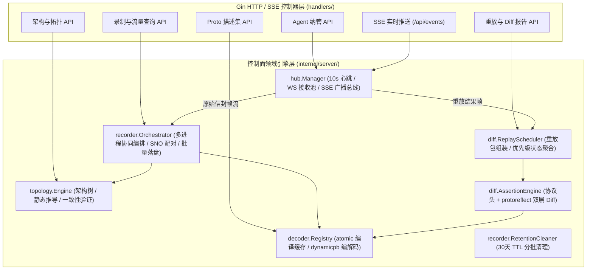
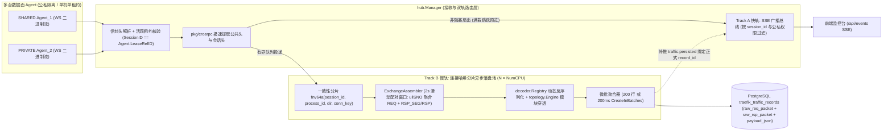

# 业务流量监控与重放 (`code-traefik`) 管理面服务、微前端控制台与回归断言设计

- **文档编号**：`04-control-plane-and-web-console.md`
- **文档版本**：v1.5.0
- **更新日期**：2026-11-02
- **归属阶段**：阶段二：系统架构与数据模型设计 (`02-design`)
- **状态**：已冻结 (Frozen)
- **上位基线**：[`01-feature-matrix.md`](../01-features/01-feature-matrix.md) (v2.9.0)、[`01-system-architecture.md`](./01-system-architecture.md)、[`02-data-plane-and-cros-rpc-engine.md`](./02-data-plane-and-cros-rpc-engine.md)、[`03-architecture-elements-and-topology.md`](./03-architecture-elements-and-topology.md)、[`07-console-ia-restructuring-and-workflow-workbench-adr.md`](../05-adr/07-console-ia-restructuring-and-workflow-workbench-adr.md) (ADR-07)、[`08-recording-drawer-and-process-tree-selection-adr.md`](../05-adr/08-recording-drawer-and-process-tree-selection-adr.md) (ADR-08)、[`09-arch-process-ssot-and-ebpf-premount-standby-adr.md`](../05-adr/09-arch-process-ssot-and-ebpf-premount-standby-adr.md) (ADR-09)

---

## 1. Server 控制面核心服务与调度编排 (`internal/server`)



### 1.1 多 Agent 信封路由与双轨分发管道 (`hub.Manager` & `recorder.Orchestrator`)

当多台公私域 Agent（`SHARED` 或个人 `PRIVATE`）同时处于不同用户的活跃会话时，Server 基于 56B `EnvelopeHeader` 执行租约核验与**「快轨 SSE 实时推送 + 慢轨异步配对双模落盘」**双轨无阻塞分流：



1. **周期心跳、自动预挂补齐 (`Auto-Rearm`)、离线熔断与悬空租约自愈**：
   - 后台协程按 `10s` 间隔并发探活所有已登记 Agent（`GET /agent/v1/handshake`，超时 `3s`），刷新 `status = 'ONLINE'`、`last_heartbeat_at`，核对 `ActiveLeaseType / ActiveRefID` 与预挂载摘要 `ArmedDigest`；
   - **默认自动预挂对账**：当在线且空闲（`lease_type == ''`）的 Agent 返回的 `ArmedDigest` 与数据库中 `probe_desired_state = 'ARMED'` 的挂载规格不一致（例如 Agent 首次上线、重启 `BootID` 刷新或架构进程默认端口变更）时，`hub.Manager` 自动调用 `PUT /agent/v1/monitors/arm` 补齐待命探针并更新 `traefik_processes` 就绪诊断列；
   - 连续 **3 个周期（30s）** 探活失败则将数据库状态切换为 `OFFLINE`，**自动释放该 Agent 上残留的排他租约**并将关联录制批次或重放任务置为异常终止，防止团队共享 Agent 发生死锁挂死。
2. **Track A 快轨（前端 SSE 实时预览推送）**：
   - 为每个已认证订阅者分配容量为 `128` 的缓冲 Channel；推送前严格校验订阅者对目标 `session_id` 的访问权（`PRIVATE` 批次仅推送给 `owner_id` 本人及 `traefik_admin`）；
   - Channel 瞬时满载时仅跳过实时预览通知，绝不反向阻塞 WebSocket 读取协程与 Track B 落盘管道，确保端到端呈现延迟 `<= 1s`。

### 1.2 预挂就绪零重启录制编排与无损+结构化双模落盘流水线 (`recorder.Orchestrator`)

1. **多进程排他租约获取、零重启采集闸门与停录不断连**：
   - 校验发起人对所选 `target_process_ids` 所属 Agent 的访问权（普通用户可组合本人 `PRIVATE` Agent 与当前空闲的 `SHARED` Agent），按 `agent_id` 升序调用 `AcquireAgentLeases` 原子加锁（冲突立即返回 `409 Conflict` 及持锁人信息）；
   - 并发调用各 Agent `PUT /agent/v1/monitors/sync` 下发 `[]ProcessMonitorSpec`：对已处于 `ARMED` 预挂待命态的进程直接 **0ms 原子置 `session_id = S` 开启采集闸门（零进程重启）**，对处于 `DISARMED` 的进程自动兜底临时挂载，汇总诊断结果写入 `traefik_recording_sessions.process_diagnostics`；
   - 录制正常结束或触发上限时，调用 `POST /agent/v1/monitors/:sessionId/stop` 将 `session_id` 拨回 `0` **无损回退至 `ARMED` 待命（不断开 `EgressProxy` 业务长连接）**，并在统一收尾函数中原子释放全部 Agent 租约。
2. **双阈值自动停录守卫**：
   - 内存原子维护当前批次 `capturedFrames` 与启动定时器 `time.AfterFunc(MaxDuration)`（默认 `30 分钟` / `100,000 帧`）；任一阈值触发时自动向全部参与 Agent 发送 `/stop`、刷空配对窗口并释放租约，状态落盘为 **`COMPLETED_BY_LIMIT`**。
3. **Track B 慢轨：连接内 `ullSNO` 往返配对与双模归档 (`ExchangeAssembler`)**：
   - **无锁分片亲和**：按 `(session_id, process_id, direction, conn_key)` 哈希路由至固定 Worker，保证同一 TCP 连接上的 `REQ`、`RSP_SEG` 与 `RSP` 100% 由同一协程串行处理；
   - **单行往返聚合规则（Exchange-per-Row，目标吞吐 `>= 2000 帧/s`）**：
     - **`ONEWAY` 单向请求**（`ucMsgType == 2 && ucReqType == 3`）：无需等待应答，直接组装 `raw_req_packet = frame`、`raw_rsp_packet = nil`、`payload_json = {"req": reqObj, "rsp": null}`；
     - **标准 `UNARY` 与多段流式 `STREAM_RSP`**：收到 `REQ` 时暂存至 Worker 本地 `pendingMap[(process_id, direction, conn_key, sno)]`；后续收到 `ucMsgType == 4 (RSP_SEG)` 时按序追加分片字节至 `rspBuf` 并递增 `rsp_seg_count`；收到终结帧 `ucMsgType == 3 (RSP)` 时弹出配对项，无损拼接 `raw_rsp_packet`（可通过 `crosrpc.SplitFrames` 零歧义逐片还原），组装 `payload_json = {"req": reqObj, "rsp": rspObjOrSegArray}`，并精确计算微秒级往返耗时 `latency_us = (rspCapturedAtNs - reqCapturedAtNs) / 1000`；
     - **自适应配对超时与孤立帧兜底**：
       - 滑动配对超时时间基于报文会话头动态计算：取 `max(ReqHead.uiTimeOutSecondLimit, 30s)`；
       - 若收到 Agent 投递的 `EVENT_CONN_CLOSED` 连接关闭事件，立即刷空该连接的所有挂起请求，置为 `exchange_type = 'REQ_ONLY'` 落盘；
       - 连接中途切入捕获到的无头孤立应答以 `exchange_type = 'RSP_ORPHAN'` 落盘（`raw_req_packet = nil`）；连接管理帧以 `exchange_type = 'MNG'` 归档；
       - 每个 Worker 设立最大 `10000` 条挂起请求预算，防止慢连接恶意泄漏内存；
   - **微批写入**：每凑满 `200` 条往返记录或每 `200ms` 触发一次 GORM `CreateInBatches` 分区表写入。

### 1.3 跨 Agent 同构重放调度器与多请求明细持久化 (`diff.ReplayScheduler`)

1. **权限、同构兼容性与排他租约三重前置门禁**：
   - 校验选定的 `INGRESS` 往返记录均属于同一 `session_id` 与同一源进程 `source_process_id`，且 `is_replayable == true`（`raw_req_packet` 非空且未被 4MB 截断）；
   - 调用 `topology.ValidateReplayProcessCompatibility` 校验发起人对录制素材（`SHARED` 或本人 `PRIVATE`，管理员可全团队重用）及目标进程 `target_process_id` 所属 Agent 的权限，并验证 `target_process_id` 完整承载选定请求命中的全部公共架构模块（支持将公共回归流量投递至开发者个人 `PRIVATE` Agent 上的同构本地进程，或当前空闲的 `SHARED` Agent 进程）；
   - 对目标进程所属 Agent 获取 `REPLAY` 排他租约（若该 Agent 正在被录制或重放占用则立即返回 `409 Conflict`）。
2. **重放生命周期状态机与流式切片下发**：
   - **状态机流转**：`PENDING`（初始创建） -> `ARMED`（向 Agent 下发重定向规格与 Mock 预加载完成，此时提示 A-01 引导重启或重连） -> `INJECTING`（连接建立，按序注入请求切片） -> `COMPLETED / CANCELLED / FAILED`；
   - **单次扫描流式组装**：直接从 `traefik_traffic_records` 提取选定记录的 `raw_req_packet` 作为注入帧，并关联对应的局部 ScopedMock 集合及全局兜底 Mock 集合（严格过滤截断帧与 REQ_ONLY 帧），采用二进制分片流下发 Agent；
   - **双轨可靠回收与独立明细持久化**：
     - 重放执行进度与结果通过 WebSocket `EVENT_REPLAY_ITEM_DONE` 实时推送，同时支持通过 `GET /agent/v1/replays/:taskId/result` 幂等拉取；
     - 每条请求重放回收的实际原始应答帧（`actual_rsp_packet` bytea）及双层比对结果独立持久化至 **`traefik_replay_items`** 表，支持前端标准服务端分页查询与历史多次比对！
3. **多请求状态聚合优先级定律**：
   单条请求及整包重放任务的最终 `result_status` 严格遵循以下全序优先级取最高异常级别：

   $$\text{ERROR} \succ \text{TIMEOUT} \succ \text{MOCK\_MISS} \succ \text{FAILED} \succ \text{PASS}$$

### 1.4 历史流量保留期自动清理器 (`recorder.RetentionCleaner`)

每 `6 小时` 巡检一次超过保留期（默认 `30 天`，配置项 `traffic.retention_days`）且非活跃状态的录制批次，按每批 `5000` 行分批删除关联流量记录与过期会话，避免长事务锁表，并通过 `commonAudit.Push` 写入一条系统级清理审计记录。

---

## 2. IDL 描述集引擎与 `dynamicpb` 动态编解码 (`internal/server/decoder`)

### 2.1 `.pb` 描述集注册校验与多版本热切换

1. **上传校验流水线**：
   - 通过 `http.MaxBytesReader` 强制限制上传流 `<= 4MB (4,194,304 Bytes)`；
   - `proto.Unmarshal` 解析为 `descriptorpb.FileDescriptorSet`，再经 `protodesc.NewFiles(fds)` 构建完整 `protoregistry.Files` 验证依赖闭包合法性（损坏或缺失 import 依赖返回 `400 Bad Request`）；
   - 遍历全部 `FileDescriptor.Services()` 与 `ServiceDescriptor.Methods()`，严格按 **`service_name = string(file.Package()) + "-" + string(svc.Name())`**（无 `package` 时使用 `string(svc.Name())`）与 **`operation = string(method.Name())`** 生成操作映射行；
   - 同名描述集（`name` 相同）每次上传自动递增 `version = max(version) + 1`。
2. **激活冲突门禁 (`ActivateSchemaVersion`)**：
   - 激活某版本前，在事务内查询该版本的所有 `(service_name, operation)` 是否与**其他名称下当前已激活 (`is_active = true`)** 的描述集存在交集；若冲突则立即回滚并返回 `409 Conflict` 及冲突接口明细；
   - 校验通过后，将同名旧版本置为 `is_active = false`，目标版本及旗下 `traefik_proto_operations` 置为 `is_active = true`，并原子重建内存无锁注册表 `atomic.Pointer[CompiledRegistry]`。

### 2.2 动态编解码与历史版本不可变契约

- **动态解码 (`DecodePayloadToJSON`)**：按 `(serviceName, operation, msgType)` 查找生效的 `protoreflect.MessageDescriptor`，实例化 `dynamicpb.NewMessage(desc)` 执行 `proto.Unmarshal(payload)`，再以 `protojson.MarshalOptions{UseProtoNames: true, EmitUnpopulated: false}` 序列化为标准 JSON（注：ProtoJSON 标准自动将 64 位整数编码为十进制字符串，天然杜绝前端 JS `Number.MAX_SAFE_INTEGER` 精度截断）。
- **无映射优雅降级**：若未注册对应 `.pb` 或二进制反序列化失败，保留完整 CROS RPC 头解析结果，将 `decode_status` 置为 `NO_SCHEMA_RAW_HEX` 或 `DECODE_ERR_RAW_HEX`，前端自动切换纯 Hex 视图，绝不中断采集链路。
- **历史不可变与按需重解码**：落盘时快照记录当时使用的 `(schema_id, schema_version)`；后续切换 `.pb` 生效版本不会隐式篡改历史记录，用户可在流量详情抽屉显式点击「使用当前生效版本重新解码」。

### 2.3 消息体参数定义字典树反射与源文件导出 (`F-03.2`, `F-03.4`)

为彻底解决“请求/应答参数定义不可见”与“描述集黑盒无法导出”的痛点，控制面提供基于 `protodesc` 的动态字典树反射服务：

1. **服务端动态字典树递归反射 (`ExtractMessageFieldTree`)**：
   - 给定 `ProtoOperation` 的 `req_message_full_name` 或 `rsp_message_full_name`，由 `Registry` 从缓存的 `protoregistry.Files` 查找目标 `protoreflect.MessageDescriptor`；
   - 递归遍历其包含的全部 `protoreflect.FieldDescriptor`，提取出结构化的 `ProtoFieldNodeDTO`：
     - `name`: 字段名（Proto 原名，如 `server_time`、`order_id`）；
     - `json_name`: JSON 序列化名（如 `serverTime`）；
     - `tag_number`: 字段编号（如 `#1`、`#2`）；
     - `kind`: 字段基本数据类型（`INT64`、`STRING`、`BOOL`、`MESSAGE`、`ENUM`、`BYTES` 等）；
     - `cardinality`: 规则修饰（`OPTIONAL`、`REQUIRED`、`REPEATED`）；
     - `is_map`: 是否为 Map 键值映射；
     - `comments`: 源码注释（自动提取 `SourceCodeInfo` 中的 `leading_comments` 与 `trailing_comments`）；
     - `children`: 针对子 Message 递归提取子字段集合（内置防循环引用深度截断，最大深度 12 层）；
     - `field_path`: 预计算的标准点分路径（如 `header.server_time`、`items[*].create_time`）。
2. **描述集源文件树透视与原文件导出**：
   - 提取 `FileDescriptorSet` 内包含的全部 `.proto` 源文件名（如 `account.proto`、`common.proto`）及各自声明的 `Service` / `Message` 清单；
   - 提供 `GET /api/proto-schemas/:id/download` 原始二进制流下载接口，附带 `Content-Disposition: attachment; filename="<schema_name>_v<ver>.pb"`，便于开发本地使用 `protoc` 或 `grpcurl` 排查。

### 2.4 可视化 Diff 忽略字段规则与三级优先级继承模型 (`F-03.3`)

在流量回归对比场景中，动态变化的时间戳、随机请求流水号与签名必须精准豁免比对，传统手工输入路径容易发生拼写与大小写错误：

1. **点分路径与通配符生成规则**：
   - 单层字段：`fieldName`（如 `server_time`）；
   - 嵌套对象：`parent.child`（如 `header.timestamp`）；
   - 数组/列表元素：`array[*].field`（如 `orders[*].trace_token`）；
   - 忽略整个对象/子树：`data.debug_info`。
2. **三级优先级合并继承模型**：
   当回归 Diff 引擎比对单次 RPC 应答时，最终生效的忽略路径集合由三级合并计算：
   $$\text{FinalIgnorePaths} = \text{ReplayTask.ExtraIgnorePaths} \cup \text{Operation.DiffIgnorePaths} \cup \text{ModuleService.DiffIgnorePaths}$$
   - **L1 任务级临时忽略 (`ReplayTask.ExtraIgnorePaths`)**：发起单次重放任务时用户临时附加的针对性忽略项；
   - **L2 方法级精准忽略 (`ProtoOperation.DiffIgnorePaths`)**：在契约工作台字段树上可视化勾选、并持久化至 `traefik_proto_operations` 的方法级专属规则；
   - **L3 服务级全局默认 (`ModuleService.DiffIgnorePaths`)**：在架构中心供给服务上配置的服务级通用忽略规则（如公共网关头 `header.*`）。

---

## 3. 协议头级 + Protobuf 语义字段级双层回归 Diff 引擎 (`internal/server/diff`)

双层回归断言引擎对每条重放请求的录制基线应答组（`Expected`）与实际回收应答组（`Actual`）执行递进式精准比对：

### 3.1 第一层：CROS RPC 协议头与载荷字节快速比对

| 比对项 | 比对策略 | 差异判定结果 |
| :--- | :--- | :--- |
| **分片数量与类型** | 比对帧序列长度、`ucMsgType`（`RSP` vs `RSP_SEG`）、`usRspMsgNo`、`isPacked` | 不一致直接标记头层 `FAILED` |
| **业务返回状态码** | 比对 `uiStatusCode` 及 V4 `ullStatusCode`（例如 `0` 突变为错误码） | 不一致直接标记头层 `FAILED` 并高亮状态码字段 |
| **固定豁免头字段** | 服务端时间戳 `ullServerRecvTime`、`ullServerSendTime`、扩展头 `ullServerEnqueueTime`，以及客户端运行态回显 `ullSNO`、`aucTraceBuff`、`ullClientSendTime` | **永久豁免，不参与相等性断言** |
| **Payload 原始字节** | `bytes.Equal(expectedPayload, actualPayload)` | 若完全相等且头层通过，直接短路返回 **`PASS`**（跳过第二层开销） |

### 3.2 第二层：`protoreflect` 类型感知语义树 Diff 算法

当第一层协议头一致但 `Payload` 原始字节存在差异时（例如 `map` 序列化字节顺序不同、或包含被忽略的动态业务字段、或发生真实业务数值突变），触发第二层语义比对：

1. **无 `.pb` 映射降级**：直接计算并返回 `ByteDiffSummary`（期望长度、实际长度、首个差异字节偏移量 `FirstDiffOffset` 及前后 32B Hex 切片），判定为 `FAILED`。
2. **有 `.pb` 映射递归语义比对 (`DiffProtoMessages`)**：
   - **严格快照 Schema 版本锁定**：解码 `Actual` 原始载荷时，必须严格使用录制基线记录所归档的 `(schema_id, schema_version)`，杜绝因管理员激活新 IDL 版本导致回归基线漂移；
   - 将 `Expected` 与 `Actual` 分别反序列化为 `dynamicpb.Message`；
   - **未知字段防漏判机制**：通过 `protoreflect.Message.GetUnknown()` 提取双方原始载荷中未在当前 `.pb` 中声明的额外 Tag 字段；若 `Actual` 存在非空未知字节而 `Expected` 没有，记录 `FieldPath = "<unknown_fields>"`，判定为 **`FAILED`**（提示新代码引入了未备案的扩展字段，防止漏判）；
   - 合并生效忽略规则集合：`IgnoreMatcher = CompilePaths(Interface.DiffIgnorePaths ∪ Task.ExtraIgnorePaths)`（支持点分路径如 `header.server_time` 与数组通配路径如 `orders[*].trace_token`）；
   - 递归遍历 `Expected` 与 `Actual` 中所有被设置（`Has(fd)`）的 `protoreflect.FieldDescriptor`：
     - 若当前 `fieldPath` 命中 `IgnoreMatcher`，直接跳过；
     - **`fd.IsMap()`（无序键值语义，F-14.5）**：提取双方全部 Map Key 集合并排序遍历，仅当某 Key 缺失、多出或对应 Value 递归不等时记录 `FieldPath = path + "[" + keyStr + "]"`，**彻底免疫 Go/C++ Map 迭代乱序导致的字节差异**；
     - **`fd.IsList()`（`repeated` 严格保序语义，F-14.5）**：按索引 `i = 0 .. max(lenExp, lenAct)-1` 逐位比对，索引错位或长度不等均记录 `FieldPath = fmt.Sprintf("%s[%d]", path, i)`；
     - **嵌套 `MessageKind`**：拼接 `path + "." + string(fd.Name())` 递归下钻；
     - **标量与枚举类型**：精确比较原始值（浮点数处理 `-0.0 == +0.0` 与 `NaN`）。
   - **最终裁决**：若过滤忽略路径与 Map 顺序噪声后 `len(fieldDiffs) == 0`，则该请求最终裁决为 **`PASS`**！否则裁决为 **`FAILED`** 并输出完整 `[]FieldDiff`。

```go
package diff

type FieldDiff struct {
	FieldPath string `json:"field_path"` // 如 "pricing.discount_cents" 或 "items[2].sku_id"
	DiffKind  string `json:"diff_kind"`  // "MODIFIED" | "ADDED" | "REMOVED"
	Expected  any    `json:"expected"`   // 64 位整数统一格式化为 string 防前端精度丢失
	Actual    any    `json:"actual"`
}
```

---

## 4. 微前端控制台架构与组件设计 (`frontend/src/`)

### 4.1 模块联邦导出契约、三层频次菜单与路由矩阵 (`ADR-07`)

前端通过 `vite.config.ts` 固定 `base: '/traefik/'`，向外暴露 `./App` 与 `./menu`（`traefikMenuConfig`）。菜单体系严格按**操作频次金字塔**与**动态作业 / 静态基线 / 环境治理解耦原则**划分为 **3 个菜单组、8 个精炼菜单项**（默认落地页为 `/record`），`StandaloneShell` 独立调试侧边栏直接消费 `traefikMenuConfig` 渲染以保持单一真实源：

| 菜单分组 | 菜单名称 | 子路由路径 (`MODULE_BASE_PATH = '/traefik'`) | 页面组件 | 可见角色 | URL Search Params 状态同步项 |
| :--- | :--- | :--- | :--- | :---: | :--- |
| **流量作业** *(置顶高频)* | **流量录制** *(默认首页)* | `/record` | `RecordingWorkbenchPage` | 全体登录用户 | `scope` (`SHARED` \| `PRIVATE`), `status`, `search`, `auto_start` (`1`), `agent_id`, `page`, `page_size` |
| **流量作业** | **流量调试** | `/debug` | `TrafficDebugWorkbenchPage` | 全体登录用户 | `session_id`, `live` (`1`), `direction`, `exchange_type`, `service_name`, `operation`, `sno`, `trace_id`, `has_error` (`true`), `is_replayable`, `keyword`, `page`, `page_size` |
| **流量作业** | **流量重放** | `/replay` | `ReplayWorkbenchPage` | 全体登录用户 | `session_id`, `auto_create` (`1`), `target_process_id`, `status`, `page`, `page_size` |
| **架构与契约** *(静态基线)* | **架构拓扑** | `/topology` | `TopologyWorkbenchPage` | 全体登录用户 | `view` (`LOGICAL` \| `PHYSICAL`), `depth`, `session_id`, `focus` |
| **架构与契约** | **架构元素** | `/architecture` | `ArchitectureWorkbenchPage` | 全体登录用户 | `tree` (`logical` \| `physical`), `subsystem_id`, `group_id`, `module_id`, `proc_group_id`, `arch_process_id` |
| **架构与契约** | **Proto 契约** | `/schemas` | `ProtoSchemaWorkbenchPage` | 全体登录用户 | `schema_id`, `active_only`, `search`, `page`, `page_size` |
| **环境与治理** *(沉底低频)* | **Agent 与进程** | `/agents` | `AgentManagementPage` | 全体登录用户 | `scope` (`SHARED` \| `PRIVATE`), `agent_id`, `process_id`, `open_mount` (`1`), `lease_state`, `status`, `page`, `page_size` |
| **环境与治理** | **模块参数配置** | `/admin/settings` | `AdminSettingsPage` | `traefik_admin` (`adminOnly`) | - |

* **历史深链平滑重定向契约（100% 无损保留 Query 参数）**：
  - `/`、`/traefik`、`/traefik/`、`/sessions` $\rightarrow$ `replace` 重定向至 `/record`；
  - `/traffic?...` $\rightarrow$ `replace` 重定向至 `/debug?...`（完整继承 `session_id`、`trace_id`、`sno` 等检索参数）；
  - `/architecture?tab=topology|verify&...` $\rightarrow$ `replace` 重定向至 `/topology?...`；`/architecture?tab=physical&...` $\rightarrow$ `replace` 重定向至 `/topology?view=PHYSICAL&...`。

> **通用分页硬约束**：所有分页列表统一复用 `@code/common` 的 `Pagination` 与 `usePaginationState`（同步至 `useSearchParams`），每页条数选项固定为 **`15 / 25 / 50 / 100`（默认 `25`）**，控件布局严格为 `[首页] [上一页] [5页连续数字滑动窗口] [下一页] [末页] [条/页下拉框]`。

### 4.2 核心工作台 React 组件分层树

```text
src/
├── components/
│   ├── ArchCanvas/                         # 通用分层复合架构拓扑引擎 (React Flow v12 + ELK Inline Worker)
│   │   ├── ArchCanvas.tsx                  # 视口底座 (.code-arch-canvas 作用域 / 平移缩放 / 小地图 / LOD 类名)
│   │   ├── ArchCanvas.css                  # 100% --color-* Token 样式及 .react-flow__* 亮暗主题覆写
│   │   ├── layout/
│   │   │   ├── elk.worker.ts               # ELK 复合图分层正交排版内联 Worker (?worker&inline)
│   │   │   └── useElkLayout.ts             # 父先于子拓扑序、跨层拐点全局坐标换算、锚点保持与拖拽 SmoothStep 退化
│   │   ├── model/
│   │   │   ├── hierarchy.ts                # 树索引、祖先物化路径与 LCA (最近公共祖先) 纯函数
│   │   │   ├── rollup.ts                   # 纯前端边汇总 (rep)、动态 VIOLATION/UNATTRIBUTED 融合与最差状态收敛
│   │   │   └── metrics.ts                  # Tarjan SCC 循环依赖分析与扇入扇出统计
│   │   ├── nodes/
│   │   │   ├── ContainerNode.tsx           # 矩形嵌套容器 (子系统/功能组/进程组/物理进程，支持双击下钻)
│   │   │   ├── ModuleLeafNode.tsx          # 功能模块叶子卡片 (未装载虚线告警)
│   │   │   └── ExternalNode.tsx            # 外部系统/外部端点/未登记接口卡片
│   │   ├── edges/
│   │   │   └── RollupEdge.tsx              # 正交折线汇总边 (对数线宽、六分类着色、脉冲告警与拖拽自适应)
│   │   └── panels/
│   │       ├── ArchCanvasToolbar.tsx       # 工具栏: 逻辑/物理切换、L0~Ln 层级滑杆、自动展开开关、批次选择与重置布局
│   │       ├── ArchSummaryBar.tsx          # 一致性比对六分类摘要栏与待定归属待办入口
│   │       ├── NodeInspectDrawer.tsx       # 选中节点属性画像与 PROVIDE/DEPEND 快速跳转抽屉
│   │       └── EdgeDetailDrawer.tsx        # 汇总边底层契约明细与一致性抽样报文联动抽屉
│   └── PacketAnatomyDrawer/                # 公共四段式 CROS RPC 深度解剖抽屉 (供流量调试台与拓扑一致性边共同复用)
│       ├── PacketAnatomyDrawer.tsx         # 单条往返内「请求帧 REQ <-> 应答帧 RSP」零延迟切换外壳 (+单包重放调试动作插槽)
│       ├── CommHeadBitmapCard.tsx          # ① 24B 公共头字节偏移位图可视化卡片
│       ├── SessionHeadDetailCard.tsx       # ② 会话头版本识别、字段表与客户端/服务端耗时拆解条
│       ├── ExtendHeadTraceCard.tsx         # ③ DOTR TraceID/SpanID/FatherSpanID 链路跳转与入队等待耗时
│       └── PayloadJsonHexSplitView.tsx     # ④ 左栏 payload_json.{req|rsp} 树 <-> 右栏 raw_{req|rsp}_packet 16B 对齐 Hex 对照
├── pages/
│   ├── RecordingWorkbenchPage/             # 1. [流量作业] 流量录制工作台 (/record - 默认落地页)
│   │   ├── ActiveRecordingBanner.tsx       # 活跃录制状态卡: 实时帧计数、A-01 存量长连接重连告警、一键停录与【实时跟流调试】
│   │   ├── RecordingStartDrawer.tsx        # 发起协同录制抽屉(680px Drawer): 卡片式作用域、Agent 在线/租约防呆与预挂就绪分组进程树
│   │   └── RecordingSessionTable.tsx       # 录制素材分页台账表: 展示进程/帧数/归属，内置 [去调试] [发起重放] [架构验证] [发布共享] [删除]
│   ├── TrafficDebugWorkbenchPage/          # 2. [流量作业] 流量调试工作台 (/debug - 兼容 /traffic 重定向)
│   │   ├── DebugSessionContextBar.tsx      # 调试上下文顶栏: 录制批次切换、活跃批次脉冲提示与 SSE 实时跟流暂停/继续控制
│   │   ├── LiveTrafficFilterForm.tsx       # 多维 URL 筛选器: Service/Operation/ullSNO/TraceID/方向/has_error(仅看异常)/关键字
│   │   ├── TrafficRecordTable.tsx          # 往返报文主表: 点击唤起四段解剖，可重放 INGRESS 行挂载【单包调试】快捷入口
│   │   └── SinglePacketReplayDrawer.tsx    # 单包快速重放调试抽屉: 过滤同构目标进程 -> 一键触发单条 ReplayTask -> 原地呈现双层 Diff 与 Mock 明细
│   ├── ReplayWorkbenchPage/                # 3. [流量作业] 流量重放工作台 (/replay)
│   │   ├── ReplayTaskCreatorModal.tsx      # 批量同构重放创建弹窗 (支持 URL ?session_id=X&auto_create=1 自动预选唤起)
│   │   ├── ReplayTaskTable.tsx             # 重放任务台账表 (PASS/FAILED/MOCK_MISS/TIMEOUT/ERROR 全序裁决)
│   │   └── ReplayReportDrawer/             # 双层回归 Diff 报告抽屉 (HeaderAssertionCard + ProtoFieldDiffTable + MockHitMissTimeline)
│   ├── TopologyWorkbenchPage/              # 4. [架构与契约] 架构拓扑工作台 (/topology - 全屏独立画布)
│   │   └── TopologyWorkbenchPage.tsx       # 零外层胶囊 Tab，全视口高度承载逻辑/物理复合拓扑画布与录制批次一致性比对叠加层
│   ├── ArchitectureWorkbenchPage/          # 5. [架构与契约] 架构元素工作台 (/architecture - 左树顶部 [逻辑架构 | 物理进程] 双视图 SSOT)
│   │   ├── SubsystemGroupTreePanel.tsx     # [逻辑架构 ?tree=logical]: 子系统 ➔ 8级功能组 ➔ 功能模块叶子定位与跨层搜索
│   │   ├── ModuleContractDetailPane.tsx    # 模块元数据、归属标准架构进程(跳 ?tree=physical)、挂载血缘(跳 /agents)与 PROVIDE/DEPEND 双表(跳 /schemas)
│   │   ├── ArchProcessTreePanel.tsx        # [物理进程 ?tree=physical]: 标准进程组 (ArchProcessGroup) ➔ 标准业务进程 (ArchProcess) 树与搜索/CRUD
│   │   └── ArchProcessDetailPane.tsx       # 标准架构进程详情: 默认端口(含0纯客户端)/启动特征、组装承载的 FM 模块、汇总服务契约与宿主机挂载就绪血缘
│   ├── ProtoSchemaWorkbenchPage/           # 6. [架构与契约] Proto 契约工作台 (/schemas)
│   │   ├── SchemaUploadModal.tsx           # .pb 上传弹窗（<=4MB 预检、版本备注、自动激活开关）
│   │   ├── SchemaVersionList.tsx           # 描述集资产制品列表（原文件下载导出、包含 Proto 文件透视、架构认领血缘概览）
│   │   ├── OperationMappingTable.tsx       # 两级嵌套折叠表: 外层服务聚合行 (含认领模块深链跳 /architecture) ➔ 内层 RPC 方法子表
│   │   ├── ServiceSummaryRow.tsx           # 外层服务行组件: 服务全名、源 Proto、认领模块、RPC 计数、一键全部折叠/展开
│   │   ├── OperationDocDrawer.tsx          # 契约详情与消息体参数定义抽屉 (双栏/Tab 切换查看 Req/Rsp Message)
│   │   ├── MessageSchemaInspectorTree.tsx  # 消息体参数定义字典树组件 (多层递归展开、Tag、类型高亮、注释透视)
│   │   └── DiffIgnoreFieldToggle.tsx       # 字段级 Diff 忽略复选框与路径自动生成控制器
│   ├── AgentManagementPage/                # 7. [环境与治理] Agent 与进程工作台 (/agents - 1:1 架构进程挂载、本地覆盖与预挂就绪看板)
│   │   ├── AgentScopeTabs.tsx              # 切换「团队公共 Agent (SHARED)」与「我的私有 Agent (PRIVATE)」
│   │   ├── AgentLeaseStatusBadge.tsx       # 实时展示空闲 / 录制占用 / 重放占用，管理员支持强制解锁
│   │   ├── AgentMountedProcessTree.tsx     # 右栏分组进程挂载与就绪树台账: 四色探针就绪灯、[本地已覆盖] 标记、组级/整机暂停恢复与 [前往发起录制 ->]
│   │   └── AgentProcessMountDrawer.tsx     # 挂载架构进程抽屉(680px Drawer): 架构进程树 1:1 勾选、⚡自动扫描宿主机匹配、内联本地覆盖与跳回 /architecture 引导
│   └── AdminSettingsPage.tsx               # 8. [环境与治理] 模块参数配置 (/admin/settings - adminOnly)
```

### 4.3 四段报文解剖抽屉前后端 TypeScript DTO 契约 (`PacketAnatomyDTO`)

由于单行 `TrafficRecord` 同时归档无损 `raw_req_packet`、`raw_rsp_packet` 与结构化 `payload_json: {req, rsp}`，解剖抽屉一次加载即可在请求侧（`reqSide`）与应答侧（`rspSide`）之间零延迟切换。所有 `uint64` 字段在 JSON 契约中统一采用 **`string`**，严禁使用 `any`：

```typescript
// frontend/src/types/traffic.ts

export interface ByteSliceSegment {
  offsetStart: number;       // 起始字节偏移，如 0, 8, 16, 20, 22, 23
  byteLength: number;        // 字节长度
  fieldName: string;         // 如 "unMagicInfo", "ullSNO", "uiLength", "usHeadLen"
  rawHex: string;            // 如 "43 53 45 2E 54 43 50 01"
  displayValue: string;      // 如 '"CSE.TCP" + TCP(1)' 或 "0x000000010009A2B3"
}

/** ① 第一段：24B 公共头偏移位图与校验概览 */
export interface CommHeadAnatomyDTO {
  magicAscii: string;        // "CSE.TCP"
  transportProtocol: number; // 1 = TCP
  transportName: string;     // "RPC_TRANSPORT_TCP"
  snoDec: string;            // uint64 十进制字符串
  snoHex: string;            // "0x000000010009a2b3"
  uiLength: number;
  usHeadLen: number;
  ucMsgType: number;
  msgTypeName: string;       // "RPC_MSG_TYPE_REQ" | "RPC_MSG_TYPE_RSP" | ...
  isPacked: number;
  segments: ByteSliceSegment[]; // 精确覆盖偏移 0..23 的 6 个位图色块
}

/** ② 第二段：多版本会话头明细与阶段耗时计算 */
export interface SessionHeadAnatomyDTO {
  headKind: 'REQ' | 'RSP' | 'MNG';
  detectedVersion: string;   // 如 "V05 (256B)" 或 "V04 (200B)"
  sessionHeadLen: number;
  serviceName: string;       // "{package}-{serviceName}"
  operation: string;
  reqType?: number;          // 1=Sync, 2=Async, 3=Oneway
  uiStatusCode?: number;
  ullStatusCode?: string;
  rspMsgNo?: number;
  traceBuffHex?: string;     // 16B aucTraceBuff Hex
  timingBreakdownUs?: {      // V3+ RSP 自动拆解的微秒级耗时
    clientToServerUs?: number;
    serverProcessUs?: number; // ullServerSendTime - ullServerRecvTime
  };
  fields: Array<{ name: string; offsetRange: string; value: string }>;
}

/** ③ 第三段：0..N 段扩展头（DOTR Trace 与入队时间戳） */
export interface ExtendHeadAnatomyDTO {
  totalExtendBytes: number;
  trace?: {
    traceIdHex: string;      // 点击可一键筛选同批次全链路报文
    spanIdHex: string;
    fatherSpanIdHex: string;
    recordMsgSwitch: number;
  };
  serverEnqueueTime?: string;
  queueWaitUs?: number;      // 入队时间戳与处理开始时间差
  items: Array<{ ucType: number; typeName: string; usHeadLen: number; rawHex: string }>;
}

/** ④ 第四段：Protobuf 动态 JSON 与 16B 对齐 Raw Hex 对照 */
export interface PayloadAnatomyDTO {
  payloadOffset: number;     // 24 + usHeadLen
  payloadLength: number;
  isTruncated: boolean;
  isReplayable: boolean;
  decodeStatus: 'DECODED_JSON' | 'NO_SCHEMA_RAW_HEX' | 'DECODE_ERR_RAW_HEX' | 'TRUNCATED' | 'MNG_RAW';
  schemaName?: string;
  schemaVersion?: number;
  messageFullName?: string;
  decodedJson?: Record<string, unknown> | Array<Record<string, unknown>>; // 支持单包对象或多段 RSP_SEG 数组
  rawFrameHexLines: Array<{  // 基于 raw_req_packet / raw_rsp_packet 按每行 16B 切片对齐生成的对照行
    offsetHex: string;       // "00000018"
    hexCols: string;         // "00 05 01 00 00 00 00 01  64 6f 70 68 69 2e 6f 72"
    asciiCols: string;       // "........dophi.or"
    region: 'COMM_HEAD' | 'SESSION_HEAD' | 'EXTEND_HEAD' | 'PAYLOAD';
  }>;
}

/** 单侧报文四段完整解剖结构（用于 reqSide 或 rspSide） */
export interface FrameSideAnatomyDTO {
  commHead: CommHeadAnatomyDTO;
  sessionHead: SessionHeadAnatomyDTO;
  extendHead: ExtendHeadAnatomyDTO;
  payload: PayloadAnatomyDTO;
  segmentCount: number;      // REQ 恒为 1；STREAM_RSP 为实际拼接的 RSP_SEG + RSP 总段数
}

export interface PacketAnatomyDrawerDTO {
  recordId: string;
  sessionId: string;
  direction: 'INGRESS' | 'EGRESS';
  exchangeType: 'UNARY' | 'STREAM_RSP' | 'ONEWAY' | 'REQ_ONLY' | 'RSP_ORPHAN' | 'MNG';
  roundTripLatencyUs?: number;
  srcModuleName?: string;
  dstModuleName?: string;
  reqSide?: FrameSideAnatomyDTO; // RSP_ORPHAN 时为空
  rspSide?: FrameSideAnatomyDTO; // ONEWAY 或 REQ_ONLY 时为空
}
```

### 4.4 消息体参数定义字典树与契约嵌套表 TypeScript DTO 契约 (`MessageSchemaTreeDTO`)

#### (1) 参数字段字典树节点契约
```typescript
// frontend/src/types/schema.ts

export type ProtoFieldKind =
  | 'INT32' | 'INT64' | 'UINT32' | 'UINT64' | 'SINT32' | 'SINT64'
  | 'BOOL' | 'ENUM' | 'STRING' | 'BYTES'
  | 'FLOAT' | 'DOUBLE' | 'MESSAGE';

export interface ProtoFieldNodeDTO {
  name: string;                // Proto 原名字段，如 "server_time"
  jsonName: string;            // JSON 序列化键，如 "serverTime"
  tagNumber: number;           // 字段编号，如 1, 2
  kind: ProtoFieldKind;        // 数据类型
  typeName?: string;           // 嵌套 Message 或 Enum 的类型全名，如 "dophi.common.Head"
  cardinality: 'OPTIONAL' | 'REQUIRED' | 'REPEATED';
  isMap: boolean;              // 是否为 map<K, V> 映射
  comments?: string;           // 提取自 SourceCodeInfo 的注释
  fieldPath: string;           // 自动计算的规范点分/数组通配路径，如 "header.server_time", "items[*].id"
  isIgnoredInDiff: boolean;    // 当前方法或服务级是否已配置忽略
  children?: ProtoFieldNodeDTO[]; // 针对 MESSAGE 递归展开的子字段树 (最大递归深度 12)
}

export interface OperationSchemaTreeDTO {
  operationId: string;
  serviceName: string;         // "{package}-{serviceName}"
  operation: string;           // "DeductBalance"
  protoFile: string;           // "account.proto"
  clientStreaming: boolean;
  serverStreaming: boolean;
  diffIgnorePaths: string[];   // 当前方法生效的忽略路径清单
  inheritedIgnorePaths: string[]; // 继承自架构服务级的忽略清单
  reqMessage: {
    fullName: string;
    fields: ProtoFieldNodeDTO[];
  };
  rspMessage: {
    fullName: string;
    fields: ProtoFieldNodeDTO[];
  };
}
```

#### (2) 两级嵌套折叠表聚合数据模型
```typescript
export interface ServiceContractGroupDTO {
  serviceName: string;         // 聚合键: "{package}-{serviceName}"
  protoPackage: string;
  protoService: string;
  protoFile: string;
  claimedByModule?: {          // 架构血缘: 认领此服务的公共架构模块
    id: string;
    code: string;
    name: string;
    subsystemName: string;
  };
  totalOperations: number;
  unaryCount: number;
  streamCount: number;
  isActive: boolean;
  operations: ProtoOperation[]; // 展开后的子表数据
}
```

### 4.5 架构物理进程蓝图、Agent `1:1` 挂载就绪与跨工作台流转契约 (`F-15.1`~`F-15.5`, `ADR-09`)

#### (1) 架构物理进程蓝图与 Agent 挂载就绪 TypeScript DTO 契约（零 `any`）
```typescript
// frontend/src/types/arch.ts & frontend/src/types/agent.ts

export type ProbeDesiredState = 'ARMED' | 'DISARMED';

export type ProbeReadinessStatus =
  | 'READY'          // 🟢 eBPF 已预挂 + PID 已定位 + 存量直连连接数 == 0 (随时 0ms 零重启开录)
  | 'NEED_RECONNECT' // 🟡 eBPF 已预挂 + PID 已定位 + 存在预挂前存量直连 (空闲期重连一次即可永久就绪)
  | 'WAITING_PROC'   // 🔵 eBPF 已预挂 + sched_process_exec 待命等待目标进程启动
  | 'MONITORING'     // 🟣 当前正处于活跃录制/重放采集中
  | 'CAP_DENIED'     // 🔴 Agent 缺少 CAP_BPF / CAP_NET_ADMIN 权限
  | 'ERROR'          // 🔴 探针挂载或规则同步异常
  | 'DISARMED';      // ⚪ 用户手动暂停探针或 Agent 离线

export interface ArchProcessGroupDTO {
  id: number;
  code: string;
  name: string;
  sort_order: number;
  description: string;
  processes?: ArchProcessDTO[];
}

export interface ArchProcessDTO {
  id: number;
  group_id: number;
  group?: ArchProcessGroupDTO;
  code: string;                        // 全局唯一标准进程编码，如 "sut-order"
  name: string;                        // 展示名称，如 "订单核心服务进程"
  default_listen_port: number;         // 0..65535 (0 表示纯客户端无监听端口)
  default_cmd_pattern: string;         // 默认 /proc/<pid>/cmdline 匹配特征
  default_extra_downstreams: string[]; // 默认补充下游 ["IP:Port"]
  sort_order: number;
  description: string;
  modules?: ArchModuleSummaryDTO[];    // 架构层唯一组装承载的 FM 功能模块集合 (1:N)
  mount_count?: number;                // 已被宿主机 Agent 挂载的实例数
}

export interface AgentProcessMountDTO {
  id: number;                          // traefik_processes.id
  agent_id: number;
  arch_process_id: number;             // UNIQUE(agent_id, arch_process_id) 单机严格 1:1
  arch_process?: ArchProcessDTO;
  // 有效继承值（方便三工作台分组进程树统一渲染）
  group_id: number;
  group_name: string;
  code: string;
  name: string;
  listen_port: number;                 // EffectiveListenPort = override_listen_port ?? default_listen_port
  cmd_pattern: string;                 // EffectiveCmdPattern = override_cmd_pattern || default_cmd_pattern
  // 本地覆盖配置（为空/null 表示完全继承架构蓝图默认基线）
  has_override: boolean;
  override_listen_port: number | null;
  override_cmd_pattern: string;
  advertise_ip: string;
  extra_downstreams: string[];
  description: string;
  // eBPF 默认自动预挂与实时就绪诊断快照
  probe_desired_state: ProbeDesiredState;
  probe_status: ProbeReadinessStatus;
  resolved_pid: number;
  established_conns: number;
  need_reconnect: boolean;
  diag_message: string;
  last_diag_at?: string;
}
```

#### (2) 「架构进程定义 ➔ Agent 挂载与自动预挂就绪 ➔ 秒级零重启录制」三台同构树动线
- **`架构元素` (`/architecture?tree=physical`) 定义蓝图**：左栏顶部分段开关切换 `[逻辑架构 | 物理进程]`；在 `物理进程` 树中由 `traefik_admin` 统一维护 `ArchProcessGroup ➔ ArchProcess`、默认端口/启动特征及 `FM` 模块组装；点击任一组装模块可切回 `?tree=logical&module_id=M`，点击服务契约跳 `/schemas?active_only=true&search=<service_name>`，点击下方宿主机挂载血缘跳 `/agents?scope=<scope>&agent_id=<aid>&process_id=<pid>`；
- **`Agent 与进程` (`/agents`) `1:1` 挂载与预挂就绪**：
  - 右栏以同构的 **`ArchProcessGroup ➔ 挂载进程` 分组就绪树 (`AgentMountedProcessTree`)** 取代旧平铺表，实时展示四色探针就绪灯、`[本地已覆盖]` 标记与按进程/组/整机 `暂停探针 / 恢复预挂`；
  - 点击 `[+ 挂载架构进程]` 滑出 **`AgentProcessMountDrawer` (`680px` Drawer)**：呈现完整架构进程树复选框，点击顶部 **`[⚡ 自动扫描宿主机进程并匹配架构树]`** 调用 `/proc` 探查自动匹配点亮 `✨ 本机已探测 (PID · :Port)` 并一键勾选，节点内联支持折叠展开 `⚙ 本地覆盖配置`；若架构树中缺少所需进程，底部横幅直接深链引导至 `/architecture?tree=physical`；保存后在线 Agent 自动触发 `/agent/v1/monitors/arm` 预挂待命；
  - 就绪后点击右栏顶部的 **`[前往发起录制 ->]`** 一键跳转 `/record?auto_start=1&agent_id=<id>` 自动滑出录制抽屉并预选该 Agent；
- **`流量录制` (`/record`) `RecordingStartDrawer` 秒级零重启录制**：复用同一棵分组进程树，实时回显各挂载进程的预挂就绪徽章并自动预勾选已就绪进程；全部 `🟢 READY` 时点击启动即 **0ms 零重启开启采集闸门**。

#### (3) 「录制 ➔ 调试 ➔ 重放 / 架构验证」高频作业闭环动线
- **从 `流量录制` (`/record`) 出发**：
  - 活跃录制进行中时，点击顶部状态卡【实时跟流调试】$\rightarrow$ 跳转 `/debug?session_id=<id>&live=1`，自动开启 SSE `traffic.persisted` 实时订阅；
  - 在录制素材台账表任一行点击 `[去调试]` $\rightarrow$ 跳转 `/debug?session_id=<id>`；点击 `[发起重放]` $\rightarrow$ 跳转 `/replay?session_id=<id>&auto_create=1` 自动唤起 `ReplayTaskCreatorModal`；点击 `[架构验证]` $\rightarrow$ 跳转 `/topology?session_id=<id>` 自动叠加六分类架构一致性报告。
- **在 `流量调试` (`/debug`) 执行单包快速重放调试 (`SinglePacketReplayDrawer`)**：
  - **触发条件**：仅当 `record.direction === 'INGRESS'` 且 `record.is_replayable === true` 时，在表格操作列与 `PacketAnatomyDrawer` 顶栏激活【单包重放调试】按钮；
  - **同构进程智能匹配**：根据该报文来源进程的 `arch_process_id` 或目标模块 `dst_module_id`，从当前用户可见的 `Process` 挂载列表中自动筛选挂载相同 `ArchProcess`（或承载相同公共模块）且有效 `listen_port > 0` 的同构目标进程（优先推荐本人在线空闲 `PRIVATE` Agent 进程，亦支持空闲 `SHARED` Agent 进程）；
  - **零新协议原地闭环**：直接复用 `POST /api/replay-tasks`（`selected_record_ids: [record.id]`），执行完毕后在同一抽屉内原地渲染 `HeaderAssertionCard`、`ProtoFieldDiffTable` 与 `MockHitMissTimeline`。

---

## 5. RBAC 权限矩阵与操作审计接入规范 (RBAC & Audit Governance)

### 5.1 角色权限守卫与公私域防越权矩阵

基于 `code-common/backend/auth` 的 `AuthMiddleware`（登录态校验）、`RequireAdmin("traefik_admin")` 以及资源层 `owner_id` 归属核验，严格划分以下权限边界：

| 业务资源与操作动作 | 免密访客 | 普通认证用户 (JWT) | 模块管理员 (`traefik_admin` / `super_admin`) |
| :--- | :---: | :---: | :---: |
| 健康检查 (`/api/health`) 与认证配置 (`/api/auth/*`) | 允许 | 允许 | 允许 |
| 查看公共三级逻辑架构、**物理进程蓝图 (`ArchProcessGroup / ArchProcess`)**、模块契约、静态拓扑与 `.pb` 映射 | `401` | **允许** | **允许** |
| 新增 / 修改 / 移动 / 删除公共逻辑架构元素、**物理进程组与标准架构进程蓝图**、`.pb` 描述集管理 | `401` | `403` | **允许** |
| 查看公共 `SHARED` Agent、挂载进程就绪灯态并刷新就绪诊断；创建并全权管理**本人 `PRIVATE` Agent**（`1:1` 勾选挂载架构进程、本地覆盖、预挂/暂停探针） | `401` | **允许**（访问或开关他人 `PRIVATE` Agent 探针返 `403`；修改 `SHARED` Agent 挂载配置返 `403`） | **允许**（全团队 `SHARED` 与各用户 `PRIVATE` Agent 均可见；负责管理 `SHARED` Agent 挂载/探针及强制释放异常租约） |
| 租用空闲的 `SHARED` Agent 或本人的 `PRIVATE` Agent **启动/停止录制** | `401` | **允许**（若目标 Agent 已被占用返 `409 Conflict`） | **允许**（同样遵守动态排他租约 `409` 互斥） |
| 查看 `SHARED` 录制素材及**本人的 `PRIVATE` 录制素材**；将本人 `PRIVATE` 素材发布为 `SHARED` 或删除本人 `PRIVATE` 素材 | `401` | **允许**（访问或删除他人 `PRIVATE` 素材返 `403`；删除公共 `SHARED` 素材返 `403`） | **允许**（全团队 `SHARED` 与所有用户的 `PRIVATE` 录制素材均可见与审计；可治理并删除无引用的素材） |
| **跨 Agent 同构离线重放**：选用有权限的 `SHARED` 或本人 `PRIVATE` 素材，投递至空闲 `SHARED` 或本人 `PRIVATE` Agent 的同构挂载进程 | `401` | **允许**（支持投递至本人私有或空闲共享环境，架构进程/模块不匹配返 `400`，Agent 被占用返 `409`） | **允许**（具备跨公私域同构调度与故障恢复特权） |
| 修改模块全局治理参数 (`/api/admin/settings`) | `401` | `403` | **允许** |

### 5.2 `commonAudit` 字段级 Diff 与操作事件审计埋点字典

所有写操作控制器统一调用 `commonAudit.SetAuditContext(c, module, action, level, summary, targetType, targetID, targetName, beforeSnapshot, afterSnapshot)`，由 `commonAudit.Middleware("traefik")` 自动通过 `CalculateDiff` 生成字段级 `OldVal / NewVal` 写入平台共享 `audit_logs` 表：

| 审计子模块 (`module`) | 动作标识 (`action`) | 风险等级 | `before` / `after` 快照策略与必含上下文 |
| :--- | :--- | :---: | :--- |
| `traefik_arch` | `create` / `update` / `move` / `delete` | `P1` (删除) / `P2` | 传入变更前后的 `Subsystem` / `FunctionalGroup` / `Module` / `ModuleService` / `ModuleDependency` / `ArchProcessGroup` / `ArchProcess` 结构体快照 |
| `traefik_agent` | `create` / `update` / `delete` / `sync_mounts` / `toggle_probe` / `force_unlock_lease` | `P1` | 传入 `Agent`（含 `scope`、`owner_id`、`endpoint`）或 `Process` 挂载实例（含 `arch_process_id`、`override_listen_port`、`override_cmd_pattern`、`probe_desired_state`）快照；管理员强制解锁记录原持锁人及原因 |
| `traefik_schema` | `upload` / `activate` / `delete` / `update_op_ignores` | `P1` | 记录描述集 `name`、`version`、`file_sha256`、`is_active` 切换前后版本对比及方法级 `diff_ignore_paths` 变更（剔除大体积 `descriptor_bytes` 二进制字段） |
| `traefik_record` | `start_session` / `stop_session` / `publish_session` / `delete_session` | `P1` | 操作事件审计：记录操作人、`session_no`、`scope`（`SHARED`/`PRIVATE`）、加锁的 `agent_id` 与 `process_id` 列表、停止原因 |
| `traefik_replay` | `execute_replay` / `cancel_replay` | `P2` | 操作事件审计：记录操作人、`task_no`、来源 `(session_id, source_process_id)`、目标 `(agent_id, target_process_id)` 与 `extra_ignore_paths` |
| `traefik_system` | `retention_cleanup` | `P2` | 后台定时任务直接调用 `commonAudit.Push` 记录清理过期批次数量与释放流量行数 |
