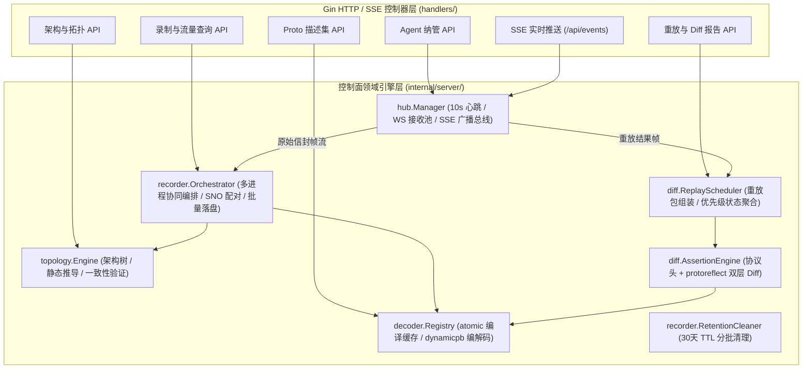

# 业务流量监控与重放 (`code-traefik`) 管理面服务、微前端控制台与回归断言设计

- **文档编号**：`04-control-plane-and-web-console.md`
- **文档版本**：v1.0.0
- **更新日期**：2026-10-29
- **归属阶段**：阶段二：系统架构与数据模型设计 (`02-design`)
- **状态**：已定稿 (Frozen)
- **上位基线**：[`01-feature-matrix.md`](../01-features/01-feature-matrix.md) (v2.5.1)、[`01-system-architecture.md`](./01-system-architecture.md)、[`02-data-plane-and-cros-rpc-engine.md`](./02-data-plane-and-cros-rpc-engine.md)、[`03-architecture-elements-and-topology.md`](./03-architecture-elements-and-topology.md)

---

## 1. Server 控制面核心服务与调度编排 (`internal/server`)



### 1.1 Agent 连接池与事件广播中心 (`hub.Manager`)

1. **周期心跳与离线熔断**：后台单协程按 `10s` 间隔并发探活所有已登记 Agent（`GET /agent/v1/handshake`，单次超时 `3s`）。成功则刷新 `status = 'ONLINE'`、`last_heartbeat_at` 及内核能力快照；连续 **3 个周期（30s）** 探活失败则将数据库状态切换为 `OFFLINE` 并向前端广播状态变更事件。
2. **WebSocket 流管理**：仅当某 Agent 存在活跃录制批次或重放任务时按需维持长连接 `/agent/v1/stream`，空闲时释放连接；异常断线时执行 `500ms -> 5s` 指数退避自动重连。
3. **SSE 实时推送总线 (`/api/events`)**：为每个已认证前端订阅者分配容量为 `128` 的非阻塞缓冲 Channel；满载时执行跳跃合并（仅丢弃瞬时实时预览通知，不影响后端完整落盘），确保从 Agent 采集到前端界面呈现端到端延迟 `<= 1s`。

### 1.2 多进程协同录制编排与高吞吐落盘流水线 (`recorder.Orchestrator`)

1. **跨机多进程批次编排**：
   - 将选定的 `target_process_ids` 按所属 `agent_id` 分组，校验所有涉及 Agent 均处于 `ONLINE`、协议主版本匹配且 `has_ebpf_cap == true`；
   - 并发调用各 Agent `PUT /agent/v1/monitors/sync` 下发 `[]ProcessMonitorSpec`，汇总存量长连接诊断结果写入 `traefik_recording_sessions.process_diagnostics`。
2. **双阈值自动停录守卫**：
   - 内存原子维护当前批次 `capturedFrames` 与启动定时器 `time.AfterFunc(MaxDuration)`（默认 `30 分钟` / `100,000 帧`）；任一阈值触发时自动向全部参与 Agent 发送 `/stop`，批次最终状态落盘为 **`COMPLETED_BY_LIMIT`**。
3. **解析、配对与批量写入流水线（目标吞吐 `>= 2000 帧/s`）**：
   - **Worker Pool 解码**：有界队列分发至 `N = runtime.NumCPU()` 个解析协程，调用 `pkg/crosrpc` 解析完整头部，调用 `decoder.Registry` 动态反序列化 Payload，调用 `topology.Engine` 判定目的与来源模块。
   - **连接内 `ullSNO` 配对器 (`SessionPairTracker`)**：
     - 以 `(process_id, direction, conn_key, sno)` 为关联键维护待配对请求表；
     - 若 `REQ` 的 `ucReqType == 3 (Oneway)`，直接落盘不入表；
     - 收到 `RSP (ucMsgType=3)` 或 `RSP_SEG (ucMsgType=4)` 时，关联同键 `REQ.ID` 填入 `paired_req_id`，并根据采集时间戳差值计算微秒级往返耗时 `latency_us`。
   - **微批聚合落盘**：每凑满 `200` 条记录或每 `200ms` 触发一次 GORM `CreateInBatches`，避免逐帧单条 `INSERT` 打满数据库连接池。

### 1.3 重放调度器与状态优先级折叠规则 (`diff.ReplayScheduler`)

1. **重放资产组装**：
   - 校验选定的 `INGRESS REQ` 记录均属于同一 `session_id` 与 `target_process_id`，且 `is_replayable == true`（未被 4MB 阈值截断）；
   - 自动检索同批次、同进程录制期间采集到的全部 `EGRESS RSP / RSP_SEG` 原始帧及连接级 `MNG` 帧，打包为 `ExecuteReplayReq` 下发目标 Agent。
2. **多请求状态聚合优先级定律**：
   单条请求及整包重放任务的最终 `result_status` 严格遵循以下全序优先级取最高异常级别（同时完整保留每条请求的独立明细）：

   $$\text{ERROR} \succ \text{TIMEOUT} \succ \text{MOCK\_MISS} \succ \text{FAILED} \succ \text{PASS}$$

### 1.4 历史流量保留期自动清理器 (`recorder.RetentionCleaner`)

每 `6 小时` 巡检一次超过保留期（默认 `30 天`，配置项 `traffic.retention_days`）且非活跃状态的录制批次，按每批 `5000` 行分批删除关联流量记录与过期会话，避免长事务锁表，并通过 `commonAudit.Push` 写入一条系统级清理审计记录。

---

## 2. IDL 描述集引擎与 `dynamicpb` 动态编解码 (`internal/server/decoder`)

### 2.1 `.pb` 描述集注册校验与多版本热切换

1. **上传校验流水线**：
   - 通过 `http.MaxBytesReader` 强制限制上传流 `<= 4MB (4,194,304 Bytes)`；
   - `proto.Unmarshal` 解析为 `descriptorpb.FileDescriptorSet`，再经 `protodesc.NewFiles(fds)` 构建完整 `protoregistry.Files` 验证依赖闭包合法性（损坏或缺失 import 依赖返回 `400 Bad Request`）；
   - 遍历全部 `FileDescriptor.Services()` 与 `ServiceDescriptor.Methods()`，严格按 **`service_name = string(file.Package()) + "-" + string(svc.Name())`**（无 `package` 时使用 `string(svc.Name())`）与 **`operation = string(method.Name())`** 生成操作映射行；
   - 同名描述集（`name` 相同）每次上传自动递增 `version = max(version) + 1`。
2. **激活冲突门禁 (`ActivateSchemaVersion`)**：
   - 激活某版本前，在事务内查询该版本的所有 `(service_name, operation)` 是否与**其他名称下当前已激活 (`is_active = true`)** 的描述集存在交集；若冲突则立即回滚并返回 `409 Conflict` 及冲突接口明细；
   - 校验通过后，将同名旧版本置为 `is_active = false`，目标版本及旗下 `traefik_proto_operations` 置为 `is_active = true`，并原子重建内存无锁注册表 `atomic.Pointer[CompiledRegistry]`。

### 2.2 动态编解码与历史版本不可变契约

- **动态解码 (`DecodePayloadToJSON`)**：按 `(serviceName, operation, msgType)` 查找生效的 `protoreflect.MessageDescriptor`，实例化 `dynamicpb.NewMessage(desc)` 执行 `proto.Unmarshal(payload)`，再以 `protojson.MarshalOptions{UseProtoNames: true, EmitUnpopulated: false}` 序列化为标准 JSON（注：ProtoJSON 标准自动将 64 位整数编码为十进制字符串，天然杜绝前端 JS `Number.MAX_SAFE_INTEGER` 精度截断）。
- **无映射优雅降级**：若未注册对应 `.pb` 或二进制反序列化失败，保留完整 CROS RPC 头解析结果，将 `decode_status` 置为 `NO_SCHEMA_RAW_HEX` 或 `DECODE_ERR_RAW_HEX`，前端自动切换纯 Hex 视图，绝不中断采集链路。
- **历史不可变与按需重解码**：落盘时快照记录当时使用的 `(schema_id, schema_version)`；后续切换 `.pb` 生效版本不会隐式篡改历史记录，用户可在流量详情抽屉显式点击「使用当前生效版本重新解码」。

---

## 3. 协议头级 + Protobuf 语义字段级双层回归 Diff 引擎 (`internal/server/diff`)

双层回归断言引擎对每条重放请求的录制基线应答组（`Expected`）与实际回收应答组（`Actual`）执行递进式精准比对：

### 3.1 第一层：CROS RPC 协议头与载荷字节快速比对

| 比对项 | 比对策略 | 差异判定结果 |
| :--- | :--- | :--- |
| **分片数量与类型** | 比对帧序列长度、`ucMsgType`（`RSP` vs `RSP_SEG`）、`usRspMsgNo`、`isPacked` | 不一致直接标记头层 `FAILED` |
| **业务返回状态码** | 比对 `uiStatusCode` 及 V4 `ullStatusCode`（例如 `0` 突变为错误码） | 不一致直接标记头层 `FAILED` 并高亮状态码字段 |
| **固定豁免头字段** | 服务端时间戳 `ullServerRecvTime`、`ullServerSendTime`、扩展头 `ullServerEnqueueTime`，以及客户端运行态回显 `ullSNO`、`aucTraceBuff`、`ullClientSendTime` | **永久豁免，不参与相等性断言** |
| **Payload 原始字节** | `bytes.Equal(expectedPayload, actualPayload)` | 若完全相等且头层通过，直接短路返回 **`PASS`**（跳过第二层开销） |

### 3.2 第二层：`protoreflect` 类型感知语义树 Diff 算法

当第一层协议头一致但 `Payload` 原始字节存在差异时（例如 `map` 序列化字节顺序不同、或包含被忽略的动态业务字段、或发生真实业务数值突变），触发第二层语义比对：

1. **无 `.pb` 映射降级**：直接计算并返回 `ByteDiffSummary`（期望长度、实际长度、首个差异字节偏移量 `FirstDiffOffset` 及前后 32B Hex 切片），判定为 `FAILED`。
2. **有 `.pb` 映射递归语义比对 (`DiffProtoMessages`)**：
   - 将 `Expected` 与 `Actual` 分别反序列化为 `dynamicpb.Message`；
   - 合并生效忽略规则集合：`IgnoreMatcher = CompilePaths(Interface.DiffIgnorePaths ∪ Task.ExtraIgnorePaths)`（支持点分路径如 `header.server_time` 与数组通配路径如 `orders[*].trace_token`）；
   - 递归遍历 `Expected` 与 `Actual` 中所有被设置（`Has(fd)`）的 `protoreflect.FieldDescriptor`：
     - 若当前 `fieldPath` 命中 `IgnoreMatcher`，直接跳过；
     - **`fd.IsMap()`（无序键值语义，F-14.5）**：提取双方全部 Map Key 集合并排序遍历，仅当某 Key 缺失、多出或对应 Value 递归不等时记录 `FieldPath = path + "[" + keyStr + "]"`，**彻底免疫 Go/C++ Map 迭代乱序导致的字节差异**；
     - **`fd.IsList()`（`repeated` 严格保序语义，F-14.5）**：按索引 `i = 0 .. max(lenExp, lenAct)-1` 逐位比对，索引错位或长度不等均记录 `FieldPath = fmt.Sprintf("%s[%d]", path, i)`；
     - **嵌套 `MessageKind`**：拼接 `path + "." + string(fd.Name())` 递归下钻；
     - **标量与枚举类型**：精确比较原始值（浮点数处理 `-0.0 == +0.0` 与 `NaN`）。
   - **最终裁决**：若过滤忽略路径与 Map 顺序噪声后 `len(fieldDiffs) == 0`，则该请求最终裁决为 **`PASS`**！否则裁决为 **`FAILED`** 并输出完整 `[]FieldDiff`。

```go
package diff

type FieldDiff struct {
	FieldPath string `json:"field_path"` // 如 "pricing.discount_cents" 或 "items[2].sku_id"
	DiffKind  string `json:"diff_kind"`  // "MODIFIED" | "ADDED" | "REMOVED"
	Expected  any    `json:"expected"`   // 64 位整数统一格式化为 string 防前端精度丢失
	Actual    any    `json:"actual"`
}
```

---

## 4. 微前端控制台架构与组件设计 (`frontend/src/`)

### 4.1 模块联邦导出契约与路由矩阵

前端通过 `vite.config.ts` 固定 `base: '/traefik/'`，向外暴露 `./App` 与 `./menu`（`traefikMenuConfig`）：

| 菜单分组 | 子路由路径 (`MODULE_BASE_PATH = '/traefik'`) | 页面组件 | 可见角色 | URL Search Params 状态同步项 |
| :--- | :--- | :--- | :---: | :--- |
| **流量与架构** | `/architecture` | `ArchitectureWorkbenchPage` | 全体登录用户 | `tab` (`logical` \| `physical` \| `verify`), `subsystem_id`, `session_id` |
| **流量与架构** | `/traffic` | `TrafficMonitorWorkbenchPage` | 全体登录用户 | `session_id`, `subsystem_id`, `module_id`, `process_id`, `service_name`, `operation`, `sno`, `trace_id`, `page`, `page_size` |
| **流量与架构** | `/replay` | `ReplayWorkbenchPage` | 全体登录用户 | `session_id`, `process_id`, `status`, `page`, `page_size` |
| **流量与架构** | `/schemas` | `ProtoSchemaWorkbenchPage` | 全体登录用户 | `name`, `active_only`, `search`, `page`, `page_size` |
| **模块治理** | `/admin/agents` | `AgentManagementPage` | `traefik_admin` | `status`, `search`, `page`, `page_size` |
| **模块治理** | `/admin/settings` | `AdminSettingsPage` | `traefik_admin` | - |

> **通用分页硬约束**：所有分页列表统一复用 `@code/common` 的 `Pagination` 与 `usePaginationState`（同步至 `useSearchParams`），每页条数选项固定为 **`15 / 25 / 50 / 100`（默认 `25`）**，控件布局严格为 `[首页] [上一页] [5页连续数字滑动窗口] [下一页] [末页] [条/页下拉框]`。

### 4.2 四大核心工作台 React 组件分层树

```text
src/pages/
├── ArchitectureWorkbenchPage/             # 1. 架构中心与拓扑工作台
│   ├── SubsystemGroupTreePanel.tsx        # 左侧：子系统切换 + 8级功能组树（支持拖拽/弹窗移动与防成环提示）
│   ├── ModuleContractDetailPane.tsx       # 中部：功能模块详情、进程部署绑定器、PROVIDE/DEPEND 接口契约表
│   ├── StaticTopologyCanvas.tsx           # 画布：逻辑架构视图 / 物理进程归属视图切换（纯 --color-* Token 渲染）
│   └── ConsistencyVerifyOverlay.tsx       # 验证层：关联录制批次叠加 Verified/Violation/Uncovered/NotObservable/Unattributed
├── ProtoSchemaWorkbenchPage/              # 2. 接口文档与 IDL 描述集工作台
│   ├── SchemaUploadModal.tsx              # .pb 上传弹窗（<=4MB 预检、版本备注）
│   ├── SchemaVersionList.tsx              # 同名描述集多版本时间线与一键生效切换（409 冲突明细展示）
│   ├── OperationMappingTable.tsx          # {package}-{serviceName} 映射检索表 + 接口默认忽略路径编辑器
│   └── OperationDocDrawer.tsx             # 入参/出参 Message 字段树与模块关联抽屉（兼顾 P0 映射详情与 P1 F-18 演进槽位）
├── TrafficMonitorWorkbenchPage/           # 3. 协同录制与流量解剖工作台
│   ├── RecordingSessionBar.tsx            # 批次控制栏：多进程选择器、A-01 存量长连接重连引导横幅、帧数/时长进度条
│   ├── LiveTrafficFilterForm.tsx          # 多维 URL 同步筛选器 + SSE 实时流暂停/继续开关
│   ├── TrafficRecordTable.tsx             # 报文主表（方向徽章、REQ/RSP 配对耗时、穿透源/目模块标签）
│   └── PacketAnatomyDrawer/               # 右侧四段式 CROS RPC 深度解剖抽屉（复用 @code/common Drawer）
│       ├── CommHeadBitmapCard.tsx         # ① 24B 公共头字节偏移位图可视化卡片
│       ├── SessionHeadDetailCard.tsx      # ② 会话头版本识别、字段表与客户端/服务端耗时拆解条
│       ├── ExtendHeadTraceCard.tsx        # ③ DOTR TraceID/SpanID/FatherSpanID 链路跳转与入队等待耗时
│       └── PayloadJsonHexSplitView.tsx    # ④ 左栏 Protobuf JSON 树 <-> 右栏 16B 对齐 Raw Hex + ASCII 对照视图
└── ReplayWorkbenchPage/                   # 4. 离线重放与双层回归断言工作台
    ├── ReplayTaskCreatorModal.tsx         # 选定录制批次、目标进程、勾选 INGRESS 请求与临时追加忽略路径
    ├── ReplayTaskTable.tsx                # 重放任务列表（PASS/FAILED/MOCK_MISS/TIMEOUT/ERROR 状态标签）
    └── ReplayReportDrawer/                # 重放回归报告详情抽屉
        ├── HeaderAssertionCard.tsx        # 第一层协议头断言结果卡片（状态码、消息类型、豁免时间戳说明）
        ├── ProtoFieldDiffTable.tsx        # 第二层语义字段级 Diff 表（FieldPath / Expected / Actual 高亮对比）
        └── MockHitMissTimeline.tsx        # 下游二进制 Mock 命中方式(精确哈希/顺序兜底)、自愈字段回显与 MOCK_MISS 告警表
```

### 4.3 四段报文解剖抽屉前后端 TypeScript DTO 契约 (`PacketAnatomyDTO`)

所有 `uint64` 字段（如 `sno`, `trace_id`, `span_id`, `status_code`, 时间戳）在 JSON 契约中统一采用 **`string`**（十进制或 `0x` 十六进制格式），严禁使用 `any`：

```typescript
// frontend/src/types/traffic.ts

export interface ByteSliceSegment {
  offsetStart: number;       // 起始字节偏移，如 0, 8, 16, 20, 22, 23
  byteLength: number;        // 字节长度
  fieldName: string;         // 如 "unMagicInfo", "ullSNO", "uiLength", "usHeadLen"
  rawHex: string;            // 如 "43 53 45 2E 54 43 50 01"
  displayValue: string;      // 如 '"CSE.TCP" + TCP(1)' 或 "0x000000010009A2B3"
}

/** ① 第一段：24B 公共头偏移位图与校验概览 */
export interface CommHeadAnatomyDTO {
  magicAscii: string;        // "CSE.TCP"
  transportProtocol: number; // 1 = TCP
  transportName: string;     // "RPC_TRANSPORT_TCP"
  snoDec: string;            // uint64 十进制字符串
  snoHex: string;            // "0x000000010009a2b3"
  uiLength: number;
  usHeadLen: number;
  ucMsgType: number;
  msgTypeName: string;       // "RPC_MSG_TYPE_REQ" | "RPC_MSG_TYPE_RSP" | ...
  isPacked: number;
  segments: ByteSliceSegment[]; // 精确覆盖偏移 0..23 的 6 个位图色块
}

/** ② 第二段：多版本会话头明细与阶段耗时计算 */
export interface SessionHeadAnatomyDTO {
  headKind: 'REQ' | 'RSP' | 'MNG';
  detectedVersion: string;   // 如 "V05 (256B)" 或 "V04 (200B)"
  sessionHeadLen: number;
  serviceName: string;       // "{package}-{serviceName}"
  operation: string;
  reqType?: number;          // 1=Sync, 2=Async, 3=Oneway
  uiStatusCode?: number;
  ullStatusCode?: string;
  rspMsgNo?: number;
  traceBuffHex?: string;     // 16B aucTraceBuff Hex
  timingBreakdownUs?: {      // V3+ RSP 自动拆解的微秒级耗时
    clientToServerUs?: number;
    serverProcessUs?: number; // ullServerSendTime - ullServerRecvTime
  };
  fields: Array<{ name: string; offsetRange: string; value: string }>;
}

/** ③ 第三段：0..N 段扩展头（DOTR Trace 与入队时间戳） */
export interface ExtendHeadAnatomyDTO {
  totalExtendBytes: number;
  trace?: {
    traceIdHex: string;      // 点击可一键筛选同批次全链路报文
    spanIdHex: string;
    fatherSpanIdHex: string;
    recordMsgSwitch: number;
  };
  serverEnqueueTime?: string;
  queueWaitUs?: number;      // 入队时间戳与处理开始时间差
  items: Array<{ ucType: number; typeName: string; usHeadLen: number; rawHex: string }>;
}

/** ④ 第四段：Protobuf 动态 JSON 与 16B 对齐 Raw Hex 对照 */
export interface PayloadAnatomyDTO {
  payloadOffset: number;     // 24 + usHeadLen
  payloadLength: number;
  isTruncated: boolean;
  isReplayable: boolean;
  decodeStatus: 'DECODED_JSON' | 'NO_SCHEMA_RAW_HEX' | 'DECODE_ERR_RAW_HEX' | 'TRUNCATED' | 'MNG_RAW';
  schemaName?: string;
  schemaVersion?: number;
  messageFullName?: string;
  decodedJson?: Record<string, unknown>;
  rawFrameHexLines: Array<{  // 后端或前端按每行 16B 切片对齐生成的对照行
    offsetHex: string;       // "00000018"
    hexCols: string;         // "00 05 01 00 00 00 00 01  64 6f 70 68 69 2e 6f 72"
    asciiCols: string;       // "........dophi.or"
    region: 'COMM_HEAD' | 'SESSION_HEAD' | 'EXTEND_HEAD' | 'PAYLOAD';
  }>;
}

export interface PacketAnatomyDrawerDTO {
  recordId: string;
  sessionId: string;
  direction: 'INGRESS' | 'EGRESS';
  pairedRecordId?: string;
  roundTripLatencyUs?: number;
  srcModuleName?: string;
  dstModuleName?: string;
  commHead: CommHeadAnatomyDTO;
  sessionHead: SessionHeadAnatomyDTO;
  extendHead: ExtendHeadAnatomyDTO;
  payload: PayloadAnatomyDTO;
}
```

---

## 5. RBAC 权限矩阵与操作审计接入规范 (RBAC & Audit Governance)

### 5.1 角色权限守卫矩阵

基于 `code-common/backend/auth` 的 `AuthMiddleware`（登录态校验）与 `RequireAdmin("traefik_admin")`（模块管理员或 `super_admin` 放行），严格划分以下权限边界：

| 业务资源与操作动作 | 免密访客 | 普通认证用户 (JWT) | 模块管理员 (`traefik_admin` / `super_admin`) |
| :--- | :---: | :---: | :---: |
| 健康检查 (`/api/health`) 与认证配置 (`/api/auth/*`) | 允许 | 允许 | 允许 |
| 查看三级架构元素、模块契约、静态拓扑与一致性报告 | `401` | **允许** | **允许** |
| 新增 / 修改 / 移动 / 删除子系统、功能组、模块、接口契约 | `401` | `403` | **允许** |
| 查看 Agent 列表、进程部署映射、`.pb` 版本与接口映射列表 | `401` | **允许** | **允许** |
| Agent 纳管增删改、进程探查与进程映射增删改 | `401` | `403` | **允许** |
| 上传 `.pb` 描述集、切换生效版本、修改接口默认忽略字段 | `401` | `403` | **允许** |
| **启动 / 停止多进程协同录制**、删除录制批次与流量数据 | `401` | `403` | **允许** |
| 查看录制批次、流量解剖详情抽屉、触发单条重解码预览 | `401` | **允许** | **允许** |
| **基于已有录制资产发起离线重放**（测试环境 A-06）及查看 Diff 报告 | `401` | **允许** | **允许** |
| 修改模块全局治理参数 (`/api/admin/settings`) | `401` | `403` | **允许** |

### 5.2 `commonAudit` 字段级 Diff 与操作事件审计埋点字典

所有写操作控制器统一调用 `commonAudit.SetAuditContext(c, module, action, level, summary, targetType, targetID, targetName, beforeSnapshot, afterSnapshot)`，由 `commonAudit.Middleware("traefik")` 自动通过 `CalculateDiff` 生成字段级 `OldVal / NewVal` 写入平台共享 `audit_logs` 表：

| 审计子模块 (`module`) | 动作标识 (`action`) | 风险等级 | `before` / `after` 快照策略与必含上下文 |
| :--- | :--- | :---: | :--- |
| `traefik_arch` | `create` / `update` / `move` / `delete` | `P1` (删除) / `P2` | 传入变更前后的 `Subsystem` / `FunctionalGroup` / `Module` / `ModuleInterface` 结构体快照 |
| `traefik_agent` | `create` / `update` / `delete` | `P1` | 传入 `Agent` / `Process` 快照（含 `endpoint`、`listen_port`、`cmd_pattern` 变更 Diff） |
| `traefik_schema` | `upload` / `activate` / `delete` | `P1` | 记录描述集 `name`、`version`、`file_sha256` 及 `is_active` 切换前后版本对比（剔除大体积 `descriptor_bytes` 二进制字段避免膨胀审计表） |
| `traefik_record` | `start_session` / `stop_session` / `delete_session` | `P1` | 操作事件审计：记录操作人、`session_no`、参与 `agent_id` 与 `process_id` 列表、停止原因 |
| `traefik_replay` | `execute_replay` / `cancel_replay` | `P2` | 操作事件审计：记录操作人（含普通认证用户）、`task_no`、来源 `session_id`、目标 `process_id` 与 `extra_ignore_paths` |
| `traefik_system` | `retention_cleanup` | `P2` | 后台定时任务直接调用 `commonAudit.Push` 记录清理过期批次数量与释放流量行数 |
