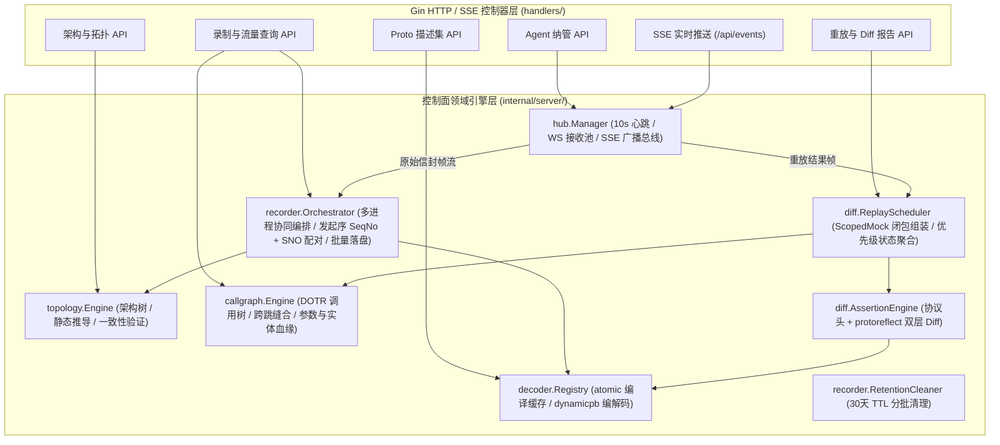
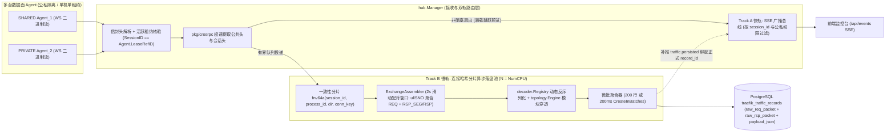

# 业务流量与接口契约治理 (`code-traefik`) 管理面服务、微前端控制台与回归断言设计

- **文档编号**：`04-control-plane-and-web-console.md`
- **文档版本**：v1.7.0
- **更新日期**：2026-11-04
- **归属阶段**：阶段二：系统架构与数据模型设计 (`02-design`)
- **状态**：已批准待实施 (Approved for M13)
- **上位基线**：[`01-feature-matrix.md`](../01-features/01-feature-matrix.md) (v2.10.0)、[`01-system-architecture.md`](./01-system-architecture.md)、[`02-data-plane-and-cros-rpc-engine.md`](./02-data-plane-and-cros-rpc-engine.md)、[`03-architecture-elements-and-topology.md`](./03-architecture-elements-and-topology.md)、[`07-console-ia-restructuring-and-workflow-workbench-adr.md`](../05-adr/07-console-ia-restructuring-and-workflow-workbench-adr.md) (ADR-07)、[`08-recording-drawer-and-process-tree-selection-adr.md`](../05-adr/08-recording-drawer-and-process-tree-selection-adr.md) (ADR-08)、[`09-arch-process-ssot-and-ebpf-premount-standby-adr.md`](../05-adr/09-arch-process-ssot-and-ebpf-premount-standby-adr.md) (ADR-09 v1.1.0)、[`10-enhanced-proto-schema-file-management-adr.md`](../05-adr/10-enhanced-proto-schema-file-management-adr.md) (ADR-10 v1.1.0)、[`11-single-process-bidirectional-capture-and-recording-ux-adr.md`](../05-adr/11-single-process-bidirectional-capture-and-recording-ux-adr.md) (ADR-11 v1.0.0)、[`12-packet-causality-call-tree-and-sequence-ux-adr.md`](../05-adr/12-packet-causality-call-tree-and-sequence-ux-adr.md) (ADR-12 v1.0.0)

---

## 1. Server 控制面核心服务与调度编排 (`internal/server`)



### 1.1 多 Agent 信封路由与双轨分发管道 (`hub.Manager` & `recorder.Orchestrator`)

当多台公私域 Agent（`SHARED` 或个人 `PRIVATE`）同时处于不同用户的活跃会话时，Server 基于 56B `EnvelopeHeader` 执行租约核验与**「快轨 SSE 实时推送 + 慢轨异步配对双模落盘」**双轨无阻塞分流：



1. **周期心跳、Single-Flight 自动预挂补齐 (`Auto-Rearm`)、离线熔断与悬空租约自愈**：
   - 后台协程按 `10s` 间隔并发探活所有已登记 Agent（`GET /agent/v1/handshake`，超时 `3s`），刷新 `status = 'ONLINE'`、`last_heartbeat_at`，核对 `ActiveLeaseType / ActiveRefID` 与规范化预挂载摘要 `ArmedDigest`；
   - **Single-Flight 版本化预挂对账与指数退避**：当在线且空闲（`lease_type == ''`）的 Agent 返回的 `ArmedDigest` 与 `traefik_agents.expected_armed_digest` 不一致或 `BootID` 刷新时，`hub.Manager` 在单机互斥锁 `rearmMu[agentID]` 保护下携带最新 `mounts_revision` 调用 `PUT /agent/v1/monitors/arm` 补齐待命探针并回写统一七态 `probe_status`；若遇 `CAP_DENIED`/`ERROR` 等持久性错误自动进入 `10s -> 30s -> 60s -> 300s` 指数退避（配置变更或手动触发立即重置退避）；
   - 连续 **3 个周期（30s）** 探活失败则将数据库状态切换为 `OFFLINE`、将该 Agent 名下挂载进程 `probe_status` 同步置为 `'OFFLINE'`，**自动释放残留排他租约**并将关联录制批次或重放任务置为异常终止，防止共享测试环境 Agent 发生死锁挂死。
2. **Track A 快轨（前端 SSE 实时预览推送）**：
   - 为每个已认证订阅者分配容量为 `128` 的缓冲 Channel；推送前严格校验订阅者对目标 `session_id` 的访问权（`PRIVATE` 批次仅推送给 `owner_id` 本人及 `traefik_admin`）；
   - Channel 瞬时满载时仅跳过实时预览通知，绝不反向阻塞 WebSocket 读取协程与 Track B 落盘管道，确保端到端呈现延迟 `<= 1s`。

### 1.2 预挂就绪零重启录制编排与无损+结构化双模落盘流水线 (`recorder.Orchestrator`)

1. **多进程排他租约获取、有序采集闸门与停录不断连**：
   - 校验发起人对所选 `target_process_ids` 所属环境 Agent 的访问权（普通用户可组合本人 `PRIVATE` Agent 与当前空闲的任意 `SHARED` 环境 Agent），固化 `process_snapshots` 进程蓝图快照（解耦日后卸载挂载实例），按 `agent_id` 升序调用 `AcquireAgentLeases` 原子加锁（冲突立即返回 `409 Conflict` 及持锁人信息）；
   - 并发调用各 Agent `PUT /agent/v1/monitors/sync` 下发 `[]ProcessMonitorSpec`：Agent 实时复检 `/proc/<pid>/fd` 后按序先注入 `activeSessionID` 并开启 `EgressProxy` `CAPTURING` 分帧（目标 PID 默认全出站透明代理，即使仅挂载单个进程且 `Downstreams` 为空亦可自动录齐 `INGRESS + EGRESS`，[`ADR-11`](../05-adr/11-single-process-bidirectional-capture-and-recording-ux-adr.md)）、再预热存量已建立入站 FD 至 `ing_conn_map` 并动态挂载入站读写钩子（已 `ARMED` 进程 **0ms 零重启开录**，`DISARMED` 进程兜底临时挂载），将最新诊断写入 `traefik_recording_sessions.process_diagnostics`；WebSocket 读取协程将真实采集 `agt.ID` 透传至 `ExchangeAssembler.Feed(agt.ID, env, payload)`（禁止硬编码 `agent_id = 1`）；
   - 录制正常结束或触发上限时，严格调用 **`POST /agent/v1/monitors/{sessionId}/stop`**（携带路径参数 `sessionId`）：Agent 先卸载入站读写钩子 -> `200ms` 在途应答排空 -> 将 `EgressProxy` 拨回 `PASSTHROUGH` 并清零 `activeSessionID`（**不断开业务 TCP 长连接**） -> 发送 `EVENT_SESSION_DRAINED` 并释放本地 `RECORDING` 租约，主控在统一收尾函数中原子释放全部 DB 租约。
2. **双阈值自动停录守卫**：
   - 内存原子维护当前批次 `capturedFrames` 与启动定时器 `time.AfterFunc(MaxDuration)`（默认 `30 分钟` / `100,000 帧`）；任一阈值触发时自动向全部参与 Agent 发送 `/stop`、刷空配对窗口并释放租约，状态落盘为 **`COMPLETED_BY_LIMIT`**。
3. **Track B 慢轨：连接内 `ullSNO` 往返配对与双模归档 (`ExchangeAssembler`)**：
   - **无锁分片亲和**：按 `(session_id, process_id, direction, conn_key)` 哈希路由至固定 Worker，保证同一 TCP 连接上的 `REQ`、`RSP_SEG` 与 `RSP` 100% 由同一协程串行处理；
   - **单行往返聚合与发起序锚定规则（Exchange-per-Row，目标吞吐 `>= 2000 帧/s`，[`ADR-12`](../05-adr/12-packet-causality-call-tree-and-sequence-ux-adr.md)）**：
     - **请求到达瞬间原子分配发起序号 (`SeqNo`)**：每个活跃录制批次维护 `atomic.Int64` 序号器 `sessionSeq`；收到任意 `REQ` 首帧创建挂起项瞬间（以及 `ONEWAY`、`MNG`、`RSP_ORPHAN` 到达瞬间）立即执行 `seqNo = sessionSeq.Add(1)` 绑定至挂起上下文，彻底根治因下游 `EGRESS RSP` 先于父 `INGRESS RSP` 完成落盘而导致的列表父子倒挂；
     - **连接级 `MNG.acProcName` 对端身份缓存**：当某 `(session_id, process_id, conn_key)` 捕获到 `ucMsgType ∈ {5, 6, 7}` (`MNG`) 握手管理帧且 `MngHead.ProcName` 非空时，在 Worker 本地连接字典 `connPeerProc[connKey]` 中记忆对端自报进程名，并注入同连接后续往返记录的 `headers_json.meta.peer_proc_name`；
     - **`ONEWAY` 单向请求**（`ucMsgType == 2 && ucReqType == 3`）：无需等待应答，直接组装 `raw_req_packet = frame`、`raw_rsp_packet = nil`、`payload_json = {"req": reqObj, "rsp": null}`；
     - **标准 `UNARY` 与多段流式 `STREAM_RSP`**：收到 `REQ` 时携带已分配的 `seqNo` 暂存至 Worker 本地 `pendingMap[(process_id, direction, conn_key, sno)]`；后续收到 `ucMsgType == 4 (RSP_SEG)` 时按序追加分片字节至 `rspBuf` 并递增 `rsp_seg_count`；收到终结帧 `ucMsgType == 3 (RSP)` 时弹出配对项，无损拼接 `raw_rsp_packet`（可通过 `crosrpc.SplitFrames` 零歧义逐片还原），组装 `payload_json = {"req": reqObj, "rsp": rspObjOrSegArray}`，提取轻量调用图摘要 `headers_json.meta`（含 `peer_proc_name`、`biz_error`、`biz_status_summary` 及顶层实体主键摘要 `produced_entities / consumed_entities`），并精确计算微秒级往返耗时 `latency_us = (rspCapturedAtNs - reqCapturedAtNs) / 1000`；
     - **自适应配对超时与孤立帧兜底**：
       - 滑动配对超时时间基于报文会话头动态计算：取 `max(ReqHead.uiTimeOutSecondLimit, 30s)`；
       - 若收到 Agent 投递的 `EVENT_CONN_CLOSED` 连接关闭事件，立即刷空该连接的所有挂起请求，置为 `exchange_type = 'REQ_ONLY'` 落盘；
       - 连接中途切入捕获到的无头孤立应答以 `exchange_type = 'RSP_ORPHAN'` 落盘（`raw_req_packet = nil`）；连接管理帧以 `exchange_type = 'MNG'` 归档；
       - 每个 Worker 设立最大 `10000` 条挂起请求预算，防止慢连接恶意泄漏内存；
   - **微批写入**：每凑满 `200` 条往返记录或每 `200ms` 触发一次 GORM `CreateInBatches` 分区表写入。

### 1.3 跨 Agent 同构重放调度器与多请求明细持久化 (`diff.ReplayScheduler`)

1. **权限、快照解耦同构兼容性、就绪硬门禁与排他租约四重前置校验**：
   - 校验选定的 `INGRESS` 往返记录均属于同一 `session_id` 与同一源进程 `source_process_id`，且 `is_replayable == true`（`raw_req_packet` 非空且未被 4MB 截断）；
   - 调用基于 `session.ProcessSnapshots` 解耦的 `topology.ValidateReplayProcessCompatibility`（即使源环境 Agent 日后已卸载原挂载实例亦不受阻碍），校验发起人对录制素材与目标进程 `target_process_id` 所属环境 Agent 的权限及模块同构性；
   - **重放零外泄前置硬门禁与历史 `EGRESS` 端点自动并集（[`ADR-11`](../05-adr/11-single-process-bidirectional-capture-and-recording-ux-adr.md)）**：主控自动取「`CompileProcessDownstreams(target)` 静态推导下游端点 $\cup$ 源录制批次中该源进程实测捕获的全部 `EGRESS` 记录 `DstAddr (IP:Port)`」合并写入 `ExecuteReplayReq.ProcessSpec.Downstreams`（使单进程零拓扑录制的素材同样 100% 闭环 Mock）；实时核验目标进程就绪态，若处于 `WAITING_PROC`（未启动）或持有指向该合并 Mock 端点集的未代理存量直连（`NEED_RECONNECT`, `established_conns > 0`），**直接拒绝启动重放并返回 `409 Conflict`**；
   - 对目标进程所属 Agent 获取 `REPLAY` 排他租约（冲突立即返回 `409 Conflict`）。
2. **重放生命周期状态机与既有代理连接零外泄 Mock 接管**：
   - **状态机流转**：`PENDING`（初始创建） -> `RUNNING`（目标进程已 `🟢 READY`，无需手动重启；Agent 将 `EgressProxy` 中该进程的既有长连接原子切入 `REPLAY_MOCK` 物理阻断真实下游写通道并按序注入请求切片） -> `COMPLETED / CANCELLED / FAILED`；
   - **按 `RecordID` 因果子树组装 `ScopedEgressMocks`（[`ADR-12`](../05-adr/12-packet-causality-call-tree-and-sequence-ux-adr.md)）**：从 `traefik_traffic_records` 按 `req_captured_at_ns ASC, seq_no ASC, id ASC` 提取选定 `INGRESS` 记录组装 `IngressItems: []ReplayIngressItem{RecordID, RawReq}`，并调用 `callgraph.BuildReplayClosure`：优先按同进程同 `trace_id` 的 DOTR `FatherSpanID` 子孙闭包（无 `trace_id` 时回退 `[req_ns - 500μs, rsp_ns + 500μs]` 包含时间窗）为每条 `INGRESS` 切分专属 `ScopedEgressMocks[recordID]`，将未归属合格 `EGRESS` 放入 `GlobalFallbackMocks`（严格剔除 `is_truncated == true`、`REQ_ONLY` 与空应答帧），纯二进制下发 Agent；
   - **双轨可靠回收与独立明细持久化**：
     - 重放执行进度与结果通过 WebSocket `EVENT_REPLAY_ITEM_DONE` 实时推送，同时支持通过 `GET /agent/v1/replays/:taskId/result` 幂等拉取；
     - 每条请求重放回收的实际原始应答帧（`actual_rsp_packet` bytea）及双层比对结果独立持久化至 **`traefik_replay_items`** 表，支持前端标准服务端分页查询与历史多次比对！
3. **多请求状态聚合优先级定律**：
   单条请求及整包重放任务的最终 `result_status` 严格遵循以下全序优先级取最高异常级别：

   $$\text{ERROR} \succ \text{TIMEOUT} \succ \text{MOCK\_MISS} \succ \text{FAILED} \succ \text{PASS}$$

### 1.4 历史流量保留期自动清理器 (`recorder.RetentionCleaner`)

每 `6 小时` 巡检一次超过保留期（默认 `30 天`，配置项 `traffic.retention_days`）且非活跃状态的录制批次，按每批 `5000` 行分批删除关联流量记录与过期会话，避免长事务锁表，并通过 `commonAudit.Push` 写入一条系统级清理审计记录。

### 1.5 DOTR 因果调用树、跨进程跳点缝合与数据流血缘引擎 (`internal/server/callgraph`, [`ADR-12`](../05-adr/12-packet-causality-call-tree-and-sequence-ux-adr.md))

为支撑 `/debug` 默认「事务调用树 + 内联迷你甘特瀑布条」、交互式 UML 时序泳道图及有状态重放闭包预览，`internal/server/callgraph` 提供以下五大确定性纯算法能力：

1. **批量架构水合与连接短编号消歧 (`HydrateRecordSummaries`)**：
   - 一次性批量加载批次涉及的 `Module` 字典与 `RecordingSession.ProcessSnapshots`（辅以存活 `Process` 表兜底），`O(1)` 回填每条记录的 `src_module_name`、`dst_module_name`、`process_name`、`arch_process_name` 及 `headers_json.meta.peer_proc_name`（来自同连接 `MNG.acProcName`）；
   - 按连接首次出现时序为批次内每个唯一 `(process_id, conn_key)` 生成紧凑短编号 `Conn#1, Conn#2, ...`，消除不同 TCP 长连接各自独立递增 `ullSNO`（如两条不同连接均出现 `SNO=1002`）引发的视觉混淆。
2. **多进程 `EgressProxy` 跨跳合并缝合 (`StitchCrossProcessHops`)**：
   - 当同一录制批次纳管了上下游多个业务进程（$P_1 \rightarrow \text{EgressProxy} \rightarrow P_2$）时，`EgressProxy` 代拨会产生新客户端临时端口，导致 $P_1.\text{EGRESS}$ 与 $P_2.\text{INGRESS}$ 四元组不同；
   - **一级权威匹配 (`DOTR_EXACT`)**：在同一非空 `TraceID` 内，将满足 `i.Direction == INGRESS && i.ProcessID != e.ProcessID && (i.SpanID == e.SpanID || i.FatherSpanID == e.SpanID) && i.ServiceName == e.ServiceName && i.Operation == e.Operation` 且时间距离最近的单条未配对入站记录与出站记录 $e$ 双向缝合（记录 `linked_peer_record_id` 并估算单跳网络传输耗时 `net_hop_us = max(0, e.latency_us - i.latency_us)`）；
   - **二级指纹兜底 (`FINGERPRINT_INFERRED`)**：针对无 `TraceID` 报文，按 `(ServiceName, Operation, ReqPayloadSHA256, DstPort)` 相等且 `|i.ReqCapturedAtNs - e.ReqCapturedAtNs| <= 50ms` 缝合。
3. **DOTR 主路径调用树构建、同层兄弟分类与甘特坐标归一化 (`BuildTransactionTrees`)**：
   - **父子挂载与安全边界**：优先在同一 `TraceID` 内依据 `child.FatherSpanID == parent.SpanID`（兼容同进程内 `EGRESS` 继承入口 `INGRESS` 上下文）挂载子孙节点；无 `TraceID` 的孤儿 `EGRESS` 回退在同 `(session_id, process_id)` 内寻找满足 `[parent.ReqNs - 500μs, parent.RspNs + 500μs]` 的最内层入口 `INGRESS` 挂载（标记 `TEMPORAL_INFERRED`）；强制执行 `visited` 破环保护、最大树深 `max_depth = 16` 与单根事务返回子节点上限 `max_children = 200`；
   - **兄弟时序关系与软错误标记**：同父节点下按发起序比较相邻子调用区间，自动标注 `PARALLEL`（重叠 `> 50μs`）、`COMPENSATION`（位于前序异常或 `biz_error` 之后且方法名匹配 `Cancel* / Release* / Rollback* / Refund* / Unlock* / Compensate* / Revert*`）与 `SEQUENTIAL`；以根事务 `[rootStartNs, rootEndNs]` 为基准计算每个节点的 `waterfall_offset_pct (0..100)`、`waterfall_width_pct (0.5..100)`、净自身执行耗时 `self_exec_us` 与 `is_critical_path`；
   - **筛选保树语义**：当用户在 `/debug` 传入方法名、异常或关键字过滤命中深层子节点时，引擎自动保留其所属根事务及完整祖先链路（非命中兄弟可折叠或标记弱化），并严格以**根业务事务**为单位进行分页切片，确保同一事务绝不跨页割裂。
4. **单事务参数数据流血缘提取 (`ExtractParameterLineage`)**：
   - 面向单事务时序泳道接口按需触发（节点上限 `<= 200`，单 JSON 递归深度 `<= 6`、标量叶节点上限 `<= 500`）：遍历事务内按发起序排列的已解码 `payload_json.{req, rsp}`，当上游输入或前序子调用应答产出的非噪声标量值（关键标识字段 `*_id / *_no / *_code / *_key / *_token / sku*` 或长度 `>= 4` 的高熵字符串/业务长整型）在后续调用入参或最终入口出参中精确复现时，生成有向参数血缘边 `ParameterLineageEdgeDTO`。
5. **跨事务有状态业务实体生命线与重放闭包诊断 (`BuildEntityChains` & `BuildReplayClosurePreview`)**：
   - 基于批次各根事务 `headers_json.meta`（历史无 `meta` 小批次受控回退扫描顶层载荷）：当某根事务在 `rsp` 中首次产出某业务主键（`req` 未携带而 `rsp` 出现，如 `CreateOrder.rsp.order_id = "ORD_9981"`，角色 `PRODUCER`），后续根事务在 `req` 中携带同一键值（如 `GetOrderDetail / CancelOrder`，角色 `CONSUMER`），自动串联为跨事务实体生命线；
   - 当用户对任一 `CONSUMER` 入口记录请求 `GET /api/traffic-records/:id/replay-closure` 时，除返回其专属 `ScopedEgressMocks` 预览清单外，自动附带前置 `PRODUCER`（及中间状态变更事务）有序依赖链与一键连带回放推荐 `recommended_record_ids`。

---

## 2. IDL 描述集引擎、跨集依赖闭包与 `dynamicpb` 动态编解码 (`internal/server/decoder`)

### 2.1 `.pb` 多描述集依赖闭包解析、`CompileTrialPool` 仲裁与全局单一生效池 (`ADR-10`)

系统内所有运行环境与 Agent 共享唯一的全局生效契约池（`Single Active Schema Pool`），支持超大型系统将公共基础协议（`BASE_LIB`）与各业务域（`BUSINESS` / `GATEWAY`）拆分为多个独立 `.pb` 描述集协同治理：

1. **上传预检、去重拓扑闭包与忽略规则向前继承 (`UploadSchema`)**：
   - **流式上限与基础校验**：通过 `http.MaxBytesReader` 强制限制上传请求 `<= 16MB (16,777,216 Bytes) + 64KB`；校验扩展名白名单（`.pb/.bin/.desc/.protoset`）与 `category IN ('BASE_LIB', 'BUSINESS', 'GATEWAY')`；`proto.Unmarshal` 解析为 `descriptorpb.FileDescriptorSet`（强制校验 `len(fds.File) > 0` 且 `UnknownFields` 为空）；
   - **自有文件与外部依赖分离**：提取本文件携带的 `ProtoFiles`（`own_proto_files`），遍历 `file.GetDependency()` 计算不在自有集合内且非内置 `google/protobuf/*` Well-Known Types 的缺失路径记入 `ExternalImports`（`jsonb []string`）；
   - **去重 DAG 拓扑合并**：当存在外部 `import` 时，按 **「本描述集自有文件 $\succ$ 当前生效 `BASE_LIB` $\succ$ 其他生效描述集（当 `auto_activate=false` 仅草稿归档时，允许回退取未生效各 `BASE_LIB` 最新版本）$\succ$ Go 标准库内置 `google/protobuf/*` WKT」** 优先级按 `file.GetName()` 严格去重并按 `import` 拓扑序重排后执行 `protodesc.NewFiles`（若仍缺失依赖，返回 `400 Bad Request` 并精准列出 `missing_imports` 文件名）；
   - **自有服务提取与 `0` Service 基础库支持**：**仅遍历 `own_proto_files` 提取 `(service_name, operation)`**（若非 `BASE_LIB` 业务包因 `--include_imports` 重复打包了已生效 `BASE_LIB` 中的同名文件，自动跳过基础库已托管文件的 `Service` 提取），严格按点分规范 **`service_name = string(file.Package()) + "." + string(svc.Name())`**（无 `package` 时为 `string(svc.Name())`）生成映射；完全允许 `OperationCount == 0` 的纯消息体 `BASE_LIB` 入库与激活；
   - **咨询锁递增版本与 `DiffIgnorePaths` 向前继承**：在 PostgreSQL 事务入口获取 `pg_advisory_xact_lock(hashtext('traefik_proto_schema_registry'))` 计算 `version = max(version) + 1`；若 `version > 1`，自动读取同名当前生效版本（无生效版本则取 `version - 1`）的非空 `ProtoOperation.DiffIgnorePaths`，按 `(service_name, operation)` 无损向前继承。
2. **`CompileTrialPool` 激活 / 批量激活 / 停用双向门禁 (`Activate` / `BatchActivate` / `Deactivate`)**：
   - 任何改变全局生效池的操作均在咨询锁事务内先推导出变更后的候选生效集合 $S_{\text{next}}$：
     - **单集激活 (`Activate`)**：$S_{\text{next}} = (S_{\text{active}} \setminus \{\text{同名旧版}\}) \cup \{s_{\text{target}}\}$；
     - **批量激活 (`BatchActivate`)**：校验 `schema_ids` 非空且不含同名多版本后，$S_{\text{next}} = \{s \in S_{\text{active}} \mid s.\text{Name} \notin N_T\} \cup T$；
     - **停用下线 (`Deactivate`)**：$S_{\text{next}} = S_{\text{active}} \setminus \{s_{\text{target}}\}$；
   - **门禁 ①（跨集方法全局唯一）**：校验 $S_{\text{next}}$ 导出的全部 `(service_name, operation)` 两两无交集（重叠立即回滚返 `409 Conflict` 及 `conflicts` 明细）；
   - **门禁 ②（`CompileTrialPool(S_next)` 联合预编译与反向依赖保护）**：仅使用 $S_{\text{next}}$ 内部成员（加内置 WKT）执行去重拓扑联合 `protodesc.NewFiles`，并逐一核验 $S_{\text{next}}$ 全部 `ProtoOperation` 的 `ReqMessageFullName / RspMessageFullName` 均可解析为 `MessageDescriptor`。若待激活业务包依赖的 `BASE_LIB` 未激活，或停用/升级某基础库破坏了下游已生效业务包的依赖闭包，立即回滚并返回 **`409 Conflict`**（携带 `broken_dependents: [{schema_id, schema_name, version, reason}]`）；
   - 校验通过后提交事务，并在 `reloadMu` 保护下执行 `Reload()` 将联合编译出的统一 `CompiledRegistry{Files, Operations}` 原子写入 `atomic.Pointer[CompiledRegistry]`。

### 2.2 动态编解码与历史版本不可变契约

- **动态解码 (`DecodePayloadToJSON`)**：按 `(serviceName, operation, msgType)` 查找生效的 `protoreflect.MessageDescriptor`，实例化 `dynamicpb.NewMessage(desc)` 执行 `proto.Unmarshal(payload)`，再以 `protojson.MarshalOptions{UseProtoNames: true, EmitUnpopulated: false}` 序列化为标准 JSON（注：ProtoJSON 标准自动将 64 位整数编码为十进制字符串，天然杜绝前端 JS `Number.MAX_SAFE_INTEGER` 精度截断）。
- **无映射优雅降级**：若未注册对应 `.pb` 或二进制反序列化失败，保留完整 CROS RPC 头解析结果，将 `decode_status` 置为 `NO_SCHEMA_RAW_HEX` 或 `DECODE_ERR_RAW_HEX`，前端自动切换纯 Hex 视图，绝不中断采集链路。
- **历史不可变与按需重解码**：落盘时快照记录当时使用的 `(schema_id, schema_version)`；后续切换 `.pb` 生效版本不会隐式篡改历史记录，用户可在流量详情抽屉显式点击「使用当前生效版本重新解码」。

### 2.3 消息体参数定义字典树反射与源文件导出 (`F-03.2`, `F-03.4`)

为彻底解决“请求/应答参数定义不可见”与“描述集黑盒无法导出”的痛点，控制面提供基于 `protodesc` 的动态字典树反射服务：

1. **服务端动态字典树递归反射 (`ExtractMessageFieldTree` & 跨集联合池回退)**：
   - 给定 `ProtoOperation` 的 `req_message_full_name` 或 `rsp_message_full_name`：若所属 `ProtoSchema.IsActive == true`，直接从内存 `CompiledRegistry.Files`（联合生效类型池）`O(1)` 查找目标 `protoreflect.MessageDescriptor`；若为未生效的历史/草稿版本，自动将该版本的 `DescriptorBytes` 与当前生效池（及最新 `BASE_LIB`）合并去重构建临时 `*protoregistry.Files`，确保拆包编译的未激活版本同样 100% 可展开字典树；
   - 递归遍历其包含的全部 `protoreflect.FieldDescriptor`，提取出结构化的 `ProtoFieldNodeDTO`：
     - `name`: 字段名（Proto 原名，如 `server_time`、`order_id`）；
     - `json_name`: JSON 序列化名（如 `serverTime`）；
     - `tag_number`: 字段编号（如 `#1`、`#2`）；
     - `kind`: 字段基本数据类型（`INT64`、`STRING`、`BOOL`、`MESSAGE`、`ENUM`、`BYTES` 等）；
     - `cardinality`: 规则修饰（`OPTIONAL`、`REQUIRED`、`REPEATED`）；
     - `is_map`: 是否为 Map 键值映射；
     - `comments`: 源码注释（自动提取 `SourceCodeInfo` 中的 `leading_comments` 与 `trailing_comments`）；
     - `children`: 针对子 Message 递归提取子字段集合（内置防循环引用深度截断，最大深度 12 层）；
     - `field_path`: 预计算的标准点分路径（如 `header.server_time`、`items[*].create_time`）。
2. **描述集源文件树透视与原文件导出**：
   - 提取 `FileDescriptorSet` 内包含的全部 `.proto` 源文件名（如 `account.proto`、`common.proto`）及各自声明的 `Service` / `Message` 清单；
   - 提供 `GET /api/proto-schemas/:id/download` 原始二进制流下载接口，附带 `Content-Disposition: attachment; filename="<schema_name>_v<ver>.pb"`，便于开发本地使用 `protoc` 或 `grpcurl` 排查。

### 2.4 可视化 Diff 忽略字段规则与三级优先级继承模型 (`F-03.3`)

在流量回归对比场景中，动态变化的时间戳、随机请求流水号与签名必须精准豁免比对，传统手工输入路径容易发生拼写与大小写错误：

1. **点分路径与通配符生成规则**：
   - 单层字段：`fieldName`（如 `server_time`）；
   - 嵌套对象：`parent.child`（如 `header.timestamp`）；
   - 数组/列表元素：`array[*].field`（如 `orders[*].trace_token`）；
   - 忽略整个对象/子树：`data.debug_info`。
2. **三级优先级合并继承模型**：
   当回归 Diff 引擎比对单次 RPC 应答时，最终生效的忽略路径集合由三级合并计算：
   $$\text{FinalIgnorePaths} = \text{ReplayTask.ExtraIgnorePaths} \cup \text{Operation.DiffIgnorePaths} \cup \text{ModuleService.DiffIgnorePaths}$$
   - **L1 任务级临时忽略 (`ReplayTask.ExtraIgnorePaths`)**：发起单次重放任务时用户临时附加的针对性忽略项；
   - **L2 方法级精准忽略 (`ProtoOperation.DiffIgnorePaths`)**：在契约工作台字段树上可视化勾选、并持久化至 `traefik_proto_operations` 的方法级专属规则；
   - **L3 服务级全局默认 (`ModuleService.DiffIgnorePaths`)**：在架构中心供给服务上配置的服务级通用忽略规则（如公共网关头 `header.*`）。

---

## 3. 协议头级 + Protobuf 语义字段级双层回归 Diff 引擎 (`internal/server/diff`)

双层回归断言引擎对每条重放请求的录制基线应答组（`Expected`）与实际回收应答组（`Actual`）执行递进式精准比对：

### 3.1 第一层：CROS RPC 协议头与载荷字节快速比对

| 比对项 | 比对策略 | 差异判定结果 |
| :--- | :--- | :--- |
| **分片数量与类型** | 比对帧序列长度、`ucMsgType`（`RSP` vs `RSP_SEG`）、`usRspMsgNo`、`isPacked` | 不一致直接标记头层 `FAILED` |
| **业务返回状态码** | 比对 `uiStatusCode` 及 V4 `ullStatusCode`（例如 `0` 突变为错误码） | 不一致直接标记头层 `FAILED` 并高亮状态码字段 |
| **固定豁免头字段** | 服务端时间戳 `ullServerRecvTime`、`ullServerSendTime`、扩展头 `ullServerEnqueueTime`，以及客户端运行态回显 `ullSNO`、`aucTraceBuff`、`ullClientSendTime` | **永久豁免，不参与相等性断言** |
| **Payload 原始字节** | `bytes.Equal(expectedPayload, actualPayload)` | 若完全相等且头层通过，直接短路返回 **`PASS`**（跳过第二层开销） |

### 3.2 第二层：`protoreflect` 类型感知语义树 Diff 算法

当第一层协议头一致但 `Payload` 原始字节存在差异时（例如 `map` 序列化字节顺序不同、或包含被忽略的动态业务字段、或发生真实业务数值突变），触发第二层语义比对：

1. **无 `.pb` 映射降级**：直接计算并返回 `ByteDiffSummary`（期望长度、实际长度、首个差异字节偏移量 `FirstDiffOffset` 及前后 32B Hex 切片），判定为 `FAILED`。
2. **有 `.pb` 映射递归语义比对 (`DiffProtoMessages`)**：
   - **严格快照 Schema 版本锁定**：解码 `Actual` 原始载荷时，必须严格使用录制基线记录所归档的 `(schema_id, schema_version)`，杜绝因管理员激活新 IDL 版本导致回归基线漂移；
   - 将 `Expected` 与 `Actual` 分别反序列化为 `dynamicpb.Message`；
   - **未知字段防漏判机制**：通过 `protoreflect.Message.GetUnknown()` 提取双方原始载荷中未在当前 `.pb` 中声明的额外 Tag 字段；若 `Actual` 存在非空未知字节而 `Expected` 没有，记录 `FieldPath = "<unknown_fields>"`，判定为 **`FAILED`**（提示新代码引入了未备案的扩展字段，防止漏判）；
   - 合并生效忽略规则集合：`IgnoreMatcher = CompilePaths(Interface.DiffIgnorePaths ∪ Task.ExtraIgnorePaths)`（支持点分路径如 `header.server_time` 与数组通配路径如 `orders[*].trace_token`）；
   - 递归遍历 `Expected` 与 `Actual` 中所有被设置（`Has(fd)`）的 `protoreflect.FieldDescriptor`：
     - 若当前 `fieldPath` 命中 `IgnoreMatcher`，直接跳过；
     - **`fd.IsMap()`（无序键值语义，F-14.5）**：提取双方全部 Map Key 集合并排序遍历，仅当某 Key 缺失、多出或对应 Value 递归不等时记录 `FieldPath = path + "[" + keyStr + "]"`，**彻底免疫 Go/C++ Map 迭代乱序导致的字节差异**；
     - **`fd.IsList()`（`repeated` 严格保序语义，F-14.5）**：按索引 `i = 0 .. max(lenExp, lenAct)-1` 逐位比对，索引错位或长度不等均记录 `FieldPath = fmt.Sprintf("%s[%d]", path, i)`；
     - **嵌套 `MessageKind`**：拼接 `path + "." + string(fd.Name())` 递归下钻；
     - **标量与枚举类型**：精确比较原始值（浮点数处理 `-0.0 == +0.0` 与 `NaN`）。
   - **最终裁决**：若过滤忽略路径与 Map 顺序噪声后 `len(fieldDiffs) == 0`，则该请求最终裁决为 **`PASS`**！否则裁决为 **`FAILED`** 并输出完整 `[]FieldDiff`。

```go
package diff

type FieldDiff struct {
	FieldPath string `json:"field_path"` // 如 "pricing.discount_cents" 或 "items[2].sku_id"
	DiffKind  string `json:"diff_kind"`  // "MODIFIED" | "ADDED" | "REMOVED"
	Expected  any    `json:"expected"`   // 64 位整数统一格式化为 string 防前端精度丢失
	Actual    any    `json:"actual"`
}
```

---

## 4. 微前端控制台架构与组件设计 (`frontend/src/`)

### 4.1 模块联邦导出契约、三层频次菜单与路由矩阵 (`ADR-07`)

前端通过 `vite.config.ts` 固定 `base: '/traefik/'`，向外暴露 `./App` 与 `./menu`（`traefikMenuConfig`）。菜单体系严格按**操作频次金字塔**与**动态作业 / 静态基线 / 环境治理解耦原则**划分为 **3 个菜单组、8 个精炼菜单项**（默认落地页为 `/record`），`StandaloneShell` 独立调试侧边栏直接消费 `traefikMenuConfig` 渲染以保持单一真实源：

| 菜单分组 | 菜单名称 | 子路由路径 (`MODULE_BASE_PATH = '/traefik'`) | 页面组件 | 可见角色 | URL Search Params 状态同步项 |
| :--- | :--- | :--- | :--- | :---: | :--- |
| **流量作业** *(置顶高频)* | **流量录制** *(默认首页)* | `/record` | `RecordingWorkbenchPage` | 全体登录用户 | `scope` (`SHARED` \| `PRIVATE`), `status`, `search`, `auto_start` (`1`), `agent_id`, `page`, `page_size` |
| **流量作业** | **流量调试** | `/debug` | `TrafficDebugWorkbenchPage` | 全体登录用户 | `session_id`, `view` (`tree` \| `flat`, 默认 `tree`), `live` (`1`), `direction`, `exchange_type`, `service_name`, `operation`, `sno`, `trace_id`, `entity_key`, `has_error` (`true`), `is_replayable`, `keyword`, `seq_root_id`, `page`, `page_size` |
| **流量作业** | **流量重放** | `/replay` | `ReplayWorkbenchPage` | 全体登录用户 | `session_id`, `auto_create` (`1`), `target_process_id`, `status`, `page`, `page_size` |
| **架构与契约** *(静态基线)* | **架构拓扑** | `/topology` | `TopologyWorkbenchPage` | 全体登录用户 | `view` (`LOGICAL` \| `PHYSICAL`), `env_agent_id`, `depth`, `session_id`, `focus` |
| **架构与契约** | **架构元素** | `/architecture` | `ArchitectureWorkbenchPage` | 全体登录用户 | `tree` (`logical` \| `physical`), `subsystem_id`, `group_id`, `module_id`, `proc_group_id`, `arch_process_id` |
| **架构与契约** | **Proto 契约** | `/schemas` | `ProtoSchemaWorkbenchPage` | 全体登录用户 | `tab` (`assets` \| `catalog`), `schema_id`, `category` (`BASE_LIB` \| `BUSINESS` \| `GATEWAY`), `latest_only` (`true` \| `false`), `active_only`, `claimed_status` (`ALL` \| `CLAIMED` \| `UNCLAIMED`), `service_name`, `search`, `sort_by`, `sort_dir`, `page`, `page_size` |
| **环境与治理** *(沉底低频)* | **Agent 与进程** | `/agents` | `AgentManagementPage` | 全体登录用户 | `scope` (`SHARED` \| `PRIVATE`), `agent_id`, `process_id`, `open_mount` (`1`), `lease_state`, `status`, `page`, `page_size` |
| **环境与治理** | **模块参数配置** | `/admin/settings` | `AdminSettingsPage` | `traefik_admin` (`adminOnly`) | - |

* **历史深链平滑重定向契约（100% 无损保留 Query 参数）**：
  - `/`、`/traefik`、`/traefik/`、`/sessions` $\rightarrow$ `replace` 重定向至 `/record`；
  - `/traffic?...` $\rightarrow$ `replace` 重定向至 `/debug?...`（完整继承 `session_id`、`trace_id`、`sno` 等检索参数）；
  - `/architecture?tab=topology|verify&...` $\rightarrow$ `replace` 重定向至 `/topology?...`；`/architecture?tab=physical&...` $\rightarrow$ `replace` 重定向至 `/topology?view=PHYSICAL&...`。

> **通用分页硬约束**：所有分页列表统一复用 `@code/common` 的 `Pagination` 与 `usePaginationState`（同步至 `useSearchParams`），每页条数选项固定为 **`15 / 25 / 50 / 100`（默认 `25`）**，控件布局严格为 `[首页] [上一页] [5页连续数字滑动窗口] [下一页] [末页] [条/页下拉框]`。

### 4.2 核心工作台 React 组件分层树

```text
src/
├── components/
│   ├── ArchCanvas/                         # 通用分层复合架构拓扑引擎 (React Flow v12 + ELK Inline Worker)
│   │   ├── ArchCanvas.tsx                  # 视口底座 (.code-arch-canvas 作用域 / 平移缩放 / 小地图 / LOD 类名)
│   │   ├── ArchCanvas.css                  # 100% --color-* Token 样式及 .react-flow__* 亮暗主题覆写
│   │   ├── layout/
│   │   │   ├── elk.worker.ts               # ELK 复合图分层正交排版内联 Worker (?worker&inline)
│   │   │   └── useElkLayout.ts             # 父先于子拓扑序、跨层拐点全局坐标换算、锚点保持与拖拽 SmoothStep 退化
│   │   ├── model/
│   │   │   ├── hierarchy.ts                # 树索引、祖先物化路径与 LCA (最近公共祖先) 纯函数
│   │   │   ├── rollup.ts                   # 纯前端边汇总 (rep)、动态 VIOLATION/UNATTRIBUTED 融合与最差状态收敛
│   │   │   └── metrics.ts                  # Tarjan SCC 循环依赖分析与扇入扇出统计
│   │   ├── nodes/
│   │   │   ├── ContainerNode.tsx           # 矩形嵌套容器 (子系统/功能组/进程组/物理进程，支持双击下钻)
│   │   │   ├── ModuleLeafNode.tsx          # 功能模块叶子卡片 (未装载虚线告警)
│   │   │   └── ExternalNode.tsx            # 外部系统/外部端点/未登记接口卡片
│   │   ├── edges/
│   │   │   └── RollupEdge.tsx              # 正交折线汇总边 (对数线宽、六分类着色、脉冲告警与拖拽自适应)
│   │   └── panels/
│   │       ├── ArchCanvasToolbar.tsx       # 工具栏: 逻辑/物理切换、L0~Ln 层级滑杆、自动展开开关、批次选择与重置布局
│   │       ├── ArchSummaryBar.tsx          # 一致性比对六分类摘要栏与待定归属待办入口
│   │       ├── NodeInspectDrawer.tsx       # 选中节点属性画像与 PROVIDE/DEPEND 快速跳转抽屉
│   │       └── EdgeDetailDrawer.tsx        # 汇总边底层契约明细与一致性抽样报文联动抽屉
│   └── PacketAnatomyDrawer/                # 面向业务视角的报文调用透视与底层解剖抽屉 (供流量调试台与拓扑一致性边复用)
│       ├── PacketAnatomyDrawer.tsx         # 抽屉外壳与无模态嵌入容器 (支持 [💼 业务视图 | 🔬 协议专家] 双模切换)
│       ├── BusinessSummaryBar.tsx          # 顶部业务调用概览条 (服务/方法大标题、状态码徽章、TraceID 一键复制、往返耗时与链路)
│       ├── BusinessPayloadCompareView.tsx  # 核心业务孪生视窗: 请求入参 vs 返回结果左右双栏并排 (Split View, 树状高亮/折叠/一键复制)
│       ├── RpcLatencyWaterfallBar.tsx      # 微秒级阶段耗时彩色甘特条 (网络传输 / 入队排队 / 服务端业务执行)
│       ├── AdvancedProtocolAccordion.tsx   # 底层协议与十六进制专家排错手风琴折叠区 (默认收起，反序列化失败自动展开)
│       ├── CommHeadBitmapCard.tsx          # ① 24B 公共头字节偏移位图可视化卡片 (折叠区子组件)
│       ├── SessionHeadDetailCard.tsx       # ② 会话头版本识别与底层二进制字段表 (折叠区子组件)
│       ├── ExtendHeadTraceCard.tsx         # ③ DOTR 扩展头 TLV 原始段与时间戳 (折叠区子组件)
│       └── PayloadJsonHexSplitView.tsx     # ④ 16B 对齐 Raw Hex 与底层报文对照视窗 (折叠区子组件)
├── pages/
│   ├── RecordingWorkbenchPage/             # 1. [流量作业] 流量录制工作台 (/record - 默认落地页)
│   │   ├── ActiveRecordingBanner.tsx       # 活跃录制状态卡: 实时帧计数、A-01 存量长连接重连告警、一键停录与【实时跟流调试】
│   │   ├── RecordingStartDrawer.tsx        # 发起协同录制抽屉(680px Drawer): 卡片式作用域、Agent 在线/租约防呆与预挂就绪分组进程树
│   │   └── RecordingSessionTable.tsx       # 录制素材分页台账表: 展示进程/帧数/归属，内置 [去调试] [发起重放] [架构验证] [发布共享] [删除]
│   ├── TrafficDebugWorkbenchPage/          # 2. [流量作业] 流量调试工作台 (/debug - 默认可折叠事务调用树 + 内联甘特瀑布)
│   │   ├── DebugSessionContextBar.tsx      # 调试上下文顶栏: 录制批次切换、[🌳 事务调用树 | 📋 原始时序平铺] 视图切换与 SSE 实时跟流控制
│   │   ├── LiveTrafficFilterForm.tsx       # 多维 URL 筛选器: Service/Operation/ullSNO/TraceID/方向/has_error(含软错误)/关键字
│   │   ├── EntityLifecycleFilterStrip.tsx  # 跨事务有状态业务实体生命线快捷胶囊条 (如 order_id=ORD_9981 [创建➔详情➔取消])
│   │   ├── TransactionCallTreeTable.tsx    # [默认主表 ?view=tree] 按根事务不割裂分页的多级可折叠因果调用树 (跨跳合并/并发/补偿徽章)
│   │   ├── InlineWaterfallBar.tsx          # 行内迷你甘特瀑布条 (以根事务跨度为 100% 轨道，--color-* 语义着色与关键路径高亮)
│   │   ├── TrafficRecordTable.tsx          # [平铺备选视图 ?view=flat] 按请求发起序排列的平铺报文表 (#Seq + Conn#k·SNO + 水合架构链路)
│   │   ├── TransactionSequenceDrawer.tsx   # 全链路时序泳道 + 四段解剖双栏联动宽屏抽屉 (支持叠加重放 Diff / MOCK_MISS 图层)
│   │   ├── SequenceSwimlaneCanvas.tsx      # 纯原生 React SVG 交互式 UML 时序泳道画布 (三段耗时柱 + 可开关参数传递血缘弧线)
│   │   └── SinglePacketReplayDrawer.tsx    # 事务闭包快速重放抽屉: 专属下游 ScopedMock 闭包透明预览、前置状态依赖链勾选回放与原地 Diff
│   ├── ReplayWorkbenchPage/                # 3. [流量作业] 流量重放工作台 (/replay)
│   │   ├── ReplayTaskCreatorModal.tsx      # 批量同构重放创建弹窗 (支持 URL ?session_id=X&auto_create=1 自动预选唤起)
│   │   ├── ReplayTaskTable.tsx             # 重放任务台账表 (PASS/FAILED/MOCK_MISS/TIMEOUT/ERROR 全序裁决)
│   │   └── ReplayReportDrawer/             # 双层回归 Diff 报告抽屉 (HeaderAssertionCard + ProtoFieldDiffTable + MockHitMissTimeline)
│   ├── TopologyWorkbenchPage/              # 4. [架构与契约] 架构拓扑工作台 (/topology - 全屏独立画布)
│   │   └── TopologyWorkbenchPage.tsx       # 零外层胶囊 Tab，全视口高度承载逻辑/物理复合拓扑画布与录制批次一致性比对叠加层
│   ├── ArchitectureWorkbenchPage/          # 5. [架构与契约] 架构元素工作台 (/architecture - 左树顶部 [逻辑架构 | 物理进程] 双视图 SSOT)
│   │   ├── SubsystemGroupTreePanel.tsx     # [逻辑架构 ?tree=logical]: 子系统 ➔ 8级功能组 ➔ 功能模块叶子定位与跨层搜索
│   │   ├── ModuleContractDetailPane.tsx    # 模块元数据、归属标准架构进程(跳 ?tree=physical)、挂载血缘(跳 /agents)与 PROVIDE/DEPEND 双表(跳 /schemas)
│   │   ├── ArchProcessTreePanel.tsx        # [物理进程 ?tree=physical]: 标准进程组 (ArchProcessGroup) ➔ 标准业务进程 (ArchProcess) 树与搜索/CRUD
│   │   └── ArchProcessDetailPane.tsx       # 标准架构进程详情: 默认端口(含0纯客户端)/启动特征、组装承载的 FM 模块、汇总服务契约与宿主机挂载就绪血缘
│   ├── ProtoSchemaWorkbenchPage/           # 6. [架构与契约] Proto 契约双模工作台 (/schemas - ADR-06 & ADR-10)
│   │   ├── SchemaPoolSummaryBar.tsx        # 顶部全局生效池健康摘要栏: 生效制品数(含BASE_LIB)/服务数/方法数/架构认领率与孤儿快捷过滤
│   │   ├── SchemaAssetLedgerTable.tsx      # [视窗一 ?tab=assets] 制品资产全景宽表: 默认按制品名聚合、分类徽章、依赖血缘、认领率、批量激活与行内[⬆️新版本]
│   │   ├── SchemaAssetInspectDrawer.tsx    # 制品详情与历史抽屉(680px Drawer): 自有 .proto/外部 import 来源、服务认领明细与同名全版本时间线回滚/停用/清理
│   │   ├── SchemaUploadModal.tsx           # .pb 上传弹窗（<=16MB 预检、BASE_LIB/BUSINESS/GATEWAY 分类、预填锁定同名升级、自动激活开关）
│   │   ├── SchemaConflictModal.tsx         # 409 冲突与反向依赖阻断受控弹窗（结构化呈现方法冲突表 conflicts 或受影响下游制品表 broken_dependents）
│   │   ├── OperationMappingTable.tsx       # [视窗二 ?tab=catalog] 服务级分页两级折叠契约目录树: 外层服务主行(含来源 .pb 徽章与认领深链) ➔ 内层 RPC 方法子表
│   │   ├── ServiceSummaryRow.tsx           # 外层服务行组件: 服务全名、来源 .pb 制品、源 Proto、认领模块、RPC 计数、一键全部折叠/展开
│   │   ├── OperationDocDrawer.tsx          # 契约详情与消息体参数定义抽屉 (双栏/Tab 切换查看 Req/Rsp Message，支持生效与未生效版本跨集依赖反射)
│   │   ├── MessageSchemaInspectorTree.tsx  # 消息体参数定义字典树组件 (多层递归展开、Tag、类型高亮、注释透视)
│   │   └── DiffIgnoreFieldToggle.tsx       # 字段级 Diff 忽略复选框与路径自动生成控制器
│   ├── AgentManagementPage/                # 7. [环境与治理] Agent 与进程工作台 (/agents - 1:1 架构进程挂载、本地覆盖与预挂就绪看板)
│   │   ├── AgentScopeTabs.tsx              # 切换「团队公共 Agent (SHARED)」与「我的私有 Agent (PRIVATE)」
│   │   ├── AgentLeaseStatusBadge.tsx       # 实时展示空闲 / 录制占用 / 重放占用，管理员支持强制解锁
│   │   ├── AgentMountedProcessTree.tsx     # 右栏分组进程挂载与就绪树台账: 四色探针就绪灯、[本地已覆盖] 标记、组级/整机暂停恢复与 [前往发起录制 ->]
│   │   └── AgentProcessMountDrawer.tsx     # 挂载架构进程抽屉(680px Drawer): 架构进程树 1:1 勾选、⚡自动扫描宿主机匹配、内联本地覆盖与跳回 /architecture 引导
│   └── AdminSettingsPage.tsx               # 8. [环境与治理] 模块参数配置 (/admin/settings - adminOnly)
```

### 4.3 四段报文解剖抽屉前后端 TypeScript DTO 契约 (`PacketAnatomyDTO`)

由于单行 `TrafficRecord` 同时归档无损 `raw_req_packet`、`raw_rsp_packet` 与结构化 `payload_json: {req, rsp}`，解剖抽屉一次加载即可在请求侧（`reqSide`）与应答侧（`rspSide`）之间零延迟切换。所有 `uint64` 字段在 JSON 契约中统一采用 **`string`**，严禁使用 `any`：

```typescript
// frontend/src/types/traffic.ts

export interface ByteSliceSegment {
  offsetStart: number;       // 起始字节偏移，如 0, 8, 16, 20, 22, 23
  byteLength: number;        // 字节长度
  fieldName: string;         // 如 "unMagicInfo", "ullSNO", "uiLength", "usHeadLen"
  rawHex: string;            // 如 "43 53 45 2E 54 43 50 01"
  displayValue: string;      // 如 '"CSE.TCP" + TCP(1)' 或 "0x000000010009A2B3"
}

/** ① 第一段：24B 公共头偏移位图与校验概览 */
export interface CommHeadAnatomyDTO {
  magicAscii: string;        // "CSE.TCP"
  transportProtocol: number; // 1 = TCP
  transportName: string;     // "RPC_TRANSPORT_TCP"
  snoDec: string;            // uint64 十进制字符串
  snoHex: string;            // "0x000000010009a2b3"
  uiLength: number;
  usHeadLen: number;
  ucMsgType: number;
  msgTypeName: string;       // "RPC_MSG_TYPE_REQ" | "RPC_MSG_TYPE_RSP" | ...
  isPacked: number;
  segments: ByteSliceSegment[]; // 精确覆盖偏移 0..23 的 6 个位图色块
}

/** ② 第二段：多版本会话头明细与阶段耗时计算 */
export interface SessionHeadAnatomyDTO {
  headKind: 'REQ' | 'RSP' | 'MNG';
  detectedVersion: string;   // 如 "V05 (256B)" 或 "V04 (200B)"
  sessionHeadLen: number;
  serviceName: string;       // "{package}.{serviceName}"
  operation: string;
  reqType?: number;          // 1=Sync, 2=Async, 3=Oneway
  uiStatusCode?: number;
  ullStatusCode?: string;
  rspMsgNo?: number;
  traceBuffHex?: string;     // 16B aucTraceBuff Hex
  timingBreakdownUs?: {      // V3+ RSP 联合 TIME_STAMP 扩展头自动拆解的微秒级阶段耗时 (ADR-12)
    clientToServerUs?: number;
    networkAndFramingUs?: number; // max(0, roundTripLatencyUs - serverProcessUs)
    queueWaitUs?: number;         // ullServerEnqueueTime - ullServerRecvTime
    serverExecUs?: number;        // ullServerSendTime - ullServerEnqueueTime
    serverProcessUs?: number;     // ullServerSendTime - ullServerRecvTime (服务端总驻留)
  };
  fields: Array<{ name: string; offsetRange: string; value: string }>;
}

/** ③ 第三段：0..N 段扩展头（DOTR Trace 与入队时间戳） */
export interface ExtendHeadAnatomyDTO {
  totalExtendBytes: number;
  trace?: {
    traceIdHex: string;      // 点击可一键筛选同批次全链路报文
    spanIdHex: string;
    fatherSpanIdHex: string;
    recordMsgSwitch: number;
  };
  serverEnqueueTime?: string;
  queueWaitUs?: number;      // 入队时间戳与处理开始时间差
  items: Array<{ ucType: number; typeName: string; usHeadLen: number; rawHex: string }>;
}

/** ④ 第四段：Protobuf 动态 JSON 与 16B 对齐 Raw Hex 对照 */
export interface PayloadAnatomyDTO {
  payloadOffset: number;     // 24 + usHeadLen
  payloadLength: number;
  isTruncated: boolean;
  isReplayable: boolean;
  decodeStatus: 'DECODED_JSON' | 'NO_SCHEMA_RAW_HEX' | 'DECODE_ERR_RAW_HEX' | 'TRUNCATED' | 'MNG_RAW';
  schemaName?: string;
  schemaVersion?: number;
  messageFullName?: string;
  decodedJson?: Record<string, unknown> | Array<Record<string, unknown>>; // 支持单包对象或多段 RSP_SEG 数组
  rawFrameHexLines: Array<{  // 基于 raw_req_packet / raw_rsp_packet 按每行 16B 切片对齐生成的对照行
    offsetHex: string;       // "00000018"
    hexCols: string;         // "00 05 01 00 00 00 00 01  64 6f 70 68 69 2e 6f 72"
    asciiCols: string;       // "........dophi.or"
    region: 'COMM_HEAD' | 'SESSION_HEAD' | 'EXTEND_HEAD' | 'PAYLOAD';
  }>;
}

/** 单侧报文四段完整解剖结构（用于 reqSide 或 rspSide） */
export interface FrameSideAnatomyDTO {
  commHead: CommHeadAnatomyDTO;
  sessionHead: SessionHeadAnatomyDTO;
  extendHead: ExtendHeadAnatomyDTO;
  payload: PayloadAnatomyDTO;
  segmentCount: number;      // REQ 恒为 1；STREAM_RSP 为实际拼接的 RSP_SEG + RSP 总段数
}

export interface PacketAnatomyDrawerDTO {
  recordId: string;
  sessionId: string;
  direction: 'INGRESS' | 'EGRESS';
  exchangeType: 'UNARY' | 'STREAM_RSP' | 'ONEWAY' | 'REQ_ONLY' | 'RSP_ORPHAN' | 'MNG';
  roundTripLatencyUs?: number;
  srcModuleName?: string;
  dstModuleName?: string;
  reqSide?: FrameSideAnatomyDTO; // RSP_ORPHAN 时为空
  rspSide?: FrameSideAnatomyDTO; // ONEWAY 或 REQ_ONLY 时为空
}
```

### 4.4 消息体参数定义字典树与契约嵌套表 TypeScript DTO 契约 (`MessageSchemaTreeDTO`)

#### (1) 参数字段字典树节点契约
```typescript
// frontend/src/types/schema.ts

export type ProtoFieldKind =
  | 'INT32' | 'INT64' | 'UINT32' | 'UINT64' | 'SINT32' | 'SINT64'
  | 'BOOL' | 'ENUM' | 'STRING' | 'BYTES'
  | 'FLOAT' | 'DOUBLE' | 'MESSAGE';

export interface ProtoFieldNodeDTO {
  name: string;                // Proto 原名字段，如 "server_time"
  jsonName: string;            // JSON 序列化键，如 "serverTime"
  tagNumber: number;           // 字段编号，如 1, 2
  kind: ProtoFieldKind;        // 数据类型
  typeName?: string;           // 嵌套 Message 或 Enum 的类型全名，如 "dophi.common.Head"
  cardinality: 'OPTIONAL' | 'REQUIRED' | 'REPEATED';
  isMap: boolean;              // 是否为 map<K, V> 映射
  comments?: string;           // 提取自 SourceCodeInfo 的注释
  fieldPath: string;           // 自动计算的规范点分/数组通配路径，如 "header.server_time", "items[*].id"
  isIgnoredInDiff: boolean;    // 当前方法或服务级是否已配置忽略
  children?: ProtoFieldNodeDTO[]; // 针对 MESSAGE 递归展开的子字段树 (最大递归深度 12)
}

export interface OperationSchemaTreeDTO {
  operationId: string;
  serviceName: string;         // "{package}.{serviceName}"
  operation: string;           // "DeductBalance"
  protoFile: string;           // "account.proto"
  clientStreaming: boolean;
  serverStreaming: boolean;
  diffIgnorePaths: string[];   // 当前方法生效的忽略路径清单
  inheritedIgnorePaths: string[]; // 继承自架构服务级的忽略清单
  reqMessage: {
    fullName: string;
    fields: ProtoFieldNodeDTO[];
  };
  rspMessage: {
    fullName: string;
    fields: ProtoFieldNodeDTO[];
  };
}
```

#### (2) 描述集制品台账与服务级分页契约目录树 TypeScript DTO 契约 (`ADR-10`)
```typescript
export type ProtoCategory = 'BASE_LIB' | 'BUSINESS' | 'GATEWAY';

export interface ResolvedSchemaDependencyDTO {
  schema_id: string;
  schema_name: string;
  version: number;
  category: ProtoCategory;
  is_active: boolean;
  matched_protos: string[];    // 由该前置描述集供给的 import .proto 路径
}

export interface BrokenDependentItemDTO {
  schema_id: string;
  schema_name: string;
  version: number;
  missing_import_or_symbol: string; // 停用或破坏性升级导致的缺失文件或 Message 符号
}

export interface ProtoSchemaLedgerItemDTO extends ProtoSchema {
  category: ProtoCategory;
  proto_file_count: number;
  service_count: number;
  operation_count: number;
  external_imports: string[];
  claimed_service_count: number;
  claimed_ratio: number;       // service_count == 0 (纯类型 BASE_LIB) 时为 1.0，UI 展示“基础类型库”
  version_count: number;       // 同名制品累计版本数 (latest_only=true 聚合徽章使用)
  latest_version: number;
  active_version?: number;
  created_by_name?: string;
  resolved_dependencies: ResolvedSchemaDependencyDTO[];
}

export interface ServiceContractGroupDTO {
  serviceName: string;         // 聚合键: "{package}.{serviceName}"
  protoPackage: string;
  protoService: string;
  protoFile: string;
  sourceSchema?: {             // 来源 .pb 制品徽章 (全局契约目录树跨集溯源)
    id: string;
    name: string;
    version: number;
    category: ProtoCategory;
    isActive: boolean;
  };
  claimedByModule?: {          // 架构血缘: 认领此服务的公共架构模块
    id: string;
    code: string;
    name: string;
    subsystemName: string;
  };
  totalOperations: number;
  unaryCount: number;
  streamCount: number;
  isActive: boolean;
  operations: ProtoOperation[]; // 服务端保证同一 Service 下的全部方法完整不跨页割裂
}
```

### 4.5 架构物理进程蓝图、Agent `1:1` 挂载就绪与跨工作台流转契约 (`F-15.1`~`F-15.5`, `ADR-09`)

#### (1) 架构物理进程蓝图与 Agent 挂载就绪 TypeScript DTO 契约（零 `any`）
```typescript
// frontend/src/types/arch.ts & frontend/src/types/agent.ts

export type ProbeDesiredState = 'ARMED' | 'DISARMED';

export type ProbeReadinessStatus =
  | 'READY'          // 🟢 eBPF 已预挂 + PID 已定位 + 存量直连连接数 == 0 (随时 0ms 零重启开录/重放)
  | 'NEED_RECONNECT' // 🟡 eBPF 已预挂 + PID 已定位 + 存在预挂前存量直连 (空闲期重连一次即可永久就绪；重放硬阻断 409)
  | 'WAITING_PROC'   // 🔵 eBPF 已预挂 + sched_process_exec/fork 待命等待目标进程启动
  | 'MONITORING'     // 🟣 当前正处于活跃录制/重放作业中
  | 'DISARMED'       // ⚪ 用户手动暂停该进程探针
  | 'OFFLINE'        // ⚫ 所属环境 Agent 离线失联
  | 'CAP_DENIED'     // 🔴 Agent 缺少 CAP_BPF / CAP_NET_ADMIN / CAP_PERFMON / CAP_SYS_PTRACE 权限
  | 'ERROR';         // 🔴 探针挂载或规则同步异常

export interface AgentEnvironmentDTO {
  id: number;
  name: string;                        // 1 台 Agent = 1 套独立环境 (如 "SIT-公共环境-01", "Alice-本地联调")
  endpoint: string;
  scope: 'SHARED' | 'PRIVATE';
  owner_id: number | null;
  fallback_agent_id: number | null;    // 可选绑定的公共 SHARED 基线环境 Agent ID（同机未挂载下游兜底）
  status: 'ONLINE' | 'OFFLINE';
  mounts_revision: number;             // 乐观并发版本号，保存挂载抽屉时回传 expected_revision
  expected_armed_digest: string;
  armed_digest: string;
  lease_type: '' | 'RECORDING' | 'REPLAY';
  lease_holder_name?: string;
}

export interface ArchProcessGroupDTO {
  id: number;
  code: string;
  name: string;
  sort_order: number;
  description: string;
  processes?: ArchProcessDTO[];
}

export interface ArchProcessDTO {
  id: number;
  group_id: number;
  group?: ArchProcessGroupDTO;
  code: string;                        // 全局唯一标准进程编码，如 "sut-order"
  name: string;                        // 展示名称，如 "订单核心服务进程"
  default_listen_port: number;         // 0..65535 (0 表示纯客户端无监听端口)
  default_cmd_pattern: string;         // 默认 /proc/<pid>/cmdline 匹配特征
  default_extra_downstreams: string[]; // 默认补充下游 ["IP:Port"]
  sort_order: number;
  description: string;
  modules?: ArchModuleSummaryDTO[];    // 架构层唯一组装承载的 FM 功能模块集合 (1:N)
  mount_count?: number;                // 已被宿主机 Agent 挂载的实例数
}

export interface AgentProcessMountDTO {
  id: number;                          // traefik_processes.id
  agent_id: number;
  arch_process_id: number;             // UNIQUE(agent_id, arch_process_id) 单机严格 1:1
  arch_process?: ArchProcessDTO;
  // 有效继承值（方便三工作台分组进程树统一渲染）
  group_id: number;
  group_name: string;
  code: string;
  name: string;
  listen_port: number;                 // EffectiveListenPort = override_listen_port ?? default_listen_port
  cmd_pattern: string;                 // EffectiveCmdPattern = override_cmd_pattern || default_cmd_pattern
  // 本地覆盖配置（为空/null 表示完全继承架构蓝图默认基线）
  has_override: boolean;
  override_listen_port: number | null;
  override_cmd_pattern: string;
  advertise_ip: string;
  extra_downstreams: string[];
  description: string;
  // eBPF 默认自动预挂与实时就绪诊断快照
  probe_desired_state: ProbeDesiredState;
  probe_status: ProbeReadinessStatus;
  resolved_pid: number;
  established_conns: number;
  need_reconnect: boolean;
  diag_message: string;
  last_diag_at?: string;
}
```

#### (2) 「架构进程定义 ➔ Agent 常驻待命挂载 ➔ 智能预选秒级双录」三台同构树与双向深链动线 (`ADR-09` & `ADR-11`)
- **`架构元素` (`/architecture?tree=physical`) 定义蓝图**：左栏顶部分段开关切换 `[逻辑架构 | 物理进程]`；在 `物理进程` 树中由 `traefik_admin` 统一维护 `ArchProcessGroup ➔ ArchProcess`、默认端口/启动特征及 `FM` 模块组装；点击任一组装模块可切回 `?tree=logical&module_id=M`，点击服务契约跳 `/schemas?active_only=true&search=<service_name>`，点击下方宿主机挂载血缘跳 `/agents?scope=<scope>&agent_id=<aid>&process_id=<pid>`；
- **`Agent 与进程` (`/agents`) Day-1 环境级 `1:1` 挂载与常驻预挂待命**：
  - `GET /api/agents/:id` 与 `PUT /api/agents/:id/process-mounts` 强制预加载 `ArchProcess.Group` 与 `ArchProcess.Modules`，按 `effective_listen_port ASC, id ASC` 排序并调用 `FillFromArchProcess()` 填充完整继承属性（严禁忽略 DB 查询错误）；
  - 右栏副标题明确标注为 **「环境进程部署映射与常驻待命探针 (配置一次 · 零损耗待命)」**，展示七态探针就绪徽章、`[本地已覆盖]` 标记与按进程/组/整机 `暂停探针 / 恢复预挂`；
  - 点击 `[⚡ 批量挂载架构进程]`（或响应跨工作台深链 **`/agents?scope=<scope>&agent_id=<id>&open_mount=1`**，具备写权限时自动滑出）打开 **`AgentProcessMountDrawer` (`680px` Drawer)**：支持 `/proc` 自动匹配高亮、`expected_revision` 乐观并发保护，保存时在线空闲 Agent 自动触发 `/agent/v1/monitors/arm`；
  - 右栏顶栏提供 **`[🎬 发起录制]`** 按钮（当 Agent `ONLINE`、空闲且已挂载进程时启用），点击直达 `/record?auto_start=1&agent_id=<id>`；
- **`流量录制` (`/record`) Day-2 任务级智能预选与开箱双录 (`RecordingStartDrawer`)**：
  - `RecordingWorkbenchPage` 解析 URL `?auto_start=1&agent_id=<id>` 自动打开 `RecordingStartDrawer` 并预选指定环境 Agent（抽屉关闭时自动清理一次性 `auto_start` 参数避免刷新重弹）；若当前所选 Agent 尚未挂载任何进程，空状态卡片渲染 **`[前往挂载架构进程 →]`** 按钮一键跳回 `/agents?scope=<scope>&agent_id=<id>&open_mount=1`；
  - 进程选择器标题消歧为 **「本次采集目标进程（从已挂载进程中圈定范围 · 默认同时录制入口 INGRESS 与出口 EGRESS）」**；
  - **智能默认预勾选规则**：打开抽屉或切换环境 Agent 时，筛选 `probe_desired_state !== 'DISARMED'` 的可用进程——当可用数 `1 <= N <= 5` 时**默认自动全选**（单进程及常规联调 0 次手动勾选直接开录），当 `N > 5` 时默认仅自动勾选 `probe_status === 'READY'` 的进程；`DISARMED` 进程置灰禁用勾选；工具栏提供 `[全选可用]`、`[仅选就绪]`、`[🔗 勾选关联下游]`（根据当前已勾选进程承载模块的 `DEPEND` 契约自动补选同 Agent 下游挂载进程）与 `[清空]`。

#### (3) 「录制 ➔ 调试 ➔ 重放 / 架构验证」高频作业闭环动线
- **从 `流量录制` (`/record`) 出发**：
  - 活跃录制进行中时，点击顶部状态卡【实时跟流调试】$\rightarrow$ 跳转 `/debug?session_id=<id>&live=1`，自动开启 SSE `traffic.persisted` 实时订阅；
  - 在录制素材台账表任一行点击 `[去调试]` $\rightarrow$ 跳转 `/debug?session_id=<id>`；点击 `[发起重放]` $\rightarrow$ 跳转 `/replay?session_id=<id>&auto_create=1` 自动唤起 `ReplayTaskCreatorModal`；点击 `[架构验证]` $\rightarrow$ 跳转 `/topology?session_id=<id>` 自动叠加六分类架构一致性报告。
- **在 `流量调试` (`/debug`) 执行事务因果检视、时序泳道联动与闭包重放调试 (`ADR-12`)**：
  - **默认可折叠事务调用树与内联迷你甘特瀑布 (`?view=tree`)**：默认按根事务分页呈现入口请求及其多级子孙 `EGRESS` / 跨进程缝合跳 `[P1 ➔ P2]`，内联渲染归一化甘特瀑布条、兄弟 `串行/并发/补偿` 徽章与协议+业务双态状态码；支持一键切换 `?view=flat` 查看严格按发起时刻升序排列的平铺表，或点击顶部 `EntityLifecycleFilterStrip` 实体胶囊筛选某业务单据（如 `order_id=ORD_9981`）的完整增删查改生命线；
  - **全链路时序泳道与四段解剖双栏联动 (`TransactionSequenceDrawer`)**：点击任意事务的 `[📊 时序泳道]` 滑出宽屏抽屉，左栏通过纯原生 React SVG 渲染 UML 参与者泳道、三段阶段耗时柱与可开关的参数传递血缘弧线（如 `rsp.lock_id ➔ req.lock_id`），点击任意一跳箭头即在右栏零延迟联动刷新四段报文解剖并高亮关联字段；
  - **事务闭包重放与前置状态依赖链回放 (`SinglePacketReplayDrawer`)**：
    - **触发条件**：当入口或已缝合入站记录 `direction === 'INGRESS'` 且 `is_replayable === true` 时，激活【事务重放】按钮；
    - **下游闭包预览与前置实体防呆**：自动请求 `GET /api/traffic-records/:id/replay-closure`，透明列出本事务绑定的专属 `ScopedEgressMocks` 清单；若检出当前请求消费了同批次前序事务产出的业务实体主键（如直接重放 `CancelOrder` 依赖前序 `CreateOrder`），醒目提示前置依赖链并支持勾选 **`[☑ 按序连带回放前置依赖事务链]`**；
    - **同构投递与泳道故障叠加**：筛选承载同构模块且 `listen_port > 0` 的 `READY` 目标进程调用 `POST /api/replay-tasks`（下发 `RecordID` 级隔离 `ScopedEgressMocks`），完成后除原地渲染双层 Diff 外，支持一键在时序泳道图上叠加定位 `SCOPED_HIT`、`MOCK_MISS` 或 `RSP_DIFF` 故障跳点。

### 4.6 流量调试调用树、时序泳道、数据血缘与闭包重放 TypeScript DTO 契约（`ADR-12`，零 `any`）

```typescript
// frontend/src/types/traffic.ts

export type CallLinkConfidence = 'DOTR_EXACT' | 'FINGERPRINT_INFERRED' | 'TEMPORAL_INFERRED' | 'ROOT';
export type SiblingRelationKind = 'ROOT' | 'SEQUENTIAL' | 'PARALLEL' | 'COMPENSATION';

/** 水合增强后的单条往返记录摘要（平铺列表与调用树节点共用基座） */
export interface TrafficRecordSummary {
  id: string;
  session_id: string;
  seq_no: number;                 // 请求到达瞬间原子分配的发起序号 (#1, #2, ...)
  process_id: string;
  process_name?: string;
  arch_process_name?: string;
  peer_proc_name?: string;        // 来自同连接 MNG.acProcName 的对端自报进程名
  conn_key: string;
  conn_index: number;             // 批次内紧凑连接短编号 (展示为 Conn#1 · SNO)
  direction: 'INGRESS' | 'EGRESS';
  exchange_type: 'UNARY' | 'STREAM_RSP' | 'ONEWAY' | 'REQ_ONLY' | 'RSP_ORPHAN' | 'MNG';
  src_addr: string;
  dst_addr: string;
  req_captured_at_ns: string;     // 64位纳秒时间戳统一使用十进制字符串防精度丢失
  rsp_captured_at_ns?: string;
  sno: string;
  service_name: string;
  operation: string;
  latency_us?: number;
  status_code: string;
  biz_error: boolean;             // 协议头 status_code==0 但业务载荷返回非零错误码
  biz_status_summary?: string;    // 如 "code=4009"
  trace_id: string;
  span_id: string;
  father_span_id: string;
  src_module_id?: string;
  src_module_name?: string;
  dst_module_id?: string;
  dst_module_name?: string;
  decode_status: string;
  is_truncated: boolean;
  is_replayable: boolean;
  created_at: string;
}

/** 事务调用树递归节点（支持多进程 EGRESS ⇔ INGRESS 跨跳缝合与内联瀑布百分比） */
export interface TransactionTreeNodeDTO {
  record: TrafficRecordSummary;
  stitched_ingress_record?: TrafficRecordSummary; // 多进程协同录制下缝合的下游对端 INGRESS 记录
  net_hop_us?: number;                            // 跨进程缝合估算的单跳网络开销
  depth: number;                                  // 0..16
  link_confidence: CallLinkConfidence;
  sibling_relation: SiblingRelationKind;
  waterfall_offset_pct: number;                   // 相对根事务起点的百分比偏移 [0, 100]
  waterfall_width_pct: number;                    // 相对根事务总耗时的百分比宽度 [0.5, 100]
  self_exec_us?: number;                          // 扣除子调用并集耗时后的自身净耗时
  is_critical_path: boolean;
  matched_filter: boolean;                        // 搜索命中深层子节点时标记高亮
  children: TransactionTreeNodeDTO[];
}

/** 跨事务业务实体生命周期摘要项（如 order_id="ORD_9981"） */
export interface EntityLifecycleChainDTO {
  entity_key: string;             // 如 "order_id:ORD_9981"
  field_name: string;             // "order_id"
  entity_value: string;           // "ORD_9981"
  producer_root_record_id?: string;
  steps: Array<{
    root_record_id: string;
    seq_no: number;
    operation: string;
    role: 'PRODUCER' | 'CONSUMER';
  }>;
}

/** GET /api/recording-sessions/:id/transactions 单页根事务组 */
export interface TransactionTreeGroupDTO {
  root_record_id: string;
  trace_id: string;
  total_node_count: number;
  truncated_children_count: number; // 超出 max_children=200 上限被折叠的尾部节点数
  total_duration_us: number;
  has_protocol_error: boolean;
  has_biz_error: boolean;
  has_compensation: boolean;
  entity_tags: string[];            // 关联的业务实体键值标签
  root: TransactionTreeNodeDTO;
}

/** 单事务内参数数据流传递血缘有向边 */
export interface ParameterLineageEdgeDTO {
  from_record_id: string;
  from_side: 'REQ' | 'RSP';
  from_field_path: string;          // 如 "rsp.lock_id"
  to_record_id: string;
  to_side: 'REQ' | 'RSP';
  to_field_path: string;            // 如 "req.lock_id"
  sample_value: string;             // 截断脱敏展示摘要 (<= 64 字符)
}

/** 交互式 UML 全链路时序泳道与可选重放叠加 DTO */
export interface SequenceParticipantDTO {
  participant_key: string;          // 如 "ext:api-gateway" | "proc:12" | "svc:demo.inventory.InventoryService"
  title: string;                    // 泳道主标题 (模块名或服务名)
  subtitle: string;                 // 进程名 / IP:Port
  kind: 'EXTERNAL_CALLER' | 'MONITORED_PROCESS' | 'EXTERNAL_DOWNSTREAM';
}

export interface SequenceStepDTO {
  step_index: number;
  record: TrafficRecordSummary;
  stitched_ingress_record?: TrafficRecordSummary;
  from_participant: string;
  to_participant: string;
  sibling_relation: SiblingRelationKind;
  offset_us: number;
  duration_us: number;
  stage_timing?: {
    network_and_framing_us?: number;
    queue_wait_us?: number;
    server_exec_us?: number;
  };
  replay_overlay?: {                // 传入 replay_task_id 时叠加的实际回放裁决
    status: 'PASS' | 'FAILED' | 'MOCK_MISS' | 'SCOPED_HIT' | 'GLOBAL_FALLBACK_HIT' | 'TIMEOUT' | 'ERROR';
    diff_count?: number;
    summary?: string;
  };
}

export interface TransactionSequenceDTO {
  root_record_id: string;
  trace_id: string;
  total_duration_us: number;
  participants: SequenceParticipantDTO[];
  steps: SequenceStepDTO[];
  parameter_lineages: ParameterLineageEdgeDTO[];
  entity_chains: EntityLifecycleChainDTO[];
}

/** GET /api/traffic-records/:id/replay-closure 事务闭包重放预览与前置依赖诊断 */
export interface ReplayClosurePreviewDTO {
  ingress_record: TrafficRecordSummary;
  scoped_egress_mocks: Array<{
    record_id: string;
    seq_no: number;
    service_name: string;
    operation: string;
    exchange_type: string;
    status_code: string;
    link_confidence: CallLinkConfidence;
    usable_as_mock: boolean;
    warning?: string;               // 如录制期为 REQ_ONLY 无应答时提示重放可能触发超时
  }>;
  prerequisite_chain: Array<{
    record_id: string;
    seq_no: number;
    service_name: string;
    operation: string;
    shared_entity_key: string;      // 如 "order_id=ORD_9981"
    role: 'PRODUCER' | 'STATE_MUTATOR';
  }>;
  recommended_record_ids: string[]; // 包含前置依赖 + 当前入口记录的发起序列表
}
```

### 4.7 面向业务开发者的报文调用与结果透视抽屉架构设计 (ADR-15 / M18)

#### 4.7.1 设计目标与信息架构分层
将原本偏向 Wireshark/网络协议抓包的四段二进制界面彻底重构为**以业务工程师日常排查为核心的高质感视窗**：
1. **第一层：业务调用总览 Bar (`BusinessSummaryBar`)**
   - **标题与接口**：直接外显点分服务名与 RPC 方法大标题（如 `demo.inventory.InventoryService / GetItemStock`），支持一键复制完整全名；
   - **调用结果与状态**：成功时呈现醒目绿色 `🟢 成功 (Code: 0)`；发生业务错误或协议异常时呈现高亮红色/黄色胶囊（如 `🔴 业务异常 (Code: 5001 - ITEM_OUT_OF_STOCK)`），若存在 `biz_status_summary` 则外露业务提示信息；
   - **耗时与流向**：展示往返耗时（如 `3.30 ms` / `3303 μs`）、架构链路（`MOD_1 ➔ MOD_3`）、交换模式（`UNARY` / `STREAM`）与流向（`INGRESS` / `EGRESS`）；
   - **TraceID 快速复制与联动**：外显 DOTR TraceID，附带一键复制与“一键过滤本 Trace”动作。
2. **第二层：业务请求与响应孪生对比视窗 (`BusinessPayloadCompareView`)**
   - **左右双栏并排 (Split View)**：
     - **左栏（业务请求入参 Request）**：展示请求 Schema 名（如 `ItemStockRequest` v1）与格式化 JSON；
     - **右栏（业务返回结果 Response）**：展示响应状态码、状态提示与返回数据 JSON；
     - **自适应降级**：若为 `ONEWAY`（单向通知）或 `REQ_ONLY`（未收到应答/超时），右栏展示清晰的状态占位与排查提示；若为 `RSP_ORPHAN`（孤立应答），左栏展示无头应答说明；
   - **高质感工具栏**：提供 **[复制 JSON]**、**[折叠/展开]**、以及 **[按 生效 .pb 重新解码]** 快捷按钮。
3. **第三层：微秒级阶段耗时瀑布分解 (`RpcLatencyWaterfallBar`)**
   - 提取会话头与扩展头中的耗时指标，按微秒计算总耗时与各阶段占比并渲染直观的彩色横向进度条：
     - 客户端网络传输耗时 (`clientToServerUs`)
     - 队列排队等待耗时 (`queueWaitUs`)
     - 服务端业务执行耗时 (`serverProcessUs` / `serverExecUs`)
   - 附带业务诊断文案（如：“耗时主要集中在服务端业务处理（91%），网关与传输无延迟”）。
4. **第四层：底层协议与十六进制专家排错手风琴折叠区 (`AdvancedProtocolAccordion`)**
   - 默认折叠收起，仅在卡片头部显示摘要标签（`24B 公共头 · 会话头 V05 · 1 个扩展头 · Raw Hex 205B`）；
   - 当点击展开或当载荷出现 `NO_SCHEMA_RAW_HEX` / `DECODE_ERR_RAW_HEX` 时自动展开；
   - 内部完整容纳原有的 ① CommHead 24B 位图色块、② SessionHead 二进制字段偏移表、③ ExtendHead 原始段以及 ④ 16B 对齐 Raw Hex 与 ASCII 对照视窗，保持底层排错能力 100% 完整。

```typescript
// frontend/src/components/PacketAnatomyDrawer/types.ts
export type PacketInspectorViewMode = 'BUSINESS' | 'EXPERT';

export interface BusinessSummaryProps {
  data: PacketAnatomyDrawerDTO;
  onFilterTrace?: (traceId: string) => void;
  onRedecode?: (recordId: string) => Promise<void>;
  extraActions?: React.ReactNode;
}
```

---

## 5. RBAC 权限矩阵与操作审计接入规范 (RBAC & Audit Governance)

### 5.1 角色权限守卫与公私域防越权矩阵

基于 `code-common/backend/auth` 的 `AuthMiddleware`（登录态校验）、`RequireAdmin("traefik_admin")` 以及资源层 `owner_id` 归属核验，严格划分以下权限边界：

| 业务资源与操作动作 | 免密访客 | 普通认证用户 (JWT) | 模块管理员 (`traefik_admin` / `super_admin`) |
| :--- | :---: | :---: | :---: |
| 健康检查 (`/api/health`) 与认证配置 (`/api/auth/*`) | 允许 | 允许 | 允许 |
| 查看公共三级逻辑架构、**物理进程蓝图 (`ArchProcessGroup / ArchProcess`)**、模块契约、静态拓扑与 `.pb` 映射 | `401` | **允许** | **允许** |
| 新增 / 修改 / 移动 / 删除公共逻辑架构元素、**物理进程组与标准架构进程蓝图**、`.pb` 描述集管理 | `401` | `403` | **允许** |
| 查看公共 `SHARED` Agent、挂载进程就绪灯态并刷新就绪诊断；创建并全权管理**本人 `PRIVATE` Agent**（`1:1` 勾选挂载架构进程、本地覆盖、预挂/暂停探针） | `401` | **允许**（访问或开关他人 `PRIVATE` Agent 探针返 `403`；修改 `SHARED` Agent 挂载配置返 `403`） | **允许**（全团队 `SHARED` 与各用户 `PRIVATE` Agent 均可见；负责管理 `SHARED` Agent 挂载/探针及强制释放异常租约） |
| 租用空闲的 `SHARED` Agent 或本人的 `PRIVATE` Agent **启动/停止录制** | `401` | **允许**（若目标 Agent 已被占用返 `409 Conflict`） | **允许**（同样遵守动态排他租约 `409` 互斥） |
| 查看 `SHARED` 录制素材及**本人的 `PRIVATE` 录制素材**；将本人 `PRIVATE` 素材发布为 `SHARED` 或删除本人 `PRIVATE` 素材 | `401` | **允许**（访问或删除他人 `PRIVATE` 素材返 `403`；删除公共 `SHARED` 素材返 `403`） | **允许**（全团队 `SHARED` 与所有用户的 `PRIVATE` 录制素材均可见与审计；可治理并删除无引用的素材） |
| **跨 Agent 同构离线重放**：选用有权限的 `SHARED` 或本人 `PRIVATE` 素材，投递至空闲 `SHARED` 或本人 `PRIVATE` Agent 的同构挂载进程 | `401` | **允许**（支持投递至本人私有或空闲共享环境，架构进程/模块不匹配返 `400`，Agent 被占用返 `409`） | **允许**（具备跨公私域同构调度与故障恢复特权） |
| 修改模块全局治理参数 (`/api/admin/settings`) | `401` | `403` | **允许** |

### 5.2 `commonAudit` 字段级 Diff 与操作事件审计埋点字典

所有写操作控制器统一调用 `commonAudit.SetAuditContext(c, module, action, level, summary, targetType, targetID, targetName, beforeSnapshot, afterSnapshot)`，由 `commonAudit.Middleware("traefik")` 自动通过 `CalculateDiff` 生成字段级 `OldVal / NewVal` 写入平台共享 `audit_logs` 表：

| 审计子模块 (`module`) | 动作标识 (`action`) | 风险等级 | `before` / `after` 快照策略与必含上下文 |
| :--- | :--- | :---: | :--- |
| `traefik_arch` | `create` / `update` / `move` / `delete` | `P1` (删除) / `P2` | 传入变更前后的 `Subsystem` / `FunctionalGroup` / `Module` / `ModuleService` / `ModuleDependency` / `ArchProcessGroup` / `ArchProcess` 结构体快照 |
| `traefik_agent` | `create` / `update` / `delete` / `sync_mounts` / `toggle_probe` / `force_unlock_lease` | `P1` | 传入 `Agent`（含 `scope`、`owner_id`、`endpoint`）或 `Process` 挂载实例（含 `arch_process_id`、`override_listen_port`、`override_cmd_pattern`、`probe_desired_state`）快照；管理员强制解锁记录原持锁人及原因 |
| `traefik_schema` | `upload` / `activate` / `delete` / `update_op_ignores` | `P1` | 记录描述集 `name`、`version`、`file_sha256`、`is_active` 切换前后版本对比及方法级 `diff_ignore_paths` 变更（剔除大体积 `descriptor_bytes` 二进制字段） |
| `traefik_record` | `start_session` / `stop_session` / `publish_session` / `delete_session` | `P1` | 操作事件审计：记录操作人、`session_no`、`scope`（`SHARED`/`PRIVATE`）、加锁的 `agent_id` 与 `process_id` 列表、停止原因 |
| `traefik_replay` | `execute_replay` / `cancel_replay` | `P2` | 操作事件审计：记录操作人、`task_no`、来源 `(session_id, source_process_id)`、目标 `(agent_id, target_process_id)` 与 `extra_ignore_paths` |
| `traefik_system` | `retention_cleanup` | `P2` | 后台定时任务直接调用 `commonAudit.Push` 记录清理过期批次数量与释放流量行数 |
