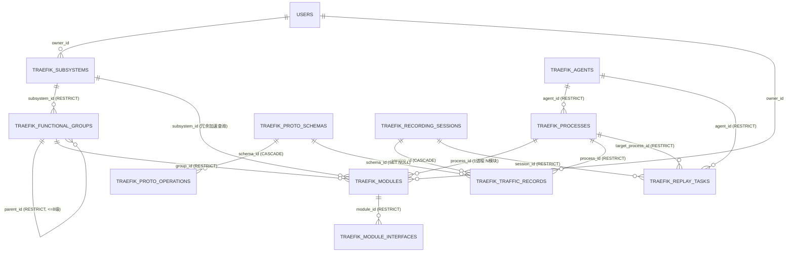

# 业务流量监控与重放 (`code-traefik`) 数据库物理模型与 GORM 建模字典

- **文档编号**：`05-database-schema.md`
- **文档版本**：v1.0.0
- **更新日期**：2026-10-29
- **归属阶段**：阶段二：系统架构与数据模型设计 (`02-design`)
- **状态**：已定稿 (Frozen)
- **上位基线**：[`01-feature-matrix.md`](../01-features/01-feature-matrix.md) (v2.5.1)、[`01-system-architecture.md`](./01-system-architecture.md)

---

## 1. 数据库共享隔离原则与类型安全约定

1. **共享库表名前缀强制隔离**：`code-traefik-server` 与宿主门户 `code-bench` 共享同一 PostgreSQL 实例，直接复用 `code-common/backend/models` 中的 `users`、`departments`、`audit_logs` 公共表；本子系统全部 **11 张核心业务表**（及平台治理参数表 `traefik_settings`）必须显式实现 `TableName() string` 并冠以 `config.TablePrefix`（**`traefik_`**）前缀。
2. **64 位无符号协议整数精度防腐**：CROS RPC 协议中的 `ullSNO` 与 `ullStatusCode` 为无符号 `UINT64`（最高位可为 `1`，值域 `0 .. 18446744073709551615`），超出 PostgreSQL 有符号 `BIGINT` 上限（`2^63 - 1`）与前端 JavaScript `Number.MAX_SAFE_INTEGER`（`2^53 - 1`）。因此数据库列统一采用 `NUMERIC(20,0)`，JSON Tag 统一声明 `,string`；`TraceID` / `SpanID` / `FatherSpanID` 统一规范化为 16 位小写十六进制字符串（如 `"00000001a2b3c4d5"`）建索引存储。
3. **测试物理隔离铁律**：所有涉及 GORM 的单元测试必须使用 `code-common/backend/testdb.SetupIsolatedDB(t)` 在本地 `127.0.0.1` PostgreSQL 上动态创建独立临时数据库并在 `t.Cleanup` 中自动销毁，严禁连接共享库或生产库。

---

## 2. 全局物理实体关系拓扑图 (Physical ER Diagram)



---

## 3. 11 张 `traefik_*` 核心业务表完整 GORM 模型定义

### 3.1 架构元素领域表（表 1 ~ 表 3）

```go
package models

import (
	"time"

	commonModels "code-common/backend/models"
	"code-traefik/config"
	"gorm.io/datatypes"
)

type User = commonModels.User
type Department = commonModels.Department
type SysAuditLog = commonModels.SysAuditLog

// 1. Subsystem 顶层业务子系统表 (traefik_subsystems)
type Subsystem struct {
	ID          uint64    `gorm:"primaryKey;autoIncrement" json:"id"`
	Code        string    `gorm:"size:64;not null;uniqueIndex:uk_traefik_subsystems_code" json:"code"` // 全局唯一大写编码
	Name        string    `gorm:"size:128;not null;index:idx_traefik_subsystems_name" json:"name"`
	OwnerID     *uint     `gorm:"index:idx_traefik_subsystems_owner" json:"owner_id"`
	Owner       *User     `gorm:"foreignKey:OwnerID;constraint:OnUpdate:CASCADE,OnDelete:SET NULL" json:"owner,omitempty"`
	Description string    `gorm:"type:text" json:"description"`
	CreatedBy   uint      `gorm:"not null;default:0" json:"created_by"`
	UpdatedBy   uint      `gorm:"not null;default:0" json:"updated_by"`
	CreatedAt   time.Time `json:"created_at"`
	UpdatedAt   time.Time `json:"updated_at"`
}

func (Subsystem) TableName() string { return config.TablePrefix + "subsystems" }

// 2. FunctionalGroup 多级自嵌套功能组树表 (traefik_functional_groups)
type FunctionalGroup struct {
	ID          uint64           `gorm:"primaryKey;autoIncrement" json:"id"`
	SubsystemID uint64           `gorm:"not null;uniqueIndex:uk_traefik_fg_sub_code,priority:1;index:idx_traefik_fg_sub_path,priority:1" json:"subsystem_id"`
	Subsystem   *Subsystem       `gorm:"foreignKey:SubsystemID;constraint:OnUpdate:CASCADE,OnDelete:RESTRICT" json:"subsystem,omitempty"`
	ParentID    *uint64          `gorm:"index:idx_traefik_fg_parent" json:"parent_id"` // 根节点为 nil
	Parent      *FunctionalGroup `gorm:"foreignKey:ParentID;constraint:OnUpdate:CASCADE,OnDelete:RESTRICT" json:"-"`
	Code        string           `gorm:"size:64;not null;uniqueIndex:uk_traefik_fg_sub_code,priority:2" json:"code"` // 同子系统内唯一
	Name        string           `gorm:"size:128;not null" json:"name"`
	Level       int              `gorm:"not null;default:1;check:chk_traefik_fg_level,level >= 1 AND level <= 8" json:"level"` // 最大深度 8 级
	Path        string           `gorm:"size:256;not null;index:idx_traefik_fg_sub_path,priority:2" json:"path"`               // 物化路径 "/10/12/"
	SortOrder   int              `gorm:"not null;default:0" json:"sort_order"`
	Description string           `gorm:"type:text" json:"description"`
	CreatedBy   uint             `gorm:"not null;default:0" json:"created_by"`
	UpdatedBy   uint             `gorm:"not null;default:0" json:"updated_by"`
	CreatedAt   time.Time        `json:"created_at"`
	UpdatedAt   time.Time        `json:"updated_at"`
}

func (FunctionalGroup) TableName() string { return config.TablePrefix + "functional_groups" }

// 3. Module 最小接口契约功能模块表 (traefik_modules)
type Module struct {
	ID          uint64           `gorm:"primaryKey;autoIncrement" json:"id"`
	SubsystemID uint64           `gorm:"not null;index:idx_traefik_modules_subsystem" json:"subsystem_id"` // 冗余所属子系统加速检索
	Subsystem   *Subsystem       `gorm:"foreignKey:SubsystemID;constraint:OnUpdate:CASCADE,OnDelete:RESTRICT" json:"subsystem,omitempty"`
	GroupID     uint64           `gorm:"not null;index:idx_traefik_modules_group" json:"group_id"` // 可挂载于任意层级功能组
	Group       *FunctionalGroup `gorm:"foreignKey:GroupID;constraint:OnUpdate:CASCADE,OnDelete:RESTRICT" json:"group,omitempty"`
	ProcessID   *uint64          `gorm:"index:idx_traefik_modules_process" json:"process_id"` // 绑定 0..1 个进程 (A-03)
	Process     *Process         `gorm:"foreignKey:ProcessID;constraint:OnUpdate:CASCADE,OnDelete:SET NULL" json:"process,omitempty"`
	Code        string           `gorm:"size:64;not null;uniqueIndex:uk_traefik_modules_code" json:"code"` // 全局唯一编码
	Name        string           `gorm:"size:128;not null;index:idx_traefik_modules_name" json:"name"`
	OwnerID     *uint            `gorm:"index:idx_traefik_modules_owner" json:"owner_id"`
	Owner       *User            `gorm:"foreignKey:OwnerID;constraint:OnUpdate:CASCADE,OnDelete:SET NULL" json:"owner,omitempty"`
	Description string           `gorm:"type:text" json:"description"`
	CreatedBy   uint             `gorm:"not null;default:0" json:"created_by"`
	UpdatedBy   uint             `gorm:"not null;default:0" json:"updated_by"`
	CreatedAt   time.Time        `json:"created_at"`
	UpdatedAt   time.Time        `json:"updated_at"`
}

func (Module) TableName() string { return config.TablePrefix + "modules" }
```

### 3.2 模块接口契约表（表 4）

```go
const (
	InterfaceRelationProvide = "PROVIDE" // 模块对外实现的供给接口 (全局唯一 A-05)
	InterfaceRelationDepend  = "DEPEND"  // 模块调用下游的依赖接口
)

// 4. ModuleInterface 模块级供给与依赖接口契约表 (traefik_module_interfaces)
type ModuleInterface struct {
	ID              uint64         `gorm:"primaryKey;autoIncrement" json:"id"`
	ModuleID        uint64         `gorm:"not null;uniqueIndex:uk_traefik_mod_iface_tuple,priority:1;index:idx_traefik_mod_iface_mod" json:"module_id"`
	Module          *Module        `gorm:"foreignKey:ModuleID;constraint:OnUpdate:CASCADE,OnDelete:RESTRICT" json:"module,omitempty"`
	RelationType    string         `gorm:"size:16;not null;uniqueIndex:uk_traefik_mod_iface_tuple,priority:2;check:chk_traefik_iface_rel,relation_type IN ('PROVIDE','DEPEND')" json:"relation_type"`
	ServiceName     string         `gorm:"size:128;not null;uniqueIndex:uk_traefik_mod_iface_tuple,priority:3;uniqueIndex:uk_traefik_provide_service_op,priority:1,where:relation_type = 'PROVIDE';index:idx_traefik_iface_svc_op,priority:1" json:"service_name"` // 格式 {package}-{serviceName}
	Operation       string         `gorm:"size:128;not null;uniqueIndex:uk_traefik_mod_iface_tuple,priority:4;uniqueIndex:uk_traefik_provide_service_op,priority:2,where:relation_type = 'PROVIDE';index:idx_traefik_iface_svc_op,priority:2" json:"operation"`    // 与 Method 名直接相等
	DiffIgnorePaths datatypes.JSON `gorm:"type:jsonb;not null;default:'[]'" json:"diff_ignore_paths"` // 接口级默认回归 Diff 忽略字段路径 []string (F-14)
	Description     string         `gorm:"size:512" json:"description"`
	CreatedBy       uint           `gorm:"not null;default:0" json:"created_by"`
	CreatedAt       time.Time      `json:"created_at"`
	UpdatedAt       time.Time      `json:"updated_at"`
}

func (ModuleInterface) TableName() string { return config.TablePrefix + "module_interfaces" }
```

### 3.3 Agent 纳管与物理进程部署表（表 5 ~ 表 6）

```go
const (
	AgentStatusOnline  = "ONLINE"
	AgentStatusOffline = "OFFLINE"
)

// 5. Agent 数据面宿主机守护进程纳管表 (traefik_agents)
type Agent struct {
	ID              uint64     `gorm:"primaryKey;autoIncrement" json:"id"`
	Name            string     `gorm:"size:128;not null;uniqueIndex:uk_traefik_agents_name" json:"name"`
	Endpoint        string     `gorm:"size:128;not null;uniqueIndex:uk_traefik_agents_endpoint" json:"endpoint"` // 唯一 IP:Port
	Status          string     `gorm:"size:32;not null;default:'OFFLINE';index:idx_traefik_agents_status" json:"status"`
	AgentVersion    string     `gorm:"size:64;not null;default:''" json:"agent_version"`
	ProtocolVersion string     `gorm:"size:32;not null;default:''" json:"protocol_version"` // 如 "1.0"
	KernelVersion   string     `gorm:"size:128;not null;default:''" json:"kernel_version"`
	HasEbpfCap      bool       `gorm:"not null;default:false" json:"has_ebpf_cap"` // CAP_BPF + CAP_NET_ADMIN 具备状态
	CapDetail       string     `gorm:"size:512;not null;default:''" json:"cap_detail"`
	LastHeartbeatAt *time.Time `gorm:"index:idx_traefik_agents_hb" json:"last_heartbeat_at"`
	Description     string     `gorm:"type:text" json:"description"`
	CreatedBy       uint       `gorm:"not null;default:0" json:"created_by"`
	UpdatedBy       uint       `gorm:"not null;default:0" json:"updated_by"`
	CreatedAt       time.Time  `json:"created_at"`
	UpdatedAt       time.Time  `json:"updated_at"`
}

func (Agent) TableName() string { return config.TablePrefix + "agents" }

// 6. Process 业务宿主机目标进程部署映射表 (traefik_processes)
// 注：实时操作系统 PID 不作为权威静态字段落库，由 Agent 运行期通过 ListenPort / CmdPattern 动态反查
type Process struct {
	ID               uint64         `gorm:"primaryKey;autoIncrement" json:"id"`
	AgentID          uint64         `gorm:"not null;uniqueIndex:uk_traefik_proc_agent_port,priority:1;uniqueIndex:uk_traefik_proc_agent_name,priority:1;index:idx_traefik_proc_agent" json:"agent_id"`
	Agent            *Agent         `gorm:"foreignKey:AgentID;constraint:OnUpdate:CASCADE,OnDelete:RESTRICT" json:"agent,omitempty"`
	Name             string         `gorm:"size:128;not null;uniqueIndex:uk_traefik_proc_agent_name,priority:2" json:"name"`
	ListenPort       int            `gorm:"not null;uniqueIndex:uk_traefik_proc_agent_port,priority:2;check:chk_traefik_proc_port,listen_port >= 1 AND listen_port <= 65535" json:"listen_port"` // 单进程单监听端口互斥 (A-02)
	AdvertiseIP      string         `gorm:"size:64;not null;default:''" json:"advertise_ip"` // 可选对外业务通信 IP，为空时默认取所属 Agent IP
	CmdPattern       string         `gorm:"size:512;not null" json:"cmd_pattern"`            // /proc/<pid>/cmdline 匹配规则
	ExtraDownstreams datatypes.JSON `gorm:"type:jsonb;not null;default:'[]'" json:"extra_downstreams"` // 显式补充的外部未登记下游 ["IP:Port"]
	Description      string         `gorm:"type:text" json:"description"`
	CreatedBy        uint           `gorm:"not null;default:0" json:"created_by"`
	UpdatedBy        uint           `gorm:"not null;default:0" json:"updated_by"`
	CreatedAt        time.Time      `json:"created_at"`
	UpdatedAt        time.Time      `json:"updated_at"`
}

func (Process) TableName() string { return config.TablePrefix + "processes" }
```

### 3.4 IDL 描述集与方法映射字典表（表 7 ~ 表 8）

```go
// 7. ProtoSchema Protobuf 编译描述集 (.pb FileDescriptorSet) 多版本仓库表 (traefik_proto_schemas)
type ProtoSchema struct {
	ID              uint64    `gorm:"primaryKey;autoIncrement" json:"id"`
	Name            string    `gorm:"size:128;not null;uniqueIndex:uk_traefik_proto_name_ver,priority:1;uniqueIndex:uk_traefik_proto_active_name,where:is_active = true" json:"name"`
	Version         int       `gorm:"not null;uniqueIndex:uk_traefik_proto_name_ver,priority:2" json:"version"` // 同名递增版本号 1, 2, 3...
	VersionTag      string    `gorm:"size:64;not null;default:''" json:"version_tag"`
	FileName        string    `gorm:"size:255;not null" json:"file_name"`   // 经 filepath.Base 净化的展示文件名
	FileSHA256      string    `gorm:"size:64;not null;index:idx_traefik_proto_sha" json:"file_sha256"`
	FileSize        int       `gorm:"not null;check:chk_traefik_proto_size,file_size > 0 AND file_size <= 4194304" json:"file_size"` // <= 4MB
	DescriptorBytes []byte    `gorm:"type:bytea;not null" json:"-"`         // 二进制内容仅存 DB，JSON 响应默认不透出
	IsActive        bool      `gorm:"not null;default:false;index:idx_traefik_proto_active" json:"is_active"`
	OperationCount  int       `gorm:"not null;default:0" json:"operation_count"`
	Description     string    `gorm:"type:text" json:"description"`
	CreatedBy       uint      `gorm:"not null;default:0" json:"created_by"`
	CreatedAt       time.Time `json:"created_at"`
	UpdatedAt       time.Time `json:"updated_at"`
}

func (ProtoSchema) TableName() string { return config.TablePrefix + "proto_schemas" }

// 8. ProtoOperation 描述集解析出的 CROS RPC 服务方法映射表 (traefik_proto_operations)
type ProtoOperation struct {
	ID                 uint64       `gorm:"primaryKey;autoIncrement" json:"id"`
	SchemaID           uint64       `gorm:"not null;uniqueIndex:uk_traefik_proto_op_schema,priority:1;index:idx_traefik_proto_op_sid" json:"schema_id"`
	Schema             *ProtoSchema `gorm:"foreignKey:SchemaID;constraint:OnUpdate:CASCADE,OnDelete:CASCADE" json:"-"`
	ProtoFile          string       `gorm:"size:255;not null" json:"proto_file"`
	ProtoPackage       string       `gorm:"size:128;not null" json:"proto_package"` // 原样点分结构，如 "dophi.order.v1"
	ProtoService       string       `gorm:"size:128;not null" json:"proto_service"` // Service 简称，如 "TradeService"
	ServiceName        string       `gorm:"size:128;not null;uniqueIndex:uk_traefik_proto_op_schema,priority:2;uniqueIndex:uk_traefik_active_proto_op,priority:1,where:is_active = true;index:idx_traefik_proto_op_lookup,priority:1" json:"service_name"` // "{package}-{serviceName}"
	Operation          string       `gorm:"size:128;not null;uniqueIndex:uk_traefik_proto_op_schema,priority:3;uniqueIndex:uk_traefik_active_proto_op,priority:2,where:is_active = true;index:idx_traefik_proto_op_lookup,priority:2" json:"operation"`    // Method 名
	ReqMessageFullName string       `gorm:"size:255;not null" json:"req_message_full_name"`
	RspMessageFullName string       `gorm:"size:255;not null" json:"rsp_message_full_name"`
	ClientStreaming    bool         `gorm:"not null;default:false" json:"client_streaming"`
	ServerStreaming    bool         `gorm:"not null;default:false" json:"server_streaming"`
	IsActive           bool         `gorm:"not null;default:false;index:idx_traefik_proto_op_active" json:"is_active"` // 随所属 Schema 原子切换，由部分唯一索引保障全局无冲突 (F-03.3)
	CreatedAt          time.Time    `json:"created_at"`
}

func (ProtoOperation) TableName() string { return config.TablePrefix + "proto_operations" }
```

### 3.5 协同录制、流量归档与重放断言表（表 9 ~ 表 11）

```go
const (
	SessionStatusPending          = "PENDING"
	SessionStatusRecording        = "RECORDING"
	SessionStatusStopping         = "STOPPING"
	SessionStatusCompleted        = "COMPLETED"
	SessionStatusCompletedByLimit = "COMPLETED_BY_LIMIT" // 达到时长或帧数上限自动停止 (F-11)
	SessionStatusFailed           = "FAILED"

	TrafficDirIngress = "INGRESS"
	TrafficDirEgress  = "EGRESS"

	ReplayResultPass     = "PASS"
	ReplayResultFailed   = "FAILED"
	ReplayResultMockMiss = "MOCK_MISS"
	ReplayResultTimeout  = "TIMEOUT"
	ReplayResultError    = "ERROR"
)

// 9. RecordingSession 任务级多进程协同录制批次表 (traefik_recording_sessions)
type RecordingSession struct {
	ID                    uint64         `gorm:"primaryKey;autoIncrement" json:"id"`
	SessionNo             string         `gorm:"size:64;not null;uniqueIndex:uk_traefik_rec_session_no" json:"session_no"`
	Name                  string         `gorm:"size:128;not null;index:idx_traefik_rec_name" json:"name"`
	Status                string         `gorm:"size:32;not null;default:'PENDING';index:idx_traefik_rec_status" json:"status"`
	TargetProcessIDs      datatypes.JSON `gorm:"type:jsonb;not null" json:"target_process_ids"`                  // []uint64 参与进程快照
	ProcessDiagnostics    datatypes.JSON `gorm:"type:jsonb;not null;default:'[]'" json:"process_diagnostics"`    // PID 定位与存量长连接诊断快照
	MaxDurationSec        int            `gorm:"not null;default:1800" json:"max_duration_sec"`                  // 默认最长 30 分钟
	MaxFrames             int            `gorm:"not null;default:100000" json:"max_frames"`                      // 默认最大 10 万帧
	MaxFrameBytes         int            `gorm:"not null;default:4194304" json:"max_frame_bytes"`                // 默认单帧采集阈值 4MB
	CapturedFrames        int64          `gorm:"not null;default:0" json:"captured_frames"`
	DroppedFrames         int64          `gorm:"not null;default:0" json:"dropped_frames"`                       // Agent 有界缓冲背压丢帧累计
	StartedAt             *time.Time     `json:"started_at"`
	StoppedAt             *time.Time     `gorm:"index:idx_traefik_rec_stopped_at" json:"stopped_at"`             // 供 30 天 TTL 保留期清理扫描
	StopReason            string         `gorm:"size:255;not null;default:''" json:"stop_reason"`
	TopologyVerifySummary datatypes.JSON `gorm:"type:jsonb" json:"topology_verify_summary,omitempty"`            // 架构一致性验证摘要缓存
	Description           string         `gorm:"type:text" json:"description"`
	CreatedBy             uint           `gorm:"not null;default:0;index:idx_traefik_rec_creator" json:"created_by"`
	CreatedAt             time.Time      `gorm:"index:idx_traefik_rec_created_at" json:"created_at"`
	UpdatedAt             time.Time      `json:"updated_at"`
}

func (RecordingSession) TableName() string { return config.TablePrefix + "recording_sessions" }

// 10. TrafficRecord CROS RPC 原始帧与四段深度解剖归档表 (traefik_traffic_records)
type TrafficRecord struct {
	ID                    uint64            `gorm:"primaryKey;autoIncrement" json:"id"`
	SessionID             uint64            `gorm:"not null;index:idx_traefik_tr_session_seq,priority:1;index:idx_traefik_tr_session_svc,priority:1;index:idx_traefik_tr_session_trace,priority:1" json:"session_id"`
	Session               *RecordingSession `gorm:"foreignKey:SessionID;constraint:OnUpdate:CASCADE,OnDelete:CASCADE" json:"-"`
	SeqNo                 int64             `gorm:"not null;index:idx_traefik_tr_session_seq,priority:2" json:"seq_no"`
	AgentID               uint64            `gorm:"not null;index:idx_traefik_tr_agent" json:"agent_id"`
	ProcessID             uint64            `gorm:"not null;index:idx_traefik_tr_proc_dir,priority:1" json:"process_id"`
	Process               *Process          `gorm:"foreignKey:ProcessID;constraint:OnUpdate:CASCADE,OnDelete:RESTRICT" json:"-"`
	CapturedPID           uint32            `gorm:"not null" json:"captured_pid"`
	ConnKey               string            `gorm:"size:128;not null;index:idx_traefik_tr_conn_sno,priority:1" json:"conn_key"`
	Direction             string            `gorm:"size:16;not null;index:idx_traefik_tr_proc_dir,priority:2" json:"direction"` // INGRESS | EGRESS
	SrcAddr               string            `gorm:"size:64;not null" json:"src_addr"`
	DstAddr               string            `gorm:"size:64;not null" json:"dst_addr"`
	CapturedAtNs          int64             `gorm:"not null;index:idx_traefik_tr_captured_ns" json:"captured_at_ns"`

	// CROS RPC 公共头与会话头核心检索列
	TransportProto        uint8             `gorm:"not null;default:1" json:"transport_proto"`
	SNO                   uint64            `gorm:"type:numeric(20,0);not null;index:idx_traefik_tr_conn_sno,priority:2;index:idx_traefik_tr_sno" json:"sno,string"` // ullSNO 无损无符号 64 位
	MsgType               uint8             `gorm:"not null;index:idx_traefik_tr_msg_type" json:"msg_type"`                                                          // ucMsgType (2=REQ,3=RSP,4=RSP_SEG,5..7=MNG)
	ReqType               uint8             `gorm:"not null;default:0" json:"req_type"`                                                                              // ucReqType (1=Sync,2=Async,3=Oneway)
	RspMsgNo              uint16            `gorm:"not null;default:0" json:"rsp_msg_no"`                                                                            // usRspMsgNo
	UILength              uint32            `gorm:"not null" json:"ui_length"`
	HeadLen               uint16            `gorm:"not null" json:"head_len"`
	IsPacked              uint8             `gorm:"not null;default:1" json:"is_packed"`
	ServiceName           string            `gorm:"size:128;not null;default:'';index:idx_traefik_tr_session_svc,priority:2" json:"service_name"`
	Operation             string            `gorm:"size:128;not null;default:'';index:idx_traefik_tr_session_svc,priority:3" json:"operation"`
	StatusCode            uint64            `gorm:"type:numeric(20,0);not null;default:0" json:"status_code,string"`
	TraceID               string            `gorm:"size:32;not null;default:'';index:idx_traefik_tr_session_trace,priority:2" json:"trace_id"` // 16位十六进制字符串
	SpanID                string            `gorm:"size:32;not null;default:'';index:idx_traefik_tr_span" json:"span_id"`
	FatherSpanID          string            `gorm:"size:32;not null;default:'';index:idx_traefik_tr_father_span" json:"father_span_id"`

	// REQ/RSP 配对与架构模块穿透定位列
	PairedReqID           *uint64           `gorm:"index:idx_traefik_tr_paired_req" json:"paired_req_id,omitempty"`
	LatencyUs             *int64            `json:"latency_us,omitempty"`
	SubsystemID           *uint64           `gorm:"index:idx_traefik_tr_subsystem" json:"subsystem_id,omitempty"`
	SrcModuleID           *uint64           `gorm:"index:idx_traefik_tr_src_mod" json:"src_module_id,omitempty"`
	SrcAttributionMode    string            `gorm:"size:32;not null;default:''" json:"src_attribution_mode"`
	SrcCandidateModuleIDs datatypes.JSON    `gorm:"type:jsonb" json:"src_candidate_module_ids,omitempty"`
	DstModuleID           *uint64           `gorm:"index:idx_traefik_tr_dst_mod" json:"dst_module_id,omitempty"`

	// 头完整快照、Protobuf 解码版本锁定与原始字节归档列
	ParsedHeaders         datatypes.JSON    `gorm:"type:jsonb;not null" json:"parsed_headers"`
	SchemaID              *uint64           `gorm:"index:idx_traefik_tr_schema" json:"schema_id,omitempty"`
	Schema                *ProtoSchema      `gorm:"foreignKey:SchemaID;constraint:OnUpdate:CASCADE,OnDelete:SET NULL" json:"-"`
	SchemaVersion         *int              `json:"schema_version,omitempty"` // 冗余保存解码版本号，切换生效版本不改写历史 (F-03.4)
	DecodeStatus          string            `gorm:"size:32;not null" json:"decode_status"`
	DecodedPayloadJSON    datatypes.JSON    `gorm:"type:jsonb" json:"decoded_payload_json,omitempty"`
	PayloadSHA256         string            `gorm:"size:64;not null;default:'';index:idx_traefik_tr_payload_sha" json:"payload_sha256"`
	RawFrame              []byte            `gorm:"type:bytea;not null" json:"-"` // 完整（或 4MB 截断）原始报文帧
	IsTruncated           bool              `gorm:"not null;default:false" json:"is_truncated"`
	IsReplayable          bool              `gorm:"not null;default:true;index:idx_traefik_tr_replayable" json:"is_replayable"`
	CreatedAt             time.Time         `json:"created_at"`
}

func (TrafficRecord) TableName() string { return config.TablePrefix + "traffic_records" }

// 11. ReplayTask 离线自愈重放与双层 Diff 回归任务表 (traefik_replay_tasks)
type ReplayTask struct {
	ID                uint64            `gorm:"primaryKey;autoIncrement" json:"id"`
	TaskNo            string            `gorm:"size:64;not null;uniqueIndex:uk_traefik_replay_task_no" json:"task_no"`
	Name              string            `gorm:"size:128;not null" json:"name"`
	SessionID         uint64            `gorm:"not null;index:idx_traefik_replay_session" json:"session_id"`
	Session           *RecordingSession `gorm:"foreignKey:SessionID;constraint:OnUpdate:CASCADE,OnDelete:RESTRICT" json:"session,omitempty"`
	TargetProcessID   uint64            `gorm:"not null;index:idx_traefik_replay_proc" json:"target_process_id"`
	TargetProcess     *Process          `gorm:"foreignKey:TargetProcessID;constraint:OnUpdate:CASCADE,OnDelete:RESTRICT" json:"target_process,omitempty"`
	AgentID           uint64            `gorm:"not null;index:idx_traefik_replay_agent" json:"agent_id"`
	Agent             *Agent            `gorm:"foreignKey:AgentID;constraint:OnUpdate:CASCADE,OnDelete:RESTRICT" json:"agent,omitempty"`
	SelectedRecordIDs datatypes.JSON    `gorm:"type:jsonb;not null" json:"selected_record_ids"`                  // []uint64 选定注入的 INGRESS REQ ID
	ExtraIgnorePaths  datatypes.JSON    `gorm:"type:jsonb;not null;default:'[]'" json:"extra_ignore_paths"`      // 任务级临时追加忽略字段路径 []string
	TimeoutMs         int               `gorm:"not null;default:30000" json:"timeout_ms"`                        // 单请求等待超时默认 30s
	LifecycleState    string            `gorm:"size:32;not null;default:'PENDING';index:idx_traefik_replay_state" json:"lifecycle_state"`
	ResultStatus      string            `gorm:"size:32;not null;default:'';index:idx_traefik_replay_result" json:"result_status"` // PASS | FAILED | MOCK_MISS | TIMEOUT | ERROR
	TotalRequests     int               `gorm:"not null;default:0" json:"total_requests"`
	PassedRequests    int               `gorm:"not null;default:0" json:"passed_requests"`
	MockHitCount      int               `gorm:"not null;default:0" json:"mock_hit_count"`
	MockMissCount     int               `gorm:"not null;default:0" json:"mock_miss_count"`
	ItemResults       datatypes.JSON    `gorm:"type:jsonb;not null;default:'[]'" json:"item_results"`            // 每条请求独立结果与双层 FieldDiff 明细
	MockEvents        datatypes.JSON    `gorm:"type:jsonb;not null;default:'[]'" json:"mock_events"`             // Mock 命中/自愈回写详情与 MOCK_MISS 明细
	ErrorMessage      string            `gorm:"type:text" json:"error_message"`
	StartedAt         *time.Time        `json:"started_at"`
	FinishedAt        *time.Time        `json:"finished_at"`
	CreatedBy         uint              `gorm:"not null;default:0;index:idx_traefik_replay_creator" json:"created_by"`
	CreatedAt         time.Time         `gorm:"index:idx_traefik_replay_created_at" json:"created_at"`
	UpdatedAt         time.Time         `json:"updated_at"`
}

func (ReplayTask) TableName() string { return config.TablePrefix + "replay_tasks" }
```

> **附：治理配置表说明**：工程初始化模板自带的 `TraefikSetting`（`traefik_settings`）保留用于持久化管理员可调模块治理参数（如 `traffic_retention_days`、`default_max_frames`、`default_max_duration_sec`），而模板示例占位表 `traefik_items` 在阶段四 M1 迁移时移除。

---

## 4. 关键唯一索引与部分唯一索引字典 (Unique & Partial Indexes)

| 物理表名 | 索引名 | 索引列与过滤谓词 | 守护的业务契约与假设 |
| :--- | :--- | :--- | :--- |
| `traefik_subsystems` | `uk_traefik_subsystems_code` | `UNIQUE (code)` | F-01：子系统编码全局唯一 |
| `traefik_functional_groups` | `uk_traefik_fg_sub_code` | `UNIQUE (subsystem_id, code)` | F-01：功能组编码在同一子系统内唯一 |
| `traefik_modules` | `uk_traefik_modules_code` | `UNIQUE (code)` | F-01：功能模块编码全局唯一 |
| `traefik_module_interfaces` | `uk_traefik_mod_iface_tuple` | `UNIQUE (module_id, relation_type, service_name, operation)` | F-02：同模块内同一方向接口不重复声明 |
| `traefik_module_interfaces` | `uk_traefik_provide_service_op` | `UNIQUE (service_name, operation) WHERE relation_type = 'PROVIDE'` | **A-05 & F-02**：全局唯一供给接口契约，同时不阻塞多模块声明相同 `DEPEND` |
| `traefik_agents` | `uk_traefik_agents_endpoint` | `UNIQUE (endpoint)` | F-06：Agent 访问地址 `IP:Port` 全局唯一 |
| `traefik_processes` | `uk_traefik_proc_agent_port` | `UNIQUE (agent_id, listen_port)` | **A-02 & F-02**：单进程单端口，同一 Agent 下监听端口严格互斥 |
| `traefik_proto_schemas` | `uk_traefik_proto_name_ver` | `UNIQUE (name, version)` | F-03：同名 `.pb` 描述集版本号严格递增不冲突 |
| `traefik_proto_schemas` | `uk_traefik_proto_active_name` | `UNIQUE (name) WHERE is_active = true` | F-03：同名 `.pb` 任意时刻至多 1 个版本处于生效态 |
| `traefik_proto_operations` | `uk_traefik_proto_op_schema` | `UNIQUE (schema_id, service_name, operation)` | F-03：单个 `.pb` 版本内部接口映射唯一 |
| `traefik_proto_operations` | `uk_traefik_active_proto_op` | `UNIQUE (service_name, operation) WHERE is_active = true` | **F-03.3**：所有生效描述集之间 `(service, operation)` 全局唯一，杜绝并发激活冲突 |

---

## 5. 外键级联与 `409 Conflict` 业务拦截策略矩阵

为防止误删主数据导致历史流量或拓扑悬空，应用层前置校验与数据库外键策略执行双重守卫：

| 被删除父实体 | 依赖子表 / 活跃运行状态检查 | HTTP 拦截响应 | 数据库外键兜底策略 |
| :--- | :--- | :---: | :---: |
| `Subsystem` | 存在 `FunctionalGroup` 或 `Module` 引用 | `409 Conflict` | `ON DELETE RESTRICT` |
| `FunctionalGroup` | 存在子 `FunctionalGroup`（`parent_id`）或挂载的 `Module` | `409 Conflict` | `ON DELETE RESTRICT` |
| `Module` | 存在已声明的 `ModuleInterface`（`PROVIDE` / `DEPEND`） | `409 Conflict` | `ON DELETE RESTRICT` |
| `Agent` | 仍纳管任何 `Process` 或存在活跃录制/重放任务 | `409 Conflict` | `ON DELETE RESTRICT` |
| `Process` | 处于活跃录制（`RECORDING`）或重放（`RUNNING`）中，或被历史录制/重放引用 | `409 Conflict` | `Module.process_id` 为 `SET NULL`；流量与重放任务为 `RESTRICT` |
| `ProtoSchema` | 当前处于 `is_active = true` 生效态 | `409 Conflict` | 非生效历史版本允许删除：`ProtoOperation` 级联 `CASCADE` 删除，`TrafficRecord.schema_id` 置 `SET NULL`（保留 `schema_version` 冗余整数） |
| `RecordingSession` | 当前处于 `RECORDING` / `STOPPING` 态，或仍被 `ReplayTask` 引用 | `409 Conflict` | 删除已完成且无重放引用的批次时，`TrafficRecord` 级联 `CASCADE` 清理 |

