# 架构与活体契约治理 (`code-traefik`) 数据库物理模型与 GORM 建模字典

- **文档编号**：`05-database-schema.md`
- **文档版本**：v1.9.0
- **更新日期**：2026-11-14
- **归属阶段**：阶段二：系统架构与数据模型设计 (`02-design`)
- **状态**：M1~M22 已交付；M23~M26 已批准待实施 (Approved for M23~M26)
- **上位基线**：[`01-feature-matrix.md`](../01-features/01-feature-matrix.md) (v2.20.0)、[`01-system-architecture.md`](./01-system-architecture.md) (v1.8.1)、[`04-traffic-storage-partitioning-and-relational-normalization.md`](../05-adr/04-traffic-storage-partitioning-and-relational-normalization.md)、[`09-arch-process-ssot-and-ebpf-premount-standby-adr.md`](../05-adr/09-arch-process-ssot-and-ebpf-premount-standby-adr.md) (ADR-09 v1.1.0)、[`12-packet-causality-call-tree-and-sequence-ux-adr.md`](../05-adr/12-packet-causality-call-tree-and-sequence-ux-adr.md) (ADR-12 v1.0.0)、[`14-governance-dashboard-golden-suite-and-ci-gate-adr.md`](../05-adr/14-governance-dashboard-golden-suite-and-ci-gate-adr.md) (ADR-14 v1.1.0)、[`15-scalable-topology-focus-and-layout-persistence-adr.md`](../05-adr/15-scalable-topology-focus-and-layout-persistence-adr.md) (ADR-15 v1.3.0)、[`16-multi-implementation-service-contract-adr.md`](../05-adr/16-multi-implementation-service-contract-adr.md) (ADR-16 v2.0.0)、[`17-topology-single-layer-drilldown-and-layout-ux-adr.md`](../05-adr/17-topology-single-layer-drilldown-and-layout-ux-adr.md) (ADR-17 v1.1.0)、[`18-proto-full-lifecycle-and-git-mr-governance-adr.md`](../05-adr/18-proto-full-lifecycle-and-git-mr-governance-adr.md) (ADR-18 v1.3.0)

### 修订记录

| 版本 | 日期 | 修订说明 |
| :--- | :--- | :--- |
| v1.5.1 | 2026-11-09 | 同步 ADR-15 (v1.1.0) 拓扑画布双层布局持久化表 `traefik_topology_layouts`（18 张核心业务表） |
| v1.6.0 | 2026-11-11 | 依据 ADR-16 (v1.0.0) 同步多实现服务契约与接口库建模（`F-02.1` / `F-04.4` / `F-05.1` / `SC-12` / `M20`，核心业务表扩充为 19 张）：1. 新增 `traefik_service_contracts` 多实现服务契约表；2. `traefik_modules` 新增 `module_kind` 与库模块禁绑进程 `CHECK`；3. `traefik_module_services` 新增 `contract_id`、`impl_key`，将 `uk_traefik_mod_svc_name` 平滑替换为部分唯一索引 `uk_traefik_mod_svc_name_excl`、`uk_traefik_mod_svc_contract_impl`、`uk_traefik_mod_svc_contract_mod`（修订 `A-05`、守护 `A-09`）；4. `traefik_module_dependencies` 新增 `contract_id` 分发依赖与三选一 `CHECK`；5. `traefik_recording_sessions` 新增 `endpoint_snapshots`、`traefik_traffic_records` 新增 `dst_contract_id` 及存量平滑迁移规范 |
| v1.6.1 | 2026-11-13 | 同步 [`ADR-17`](../05-adr/17-topology-single-layer-drilldown-and-layout-ux-adr.md) (`M21`) 零 DDL 布局持久化兼容约定：保持 `traefik_topology_layouts` 既有表结构与约束不变，明确单层平铺模式下内部子节点直接复用原节点 ID 存储各聚焦域平铺坐标，外部传送门卡跨聚焦域差量坐标采用 `${focusScope}::${extNodeId}` 复合键名（满足 `len <= 128` 校验），`expand_state` 保持向后兼容反序列化 |
| v1.7.0 | 2026-11-13 | 依据 [`ADR-18`](../05-adr/18-proto-full-lifecycle-and-git-mr-governance-adr.md) (v1.1.0, `M22~M25`) 扩充 Proto 全生命周期、Git 同步、MR 门禁与通知实体 |
| v1.8.0 | 2026-11-13 | 依据 [`ADR-18`](../05-adr/18-proto-full-lifecycle-and-git-mr-governance-adr.md) (v1.2.0, `M22~M26`) 检视修订：全库扩充为 **30 张核心 `traefik_*` 业务表 + `traefik_settings` 运行配置表（共 31 张物理表）**：1. 将 `GitRepo` 拆分为 **Git 仓连接 (`traefik_git_repos`, #20) `1:N` 编译单元 (`traefik_git_proto_bundles`, #21)** 原生支持 Monorepo 多子目录包，对应为 `ProtoSchema` 增补 `source_bundle_id`，`ProtoFile` (#22) 增补 `bundle_id`/`target_schema_name`/`latest_version_id`/`is_deleted`（零写锁）；2. `MRCheckRun` (#29) 增补 `bundle_id`/`mr_url`/`target_head_sha`/`remote_comment_id`/`event_phase`，去重索引升级为 `uk_traefik_mr_dedup (git_repo_id, COALESCE(bundle_id, 0), event_phase, head_commit_sha, target_head_sha)` 防 Fast-Forward 同 SHA 误丢；3. `CheckRule` (#25) 增补 `suggestion_template`，`VocabularyTerm` (#26) 补齐 `aliases`/`description_en`/`similar_terms`/`domain`；4. `Notification` (#30) 规范为 `email_status`/`external_channel`/`email_error`，`traefik_settings` 增补 `outbound_trusted_cidrs`、`code_notifier_enabled`、`code_notifier_url`、`code_notifier_token_enc` 支持跨机 LAN 部署的 `code-notifier`（AES 主密钥统一为 `TRAEFIK_CRYPTO_KEY`） |
| v1.9.0 | 2026-11-13 | 依据 [`ADR-18`](../05-adr/18-proto-full-lifecycle-and-git-mr-governance-adr.md) (v1.3.0) 清除无用的外部旧库迁移设计：鉴于 `code-proto` 与 `protohub` 均未开发完成且从未运行，正式移除 `scripts/migrate_protohub_vocab` SQLite/JSON 迁移清单、`PROTOHUB_IMPORT` 枚举值与 SQLite 列对照表；`VocabularyTerm.Source` 收敛为 `MANUAL \| BUILTIN_SEED \| LLM_SUGGESTED`，并在 `SetupWithDB` 内直接完成通用基础词根与默认规则的幂等 Seed 初始化 |

---

## 1. 数据库共享隔离原则、分区规范与类型安全约定

1. **共享库表名前缀强制隔离**：`code-traefik-server` 与宿主门户 `code-bench` 共享同一 PostgreSQL 实例，直接复用 `code-common/backend/models` 中的 `users`、`departments`、`audit_logs` 公共表；本子系统全部 **30 张核心业务实体表**（及平台治理参数表 `traefik_settings`，共 `31` 张表）必须显式实现 `TableName() string` 并冠以 `config.TablePrefix`（**`traefik_`**）前缀。
2. **架构物理进程蓝图解耦与「单 Agent 单环境」关系规范化（[`ADR-09`](../05-adr/09-arch-process-ssot-and-ebpf-premount-standby-adr.md)）**：
   - 将全局架构物理进程蓝图独立建模为 **`traefik_arch_process_groups`** 与 **`traefik_arch_processes`**，通过 `traefik_modules.arch_process_id` 唯一表达 `1 ArchProcess : N Module` 组装关系（守护 `A-03` 单模块单标准进程归属）；
   - **1 台 `Agent` 即代表 1 套独立运行环境**（支持多套 `SHARED` 公共测试环境与多套 `PRIVATE` 个人环境对等并存，不同 `SHARED` Agent 允许各自挂载同一 `ArchProcess`；`traefik_agents.fallback_agent_id` 支持可选关联某套公共基准环境用于混合下游推导）；
   - 将 **`traefik_processes`** 收敛为环境 Agent `1:1` 挂载实例表，通过强唯一索引 **`UNIQUE(agent_id, arch_process_id)`** 保障单环境单实例约束、通过部分唯一索引 **`UNIQUE(agent_id, effective_listen_port) WHERE effective_listen_port > 0`** 保障同机非零监听端口互斥（`A-02`）并兼容多纯客户端进程（端口 `0`），内置本地覆盖列与统一 **7 态探针就绪快照列**；
   - **运行期录制快照、黄金套件自包含快照与历史挂载解耦（[`ADR-14`](../05-adr/14-governance-dashboard-golden-suite-and-ci-gate-adr.md)）**：`traefik_recording_sessions.process_snapshots` (`jsonb`) 固化录制时刻各参与进程的 `arch_process_id` 与装载 `module_ids` 快照；**`traefik_golden_suites` / `traefik_golden_suite_items`** 将沉淀事务的入站/应答二进制帧与下游 `ScopedMocks` 完整深拷贝持久化，彻底脱离 `traefik_traffic_records` 30 天分区生命周期；`traefik_replay_tasks` 将 `session_id` 设为可空并支持 `golden_suite_id` 双源驱动，同时将 `source_process_id / target_process_id` 设为 `ON DELETE SET NULL`，确保后续卸载空闲挂载进程或清理过期流量分区后，黄金套件与历史任务永久独立可回放；
   - **`traefik_replay_items`** 物理条目表为每条被测请求独立一行持久化 `raw_actual_packet`（`bytea`）与 `field_diffs`（`jsonb`），支持标准服务端分页查询与历史多次 Diff 重跑；
   - **位置层 + 视角层双层拓扑布局持久化（[`ADR-15`](../05-adr/15-scalable-topology-focus-and-layout-persistence-adr.md) v1.1.0）**：`traefik_topology_layouts` 统一承载架构师发布的**团队基准布局**（`scope='SHARED'`，每个 `view` 至多 1 条，完整相对父坐标 + 默认展开态/视口，`revision` 乐观锁）与普通成员保存的**个人视图书签**（`scope='PRIVATE'`，每人 ≤ 20 条，保存聚焦域、过滤条件、展开态、视口与**相对团队基准的坐标差量**）；坐标为相对父容器坐标、与聚焦域无关，故位置层按视图统一；通过 `structure_version`（树结构指纹）支撑架构演进时的增量 Diff 合并；
   - **多实现服务契约、接口库建模与录制端点字典固化（[`ADR-16`](../05-adr/16-multi-implementation-service-contract-adr.md) v1.0.0，`F-02.1` / `F-04.4` / `F-05.1`）**：`traefik_modules.module_kind` 区分运行期业务模块 (`BUSINESS`) 与设计期接口定义库模块 (`CONTRACT_LIB`，仅保留在逻辑架构树中，禁止绑定 `ArchProcess` 或声明运行期 `PROVIDE/DEPEND`)；新增 **`traefik_service_contracts`** 显式登记多实现服务契约（定义方必须为 `CONTRACT_LIB`）；`traefik_module_services` 通过 `contract_id + impl_key` 统一承载独占契约 (`contract_id IS NULL`，由部分唯一索引 `uk_traefik_mod_svc_name_excl` 守护修订后 `A-05`) 与多实现契约实现 (`contract_id IS NOT NULL`，由 `uk_traefik_mod_svc_contract_impl`、`uk_traefik_mod_svc_contract_mod` 与 `A-09` 同一契约各实现分属不同 `ArchProcess` 守护)；`traefik_module_dependencies` 新增 `contract_id` 表达调度中心**分发依赖 (`DISPATCH`)**，与 `service_id` / `is_external` 严格三选一；`traefik_recording_sessions.endpoint_snapshots` (`jsonb`) 在开录编译下游时一次性固化「网络端点 ➔ `ArchProcess`」字典，配合 `traefik_traffic_records.dst_contract_id` 支撑按目的进程的确定性实现定位与第八类状态 `IMPL_UNRESOLVED`（实现待定）归类。
3. **旧版表结构重建与 M20 多实现契约存量平滑增量迁移策略 (`Idempotent Schema Migration`)**：
   - **早期单层进程表干净重建**：在 `models/db.go` `SetupWithDB` 启动迁移前，若检测到 ADR-09 之前的远古表结构（存在 `traefik_process_modules` 表，或 `traefik_processes` 缺少 `arch_process_id` 列），执行一次性幂等清理重建；
   - **M20 多实现契约存量数据零破坏增量迁移（[`ADR-16`](../05-adr/16-multi-implementation-service-contract-adr.md) §3 & §7.4）**：对已处于 18 表结构的存量数据库，**严禁清库**，由 `SetupWithDB` 按以下 4 步幂等演进至 19 表结构：
     1. **GORM `AutoMigrate` 新增表与默认列**：自动创建 `traefik_service_contracts` 表；为存量表幂等追加 `traefik_modules.module_kind VARCHAR(16) NOT NULL DEFAULT 'BUSINESS'`（既有模块全部默认为业务模块）、`traefik_module_services.contract_id BIGINT NULL` 与 `impl_key VARCHAR(64) NOT NULL DEFAULT ''`（既有供给行自动保持 `contract_id IS NULL AND impl_key = ''` 独占契约状态，零数据改写）、`traefik_module_dependencies.contract_id BIGINT NULL`（既有依赖保持 `contract_id IS NULL`）、`traefik_recording_sessions.endpoint_snapshots JSONB NOT NULL DEFAULT '[]'`；
     2. **流量分区母表幂等扩列**：在 `PartitionManager.EnsureParentTable` 中执行 `ALTER TABLE traefik_traffic_records ADD COLUMN IF NOT EXISTS dst_contract_id BIGINT;` 与 `CREATE INDEX IF NOT EXISTS idx_traefik_tr_dst_contract ON traefik_traffic_records (dst_contract_id);`，PostgreSQL 自动将该可空列与索引传播至全部既有及新建按日分区子表，无需重写分区数据；
     3. **旧唯一索引 `uk_traefik_mod_svc_name` 平滑替换与部分唯一索引创建**：在 `DO $$ ... END $$` 块中幂等移除旧的无条件唯一索引/约束（`ALTER TABLE traefik_module_services DROP CONSTRAINT IF EXISTS uk_traefik_mod_svc_name; DROP INDEX IF EXISTS uk_traefik_mod_svc_name;`；同时对 `traefik_module_dependencies` 执行 `ALTER TABLE traefik_module_dependencies DROP CONSTRAINT IF EXISTS uk_traefik_dep_tuple; DROP INDEX IF EXISTS uk_traefik_dep_tuple;`），随后通过 `CREATE UNIQUE INDEX IF NOT EXISTS` 创建部分唯一索引 `uk_traefik_mod_svc_name_excl`、`uk_traefik_mod_svc_contract_impl`、`uk_traefik_mod_svc_contract_mod`、`uk_traefik_dep_tuple (consumer_module_id, service_id) WHERE service_id IS NOT NULL` 与 `uk_traefik_dep_consumer_contract (consumer_module_id, contract_id) WHERE contract_id IS NOT NULL`；
     4. **`CHECK` 约束与外键幂等刷新**：先 `DROP CONSTRAINT IF EXISTS` 再 `ADD CONSTRAINT` 刷新 `chk_traefik_modules_kind`、`chk_traefik_modules_lib_no_proc`、`chk_traefik_svc_contract_mode`、`chk_traefik_mod_svc_impl_key`、`chk_traefik_dep_target_xor` 及外键 `fk_traefik_svc_contract_definer`、`fk_traefik_mod_svc_contract`、`fk_traefik_dep_contract`，重复启动 100% 幂等。
   - **M22~M26 Proto 全生命周期原生扩展与内置规则/词根幂等初始化（`ADR-18` v1.3.0，零历史库迁移）**：
     1. **GORM `AutoMigrate` 与默认列升级**：在 `SetupWithDB` 中按里程碑扩充 **11 张新表**：`&ProtoDocSymbol{}` (M23)、`&CheckRule{}`/`&VocabularyTerm{}`/`&CheckReport{}`/`&CheckViolation{}` (M24)、`&GitRepo{}`/`&GitProtoBundle{}`/`&ProtoFile{}`/`&ProtoFileVersion{}` (M25)、`&MRCheckRun{}`/`&Notification{}` (M26)；为存量 `traefik_subsystems` 与 `traefik_modules` 幂等追加 `layer_level INT NOT NULL DEFAULT 0`（默认 `0` = 不限制分层，零破坏存量依赖）；为 `traefik_proto_schemas` 幂等追加 `source_type VARCHAR(16) NOT NULL DEFAULT 'UPLOAD_PB'`、`git_repo_id BIGINT NULL`、`source_bundle_id BIGINT NULL`、`source_commit_sha VARCHAR(64) NOT NULL DEFAULT ''` 与 `source_mr_iid INT NULL`；
     2. **部分唯一索引、表达式去重索引与约束**：在 `DO $$ ... END $$` 中创建部分唯一索引 `uk_traefik_pfile_bundle_path UNIQUE (bundle_id, file_path) WHERE is_deleted = false`、`uk_traefik_mr_dedup UNIQUE (git_repo_id, COALESCE(bundle_id, 0), event_phase, head_commit_sha, target_head_sha)` 与通知覆盖索引 `idx_traefik_notif_user_read (recipient_user_id, is_read, created_at DESC)`，幂等刷新新域表全部 `CHECK` 约束；
     3. **内置静态规则与通用基础词根幂等初始化（零 SQLite）**：因 `code-proto` 与 `protohub` 均未开发完成且未真正运行过，无历史数据库需要迁入；`SetupWithDB` 启动时通过 `EnsureBuiltinCheckRules`（`INSERT ... ON CONFLICT (rule_code) DO NOTHING` 预置 `ADR-18` 默认静态规则，含多段包名、默认 `WARNING` 的 `COMMENT_REQUIRED`/`DUPLICATE_MESSAGE_AST` 与 `suggestion_template`）及 `EnsureBuiltinVocabularyTerms`（`INSERT ... ON CONFLICT (term) DO NOTHING` 预置高频通用基础缩写词根，`source = 'BUILTIN_SEED'`、`is_approved = true`），全仓严禁引入任何 SQLite 驱动。
4. **海量流量时间范围物理分区 (`Range Partitioning`)**：
   - 核心流量往返表 **`traefik_traffic_records`** 采用 PostgreSQL 原生 **`PARTITION BY RANGE (created_at)`** 按日（或按周）自动建表；
   - 30 天保留期清理流水线采用轻量级 **`DROP TABLE traefik_traffic_records_yYYYYmMMdDD`**，实现磁盘空间毫秒级无锁释放。
5. **64 位无符号协议整数精度防腐 (`U64Numeric`)**：
   - CROS RPC 协议中的 `ullSNO` 与 `ullStatusCode` 为无符号 `UINT64`（值域 `0 .. 18446744073709551615`），超出 PostgreSQL `BIGINT` 范围。模型层采用 `NUMERIC(20,0)` 并封装自定义 GORM 类型 `U64Numeric`（实现 `sql.Scanner` 与 `driver.Valuer`），JSON Tag 统一声明 `,string`；`TraceID` / `SpanID` / `FatherSpanID` 统一规范化为 16 位小写十六进制字符串存储。
6. **无损二进制 + 结构化 JSONB 双模往返存储契约**：
   - 采用 **单次 RPC 往返一行 (`Exchange-per-Row`)** 模型，同时持久化 `raw_req_packet` / `raw_rsp_packet`（`bytea`，重放资产基石）与 `payload_json`（`jsonb`，挂载 GIN 索引支撑明文检索）。
7. **测试物理隔离铁律**：所有涉及 GORM 的单测必须使用 `testdb.SetupIsolatedDB(t)` 动态创建临时库并在 `t.Cleanup` 销毁，严禁连接共享库。

---

## 2. 全局物理实体关系拓扑图 (Physical ER Diagram)

```mermaid
erDiagram
    USERS ||--o{ TRAEFIK_SUBSYSTEMS : "owner_id"
    USERS ||--o{ TRAEFIK_MODULES : "owner_id"
    USERS ||--o{ TRAEFIK_AGENTS : "owner_id (PRIVATE) & lease_holder_id"
    USERS ||--o{ TRAEFIK_RECORDING_SESSIONS : "owner_id (SHARED / PRIVATE)"
    USERS ||--o{ TRAEFIK_REPLAY_TASKS : "owner_id"
    USERS ||--o{ TRAEFIK_TOPOLOGY_LAYOUTS : "owner_id (PRIVATE 书签) / created_by·updated_by (SHARED 基准)"

    TRAEFIK_SUBSYSTEMS ||--o{ TRAEFIK_FUNCTIONAL_GROUPS : "subsystem_id (RESTRICT)"
    TRAEFIK_FUNCTIONAL_GROUPS ||--o{ TRAEFIK_FUNCTIONAL_GROUPS : "parent_id (RESTRICT, <=8级)"
    TRAEFIK_SUBSYSTEMS ||--o{ TRAEFIK_MODULES : "subsystem_id (冗余加速查询)"
    TRAEFIK_FUNCTIONAL_GROUPS ||--o{ TRAEFIK_MODULES : "group_id (RESTRICT)"
    TRAEFIK_MODULES ||--o{ TRAEFIK_SERVICE_CONTRACTS : "definer_module_id (RESTRICT, 仅 CONTRACT_LIB)"
    TRAEFIK_MODULES ||--o{ TRAEFIK_MODULE_SERVICES : "module_id (CASCADE, 仅 BUSINESS)"
    TRAEFIK_SERVICE_CONTRACTS |o--o{ TRAEFIK_MODULE_SERVICES : "contract_id (RESTRICT, 多实现供给)"
    TRAEFIK_MODULES ||--o{ TRAEFIK_MODULE_DEPENDENCIES : "consumer/provider_module_id"
    TRAEFIK_MODULE_SERVICES |o--o{ TRAEFIK_MODULE_DEPENDENCIES : "service_id (RESTRICT, 具体实现依赖)"
    TRAEFIK_SERVICE_CONTRACTS |o--o{ TRAEFIK_MODULE_DEPENDENCIES : "contract_id (RESTRICT, DISPATCH 分发依赖)"

    TRAEFIK_ARCH_PROCESS_GROUPS ||--o{ TRAEFIK_ARCH_PROCESSES : "group_id (RESTRICT)"
    TRAEFIK_ARCH_PROCESSES ||--o{ TRAEFIK_MODULES : "arch_process_id (SET NULL, 1:N 组装, 仅 BUSINESS)"

    TRAEFIK_AGENTS ||--o{ TRAEFIK_AGENTS : "fallback_agent_id (SET NULL, 关联公共环境)"
    TRAEFIK_AGENTS ||--o{ TRAEFIK_PROCESSES : "agent_id (RESTRICT)"
    TRAEFIK_ARCH_PROCESSES ||--o{ TRAEFIK_PROCESSES : "arch_process_id (RESTRICT, 单环境 1:1)"

    TRAEFIK_PROTO_SCHEMAS ||--o{ TRAEFIK_PROTO_OPERATIONS : "schema_id (CASCADE)"
    TRAEFIK_PROTO_SCHEMAS ||--o{ TRAEFIK_PROTO_DOC_SYMBOLS : "schema_id (CASCADE, F-18 活体文档符号)"
    TRAEFIK_GIT_REPOS ||--o{ TRAEFIK_GIT_PROTO_BUNDLES : "git_repo_id (CASCADE, Monorepo 1:N 包)"
    TRAEFIK_SUBSYSTEMS |o--o{ TRAEFIK_GIT_PROTO_BUNDLES : "subsystem_id (SET NULL)"
    TRAEFIK_GIT_REPOS |o--o{ TRAEFIK_PROTO_SCHEMAS : "git_repo_id (SET NULL, 编译来源溯源)"
    TRAEFIK_GIT_PROTO_BUNDLES |o--o{ TRAEFIK_PROTO_SCHEMAS : "source_bundle_id (SET NULL)"
    TRAEFIK_GIT_REPOS ||--o{ TRAEFIK_PROTO_FILES : "git_repo_id (CASCADE)"
    TRAEFIK_GIT_PROTO_BUNDLES ||--o{ TRAEFIK_PROTO_FILES : "bundle_id (CASCADE, Git-Only 只读快照)"
    TRAEFIK_PROTO_SCHEMAS |o--o{ TRAEFIK_PROTO_FILES : "schema_id (SET NULL)"
    TRAEFIK_PROTO_FILES ||--o{ TRAEFIK_PROTO_FILE_VERSIONS : "proto_file_id (CASCADE)"
    TRAEFIK_GIT_REPOS ||--o{ TRAEFIK_MR_CHECK_RUNS : "git_repo_id (CASCADE)"
    TRAEFIK_GIT_PROTO_BUNDLES |o--o{ TRAEFIK_MR_CHECK_RUNS : "bundle_id (CASCADE)"
    TRAEFIK_CHECK_REPORTS |o--|| TRAEFIK_MR_CHECK_RUNS : "check_report_id (SET NULL)"
    TRAEFIK_PROTO_SCHEMAS |o--o{ TRAEFIK_MR_CHECK_RUNS : "compiled_schema_id (SET NULL)"
    TRAEFIK_GIT_REPOS |o--o{ TRAEFIK_CHECK_REPORTS : "git_repo_id (SET NULL)"
    TRAEFIK_PROTO_FILES |o--o{ TRAEFIK_CHECK_REPORTS : "proto_file_id (SET NULL)"
    TRAEFIK_CHECK_REPORTS ||--o{ TRAEFIK_CHECK_VIOLATIONS : "report_id (CASCADE)"
    TRAEFIK_CHECK_RULES |o--o{ TRAEFIK_CHECK_VIOLATIONS : "rule_id (SET NULL)"
    USERS ||--o{ TRAEFIK_NOTIFICATIONS : "recipient_user_id (CASCADE)"

    TRAEFIK_RECORDING_SESSIONS ||--o{ TRAEFIK_TRAFFIC_RECORDS : "session_id (分区逻辑关联)"
    TRAEFIK_PROCESSES ||--o{ TRAEFIK_TRAFFIC_RECORDS : "process_id (分区逻辑关联)"
    TRAEFIK_PROTO_SCHEMAS ||--o{ TRAEFIK_TRAFFIC_RECORDS : "schema_id (分区逻辑关联)"
    TRAEFIK_SERVICE_CONTRACTS |o--o{ TRAEFIK_TRAFFIC_RECORDS : "dst_contract_id (分区逻辑关联)"

    TRAEFIK_RECORDING_SESSIONS |o--o{ TRAEFIK_REPLAY_TASKS : "session_id (SET NULL, 可选批次源)"
    TRAEFIK_ARCH_PROCESSES ||--o{ TRAEFIK_GOLDEN_SUITES : "arch_process_id (RESTRICT)"
    TRAEFIK_GOLDEN_SUITES ||--o{ TRAEFIK_GOLDEN_SUITE_ITEMS : "suite_id (CASCADE, 自包含报文快照)"
    TRAEFIK_GOLDEN_SUITES |o--o{ TRAEFIK_REPLAY_TASKS : "golden_suite_id (SET NULL, 可选套件源)"
    TRAEFIK_ARCH_PROCESSES ||--o{ TRAEFIK_REPLAY_TASKS : "arch_process_id (RESTRICT)"
    TRAEFIK_PROCESSES |o--o{ TRAEFIK_REPLAY_TASKS : "source/target_process_id (SET NULL)"
    TRAEFIK_AGENTS ||--o{ TRAEFIK_REPLAY_TASKS : "agent_id (RESTRICT)"
    TRAEFIK_REPLAY_TASKS ||--o{ TRAEFIK_REPLAY_ITEMS : "task_id (CASCADE)"
    TRAEFIK_TRAFFIC_RECORDS |o--o{ TRAEFIK_REPLAY_ITEMS : "record_id (弱引用)"
    TRAEFIK_GOLDEN_SUITE_ITEMS |o--o{ TRAEFIK_REPLAY_ITEMS : "suite_item_id (SET NULL)"
```



---

## 3. 30 张 `traefik_*` 核心业务表完整 GORM 模型定义

### 3.1 逻辑架构元素领域表（表 1 ~ 表 3）

```go
package models

import (
	"time"

	commonModels "code-common/backend/models"
	"code-traefik/config"
	"gorm.io/datatypes"
)

type User = commonModels.User
type Department = commonModels.Department
type SysAuditLog = commonModels.SysAuditLog

const (
	ModuleKindBusiness    = "BUSINESS"     // 标准运行期业务功能模块（默认，可绑定 ArchProcess 并声明运行期 PROVIDE/DEPEND）
	ModuleKindContractLib = "CONTRACT_LIB" // 接口定义库模块（F-02.1, ADR-16：仅存在于逻辑树中作为多实现契约属主，禁止绑定 ArchProcess，不直接参与运行期 PROVIDE/DEPEND）

	ContractProvideModeMultiImpl = "MULTI_IMPL" // 多实现服务契约模式（预留扩展位，首期仅 MULTI_IMPL）
)

// 1. Subsystem 顶层业务子系统表 (traefik_subsystems)
type Subsystem struct {
	ID          uint64    `gorm:"primaryKey;autoIncrement" json:"id"`
	Code        string    `gorm:"size:64;not null;uniqueIndex:uk_traefik_subsystems_code" json:"code"` // 全局唯一大写编码
	Name        string    `gorm:"size:128;not null;index:idx_traefik_subsystems_name" json:"name"`
	LayerLevel  int       `gorm:"not null;default:0;index:idx_traefik_subsystems_layer;check:chk_traefik_subsystems_layer,layer_level >= 0 AND layer_level <= 99" json:"layer_level"` // M22 架构分层层级 (0=不限制, >0 数值越小越底层)
	OwnerID     *uint     `gorm:"index:idx_traefik_subsystems_owner" json:"owner_id"`
	Owner       *User     `gorm:"foreignKey:OwnerID;constraint:OnUpdate:CASCADE,OnDelete:SET NULL" json:"owner,omitempty"`
	Description string    `gorm:"type:text" json:"description"`
	CreatedBy   uint      `gorm:"not null;default:0" json:"created_by"`
	UpdatedBy   uint      `gorm:"not null;default:0" json:"updated_by"`
	CreatedAt   time.Time `json:"created_at"`
	UpdatedAt   time.Time `json:"updated_at"`
}

func (Subsystem) TableName() string { return config.TablePrefix + "subsystems" }

// 2. FunctionalGroup 多级自嵌套功能组树表 (traefik_functional_groups)
type FunctionalGroup struct {
	ID          uint64           `gorm:"primaryKey;autoIncrement" json:"id"`
	SubsystemID uint64           `gorm:"not null;uniqueIndex:uk_traefik_fg_sub_code,priority:1;index:idx_traefik_fg_sub_path,priority:1" json:"subsystem_id"`
	Subsystem   *Subsystem       `gorm:"foreignKey:SubsystemID;constraint:OnUpdate:CASCADE,OnDelete:RESTRICT" json:"subsystem,omitempty"`
	ParentID    *uint64          `gorm:"index:idx_traefik_fg_parent" json:"parent_id"` // 根节点为 nil
	Parent      *FunctionalGroup `gorm:"foreignKey:ParentID;constraint:OnUpdate:CASCADE,OnDelete:RESTRICT" json:"-"`
	Code        string           `gorm:"size:64;not null;uniqueIndex:uk_traefik_fg_sub_code,priority:2" json:"code"` // 同子系统内唯一
	Name        string           `gorm:"size:128;not null" json:"name"`
	Level       int              `gorm:"not null;default:1;check:chk_traefik_fg_level,level >= 1 AND level <= 8" json:"level"` // 最大深度 8 级
	Path        string           `gorm:"size:256;not null;index:idx_traefik_fg_sub_path,priority:2" json:"path"`               // 物化路径 "/10/12/"
	SortOrder   int              `gorm:"not null;default:0" json:"sort_order"`
	Description string           `gorm:"type:text" json:"description"`
	CreatedBy   uint             `gorm:"not null;default:0" json:"created_by"`
	UpdatedBy   uint             `gorm:"not null;default:0" json:"updated_by"`
	CreatedAt   time.Time        `json:"created_at"`
	UpdatedAt   time.Time        `json:"updated_at"`
}

func (FunctionalGroup) TableName() string { return config.TablePrefix + "functional_groups" }

// 3. Module 最小接口契约功能模块表 (traefik_modules)
// 表级约束：
//   - chk_traefik_modules_kind: CHECK (module_kind IN ('BUSINESS','CONTRACT_LIB'))
//   - chk_traefik_modules_lib_no_proc: CHECK (module_kind = 'BUSINESS' OR arch_process_id IS NULL) —— 接口库模块严禁绑定物理进程蓝图
type Module struct {
	ID            uint64           `gorm:"primaryKey;autoIncrement" json:"id"`
	SubsystemID   uint64           `gorm:"not null;index:idx_traefik_modules_subsystem" json:"subsystem_id"` // 冗余所属子系统加速检索
	Subsystem     *Subsystem       `gorm:"foreignKey:SubsystemID;constraint:OnUpdate:CASCADE,OnDelete:RESTRICT" json:"subsystem,omitempty"`
	GroupID       uint64           `gorm:"not null;index:idx_traefik_modules_group" json:"group_id"` // 可挂载于任意层级功能组
	Group         *FunctionalGroup `gorm:"foreignKey:GroupID;constraint:OnUpdate:CASCADE,OnDelete:RESTRICT" json:"group,omitempty"`
	ModuleKind    string           `gorm:"size:16;not null;default:'BUSINESS';index:idx_traefik_modules_kind;check:chk_traefik_modules_kind,module_kind IN ('BUSINESS','CONTRACT_LIB')" json:"module_kind"` // 模块类型：BUSINESS | CONTRACT_LIB (F-02.1, ADR-16)
	LayerLevel    int              `gorm:"not null;default:0;index:idx_traefik_modules_layer;check:chk_traefik_modules_layer,layer_level >= 0 AND layer_level <= 99" json:"layer_level"`                 // M22 架构分层层级 (0=自动继承 Subsystem.LayerLevel)
	ArchProcessID *uint64          `gorm:"index:idx_traefik_modules_arch_proc" json:"arch_process_id"`                                                                                                       // 指向全局架构标准进程蓝图 (A-03 单模块至多归属 1 个标准进程；CONTRACT_LIB 恒为 nil)
	ArchProcess   *ArchProcess     `gorm:"foreignKey:ArchProcessID;constraint:OnUpdate:CASCADE,OnDelete:SET NULL" json:"arch_process,omitempty"`
	Code          string           `gorm:"size:64;not null;uniqueIndex:uk_traefik_modules_code" json:"code"` // 全局唯一编码
	Name          string           `gorm:"size:128;not null;index:idx_traefik_modules_name" json:"name"`
	OwnerID       *uint            `gorm:"index:idx_traefik_modules_owner" json:"owner_id"`
	Owner         *User            `gorm:"foreignKey:OwnerID;constraint:OnUpdate:CASCADE,OnDelete:SET NULL" json:"owner,omitempty"`
	Description   string           `gorm:"type:text" json:"description"`
	CreatedBy     uint             `gorm:"not null;default:0" json:"created_by"`
	UpdatedBy     uint             `gorm:"not null;default:0" json:"updated_by"`
	CreatedAt     time.Time        `json:"created_at"`
	UpdatedAt     time.Time        `json:"updated_at"`
}

func (Module) TableName() string { return config.TablePrefix + "modules" }
```

### 3.2 多实现服务契约、模块服务供给与依赖关系表（表 4 ~ 表 6，`F-02`, `F-02.1`, [`ADR-16`](../05-adr/16-multi-implementation-service-contract-adr.md)）

契约全面收敛至 Service 级别，废弃旧有的 Operation 冗余声明；并将**契约定义 (`ServiceContract`)**、**服务供给/实现 (`ModuleService`)** 与**消费依赖 (`ModuleDependency`)** 正交建模：
- **独占契约 (`EXCLUSIVE`)**：无需在 `traefik_service_contracts` 登记，直接由单个 `BUSINESS` 模块在 `traefik_module_services` 声明 `contract_id = NULL, impl_key = ''`，由部分唯一索引 `uk_traefik_mod_svc_name_excl` 保证 `service_name` 全局唯一供给；
- **多实现契约 (`MULTI_IMPL`, `F-02.1`, `ADR-16`)**：由 `CONTRACT_LIB` 接口库模块在 `traefik_service_contracts` 登记契约属主，多个位于**不同标准进程 (`A-09`)** 的 `BUSINESS` 模块在 `traefik_module_services` 中关联 `contract_id` 并声明各自唯一的 `impl_key`；调度中心模块可在 `traefik_module_dependencies` 中声明指向 `contract_id` 的**分发依赖 (`DISPATCH`)**，或指向具体 `service_id` 的单实现依赖。

```go
// 4. ServiceContract 多实现服务契约定义表 (traefik_service_contracts，F-02.1, ADR-16 §3.2)
// 仅多实现契约需登记本表；定义方 DefinerModule 必须为 module_kind = 'CONTRACT_LIB'。
type ServiceContract struct {
	ID                    uint64          `gorm:"primaryKey;autoIncrement" json:"id"`
	ServiceName           string          `gorm:"size:128;not null;uniqueIndex:uk_traefik_svc_contract_name" json:"service_name"` // 格式 {package}.{serviceName}，校验同 A-07 (^[A-Za-z0-9._-]{1,63}$)
	DefinerModuleID       uint64          `gorm:"not null;index:idx_traefik_svc_contract_definer" json:"definer_module_id"`       // 定义方接口库模块 ID (必须为 CONTRACT_LIB，ON DELETE RESTRICT)
	DefinerModule         *Module         `gorm:"foreignKey:DefinerModuleID;constraint:OnUpdate:CASCADE,OnDelete:RESTRICT" json:"definer_module,omitempty"`
	ProvideMode           string          `gorm:"size:16;not null;default:'MULTI_IMPL';check:chk_traefik_svc_contract_mode,provide_mode IN ('MULTI_IMPL')" json:"provide_mode"` // 预留扩展位，首期仅 MULTI_IMPL
	ImplKeyLabel          string          `gorm:"size:64;not null;default:''" json:"impl_key_label"`                                                                            // 实现身份的业务含义说明，如 "业务类型"
	Description           string          `gorm:"type:text" json:"description"`
	Implementations       []ModuleService `gorm:"foreignKey:ContractID;constraint:OnUpdate:CASCADE,OnDelete:RESTRICT" json:"implementations,omitempty"`
	ImplCount             int             `gorm:"-" json:"impl_count"`              // 已登记实现模块数量
	DispatchConsumerCount int             `gorm:"-" json:"dispatch_consumer_count"` // 声明分发依赖 (DISPATCH) 的调用方数量
	DirectConsumerCount   int             `gorm:"-" json:"direct_consumer_count"`   // 声明具体实现依赖的调用方数量
	CreatedBy             uint            `gorm:"not null;default:0" json:"created_by"`
	UpdatedBy             uint            `gorm:"not null;default:0" json:"updated_by"`
	CreatedAt             time.Time       `json:"created_at"`
	UpdatedAt             time.Time       `json:"updated_at"`
}

func (ServiceContract) TableName() string { return config.TablePrefix + "service_contracts" }

// 5. ModuleService 模块级对外供给服务契约/实现表 (traefik_module_services，修订 A-05, F-02.1, ADR-16 §3.3)
// 索引与约束（由 db.go 显式维护）：
//   - 移除旧无条件唯一索引 uk_traefik_mod_svc_name；
//   - uk_traefik_mod_svc_name_excl: UNIQUE (service_name) WHERE contract_id IS NULL（独占契约服务名全局唯一）；
//   - uk_traefik_mod_svc_contract_impl: UNIQUE (contract_id, impl_key) WHERE contract_id IS NOT NULL（同契约下实现身份唯一）；
//   - uk_traefik_mod_svc_contract_mod: UNIQUE (contract_id, module_id) WHERE contract_id IS NOT NULL（同契约下同一模块至多实现一次）；
//   - chk_traefik_mod_svc_impl_key: CHECK ((contract_id IS NULL AND impl_key = '') OR (contract_id IS NOT NULL AND impl_key <> ''))。
type ModuleService struct {
	ID              uint64           `gorm:"primaryKey;autoIncrement" json:"id"`
	ModuleID        uint64           `gorm:"not null;index:idx_traefik_mod_svc_mod" json:"module_id"` // 供给/实现方模块 ID（必须为 BUSINESS 模块）
	Module          *Module          `gorm:"foreignKey:ModuleID;constraint:OnUpdate:CASCADE,OnDelete:CASCADE" json:"module,omitempty"`
	ContractID      *uint64          `gorm:"index:idx_traefik_mod_svc_contract" json:"contract_id,omitempty"` // NULL 表示独占契约 (EXCLUSIVE)；非 NULL 指向 traefik_service_contracts(id) ON DELETE RESTRICT
	Contract        *ServiceContract `gorm:"foreignKey:ContractID;constraint:OnUpdate:CASCADE,OnDelete:RESTRICT" json:"contract,omitempty"`
	ServiceName     string           `gorm:"size:128;not null;index:idx_traefik_mod_svc_name" json:"service_name"` // 格式 {package}.{serviceName}；多实现时冗余等于 contract.service_name
	ImplKey         string           `gorm:"size:64;not null;default:''" json:"impl_key"`                          // 实现身份标识（如 "b"），多实现时必填 (^[A-Za-z0-9._-]{1,64}$)，独占时恒为 ""
	DiffIgnorePaths datatypes.JSON   `gorm:"type:jsonb;not null;default:'[]'" json:"diff_ignore_paths"`            // 服务级默认回归 Diff 忽略字段路径 []string (F-14)
	Description     string           `gorm:"type:text" json:"description"`
	CreatedBy       uint             `gorm:"not null;default:0" json:"created_by"`
	CreatedAt       time.Time        `json:"created_at"`
	UpdatedAt       time.Time        `json:"updated_at"`
}

func (ModuleService) TableName() string { return config.TablePrefix + "module_services" }

// 6. ModuleDependency 模块间服务依赖关系表 (traefik_module_dependencies，F-02, F-02.1, ADR-16 §3.5)
// 索引与约束（由 db.go 显式维护）：
//   - chk_traefik_dep_target_xor: CHECK (num_nonnulls(service_id, contract_id) + (is_external::int) = 1) —— 具体实现、分发契约、外部系统严格三选一；
//   - uk_traefik_dep_tuple: UNIQUE (consumer_module_id, service_id) WHERE service_id IS NOT NULL；
//   - uk_traefik_dep_consumer_contract: UNIQUE (consumer_module_id, contract_id) WHERE contract_id IS NOT NULL；
//   - 跨行不变量：同一消费方模块对同一多实现契约不得同时存在分发依赖 (contract_id) 与具体实现依赖 (service.contract_id)，违反返 409。
type ModuleDependency struct {
	ID               uint64           `gorm:"primaryKey;autoIncrement" json:"id"`
	ConsumerModuleID uint64           `gorm:"not null;index:idx_traefik_dep_consumer" json:"consumer_module_id"` // 消费方模块 ID（必须为 BUSINESS 模块）
	ConsumerModule   *Module          `gorm:"foreignKey:ConsumerModuleID;constraint:OnUpdate:CASCADE,OnDelete:CASCADE" json:"consumer_module,omitempty"`
	IsExternal       bool             `gorm:"not null;default:false;index:idx_traefik_dep_external" json:"is_external"` // 是否依赖外部第三方/未登记系统
	ExternalSystem   string           `gorm:"size:128;not null;default:''" json:"external_system"`                      // 外部系统名称 (如 "WeChatPayGateway")
	ExternalService  string           `gorm:"size:128;not null;default:''" json:"external_service"`                     // 外部服务名称 (如 "UnifiedOrderService")
	ServiceID        *uint64          `gorm:"index:idx_traefik_dep_service" json:"service_id,omitempty"`                // 内部具体实现依赖外键指向 ModuleService (ON DELETE RESTRICT)
	Service          *ModuleService   `gorm:"foreignKey:ServiceID;constraint:OnUpdate:CASCADE,OnDelete:RESTRICT" json:"service,omitempty"`
	ContractID       *uint64          `gorm:"index:idx_traefik_dep_contract" json:"contract_id,omitempty"`              // 内部多实现契约分发依赖 (DISPATCH) 外键指向 ServiceContract (ON DELETE RESTRICT，F-02.1)
	Contract         *ServiceContract `gorm:"foreignKey:ContractID;constraint:OnUpdate:CASCADE,OnDelete:RESTRICT" json:"contract,omitempty"`
	ProviderModuleID *uint64          `gorm:"index:idx_traefik_dep_provider" json:"provider_module_id,omitempty"`       // 内部具体实现依赖冗余提供方 FM（分发依赖与外部依赖时为 nil）
	ProviderModule   *Module          `gorm:"foreignKey:ProviderModuleID;constraint:OnUpdate:CASCADE,OnDelete:SET NULL" json:"provider_module,omitempty"`
	Description      string           `gorm:"type:text" json:"description"`                                             // 调用与依赖业务场景说明
	CreatedBy        uint             `gorm:"not null;default:0" json:"created_by"`
	CreatedAt        time.Time        `json:"created_at"`
	UpdatedAt        time.Time        `json:"updated_at"`
}

func (ModuleDependency) TableName() string { return config.TablePrefix + "module_dependencies" }
```

> **`traefik_service_contracts` 及关联契约约束完整 PostgreSQL DDL 说明（`ADR-16` §3.1~§3.5）**：
> ```sql
> -- 1. 多实现服务契约主表 (表 4)
> CREATE TABLE IF NOT EXISTS traefik_service_contracts (
>     id BIGSERIAL PRIMARY KEY,
>     service_name VARCHAR(128) NOT NULL,
>     definer_module_id BIGINT NOT NULL,
>     provide_mode VARCHAR(16) NOT NULL DEFAULT 'MULTI_IMPL',
>     impl_key_label VARCHAR(64) NOT NULL DEFAULT '',
>     description TEXT,
>     created_by BIGINT NOT NULL DEFAULT 0,
>     updated_by BIGINT NOT NULL DEFAULT 0,
>     created_at TIMESTAMPTZ,
>     updated_at TIMESTAMPTZ,
>     CONSTRAINT uk_traefik_svc_contract_name UNIQUE (service_name),
>     CONSTRAINT chk_traefik_svc_contract_mode CHECK (provide_mode IN ('MULTI_IMPL')),
>     CONSTRAINT fk_traefik_svc_contract_definer FOREIGN KEY (definer_module_id)
>         REFERENCES traefik_modules(id) ON UPDATE CASCADE ON DELETE RESTRICT
> );
> CREATE INDEX IF NOT EXISTS idx_traefik_svc_contract_definer ON traefik_service_contracts (definer_module_id);
>
> -- 2. traefik_modules 模块类型与库模块禁绑进程约束
> ALTER TABLE traefik_modules ADD COLUMN IF NOT EXISTS module_kind VARCHAR(16) NOT NULL DEFAULT 'BUSINESS';
> ALTER TABLE traefik_modules ADD CONSTRAINT chk_traefik_modules_kind CHECK (module_kind IN ('BUSINESS', 'CONTRACT_LIB'));
> ALTER TABLE traefik_modules ADD CONSTRAINT chk_traefik_modules_lib_no_proc CHECK (module_kind = 'BUSINESS' OR arch_process_id IS NULL);
>
> -- 3. traefik_module_services 独占/自定义运行期名与多实现部分唯一索引（平滑替换 uk_traefik_mod_svc_name）
> ALTER TABLE traefik_module_services ADD COLUMN IF NOT EXISTS contract_id BIGINT NULL REFERENCES traefik_service_contracts(id) ON UPDATE CASCADE ON DELETE RESTRICT;
> ALTER TABLE traefik_module_services ADD COLUMN IF NOT EXISTS impl_key VARCHAR(64) NOT NULL DEFAULT '';
> ALTER TABLE traefik_module_services ADD COLUMN IF NOT EXISTS is_custom_service_name BOOLEAN NOT NULL DEFAULT false;
> ALTER TABLE traefik_module_services DROP CONSTRAINT IF EXISTS uk_traefik_mod_svc_name;
> DROP INDEX IF EXISTS uk_traefik_mod_svc_name;
> DROP INDEX IF EXISTS uk_traefik_mod_svc_name_excl;
> CREATE UNIQUE INDEX IF NOT EXISTS uk_traefik_mod_svc_name_excl ON traefik_module_services (service_name) WHERE contract_id IS NULL OR is_custom_service_name = true;
> CREATE UNIQUE INDEX IF NOT EXISTS uk_traefik_mod_svc_contract_impl ON traefik_module_services (contract_id, impl_key) WHERE contract_id IS NOT NULL;
> CREATE UNIQUE INDEX IF NOT EXISTS uk_traefik_mod_svc_contract_mod ON traefik_module_services (contract_id, module_id) WHERE contract_id IS NOT NULL;
> ALTER TABLE traefik_module_services ADD CONSTRAINT chk_traefik_mod_svc_contract_impl
>     CHECK ((contract_id IS NULL AND impl_key = '') OR (contract_id IS NOT NULL AND impl_key <> ''));
> ALTER TABLE traefik_module_services ADD CONSTRAINT chk_traefik_mod_svc_custom_name
>     CHECK (contract_id IS NOT NULL OR is_custom_service_name = false);
> UPDATE traefik_module_services ms
> SET is_custom_service_name = (ms.service_name <> sc.service_name)
> FROM traefik_service_contracts sc
> WHERE ms.contract_id = sc.id AND ms.is_custom_service_name IS DISTINCT FROM (ms.service_name <> sc.service_name);
>
> -- 4. traefik_module_dependencies 分发依赖列、三选一 CHECK 与部分唯一索引
> ALTER TABLE traefik_module_dependencies ADD COLUMN IF NOT EXISTS contract_id BIGINT NULL REFERENCES traefik_service_contracts(id) ON UPDATE CASCADE ON DELETE RESTRICT;
> ALTER TABLE traefik_module_dependencies DROP CONSTRAINT IF EXISTS uk_traefik_dep_tuple;
> DROP INDEX IF EXISTS uk_traefik_dep_tuple;
> CREATE UNIQUE INDEX IF NOT EXISTS uk_traefik_dep_tuple ON traefik_module_dependencies (consumer_module_id, service_id) WHERE service_id IS NOT NULL;
> CREATE UNIQUE INDEX IF NOT EXISTS uk_traefik_dep_consumer_contract ON traefik_module_dependencies (consumer_module_id, contract_id) WHERE contract_id IS NOT NULL;
> ALTER TABLE traefik_module_dependencies ADD CONSTRAINT chk_traefik_dep_target_xor
>     CHECK (num_nonnulls(service_id, contract_id) + (is_external::int) = 1);
> ```
> - **跨表事务咨询锁不变量**：在创建契约、转换独占供给、归入存量独占服务（`/attach`）或创建/编辑 `ModuleService`（含自定义运行期服务名）时，事务首行统一按字典序执行 `SELECT pg_advisory_xact_lock(hashtext(name))` 串行化并发请求，保证同一全局命名空间内绝不同时存在冲突的独占/自定义服务名与契约名；多实现行可与契约名同名共享（`is_custom_service_name = false`），或自由定义全局唯一的运行期服务名（`is_custom_service_name = true`，如 `DH_SyncService`）。
> - **A-09 同名多实现进程互斥校验 (`AssertContractImplProcessDisjoint`)**：在新增/修改同名共享实现（`POST /api/arch/modules/:id/services`、`PUT /api/arch/module-services/:serviceId`）与绑定模块至进程（`POST /api/arch/modules/:id/process-binding`、模块保存或进程蓝图组装）入口，事务内持有相关契约咨询锁校验同一 `contract_id` 下 **`is_custom_service_name = false`（共享契约名）** 的实现模块 `arch_process_id` 两两互不相同（未绑定进程的 `NULL` 实现允许并存），违反返回 `409 Conflict`（携带冲突契约名、`impl_key` 与模块编码）。自定义唯一运行期服务名（`is_custom_service_name = true`）豁免 `A-09`，允许同一进程共署同一契约的多个派生服务实现。

### 3.3 架构物理进程蓝图 SSOT、公私域 Agent 纳管与 `1:1` 宿主机进程挂载表（表 7 ~ 表 10）

```go
const (
	ScopeShared  = "SHARED"  // 团队共享公共资源
	ScopePrivate = "PRIVATE" // 用户个人私有资源

	AgentStatusOnline  = "ONLINE"
	AgentStatusOffline = "OFFLINE"

	AgentLeaseNone      = ""          // 空闲无租约 (允许 ARMED 预挂载待命)
	AgentLeaseRecording = "RECORDING" // 录制会话排他占用中
	AgentLeaseReplay    = "REPLAY"    // 重放任务排他占用中

	ProbeDesiredArmed    = "ARMED"    // 默认自动预挂待命
	ProbeDesiredDisarmed = "DISARMED" // 手动暂停探针

	// 全局唯一权威 7 态探针就绪枚举 (后端 DB / agentproto / 前端 TS 同构)
	ProbeStatusReady         = "READY"          // 🟢 已就绪：eBPF 已预挂 + PID 已定位 + 0 存量直连
	ProbeStatusNeedReconnect = "NEED_RECONNECT" // 🟡 待重连：eBPF 已预挂 + PID 已定位 + 存在预挂前存量直连
	ProbeStatusWaitingProc   = "WAITING_PROC"   // 🔵 待进程启动：eBPF 已预挂待命，目标进程尚未运行
	ProbeStatusMonitoring    = "MONITORING"     // 🟣 采集中：当前持有活跃录制/重放租约作业中
	ProbeStatusDisarmed      = "DISARMED"       // ⚪ 已暂停探针：用户手动设为 DISARMED 卸挂
	ProbeStatusOffline       = "OFFLINE"        // ⚫ Agent 离线：宿主 Agent 当前处于 OFFLINE
	ProbeStatusCapDenied     = "CAP_DENIED"     // 🔴 权限不足：缺少 CAP_BPF/CAP_NET_ADMIN
	ProbeStatusError         = "ERROR"          // 🔴 异常：探针挂载或同步报错
)

// 7. ArchProcessGroup 全局架构物理进程组蓝图表 (traefik_arch_process_groups)
type ArchProcessGroup struct {
	ID          uint64        `gorm:"primaryKey;autoIncrement" json:"id"`
	Code        string        `gorm:"size:64;not null;uniqueIndex:uk_traefik_arch_pgrp_code" json:"code"` // 全局唯一大写编码，如 "CORE_TRADE"
	Name        string        `gorm:"size:128;not null;uniqueIndex:uk_traefik_arch_pgrp_name" json:"name"`
	SortOrder   int           `gorm:"not null;default:0" json:"sort_order"`
	Description string        `gorm:"type:text" json:"description"`
	Processes   []ArchProcess `gorm:"foreignKey:GroupID;constraint:OnUpdate:CASCADE,OnDelete:RESTRICT" json:"processes,omitempty"`
	CreatedBy   uint          `gorm:"not null;default:0" json:"created_by"`
	UpdatedBy   uint          `gorm:"not null;default:0" json:"updated_by"`
	CreatedAt   time.Time     `json:"created_at"`
	UpdatedAt   time.Time     `json:"updated_at"`
}

func (ArchProcessGroup) TableName() string { return config.TablePrefix + "arch_process_groups" }

// 8. ArchProcess 全局架构标准业务进程蓝图表 (traefik_arch_processes)
// 在 /architecture?tree=physical 中作为全局唯一 SSOT 维护，零 Agent 机器耦合
type ArchProcess struct {
	ID                      uint64            `gorm:"primaryKey;autoIncrement" json:"id"`
	GroupID                 uint64            `gorm:"not null;index:idx_traefik_arch_proc_group" json:"group_id"`
	Group                   *ArchProcessGroup `gorm:"foreignKey:GroupID;constraint:OnUpdate:CASCADE,OnDelete:RESTRICT" json:"group,omitempty"`
	Code                    string            `gorm:"size:64;not null;uniqueIndex:uk_traefik_arch_proc_code" json:"code"` // 全局唯一标准进程编码，如 "sut-order"
	Name                    string            `gorm:"size:128;not null;index:idx_traefik_arch_proc_name" json:"name"`
	DefaultListenPort       int               `gorm:"not null;default:0;check:chk_traefik_arch_proc_port,default_listen_port >= 0 AND default_listen_port <= 65535" json:"default_listen_port"` // 0 表示纯客户端进程；1..65535 为默认监听端口
	DefaultCmdPattern       string            `gorm:"size:512;not null;default:''" json:"default_cmd_pattern"`                                                                                   // 默认 /proc/<pid>/cmdline 匹配特征
	DefaultExtraDownstreams datatypes.JSON    `gorm:"type:jsonb;not null;default:'[]'" json:"default_extra_downstreams"`                                                                         // 默认补充下游 ["IP:Port"]
	SortOrder               int               `gorm:"not null;default:0" json:"sort_order"`
	Description             string            `gorm:"type:text" json:"description"`
	Modules                 []Module          `gorm:"foreignKey:ArchProcessID;constraint:OnUpdate:CASCADE,OnDelete:SET NULL" json:"modules,omitempty"` // 组装承载的 FM 功能模块集合 (1:N，仅 BUSINESS 模块；同一多实现契约的实现模块受 A-09 互斥保护)
	CreatedBy               uint              `gorm:"not null;default:0" json:"created_by"`
	UpdatedBy               uint              `gorm:"not null;default:0" json:"updated_by"`
	CreatedAt               time.Time         `json:"created_at"`
	UpdatedAt               time.Time         `json:"updated_at"`
}

func (ArchProcess) TableName() string { return config.TablePrefix + "arch_processes" }

// 9. Agent 数据面环境宿主机守护进程纳管与动态排他租约表 (traefik_agents)
// 注：1 台 Agent 代表 1 套独立运行环境（支持多套 SHARED 公共测试环境与多套 PRIVATE 个人环境）
type Agent struct {
	ID                  uint64     `gorm:"primaryKey;autoIncrement" json:"id"`
	Name                string     `gorm:"size:128;not null;uniqueIndex:uk_traefik_agents_name" json:"name"`
	Endpoint            string     `gorm:"size:128;not null;uniqueIndex:uk_traefik_agents_endpoint" json:"endpoint"` // 唯一 IP:Port
	Scope               string     `gorm:"size:16;not null;default:'SHARED';index:idx_traefik_agents_scope_owner,priority:1;check:chk_traefik_agents_scope,scope IN ('SHARED','PRIVATE')" json:"scope"`
	OwnerID             *uint      `gorm:"index:idx_traefik_agents_scope_owner,priority:2" json:"owner_id,omitempty"` // SHARED 为 nil；PRIVATE 必填创建人 users.id
	Owner               *User      `gorm:"foreignKey:OwnerID;constraint:OnUpdate:CASCADE,OnDelete:RESTRICT" json:"owner,omitempty"`
	FallbackAgentID     *uint64    `gorm:"index:idx_traefik_agents_fallback" json:"fallback_agent_id,omitempty"` // 可选关联的公共基准环境 Agent (仅允许指向 scope='SHARED' 且 != ID)
	FallbackAgent       *Agent     `gorm:"foreignKey:FallbackAgentID;constraint:OnUpdate:CASCADE,OnDelete:SET NULL" json:"fallback_agent,omitempty"`
	MountsRevision      uint64     `gorm:"not null;default:0" json:"mounts_revision"`                            // 挂载配置单调递增版本号 (防并发覆盖与 Agent 乱序下发)
	Status              string     `gorm:"size:32;not null;default:'OFFLINE';index:idx_traefik_agents_status" json:"status"`
	BootID              string     `gorm:"size:64;not null;default:''" json:"boot_id"`                           // 感知 Agent 重启以触发预挂自动补齐
	ExpectedArmedDigest string     `gorm:"size:64;not null;default:''" json:"expected_armed_digest"`             // 主控编译的期望 ARMED 规格 SHA-256 摘要
	ArmedDigest         string     `gorm:"size:64;not null;default:''" json:"armed_digest"`                      // Agent 实际回报的已生效 ARMED 规格 SHA-256 摘要
	AgentVersion        string     `gorm:"size:64;not null;default:''" json:"agent_version"`
	ProtocolVersion     string     `gorm:"size:32;not null;default:''" json:"protocol_version"` // 如 "1.0"
	KernelVersion       string     `gorm:"size:128;not null;default:''" json:"kernel_version"`
	HasEbpfCap          bool       `gorm:"not null;default:false" json:"has_ebpf_cap"` // CAP_BPF + CAP_NET_ADMIN 具备状态
	CapDetail           string     `gorm:"size:512;not null;default:''" json:"cap_detail"`
	LastHeartbeatAt     *time.Time `gorm:"index:idx_traefik_agents_hb" json:"last_heartbeat_at"`

	// 动态排他租约列 (Agent Mutex Lease：仅活跃 RECORDING / REPLAY 占用；ARMED 预挂待命不占租约)
	LeaseType       string     `gorm:"size:16;not null;default:'';index:idx_traefik_agents_lease;check:chk_traefik_agents_lease,lease_type IN ('','RECORDING','REPLAY')" json:"lease_type"`
	LeaseRefID      *uint64    `json:"lease_ref_id,omitempty"`
	LeaseHolderID   *uint      `gorm:"index:idx_traefik_agents_lease_holder" json:"lease_holder_id,omitempty"`
	LeaseHolder     *User      `gorm:"foreignKey:LeaseHolderID;constraint:OnUpdate:CASCADE,OnDelete:SET NULL" json:"lease_holder,omitempty"`
	LeaseAcquiredAt *time.Time `json:"lease_acquired_at,omitempty"`
	LeaseExpiresAt  *time.Time `gorm:"index:idx_traefik_agents_lease_exp" json:"lease_expires_at,omitempty"`

	Description string    `gorm:"type:text" json:"description"`
	CreatedBy   uint      `gorm:"not null;default:0" json:"created_by"`
	UpdatedBy   uint      `gorm:"not null;default:0" json:"updated_by"`
	CreatedAt   time.Time `json:"created_at"`
	UpdatedAt   time.Time `json:"updated_at"`
}

func (Agent) TableName() string { return config.TablePrefix + "agents" }

// 10. Process 宿主机 Agent 架构进程 1:1 挂载实例、本地覆盖与预挂就绪表 (traefik_processes)
// 注：保持 process_id 主键与历史录制批次、流量分区表及重放任务的完全外键兼容
type Process struct {
	ID                  uint64         `gorm:"primaryKey;autoIncrement" json:"id"`
	AgentID             uint64         `gorm:"not null;uniqueIndex:uk_traefik_proc_agent_arch,priority:1;uniqueIndex:uk_traefik_proc_agent_port,priority:1,where:effective_listen_port > 0;index:idx_traefik_proc_agent" json:"agent_id"`
	Agent               *Agent         `gorm:"foreignKey:AgentID;constraint:OnUpdate:CASCADE,OnDelete:RESTRICT" json:"agent,omitempty"`
	ArchProcessID       uint64         `gorm:"not null;uniqueIndex:uk_traefik_proc_agent_arch,priority:2;index:idx_traefik_proc_arch" json:"arch_process_id"` // 单机严格 1:1 唯一约束
	ArchProcess         *ArchProcess   `gorm:"foreignKey:ArchProcessID;constraint:OnUpdate:CASCADE,OnDelete:RESTRICT" json:"arch_process,omitempty"`
	OverrideListenPort  *int           `gorm:"check:chk_traefik_proc_override_port,override_listen_port IS NULL OR (override_listen_port >= 0 AND override_listen_port <= 65535)" json:"override_listen_port"` // nil 表示继承 ArchProcess.DefaultListenPort
	EffectiveListenPort int            `gorm:"not null;default:0;uniqueIndex:uk_traefik_proc_agent_port,priority:2,where:effective_listen_port > 0;check:chk_traefik_proc_eff_port,effective_listen_port >= 0 AND effective_listen_port <= 65535" json:"listen_port"` // 物化有效端口，保障同机非零端口互斥 (A-02)
	OverrideCmdPattern  string         `gorm:"size:512;not null;default:''" json:"override_cmd_pattern"`                                                                                                                                                              // 为空表示继承 ArchProcess.DefaultCmdPattern
	AdvertiseIP         string         `gorm:"size:64;not null;default:''" json:"advertise_ip"`                                                                                                                                                                       // 可选本地业务通信 IP，为空取所属 Agent IP
	ExtraDownstreams    datatypes.JSON `gorm:"type:jsonb;not null;default:'[]'" json:"extra_downstreams"`                                                                                                                                                             // 本地附加补充下游 ["IP:Port"]
	Description         string         `gorm:"type:text" json:"description"`

	// eBPF 默认自动预挂期望状态与最近一次宿主机 /proc 就绪诊断快照
	ProbeDesiredState string     `gorm:"size:16;not null;default:'ARMED';check:chk_traefik_proc_desired,probe_desired_state IN ('ARMED','DISARMED')" json:"probe_desired_state"`
	ProbeStatus       string     `gorm:"size:32;not null;default:'DISARMED';index:idx_traefik_proc_probe_status" json:"probe_status"`
	ResolvedPID       uint32     `gorm:"not null;default:0" json:"resolved_pid"`
	EstablishedConns  int        `gorm:"not null;default:0" json:"established_conns"`
	NeedReconnect     bool       `gorm:"not null;default:false" json:"need_reconnect"`
	DiagMessage       string     `gorm:"size:512;not null;default:''" json:"diag_message"`
	LastDiagAt        *time.Time `json:"last_diag_at,omitempty"`

	// DTO 序列化便捷透出字段（由预加载的 ArchProcess 自动计算填充，不落冗余列）
	GroupID     uint64 `gorm:"-" json:"group_id"`
	GroupName   string `gorm:"-" json:"group_name"`
	Code        string `gorm:"-" json:"code"`
	Name        string `gorm:"-" json:"name"`
	CmdPattern  string `gorm:"-" json:"cmd_pattern"`
	HasOverride bool   `gorm:"-" json:"has_override"`

	CreatedBy uint      `gorm:"not null;default:0" json:"created_by"`
	UpdatedBy uint      `gorm:"not null;default:0" json:"updated_by"`
	CreatedAt time.Time `json:"created_at"`
	UpdatedAt time.Time `json:"updated_at"`
}

func (Process) TableName() string { return config.TablePrefix + "processes" }
```

### 3.4 IDL 描述集与方法映射字典表（表 11 ~ 表 12）

```go
// 11. ProtoSchema Protobuf 编译描述集 (.pb FileDescriptorSet) 多版本制品台账表 (traefik_proto_schemas)
const (
	ProtoCategoryBaseLib  = "BASE_LIB" // 公共基础依赖库（通用消息头、公共枚举/基础类型，允许 OperationCount == 0）
	ProtoCategoryBusiness = "BUSINESS" // 业务微服务契约
	ProtoCategoryGateway  = "GATEWAY"  // 接入网关/边缘代理契约
)

const (
	ProtoSourceUploadPB      = "UPLOAD_PB"
	ProtoSourceOnlineCompile = "ONLINE_COMPILE"
	ProtoSourceGitSync       = "GIT_SYNC"
	ProtoSourceGitMRAuto     = "GIT_MR_AUTO"
)

type ProtoSchema struct {
	ID              uint64         `gorm:"primaryKey;autoIncrement" json:"id"`
	Name            string         `gorm:"size:128;not null;uniqueIndex:uk_traefik_proto_name_ver,priority:1;uniqueIndex:uk_traefik_proto_active_name,where:is_active = true" json:"name"`
	Version         int            `gorm:"not null;uniqueIndex:uk_traefik_proto_name_ver,priority:2" json:"version"` // 同名递增版本号 1, 2, 3...
	VersionTag      string         `gorm:"size:64;not null;default:''" json:"version_tag"`
	Category        string         `gorm:"size:32;not null;default:'BUSINESS';index:idx_traefik_proto_category" json:"category"` // BASE_LIB | BUSINESS | GATEWAY (chk_traefik_proto_category)
	FileName        string         `gorm:"size:255;not null" json:"file_name"`                                                   // 经 filepath.Base 净化的展示文件名
	FileSHA256      string         `gorm:"size:64;not null;index:idx_traefik_proto_sha" json:"file_sha256"`
	FileSize        int            `gorm:"not null" json:"file_size"`                                // 0 < file_size <= 16777216 (<= 16MB, 由 db.go 显式维护 chk_traefik_proto_size)
	DescriptorBytes []byte         `gorm:"type:bytea;not null" json:"-"`                             // 二进制内容仅存 DB，JSON 响应永不透出
	IsActive        bool           `gorm:"not null;default:false;index:idx_traefik_proto_active" json:"is_active"`
	ProtoFileCount  int            `gorm:"not null;default:0" json:"proto_file_count"`               // 自有 .proto 源文件数量
	ServiceCount    int            `gorm:"not null;default:0" json:"service_count"`                  // 自有导出的去重 RPC Service 数量
	OperationCount  int            `gorm:"not null;default:0" json:"operation_count"`                // 自有导出的 RPC Method 总数
	ProtoFiles      datatypes.JSON `gorm:"type:jsonb;not null;default:'[]'" json:"proto_files"`      // 自有 .proto 源文件清单 []string (F-03.4, F-03.6)
	ExternalImports datatypes.JSON `gorm:"type:jsonb;not null;default:'[]'" json:"external_imports"` // 需外部描述集供给的 import .proto 路径清单 []string (F-03.6)
	SourceType      string         `gorm:"size:16;not null;default:'UPLOAD_PB';index:idx_traefik_proto_source_type;check:chk_traefik_proto_source_type,source_type IN ('UPLOAD_PB','ONLINE_COMPILE','GIT_SYNC','GIT_MR_AUTO')" json:"source_type"` // ADR-18 编译来源溯源
	GitRepoID       *uint64        `gorm:"index:idx_traefik_proto_git_repo" json:"git_repo_id,omitempty"`
	GitRepo         *GitRepo       `gorm:"foreignKey:GitRepoID;constraint:OnUpdate:CASCADE,OnDelete:SET NULL" json:"-"`
	SourceBundleID  *uint64        `gorm:"index:idx_traefik_proto_bundle" json:"source_bundle_id,omitempty"`
	SourceBundle    *GitProtoBundle `gorm:"foreignKey:SourceBundleID;constraint:OnUpdate:CASCADE,OnDelete:SET NULL" json:"-"`
	SourceCommitSHA string         `gorm:"size:64;not null;default:'';index:idx_traefik_proto_commit" json:"source_commit_sha,omitempty"`
	SourceMRIID     *int           `gorm:"default:null" json:"source_mr_iid,omitempty"`
	Description     string         `gorm:"type:text" json:"description"`
	CreatedBy       uint           `gorm:"not null;default:0" json:"created_by"`
	CreatedAt       time.Time      `json:"created_at"`
	UpdatedAt       time.Time      `json:"updated_at"`
}

func (ProtoSchema) TableName() string { return config.TablePrefix + "proto_schemas" }

// 12. ProtoOperation 描述集解析出的 CROS RPC 服务方法映射表 (traefik_proto_operations)
type ProtoOperation struct {
	ID                 uint64         `gorm:"primaryKey;autoIncrement" json:"id"`
	SchemaID           uint64         `gorm:"not null;uniqueIndex:uk_traefik_proto_op_schema,priority:1;index:idx_traefik_proto_op_sid" json:"schema_id"`
	Schema             *ProtoSchema   `gorm:"foreignKey:SchemaID;constraint:OnUpdate:CASCADE,OnDelete:CASCADE" json:"-"`
	ProtoFile          string         `gorm:"size:255;not null" json:"proto_file"`
	ProtoPackage       string         `gorm:"size:128;not null" json:"proto_package"` // 原样点分结构，如 "dophi.order.v1"
	ProtoService       string         `gorm:"size:128;not null" json:"proto_service"` // Service 简称，如 "TradeService"
	ServiceName        string         `gorm:"size:128;not null;uniqueIndex:uk_traefik_proto_op_schema,priority:2;uniqueIndex:uk_traefik_active_proto_op,priority:1,where:is_active = true;index:idx_traefik_proto_op_lookup,priority:1" json:"service_name"` // "{package}.{serviceName}"
	Operation          string         `gorm:"size:128;not null;uniqueIndex:uk_traefik_proto_op_schema,priority:3;uniqueIndex:uk_traefik_active_proto_op,priority:2,where:is_active = true;index:idx_traefik_proto_op_lookup,priority:2" json:"operation"`    // Method 名
	ReqMessageFullName string         `gorm:"size:255;not null" json:"req_message_full_name"`
	RspMessageFullName string         `gorm:"size:255;not null" json:"rsp_message_full_name"`
	DiffIgnorePaths    datatypes.JSON `gorm:"type:jsonb;not null;default:'[]'" json:"diff_ignore_paths"` // 方法级专属回归 Diff 忽略字段路径 []string (F-03.3)
	ClientStreaming    bool           `gorm:"not null;default:false" json:"client_streaming"`
	ServerStreaming    bool           `gorm:"not null;default:false" json:"server_streaming"`
	IsActive           bool           `gorm:"not null;default:false;index:idx_traefik_proto_op_active" json:"is_active"` // 随所属 Schema 原子切换，由部分唯一索引保障全局无冲突 (F-03.3)
	CreatedAt          time.Time      `json:"created_at"`
}

func (ProtoOperation) TableName() string { return config.TablePrefix + "proto_operations" }
```

### 3.5 公私域协同录制、双模物理分区归档与跨 Agent 重放断言表（表 13 ~ 表 16）

```go
const (
	SessionStatusPending          = "PENDING"
	SessionStatusRecording        = "RECORDING"
	SessionStatusStopping         = "STOPPING"
	SessionStatusCompleted        = "COMPLETED"
	SessionStatusCompletedByLimit = "COMPLETED_BY_LIMIT" // 达到时长或帧数上限自动停止 (F-11)
	SessionStatusFailed           = "FAILED"

	TrafficDirIngress = "INGRESS"
	TrafficDirEgress  = "EGRESS"

	ExchangeUnary     = "UNARY"      // 标准一问一答 (REQ + RSP)
	ExchangeStreamRsp = "STREAM_RSP" // 流式分片应答 (REQ + N*RSP_SEG + RSP)
	ExchangeOneway    = "ONEWAY"     // 单向通知请求 (ucReqType=3, 无应答)
	ExchangeReqOnly   = "REQ_ONLY"   // 超配对窗口或停录时未收到应答的挂起请求
	ExchangeRspOrphan = "RSP_ORPHAN" // 连接中途切入捕获到的孤立应答帧
	ExchangeMng       = "MNG"        // 连接管理握手/心跳报文 (ucMsgType=5..7)

	ReplayResultPass     = "PASS"
	ReplayResultFailed   = "FAILED"
	ReplayResultMockMiss = "MOCK_MISS"
	ReplayResultTimeout  = "TIMEOUT"
	ReplayResultError    = "ERROR"
)

// EndpointSnapshotItem 固化在 RecordingSession.EndpointSnapshots 中的录制时刻「网络端点 ➔ 标准架构进程」字典项 (F-05.1, ADR-16 §3.6)
// 在创建录制批次、编译下游时一次性固化（仅纳入能确定性映射至 ArchProcess 的端点，匿名 extra_downstreams 不入字典）。
type EndpointSnapshotItem struct {
	Endpoint      string `json:"endpoint"`        // "IP:Port"，含同机 127.0.0.1:<port> 回环别名
	ArchProcessID uint64 `json:"arch_process_id"` // 目的标准架构进程蓝图 ID
	Source        string `json:"source"`          // LOCAL | FALLBACK | SHARED_UNIQUE
}

// 13. RecordingSession 任务级多进程协同录制批次表 (traefik_recording_sessions)
type RecordingSession struct {
	ID                    uint64         `gorm:"primaryKey;autoIncrement" json:"id"`
	SessionNo             string         `gorm:"size:64;not null;uniqueIndex:uk_traefik_rec_session_no" json:"session_no"`
	Name                  string         `gorm:"size:128;not null;index:idx_traefik_rec_name" json:"name"`
	Scope                 string         `gorm:"size:16;not null;default:'PRIVATE';index:idx_traefik_rec_scope_owner,priority:1;check:chk_traefik_rec_scope,scope IN ('SHARED','PRIVATE')" json:"scope"` // 公共级 SHARED 或个人级 PRIVATE
	OwnerID               uint           `gorm:"not null;index:idx_traefik_rec_scope_owner,priority:2" json:"owner_id"`                                                                                 // 素材归属用户 users.id
	Owner                 *User          `gorm:"foreignKey:OwnerID;constraint:OnUpdate:CASCADE,OnDelete:RESTRICT" json:"owner,omitempty"`
	Status                string         `gorm:"size:32;not null;default:'PENDING';index:idx_traefik_rec_status" json:"status"`
	LeasedAgentIDs        datatypes.JSON `gorm:"type:jsonb;not null;default:'[]'" json:"leased_agent_ids"`       // []uint64 本批次锁定的 Agent ID 升序列表，供停止/恢复时确定性释放排他租约
	TargetProcessIDs      datatypes.JSON `gorm:"type:jsonb;not null" json:"target_process_ids"`                  // []uint64 参与进程挂载实例 ID 列表
	ProcessSnapshots      datatypes.JSON `gorm:"type:jsonb;not null;default:'[]'" json:"process_snapshots"`      // []ProcessSnapshotItem [{process_id, arch_process_id, code, name, module_ids, listen_port}] 录制时刻快照，解耦后续卸载挂载实例
	EndpointSnapshots     datatypes.JSON `gorm:"type:jsonb;not null;default:'[]'" json:"endpoint_snapshots"`     // []EndpointSnapshotItem [{endpoint, arch_process_id, source}] 录制时刻端点字典快照，支撑多实现契约 EGRESS 目的进程消歧 (F-05.1, ADR-16 §3.6)
	ProcessDiagnostics    datatypes.JSON `gorm:"type:jsonb;not null;default:'[]'" json:"process_diagnostics"`    // PID 定位与存量长连接诊断快照
	MaxDurationSec        int            `gorm:"not null;default:1800" json:"max_duration_sec"`                  // 默认最长 30 分钟
	MaxFrames             int            `gorm:"not null;default:100000" json:"max_frames"`                      // 默认最大 10 万帧
	MaxFrameBytes         int            `gorm:"not null;default:4194304" json:"max_frame_bytes"`                // 默认单帧采集阈值 4MB
	CapturedFrames        int64          `gorm:"not null;default:0" json:"captured_frames"`
	DroppedFrames         int64          `gorm:"not null;default:0" json:"dropped_frames"`                       // Agent 有界缓冲背压丢帧累计
	StartedAt             *time.Time     `json:"started_at"`
	StoppedAt             *time.Time     `gorm:"index:idx_traefik_rec_stopped_at" json:"stopped_at"`             // 30 天 TTL 保留期清理扫描
	StopReason            string         `gorm:"size:255;not null;default:''" json:"stop_reason"`
	TopologyVerifySummary datatypes.JSON `gorm:"type:jsonb" json:"topology_verify_summary,omitempty"`            // 架构一致性验证摘要缓存
	Description           string         `gorm:"type:text" json:"description"`
	CreatedBy             uint           `gorm:"not null;default:0;index:idx_traefik_rec_creator" json:"created_by"`
	CreatedAt             time.Time      `gorm:"index:idx_traefik_rec_created_at" json:"created_at"`
	UpdatedAt             time.Time      `json:"updated_at"`
}

func (RecordingSession) TableName() string { return config.TablePrefix + "recording_sessions" }

// 14. TrafficRecord CROS RPC 无损二进制 + 结构化 JSONB 双模往返物理分区表 (traefik_traffic_records)
// 采用 Exchange-per-Row 单次往返一行模型，按 created_at 进行 PostgreSQL PARTITION BY RANGE (created_at)
// 满足 30 天数据保留期的 O(1) 零锁表 DROP TABLE 毫秒级轮转
type TrafficRecord struct {
	ID                    uint64         `gorm:"column:id;not null" json:"id"`                                                                                                                                                              // 复合主键之一，由全局序列生成
	CreatedAt             time.Time      `gorm:"column:created_at;not null" json:"created_at"`                                                                                                                                              // 分区键与复合主键之二
	SessionID             uint64         `gorm:"not null;index:idx_traefik_tr_session_seq,priority:1;index:idx_traefik_tr_session_req_ns,priority:1;index:idx_traefik_tr_session_svc,priority:1;index:idx_traefik_tr_session_trace,priority:1" json:"session_id"`
	SeqNo                 int64          `gorm:"not null;index:idx_traefik_tr_session_seq,priority:2" json:"seq_no"` // 在 REQ 到达瞬间按批次原子递增分配（发起序，ADR-12）
	AgentID               uint64         `gorm:"not null;index:idx_traefik_tr_agent" json:"agent_id"`
	ProcessID             uint64         `gorm:"not null;index:idx_traefik_tr_proc_dir,priority:1" json:"process_id"`
	CapturedPID           uint32         `gorm:"not null" json:"captured_pid"`
	ConnKey               string         `gorm:"size:128;not null;index:idx_traefik_tr_conn_sno,priority:1" json:"conn_key"`
	Direction             string         `gorm:"size:16;not null;index:idx_traefik_tr_proc_dir,priority:2" json:"direction"` // INGRESS | EGRESS
	ExchangeType          string         `gorm:"size:24;not null;default:'UNARY';index:idx_traefik_tr_exchange;check:chk_traefik_tr_ex_type,exchange_type IN ('UNARY','STREAM_RSP','ONEWAY','REQ_ONLY','RSP_ORPHAN','MNG')" json:"exchange_type"`
	SrcAddr               string         `gorm:"size:64;not null" json:"src_addr"`
	DstAddr               string         `gorm:"size:64;not null" json:"dst_addr"`
	ReqCapturedAtNs       int64          `gorm:"not null;index:idx_traefik_tr_req_ns;index:idx_traefik_tr_session_req_ns,priority:2" json:"req_captured_at_ns"` // 请求帧首字节到达纳秒时间戳
	RspCapturedAtNs       *int64         `json:"rsp_captured_at_ns,omitempty"`
	LatencyUs             *int64         `json:"latency_us,omitempty"` // 往返微秒耗时 (rsp_captured_at_ns - req_captured_at_ns)/1000

	// CROS RPC 公共头与会话头核心索引列
	TransportProto        uint8          `gorm:"not null;default:1" json:"transport_proto"`
	SNO                   uint64         `gorm:"type:numeric(20,0);not null;index:idx_traefik_tr_conn_sno,priority:2;index:idx_traefik_tr_sno" json:"sno,string"` // ullSNO 无损无符号 64 位
	ReqType               uint8          `gorm:"not null;default:0" json:"req_type"`                                                                              // ucReqType (1=Sync,2=Async,3=Oneway)
	RspSegCount           int            `gorm:"not null;default:0" json:"rsp_seg_count"`                                                                         // 应答帧总段数 (UNARY=1, STREAM_RSP>=2)
	IsPacked              uint8          `gorm:"not null;default:1" json:"is_packed"`
	ServiceName           string         `gorm:"size:128;not null;default:'';index:idx_traefik_tr_session_svc,priority:2" json:"service_name"`
	Operation             string         `gorm:"size:128;not null;default:'';index:idx_traefik_tr_session_svc,priority:3" json:"operation"`
	StatusCode            uint64         `gorm:"type:numeric(20,0);not null;default:0" json:"status_code,string"`
	TraceID               string         `gorm:"size:32;not null;default:'';index:idx_traefik_tr_session_trace,priority:2" json:"trace_id"` // 16位十六进制字符串
	SpanID                string         `gorm:"size:32;not null;default:'';index:idx_traefik_tr_span" json:"span_id"`
	FatherSpanID          string         `gorm:"size:32;not null;default:'';index:idx_traefik_tr_father_span" json:"father_span_id"`

	// 架构模块与多实现契约穿透定位列
	SubsystemID           *uint64        `gorm:"index:idx_traefik_tr_subsystem" json:"subsystem_id,omitempty"`
	SrcModuleID           *uint64        `gorm:"index:idx_traefik_tr_src_mod" json:"src_module_id,omitempty"`
	SrcAttributionMode    string         `gorm:"size:32;not null;default:''" json:"src_attribution_mode"`
	SrcCandidateModuleIDs datatypes.JSON `gorm:"type:jsonb" json:"src_candidate_module_ids,omitempty"`
	DstModuleID           *uint64        `gorm:"index:idx_traefik_tr_dst_mod" json:"dst_module_id,omitempty"`
	DstContractID         *uint64        `gorm:"column:dst_contract_id;index:idx_traefik_tr_dst_contract" json:"dst_contract_id,omitempty"` // 命中的多实现服务契约 ID (F-05.1, ADR-16 §4；独占契约为 nil；dst_module_id 为 nil 且 dst_contract_id 非空时表征 IMPL_UNRESOLVED)

	// 结构化 JSONB + 无损二进制 Bytea 双模持久化列
	HeadersJSON           datatypes.JSON `gorm:"column:headers_json;type:jsonb;not null" json:"headers_json"`                        // {"req": ParsedHead, "rsp": ParsedHead, "meta"?: CallGraphMeta} 协议头与轻量调用图摘要快照 (ADR-12)
	SchemaID              *uint64        `gorm:"index:idx_traefik_tr_schema" json:"schema_id,omitempty"`
	SchemaVersion         *int           `json:"schema_version,omitempty"`                                                           // 冗余保存解码版本号，切换生效版本不改写历史 (F-03.4)
	DecodeStatus          string         `gorm:"size:32;not null" json:"decode_status"`
	PayloadJSON           datatypes.JSON `gorm:"column:payload_json;type:jsonb;not null;default:'{}'" json:"payload_json"`           // {"req": <obj|null>, "rsp": <obj|array|null>}，建有局部 GIN 索引
	ReqPayloadSHA256      string         `gorm:"size:64;not null;default:'';index:idx_traefik_tr_req_sha" json:"req_payload_sha256"` // 请求纯载荷 SHA256
	RawReqPacket          []byte         `gorm:"column:raw_req_packet;type:bytea" json:"-"`                                          // 无损原始请求报文帧 (仅 RSP_ORPHAN 允许为 NULL)
	RawRspPacket          []byte         `gorm:"column:raw_rsp_packet;type:bytea" json:"-"`                                          // 无损原始应答报文帧 (多段 RSP_SEG+RSP 连续拼接，经 crosrpc.SplitFrames 无损切分)
	IsTruncated           bool           `gorm:"not null;default:false" json:"is_truncated"`
	IsReplayable          bool           `gorm:"not null;default:true;index:idx_traefik_tr_replayable" json:"is_replayable"`
}

func (TrafficRecord) TableName() string { return config.TablePrefix + "traffic_records" }

// 15. ReplayTask 跨 Agent 同构离线自愈重放任务头表 (traefik_replay_tasks)
// 支持「基于录制批次 (SessionID)」与「基于黄金契约套件 (GoldenSuiteID)」双源驱动 (ADR-14)
type ReplayTask struct {
	ID                  uint64            `gorm:"primaryKey;autoIncrement" json:"id"`
	TaskNo              string            `gorm:"size:64;not null;uniqueIndex:uk_traefik_replay_task_no" json:"task_no"`
	Name                string            `gorm:"size:128;not null" json:"name"`
	TriggerSource       string            `gorm:"size:24;not null;default:'MANUAL';index:idx_traefik_replay_trigger;check:chk_traefik_replay_trigger,trigger_source IN ('MANUAL','SINGLE_DEBUG','GOLDEN_SUITE','CI_GATE')" json:"trigger_source"` // 区分人工调试与权威套件/CI门禁 (F-24 健康分过滤依据)
	OwnerID             uint              `gorm:"not null;index:idx_traefik_replay_owner" json:"owner_id"`
	Owner               *User             `gorm:"foreignKey:OwnerID;constraint:OnUpdate:CASCADE,OnDelete:RESTRICT" json:"owner,omitempty"`
	SessionID           *uint64           `gorm:"index:idx_traefik_replay_session" json:"session_id,omitempty"` // 录制批次源（套件回归时为 nil；源批次删除后置 NULL）
	Session             *RecordingSession `gorm:"foreignKey:SessionID;constraint:OnUpdate:CASCADE,OnDelete:SET NULL" json:"session,omitempty"`
	GoldenSuiteID       *uint64           `gorm:"index:idx_traefik_replay_suite" json:"golden_suite_id,omitempty"` // 黄金契约套件源 (F-25, F-27)
	GoldenSuite         *GoldenSuite      `gorm:"foreignKey:GoldenSuiteID;constraint:OnUpdate:CASCADE,OnDelete:SET NULL" json:"golden_suite,omitempty"`
	ArchProcessID       uint64            `gorm:"not null;index:idx_traefik_replay_arch_proc" json:"arch_process_id"` // 重放目标对应的标准架构进程蓝图 ID
	ArchProcess         *ArchProcess      `gorm:"foreignKey:ArchProcessID;constraint:OnUpdate:CASCADE,OnDelete:RESTRICT" json:"arch_process,omitempty"`
	SourceProcessID     *uint64           `gorm:"index:idx_traefik_replay_src_proc" json:"source_process_id,omitempty"` // 录制素材中的源挂载实例 ID（卸载后自动置 NULL，由 Session.ProcessSnapshots 保底）
	SourceProcess       *Process          `gorm:"foreignKey:SourceProcessID;constraint:OnUpdate:CASCADE,OnDelete:SET NULL" json:"source_process,omitempty"`
	TargetProcessID     *uint64           `gorm:"index:idx_traefik_replay_tgt_proc" json:"target_process_id,omitempty"` // 实际执行重放的同构目标挂载实例 ID（卸载后自动置 NULL）
	TargetProcess       *Process          `gorm:"foreignKey:TargetProcessID;constraint:OnUpdate:CASCADE,OnDelete:SET NULL" json:"target_process,omitempty"`
	AgentID             uint64            `gorm:"not null;index:idx_traefik_replay_agent" json:"agent_id"`              // TargetProcess 所属的目标环境 Agent ID (任务期间持有排他租约)
	Agent               *Agent            `gorm:"foreignKey:AgentID;constraint:OnUpdate:CASCADE,OnDelete:RESTRICT" json:"agent,omitempty"`
	SelectedRecordIDs   datatypes.JSON    `gorm:"type:jsonb;not null;default:'[]'" json:"selected_record_ids"`          // []uint64 选定注入的 INGRESS 往返记录 ID（套件源时为空或存 suite_item_id）
	ExtraIgnorePaths    datatypes.JSON    `gorm:"type:jsonb;not null;default:'[]'" json:"extra_ignore_paths"`           // 任务级临时追加忽略字段路径 []string
	TimeoutMs           int               `gorm:"not null;default:30000" json:"timeout_ms"`                             // 单请求等待超时默认 30s
	LifecycleState      string            `gorm:"size:32;not null;default:'PENDING';index:idx_traefik_replay_state" json:"lifecycle_state"`
	ResultStatus        string            `gorm:"size:32;not null;default:'';index:idx_traefik_replay_result" json:"result_status"` // PASS | FAILED | MOCK_MISS | TIMEOUT | ERROR
	ViolationCount      int               `gorm:"not null;default:0" json:"violation_count"`                                        // 重放期实测未声明 DEPEND 违规调用边数量 (F-27)
	TotalRequests       int               `gorm:"not null;default:0" json:"total_requests"`
	PassedRequests      int               `gorm:"not null;default:0" json:"passed_requests"`
	MockHitCount        int               `gorm:"not null;default:0" json:"mock_hit_count"`
	MockMissCount       int               `gorm:"not null;default:0" json:"mock_miss_count"`
	ObservedEgressCalls datatypes.JSON    `gorm:"type:jsonb;not null;default:'[]'" json:"observed_egress_calls"` // []ObservedEgressCall 重放期 Agent 实测捕获的全部出站调用摘要，供门禁 Violation 核验 (ADR-14)
	MockEvents          datatypes.JSON    `gorm:"type:jsonb;not null;default:'[]'" json:"mock_events"`           // Mock 命中/自愈回写详情与 MOCK_MISS 诊断明细
	ErrorMessage        string            `gorm:"type:text" json:"error_message"`
	StartedAt           *time.Time        `json:"started_at"`
	FinishedAt          *time.Time        `json:"finished_at"`
	CreatedBy           uint              `gorm:"not null;default:0;index:idx_traefik_replay_creator" json:"created_by"`
	CreatedAt           time.Time         `gorm:"index:idx_traefik_replay_created_at" json:"created_at"`
	UpdatedAt           time.Time         `json:"updated_at"`
}

func (ReplayTask) TableName() string { return config.TablePrefix + "replay_tasks" }

// 16. ReplayItem 重放任务单请求独立执行结果与双层 Diff 明细表 (traefik_replay_items)
// 规范化拆解原 JSONB 大字段，支持明细项并发流式更新、分页检索与实际响应切片归档
type ReplayItem struct {
	ID              uint64           `gorm:"primaryKey;autoIncrement" json:"id"`
	TaskID          uint64           `gorm:"not null;uniqueIndex:uk_traefik_replay_task_seq,priority:1;index:idx_traefik_replay_item_task" json:"task_id"`
	Task            *ReplayTask      `gorm:"foreignKey:TaskID;constraint:OnUpdate:CASCADE,OnDelete:CASCADE" json:"-"`
	RecordID        *uint64          `gorm:"index:idx_traefik_replay_item_rec" json:"record_id,omitempty"` // 批次源记录 ID（可空，防分区 DROP 断链）
	SuiteItemID     *uint64          `gorm:"index:idx_traefik_replay_item_suite_item" json:"suite_item_id,omitempty"` // 黄金套件源明细 ID (F-25)
	SuiteItem       *GoldenSuiteItem `gorm:"foreignKey:SuiteItemID;constraint:OnUpdate:CASCADE,OnDelete:SET NULL" json:"-"`
	SeqNo           int64            `gorm:"not null;uniqueIndex:uk_traefik_replay_task_seq,priority:2;index:idx_traefik_replay_item_seq" json:"seq_no"`
	ServiceName     string           `gorm:"size:128;not null" json:"service_name"`
	Operation       string           `gorm:"size:128;not null" json:"operation"`
	ResultStatus    string           `gorm:"size:32;not null;index:idx_traefik_replay_item_status" json:"result_status"` // PASS | FAILED | MOCK_MISS | TIMEOUT | ERROR
	LatencyUs       int64            `gorm:"not null;default:0" json:"latency_us"`
	ActualStatus    uint64           `gorm:"type:numeric(20,0);not null;default:0" json:"actual_status,string"`
	BaselineStatus  uint64           `gorm:"type:numeric(20,0);not null;default:0" json:"baseline_status,string"`
	FieldDiffs      datatypes.JSON   `gorm:"type:jsonb;not null;default:'[]'" json:"field_diffs"` // []FieldDiff 双层对比差异
	ActualPayload   datatypes.JSON   `gorm:"type:jsonb" json:"actual_payload,omitempty"`
	RawActualPacket []byte           `gorm:"type:bytea" json:"-"`                                 // 实际捕获响应切片
	MockTrace       datatypes.JSON   `gorm:"type:jsonb;not null;default:'[]'" json:"mock_trace"`  // 本条请求相关的 Mock 命中或未命中轨迹
	ErrorMessage    string           `gorm:"type:text" json:"error_message"`
	CreatedAt       time.Time        `json:"created_at"`
}

func (ReplayItem) TableName() string { return config.TablePrefix + "replay_items" }
```

### 3.6 黄金契约套件自包含快照资产库表（表 17 ~ 表 18，`F-25`, `ADR-14`）

```go
const (
	GoldenSuiteStatusActive   = "ACTIVE"   // 权威生效态（参与 CI/CD 默认门禁匹配）
	GoldenSuiteStatusArchived = "ARCHIVED" // 已归档历史基线
)

// 17. GoldenSuite 黄金契约测试套件资产主表 (traefik_golden_suites)
type GoldenSuite struct {
	ID               uint64            `gorm:"primaryKey;autoIncrement" json:"id"`
	Code             string            `gorm:"size:64;not null;uniqueIndex:uk_traefik_golden_suite_code" json:"code"` // 全局唯一套件编码，如 "GS_SUT_ORDER_CORE"
	Name             string            `gorm:"size:128;not null;index:idx_traefik_golden_suite_name" json:"name"`
	ArchProcessID    uint64            `gorm:"not null;index:idx_traefik_golden_suite_arch_proc,priority:1" json:"arch_process_id"` // 绑定的标准架构进程蓝图 SSOT
	ArchProcess      *ArchProcess      `gorm:"foreignKey:ArchProcessID;constraint:OnUpdate:CASCADE,OnDelete:RESTRICT" json:"arch_process,omitempty"`
	Version          string            `gorm:"size:64;not null;default:'v1.0.0'" json:"version"`
	Status           string            `gorm:"size:24;not null;default:'ACTIVE';index:idx_traefik_golden_suite_arch_proc,priority:2;check:chk_traefik_golden_suite_status,status IN ('ACTIVE','ARCHIVED')" json:"status"`
	ExtraIgnorePaths datatypes.JSON    `gorm:"type:jsonb;not null;default:'[]'" json:"extra_ignore_paths"` // 套件级默认 Diff 忽略字段路径 []string
	ItemCount        int               `gorm:"not null;default:0" json:"item_count"`                       // 冗余用例总数，零 N+1 列表展示
	Description      string            `gorm:"type:text" json:"description"`
	Items            []GoldenSuiteItem `gorm:"foreignKey:SuiteID;constraint:OnUpdate:CASCADE,OnDelete:CASCADE" json:"items,omitempty"`
	CreatedBy        uint              `gorm:"not null;default:0;index:idx_traefik_golden_suite_creator" json:"created_by"`
	UpdatedBy        uint              `gorm:"not null;default:0" json:"updated_by"`
	CreatedAt        time.Time         `json:"created_at"`
	UpdatedAt        time.Time         `json:"updated_at"`
}

func (GoldenSuite) TableName() string { return config.TablePrefix + "golden_suites" }

// 18. GoldenSuiteItem 黄金契约套件完全自包含事务快照表 (traefik_golden_suite_items)
// 关键防腐设计：完整深拷贝固化入站请求帧、基线应答帧及下游成对 ScopedMocks 闭包（含多实现契约 dst_tag），
// 100% 免疫 traefik_traffic_records 30 天按日分区 DROP TABLE 物理清理与源 RecordingSession 删除！
type GoldenSuiteItem struct {
	ID              uint64         `gorm:"primaryKey;autoIncrement" json:"id"`
	SuiteID         uint64         `gorm:"not null;uniqueIndex:uk_traefik_golden_item_order,priority:1;index:idx_traefik_golden_item_suite" json:"suite_id"`
	Suite           *GoldenSuite   `gorm:"foreignKey:SuiteID;constraint:OnUpdate:CASCADE,OnDelete:CASCADE" json:"-"`
	OrderNo         int            `gorm:"not null;uniqueIndex:uk_traefik_golden_item_order,priority:2" json:"order_no"` // 套件内严格串行执行序 (1, 2, 3...)
	Name            string         `gorm:"size:128;not null" json:"name"`                                                // 用例业务语义名称
	SourceSessionID *uint64        `gorm:"index:idx_traefik_golden_item_src_sess" json:"source_session_id,omitempty"`    // 可空溯源批次弱引用
	SourceRecordID  *uint64        `gorm:"index:idx_traefik_golden_item_src_rec" json:"source_record_id,omitempty"`      // 可空溯源流量行弱引用（绝不强依赖回查）
	ServiceName     string         `gorm:"size:128;not null;index:idx_traefik_golden_item_svc,priority:1" json:"service_name"`
	Operation       string         `gorm:"size:128;not null;index:idx_traefik_golden_item_svc,priority:2" json:"operation"`
	BaselineStatus  uint64         `gorm:"type:numeric(20,0);not null;default:0" json:"baseline_status,string"`
	RspSegCount     int            `gorm:"not null;default:1" json:"rsp_seg_count"`
	RawReqPacket    []byte         `gorm:"type:bytea;not null" json:"-"`                                         // 深拷贝固化的无损入站请求 CROS RPC 帧
	RawRspPacket    []byte         `gorm:"type:bytea;not null" json:"-"`                                         // 深拷贝固化的无损预期应答 CROS RPC 帧
	ScopedMocks     datatypes.JSON `gorm:"type:jsonb;not null;default:'[]'" json:"scoped_mocks"`                 // []agentproto.MockRuleDownstream 固化的专属下游请求+应答闭包 (含 dst_tag)
	EgressEndpoints datatypes.JSON `gorm:"type:jsonb;not null;default:'[]'" json:"egress_endpoints"`             // []agentproto.DownstreamEndpoint 固化的历史下游端点集 (含 dst_tag)
	MaskRulesJSON   datatypes.JSON `gorm:"type:jsonb;not null;default:'[]'" json:"mask_rules_json"`              // []MaskRule 用例级动态掩码与忽略路径规则
	CreatedBy       uint           `gorm:"not null;default:0" json:"created_by"`
	CreatedAt       time.Time      `json:"created_at"`
	UpdatedAt       time.Time      `json:"updated_at"`
}

func (GoldenSuiteItem) TableName() string { return config.TablePrefix + "golden_suite_items" }
```

### 3.7 拓扑画布双层布局与个人视图书签表（表 19，`F-04.3`, [`ADR-15`](../05-adr/15-scalable-topology-focus-and-layout-persistence-adr.md)）

```go
// 19. TopologyLayout 拓扑画布双层布局表 (traefik_topology_layouts)，位置层 + 视角层分离 (ADR-15 v1.1.0 §4.2 / ADR-17)：
//   - SHARED（团队基准布局 / 位置层）：每个 view 至多 1 条 (uk_traefik_topo_layout_shared)，由 traefik_admin 发布；
//     owner_id 为 NULL、focus_scope 恒为 'GLOBAL'；node_positions 为全视图完整相对父坐标；revision 乐观锁防并发覆盖；
//   - PRIVATE（个人视图书签 / 视角层）：单人上限 20 条，保存聚焦域、过滤条件、展开态与视口，
//     node_positions 仅存相对团队基准的坐标差量覆写（团队基准更新后未覆写节点自动继承）；
//   - ADR-17 零 DDL 兼容：单层平铺模式下各内部直接子节点沿用原节点 ID 映射各自父聚焦域坐标；
//     若用户在某聚焦域固定了外部传送门卡，node_positions 允许使用 `${focusScope}::${extNodeId}` 复合键名隔离存储（仅包含用户显式拖拽/图钉固定的坐标）。
//   - 约束：chk_traefik_topo_layout_scope / chk_traefik_topo_layout_view / chk_traefik_topo_layout_owner（见 §4 约束说明）。
type TopologyLayout struct {
	ID               uint64             `gorm:"primaryKey;autoIncrement" json:"id"`
	Scope            string             `gorm:"size:16;not null;default:'PRIVATE';index:idx_traefik_topo_layout_owner_view,priority:3" json:"scope"` // SHARED | PRIVATE
	View             string             `gorm:"size:16;not null;index:idx_traefik_topo_layout_owner_view,priority:2" json:"view"`                    // LOGICAL | PHYSICAL
	OwnerID          *uint              `gorm:"index:idx_traefik_topo_layout_owner_view,priority:1" json:"owner_id"`                                 // PRIVATE 归属人 ID；SHARED 为 NULL
	Owner            *commonModels.User `gorm:"foreignKey:OwnerID;constraint:OnUpdate:CASCADE,OnDelete:CASCADE" json:"owner,omitempty"`
	Name             string             `gorm:"size:128;not null" json:"name"`                                // 书签名称（SHARED 固定为 "团队基准布局"）
	Description      string             `gorm:"size:512;not null;default:''" json:"description"`
	FocusScope       string             `gorm:"size:64;not null;default:'GLOBAL'" json:"focus_scope"`         // 书签聚焦根容器 ID（"GLOBAL" | "sub_1" | "grp_12" | "pgrp_3" | "proc_7" ...）；SHARED 恒为 "GLOBAL"
	IsDefault        bool               `gorm:"not null;default:false" json:"is_default"`                     // PRIVATE：是否为该 (view, focus_scope) 默认书签；SHARED 恒为 false
	SchemaVersion    int                `gorm:"not null;default:1" json:"schema_version"`                     // JSON 载荷结构版本，前端按版本迁移或降级
	StructureVersion string             `gorm:"size:64;not null;default:''" json:"structure_version"`         // 保存时刻 TopologyGraphDTO.structure_version（树结构指纹），供增量 Diff 合并
	Revision         int                `gorm:"not null;default:1" json:"revision"`                           // 乐观锁版本号，每次更新 +1
	NodePositions    datatypes.JSON     `gorm:"type:jsonb;not null;default:'{}'" json:"node_positions"`       // map[nodeID]SavedNodePosition{x, y, pinned?}；SHARED 为完整坐标，PRIVATE 为差量
	ExpandState      datatypes.JSON     `gorm:"type:jsonb;not null;default:'{}'" json:"expand_state"`         // SavedExpandState{level: 0..16 (相对聚焦根深度), overrides: map[nodeID]bool}
	FilterState      datatypes.JSON     `gorm:"type:jsonb;not null;default:'{}'" json:"filter_state"`         // SavedFilterState{subsystem_ids?, only_my_scope?, status?, ego_node_id?, ego_hops?, hide_isolated?, hub_fold?}
	Viewport         datatypes.JSON     `gorm:"type:jsonb;not null;default:'{}'" json:"viewport"`             // SavedViewport{x, y, zoom ∈ [0.15, 2.0]}
	CreatedBy        uint               `gorm:"not null;default:0" json:"created_by"`
	UpdatedBy        uint               `gorm:"not null;default:0" json:"updated_by"`
	CreatedAt        time.Time          `json:"created_at"`
	UpdatedAt        time.Time          `json:"updated_at"`
}

// SavedNodePosition 单节点相对父容器坐标（x/y 必须为有限实数，键为节点 ID 且长度 <= 128，条目数 <= 5000）
type SavedNodePosition struct {
	X      float64 `json:"x"`
	Y      float64 `json:"y"`
	Pinned bool    `json:"pinned,omitempty"`
}

// SavedExpandState 展开态快照（level 为相对聚焦根的深度档位；overrides 条目数 <= 5000）
type SavedExpandState struct {
	Level     int             `json:"level"`
	Overrides map[string]bool `json:"overrides,omitempty"`
}

// SavedFilterState 过滤条件快照（与前端 TopologyFilterState 字段一一对应）
type SavedFilterState struct {
	SubsystemIDs []string `json:"subsystem_ids,omitempty"` // <= 100 项
	OnlyMyScope  bool     `json:"only_my_scope,omitempty"`
	Status       string   `json:"status,omitempty"`        // ALL | ABNORMAL | VIOLATION_ONLY
	EgoNodeID    string   `json:"ego_node_id,omitempty"`
	EgoHops      int      `json:"ego_hops,omitempty"`      // 1 | 2
	HideIsolated bool     `json:"hide_isolated,omitempty"`
	HubFold      bool     `json:"hub_fold,omitempty"`
}

// SavedViewport 镜头视口快照
type SavedViewport struct {
	X    float64 `json:"x"`
	Y    float64 `json:"y"`
	Zoom float64 `json:"zoom"`
}
func (TopologyLayout) TableName() string { return config.TablePrefix + "topology_layouts" }
```

### 3.8 Git 集成、只读源码、活体文档、静态检查与持久通知域（表 20 ~ 表 30，`ADR-18` v1.2.0 / M23~M26）

> **设计红线**：
> - `traefik_git_repos`（#20）与 `traefik_git_proto_bundles`（#21）呈 **`1:N`** 拆分，原生兼容 Monorepo 单仓多协议子目录编译入池；创建单仓时允许内联默认 Bundle；
> - `traefik_proto_files`（#22）严格定位为 **Git-Only 只读快照缓存**，**禁止**出现 `locked` / `locked_by` / `file_lock` 等悲观编辑锁字段；支持 `is_deleted` 软删与 `latest_version_id` 历史溯源；
> - `traefik_git_repos` 的 `CredentialsEncrypted` 与 `WebhookSecretEncrypted` 均标注 `json:"-"`，由服务端采用环境主密钥 **`TRAEFIK_CRYPTO_KEY`** 派生密钥行 **AES-256-GCM** 加密落库，并在所有 JSON 响应中仅返回脱敏状态位；
> - `traefik_mr_check_runs`（#29）由 `db.go` 创建表达式组合唯一索引 **`uk_traefik_mr_dedup (git_repo_id, COALESCE(bundle_id, 0), event_phase, head_commit_sha, target_head_sha)`** 保证 MR 更新推流幂等去重的同时防止 Fast-Forward / Rebase 同 SHA 合并事件被误丢，并记录 `remote_comment_id` 支持 Bot 评论原位更新；`rerun` 操作事务内复用并递增 `attempt_count` 同时清空旧 `Override` 记录。

```go
// Git 托管平台、认证类型与同步/门禁枚举常量
const (
	GitProviderGitLab  = "GITLAB"
	GitProviderGitHub  = "GITHUB"
	GitProviderGitea   = "GITEA"
	GitProviderGeneric = "GENERIC"

	GitAuthNone   = "NONE"
	GitAuthToken  = "TOKEN"
	GitAuthBasic  = "BASIC"
	GitAuthSSHKey = "SSH_KEY"

	GitSyncNever   = "NEVER"
	GitSyncRunning = "RUNNING"
	GitSyncSuccess = "SUCCESS"
	GitSyncFailed  = "FAILED"

	MREventPhaseGate      = "MR_GATE"
	MREventPhaseMainMerge = "MAIN_MERGE"

	MRStatusPending    = "PENDING"
	MRStatusRunning    = "RUNNING"
	MRStatusPassed     = "PASSED"
	MRStatusFailed     = "FAILED"
	MRStatusOverridden = "OVERRIDDEN"
	MRStatusError      = "ERROR"

	DocSymbolService = "SERVICE"
	DocSymbolMethod  = "METHOD"
	DocSymbolMessage = "MESSAGE"
	DocSymbolEnum    = "ENUM"

	CheckSeverityError   = "ERROR"
	CheckSeverityWarning = "WARNING"
	CheckSeverityInfo    = "INFO"
)

// 20. GitRepo Git 契约源码仓连接与凭据主表 (traefik_git_repos, M25)
type GitRepo struct {
	ID                     uint64           `gorm:"primaryKey;autoIncrement" json:"id"`
	Name                   string           `gorm:"size:128;not null;uniqueIndex:uk_traefik_git_repos_name" json:"name"`
	Provider               string           `gorm:"size:24;not null;default:'GITLAB';check:chk_traefik_git_repo_provider,provider IN ('GITLAB','GITHUB','GITEA','GENERIC')" json:"provider"`
	RepoURL                string           `gorm:"size:512;not null" json:"repo_url"`
	WebBaseURL             string           `gorm:"size:512;not null;default:''" json:"web_base_url"` // 可选网页跳链基址 (用于生成 file.proto#L42 源码跳链)
	DefaultBranch          string           `gorm:"size:128;not null;default:'main'" json:"default_branch"`
	AuthType               string           `gorm:"size:16;not null;default:'TOKEN';check:chk_traefik_git_repo_auth,auth_type IN ('NONE','TOKEN','BASIC','SSH_KEY')" json:"auth_type"`
	CredentialsEncrypted   string           `gorm:"type:text;not null;default:''" json:"-"` // TRAEFIK_CRYPTO_KEY AES-256-GCM 密文 Base64；永不通过 API 透出
	WebhookSecretEncrypted string           `gorm:"type:text;not null;default:''" json:"-"` // TRAEFIK_CRYPTO_KEY AES-256-GCM 密文 Base64；用于 Webhook 常量时间验签
	LastSyncedCommitSHA    string           `gorm:"size:64;not null;default:''" json:"last_synced_commit_sha"`
	LastSyncStatus         string           `gorm:"size:16;not null;default:'NEVER';index:idx_traefik_git_sync_status;check:chk_traefik_git_sync_status,last_sync_status IN ('NEVER','RUNNING','SUCCESS','FAILED')" json:"last_sync_status"`
	LastSyncError          string           `gorm:"type:text;not null;default:''" json:"last_sync_error"`
	LastSyncAt             *time.Time       `json:"last_sync_at"`
	Bundles                []GitProtoBundle `gorm:"foreignKey:GitRepoID" json:"bundles,omitempty"`
	CreatedBy              uint             `gorm:"not null;default:0" json:"created_by"`
	UpdatedBy              uint             `gorm:"not null;default:0" json:"updated_by"`
	CreatedAt              time.Time        `json:"created_at"`
	UpdatedAt              time.Time        `json:"updated_at"`
}

func (GitRepo) TableName() string { return config.TablePrefix + "git_repos" }

// 21. GitProtoBundle Git 仓库内 Proto 编译单元规则表 (traefik_git_proto_bundles, M25, 1:N 归属 GitRepo)
type GitProtoBundle struct {
	ID                   uint64         `gorm:"primaryKey;autoIncrement" json:"id"`
	GitRepoID            uint64         `gorm:"not null;uniqueIndex:uk_traefik_git_bundle_repo_name,priority:1;index:idx_traefik_git_bundle_repo" json:"git_repo_id"`
	GitRepo              *GitRepo       `gorm:"foreignKey:GitRepoID;constraint:OnUpdate:CASCADE,OnDelete:CASCADE" json:"-"`
	Name                 string         `gorm:"size:128;not null;uniqueIndex:uk_traefik_git_bundle_repo_name,priority:2" json:"name"`
	ProtoRootDir         string         `gorm:"size:255;not null;default:'.'" json:"proto_root_dir"`                // 仓内扫描 .proto 子目录
	ProtoIncludeDirs     datatypes.JSON `gorm:"type:jsonb;not null;default:'[\".\"]'" json:"proto_include_dirs"`   // Compilation Bundle include 根目录清单 []string
	TargetSchemaName     string         `gorm:"size:128;not null;uniqueIndex:uk_traefik_git_bundle_target_schema" json:"target_schema_name"` // 编译输出的目标 ProtoSchema.Name（全局唯一防并发竞争）
	TargetCategory       string         `gorm:"size:32;not null;default:'BUSINESS';check:chk_traefik_git_bundle_category,target_category IN ('BASE_LIB','BUSINESS','GATEWAY')" json:"target_category"`
	SubsystemID          *uint64        `gorm:"index:idx_traefik_git_bundle_sub" json:"subsystem_id"`
	Subsystem            *Subsystem     `gorm:"foreignKey:SubsystemID;constraint:OnUpdate:CASCADE,OnDelete:SET NULL" json:"subsystem,omitempty"`
	AutoCompileOnMerge   bool           `gorm:"not null;default:true" json:"auto_compile_on_merge"`
	AutoActivateOnMerge  bool           `gorm:"not null;default:false" json:"auto_activate_on_merge"`   // 仅在无 FATAL Breaking 且不冲突时自动入池激活
	MergeBlockingEnabled bool           `gorm:"not null;default:true" json:"merge_blocking_enabled"`    // 是否向托管平台回写 MR 提交状态检查与评论
	LastSyncedCommitSHA  string         `gorm:"size:64;not null;default:''" json:"last_synced_commit_sha"`
	LastCompiledSchemaID *uint64        `json:"last_compiled_schema_id,omitempty"`
	CreatedBy            uint           `gorm:"not null;default:0" json:"created_by"`
	UpdatedBy            uint           `gorm:"not null;default:0" json:"updated_by"`
	CreatedAt            time.Time      `json:"created_at"`
	UpdatedAt            time.Time      `json:"updated_at"`
}

func (GitProtoBundle) TableName() string { return config.TablePrefix + "git_proto_bundles" }

// 22. ProtoFile Git-Only .proto 只读源码快照缓存表 (traefik_proto_files, M25)
// 注意：遵循 ADR-18 Git-Only SSOT，本表严格禁止定义 locked / locked_by 等写锁列
type ProtoFile struct {
	ID               uint64          `gorm:"primaryKey;autoIncrement" json:"id"`
	GitRepoID        *uint64         `gorm:"index:idx_traefik_pfile_repo" json:"git_repo_id,omitempty"`
	GitRepo          *GitRepo        `gorm:"foreignKey:GitRepoID;constraint:OnUpdate:CASCADE,OnDelete:CASCADE" json:"-"`
	BundleID         *uint64         `gorm:"index:idx_traefik_pfile_bundle" json:"bundle_id,omitempty"` // 部分唯一索引 uk_traefik_pfile_bundle_path (bundle_id, file_path) WHERE is_deleted = false
	Bundle           *GitProtoBundle `gorm:"foreignKey:BundleID;constraint:OnUpdate:CASCADE,OnDelete:CASCADE" json:"-"`
	TargetSchemaName string          `gorm:"size:128;not null;default:'';index:idx_traefik_pfile_schema_name" json:"target_schema_name"`
	SchemaID         *uint64         `gorm:"index:idx_traefik_pfile_schema" json:"schema_id,omitempty"` // 关联最近一次成功编译的 ProtoSchema
	Schema           *ProtoSchema    `gorm:"foreignKey:SchemaID;constraint:OnUpdate:CASCADE,OnDelete:SET NULL" json:"-"`
	SubsystemID      *uint64         `gorm:"index:idx_traefik_pfile_sub" json:"subsystem_id,omitempty"`
	FilePath         string          `gorm:"size:255;not null" json:"file_path"`   // 相对仓库根目录的规范化 POSIX 路径，如 "services/order/v1/order.proto"
	FileName         string          `gorm:"size:128;not null" json:"file_name"`
	PackageName      string          `gorm:"size:128;not null;default:'';index:idx_traefik_pfile_pkg" json:"package_name"`
	Content          string          `gorm:"type:text;not null" json:"content"`    // UTF-8 原文快照
	SHA256           string          `gorm:"size:64;not null;index:idx_traefik_pfile_sha" json:"sha256"`
	LineCount        int             `gorm:"not null;default:0" json:"line_count"`
	CommitSHA        string          `gorm:"size:64;not null;default:''" json:"commit_sha"`
	CurrentVersion   int             `gorm:"not null;default:1" json:"current_version"`
	LatestVersionID  *uint64         `json:"latest_version_id,omitempty"`
	IsDeleted        bool            `gorm:"not null;default:false;index:idx_traefik_pfile_deleted" json:"is_deleted"`
	SyncedAt         time.Time       `json:"synced_at"`
	CreatedAt        time.Time       `json:"created_at"`
	UpdatedAt        time.Time       `json:"updated_at"`
}

func (ProtoFile) TableName() string { return config.TablePrefix + "proto_files" }

// 23. ProtoFileVersion Git-Only .proto 只读历史提交快照表 (traefik_proto_file_versions, M25)
type ProtoFileVersion struct {
	ID            uint64     `gorm:"primaryKey;autoIncrement" json:"id"`
	ProtoFileID   uint64     `gorm:"not null;uniqueIndex:uk_traefik_pfver_file_ver,priority:1;index:idx_traefik_pfver_file" json:"proto_file_id"`
	ProtoFile     *ProtoFile `gorm:"foreignKey:ProtoFileID;constraint:OnUpdate:CASCADE,OnDelete:CASCADE" json:"-"`
	Version       int        `gorm:"not null;uniqueIndex:uk_traefik_pfver_file_ver,priority:2" json:"version"`
	CommitSHA     string     `gorm:"size:64;not null;default:'';index:idx_traefik_pfver_commit" json:"commit_sha"`
	CommitMessage string     `gorm:"size:512;not null;default:''" json:"commit_message"`
	AuthorName    string     `gorm:"size:128;not null;default:''" json:"author_name"`
	SHA256        string     `gorm:"size:64;not null" json:"sha256"`
	Content       string     `gorm:"type:text;not null" json:"content"`
	LineCount     int        `gorm:"not null;default:0" json:"line_count"`
	CommittedAt   time.Time  `json:"committed_at"`
	CreatedAt     time.Time  `json:"created_at"`
}

func (ProtoFileVersion) TableName() string { return config.TablePrefix + "proto_file_versions" }

// 24. ProtoDocSymbol 活体接口参考文档符号与注释元数据表 (traefik_proto_doc_symbols, F-18 / M23)
type ProtoDocSymbol struct {
	ID                  uint64         `gorm:"primaryKey;autoIncrement" json:"id"`
	SchemaID            uint64         `gorm:"not null;uniqueIndex:uk_traefik_pdoc_schema_kind_full,priority:1;index:idx_traefik_pdoc_schema" json:"schema_id"`
	Schema              *ProtoSchema   `gorm:"foreignKey:SchemaID;constraint:OnUpdate:CASCADE,OnDelete:CASCADE" json:"-"`
	SymbolKind          string         `gorm:"size:16;not null;uniqueIndex:uk_traefik_pdoc_schema_kind_full,priority:2;check:chk_traefik_pdoc_kind,symbol_kind IN ('SERVICE','METHOD','MESSAGE','ENUM')" json:"symbol_kind"`
	FullName            string         `gorm:"size:255;not null;uniqueIndex:uk_traefik_pdoc_schema_kind_full,priority:3;index:idx_traefik_pdoc_fullname" json:"full_name"`
	PackageName         string         `gorm:"size:128;not null;index:idx_traefik_pdoc_pkg" json:"package_name"`
	ShortName           string         `gorm:"size:128;not null" json:"short_name"`
	ProtoFile           string         `gorm:"size:255;not null" json:"proto_file"`
	StartLine           int            `gorm:"not null;default:0" json:"start_line"`
	EndLine             int            `gorm:"not null;default:0" json:"end_line"`
	LeadingComments     string         `gorm:"type:text;not null;default:''" json:"leading_comments"`
	TrailingComments    string         `gorm:"type:text;not null;default:''" json:"trailing_comments"`
	Summary             string         `gorm:"size:512;not null;default:''" json:"summary"`
	IsDeprecated        bool           `gorm:"not null;default:false;index:idx_traefik_pdoc_deprecated" json:"is_deprecated"`
	DeprecationReason   string         `gorm:"size:512;not null;default:''" json:"deprecation_reason"`
	OwnerTag            string         `gorm:"size:128;not null;default:''" json:"owner_tag"`
	ErrorCodesJSON      datatypes.JSON `gorm:"type:jsonb;not null;default:'[]'" json:"error_codes_json"`      // [{code, http_or_cros_code, description}] (@error_code 解析结果)
	FieldsMetaJSON      datatypes.JSON `gorm:"type:jsonb;not null;default:'[]'" json:"fields_meta_json"`      // MESSAGE 字段注释/行号/枚举值字典或 METHOD 摘要扩展
	DefaultRequestJSON  datatypes.JSON `gorm:"type:jsonb;not null;default:'null'" json:"default_request_json"`  // METHOD 缺省生成 JSON 请求示例
	DefaultResponseJSON datatypes.JSON `gorm:"type:jsonb;not null;default:'null'" json:"default_response_json"` // METHOD 缺省生成 JSON 应答示例
	CreatedAt           time.Time      `json:"created_at"`
	UpdatedAt           time.Time      `json:"updated_at"`
}

func (ProtoDocSymbol) TableName() string { return config.TablePrefix + "proto_doc_symbols" }

// 25. CheckRule 可配置静态规范检查规则矩阵表 (traefik_check_rules, M24)
type CheckRule struct {
	ID                 uint64         `gorm:"primaryKey;autoIncrement" json:"id"`
	RuleCode           string         `gorm:"size:64;not null;uniqueIndex:uk_traefik_check_rule_code" json:"rule_code"`
	RuleName           string         `gorm:"size:128;not null" json:"rule_name"`
	RuleType           string         `gorm:"size:32;not null;index:idx_traefik_check_rule_type;check:chk_traefik_check_rule_type,rule_type IN ('NAMING','COMMENT','VOCABULARY','STRUCTURE','DUPLICATE')" json:"rule_type"`
	TargetScope        string         `gorm:"size:32;not null;default:'ALL'" json:"target_scope"` // FILE | PACKAGE | SERVICE | METHOD | MESSAGE | FIELD | ENUM | ENUM_VALUE | ALL
	Pattern            string         `gorm:"size:512;not null;default:''" json:"pattern"`
	DefaultSeverity    string         `gorm:"size:16;not null;default:'WARNING';check:chk_traefik_check_rule_sev,default_severity IN ('ERROR','WARNING','INFO')" json:"default_severity"`
	Enabled            bool           `gorm:"not null;default:true;index:idx_traefik_check_rule_enabled" json:"enabled"`
	IsBuiltin          bool           `gorm:"not null;default:true" json:"is_builtin"`
	SuggestionTemplate string         `gorm:"type:text;not null;default:''" json:"suggestion_template"` // 修复建议模板（支持占位符 {symbol} / {expected} / {example}）
	ExemptionRule      datatypes.JSON `gorm:"type:jsonb;not null;default:'{}'" json:"exemption_rule"` // {exclude_paths, exclude_packages, exclude_categories}
	Description        string         `gorm:"type:text;not null;default:''" json:"description"`
	CreatedBy          uint           `gorm:"not null;default:0" json:"created_by"`
	UpdatedBy          uint           `gorm:"not null;default:0" json:"updated_by"`
	CreatedAt          time.Time      `json:"created_at"`
	UpdatedAt          time.Time      `json:"updated_at"`
}

func (CheckRule) TableName() string { return config.TablePrefix + "check_rules" }

// 26. VocabularyTerm 标准业务词根词典表 (traefik_vocabulary_terms, M24)
type VocabularyTerm struct {
	ID               uint64         `gorm:"primaryKey;autoIncrement" json:"id"`
	Term             string         `gorm:"size:64;not null;uniqueIndex:uk_traefik_vocab_term" json:"term"` // 标准小写词根，如 "order", "amt", "ts"
	StandardFullName string         `gorm:"size:128;not null;default:''" json:"standard_full_name"`
	ChineseName      string         `gorm:"size:128;not null;default:''" json:"chinese_name"`
	Domain           string         `gorm:"size:64;not null;default:'COMMON';index:idx_traefik_vocab_domain" json:"domain"`       // 所属业务域，如 COMMON / ORDER / TRADE
	Category         string         `gorm:"size:64;not null;default:'COMMON';index:idx_traefik_vocab_category" json:"category"`   // COMMON | DOMAIN_TRADE | TYPE_SUFFIX | ABBREVIATION 等
	Aliases          datatypes.JSON `gorm:"type:jsonb;not null;default:'[]'" json:"aliases"`                                     // 常见不规范别名列表 ["amnt", "mony"]
	SimilarTerms     datatypes.JSON `gorm:"type:jsonb;not null;default:'[]'" json:"similar_terms"`                               // 相似可比词根/相近词推荐 []string
	DescriptionEn    string         `gorm:"type:text;not null;default:''" json:"description_en"`                                 // 英文标准释义
	Description      string         `gorm:"type:text;not null;default:''" json:"description"`
	IsApproved       bool           `gorm:"not null;default:true;index:idx_traefik_vocab_approved" json:"is_approved"`           // true=已审核标准词根；false=LLM 建议待审词根
	Source           string         `gorm:"size:32;not null;default:'MANUAL'" json:"source"`                                     // MANUAL | BUILTIN_SEED | LLM_SUGGESTED
	CreatedBy        uint           `gorm:"not null;default:0" json:"created_by"`
	UpdatedBy        uint           `gorm:"not null;default:0" json:"updated_by"`
	CreatedAt        time.Time      `json:"created_at"`
	UpdatedAt        time.Time      `json:"updated_at"`
}

func (VocabularyTerm) TableName() string { return config.TablePrefix + "vocabulary_terms" }

// 27. CheckReport 静态规范与重复结构体检报告表 (traefik_check_reports, M24)
type CheckReport struct {
	ID                  uint64          `gorm:"primaryKey;autoIncrement" json:"id"`
	TriggerSource       string          `gorm:"size:24;not null;index:idx_traefik_chk_rpt_trigger;check:chk_traefik_chk_rpt_trigger,trigger_source IN ('GIT_SYNC','MR_GATE','MANUAL_SCAN','CI_API')" json:"trigger_source"`
	GitRepoID           *uint64         `gorm:"index:idx_traefik_chk_rpt_repo" json:"git_repo_id,omitempty"`
	GitRepo             *GitRepo        `gorm:"foreignKey:GitRepoID;constraint:OnUpdate:CASCADE,OnDelete:SET NULL" json:"-"`
	BundleID            *uint64         `gorm:"index:idx_traefik_chk_rpt_bundle" json:"bundle_id,omitempty"`
	Bundle              *GitProtoBundle `gorm:"foreignKey:BundleID;constraint:OnUpdate:CASCADE,OnDelete:SET NULL" json:"-"`
	ProtoFileID         *uint64         `gorm:"index:idx_traefik_chk_rpt_pfile" json:"proto_file_id,omitempty"`
	ProtoFile           *ProtoFile      `gorm:"foreignKey:ProtoFileID;constraint:OnUpdate:CASCADE,OnDelete:SET NULL" json:"-"`
	MRCheckRunID        *uint64         `gorm:"index:idx_traefik_mr_chk_run" json:"mr_check_run_id,omitempty"`
	SchemaID            *uint64         `gorm:"index:idx_traefik_chk_rpt_schema" json:"schema_id,omitempty"`
	CommitSHA           string          `gorm:"size:64;not null;default:''" json:"commit_sha"`
	Passed              bool            `gorm:"not null;default:false;index:idx_traefik_chk_rpt_passed" json:"passed"`
	TotalFiles          int             `gorm:"not null;default:0" json:"total_files"`
	ErrorCount          int             `gorm:"not null;default:0" json:"error_count"`
	WarningCount        int             `gorm:"not null;default:0" json:"warning_count"`
	InfoCount           int             `gorm:"not null;default:0" json:"info_count"`
	DuplicateGroupCount int             `gorm:"not null;default:0" json:"duplicate_group_count"`
	ComplianceScore     float64         `gorm:"not null;default:100" json:"compliance_score"`
	LLMUsed             bool            `gorm:"not null;default:false" json:"llm_used"`
	LLMStatus           string          `gorm:"size:24;not null;default:'SKIPPED'" json:"llm_status"` // SKIPPED | HIT_CACHE | SUCCEEDED | TIMEOUT_FALLBACK | ERROR_FALLBACK
	DurationMs          int             `gorm:"not null;default:0" json:"duration_ms"`
	CheckedBy           uint            `gorm:"not null;default:0" json:"checked_by"`
	CheckedAt           time.Time       `json:"checked_at"`
	CreatedAt           time.Time       `json:"created_at"`
}

func (CheckReport) TableName() string { return config.TablePrefix + "check_reports" }

// 28. CheckViolation 静态检查明细违规条目表 (traefik_check_violations, M24)
type CheckViolation struct {
	ID                   uint64       `gorm:"primaryKey;autoIncrement" json:"id"`
	ReportID             uint64       `gorm:"not null;index:idx_traefik_violation_report" json:"report_id"`
	Report               *CheckReport `gorm:"foreignKey:ReportID;constraint:OnUpdate:CASCADE,OnDelete:CASCADE" json:"-"`
	RuleID               *uint64      `gorm:"index:idx_traefik_violation_rule" json:"rule_id,omitempty"`
	Rule                 *CheckRule   `gorm:"foreignKey:RuleID;constraint:OnUpdate:CASCADE,OnDelete:SET NULL" json:"-"`
	RuleCode             string       `gorm:"size:64;not null;index:idx_traefik_violation_code" json:"rule_code"`
	RuleType             string       `gorm:"size:32;not null" json:"rule_type"`
	Severity             string       `gorm:"size:16;not null;index:idx_traefik_violation_sev;check:chk_traefik_violation_sev,severity IN ('ERROR','WARNING','INFO')" json:"severity"`
	ProtoFile            string       `gorm:"size:255;not null;index:idx_traefik_violation_file" json:"proto_file"`
	FileLine             int          `gorm:"not null;default:0" json:"file_line"`
	FileColumn           int          `gorm:"not null;default:0" json:"file_column"`
	SymbolName           string       `gorm:"size:255;not null;default:''" json:"symbol_name"`
	ViolationMessage     string       `gorm:"type:text;not null" json:"violation_message"`
	Suggestion           string       `gorm:"type:text;not null;default:''" json:"suggestion"`
	SuggestionSource     string       `gorm:"size:16;not null;default:'RULE'" json:"suggestion_source"` // RULE | VOCABULARY | LLM_CACHE | LLM_LIVE | AST_DUP
	DuplicateClusterHash string       `gorm:"size:64;not null;default:'';index:idx_traefik_violation_dup_hash" json:"duplicate_cluster_hash,omitempty"`
	CreatedAt            time.Time    `json:"created_at"`
}

func (CheckViolation) TableName() string { return config.TablePrefix + "check_violations" }

// 29. MRCheckRun Git Merge Request 四合一静态门禁执行记录表 (traefik_mr_check_runs, M26)
// 注意：幂等组合唯一索引 uk_traefik_mr_dedup ON (git_repo_id, COALESCE(bundle_id, 0), event_phase, head_commit_sha, target_head_sha) 由 models/db.go SQL 块维护
type MRCheckRun struct {
	ID                    uint64          `gorm:"primaryKey;autoIncrement" json:"id"`
	GitRepoID             uint64          `gorm:"not null;index:idx_traefik_mr_repo" json:"git_repo_id"`
	GitRepo               *GitRepo        `gorm:"foreignKey:GitRepoID;constraint:OnUpdate:CASCADE,OnDelete:CASCADE" json:"git_repo,omitempty"`
	BundleID              *uint64         `gorm:"index:idx_traefik_mr_bundle" json:"bundle_id,omitempty"`
	Bundle                *GitProtoBundle `gorm:"foreignKey:BundleID;constraint:OnUpdate:CASCADE,OnDelete:CASCADE" json:"bundle,omitempty"`
	EventPhase            string          `gorm:"size:16;not null;default:'MR_GATE';check:chk_traefik_mr_phase,event_phase IN ('MR_GATE','MAIN_MERGE')" json:"event_phase"`
	MRIID                 int             `gorm:"not null;index:idx_traefik_mr_iid" json:"mr_iid"`
	MRTitle               string          `gorm:"size:255;not null;default:''" json:"mr_title"`
	MRURL                 string          `gorm:"size:512;not null;default:''" json:"mr_url"`
	SourceBranch          string          `gorm:"size:128;not null" json:"source_branch"`
	TargetBranch          string          `gorm:"size:128;not null" json:"target_branch"`
	AuthorName            string          `gorm:"size:128;not null;default:''" json:"author_name"`
	AuthorEmail           string          `gorm:"size:255;not null;default:''" json:"author_email"`
	HeadCommitSHA         string          `gorm:"size:64;not null;index:idx_traefik_mr_head_sha" json:"head_commit_sha"`
	TargetHeadSHA         string          `gorm:"size:64;not null;default:''" json:"target_head_sha"`     // 目标分支基准头 SHA；避免 Fast-Forward 同 SHA 合并被 MR 阶段去重吞掉
	RemoteCommentID       string          `gorm:"size:64;not null;default:''" json:"remote_comment_id"`   // 托管平台 Bot 评论 ID，实现同 MR 新 Push 原位 upsert 更新
	AttemptCount          int             `gorm:"not null;default:1" json:"attempt_count"`
	EventAction           string          `gorm:"size:32;not null;default:'open'" json:"event_action"` // open | update | reopen | merge | manual_rerun
	Status                string          `gorm:"size:16;not null;default:'PENDING';index:idx_traefik_mr_status;check:chk_traefik_mr_status,status IN ('PENDING','RUNNING','PASSED','FAILED','OVERRIDDEN','ERROR')" json:"status"`
	CompilePassed         bool            `gorm:"not null;default:false" json:"compile_passed"`
	LintPassed            bool            `gorm:"not null;default:false" json:"lint_passed"`
	DuplicatePassed       bool            `gorm:"not null;default:true" json:"duplicate_passed"` // 默认 WARNING 不阻断，可按配置升级或保留提醒
	BreakingPassed        bool            `gorm:"not null;default:false" json:"breaking_passed"`
	CompileErrors         datatypes.JSON  `gorm:"type:jsonb;not null;default:'[]'" json:"compile_errors"`          // []CompileDiagnosticDTO
	CheckReportID         *uint64         `gorm:"index:idx_traefik_mr_report" json:"check_report_id,omitempty"`
	CheckReport           *CheckReport    `gorm:"foreignKey:CheckReportID;constraint:OnUpdate:CASCADE,OnDelete:SET NULL" json:"-"`
	BreakingReportJSON    datatypes.JSON  `gorm:"type:jsonb;not null;default:'{}'" json:"breaking_report_json"`    // {breaking_rules, affected_dependents}
	DuplicateFindingsJSON datatypes.JSON  `gorm:"type:jsonb;not null;default:'[]'" json:"duplicate_findings_json"` // []DuplicateGroupDTO
	ChangedFilesJSON      datatypes.JSON  `gorm:"type:jsonb;not null;default:'[]'" json:"changed_files_json"`      // [{path, change_type, old_path}]
	ReportMarkdown        string          `gorm:"type:text;not null;default:''" json:"report_markdown"`
	CheckRunDurationMs    int             `gorm:"not null;default:0" json:"check_run_duration_ms"`
	OverriddenByUserID    *uint           `json:"overridden_by_user_id,omitempty"`
	OverriddenByName      string          `gorm:"size:128;not null;default:''" json:"overridden_by_name,omitempty"`
	OverrideReason        string          `gorm:"type:text;not null;default:''" json:"override_reason,omitempty"`
	OverriddenAt          *time.Time      `json:"overridden_at,omitempty"`
	CompiledSchemaID      *uint64         `gorm:"index:idx_traefik_mr_schema" json:"compiled_schema_id,omitempty"` // Merge 后自动入库的新 ProtoSchema.ID
	StartedAt             *time.Time      `json:"started_at"`
	FinishedAt            *time.Time      `json:"finished_at"`
	CreatedAt             time.Time       `json:"created_at"`
	UpdatedAt             time.Time       `json:"updated_at"`
}

func (MRCheckRun) TableName() string { return config.TablePrefix + "mr_check_runs" }

// 30. Notification 持久化通知收件箱与外发回执表 (traefik_notifications, M26)
type Notification struct {
	ID              uint64     `gorm:"primaryKey;autoIncrement" json:"id"`
	RecipientUserID uint       `gorm:"not null;index:idx_traefik_notif_user_read,priority:1;index:idx_traefik_notif_user_created,priority:1" json:"recipient_user_id"`
	RecipientUser   *User      `gorm:"foreignKey:RecipientUserID;constraint:OnUpdate:CASCADE,OnDelete:CASCADE" json:"-"`
	EventType       string     `gorm:"size:48;not null;index:idx_traefik_notif_event" json:"event_type"` // MR_GATE_FAILED | MR_GATE_PASSED | MR_GATE_OVERRIDDEN | GIT_SYNC_FAILED | GIT_SYNC_MERGED | BREAKING_IMPACT_ALERT | REPLAY_REGRESSION_ALERT
	Severity        string     `gorm:"size:16;not null;default:'INFO';check:chk_traefik_notif_sev,severity IN ('CRITICAL','WARNING','INFO')" json:"severity"`
	Title           string     `gorm:"size:255;not null" json:"title"`
	BodyMarkdown    string     `gorm:"type:text;not null;default:''" json:"body_markdown"`
	LinkURL         string     `gorm:"size:512;not null;default:''" json:"link_url"`
	ResourceType    string     `gorm:"size:32;not null;default:''" json:"resource_type"` // MR_CHECK_RUN | GIT_REPO | PROTO_SCHEMA | REPLAY_TASK
	ResourceID      uint64     `gorm:"not null;default:0" json:"resource_id"`
	IsRead          bool       `gorm:"not null;default:false;index:idx_traefik_notif_user_read,priority:2" json:"is_read"`
	ReadAt          *time.Time `json:"read_at"`
	ExternalChannel string     `gorm:"size:24;not null;default:'WEB_ONLY'" json:"external_channel"` // WEB_ONLY | CODE_NOTIFIER | SMTP
	EmailStatus     string     `gorm:"size:16;not null;default:'SKIPPED';check:chk_traefik_notif_email_status,email_status IN ('SKIPPED','PENDING','SENT','FAILED')" json:"email_status"`
	EmailError      string     `gorm:"size:512;not null;default:''" json:"email_error"`
	CreatedAt       time.Time  `gorm:"index:idx_traefik_notif_user_created,priority:2" json:"created_at"`
}

func (Notification) TableName() string { return config.TablePrefix + "notifications" }
```

> **附：治理配置表与自定义 GIN 索引迁移说明**：
> 1. 工程初始化模板自带的 `TraefikSetting`（`traefik_settings`）保留用于持久化管理员可调模块治理参数：
>    - 既有运维参数：`traffic_retention_days`、`default_max_frames`、`default_max_duration_sec`、新挂载进程默认预挂策略 `default_probe_desired_state_shared='ARMED'` / `default_probe_desired_state_private='ARMED'`、以及 `F-27` CI 门禁机器凭据摘要 `ci_gate_token_sha256`（**仅存 SHA-256 哈希，永不存明文且不在通用配置列表中回显**）；
>    - ADR-18 (`v1.2.0`) 新增可选协同配置键（均使用环境主密钥 **`TRAEFIK_CRYPTO_KEY`** 执行 AES-256-GCM 加密，且放宽配置值长度上限，如 `outbound_trusted_cidrs` 支持 `4096` 字符）：
>      - **出站信任白名单**：`outbound_trusted_cidrs`（逗号分隔的内网 CIDR / 精确 `host:port`，供 `SafeDialer` 在永久阻断云元数据与组播段后放行同内网 GitLab、内网 LLM 与**跨机独立部署的 `code-notifier` 机器**）；
>      - **可选 LLM 建议**：`llm_enabled` (`true|false`)、`llm_base_url`、`llm_model`、`llm_timeout_ms`（默认 `3000`）、`llm_api_key_enc`（AES-256-GCM 密文）；
>      - **跨机 `code-notifier` / SMTP 邮件外发**：`code_notifier_enabled` (`true|false`)、`code_notifier_url`（指向独立机器上的 `code-notifier`，服务端发起 `POST <url>/api/notify/email` 时校验非空 `markdown_content`、HTML 正文与解析后的真实收件邮箱）、`code_notifier_token_enc`（AES-256-GCM 密文）；`smtp_host`、`smtp_port`、`smtp_username`、`smtp_from`、`smtp_password_enc`（AES-256-GCM 密文）；
>      - **严密脱敏与审计红线**：`handlers/settings.go` 对所有 `*_enc` / `*_secret` / `*_sha256` 键在 `GET /api/admin/settings` 中强制过滤，仅返回布尔状态位（`ci_token_configured` / `llm_key_configured` / `code_notifier_token_configured` / `smtp_password_configured`），拒绝通过通用配置直改摘要键，且写入 `commonAudit` 前将所有密钥替换成 `***REDACTED***` 占位符；
>    - 模板示例占位表 `traefik_items` 在阶段四 M1 迁移时已彻底移除；
> 2. `traefik_traffic_records` 分区母表 DDL 由独立 SQL 执行（M20 起幂等追加 `dst_contract_id BIGINT` 及索引 `idx_traefik_tr_dst_contract`）：
>    ```sql
>    CREATE TABLE IF NOT EXISTS traefik_traffic_records (
>        id BIGSERIAL,
>        created_at TIMESTAMPTZ NOT NULL,
>        session_id BIGINT NOT NULL,
>        seq_no BIGINT NOT NULL,
>        agent_id BIGINT NOT NULL,
>        process_id BIGINT NOT NULL,
>        captured_pid INTEGER NOT NULL,
>        conn_key VARCHAR(128) NOT NULL,
>        direction VARCHAR(16) NOT NULL,
>        exchange_type VARCHAR(24) NOT NULL DEFAULT 'UNARY',
>        src_addr VARCHAR(64) NOT NULL,
>        dst_addr VARCHAR(64) NOT NULL,
>        req_captured_at_ns BIGINT NOT NULL,
>        rsp_captured_at_ns BIGINT,
>        latency_us BIGINT,
>        transport_proto SMALLINT NOT NULL DEFAULT 1,
>        sno NUMERIC(20,0) NOT NULL,
>        req_type SMALLINT NOT NULL DEFAULT 0,
>        rsp_seg_count INTEGER NOT NULL DEFAULT 0,
>        is_packed SMALLINT NOT NULL DEFAULT 1,
>        service_name VARCHAR(128) NOT NULL DEFAULT '',
>        operation VARCHAR(128) NOT NULL DEFAULT '',
>        status_code NUMERIC(20,0) NOT NULL DEFAULT 0,
>        trace_id VARCHAR(32) NOT NULL DEFAULT '',
>        span_id VARCHAR(32) NOT NULL DEFAULT '',
>        father_span_id VARCHAR(32) NOT NULL DEFAULT '',
>        subsystem_id BIGINT,
>        src_module_id BIGINT,
>        src_attribution_mode VARCHAR(32) NOT NULL DEFAULT '',
>        src_candidate_module_ids JSONB,
>        dst_module_id BIGINT,
>        dst_contract_id BIGINT,
>        headers_json JSONB NOT NULL,
>        schema_id BIGINT,
>        schema_version INTEGER,
>        decode_status VARCHAR(32) NOT NULL,
>        payload_json JSONB NOT NULL DEFAULT '{}',
>        req_payload_sha256 VARCHAR(64) NOT NULL DEFAULT '',
>        raw_req_packet BYTEA,
>        raw_rsp_packet BYTEA,
>        is_truncated BOOLEAN NOT NULL DEFAULT FALSE,
>        is_replayable BOOLEAN NOT NULL DEFAULT TRUE,
>        PRIMARY KEY (id, created_at)
>    ) PARTITION BY RANGE (created_at);
>    ALTER TABLE traefik_traffic_records ADD COLUMN IF NOT EXISTS dst_contract_id BIGINT;
>    CREATE INDEX IF NOT EXISTS idx_traefik_tr_dst_contract ON traefik_traffic_records (dst_contract_id);
>    ```
> 3. 每个月度/每日子分区自动继承局部索引（含幂等创建的 `idx_traefik_tr_session_req_ns (session_id, req_captured_at_ns, id)` 支撑发起序扫描与调用树构建）并支持单独附加 `CREATE INDEX IF NOT EXISTS idx_traefik_tr_payload_gin ON traefik_traffic_records USING GIN (payload_json jsonb_path_ops)`；
> 4. **零 DDL 破坏的调用图轻量摘要约定 (`headers_json.meta`, [`ADR-12`](../05-adr/12-packet-causality-call-tree-and-sequence-ux-adr.md))**：慢轨落盘时在既有 `headers_json` 内写入可选 `meta: { peer_proc_name, biz_error, biz_status_summary, produced_entities, consumed_entities }`，使批次级事务树与实体生命线列表无需加载大体积 `payload_json` 或 `bytea` 列即可在 `< 30ms` 内完成聚合。

---

## 4. 关键唯一索引、部分唯一索引与 GIN 索引字典

| 物理表名 | 索引名 | 索引列与过滤谓词 | 守护的业务契约与假设 |
| :--- | :--- | :--- | :--- |
| `traefik_subsystems` | `uk_traefik_subsystems_code` | `UNIQUE (code)` | F-01：子系统编码全局唯一 |
| `traefik_functional_groups` | `uk_traefik_fg_sub_code` | `UNIQUE (subsystem_id, code)` | F-01：功能组编码在同一子系统内唯一 |
| `traefik_modules` | `uk_traefik_modules_code` | `UNIQUE (code)` | F-01：功能模块编码全局唯一 |
| `traefik_modules` | `chk_traefik_modules_kind` / `chk_traefik_modules_lib_no_proc` | `CHECK (module_kind IN ('BUSINESS','CONTRACT_LIB'))`；`CHECK (module_kind = 'BUSINESS' OR arch_process_id IS NULL)` | **F-02.1 (ADR-16)**：受控模块类型枚举；`CONTRACT_LIB` 接口库模块严禁绑定物理进程蓝图 |
| `traefik_service_contracts` | `uk_traefik_svc_contract_name` / `chk_traefik_svc_contract_mode` | `UNIQUE (service_name)`；`CHECK (provide_mode IN ('MULTI_IMPL'))` | **F-02.1 (ADR-16)**：多实现服务契约名全局唯一；配合 `pg_advisory_xact_lock(hashtext(service_name))` 保证同一 `service_name` 不同时存在独占供给行 |
| `traefik_module_services` | `uk_traefik_mod_svc_name_excl` | `UNIQUE (service_name) WHERE contract_id IS NULL OR is_custom_service_name = true` | **修订 A-05 & F-02 / F-02.1 (ADR-16 v2.0)**：独占契约（`EXCLUSIVE`）与自定义派生运行期服务名（`is_custom_service_name = true`）下 `service_name` 全局唯一供给 |
| `traefik_module_services` | `uk_traefik_mod_svc_contract_impl` / `uk_traefik_mod_svc_contract_mod` / `chk_traefik_mod_svc_contract_impl` / `chk_traefik_mod_svc_custom_name` | `UNIQUE (contract_id, impl_key) WHERE contract_id IS NOT NULL`；`UNIQUE (contract_id, module_id) WHERE contract_id IS NOT NULL`；`CHECK ((contract_id IS NULL AND impl_key = '') OR (contract_id IS NOT NULL AND impl_key <> ''))`；`CHECK (contract_id IS NOT NULL OR is_custom_service_name = false)` | **修订 A-05 & F-02.1 (ADR-16 v2.0)**：多实现契约下同一契约内 `impl_key` 唯一、同一模块至多实现一次，且独占/多实现与 `impl_key`/`is_custom_service_name` 严格对应 |
| `traefik_module_dependencies` | `uk_traefik_dep_tuple` / `uk_traefik_dep_consumer_contract` / `chk_traefik_dep_target_xor` | `UNIQUE (consumer_module_id, service_id) WHERE service_id IS NOT NULL`；`UNIQUE (consumer_module_id, contract_id) WHERE contract_id IS NOT NULL`；`CHECK (num_nonnulls(service_id, contract_id) + (is_external::int) = 1)` | **F-02 & F-02.1 (ADR-16)**：具体实现依赖、多实现契约分发依赖（`DISPATCH`）、外部系统依赖严格三选一且各自不重复声明 |
| `traefik_arch_process_groups` | `uk_traefik_arch_pgrp_code` / `uk_traefik_arch_pgrp_name` | `UNIQUE (code)` / `UNIQUE (name)` | **F-02 & ADR-09**：全局架构物理进程组编码与名称唯一 |
| `traefik_arch_processes` | `uk_traefik_arch_proc_code` | `UNIQUE (code)` | **F-02 & ADR-09**：全局标准业务进程蓝图编码唯一 |
| `traefik_agents` | `uk_traefik_agents_name` | `UNIQUE (name)` | F-06：Agent 节点名称全局唯一 |
| `traefik_agents` | `uk_traefik_agents_endpoint` | `UNIQUE (endpoint)` | F-06：Agent 访问地址 `IP:Port` 全局唯一 |
| `traefik_processes` | `uk_traefik_proc_agent_arch` | `UNIQUE (agent_id, arch_process_id)` | **F-02 & ADR-09**：单台计算机（单个 Agent）上同一标准架构进程严格 `1:1` 单实例 |
| `traefik_processes` | `uk_traefik_proc_agent_port` | `UNIQUE (agent_id, effective_listen_port) WHERE effective_listen_port > 0` | **A-02 & F-02**：同一 Agent 下非零有效监听端口严格互斥，同时允许多个 `0` 端口纯客户端并存 |
| `traefik_proto_schemas` | `uk_traefik_proto_name_ver` | `UNIQUE (name, version)` | F-03：同名 `.pb` 描述集版本号严格递增不冲突 |
| `traefik_proto_schemas` | `uk_traefik_proto_active_name` | `UNIQUE (name) WHERE is_active = true` | F-03：同名 `.pb` 任意时刻至多 1 个版本处于生效态 |
| `traefik_proto_schemas` | `chk_traefik_proto_size` / `chk_traefik_proto_category` | `CHECK (file_size > 0 AND file_size <= 16777216)` / `CHECK (category IN ('BASE_LIB','BUSINESS','GATEWAY'))` | **F-03.5 & F-03.6 (ADR-10)**：`16MB` 制品上限与单一受控分类枚举（`db.go` 显式幂等更新） |
| `traefik_proto_operations` | `uk_traefik_proto_op_schema` | `UNIQUE (schema_id, service_name, operation)` | F-03：单个 `.pb` 版本内部接口映射唯一 |
| `traefik_proto_operations` | `uk_traefik_active_proto_op` | `UNIQUE (service_name, operation) WHERE is_active = true` | **F-03.3**：所有生效描述集之间 `(service, operation)` 全局唯一，杜绝并发激活冲突 |
| `traefik_replay_tasks` | `uk_traefik_replay_task_no` | `UNIQUE (task_no)` | F-12：重放任务流水号全局唯一 |
| `traefik_replay_items` | `uk_traefik_replay_task_seq` | `UNIQUE (task_id, seq_no)` | **F-12 & F-25**：单重放任务内请求执行序号唯一（同时兼容录制批次源 `record_id` 与黄金套件源 `suite_item_id`） |
| `traefik_golden_suites` | `uk_traefik_golden_suite_code` | `UNIQUE (code)` | **F-25 (ADR-14)**：黄金契约套件编码全局唯一 |
| `traefik_golden_suite_items` | `uk_traefik_golden_item_order` | `UNIQUE (suite_id, order_no)` | **F-25 (ADR-14)**：同一黄金套件内事务执行顺序严格唯一不冲突 |
| `traefik_topology_layouts` | `uk_traefik_topo_layout_shared` | `UNIQUE (view) WHERE scope = 'SHARED'` | **F-04.3 (ADR-15)**：每个视图类型全局至多 1 份团队基准布局（位置层按视图统一，与聚焦域无关） |
| `traefik_topology_layouts` | `uk_traefik_topo_layout_private_name` | `UNIQUE (owner_id, view, name) WHERE scope = 'PRIVATE'` | **F-04.3 (ADR-15)**：同一用户在同一视图下的个人书签名称唯一 |
| `traefik_topology_layouts` | `uk_traefik_topo_layout_private_default` | `UNIQUE (owner_id, view, focus_scope) WHERE scope = 'PRIVATE' AND is_default` | **F-04.3 (ADR-15)**：同一用户每个 `(view, focus_scope)` 至多 1 个默认书签（数据库兜底并发互斥） |
| `traefik_topology_layouts` | `chk_traefik_topo_layout_scope` / `chk_traefik_topo_layout_view` / `chk_traefik_topo_layout_owner` | `CHECK (scope IN ('SHARED','PRIVATE'))`；`CHECK (view IN ('LOGICAL','PHYSICAL'))`；`CHECK ((scope='SHARED' AND owner_id IS NULL AND focus_scope='GLOBAL' AND is_default=false) OR (scope='PRIVATE' AND owner_id IS NOT NULL))` | **F-04.3 (ADR-15)**：在数据库层保证公私域与归属人组合合法，不依赖应用层单点校验 |
| `traefik_traffic_records` | `idx_traefik_tr_session_req_ns` | `BTREE (session_id, req_captured_at_ns, id)` | **F-11 & F-15.6 (ADR-12)**：保障单批次报文严格按请求发起时刻 `O(log N)` 有序读取与事务调用树构建 |
| `traefik_traffic_records` | `idx_traefik_tr_dst_contract` | `BTREE (dst_contract_id)` | **F-05.1 (ADR-16)**：加速按多实现契约筛选流量记录与 `IMPL_UNRESOLVED` 离线归因对账 |
| `traefik_traffic_records` | `idx_traefik_tr_payload_gin` | `GIN (payload_json jsonb_path_ops)` | **F-11**：加速 `payload_json` 结构化请求/应答载荷的明文键值条件检索 |
| `traefik_subsystems` / `traefik_modules` | `chk_traefik_subsystems_layer` / `chk_traefik_modules_layer` | `CHECK (layer_level >= 0 AND layer_level <= 99)` | **M22 (ADR-18)**：架构层级值域约束（`0` 为未分层不限制） |
| `traefik_git_repos` | `uk_traefik_git_repos_name` | `UNIQUE (name)` | **F-21 & F-29 (ADR-18)**：Git 仓库连接配置全局唯一 |
| `traefik_git_proto_bundles` | `uk_traefik_git_bundle_repo_name` / `uk_traefik_git_bundle_target_schema` | `UNIQUE (git_repo_id, name)` / `UNIQUE (target_schema_name)` | **F-21 & F-29 (ADR-18 v1.2)**：支持 Monorepo 单仓多协议包编译入池且不同包输出 `target_schema_name` 全局互斥防并发覆盖 |
| `traefik_mr_check_runs` | `uk_traefik_mr_dedup` / `chk_traefik_mr_status` | `UNIQUE (git_repo_id, COALESCE(bundle_id, 0), event_phase, head_commit_sha, target_head_sha)`；`CHECK (status IN ('PENDING','RUNNING','PASSED','FAILED','OVERRIDDEN','ERROR'))` | **F-29 & F-31 (ADR-18 v1.2 / M26)**：区分 Bundle、`MR_GATE`/`MAIN_MERGE` 与目标分支头防止 Fast-Forward 合并同 SHA 误丢；门禁状态机枚举强约束 |
| `traefik_proto_files` | `uk_traefik_pfile_bundle_path` | `UNIQUE (bundle_id, file_path) WHERE is_deleted = false` | **F-28 (ADR-18 / M25)**：同 Bundle 有效文件相对 POSIX 路径唯一（Git-Only 只读，无写锁字段） |
| `traefik_proto_file_versions` | `uk_traefik_pfver_file_ver` | `UNIQUE (proto_file_id, version)` | **F-28 (ADR-18 / M25)**：同源文件历史版本严格递增不冲突 |
| `traefik_proto_doc_symbols` | `uk_traefik_pdoc_schema_kind_full` | `UNIQUE (schema_id, symbol_kind, full_name)` | **F-18 (ADR-18 / M23)**：同一编译版描述集内每类文档符号唯一，支撑毫秒级服务文档与枚举字典检索 |
| `traefik_check_rules` | `uk_traefik_check_rule_code` | `UNIQUE (rule_code)` | **F-30 (ADR-18 / M24)**：静态规范规则编码全局唯一，支持内置规则幂等初始化 |
| `traefik_vocabulary_terms` | `uk_traefik_vocab_term` | `UNIQUE (term)` | **F-30 (ADR-18 / M24)**：标准小写词根全局唯一，保证内置 `BUILTIN_SEED` 与词库写入 `ON CONFLICT DO NOTHING` 幂等 |
| `traefik_notifications` | `idx_traefik_notif_user_read` | `BTREE (recipient_user_id, is_read, created_at DESC)` | **F-31 / M26 (ADR-18)**：支撑全站未读通知角标与用户分页收件箱毫秒级覆盖扫描 |

---

## 5. 外键级联、排他租约与 `409 / 403` 业务拦截策略矩阵

为防止误删主数据导致历史流量悬空或多人并发串包，应用层前置校验与数据库外键策略执行双重守卫：

| 操作对象 / 场景 | 依赖子表 / 并发租约 / 归属状态检查 | HTTP 拦截响应 | 数据库外键 / 行锁兜底策略 |
| :--- | :--- | :---: | :---: |
| 删除 `Subsystem` | 存在 `FunctionalGroup` 或 `Module` 引用 | `409 Conflict` | `ON DELETE RESTRICT` |
| 删除 `FunctionalGroup` | 存在子 `FunctionalGroup`（`parent_id`）或挂载的 `Module` | `409 Conflict` | `ON DELETE RESTRICT` |
| 删除或修改 `Module`（含 `CONTRACT_LIB` 守卫） | 1. 存在已对外提供且已被其他 FM 依赖的 `ModuleService`，或仍装载于某 `ArchProcess`（`arch_process_id IS NOT NULL`）；<br>2. `CONTRACT_LIB` 库模块下仍存在已登记的 `ServiceContract` 时尝试删除或改回 `BUSINESS`；<br>3. `BUSINESS` 模块已绑定进程或存在 `PROVIDE/DEPEND` 时尝试改为 `CONTRACT_LIB`；<br>4. 尝试为 `CONTRACT_LIB` 绑定进程或创建运行期 `ModuleService` / `ModuleDependency` | `409 Conflict`<br>`400 Bad Request` | `ON DELETE RESTRICT`（`fk_traefik_svc_contract_definer`）+ `chk_traefik_modules_lib_no_proc` 数据库兜底 |
| 创建 / 删除 `ServiceContract` | 1. `definer_module_id` 非 `CONTRACT_LIB` 模块；<br>2. 创建时同名 `service_name` 已存在契约或独占 `ModuleService` 行；<br>3. 删除时该契约仍存在实现行（`traefik_module_services.contract_id`）或分发依赖（`traefik_module_dependencies.contract_id`） | `400 Bad Request`<br>`409 Conflict` | `pg_advisory_xact_lock(hashtext(service_name))` 串行化 + `uk_traefik_svc_contract_name` + `ON DELETE RESTRICT` |
| 创建 / 修改 `ModuleService` 或绑定模块至进程（**A-09 同名多实现进程互斥**） | 1. 独占或自定义运行期服务名已被占用，或指定多实现 `contract_id` 却未提供合法 `impl_key`，或同契约下 `impl_key` / `module_id` 重复；<br>2. **A-09 (`AssertContractImplProcessDisjoint`)**：新增/修改共享契约名实现（`is_custom_service_name = false`）或绑定进程时，同一 `contract_id` 下两个共享契约名的实现模块落在同一非空 `arch_process_id`（自定义唯一服务名实现豁免 A-09） | `400 Bad Request`<br>`409 Conflict` | 事务内持有契约咨询锁执行 `AssertContractImplProcessDisjoint`（返回冲突契约名、`impl_key` 与模块编码）+ 部分唯一索引兜底 |
| 创建 `ModuleDependency`（含 `DISPATCH` 分发依赖） | 1. `service_id`、`contract_id`、`is_external=true` 未严格三选一；<br>2. 同一消费方对同一多实现契约同时声明 `DISPATCH` 分发依赖与具体实现依赖（语义重复） | `400 Bad Request`<br>`409 Conflict` | `chk_traefik_dep_target_xor` + `uk_traefik_dep_tuple` + `uk_traefik_dep_consumer_contract` |
| 删除 `ModuleService` | 该 Service 已被其他内部功能模块作为依赖引用 (`ModuleDependency`) | `409 Conflict` | 拦截强校验，需先移除消费方模块的契约绑定 |
| 删除 `ArchProcessGroup` | 组下仍存在 `ArchProcess` 标准架构进程 | `409 Conflict` | `ON DELETE RESTRICT` |
| 删除 `ArchProcess` | 已被任何宿主机 Agent 挂载实例化（`traefik_processes` 存在引用）或被历史 `ReplayTask` 引用 | `409 Conflict` | `ON DELETE RESTRICT`（无引用时删除自动将 `Module.arch_process_id` 置 `NULL`） |
| 同机重复挂载 `ArchProcess` 或端口冲突 | 同一台 `Agent`（无论 `SHARED` 或 `PRIVATE`）重复挂载同一 `arch_process_id`，或同机非零 `effective_listen_port` 冲突 | `409 Conflict` | `uk_traefik_proc_agent_arch` / `uk_traefik_proc_agent_port`（支持多套 `SHARED` 公共测试环境各自 `1:1` 挂载同一 `ArchProcess`） |
| 配置 `Agent.FallbackAgentID` | `fallback_agent_id` 指向自身，或指向非 `SHARED` 域的 `PRIVATE` Agent | `400 Bad Request` | 应用层域隔离强校验 + 数据库外键 `ON DELETE SET NULL` |
| 访问/查看 `PRIVATE` 资源 | 非 `owner_id` 本人且非 `traefik_admin` 操作 `PRIVATE` Agent、挂载实例或 `PRIVATE` 录制素材 | `403 Forbidden` | 应用层 `owner_id` 鉴权过滤（管理员可穿透查看/审计） |
| 操作/租用 `PRIVATE` 资源 | 非 `owner_id` 本人尝试修改挂载/探针或租用他人 `PRIVATE` Agent（即使是管理员也不得代为持锁录制） | `403 Forbidden` | 应用层排他租约与挂载写权限强校验 |
| 并发租用 `Agent`（录制/重放） | 目标 `Agent`（无论 `SHARED` 还是 `PRIVATE`）存在未过期的活跃租约（`lease_type != '' && now < lease_expires_at`） | `409 Conflict` | 升序 `SELECT ... FOR UPDATE` 行锁 + Agent 内存 `SingleTenantGuard` |
| 删除 `Agent` | 仍纳管任何 `Process` 挂载实例或持有活跃排他租约（`lease_type != ''`） | `409 Conflict` | `ON DELETE RESTRICT`（被引用的 `fallback_agent_id` 自动 `SET NULL`） |
| 删除/卸载 `Process` | 所属 Agent 当前持有涉及该进程的活跃排他租约（空闲态允许随时卸载，不受历史录制/重放阻碍） | `409 Conflict` | 流量母表逻辑解耦；`RecordingSession` 保存 `ProcessSnapshots` 快照，历史 `ReplayTask` 外键自动 `ON DELETE SET NULL`；Agent 在线时递增 `mounts_revision` 热卸载规则 |
| 激活 / 批量激活 / 停用 `ProtoSchema` | 1. 与生效池其他描述集存在 `(service_name, operation)` 冲突或 `CompileTrialPool` 预编译破坏反向依赖闭包；<br>2. **F-26 (ADR-14)**：同名版本升级检出 `FATAL` 级 AST 破坏性变更且未携带管理员 `allow_breaking=true` + `breaking_reason` | `409 Conflict` | `pg_advisory_xact_lock` 事务咨询锁串行化 + `uk_traefik_active_proto_op` 部分唯一索引兜底 + 强制逃生 `P1` 审计 |
| 删除 `ProtoSchema` | 当前处于 `is_active = true` 生效态（须先执行 `deactivate` 停用或切换至新版本） | `409 Conflict` | 非生效历史版本允许删除：`ProtoOperation` 级联 `CASCADE` 删除 |
| 删除 `RecordingSession` | 当前处于 `RECORDING` / `STOPPING` 态，或存在未结束 `ReplayTask` 引用 | `409 Conflict` | 已完成批次删除时历史 `ReplayTask.session_id` 自动 `ON DELETE SET NULL`，已沉淀的 `GoldenSuiteItem` 因自包含深拷贝毫发无损 |
| 删除 `ArchProcess`（补充黄金套件守卫） | 存在关联的 `GoldenSuite` 黄金契约套件（`traefik_golden_suites`） | `409 Conflict` | `ON DELETE RESTRICT`（防止误删权威门禁绑定的架构标准进程） |
| 发布/重置团队基准布局 (`SHARED` `TopologyLayout`) | 1. 非 `traefik_admin` 调用 `PUT/DELETE /api/arch/topology/layouts/canonical`；<br>2. `expected_revision` 与当前 `revision` 不一致或并发首次创建 | `403 Forbidden`<br>`409 LAYOUT_REVISION_CONFLICT` | `requireAdmin` 守卫 + 事务内 `SELECT ... FOR UPDATE` 乐观锁 + `uk_traefik_topo_layout_shared` 兜底；审计仅记录摘要（视图、坐标条目数、`structure_version`、`revision`） |
| 读写个人视图书签 (`PRIVATE` `TopologyLayout`) | 1. 非 `owner_id` 本人读取/修改他人书签，或非本人且非管理员删除他人书签；<br>2. 单人书签总数超过 `20` 个；<br>3. 同视图重名；<br>4. 请求体超过 `1MB` | `403 Forbidden`<br>`400 PERSONAL_VIEW_QUOTA_EXCEEDED`<br>`409 Conflict`<br>`413 PAYLOAD_TOO_LARGE` | 应用层 `owner_id` Anti-IDOR 校验 + 事务内 `pg_advisory_xact_lock(hashtext('traefik_topo_layout_quota'), owner_id)` 串行化配额计数 + `uk_traefik_topo_layout_private_name` / `uk_traefik_topo_layout_private_default` + 专用 DTO 绑定防批量赋值 |
| CI/CD 门禁评估 `POST /api/gates/evaluate` | 1. 目标 Agent 离线、进程 `NEED_RECONNECT` 或排他锁等待超过 `wait_lease_seconds` 仍繁忙；<br>2. 重放检出未报备 `Violation` 或套件 `FAILED Diff / MOCK_MISS` | `503` (环境忙/未就绪)<br>`422` (质量门禁阻断) | 服务端有界退避排队获取 `REPLAY` 租约，区分环境瞬态不可用 (`503`) 与代码违规红牌 (`422`) |
| 架构依赖层级与成环检查 (`POST/PUT /api/arch/modules/:id/dependencies`, `PUT subsystems/modules`, `module-services`) | 1. 设置 `layer_level > 0` 后出现**下层模块依赖上层模块**（`consumer.EffectiveLayer < provider.EffectiveLayer`）或调整层级/绑定多实现 `ContractID` 时造成既有 `DEPEND` / `DISPATCH` 消费方层级倒挂；<br>2. 模块间 `DEPEND` 边构成**有向环** (`A -> B -> A`)；<br>3. `REALIZATION` 实现模块层级低于接口库（`impl.EffectiveLayer < contract_lib.EffectiveLayer`） | `409 Conflict` | 返回结构化错误码 `ERR_LAYER_VIOLATION` / `ERR_CYCLIC_DEPENDENCY` / `ERR_REALIZATION_LAYER_INVERSION` 与冲突路径节点详情 |
| Git 仓/Bundle 配置、Sync、Webhook 与路径校验 (`traefik_git_repos` / `traefik_git_proto_bundles` / `traefik_proto_files`) | 1. 优先匹配 `/api/webhooks/git-mr/:repoId` 并对 Webhook Header `X-Gitlab-Token` / `X-Hub-Signature-256` / `X-Gitea-Signature` 执行 `subtle.ConstantTimeCompare` 校验；<br>2. 出站 URL 解析命中云元数据或未列入 `outbound_trusted_cidrs` 的回环/私网（`SafeDialer` 拦截 SSRF）或 `proto_include_dirs` / `file_path` 含 `..` 路径穿越；<br>3. `GitProtoBundle.TargetSchemaName` 与既有 Bundle 冲突或正在运行全量同步并发争用 | `401 / 403`<br>`400 Bad Request`<br>`409 Conflict` | 使用 `TRAEFIK_CRYPTO_KEY` AES-256-GCM 解密校验凭据；删除 `GitRepo` 级联 `CASCADE` 清理 `GitProtoBundle` / `ProtoFile` / `MRCheckRun`，并对已入池 `ProtoSchema.git_repo_id` / `source_bundle_id` 执行 `ON DELETE SET NULL` |
| MR 门禁人工豁免 `POST /api/mr-check-runs/:id/override` | 1. 非 `traefik_admin` 尝试覆盖豁免；<br>2. 当前状态非 `FAILED`、包含 `compile_passed=false` 语法编译错误或 `override_reason` 缺失 | `403 Forbidden`<br>`409 / 400` | `requireAdmin` + `override_reason` 必填 + 禁止豁免语法编译失败（仅可豁免 Breaking/规则冲突）+ 强制产生 `P1` 级高危审计并向 Git 平台回写豁免状态 |
| 静态规则与通知收件箱 (`CheckRule` / `Notification`) | 1. 非 `traefik_admin` 增删改 `CheckRule` 或 `VocabularyTerm`，或尝试删除 `is_builtin=true` 内置规则；<br>2. 普通用户读写他人 `Notification`（IDOR） | `403 Forbidden`<br>`409 Conflict` | `requireAdmin` + 内置规则仅允许关闭 `enabled=false` 或调规则正则，禁止物理删除；通知接口强制 `WHERE recipient_user_id = currentUserID` 过滤 |

---

## 6. 高并发与大数据量物理分区容量规划 (Partitioning & Purge Policy)

### 6.1 分区表选型理由与性能度量
在持续自动化录制与回归测试场景下，`traefik_traffic_records` 单月可能产生数百万至上千万条往返记录，单行包含两段 `bytea`（最大 4MB 帧，平均数十 KB）与结构化 `jsonb`：
1. **传统 DELETE 隐患**：执行 `DELETE FROM traefik_traffic_records WHERE created_at < NOW() - INTERVAL '30 days'` 会产生巨大的 WAL 日志、严重的表膨胀（Bloat）以及长事务表级锁争用，引发清理过程中的查询抖动。
2. **PostgreSQL RANGE 分区优化**：按日（`PARTITION BY RANGE (created_at)`）自动创建子表，例如 `traefik_traffic_records_20261029`。
3. **毫秒级安全销毁**：数据清理作业检测到超过配置保留天数（默认 30 天）时，执行：
   ```sql
   DROP TABLE IF EXISTS traefik_traffic_records_20260928;
   ```
   直接在文件系统级别 unlink 数据块，零 WAL 写入，毫秒级完成，完全不影响在线录制与检索事务。

### 6.2 自动分区维护 Worker 机制
主控服务启动内置 `PartitionManagerWorker`：
1. **预建分区**：每日凌晨预建未来 7 天的日常子分区，防止跨日流量写入因缺失分区引发写入报错；
2. **过期分离与清理**：每日清理 30 天前的旧分区表，执行前检查是否属于仍处于进行中或被置为“加锁保留”的录制批次；
3. **主键与外键解耦**：PostgreSQL 分区表外键约束较为严格且跨表查询成本高，因此分区表 `traefik_traffic_records` 采用逻辑关联 `session_id`、`process_id`、`schema_id` 与 `dst_contract_id`，应用层在删除批次或契约前做级联清理与引用检查。


