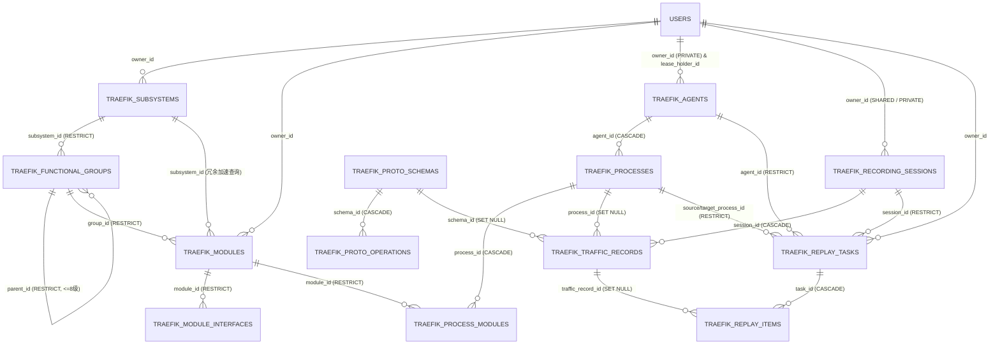

# 业务流量监控与重放 (`code-traefik`) 数据库物理模型与 GORM 建模字典

- **文档编号**：`05-database-schema.md`
- **文档版本**：v1.2.0
- **更新日期**：2026-10-29
- **归属阶段**：阶段二：系统架构与数据模型设计 (`02-design`)
- **状态**：定稿待审 (Ready for Review)
- **上位基线**：[`01-feature-matrix.md`](../01-features/01-feature-matrix.md) (v2.6.0)、[`01-system-architecture.md`](./01-system-architecture.md)、[`04-traffic-storage-partitioning-and-relational-normalization.md`](../05-adr/04-traffic-storage-partitioning-and-relational-normalization.md)

---

## 1. 数据库共享隔离原则、分区规范与类型安全约定

1. **共享库表名前缀强制隔离**：`code-traefik-server` 与宿主门户 `code-bench` 共享同一 PostgreSQL 实例，直接复用 `code-common/backend/models` 中的 `users`、`departments`、`audit_logs` 公共表；本子系统全部 **13 张核心业务实体与关联表**（及平台治理参数表 `traefik_settings`）必须显式实现 `TableName() string` 并冠以 `config.TablePrefix`（**`traefik_`**）前缀。
2. **关系规范化解耦（新增关联表与重放条目表）**：
   - 彻底解除用 JSONB 存储业务核心关系的权宜设计：新增 **`traefik_process_modules`** 物理关联表，以数据库强唯一索引（`UNIQUE(module_id) WHERE scope='SHARED'` 与 `UNIQUE(agent_id, module_id)`）保障公私域单实例不变量（A-03）；
   - 新增 **`traefik_replay_items`** 物理条目表，每条被测请求独立一行持久化 `actual_rsp_packet`（`bytea`）与 `field_diffs`（`jsonb`），支持标准服务端分页查询与历史多次 Diff 重跑。
3. **海量流量时间范围物理分区 (`Range Partitioning`)**：
   - 核心流量往返表 **`traefik_traffic_records`** 采用 PostgreSQL 原生 **`PARTITION BY RANGE (created_at)`** 按日（或按周）自动建表；
   - 30 天保留期清理流水线从原先高成本、锁表严重的 `DELETE ... LIMIT 5000` 切换为轻量级 **`DROP TABLE traefik_traffic_records_yYYYYmMMdDD`**，实现磁盘空间毫秒级无锁释放。
4. **64 位无符号协议整数精度防腐 (`U64Numeric`)**：
   - CROS RPC 协议中的 `ullSNO` 与 `ullStatusCode` 为无符号 `UINT64`（值域 `0 .. 18446744073709551615`），超出 PostgreSQL `BIGINT` 范围。模型层采用 `NUMERIC(20,0)` 并封装自定义 GORM 类型 `U64Numeric`（实现 `sql.Scanner` 与 `driver.Valuer`），JSON Tag 统一声明 `,string`；`TraceID` / `SpanID` / `FatherSpanID` 统一规范化为 16 位小写十六进制字符串存储。
5. **无损二进制 + 结构化 JSONB 双模往返存储契约**：
   - 采用 **单次 RPC 往返一行 (`Exchange-per-Row`)** 模型，同时持久化 `raw_req_packet` / `raw_rsp_packet`（`bytea`，重放资产基石）与 `payload_json`（`jsonb`，挂载 GIN 索引支撑明文检索）。
6. **测试物理隔离铁律**：所有涉及 GORM 的单测必须使用 `testdb.SetupIsolatedDB(t)` 动态创建临时库并在 `t.Cleanup` 销毁，严禁连接共享库。

---

## 2. 全局物理实体关系拓扑图 (Physical ER Diagram)



---

## 3. 11 张 `traefik_*` 核心业务表完整 GORM 模型定义

### 3.1 架构元素领域表（表 1 ~ 表 3）

```go
package models

import (
	"time"

	commonModels "code-common/backend/models"
	"code-traefik/config"
	"gorm.io/datatypes"
)

type User = commonModels.User
type Department = commonModels.Department
type SysAuditLog = commonModels.SysAuditLog

// 1. Subsystem 顶层业务子系统表 (traefik_subsystems)
type Subsystem struct {
	ID          uint64    `gorm:"primaryKey;autoIncrement" json:"id"`
	Code        string    `gorm:"size:64;not null;uniqueIndex:uk_traefik_subsystems_code" json:"code"` // 全局唯一大写编码
	Name        string    `gorm:"size:128;not null;index:idx_traefik_subsystems_name" json:"name"`
	OwnerID     *uint     `gorm:"index:idx_traefik_subsystems_owner" json:"owner_id"`
	Owner       *User     `gorm:"foreignKey:OwnerID;constraint:OnUpdate:CASCADE,OnDelete:SET NULL" json:"owner,omitempty"`
	Description string    `gorm:"type:text" json:"description"`
	CreatedBy   uint      `gorm:"not null;default:0" json:"created_by"`
	UpdatedBy   uint      `gorm:"not null;default:0" json:"updated_by"`
	CreatedAt   time.Time `json:"created_at"`
	UpdatedAt   time.Time `json:"updated_at"`
}

func (Subsystem) TableName() string { return config.TablePrefix + "subsystems" }

// 2. FunctionalGroup 多级自嵌套功能组树表 (traefik_functional_groups)
type FunctionalGroup struct {
	ID          uint64           `gorm:"primaryKey;autoIncrement" json:"id"`
	SubsystemID uint64           `gorm:"not null;uniqueIndex:uk_traefik_fg_sub_code,priority:1;index:idx_traefik_fg_sub_path,priority:1" json:"subsystem_id"`
	Subsystem   *Subsystem       `gorm:"foreignKey:SubsystemID;constraint:OnUpdate:CASCADE,OnDelete:RESTRICT" json:"subsystem,omitempty"`
	ParentID    *uint64          `gorm:"index:idx_traefik_fg_parent" json:"parent_id"` // 根节点为 nil
	Parent      *FunctionalGroup `gorm:"foreignKey:ParentID;constraint:OnUpdate:CASCADE,OnDelete:RESTRICT" json:"-"`
	Code        string           `gorm:"size:64;not null;uniqueIndex:uk_traefik_fg_sub_code,priority:2" json:"code"` // 同子系统内唯一
	Name        string           `gorm:"size:128;not null" json:"name"`
	Level       int              `gorm:"not null;default:1;check:chk_traefik_fg_level,level >= 1 AND level <= 8" json:"level"` // 最大深度 8 级
	Path        string           `gorm:"size:256;not null;index:idx_traefik_fg_sub_path,priority:2" json:"path"`               // 物化路径 "/10/12/"
	SortOrder   int              `gorm:"not null;default:0" json:"sort_order"`
	Description string           `gorm:"type:text" json:"description"`
	CreatedBy   uint             `gorm:"not null;default:0" json:"created_by"`
	UpdatedBy   uint             `gorm:"not null;default:0" json:"updated_by"`
	CreatedAt   time.Time        `json:"created_at"`
	UpdatedAt   time.Time        `json:"updated_at"`
}

func (FunctionalGroup) TableName() string { return config.TablePrefix + "functional_groups" }

// 3. Module 最小接口契约功能模块表 (traefik_modules)
type Module struct {
	ID          uint64           `gorm:"primaryKey;autoIncrement" json:"id"`
	SubsystemID uint64           `gorm:"not null;index:idx_traefik_modules_subsystem" json:"subsystem_id"` // 冗余所属子系统加速检索
	Subsystem   *Subsystem       `gorm:"foreignKey:SubsystemID;constraint:OnUpdate:CASCADE,OnDelete:RESTRICT" json:"subsystem,omitempty"`
	GroupID     uint64           `gorm:"not null;index:idx_traefik_modules_group" json:"group_id"` // 可挂载于任意层级功能组
	Group       *FunctionalGroup `gorm:"foreignKey:GroupID;constraint:OnUpdate:CASCADE,OnDelete:RESTRICT" json:"group,omitempty"`
	ProcessID   *uint64          `gorm:"index:idx_traefik_modules_process" json:"process_id"` // 指向公共 SHARED 环境绑定的唯一基线进程 (A-03)；私有 Agent 进程经 Process.ModuleIDs 复用本模块
	Process     *Process         `gorm:"foreignKey:ProcessID;constraint:OnUpdate:CASCADE,OnDelete:SET NULL" json:"process,omitempty"`
	Code        string           `gorm:"size:64;not null;uniqueIndex:uk_traefik_modules_code" json:"code"` // 全局唯一编码
	Name        string           `gorm:"size:128;not null;index:idx_traefik_modules_name" json:"name"`
	OwnerID     *uint            `gorm:"index:idx_traefik_modules_owner" json:"owner_id"`
	Owner       *User            `gorm:"foreignKey:OwnerID;constraint:OnUpdate:CASCADE,OnDelete:SET NULL" json:"owner,omitempty"`
	Description string           `gorm:"type:text" json:"description"`
	CreatedBy   uint             `gorm:"not null;default:0" json:"created_by"`
	UpdatedBy   uint             `gorm:"not null;default:0" json:"updated_by"`
	CreatedAt   time.Time        `json:"created_at"`
	UpdatedAt   time.Time        `json:"updated_at"`
}

func (Module) TableName() string { return config.TablePrefix + "modules" }
```

### 3.2 模块接口契约表（表 4）

```go
const (
	InterfaceRelationProvide = "PROVIDE" // 模块对外实现的供给接口 (全局唯一 A-05)
	InterfaceRelationDepend  = "DEPEND"  // 模块调用下游的依赖接口
)

// 4. ModuleInterface 模块级供给与依赖接口契约表 (traefik_module_interfaces)
type ModuleInterface struct {
	ID              uint64         `gorm:"primaryKey;autoIncrement" json:"id"`
	ModuleID        uint64         `gorm:"not null;uniqueIndex:uk_traefik_mod_iface_tuple,priority:1;index:idx_traefik_mod_iface_mod" json:"module_id"`
	Module          *Module        `gorm:"foreignKey:ModuleID;constraint:OnUpdate:CASCADE,OnDelete:RESTRICT" json:"module,omitempty"`
	RelationType    string         `gorm:"size:16;not null;uniqueIndex:uk_traefik_mod_iface_tuple,priority:2;check:chk_traefik_iface_rel,relation_type IN ('PROVIDE','DEPEND')" json:"relation_type"`
	ServiceName     string         `gorm:"size:128;not null;uniqueIndex:uk_traefik_mod_iface_tuple,priority:3;uniqueIndex:uk_traefik_provide_service_op,priority:1,where:relation_type = 'PROVIDE';index:idx_traefik_iface_svc_op,priority:1" json:"service_name"` // 格式 {package}-{serviceName}
	Operation       string         `gorm:"size:128;not null;uniqueIndex:uk_traefik_mod_iface_tuple,priority:4;uniqueIndex:uk_traefik_provide_service_op,priority:2,where:relation_type = 'PROVIDE';index:idx_traefik_iface_svc_op,priority:2" json:"operation"`    // 与 Method 名直接相等
	DiffIgnorePaths datatypes.JSON `gorm:"type:jsonb;not null;default:'[]'" json:"diff_ignore_paths"` // 接口级默认回归 Diff 忽略字段路径 []string (F-14)
	Description     string         `gorm:"size:512" json:"description"`
	CreatedBy       uint           `gorm:"not null;default:0" json:"created_by"`
	CreatedAt       time.Time      `json:"created_at"`
	UpdatedAt       time.Time      `json:"updated_at"`
}

func (ModuleInterface) TableName() string { return config.TablePrefix + "module_interfaces" }
```

### 3.3 公私域 Agent 纳管、动态排他租约与进程部署表（表 5 ~ 表 6）

```go
const (
	ScopeShared  = "SHARED"  // 团队共享公共资源
	ScopePrivate = "PRIVATE" // 用户个人私有资源

	AgentStatusOnline  = "ONLINE"
	AgentStatusOffline = "OFFLINE"

	AgentLeaseNone      = ""          // 空闲无租约
	AgentLeaseRecording = "RECORDING" // 录制会话排他占用中
	AgentLeaseReplay    = "REPLAY"    // 重放任务排他占用中
)

// 5. Agent 数据面宿主机守护进程纳管与动态排他租约表 (traefik_agents)
type Agent struct {
	ID              uint64     `gorm:"primaryKey;autoIncrement" json:"id"`
	Name            string     `gorm:"size:128;not null;uniqueIndex:uk_traefik_agents_name" json:"name"`
	Endpoint        string     `gorm:"size:128;not null;uniqueIndex:uk_traefik_agents_endpoint" json:"endpoint"` // 唯一 IP:Port
	Scope           string     `gorm:"size:16;not null;default:'SHARED';index:idx_traefik_agents_scope_owner,priority:1;check:chk_traefik_agents_scope,scope IN ('SHARED','PRIVATE')" json:"scope"`
	OwnerID         *uint      `gorm:"index:idx_traefik_agents_scope_owner,priority:2" json:"owner_id,omitempty"` // SHARED 为 nil；PRIVATE 必填创建人 users.id
	Owner           *User      `gorm:"foreignKey:OwnerID;constraint:OnUpdate:CASCADE,OnDelete:RESTRICT" json:"owner,omitempty"`
	Status          string     `gorm:"size:32;not null;default:'OFFLINE';index:idx_traefik_agents_status" json:"status"`
	AgentVersion    string     `gorm:"size:64;not null;default:''" json:"agent_version"`
	ProtocolVersion string     `gorm:"size:32;not null;default:''" json:"protocol_version"` // 如 "1.0"
	KernelVersion   string     `gorm:"size:128;not null;default:''" json:"kernel_version"`
	HasEbpfCap      bool       `gorm:"not null;default:false" json:"has_ebpf_cap"` // CAP_BPF + CAP_NET_ADMIN 具备状态
	CapDetail       string     `gorm:"size:512;not null;default:''" json:"cap_detail"`
	LastHeartbeatAt *time.Time `gorm:"index:idx_traefik_agents_hb" json:"last_heartbeat_at"`

	// 动态排他租约列 (Agent Mutex Lease：同一时刻仅允许 1 名用户执行 1 项录制或重放操作)
	LeaseType       string     `gorm:"size:16;not null;default:'';index:idx_traefik_agents_lease;check:chk_traefik_agents_lease,lease_type IN ('','RECORDING','REPLAY')" json:"lease_type"`
	LeaseRefID      *uint64    `json:"lease_ref_id,omitempty"`                                                      // 当前占用本 Agent 的 RecordingSession.ID 或 ReplayTask.ID
	LeaseHolderID   *uint      `gorm:"index:idx_traefik_agents_lease_holder" json:"lease_holder_id,omitempty"`      // 持锁操作人 users.id
	LeaseHolder     *User      `gorm:"foreignKey:LeaseHolderID;constraint:OnUpdate:CASCADE,OnDelete:SET NULL" json:"lease_holder,omitempty"`
	LeaseAcquiredAt *time.Time `json:"lease_acquired_at,omitempty"`
	LeaseExpiresAt  *time.Time `gorm:"index:idx_traefik_agents_lease_exp" json:"lease_expires_at,omitempty"`        // 硬性安全到期时间，超时触发惰性自愈解锁

	Description     string     `gorm:"type:text" json:"description"`
	CreatedBy       uint       `gorm:"not null;default:0" json:"created_by"`
	UpdatedBy       uint       `gorm:"not null;default:0" json:"updated_by"`
	CreatedAt       time.Time  `json:"created_at"`
	UpdatedAt       time.Time  `json:"updated_at"`
}

func (Agent) TableName() string { return config.TablePrefix + "agents" }

// 6. Process 业务宿主机目标进程部署映射表 (traefik_processes)
// 注：实时操作系统 PID 不作为权威静态字段落库，由 Agent 运行期通过 ListenPort / CmdPattern 动态反查
type Process struct {
	ID               uint64          `gorm:"primaryKey;autoIncrement" json:"id"`
	AgentID          uint64          `gorm:"not null;uniqueIndex:uk_traefik_proc_agent_port,priority:1;uniqueIndex:uk_traefik_proc_agent_name,priority:1;index:idx_traefik_proc_agent" json:"agent_id"`
	Agent            *Agent          `gorm:"foreignKey:AgentID;constraint:OnUpdate:CASCADE,OnDelete:RESTRICT" json:"agent,omitempty"`
	Name             string          `gorm:"size:128;not null;uniqueIndex:uk_traefik_proc_agent_name,priority:2" json:"name"`
	ListenPort       int             `gorm:"not null;uniqueIndex:uk_traefik_proc_agent_port,priority:2;check:chk_traefik_proc_port,listen_port >= 1 AND listen_port <= 65535" json:"listen_port"` // 单进程单监听端口互斥 (A-02)
	AdvertiseIP      string          `gorm:"size:64;not null;default:''" json:"advertise_ip"` // 可选对外业务通信 IP，为空时默认取所属 Agent IP
	CmdPattern       string          `gorm:"size:512;not null" json:"cmd_pattern"`            // /proc/<pid>/cmdline 匹配规则
	ProcessModules   []ProcessModule `gorm:"foreignKey:ProcessID;constraint:OnUpdate:CASCADE,OnDelete:CASCADE" json:"process_modules,omitempty"` // 强关系关联表
	ModuleIDs        []uint64        `gorm:"-" json:"module_ids,omitempty"`                   // DTO 传输便捷字段 (入库前持久化到 traefik_process_modules)
	ExtraDownstreams datatypes.JSON  `gorm:"type:jsonb;not null;default:'[]'" json:"extra_downstreams"` // 显式补充的外部未登记下游 ["IP:Port"]
	Description      string          `gorm:"type:text" json:"description"`
	CreatedBy        uint            `gorm:"not null;default:0" json:"created_by"`
	UpdatedBy        uint            `gorm:"not null;default:0" json:"updated_by"`
	CreatedAt        time.Time       `json:"created_at"`
	UpdatedAt        time.Time       `json:"updated_at"`
}

func (Process) TableName() string { return config.TablePrefix + "processes" }

// 7. ProcessModule 业务进程与功能模块同构承载关联表 (traefik_process_modules)
// 替代 JSONB 列表，提供强外键约束与双向高效索引，支撑跨 Agent 同构重放能力定位
type ProcessModule struct {
	ID        uint64    `gorm:"primaryKey;autoIncrement" json:"id"`
	ProcessID uint64    `gorm:"not null;uniqueIndex:uk_traefik_proc_mod,priority:1;index:idx_traefik_proc_mod_pid" json:"process_id"`
	Process   *Process  `gorm:"foreignKey:ProcessID;constraint:OnUpdate:CASCADE,OnDelete:CASCADE" json:"-"`
	ModuleID  uint64    `gorm:"not null;uniqueIndex:uk_traefik_proc_mod,priority:2;index:idx_traefik_proc_mod_mid" json:"module_id"`
	Module    *Module   `gorm:"foreignKey:ModuleID;constraint:OnUpdate:CASCADE,OnDelete:RESTRICT" json:"module,omitempty"`
	CreatedAt time.Time `json:"created_at"`
}

func (ProcessModule) TableName() string { return config.TablePrefix + "process_modules" }
```

### 3.4 IDL 描述集与方法映射字典表（表 8 ~ 表 9）

```go
// 8. ProtoSchema Protobuf 编译描述集 (.pb FileDescriptorSet) 多版本仓库表 (traefik_proto_schemas)
type ProtoSchema struct {
	ID              uint64    `gorm:"primaryKey;autoIncrement" json:"id"`
	Name            string    `gorm:"size:128;not null;uniqueIndex:uk_traefik_proto_name_ver,priority:1;uniqueIndex:uk_traefik_proto_active_name,where:is_active = true" json:"name"`
	Version         int       `gorm:"not null;uniqueIndex:uk_traefik_proto_name_ver,priority:2" json:"version"` // 同名递增版本号 1, 2, 3...
	VersionTag      string    `gorm:"size:64;not null;default:''" json:"version_tag"`
	FileName        string    `gorm:"size:255;not null" json:"file_name"`   // 经 filepath.Base 净化的展示文件名
	FileSHA256      string    `gorm:"size:64;not null;index:idx_traefik_proto_sha" json:"file_sha256"`
	FileSize        int       `gorm:"not null;check:chk_traefik_proto_size,file_size > 0 AND file_size <= 4194304" json:"file_size"` // <= 4MB
	DescriptorBytes []byte    `gorm:"type:bytea;not null" json:"-"`         // 二进制内容仅存 DB，JSON 响应默认不透出
	IsActive        bool      `gorm:"not null;default:false;index:idx_traefik_proto_active" json:"is_active"`
	OperationCount  int       `gorm:"not null;default:0" json:"operation_count"`
	Description     string    `gorm:"type:text" json:"description"`
	CreatedBy       uint      `gorm:"not null;default:0" json:"created_by"`
	CreatedAt       time.Time `json:"created_at"`
	UpdatedAt       time.Time `json:"updated_at"`
}

func (ProtoSchema) TableName() string { return config.TablePrefix + "proto_schemas" }

// 9. ProtoOperation 描述集解析出的 CROS RPC 服务方法映射表 (traefik_proto_operations)
type ProtoOperation struct {
	ID                 uint64       `gorm:"primaryKey;autoIncrement" json:"id"`
	SchemaID           uint64       `gorm:"not null;uniqueIndex:uk_traefik_proto_op_schema,priority:1;index:idx_traefik_proto_op_sid" json:"schema_id"`
	Schema             *ProtoSchema `gorm:"foreignKey:SchemaID;constraint:OnUpdate:CASCADE,OnDelete:CASCADE" json:"-"`
	ProtoFile          string       `gorm:"size:255;not null" json:"proto_file"`
	ProtoPackage       string       `gorm:"size:128;not null" json:"proto_package"` // 原样点分结构，如 "dophi.order.v1"
	ProtoService       string       `gorm:"size:128;not null" json:"proto_service"` // Service 简称，如 "TradeService"
	ServiceName        string       `gorm:"size:128;not null;uniqueIndex:uk_traefik_proto_op_schema,priority:2;uniqueIndex:uk_traefik_active_proto_op,priority:1,where:is_active = true;index:idx_traefik_proto_op_lookup,priority:1" json:"service_name"` // "{package}-{serviceName}"
	Operation          string       `gorm:"size:128;not null;uniqueIndex:uk_traefik_proto_op_schema,priority:3;uniqueIndex:uk_traefik_active_proto_op,priority:2,where:is_active = true;index:idx_traefik_proto_op_lookup,priority:2" json:"operation"`    // Method 名
	ReqMessageFullName string       `gorm:"size:255;not null" json:"req_message_full_name"`
	RspMessageFullName string       `gorm:"size:255;not null" json:"rsp_message_full_name"`
	ClientStreaming    bool         `gorm:"not null;default:false" json:"client_streaming"`
	ServerStreaming    bool         `gorm:"not null;default:false" json:"server_streaming"`
	IsActive           bool         `gorm:"not null;default:false;index:idx_traefik_proto_op_active" json:"is_active"` // 随所属 Schema 原子切换，由部分唯一索引保障全局无冲突 (F-03.3)
	CreatedAt          time.Time    `json:"created_at"`
}

func (ProtoOperation) TableName() string { return config.TablePrefix + "proto_operations" }
```

### 3.5 公私域协同录制、双模物理分区归档与跨 Agent 重放断言表（表 10 ~ 表 13）

```go
const (
	SessionStatusPending          = "PENDING"
	SessionStatusRecording        = "RECORDING"
	SessionStatusStopping         = "STOPPING"
	SessionStatusCompleted        = "COMPLETED"
	SessionStatusCompletedByLimit = "COMPLETED_BY_LIMIT" // 达到时长或帧数上限自动停止 (F-11)
	SessionStatusFailed           = "FAILED"

	TrafficDirIngress = "INGRESS"
	TrafficDirEgress  = "EGRESS"

	ExchangeUnary     = "UNARY"      // 标准一问一答 (REQ + RSP)
	ExchangeStreamRsp = "STREAM_RSP" // 流式分片应答 (REQ + N*RSP_SEG + RSP)
	ExchangeOneway    = "ONEWAY"     // 单向通知请求 (ucReqType=3, 无应答)
	ExchangeReqOnly   = "REQ_ONLY"   // 超配对窗口或停录时未收到应答的挂起请求
	ExchangeRspOrphan = "RSP_ORPHAN" // 连接中途切入捕获到的孤立应答帧
	ExchangeMng       = "MNG"        // 连接管理握手/心跳报文 (ucMsgType=5..7)

	ReplayResultPass     = "PASS"
	ReplayResultFailed   = "FAILED"
	ReplayResultMockMiss = "MOCK_MISS"
	ReplayResultTimeout  = "TIMEOUT"
	ReplayResultError    = "ERROR"
)

// 10. RecordingSession 任务级多进程协同录制批次表 (traefik_recording_sessions)
type RecordingSession struct {
	ID                    uint64         `gorm:"primaryKey;autoIncrement" json:"id"`
	SessionNo             string         `gorm:"size:64;not null;uniqueIndex:uk_traefik_rec_session_no" json:"session_no"`
	Name                  string         `gorm:"size:128;not null;index:idx_traefik_rec_name" json:"name"`
	Scope                 string         `gorm:"size:16;not null;default:'PRIVATE';index:idx_traefik_rec_scope_owner,priority:1;check:chk_traefik_rec_scope,scope IN ('SHARED','PRIVATE')" json:"scope"` // 公共级 SHARED 或个人级 PRIVATE
	OwnerID               uint           `gorm:"not null;index:idx_traefik_rec_scope_owner,priority:2" json:"owner_id"`                                                                                 // 素材归属用户 users.id
	Owner                 *User          `gorm:"foreignKey:OwnerID;constraint:OnUpdate:CASCADE,OnDelete:RESTRICT" json:"owner,omitempty"`
	Status                string         `gorm:"size:32;not null;default:'PENDING';index:idx_traefik_rec_status" json:"status"`
	LeasedAgentIDs        datatypes.JSON `gorm:"type:jsonb;not null;default:'[]'" json:"leased_agent_ids"`       // []uint64 本批次锁定的 Agent ID 升序列表，供停止/恢复时确定性释放排他租约
	TargetProcessIDs      datatypes.JSON `gorm:"type:jsonb;not null" json:"target_process_ids"`                  // []uint64 参与进程快照
	ProcessDiagnostics    datatypes.JSON `gorm:"type:jsonb;not null;default:'[]'" json:"process_diagnostics"`    // PID 定位与存量长连接诊断快照
	MaxDurationSec        int            `gorm:"not null;default:1800" json:"max_duration_sec"`                  // 默认最长 30 分钟
	MaxFrames             int            `gorm:"not null;default:100000" json:"max_frames"`                      // 默认最大 10 万帧
	MaxFrameBytes         int            `gorm:"not null;default:4194304" json:"max_frame_bytes"`                // 默认单帧采集阈值 4MB
	CapturedFrames        int64          `gorm:"not null;default:0" json:"captured_frames"`
	DroppedFrames         int64          `gorm:"not null;default:0" json:"dropped_frames"`                       // Agent 有界缓冲背压丢帧累计
	StartedAt             *time.Time     `json:"started_at"`
	StoppedAt             *time.Time     `gorm:"index:idx_traefik_rec_stopped_at" json:"stopped_at"`             // 供 30 天 TTL 保留期清理扫描
	StopReason            string         `gorm:"size:255;not null;default:''" json:"stop_reason"`
	TopologyVerifySummary datatypes.JSON `gorm:"type:jsonb" json:"topology_verify_summary,omitempty"`            // 架构一致性验证摘要缓存
	Description           string         `gorm:"type:text" json:"description"`
	CreatedBy             uint           `gorm:"not null;default:0;index:idx_traefik_rec_creator" json:"created_by"`
	CreatedAt             time.Time      `gorm:"index:idx_traefik_rec_created_at" json:"created_at"`
	UpdatedAt             time.Time      `json:"updated_at"`
}

func (RecordingSession) TableName() string { return config.TablePrefix + "recording_sessions" }

// 11. TrafficRecord CROS RPC 无损二进制 + 结构化 JSONB 双模往返物理分区表 (traefik_traffic_records)
// 采用 Exchange-per-Row 单次往返一行模型，按 created_at 进行 PostgreSQL PARTITION BY RANGE (created_at)
// 满足 30 天数据保留期的 O(1) 零锁表 DROP TABLE 毫秒级轮转
type TrafficRecord struct {
	ID                    uint64            `gorm:"column:id;not null" json:"id"` // 复合主键之一，由全局序列生成
	CreatedAt             time.Time         `gorm:"column:created_at;not null" json:"created_at"` // 分区键与复合主键之二
	SessionID             uint64            `gorm:"not null;index:idx_traefik_tr_session_seq,priority:1;index:idx_traefik_tr_session_svc,priority:1;index:idx_traefik_tr_session_trace,priority:1" json:"session_id"`
	SeqNo                 int64             `gorm:"not null;index:idx_traefik_tr_session_seq,priority:2" json:"seq_no"`
	AgentID               uint64            `gorm:"not null;index:idx_traefik_tr_agent" json:"agent_id"`
	ProcessID             uint64            `gorm:"not null;index:idx_traefik_tr_proc_dir,priority:1" json:"process_id"`
	CapturedPID           uint32            `gorm:"not null" json:"captured_pid"`
	ConnKey               string            `gorm:"size:128;not null;index:idx_traefik_tr_conn_sno,priority:1" json:"conn_key"`
	Direction             string            `gorm:"size:16;not null;index:idx_traefik_tr_proc_dir,priority:2" json:"direction"` // INGRESS | EGRESS
	ExchangeType          string            `gorm:"size:24;not null;default:'UNARY';index:idx_traefik_tr_exchange;check:chk_traefik_tr_ex_type,exchange_type IN ('UNARY','STREAM_RSP','ONEWAY','REQ_ONLY','RSP_ORPHAN','MNG')" json:"exchange_type"`
	SrcAddr               string            `gorm:"size:64;not null" json:"src_addr"`
	DstAddr               string            `gorm:"size:64;not null" json:"dst_addr"`
	ReqCapturedAtNs       int64             `gorm:"not null;index:idx_traefik_tr_req_ns" json:"req_captured_at_ns"`
	RspCapturedAtNs       *int64            `json:"rsp_captured_at_ns,omitempty"`
	LatencyUs             *int64            `json:"latency_us,omitempty"` // 往返微秒耗时 (rsp_captured_at_ns - req_captured_at_ns)/1000

	// CROS RPC 公共头与会话头核心索引列
	TransportProto        uint8             `gorm:"not null;default:1" json:"transport_proto"`
	SNO                   uint64            `gorm:"type:numeric(20,0);not null;index:idx_traefik_tr_conn_sno,priority:2;index:idx_traefik_tr_sno" json:"sno,string"` // ullSNO 无损无符号 64 位
	ReqType               uint8             `gorm:"not null;default:0" json:"req_type"`                                                                              // ucReqType (1=Sync,2=Async,3=Oneway)
	RspSegCount           int               `gorm:"not null;default:0" json:"rsp_seg_count"`                                                                         // 应答帧总段数 (UNARY=1, STREAM_RSP>=2)
	IsPacked              uint8             `gorm:"not null;default:1" json:"is_packed"`
	ServiceName           string            `gorm:"size:128;not null;default:'';index:idx_traefik_tr_session_svc,priority:2" json:"service_name"`
	Operation             string            `gorm:"size:128;not null;default:'';index:idx_traefik_tr_session_svc,priority:3" json:"operation"`
	StatusCode            uint64            `gorm:"type:numeric(20,0);not null;default:0" json:"status_code,string"`
	TraceID               string            `gorm:"size:32;not null;default:'';index:idx_traefik_tr_session_trace,priority:2" json:"trace_id"` // 16位十六进制字符串
	SpanID                string            `gorm:"size:32;not null;default:'';index:idx_traefik_tr_span" json:"span_id"`
	FatherSpanID          string            `gorm:"size:32;not null;default:'';index:idx_traefik_tr_father_span" json:"father_span_id"`

	// 架构模块穿透定位列
	SubsystemID           *uint64           `gorm:"index:idx_traefik_tr_subsystem" json:"subsystem_id,omitempty"`
	SrcModuleID           *uint64           `gorm:"index:idx_traefik_tr_src_mod" json:"src_module_id,omitempty"`
	SrcAttributionMode    string            `gorm:"size:32;not null;default:''" json:"src_attribution_mode"`
	SrcCandidateModuleIDs datatypes.JSON    `gorm:"type:jsonb" json:"src_candidate_module_ids,omitempty"`
	DstModuleID           *uint64           `gorm:"index:idx_traefik_tr_dst_mod" json:"dst_module_id,omitempty"`

	// 结构化 JSONB + 无损二进制 Bytea 双模持久化列
	HeadersJSON           datatypes.JSON    `gorm:"column:headers_json;type:jsonb;not null" json:"headers_json"`                        // {"req": ParsedHead, "rsp": ParsedHead} 协议头快照
	SchemaID              *uint64           `gorm:"index:idx_traefik_tr_schema" json:"schema_id,omitempty"`
	SchemaVersion         *int              `json:"schema_version,omitempty"`                                                           // 冗余保存解码版本号，切换生效版本不改写历史 (F-03.4)
	DecodeStatus          string            `gorm:"size:32;not null" json:"decode_status"`
	PayloadJSON           datatypes.JSON    `gorm:"column:payload_json;type:jsonb;not null;default:'{}'" json:"payload_json"`           // {"req": <obj|null>, "rsp": <obj|array|null>}，建有局部 GIN 索引
	ReqPayloadSHA256      string            `gorm:"size:64;not null;default:'';index:idx_traefik_tr_req_sha" json:"req_payload_sha256"` // 请求纯载荷 SHA256
	RawReqPacket          []byte            `gorm:"column:raw_req_packet;type:bytea" json:"-"`                                          // 无损原始请求报文帧 (仅 RSP_ORPHAN 允许为 NULL)
	RawRspPacket          []byte            `gorm:"column:raw_rsp_packet;type:bytea" json:"-"`                                          // 无损原始应答报文帧 (多段 RSP_SEG+RSP 连续拼接，经 crosrpc.SplitFrames 无损切分)
	IsTruncated           bool              `gorm:"not null;default:false" json:"is_truncated"`
	IsReplayable          bool              `gorm:"not null;default:true;index:idx_traefik_tr_replayable" json:"is_replayable"`
}

func (TrafficRecord) TableName() string { return config.TablePrefix + "traffic_records" }

// 12. ReplayTask 跨 Agent 同构离线自愈重放任务头表 (traefik_replay_tasks)
type ReplayTask struct {
	ID                uint64            `gorm:"primaryKey;autoIncrement" json:"id"`
	TaskNo            string            `gorm:"size:64;not null;uniqueIndex:uk_traefik_replay_task_no" json:"task_no"`
	Name              string            `gorm:"size:128;not null" json:"name"`
	OwnerID           uint              `gorm:"not null;index:idx_traefik_replay_owner" json:"owner_id"`
	Owner             *User             `gorm:"foreignKey:OwnerID;constraint:OnUpdate:CASCADE,OnDelete:RESTRICT" json:"owner,omitempty"`
	SessionID         uint64            `gorm:"not null;index:idx_traefik_replay_session" json:"session_id"`
	Session           *RecordingSession `gorm:"foreignKey:SessionID;constraint:OnUpdate:CASCADE,OnDelete:RESTRICT" json:"session,omitempty"`
	SourceProcessID   uint64            `gorm:"not null;index:idx_traefik_replay_src_proc" json:"source_process_id"` // 录制素材中的源进程 ID
	SourceProcess     *Process          `gorm:"foreignKey:SourceProcessID;constraint:OnUpdate:CASCADE,OnDelete:RESTRICT" json:"source_process,omitempty"`
	TargetProcessID   uint64            `gorm:"not null;index:idx_traefik_replay_tgt_proc" json:"target_process_id"` // 实际执行重放的同构目标进程 ID (可位于本人 PRIVATE Agent 或空闲 SHARED Agent)
	TargetProcess     *Process          `gorm:"foreignKey:TargetProcessID;constraint:OnUpdate:CASCADE,OnDelete:RESTRICT" json:"target_process,omitempty"`
	AgentID           uint64            `gorm:"not null;index:idx_traefik_replay_agent" json:"agent_id"`             // TargetProcess 所属的目标 Agent ID (任务期间持有排他租约)
	Agent             *Agent            `gorm:"foreignKey:AgentID;constraint:OnUpdate:CASCADE,OnDelete:RESTRICT" json:"agent,omitempty"`
	SelectedRecordIDs datatypes.JSON    `gorm:"type:jsonb;not null" json:"selected_record_ids"`                      // []uint64 选定注入的 INGRESS 往返记录 ID
	ExtraIgnorePaths  datatypes.JSON    `gorm:"type:jsonb;not null;default:'[]'" json:"extra_ignore_paths"`          // 任务级临时追加忽略字段路径 []string
	TimeoutMs         int               `gorm:"not null;default:30000" json:"timeout_ms"`                            // 单请求等待超时默认 30s
	LifecycleState    string            `gorm:"size:32;not null;default:'PENDING';index:idx_traefik_replay_state" json:"lifecycle_state"`
	ResultStatus      string            `gorm:"size:32;not null;default:'';index:idx_traefik_replay_result" json:"result_status"` // PASS | FAILED | MOCK_MISS | TIMEOUT | ERROR
	TotalRequests     int               `gorm:"not null;default:0" json:"total_requests"`
	PassedRequests    int               `gorm:"not null;default:0" json:"passed_requests"`
	MockHitCount      int               `gorm:"not null;default:0" json:"mock_hit_count"`
	MockMissCount     int               `gorm:"not null;default:0" json:"mock_miss_count"`
	MockEvents        datatypes.JSON    `gorm:"type:jsonb;not null;default:'[]'" json:"mock_events"`                 // Mock 命中/自愈回写详情与 MOCK_MISS 诊断明细
	ErrorMessage      string            `gorm:"type:text" json:"error_message"`
	StartedAt         *time.Time        `json:"started_at"`
	FinishedAt        *time.Time        `json:"finished_at"`
	CreatedBy         uint              `gorm:"not null;default:0;index:idx_traefik_replay_creator" json:"created_by"`
	CreatedAt         time.Time         `gorm:"index:idx_traefik_replay_created_at" json:"created_at"`
	UpdatedAt         time.Time         `json:"updated_at"`
}

func (ReplayTask) TableName() string { return config.TablePrefix + "replay_tasks" }

// 13. ReplayItem 重放任务单请求独立执行结果与双层 Diff 明细表 (traefik_replay_items)
// 规范化拆解原 JSONB 大字段，支持明细项并发流式更新、分页检索与实际响应切片归档
type ReplayItem struct {
	ID              uint64         `gorm:"primaryKey;autoIncrement" json:"id"`
	TaskID          uint64         `gorm:"not null;uniqueIndex:uk_traefik_replay_task_item,priority:1;index:idx_traefik_replay_item_task" json:"task_id"`
	Task            *ReplayTask    `gorm:"foreignKey:TaskID;constraint:OnUpdate:CASCADE,OnDelete:CASCADE" json:"-"`
	RecordID        uint64         `gorm:"not null;uniqueIndex:uk_traefik_replay_task_item,priority:2;index:idx_traefik_replay_item_rec" json:"record_id"`
	SeqNo           int64          `gorm:"not null;index:idx_traefik_replay_item_seq" json:"seq_no"`
	ServiceName     string         `gorm:"size:128;not null" json:"service_name"`
	Operation       string         `gorm:"size:128;not null" json:"operation"`
	ResultStatus    string         `gorm:"size:32;not null;index:idx_traefik_replay_item_status" json:"result_status"` // PASS | FAILED | MOCK_MISS | TIMEOUT | ERROR
	LatencyUs       int64          `gorm:"not null;default:0" json:"latency_us"`
	ActualStatus    uint64         `gorm:"type:numeric(20,0);not null;default:0" json:"actual_status,string"`
	BaselineStatus  uint64         `gorm:"type:numeric(20,0);not null;default:0" json:"baseline_status,string"`
	FieldDiffs      datatypes.JSON `gorm:"type:jsonb;not null;default:'[]'" json:"field_diffs"` // []FieldDiff 双层对比差异
	ActualPayload   datatypes.JSON `gorm:"type:jsonb" json:"actual_payload,omitempty"`
	RawActualPacket []byte         `gorm:"type:bytea" json:"-"`                                 // 实际捕获响应切片
	MockTrace       datatypes.JSON `gorm:"type:jsonb;not null;default:'[]'" json:"mock_trace"`  // 本条请求相关的 Mock 命中或未命中轨迹
	ErrorMessage    string         `gorm:"type:text" json:"error_message"`
	CreatedAt       time.Time      `json:"created_at"`
}

func (ReplayItem) TableName() string { return config.TablePrefix + "replay_items" }
```

> **附：治理配置表与自定义 GIN 索引迁移说明**：
> 1. 工程初始化模板自带的 `TraefikSetting`（`traefik_settings`）保留用于持久化管理员可调模块治理参数（如 `traffic_retention_days`、`default_max_frames`、`default_max_duration_sec`），而模板示例占位表 `traefik_items` 在阶段四 M1 迁移时彻底移除；
> 2. `traefik_traffic_records` 分区母表 DDL 由独立 SQL 执行：
>    ```sql
>    CREATE TABLE IF NOT EXISTS traefik_traffic_records (
>        id BIGSERIAL,
>        created_at TIMESTAMPTZ NOT NULL,
>        session_id BIGINT NOT NULL,
>        seq_no BIGINT NOT NULL,
>        agent_id BIGINT NOT NULL,
>        process_id BIGINT NOT NULL,
>        captured_pid INTEGER NOT NULL,
>        conn_key VARCHAR(128) NOT NULL,
>        direction VARCHAR(16) NOT NULL,
>        exchange_type VARCHAR(24) NOT NULL DEFAULT 'UNARY',
>        src_addr VARCHAR(64) NOT NULL,
>        dst_addr VARCHAR(64) NOT NULL,
>        req_captured_at_ns BIGINT NOT NULL,
>        rsp_captured_at_ns BIGINT,
>        latency_us BIGINT,
>        transport_proto SMALLINT NOT NULL DEFAULT 1,
>        sno NUMERIC(20,0) NOT NULL,
>        req_type SMALLINT NOT NULL DEFAULT 0,
>        rsp_seg_count INTEGER NOT NULL DEFAULT 0,
>        is_packed SMALLINT NOT NULL DEFAULT 1,
>        service_name VARCHAR(128) NOT NULL DEFAULT '',
>        operation VARCHAR(128) NOT NULL DEFAULT '',
>        status_code NUMERIC(20,0) NOT NULL DEFAULT 0,
>        trace_id VARCHAR(32) NOT NULL DEFAULT '',
>        span_id VARCHAR(32) NOT NULL DEFAULT '',
>        father_span_id VARCHAR(32) NOT NULL DEFAULT '',
>        subsystem_id BIGINT,
>        src_module_id BIGINT,
>        src_attribution_mode VARCHAR(32) NOT NULL DEFAULT '',
>        src_candidate_module_ids JSONB,
>        dst_module_id BIGINT,
>        headers_json JSONB NOT NULL,
>        schema_id BIGINT,
>        schema_version INTEGER,
>        decode_status VARCHAR(32) NOT NULL,
>        payload_json JSONB NOT NULL DEFAULT '{}',
>        req_payload_sha256 VARCHAR(64) NOT NULL DEFAULT '',
>        raw_req_packet BYTEA,
>        raw_rsp_packet BYTEA,
>        is_truncated BOOLEAN NOT NULL DEFAULT FALSE,
>        is_replayable BOOLEAN NOT NULL DEFAULT TRUE,
>        PRIMARY KEY (id, created_at)
>    ) PARTITION BY RANGE (created_at);
>    ```
> 3. 每个月度/每日子分区自动继承局部索引并支持单独附加 `CREATE INDEX IF NOT EXISTS idx_traefik_tr_payload_gin ON traefik_traffic_records USING GIN (payload_json jsonb_path_ops)`。

---

## 4. 关键唯一索引、部分唯一索引与 GIN 索引字典

| 物理表名 | 索引名 | 索引列与过滤谓词 | 守护的业务契约与假设 |
| :--- | :--- | :--- | :--- |
| `traefik_subsystems` | `uk_traefik_subsystems_code` | `UNIQUE (code)` | F-01：子系统编码全局唯一 |
| `traefik_functional_groups` | `uk_traefik_fg_sub_code` | `UNIQUE (subsystem_id, code)` | F-01：功能组编码在同一子系统内唯一 |
| `traefik_modules` | `uk_traefik_modules_code` | `UNIQUE (code)` | F-01：功能模块编码全局唯一 |
| `traefik_module_interfaces` | `uk_traefik_mod_iface_tuple` | `UNIQUE (module_id, relation_type, service_name, operation)` | F-02：同模块内同一方向接口不重复声明 |
| `traefik_module_interfaces` | `uk_traefik_provide_service_op` | `UNIQUE (service_name, operation) WHERE relation_type = 'PROVIDE'` | **A-05 & F-02**：全局唯一供给接口契约，同时不阻塞多模块声明相同 `DEPEND` |
| `traefik_agents` | `uk_traefik_agents_name` | `UNIQUE (name)` | F-06：Agent 节点名称全局唯一 |
| `traefik_agents` | `uk_traefik_agents_endpoint` | `UNIQUE (endpoint)` | F-06：Agent 访问地址 `IP:Port` 全局唯一 |
| `traefik_processes` | `uk_traefik_proc_agent_port` | `UNIQUE (agent_id, listen_port)` | **A-02 & F-02**：单进程单端口，同一 Agent 下监听端口严格互斥 |
| `traefik_processes` | `uk_traefik_proc_agent_name` | `UNIQUE (agent_id, name)` | F-02：同一 Agent 下业务进程名称唯一 |
| `traefik_process_modules` | `uk_traefik_proc_mod` | `UNIQUE (process_id, module_id)` | F-02：进程与模块多对多承载关联不重复 |
| `traefik_proto_schemas` | `uk_traefik_proto_name_ver` | `UNIQUE (name, version)` | F-03：同名 `.pb` 描述集版本号严格递增不冲突 |
| `traefik_proto_schemas` | `uk_traefik_proto_active_name` | `UNIQUE (name) WHERE is_active = true` | F-03：同名 `.pb` 任意时刻至多 1 个版本处于生效态 |
| `traefik_proto_operations` | `uk_traefik_proto_op_schema` | `UNIQUE (schema_id, service_name, operation)` | F-03：单个 `.pb` 版本内部接口映射唯一 |
| `traefik_proto_operations` | `uk_traefik_active_proto_op` | `UNIQUE (service_name, operation) WHERE is_active = true` | **F-03.3**：所有生效描述集之间 `(service, operation)` 全局唯一，杜绝并发激活冲突 |
| `traefik_replay_tasks` | `uk_traefik_replay_task_no` | `UNIQUE (task_no)` | F-12：重放任务流水号全局唯一 |
| `traefik_replay_items` | `uk_traefik_replay_task_item` | `UNIQUE (task_id, record_id)` | F-12：单重放任务内同一条素材记录仅执行与断言一次 |
| `traefik_traffic_records` | `idx_traefik_tr_payload_gin` | `GIN (payload_json jsonb_path_ops)` | **F-11**：加速 `payload_json` 结构化请求/应答载荷的明文键值条件检索 |

---

## 5. 外键级联、排他租约与 `409 / 403` 业务拦截策略矩阵

为防止误删主数据导致历史流量悬空或多人并发串包，应用层前置校验与数据库外键策略执行双重守卫：

| 操作对象 / 场景 | 依赖子表 / 并发租约 / 归属状态检查 | HTTP 拦截响应 | 数据库外键 / 行锁兜底策略 |
| :--- | :--- | :---: | :---: |
| 删除 `Subsystem` | 存在 `FunctionalGroup` 或 `Module` 引用 | `409 Conflict` | `ON DELETE RESTRICT` |
| 删除 `FunctionalGroup` | 存在子 `FunctionalGroup`（`parent_id`）或挂载的 `Module` | `409 Conflict` | `ON DELETE RESTRICT` |
| 删除 `Module` | 存在已声明的 `ModuleInterface` 或仍被 `ProcessModule` 挂载 | `409 Conflict` | `ModuleInterface` 与 `ProcessModule` 均为 `ON DELETE RESTRICT` |
| 访问/查看 `PRIVATE` 资源 | 非 `owner_id` 本人且非 `traefik_admin` 操作 `PRIVATE` Agent 或 `PRIVATE` 录制素材 | `403 Forbidden` | 应用层 `owner_id` 鉴权过滤（管理员可穿透查看/审计） |
| 操作/租用 `PRIVATE` 资源 | 非 `owner_id` 本人尝试修改或租用他人 `PRIVATE` Agent（即使是管理员也不得代为持锁录制） | `403 Forbidden` | 应用层排他租约归属强校验 |
| 并发租用 `Agent`（录制/重放） | 目标 `Agent`（无论 `SHARED` 还是 `PRIVATE`）存在未过期的活跃租约（`lease_type != '' && now < lease_expires_at`） | `409 Conflict` | 升序 `SELECT ... FOR UPDATE` 行锁 + Agent 内存 `SingleTenantGuard` |
| 删除 `Agent` | 仍纳管任何 `Process` 或持有活跃排他租约（`lease_type != ''`） | `409 Conflict` | `ON DELETE RESTRICT` |
| 删除 `Process` | 所属 Agent 持有活跃租约，或被历史录制/重放任务引用 | `409 Conflict` | `ProcessModule` 级联删除；流量母表逻辑解耦；重放任务为 `RESTRICT` |
| 删除 `ProtoSchema` | 当前处于 `is_active = true` 生效态 | `409 Conflict` | 非生效历史版本允许删除：`ProtoOperation` 级联 `CASCADE` 删除 |
| 删除 `RecordingSession` | 当前处于 `RECORDING` / `STOPPING` 态，或仍被 `ReplayTask` 引用 | `409 Conflict` | 删除已完成且无重放引用的批次时，关联清理相关子表 |

---

## 6. 高并发与大数据量物理分区容量规划 (Partitioning & Purge Policy)

### 6.1 分区表选型理由与性能度量
在持续自动化录制与回归测试场景下，`traefik_traffic_records` 单月可能产生数百万至上千万条往返记录，单行包含两段 `bytea`（最大 4MB 帧，平均数十 KB）与结构化 `jsonb`：
1. **传统 DELETE 隐患**：执行 `DELETE FROM traefik_traffic_records WHERE created_at < NOW() - INTERVAL '30 days'` 会产生巨大的 WAL 日志、严重的表膨胀（Bloat）以及长事务表级锁争用，引发清理过程中的查询抖动。
2. **PostgreSQL RANGE 分区优化**：按日（`PARTITION BY RANGE (created_at)`）自动创建子表，例如 `traefik_traffic_records_20261029`。
3. **毫秒级安全销毁**：数据清理作业检测到超过配置保留天数（默认 30 天）时，执行：
   ```sql
   DROP TABLE IF EXISTS traefik_traffic_records_20260928;
   ```
   直接在文件系统级别 unlink 数据块，零 WAL 写入，毫秒级完成，完全不影响在线录制与检索事务。

### 6.2 自动分区维护 Worker 机制
主控服务启动内置 `PartitionManagerWorker`：
1. **预建分区**：每日凌晨预建未来 7 天的日常子分区，防止跨日流量写入因缺失分区引发写入报错；
2. **过期分离与清理**：每日清理 30 天前的旧分区表，执行前检查是否属于仍处于进行中或被置为“加锁保留”的录制批次；
3. **主键与外键解耦**：PostgreSQL 分区表外键约束较为严格且跨表查询成本高，因此分区表 `traefik_traffic_records` 采用逻辑关联 `session_id` 与 `process_id`，应用层在删除批次前做级联清理检查。


