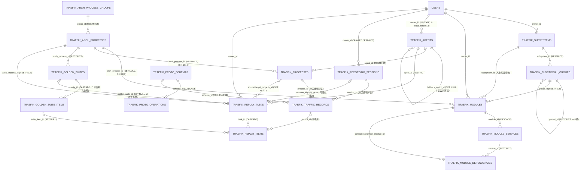

# 业务流量与接口契约治理 (`code-traefik`) 数据库物理模型与 GORM 建模字典

- **文档编号**：`05-database-schema.md`
- **文档版本**：v1.4.0
- **更新日期**：2026-11-05
- **归属阶段**：阶段二：系统架构与数据模型设计 (`02-design`)
- **状态**：已批准待实施 (Approved for M14~M17)
- **上位基线**：[`01-feature-matrix.md`](../01-features/01-feature-matrix.md) (v2.12.1)、[`01-system-architecture.md`](./01-system-architecture.md)、[`04-traffic-storage-partitioning-and-relational-normalization.md`](../05-adr/04-traffic-storage-partitioning-and-relational-normalization.md)、[`09-arch-process-ssot-and-ebpf-premount-standby-adr.md`](../05-adr/09-arch-process-ssot-and-ebpf-premount-standby-adr.md) (ADR-09 v1.1.0)、[`12-packet-causality-call-tree-and-sequence-ux-adr.md`](../05-adr/12-packet-causality-call-tree-and-sequence-ux-adr.md) (ADR-12 v1.0.0)、[`14-governance-dashboard-golden-suite-and-ci-gate-adr.md`](../05-adr/14-governance-dashboard-golden-suite-and-ci-gate-adr.md) (ADR-14 v1.1.0)

---

## 1. 数据库共享隔离原则、分区规范与类型安全约定

1. **共享库表名前缀强制隔离**：`code-traefik-server` 与宿主门户 `code-bench` 共享同一 PostgreSQL 实例，直接复用 `code-common/backend/models` 中的 `users`、`departments`、`audit_logs` 公共表；本子系统全部 **17 张核心业务实体表**（及平台治理参数表 `traefik_settings`）必须显式实现 `TableName() string` 并冠以 `config.TablePrefix`（**`traefik_`**）前缀。
2. **架构物理进程蓝图解耦与「单 Agent 单环境」关系规范化（[`ADR-09`](../05-adr/09-arch-process-ssot-and-ebpf-premount-standby-adr.md)）**：
   - 将全局架构物理进程蓝图独立建模为 **`traefik_arch_process_groups`** 与 **`traefik_arch_processes`**，通过 `traefik_modules.arch_process_id` 唯一表达 `1 ArchProcess : N Module` 组装关系（守护 `A-03` 单模块单标准进程归属）；
   - **1 台 `Agent` 即代表 1 套独立运行环境**（支持多套 `SHARED` 公共测试环境与多套 `PRIVATE` 个人环境对等并存，不同 `SHARED` Agent 允许各自挂载同一 `ArchProcess`；`traefik_agents.fallback_agent_id` 支持可选关联某套公共基准环境用于混合下游推导）；
   - 将 **`traefik_processes`** 收敛为环境 Agent `1:1` 挂载实例表，通过强唯一索引 **`UNIQUE(agent_id, arch_process_id)`** 保障单环境单实例约束、通过部分唯一索引 **`UNIQUE(agent_id, effective_listen_port) WHERE effective_listen_port > 0`** 保障同机非零监听端口互斥（`A-02`）并兼容多纯客户端进程（端口 `0`），内置本地覆盖列与统一 **7 态探针就绪快照列**；
   - **运行期录制快照、黄金套件自包含快照与历史挂载解耦（[`ADR-14`](../05-adr/14-governance-dashboard-golden-suite-and-ci-gate-adr.md)）**：`traefik_recording_sessions.process_snapshots` (`jsonb`) 固化录制时刻各参与进程的 `arch_process_id` 与装载 `module_ids` 快照；**`traefik_golden_suites` / `traefik_golden_suite_items`** 将沉淀事务的入站/应答二进制帧与下游 `ScopedMocks` 完整深拷贝持久化，彻底脱离 `traefik_traffic_records` 30 天分区生命周期；`traefik_replay_tasks` 将 `session_id` 设为可空并支持 `golden_suite_id` 双源驱动，同时将 `source_process_id / target_process_id` 设为 `ON DELETE SET NULL`，确保后续卸载空闲挂载进程或清理过期流量分区后，黄金套件与历史任务永久独立可回放；
   - **`traefik_replay_items`** 物理条目表为每条被测请求独立一行持久化 `raw_actual_packet`（`bytea`）与 `field_diffs`（`jsonb`），支持标准服务端分页查询与历史多次 Diff 重跑。
3. **新系统免历史数据迁移的干净重建策略 (`Clean Schema Rebuild`)**：
   - 本项目尚处上线前新系统阶段，无历史生产数据兼容包袱，**不编写旧版单层表历史数据回填迁移脚本**；
   - 在 `models/db.go` `SetupWithDB` 启动迁移前，若检测到旧版表结构（如存在 `traefik_process_modules` 表，或 `traefik_processes` 表尚未包含 `arch_process_id` 列），直接执行一次性幂等清理：`DROP TABLE IF EXISTS traefik_replay_items, traefik_replay_tasks, traefik_recording_sessions, traefik_process_modules, traefik_processes CASCADE`、清空 `traefik_traffic_records` 并执行 `ALTER TABLE traefik_modules DROP COLUMN IF EXISTS process_id`、重置 `traefik_agents` 残留租约列，随后干净创建最新 17 表结构与完整约束。
4. **海量流量时间范围物理分区 (`Range Partitioning`)**：
   - 核心流量往返表 **`traefik_traffic_records`** 采用 PostgreSQL 原生 **`PARTITION BY RANGE (created_at)`** 按日（或按周）自动建表；
   - 30 天保留期清理流水线采用轻量级 **`DROP TABLE traefik_traffic_records_yYYYYmMMdDD`**，实现磁盘空间毫秒级无锁释放。
5. **64 位无符号协议整数精度防腐 (`U64Numeric`)**：
   - CROS RPC 协议中的 `ullSNO` 与 `ullStatusCode` 为无符号 `UINT64`（值域 `0 .. 18446744073709551615`），超出 PostgreSQL `BIGINT` 范围。模型层采用 `NUMERIC(20,0)` 并封装自定义 GORM 类型 `U64Numeric`（实现 `sql.Scanner` 与 `driver.Valuer`），JSON Tag 统一声明 `,string`；`TraceID` / `SpanID` / `FatherSpanID` 统一规范化为 16 位小写十六进制字符串存储。
6. **无损二进制 + 结构化 JSONB 双模往返存储契约**：
   - 采用 **单次 RPC 往返一行 (`Exchange-per-Row`)** 模型，同时持久化 `raw_req_packet` / `raw_rsp_packet`（`bytea`，重放资产基石）与 `payload_json`（`jsonb`，挂载 GIN 索引支撑明文检索）。
7. **测试物理隔离铁律**：所有涉及 GORM 的单测必须使用 `testdb.SetupIsolatedDB(t)` 动态创建临时库并在 `t.Cleanup` 销毁，严禁连接共享库。

---

## 2. 全局物理实体关系拓扑图 (Physical ER Diagram)



---

## 3. 17 张 `traefik_*` 核心业务表完整 GORM 模型定义

### 3.1 逻辑架构元素领域表（表 1 ~ 表 3）

```go
package models

import (
	"time"

	commonModels "code-common/backend/models"
	"code-traefik/config"
	"gorm.io/datatypes"
)

type User = commonModels.User
type Department = commonModels.Department
type SysAuditLog = commonModels.SysAuditLog

// 1. Subsystem 顶层业务子系统表 (traefik_subsystems)
type Subsystem struct {
	ID          uint64    `gorm:"primaryKey;autoIncrement" json:"id"`
	Code        string    `gorm:"size:64;not null;uniqueIndex:uk_traefik_subsystems_code" json:"code"` // 全局唯一大写编码
	Name        string    `gorm:"size:128;not null;index:idx_traefik_subsystems_name" json:"name"`
	OwnerID     *uint     `gorm:"index:idx_traefik_subsystems_owner" json:"owner_id"`
	Owner       *User     `gorm:"foreignKey:OwnerID;constraint:OnUpdate:CASCADE,OnDelete:SET NULL" json:"owner,omitempty"`
	Description string    `gorm:"type:text" json:"description"`
	CreatedBy   uint      `gorm:"not null;default:0" json:"created_by"`
	UpdatedBy   uint      `gorm:"not null;default:0" json:"updated_by"`
	CreatedAt   time.Time `json:"created_at"`
	UpdatedAt   time.Time `json:"updated_at"`
}

func (Subsystem) TableName() string { return config.TablePrefix + "subsystems" }

// 2. FunctionalGroup 多级自嵌套功能组树表 (traefik_functional_groups)
type FunctionalGroup struct {
	ID          uint64           `gorm:"primaryKey;autoIncrement" json:"id"`
	SubsystemID uint64           `gorm:"not null;uniqueIndex:uk_traefik_fg_sub_code,priority:1;index:idx_traefik_fg_sub_path,priority:1" json:"subsystem_id"`
	Subsystem   *Subsystem       `gorm:"foreignKey:SubsystemID;constraint:OnUpdate:CASCADE,OnDelete:RESTRICT" json:"subsystem,omitempty"`
	ParentID    *uint64          `gorm:"index:idx_traefik_fg_parent" json:"parent_id"` // 根节点为 nil
	Parent      *FunctionalGroup `gorm:"foreignKey:ParentID;constraint:OnUpdate:CASCADE,OnDelete:RESTRICT" json:"-"`
	Code        string           `gorm:"size:64;not null;uniqueIndex:uk_traefik_fg_sub_code,priority:2" json:"code"` // 同子系统内唯一
	Name        string           `gorm:"size:128;not null" json:"name"`
	Level       int              `gorm:"not null;default:1;check:chk_traefik_fg_level,level >= 1 AND level <= 8" json:"level"` // 最大深度 8 级
	Path        string           `gorm:"size:256;not null;index:idx_traefik_fg_sub_path,priority:2" json:"path"`               // 物化路径 "/10/12/"
	SortOrder   int              `gorm:"not null;default:0" json:"sort_order"`
	Description string           `gorm:"type:text" json:"description"`
	CreatedBy   uint             `gorm:"not null;default:0" json:"created_by"`
	UpdatedBy   uint             `gorm:"not null;default:0" json:"updated_by"`
	CreatedAt   time.Time        `json:"created_at"`
	UpdatedAt   time.Time        `json:"updated_at"`
}

func (FunctionalGroup) TableName() string { return config.TablePrefix + "functional_groups" }

// 3. Module 最小接口契约功能模块表 (traefik_modules)
type Module struct {
	ID            uint64           `gorm:"primaryKey;autoIncrement" json:"id"`
	SubsystemID   uint64           `gorm:"not null;index:idx_traefik_modules_subsystem" json:"subsystem_id"` // 冗余所属子系统加速检索
	Subsystem     *Subsystem       `gorm:"foreignKey:SubsystemID;constraint:OnUpdate:CASCADE,OnDelete:RESTRICT" json:"subsystem,omitempty"`
	GroupID       uint64           `gorm:"not null;index:idx_traefik_modules_group" json:"group_id"` // 可挂载于任意层级功能组
	Group         *FunctionalGroup `gorm:"foreignKey:GroupID;constraint:OnUpdate:CASCADE,OnDelete:RESTRICT" json:"group,omitempty"`
	ArchProcessID *uint64          `gorm:"index:idx_traefik_modules_arch_proc" json:"arch_process_id"` // 指向全局架构标准进程蓝图 (A-03 单模块至多归属 1 个标准进程)
	ArchProcess   *ArchProcess     `gorm:"foreignKey:ArchProcessID;constraint:OnUpdate:CASCADE,OnDelete:SET NULL" json:"arch_process,omitempty"`
	Code          string           `gorm:"size:64;not null;uniqueIndex:uk_traefik_modules_code" json:"code"` // 全局唯一编码
	Name          string           `gorm:"size:128;not null;index:idx_traefik_modules_name" json:"name"`
	OwnerID       *uint            `gorm:"index:idx_traefik_modules_owner" json:"owner_id"`
	Owner         *User            `gorm:"foreignKey:OwnerID;constraint:OnUpdate:CASCADE,OnDelete:SET NULL" json:"owner,omitempty"`
	Description   string           `gorm:"type:text" json:"description"`
	CreatedBy     uint             `gorm:"not null;default:0" json:"created_by"`
	UpdatedBy     uint             `gorm:"not null;default:0" json:"updated_by"`
	CreatedAt     time.Time        `json:"created_at"`
	UpdatedAt     time.Time        `json:"updated_at"`
}

func (Module) TableName() string { return config.TablePrefix + "modules" }
```

### 3.2 模块服务契约与依赖关系表（表 4 ~ 表 5）

契约全面收敛至 Service 级别，废弃旧有的 Operation 冗余声明；并将供给（PROVIDE）与依赖（DEPEND）正交建模为实体服务表与依赖关系表，依赖显式关联提供方 FM 或外部系统。

```go
// 4. ModuleService 模块级对外供给服务契约表 (traefik_module_services)
type ModuleService struct {
	ID              uint64         `gorm:"primaryKey;autoIncrement" json:"id"`
	ModuleID        uint64         `gorm:"not null;index:idx_traefik_mod_svc_mod" json:"module_id"`
	Module          *Module        `gorm:"foreignKey:ModuleID;constraint:OnUpdate:CASCADE,OnDelete:CASCADE" json:"module,omitempty"`
	ServiceName     string         `gorm:"size:128;not null;uniqueIndex:uk_traefik_mod_svc_name" json:"service_name"` // 格式 {package}.{serviceName}（无 package 时为 {serviceName}），全系统唯一提供 (A-05)
	DiffIgnorePaths datatypes.JSON `gorm:"type:jsonb;not null;default:'[]'" json:"diff_ignore_paths"`                 // 服务级默认回归 Diff 忽略字段路径 []string (F-14)
	Description     string         `gorm:"type:text" json:"description"`
	CreatedBy       uint           `gorm:"not null;default:0" json:"created_by"`
	CreatedAt       time.Time      `json:"created_at"`
	UpdatedAt       time.Time      `json:"updated_at"`
}

func (ModuleService) TableName() string { return config.TablePrefix + "module_services" }

// 5. ModuleDependency 模块间服务依赖关系表 (traefik_module_dependencies)
type ModuleDependency struct {
	ID               uint64         `gorm:"primaryKey;autoIncrement" json:"id"`
	ConsumerModuleID uint64         `gorm:"not null;uniqueIndex:uk_traefik_dep_tuple,priority:1;index:idx_traefik_dep_consumer" json:"consumer_module_id"`
	ConsumerModule   *Module        `gorm:"foreignKey:ConsumerModuleID;constraint:OnUpdate:CASCADE,OnDelete:CASCADE" json:"consumer_module,omitempty"`
	IsExternal       bool           `gorm:"not null;default:false;index:idx_traefik_dep_external" json:"is_external"` // 是否依赖外部第三方/未登记系统
	ExternalSystem   string         `gorm:"size:128;not null;default:''" json:"external_system"`                     // 外部系统名称 (如 "WeChatPayGateway")
	ExternalService  string         `gorm:"size:128;not null;default:''" json:"external_service"`                    // 外部服务名称 (如 "UnifiedOrderService")
	ServiceID        *uint64        `gorm:"uniqueIndex:uk_traefik_dep_tuple,priority:2;index:idx_traefik_dep_service" json:"service_id,omitempty"` // 内部依赖外键指向 ModuleService
	Service          *ModuleService `gorm:"foreignKey:ServiceID;constraint:OnUpdate:CASCADE,OnDelete:RESTRICT" json:"service,omitempty"`
	ProviderModuleID *uint64        `gorm:"index:idx_traefik_dep_provider" json:"provider_module_id,omitempty"`     // 内部依赖冗余提供方 FM
	ProviderModule   *Module        `gorm:"foreignKey:ProviderModuleID;constraint:OnUpdate:CASCADE,OnDelete:SET NULL" json:"provider_module,omitempty"`
	Description      string         `gorm:"type:text" json:"description"`                                            // 调用与依赖业务场景说明
	CreatedBy        uint           `gorm:"not null;default:0" json:"created_by"`
	CreatedAt        time.Time      `json:"created_at"`
	UpdatedAt        time.Time      `json:"updated_at"`
}

func (ModuleDependency) TableName() string { return config.TablePrefix + "module_dependencies" }
```

### 3.3 架构物理进程蓝图 SSOT、公私域 Agent 纳管与 `1:1` 宿主机进程挂载表（表 6 ~ 表 9）

```go
const (
	ScopeShared  = "SHARED"  // 团队共享公共资源
	ScopePrivate = "PRIVATE" // 用户个人私有资源

	AgentStatusOnline  = "ONLINE"
	AgentStatusOffline = "OFFLINE"

	AgentLeaseNone      = ""          // 空闲无租约 (允许 ARMED 预挂载待命)
	AgentLeaseRecording = "RECORDING" // 录制会话排他占用中
	AgentLeaseReplay    = "REPLAY"    // 重放任务排他占用中

	ProbeDesiredArmed    = "ARMED"    // 默认自动预挂待命
	ProbeDesiredDisarmed = "DISARMED" // 手动暂停探针

	// 全局唯一权威 7 态探针就绪枚举 (后端 DB / agentproto / 前端 TS 同构)
	ProbeStatusReady         = "READY"          // 🟢 已就绪：eBPF 已预挂 + PID 已定位 + 0 存量直连
	ProbeStatusNeedReconnect = "NEED_RECONNECT" // 🟡 待重连：eBPF 已预挂 + PID 已定位 + 存在预挂前存量直连
	ProbeStatusWaitingProc   = "WAITING_PROC"   // 🔵 待进程启动：eBPF 已预挂待命，目标进程尚未运行
	ProbeStatusMonitoring    = "MONITORING"     // 🟣 采集中：当前持有活跃录制/重放租约作业中
	ProbeStatusDisarmed      = "DISARMED"       // ⚪ 已暂停探针：用户手动设为 DISARMED 卸挂
	ProbeStatusOffline       = "OFFLINE"        // ⚫ Agent 离线：宿主 Agent 当前处于 OFFLINE
	ProbeStatusCapDenied     = "CAP_DENIED"     // 🔴 权限不足：缺少 CAP_BPF/CAP_NET_ADMIN
	ProbeStatusError         = "ERROR"          // 🔴 异常：探针挂载或同步报错
)

// 6. ArchProcessGroup 全局架构物理进程组蓝图表 (traefik_arch_process_groups)
type ArchProcessGroup struct {
	ID          uint64        `gorm:"primaryKey;autoIncrement" json:"id"`
	Code        string        `gorm:"size:64;not null;uniqueIndex:uk_traefik_arch_pgrp_code" json:"code"` // 全局唯一大写编码，如 "CORE_TRADE"
	Name        string        `gorm:"size:128;not null;uniqueIndex:uk_traefik_arch_pgrp_name" json:"name"`
	SortOrder   int           `gorm:"not null;default:0" json:"sort_order"`
	Description string        `gorm:"type:text" json:"description"`
	Processes   []ArchProcess `gorm:"foreignKey:GroupID;constraint:OnUpdate:CASCADE,OnDelete:RESTRICT" json:"processes,omitempty"`
	CreatedBy   uint          `gorm:"not null;default:0" json:"created_by"`
	UpdatedBy   uint          `gorm:"not null;default:0" json:"updated_by"`
	CreatedAt   time.Time     `json:"created_at"`
	UpdatedAt   time.Time     `json:"updated_at"`
}

func (ArchProcessGroup) TableName() string { return config.TablePrefix + "arch_process_groups" }

// 7. ArchProcess 全局架构标准业务进程蓝图表 (traefik_arch_processes)
// 在 /architecture?tree=physical 中作为全局唯一 SSOT 维护，零 Agent 机器耦合
type ArchProcess struct {
	ID                      uint64            `gorm:"primaryKey;autoIncrement" json:"id"`
	GroupID                 uint64            `gorm:"not null;index:idx_traefik_arch_proc_group" json:"group_id"`
	Group                   *ArchProcessGroup `gorm:"foreignKey:GroupID;constraint:OnUpdate:CASCADE,OnDelete:RESTRICT" json:"group,omitempty"`
	Code                    string            `gorm:"size:64;not null;uniqueIndex:uk_traefik_arch_proc_code" json:"code"` // 全局唯一标准进程编码，如 "sut-order"
	Name                    string            `gorm:"size:128;not null;index:idx_traefik_arch_proc_name" json:"name"`
	DefaultListenPort       int               `gorm:"not null;default:0;check:chk_traefik_arch_proc_port,default_listen_port >= 0 AND default_listen_port <= 65535" json:"default_listen_port"` // 0 表示纯客户端进程；1..65535 为默认监听端口
	DefaultCmdPattern       string            `gorm:"size:512;not null;default:''" json:"default_cmd_pattern"`                                                                                   // 默认 /proc/<pid>/cmdline 匹配特征
	DefaultExtraDownstreams datatypes.JSON    `gorm:"type:jsonb;not null;default:'[]'" json:"default_extra_downstreams"`                                                                         // 默认补充下游 ["IP:Port"]
	SortOrder               int               `gorm:"not null;default:0" json:"sort_order"`
	Description             string            `gorm:"type:text" json:"description"`
	Modules                 []Module          `gorm:"foreignKey:ArchProcessID;constraint:OnUpdate:CASCADE,OnDelete:SET NULL" json:"modules,omitempty"` // 组装承载的 FM 功能模块集合 (1:N)
	CreatedBy               uint              `gorm:"not null;default:0" json:"created_by"`
	UpdatedBy               uint              `gorm:"not null;default:0" json:"updated_by"`
	CreatedAt               time.Time         `json:"created_at"`
	UpdatedAt               time.Time         `json:"updated_at"`
}

func (ArchProcess) TableName() string { return config.TablePrefix + "arch_processes" }

// 8. Agent 数据面环境宿主机守护进程纳管与动态排他租约表 (traefik_agents)
// 注：1 台 Agent 代表 1 套独立运行环境（支持多套 SHARED 公共测试环境与多套 PRIVATE 个人环境）
type Agent struct {
	ID                  uint64     `gorm:"primaryKey;autoIncrement" json:"id"`
	Name                string     `gorm:"size:128;not null;uniqueIndex:uk_traefik_agents_name" json:"name"`
	Endpoint            string     `gorm:"size:128;not null;uniqueIndex:uk_traefik_agents_endpoint" json:"endpoint"` // 唯一 IP:Port
	Scope               string     `gorm:"size:16;not null;default:'SHARED';index:idx_traefik_agents_scope_owner,priority:1;check:chk_traefik_agents_scope,scope IN ('SHARED','PRIVATE')" json:"scope"`
	OwnerID             *uint      `gorm:"index:idx_traefik_agents_scope_owner,priority:2" json:"owner_id,omitempty"` // SHARED 为 nil；PRIVATE 必填创建人 users.id
	Owner               *User      `gorm:"foreignKey:OwnerID;constraint:OnUpdate:CASCADE,OnDelete:RESTRICT" json:"owner,omitempty"`
	FallbackAgentID     *uint64    `gorm:"index:idx_traefik_agents_fallback" json:"fallback_agent_id,omitempty"` // 可选关联的公共基准环境 Agent (仅允许指向 scope='SHARED' 且 != ID)
	FallbackAgent       *Agent     `gorm:"foreignKey:FallbackAgentID;constraint:OnUpdate:CASCADE,OnDelete:SET NULL" json:"fallback_agent,omitempty"`
	MountsRevision      uint64     `gorm:"not null;default:0" json:"mounts_revision"`                            // 挂载配置单调递增版本号 (防并发覆盖与 Agent 乱序下发)
	Status              string     `gorm:"size:32;not null;default:'OFFLINE';index:idx_traefik_agents_status" json:"status"`
	BootID              string     `gorm:"size:64;not null;default:''" json:"boot_id"`                           // 感知 Agent 重启以触发预挂自动补齐
	ExpectedArmedDigest string     `gorm:"size:64;not null;default:''" json:"expected_armed_digest"`             // 主控编译的期望 ARMED 规格 SHA-256 摘要
	ArmedDigest         string     `gorm:"size:64;not null;default:''" json:"armed_digest"`                      // Agent 实际回报的已生效 ARMED 规格 SHA-256 摘要
	AgentVersion        string     `gorm:"size:64;not null;default:''" json:"agent_version"`
	ProtocolVersion     string     `gorm:"size:32;not null;default:''" json:"protocol_version"` // 如 "1.0"
	KernelVersion       string     `gorm:"size:128;not null;default:''" json:"kernel_version"`
	HasEbpfCap          bool       `gorm:"not null;default:false" json:"has_ebpf_cap"` // CAP_BPF + CAP_NET_ADMIN 具备状态
	CapDetail           string     `gorm:"size:512;not null;default:''" json:"cap_detail"`
	LastHeartbeatAt     *time.Time `gorm:"index:idx_traefik_agents_hb" json:"last_heartbeat_at"`

	// 动态排他租约列 (Agent Mutex Lease：仅活跃 RECORDING / REPLAY 占用；ARMED 预挂待命不占租约)
	LeaseType       string     `gorm:"size:16;not null;default:'';index:idx_traefik_agents_lease;check:chk_traefik_agents_lease,lease_type IN ('','RECORDING','REPLAY')" json:"lease_type"`
	LeaseRefID      *uint64    `json:"lease_ref_id,omitempty"`
	LeaseHolderID   *uint      `gorm:"index:idx_traefik_agents_lease_holder" json:"lease_holder_id,omitempty"`
	LeaseHolder     *User      `gorm:"foreignKey:LeaseHolderID;constraint:OnUpdate:CASCADE,OnDelete:SET NULL" json:"lease_holder,omitempty"`
	LeaseAcquiredAt *time.Time `json:"lease_acquired_at,omitempty"`
	LeaseExpiresAt  *time.Time `gorm:"index:idx_traefik_agents_lease_exp" json:"lease_expires_at,omitempty"`

	Description string    `gorm:"type:text" json:"description"`
	CreatedBy   uint      `gorm:"not null;default:0" json:"created_by"`
	UpdatedBy   uint      `gorm:"not null;default:0" json:"updated_by"`
	CreatedAt   time.Time `json:"created_at"`
	UpdatedAt   time.Time `json:"updated_at"`
}

func (Agent) TableName() string { return config.TablePrefix + "agents" }

// 9. Process 宿主机 Agent 架构进程 1:1 挂载实例、本地覆盖与预挂就绪表 (traefik_processes)
// 注：保持 process_id 主键与历史录制批次、流量分区表及重放任务的完全外键兼容
type Process struct {
	ID                  uint64         `gorm:"primaryKey;autoIncrement" json:"id"`
	AgentID             uint64         `gorm:"not null;uniqueIndex:uk_traefik_proc_agent_arch,priority:1;uniqueIndex:uk_traefik_proc_agent_port,priority:1,where:effective_listen_port > 0;index:idx_traefik_proc_agent" json:"agent_id"`
	Agent               *Agent         `gorm:"foreignKey:AgentID;constraint:OnUpdate:CASCADE,OnDelete:RESTRICT" json:"agent,omitempty"`
	ArchProcessID       uint64         `gorm:"not null;uniqueIndex:uk_traefik_proc_agent_arch,priority:2;index:idx_traefik_proc_arch" json:"arch_process_id"` // 单机严格 1:1 唯一约束
	ArchProcess         *ArchProcess   `gorm:"foreignKey:ArchProcessID;constraint:OnUpdate:CASCADE,OnDelete:RESTRICT" json:"arch_process,omitempty"`
	OverrideListenPort  *int           `gorm:"check:chk_traefik_proc_override_port,override_listen_port IS NULL OR (override_listen_port >= 0 AND override_listen_port <= 65535)" json:"override_listen_port"` // nil 表示继承 ArchProcess.DefaultListenPort
	EffectiveListenPort int            `gorm:"not null;default:0;uniqueIndex:uk_traefik_proc_agent_port,priority:2,where:effective_listen_port > 0;check:chk_traefik_proc_eff_port,effective_listen_port >= 0 AND effective_listen_port <= 65535" json:"listen_port"` // 物化有效端口，保障同机非零端口互斥 (A-02)
	OverrideCmdPattern  string         `gorm:"size:512;not null;default:''" json:"override_cmd_pattern"`                                                                                                                                                              // 为空表示继承 ArchProcess.DefaultCmdPattern
	AdvertiseIP         string         `gorm:"size:64;not null;default:''" json:"advertise_ip"`                                                                                                                                                                       // 可选本地业务通信 IP，为空取所属 Agent IP
	ExtraDownstreams    datatypes.JSON `gorm:"type:jsonb;not null;default:'[]'" json:"extra_downstreams"`                                                                                                                                                             // 本地附加补充下游 ["IP:Port"]
	Description         string         `gorm:"type:text" json:"description"`

	// eBPF 默认自动预挂期望状态与最近一次宿主机 /proc 就绪诊断快照
	ProbeDesiredState string     `gorm:"size:16;not null;default:'ARMED';check:chk_traefik_proc_desired,probe_desired_state IN ('ARMED','DISARMED')" json:"probe_desired_state"`
	ProbeStatus       string     `gorm:"size:32;not null;default:'DISARMED';index:idx_traefik_proc_probe_status" json:"probe_status"`
	ResolvedPID       uint32     `gorm:"not null;default:0" json:"resolved_pid"`
	EstablishedConns  int        `gorm:"not null;default:0" json:"established_conns"`
	NeedReconnect     bool       `gorm:"not null;default:false" json:"need_reconnect"`
	DiagMessage       string     `gorm:"size:512;not null;default:''" json:"diag_message"`
	LastDiagAt        *time.Time `json:"last_diag_at,omitempty"`

	// DTO 序列化便捷透出字段（由预加载的 ArchProcess 自动计算填充，不落冗余列）
	GroupID     uint64 `gorm:"-" json:"group_id"`
	GroupName   string `gorm:"-" json:"group_name"`
	Code        string `gorm:"-" json:"code"`
	Name        string `gorm:"-" json:"name"`
	CmdPattern  string `gorm:"-" json:"cmd_pattern"`
	HasOverride bool   `gorm:"-" json:"has_override"`

	CreatedBy uint      `gorm:"not null;default:0" json:"created_by"`
	UpdatedBy uint      `gorm:"not null;default:0" json:"updated_by"`
	CreatedAt time.Time `json:"created_at"`
	UpdatedAt time.Time `json:"updated_at"`
}

func (Process) TableName() string { return config.TablePrefix + "processes" }
```

### 3.4 IDL 描述集与方法映射字典表（表 10 ~ 表 11）

```go
// 10. ProtoSchema Protobuf 编译描述集 (.pb FileDescriptorSet) 多版本制品台账表 (traefik_proto_schemas)
const (
	ProtoCategoryBaseLib  = "BASE_LIB" // 公共基础依赖库（通用消息头、公共枚举/基础类型，允许 OperationCount == 0）
	ProtoCategoryBusiness = "BUSINESS" // 业务微服务契约
	ProtoCategoryGateway  = "GATEWAY"  // 接入网关/边缘代理契约
)

type ProtoSchema struct {
	ID              uint64         `gorm:"primaryKey;autoIncrement" json:"id"`
	Name            string         `gorm:"size:128;not null;uniqueIndex:uk_traefik_proto_name_ver,priority:1;uniqueIndex:uk_traefik_proto_active_name,where:is_active = true" json:"name"`
	Version         int            `gorm:"not null;uniqueIndex:uk_traefik_proto_name_ver,priority:2" json:"version"` // 同名递增版本号 1, 2, 3...
	VersionTag      string         `gorm:"size:64;not null;default:''" json:"version_tag"`
	Category        string         `gorm:"size:32;not null;default:'BUSINESS';index:idx_traefik_proto_category" json:"category"` // BASE_LIB | BUSINESS | GATEWAY (chk_traefik_proto_category)
	FileName        string         `gorm:"size:255;not null" json:"file_name"`                                                   // 经 filepath.Base 净化的展示文件名
	FileSHA256      string         `gorm:"size:64;not null;index:idx_traefik_proto_sha" json:"file_sha256"`
	FileSize        int            `gorm:"not null" json:"file_size"`                                // 0 < file_size <= 16777216 (<= 16MB, 由 db.go 显式维护 chk_traefik_proto_size)
	DescriptorBytes []byte         `gorm:"type:bytea;not null" json:"-"`                             // 二进制内容仅存 DB，JSON 响应永不透出
	IsActive        bool           `gorm:"not null;default:false;index:idx_traefik_proto_active" json:"is_active"`
	ProtoFileCount  int            `gorm:"not null;default:0" json:"proto_file_count"`               // 自有 .proto 源文件数量
	ServiceCount    int            `gorm:"not null;default:0" json:"service_count"`                  // 自有导出的去重 RPC Service 数量
	OperationCount  int            `gorm:"not null;default:0" json:"operation_count"`                // 自有导出的 RPC Method 总数
	ProtoFiles      datatypes.JSON `gorm:"type:jsonb;not null;default:'[]'" json:"proto_files"`      // 自有 .proto 源文件清单 []string (F-03.4, F-03.6)
	ExternalImports datatypes.JSON `gorm:"type:jsonb;not null;default:'[]'" json:"external_imports"` // 需外部描述集供给的 import .proto 路径清单 []string (F-03.6)
	Description     string         `gorm:"type:text" json:"description"`
	CreatedBy       uint           `gorm:"not null;default:0" json:"created_by"`
	CreatedAt       time.Time      `json:"created_at"`
	UpdatedAt       time.Time      `json:"updated_at"`
}

func (ProtoSchema) TableName() string { return config.TablePrefix + "proto_schemas" }

// 11. ProtoOperation 描述集解析出的 CROS RPC 服务方法映射表 (traefik_proto_operations)
type ProtoOperation struct {
	ID                 uint64         `gorm:"primaryKey;autoIncrement" json:"id"`
	SchemaID           uint64         `gorm:"not null;uniqueIndex:uk_traefik_proto_op_schema,priority:1;index:idx_traefik_proto_op_sid" json:"schema_id"`
	Schema             *ProtoSchema   `gorm:"foreignKey:SchemaID;constraint:OnUpdate:CASCADE,OnDelete:CASCADE" json:"-"`
	ProtoFile          string         `gorm:"size:255;not null" json:"proto_file"`
	ProtoPackage       string         `gorm:"size:128;not null" json:"proto_package"` // 原样点分结构，如 "dophi.order.v1"
	ProtoService       string         `gorm:"size:128;not null" json:"proto_service"` // Service 简称，如 "TradeService"
	ServiceName        string         `gorm:"size:128;not null;uniqueIndex:uk_traefik_proto_op_schema,priority:2;uniqueIndex:uk_traefik_active_proto_op,priority:1,where:is_active = true;index:idx_traefik_proto_op_lookup,priority:1" json:"service_name"` // "{package}.{serviceName}"
	Operation          string         `gorm:"size:128;not null;uniqueIndex:uk_traefik_proto_op_schema,priority:3;uniqueIndex:uk_traefik_active_proto_op,priority:2,where:is_active = true;index:idx_traefik_proto_op_lookup,priority:2" json:"operation"`    // Method 名
	ReqMessageFullName string         `gorm:"size:255;not null" json:"req_message_full_name"`
	RspMessageFullName string         `gorm:"size:255;not null" json:"rsp_message_full_name"`
	DiffIgnorePaths    datatypes.JSON `gorm:"type:jsonb;not null;default:'[]'" json:"diff_ignore_paths"` // 方法级专属回归 Diff 忽略字段路径 []string (F-03.3)
	ClientStreaming    bool           `gorm:"not null;default:false" json:"client_streaming"`
	ServerStreaming    bool           `gorm:"not null;default:false" json:"server_streaming"`
	IsActive           bool           `gorm:"not null;default:false;index:idx_traefik_proto_op_active" json:"is_active"` // 随所属 Schema 原子切换，由部分唯一索引保障全局无冲突 (F-03.3)
	CreatedAt          time.Time      `json:"created_at"`
}

func (ProtoOperation) TableName() string { return config.TablePrefix + "proto_operations" }
```

### 3.5 公私域协同录制、双模物理分区归档与跨 Agent 重放断言表（表 12 ~ 表 15）

```go
const (
	SessionStatusPending          = "PENDING"
	SessionStatusRecording        = "RECORDING"
	SessionStatusStopping         = "STOPPING"
	SessionStatusCompleted        = "COMPLETED"
	SessionStatusCompletedByLimit = "COMPLETED_BY_LIMIT" // 达到时长或帧数上限自动停止 (F-11)
	SessionStatusFailed           = "FAILED"

	TrafficDirIngress = "INGRESS"
	TrafficDirEgress  = "EGRESS"

	ExchangeUnary     = "UNARY"      // 标准一问一答 (REQ + RSP)
	ExchangeStreamRsp = "STREAM_RSP" // 流式分片应答 (REQ + N*RSP_SEG + RSP)
	ExchangeOneway    = "ONEWAY"     // 单向通知请求 (ucReqType=3, 无应答)
	ExchangeReqOnly   = "REQ_ONLY"   // 超配对窗口或停录时未收到应答的挂起请求
	ExchangeRspOrphan = "RSP_ORPHAN" // 连接中途切入捕获到的孤立应答帧
	ExchangeMng       = "MNG"        // 连接管理握手/心跳报文 (ucMsgType=5..7)

	ReplayResultPass     = "PASS"
	ReplayResultFailed   = "FAILED"
	ReplayResultMockMiss = "MOCK_MISS"
	ReplayResultTimeout  = "TIMEOUT"
	ReplayResultError    = "ERROR"
)

// 12. RecordingSession 任务级多进程协同录制批次表 (traefik_recording_sessions)
type RecordingSession struct {
	ID                    uint64         `gorm:"primaryKey;autoIncrement" json:"id"`
	SessionNo             string         `gorm:"size:64;not null;uniqueIndex:uk_traefik_rec_session_no" json:"session_no"`
	Name                  string         `gorm:"size:128;not null;index:idx_traefik_rec_name" json:"name"`
	Scope                 string         `gorm:"size:16;not null;default:'PRIVATE';index:idx_traefik_rec_scope_owner,priority:1;check:chk_traefik_rec_scope,scope IN ('SHARED','PRIVATE')" json:"scope"` // 公共级 SHARED 或个人级 PRIVATE
	OwnerID               uint           `gorm:"not null;index:idx_traefik_rec_scope_owner,priority:2" json:"owner_id"`                                                                                 // 素材归属用户 users.id
	Owner                 *User          `gorm:"foreignKey:OwnerID;constraint:OnUpdate:CASCADE,OnDelete:RESTRICT" json:"owner,omitempty"`
	Status                string         `gorm:"size:32;not null;default:'PENDING';index:idx_traefik_rec_status" json:"status"`
	LeasedAgentIDs        datatypes.JSON `gorm:"type:jsonb;not null;default:'[]'" json:"leased_agent_ids"`       // []uint64 本批次锁定的 Agent ID 升序列表，供停止/恢复时确定性释放排他租约
	TargetProcessIDs      datatypes.JSON `gorm:"type:jsonb;not null" json:"target_process_ids"`                  // []uint64 参与进程挂载实例 ID 列表
	ProcessSnapshots      datatypes.JSON `gorm:"type:jsonb;not null;default:'[]'" json:"process_snapshots"`      // []ProcessSnapshotItem [{process_id, arch_process_id, code, name, module_ids, listen_port}] 录制时刻快照，解耦后续卸载挂载实例
	ProcessDiagnostics    datatypes.JSON `gorm:"type:jsonb;not null;default:'[]'" json:"process_diagnostics"`    // PID 定位与存量长连接诊断快照
	MaxDurationSec        int            `gorm:"not null;default:1800" json:"max_duration_sec"`                  // 默认最长 30 分钟
	MaxFrames             int            `gorm:"not null;default:100000" json:"max_frames"`                      // 默认最大 10 万帧
	MaxFrameBytes         int            `gorm:"not null;default:4194304" json:"max_frame_bytes"`                // 默认单帧采集阈值 4MB
	CapturedFrames        int64          `gorm:"not null;default:0" json:"captured_frames"`
	DroppedFrames         int64          `gorm:"not null;default:0" json:"dropped_frames"`                       // Agent 有界缓冲背压丢帧累计
	StartedAt             *time.Time     `json:"started_at"`
	StoppedAt             *time.Time     `gorm:"index:idx_traefik_rec_stopped_at" json:"stopped_at"`             // 供 30 天 TTL 保留期清理扫描
	StopReason            string         `gorm:"size:255;not null;default:''" json:"stop_reason"`
	TopologyVerifySummary datatypes.JSON `gorm:"type:jsonb" json:"topology_verify_summary,omitempty"`            // 架构一致性验证摘要缓存
	Description           string         `gorm:"type:text" json:"description"`
	CreatedBy             uint           `gorm:"not null;default:0;index:idx_traefik_rec_creator" json:"created_by"`
	CreatedAt             time.Time      `gorm:"index:idx_traefik_rec_created_at" json:"created_at"`
	UpdatedAt             time.Time      `json:"updated_at"`
}

func (RecordingSession) TableName() string { return config.TablePrefix + "recording_sessions" }

// 13. TrafficRecord CROS RPC 无损二进制 + 结构化 JSONB 双模往返物理分区表 (traefik_traffic_records)
// 采用 Exchange-per-Row 单次往返一行模型，按 created_at 进行 PostgreSQL PARTITION BY RANGE (created_at)
// 满足 30 天数据保留期的 O(1) 零锁表 DROP TABLE 毫秒级轮转
type TrafficRecord struct {
	ID                    uint64            `gorm:"column:id;not null" json:"id"` // 复合主键之一，由全局序列生成
	CreatedAt             time.Time         `gorm:"column:created_at;not null" json:"created_at"` // 分区键与复合主键之二
	SessionID             uint64            `gorm:"not null;index:idx_traefik_tr_session_seq,priority:1;index:idx_traefik_tr_session_req_ns,priority:1;index:idx_traefik_tr_session_svc,priority:1;index:idx_traefik_tr_session_trace,priority:1" json:"session_id"`
	SeqNo                 int64             `gorm:"not null;index:idx_traefik_tr_session_seq,priority:2" json:"seq_no"` // 在 REQ 到达瞬间按批次原子递增分配（发起序，ADR-12）
	AgentID               uint64            `gorm:"not null;index:idx_traefik_tr_agent" json:"agent_id"`
	ProcessID             uint64            `gorm:"not null;index:idx_traefik_tr_proc_dir,priority:1" json:"process_id"`
	CapturedPID           uint32            `gorm:"not null" json:"captured_pid"`
	ConnKey               string            `gorm:"size:128;not null;index:idx_traefik_tr_conn_sno,priority:1" json:"conn_key"`
	Direction             string            `gorm:"size:16;not null;index:idx_traefik_tr_proc_dir,priority:2" json:"direction"` // INGRESS | EGRESS
	ExchangeType          string            `gorm:"size:24;not null;default:'UNARY';index:idx_traefik_tr_exchange;check:chk_traefik_tr_ex_type,exchange_type IN ('UNARY','STREAM_RSP','ONEWAY','REQ_ONLY','RSP_ORPHAN','MNG')" json:"exchange_type"`
	SrcAddr               string            `gorm:"size:64;not null" json:"src_addr"`
	DstAddr               string            `gorm:"size:64;not null" json:"dst_addr"`
	ReqCapturedAtNs       int64             `gorm:"not null;index:idx_traefik_tr_req_ns;index:idx_traefik_tr_session_req_ns,priority:2" json:"req_captured_at_ns"` // 请求帧首字节到达纳秒时间戳
	RspCapturedAtNs       *int64            `json:"rsp_captured_at_ns,omitempty"`
	LatencyUs             *int64            `json:"latency_us,omitempty"` // 往返微秒耗时 (rsp_captured_at_ns - req_captured_at_ns)/1000

	// CROS RPC 公共头与会话头核心索引列
	TransportProto        uint8             `gorm:"not null;default:1" json:"transport_proto"`
	SNO                   uint64            `gorm:"type:numeric(20,0);not null;index:idx_traefik_tr_conn_sno,priority:2;index:idx_traefik_tr_sno" json:"sno,string"` // ullSNO 无损无符号 64 位
	ReqType               uint8             `gorm:"not null;default:0" json:"req_type"`                                                                              // ucReqType (1=Sync,2=Async,3=Oneway)
	RspSegCount           int               `gorm:"not null;default:0" json:"rsp_seg_count"`                                                                         // 应答帧总段数 (UNARY=1, STREAM_RSP>=2)
	IsPacked              uint8             `gorm:"not null;default:1" json:"is_packed"`
	ServiceName           string            `gorm:"size:128;not null;default:'';index:idx_traefik_tr_session_svc,priority:2" json:"service_name"`
	Operation             string            `gorm:"size:128;not null;default:'';index:idx_traefik_tr_session_svc,priority:3" json:"operation"`
	StatusCode            uint64            `gorm:"type:numeric(20,0);not null;default:0" json:"status_code,string"`
	TraceID               string            `gorm:"size:32;not null;default:'';index:idx_traefik_tr_session_trace,priority:2" json:"trace_id"` // 16位十六进制字符串
	SpanID                string            `gorm:"size:32;not null;default:'';index:idx_traefik_tr_span" json:"span_id"`
	FatherSpanID          string            `gorm:"size:32;not null;default:'';index:idx_traefik_tr_father_span" json:"father_span_id"`

	// 架构模块穿透定位列
	SubsystemID           *uint64           `gorm:"index:idx_traefik_tr_subsystem" json:"subsystem_id,omitempty"`
	SrcModuleID           *uint64           `gorm:"index:idx_traefik_tr_src_mod" json:"src_module_id,omitempty"`
	SrcAttributionMode    string            `gorm:"size:32;not null;default:''" json:"src_attribution_mode"`
	SrcCandidateModuleIDs datatypes.JSON    `gorm:"type:jsonb" json:"src_candidate_module_ids,omitempty"`
	DstModuleID           *uint64           `gorm:"index:idx_traefik_tr_dst_mod" json:"dst_module_id,omitempty"`

	// 结构化 JSONB + 无损二进制 Bytea 双模持久化列
	HeadersJSON           datatypes.JSON    `gorm:"column:headers_json;type:jsonb;not null" json:"headers_json"`                        // {"req": ParsedHead, "rsp": ParsedHead, "meta"?: CallGraphMeta} 协议头与轻量调用图摘要快照 (ADR-12)
	SchemaID              *uint64           `gorm:"index:idx_traefik_tr_schema" json:"schema_id,omitempty"`
	SchemaVersion         *int              `json:"schema_version,omitempty"`                                                           // 冗余保存解码版本号，切换生效版本不改写历史 (F-03.4)
	DecodeStatus          string            `gorm:"size:32;not null" json:"decode_status"`
	PayloadJSON           datatypes.JSON    `gorm:"column:payload_json;type:jsonb;not null;default:'{}'" json:"payload_json"`           // {"req": <obj|null>, "rsp": <obj|array|null>}，建有局部 GIN 索引
	ReqPayloadSHA256      string            `gorm:"size:64;not null;default:'';index:idx_traefik_tr_req_sha" json:"req_payload_sha256"` // 请求纯载荷 SHA256
	RawReqPacket          []byte            `gorm:"column:raw_req_packet;type:bytea" json:"-"`                                          // 无损原始请求报文帧 (仅 RSP_ORPHAN 允许为 NULL)
	RawRspPacket          []byte            `gorm:"column:raw_rsp_packet;type:bytea" json:"-"`                                          // 无损原始应答报文帧 (多段 RSP_SEG+RSP 连续拼接，经 crosrpc.SplitFrames 无损切分)
	IsTruncated           bool              `gorm:"not null;default:false" json:"is_truncated"`
	IsReplayable          bool              `gorm:"not null;default:true;index:idx_traefik_tr_replayable" json:"is_replayable"`
}

func (TrafficRecord) TableName() string { return config.TablePrefix + "traffic_records" }

// 14. ReplayTask 跨 Agent 同构离线自愈重放任务头表 (traefik_replay_tasks)
// 支持「基于录制批次 (SessionID)」与「基于黄金契约套件 (GoldenSuiteID)」双源驱动 (ADR-14)
type ReplayTask struct {
	ID                  uint64            `gorm:"primaryKey;autoIncrement" json:"id"`
	TaskNo              string            `gorm:"size:64;not null;uniqueIndex:uk_traefik_replay_task_no" json:"task_no"`
	Name                string            `gorm:"size:128;not null" json:"name"`
	TriggerSource       string            `gorm:"size:24;not null;default:'MANUAL';index:idx_traefik_replay_trigger;check:chk_traefik_replay_trigger,trigger_source IN ('MANUAL','SINGLE_DEBUG','GOLDEN_SUITE','CI_GATE')" json:"trigger_source"` // 区分人工调试与权威套件/CI门禁 (F-24 健康分过滤依据)
	OwnerID             uint              `gorm:"not null;index:idx_traefik_replay_owner" json:"owner_id"`
	Owner               *User             `gorm:"foreignKey:OwnerID;constraint:OnUpdate:CASCADE,OnDelete:RESTRICT" json:"owner,omitempty"`
	SessionID           *uint64           `gorm:"index:idx_traefik_replay_session" json:"session_id,omitempty"` // 录制批次源（套件回归时为 nil；源批次删除后置 NULL）
	Session             *RecordingSession `gorm:"foreignKey:SessionID;constraint:OnUpdate:CASCADE,OnDelete:SET NULL" json:"session,omitempty"`
	GoldenSuiteID       *uint64           `gorm:"index:idx_traefik_replay_suite" json:"golden_suite_id,omitempty"` // 黄金契约套件源 (F-25, F-27)
	GoldenSuite         *GoldenSuite      `gorm:"foreignKey:GoldenSuiteID;constraint:OnUpdate:CASCADE,OnDelete:SET NULL" json:"golden_suite,omitempty"`
	ArchProcessID       uint64            `gorm:"not null;index:idx_traefik_replay_arch_proc" json:"arch_process_id"` // 重放目标对应的标准架构进程蓝图 ID
	ArchProcess         *ArchProcess      `gorm:"foreignKey:ArchProcessID;constraint:OnUpdate:CASCADE,OnDelete:RESTRICT" json:"arch_process,omitempty"`
	SourceProcessID     *uint64           `gorm:"index:idx_traefik_replay_src_proc" json:"source_process_id,omitempty"` // 录制素材中的源挂载实例 ID（卸载后自动置 NULL，由 Session.ProcessSnapshots 保底）
	SourceProcess       *Process          `gorm:"foreignKey:SourceProcessID;constraint:OnUpdate:CASCADE,OnDelete:SET NULL" json:"source_process,omitempty"`
	TargetProcessID     *uint64           `gorm:"index:idx_traefik_replay_tgt_proc" json:"target_process_id,omitempty"` // 实际执行重放的同构目标挂载实例 ID（卸载后自动置 NULL）
	TargetProcess       *Process          `gorm:"foreignKey:TargetProcessID;constraint:OnUpdate:CASCADE,OnDelete:SET NULL" json:"target_process,omitempty"`
	AgentID             uint64            `gorm:"not null;index:idx_traefik_replay_agent" json:"agent_id"`              // TargetProcess 所属的目标环境 Agent ID (任务期间持有排他租约)
	Agent               *Agent            `gorm:"foreignKey:AgentID;constraint:OnUpdate:CASCADE,OnDelete:RESTRICT" json:"agent,omitempty"`
	SelectedRecordIDs   datatypes.JSON    `gorm:"type:jsonb;not null;default:'[]'" json:"selected_record_ids"`          // []uint64 选定注入的 INGRESS 往返记录 ID（套件源时为空或存 suite_item_id）
	ExtraIgnorePaths    datatypes.JSON    `gorm:"type:jsonb;not null;default:'[]'" json:"extra_ignore_paths"`           // 任务级临时追加忽略字段路径 []string
	TimeoutMs           int               `gorm:"not null;default:30000" json:"timeout_ms"`                             // 单请求等待超时默认 30s
	LifecycleState      string            `gorm:"size:32;not null;default:'PENDING';index:idx_traefik_replay_state" json:"lifecycle_state"`
	ResultStatus        string            `gorm:"size:32;not null;default:'';index:idx_traefik_replay_result" json:"result_status"` // PASS | FAILED | MOCK_MISS | TIMEOUT | ERROR
	ViolationCount      int               `gorm:"not null;default:0" json:"violation_count"`                                        // 重放期实测未声明 DEPEND 违规调用边数量 (F-27)
	TotalRequests       int               `gorm:"not null;default:0" json:"total_requests"`
	PassedRequests      int               `gorm:"not null;default:0" json:"passed_requests"`
	MockHitCount        int               `gorm:"not null;default:0" json:"mock_hit_count"`
	MockMissCount       int               `gorm:"not null;default:0" json:"mock_miss_count"`
	ObservedEgressCalls datatypes.JSON    `gorm:"type:jsonb;not null;default:'[]'" json:"observed_egress_calls"` // []ObservedEgressCall 重放期 Agent 实测捕获的全部出站调用摘要，供门禁 Violation 核验 (ADR-14)
	MockEvents          datatypes.JSON    `gorm:"type:jsonb;not null;default:'[]'" json:"mock_events"`           // Mock 命中/自愈回写详情与 MOCK_MISS 诊断明细
	ErrorMessage        string            `gorm:"type:text" json:"error_message"`
	StartedAt           *time.Time        `json:"started_at"`
	FinishedAt          *time.Time        `json:"finished_at"`
	CreatedBy           uint              `gorm:"not null;default:0;index:idx_traefik_replay_creator" json:"created_by"`
	CreatedAt           time.Time         `gorm:"index:idx_traefik_replay_created_at" json:"created_at"`
	UpdatedAt           time.Time         `json:"updated_at"`
}

func (ReplayTask) TableName() string { return config.TablePrefix + "replay_tasks" }

// 15. ReplayItem 重放任务单请求独立执行结果与双层 Diff 明细表 (traefik_replay_items)
// 规范化拆解原 JSONB 大字段，支持明细项并发流式更新、分页检索与实际响应切片归档
type ReplayItem struct {
	ID              uint64           `gorm:"primaryKey;autoIncrement" json:"id"`
	TaskID          uint64           `gorm:"not null;uniqueIndex:uk_traefik_replay_task_seq,priority:1;index:idx_traefik_replay_item_task" json:"task_id"`
	Task            *ReplayTask      `gorm:"foreignKey:TaskID;constraint:OnUpdate:CASCADE,OnDelete:CASCADE" json:"-"`
	RecordID        *uint64          `gorm:"index:idx_traefik_replay_item_rec" json:"record_id,omitempty"` // 批次源记录 ID（可空，防分区 DROP 断链）
	SuiteItemID     *uint64          `gorm:"index:idx_traefik_replay_item_suite_item" json:"suite_item_id,omitempty"` // 黄金套件源明细 ID (F-25)
	SuiteItem       *GoldenSuiteItem `gorm:"foreignKey:SuiteItemID;constraint:OnUpdate:CASCADE,OnDelete:SET NULL" json:"-"`
	SeqNo           int64            `gorm:"not null;uniqueIndex:uk_traefik_replay_task_seq,priority:2;index:idx_traefik_replay_item_seq" json:"seq_no"`
	ServiceName     string           `gorm:"size:128;not null" json:"service_name"`
	Operation       string           `gorm:"size:128;not null" json:"operation"`
	ResultStatus    string           `gorm:"size:32;not null;index:idx_traefik_replay_item_status" json:"result_status"` // PASS | FAILED | MOCK_MISS | TIMEOUT | ERROR
	LatencyUs       int64            `gorm:"not null;default:0" json:"latency_us"`
	ActualStatus    uint64           `gorm:"type:numeric(20,0);not null;default:0" json:"actual_status,string"`
	BaselineStatus  uint64           `gorm:"type:numeric(20,0);not null;default:0" json:"baseline_status,string"`
	FieldDiffs      datatypes.JSON   `gorm:"type:jsonb;not null;default:'[]'" json:"field_diffs"` // []FieldDiff 双层对比差异
	ActualPayload   datatypes.JSON   `gorm:"type:jsonb" json:"actual_payload,omitempty"`
	RawActualPacket []byte           `gorm:"type:bytea" json:"-"`                                 // 实际捕获响应切片
	MockTrace       datatypes.JSON   `gorm:"type:jsonb;not null;default:'[]'" json:"mock_trace"`  // 本条请求相关的 Mock 命中或未命中轨迹
	ErrorMessage    string           `gorm:"type:text" json:"error_message"`
	CreatedAt       time.Time        `json:"created_at"`
}

func (ReplayItem) TableName() string { return config.TablePrefix + "replay_items" }
```

### 3.6 黄金契约套件自包含快照资产库表（表 16 ~ 表 17，`F-25`, `ADR-14`）

```go
const (
	GoldenSuiteStatusActive   = "ACTIVE"   // 权威生效态（参与 CI/CD 默认门禁匹配）
	GoldenSuiteStatusArchived = "ARCHIVED" // 已归档历史基线
)

// 16. GoldenSuite 黄金契约测试套件资产主表 (traefik_golden_suites)
type GoldenSuite struct {
	ID               uint64            `gorm:"primaryKey;autoIncrement" json:"id"`
	Code             string            `gorm:"size:64;not null;uniqueIndex:uk_traefik_golden_suite_code" json:"code"` // 全局唯一套件编码，如 "GS_SUT_ORDER_CORE"
	Name             string            `gorm:"size:128;not null;index:idx_traefik_golden_suite_name" json:"name"`
	ArchProcessID    uint64            `gorm:"not null;index:idx_traefik_golden_suite_arch_proc,priority:1" json:"arch_process_id"` // 绑定的标准架构进程蓝图 SSOT
	ArchProcess      *ArchProcess      `gorm:"foreignKey:ArchProcessID;constraint:OnUpdate:CASCADE,OnDelete:RESTRICT" json:"arch_process,omitempty"`
	Version          string            `gorm:"size:64;not null;default:'v1.0.0'" json:"version"`
	Status           string            `gorm:"size:24;not null;default:'ACTIVE';index:idx_traefik_golden_suite_arch_proc,priority:2;check:chk_traefik_golden_suite_status,status IN ('ACTIVE','ARCHIVED')" json:"status"`
	ExtraIgnorePaths datatypes.JSON    `gorm:"type:jsonb;not null;default:'[]'" json:"extra_ignore_paths"` // 套件级默认 Diff 忽略字段路径 []string
	ItemCount        int               `gorm:"not null;default:0" json:"item_count"`                       // 冗余用例总数，零 N+1 列表展示
	Description      string            `gorm:"type:text" json:"description"`
	Items            []GoldenSuiteItem `gorm:"foreignKey:SuiteID;constraint:OnUpdate:CASCADE,OnDelete:CASCADE" json:"items,omitempty"`
	CreatedBy        uint              `gorm:"not null;default:0;index:idx_traefik_golden_suite_creator" json:"created_by"`
	UpdatedBy        uint              `gorm:"not null;default:0" json:"updated_by"`
	CreatedAt        time.Time         `json:"created_at"`
	UpdatedAt        time.Time         `json:"updated_at"`
}

func (GoldenSuite) TableName() string { return config.TablePrefix + "golden_suites" }

// 17. GoldenSuiteItem 黄金契约套件完全自包含事务快照表 (traefik_golden_suite_items)
// 关键防腐设计：完整深拷贝固化入站请求帧、基线应答帧及下游成对 ScopedMocks 闭包，
// 100% 免疫 traefik_traffic_records 30 天按日分区 DROP TABLE 物理清理与源 RecordingSession 删除！
type GoldenSuiteItem struct {
	ID              uint64         `gorm:"primaryKey;autoIncrement" json:"id"`
	SuiteID         uint64         `gorm:"not null;uniqueIndex:uk_traefik_golden_item_order,priority:1;index:idx_traefik_golden_item_suite" json:"suite_id"`
	Suite           *GoldenSuite   `gorm:"foreignKey:SuiteID;constraint:OnUpdate:CASCADE,OnDelete:CASCADE" json:"-"`
	OrderNo         int            `gorm:"not null;uniqueIndex:uk_traefik_golden_item_order,priority:2" json:"order_no"` // 套件内严格串行执行序 (1, 2, 3...)
	Name            string         `gorm:"size:128;not null" json:"name"`                                                // 用例业务语义名称
	SourceSessionID *uint64        `gorm:"index:idx_traefik_golden_item_src_sess" json:"source_session_id,omitempty"`    // 可空溯源批次弱引用
	SourceRecordID  *uint64        `gorm:"index:idx_traefik_golden_item_src_rec" json:"source_record_id,omitempty"`      // 可空溯源流量行弱引用（绝不强依赖回查）
	ServiceName     string         `gorm:"size:128;not null;index:idx_traefik_golden_item_svc,priority:1" json:"service_name"`
	Operation       string         `gorm:"size:128;not null;index:idx_traefik_golden_item_svc,priority:2" json:"operation"`
	BaselineStatus  uint64         `gorm:"type:numeric(20,0);not null;default:0" json:"baseline_status,string"`
	RspSegCount     int            `gorm:"not null;default:1" json:"rsp_seg_count"`
	RawReqPacket    []byte         `gorm:"type:bytea;not null" json:"-"`                                         // 深拷贝固化的无损入站请求 CROS RPC 帧
	RawRspPacket    []byte         `gorm:"type:bytea;not null" json:"-"`                                         // 深拷贝固化的无损预期应答 CROS RPC 帧
	ScopedMocks     datatypes.JSON `gorm:"type:jsonb;not null;default:'[]'" json:"scoped_mocks"`                 // []agentproto.MockRuleDownstream 固化的专属下游请求+应答闭包
	EgressEndpoints datatypes.JSON `gorm:"type:jsonb;not null;default:'[]'" json:"egress_endpoints"`             // []agentproto.DownstreamEndpoint 固化的历史下游端点集
	MaskRulesJSON   datatypes.JSON `gorm:"type:jsonb;not null;default:'[]'" json:"mask_rules_json"`              // []MaskRule 用例级动态掩码与忽略路径规则
	CreatedBy       uint           `gorm:"not null;default:0" json:"created_by"`
	CreatedAt       time.Time      `json:"created_at"`
	UpdatedAt       time.Time      `json:"updated_at"`
}

func (GoldenSuiteItem) TableName() string { return config.TablePrefix + "golden_suite_items" }
```

> **附：治理配置表与自定义 GIN 索引迁移说明**：
> 1. 工程初始化模板自带的 `TraefikSetting`（`traefik_settings`）保留用于持久化管理员可调模块治理参数（含 `traffic_retention_days`、`default_max_frames`、`default_max_duration_sec`、新挂载进程默认预挂策略 `default_probe_desired_state_shared='ARMED'` / `default_probe_desired_state_private='ARMED'`，以及 `F-27` CI 门禁机器凭据摘要 `ci_gate_token_sha256` —— **仅存 SHA-256 哈希，永不存明文且不在通用配置列表中回显**），而模板示例占位表 `traefik_items` 在阶段四 M1 迁移时已彻底移除；
> 2. `traefik_traffic_records` 分区母表 DDL 由独立 SQL 执行：
>    ```sql
>    CREATE TABLE IF NOT EXISTS traefik_traffic_records (
>        id BIGSERIAL,
>        created_at TIMESTAMPTZ NOT NULL,
>        session_id BIGINT NOT NULL,
>        seq_no BIGINT NOT NULL,
>        agent_id BIGINT NOT NULL,
>        process_id BIGINT NOT NULL,
>        captured_pid INTEGER NOT NULL,
>        conn_key VARCHAR(128) NOT NULL,
>        direction VARCHAR(16) NOT NULL,
>        exchange_type VARCHAR(24) NOT NULL DEFAULT 'UNARY',
>        src_addr VARCHAR(64) NOT NULL,
>        dst_addr VARCHAR(64) NOT NULL,
>        req_captured_at_ns BIGINT NOT NULL,
>        rsp_captured_at_ns BIGINT,
>        latency_us BIGINT,
>        transport_proto SMALLINT NOT NULL DEFAULT 1,
>        sno NUMERIC(20,0) NOT NULL,
>        req_type SMALLINT NOT NULL DEFAULT 0,
>        rsp_seg_count INTEGER NOT NULL DEFAULT 0,
>        is_packed SMALLINT NOT NULL DEFAULT 1,
>        service_name VARCHAR(128) NOT NULL DEFAULT '',
>        operation VARCHAR(128) NOT NULL DEFAULT '',
>        status_code NUMERIC(20,0) NOT NULL DEFAULT 0,
>        trace_id VARCHAR(32) NOT NULL DEFAULT '',
>        span_id VARCHAR(32) NOT NULL DEFAULT '',
>        father_span_id VARCHAR(32) NOT NULL DEFAULT '',
>        subsystem_id BIGINT,
>        src_module_id BIGINT,
>        src_attribution_mode VARCHAR(32) NOT NULL DEFAULT '',
>        src_candidate_module_ids JSONB,
>        dst_module_id BIGINT,
>        headers_json JSONB NOT NULL,
>        schema_id BIGINT,
>        schema_version INTEGER,
>        decode_status VARCHAR(32) NOT NULL,
>        payload_json JSONB NOT NULL DEFAULT '{}',
>        req_payload_sha256 VARCHAR(64) NOT NULL DEFAULT '',
>        raw_req_packet BYTEA,
>        raw_rsp_packet BYTEA,
>        is_truncated BOOLEAN NOT NULL DEFAULT FALSE,
>        is_replayable BOOLEAN NOT NULL DEFAULT TRUE,
>        PRIMARY KEY (id, created_at)
>    ) PARTITION BY RANGE (created_at);
>    ```
> 3. 每个月度/每日子分区自动继承局部索引（含幂等创建的 `idx_traefik_tr_session_req_ns (session_id, req_captured_at_ns, id)` 支撑发起序扫描与调用树构建）并支持单独附加 `CREATE INDEX IF NOT EXISTS idx_traefik_tr_payload_gin ON traefik_traffic_records USING GIN (payload_json jsonb_path_ops)`；
> 4. **零 DDL 破坏的调用图轻量摘要约定 (`headers_json.meta`, [`ADR-12`](../05-adr/12-packet-causality-call-tree-and-sequence-ux-adr.md))**：慢轨落盘时在既有 `headers_json` 内写入可选 `meta: { peer_proc_name, biz_error, biz_status_summary, produced_entities, consumed_entities }`，使批次级事务树与实体生命线列表无需加载大体积 `payload_json` 或 `bytea` 列即可在 `< 30ms` 内完成聚合。

---

## 4. 关键唯一索引、部分唯一索引与 GIN 索引字典

| 物理表名 | 索引名 | 索引列与过滤谓词 | 守护的业务契约与假设 |
| :--- | :--- | :--- | :--- |
| `traefik_subsystems` | `uk_traefik_subsystems_code` | `UNIQUE (code)` | F-01：子系统编码全局唯一 |
| `traefik_functional_groups` | `uk_traefik_fg_sub_code` | `UNIQUE (subsystem_id, code)` | F-01：功能组编码在同一子系统内唯一 |
| `traefik_modules` | `uk_traefik_modules_code` | `UNIQUE (code)` | F-01：功能模块编码全局唯一 |
| `traefik_module_services` | `uk_traefik_mod_svc_name` | `UNIQUE (service_name)` | **A-05 & F-02**：全局唯一供给服务契约 |
| `traefik_module_dependencies` | `uk_traefik_dep_tuple` | `UNIQUE (consumer_module_id, service_id)` | F-02：同模块对同一内部服务不重复声明依赖 |
| `traefik_arch_process_groups` | `uk_traefik_arch_pgrp_code` / `uk_traefik_arch_pgrp_name` | `UNIQUE (code)` / `UNIQUE (name)` | **F-02 & ADR-09**：全局架构物理进程组编码与名称唯一 |
| `traefik_arch_processes` | `uk_traefik_arch_proc_code` | `UNIQUE (code)` | **F-02 & ADR-09**：全局标准业务进程蓝图编码唯一 |
| `traefik_agents` | `uk_traefik_agents_name` | `UNIQUE (name)` | F-06：Agent 节点名称全局唯一 |
| `traefik_agents` | `uk_traefik_agents_endpoint` | `UNIQUE (endpoint)` | F-06：Agent 访问地址 `IP:Port` 全局唯一 |
| `traefik_processes` | `uk_traefik_proc_agent_arch` | `UNIQUE (agent_id, arch_process_id)` | **F-02 & ADR-09**：单台计算机（单个 Agent）上同一标准架构进程严格 `1:1` 单实例 |
| `traefik_processes` | `uk_traefik_proc_agent_port` | `UNIQUE (agent_id, effective_listen_port) WHERE effective_listen_port > 0` | **A-02 & F-02**：同一 Agent 下非零有效监听端口严格互斥，同时允许多个 `0` 端口纯客户端并存 |
| `traefik_proto_schemas` | `uk_traefik_proto_name_ver` | `UNIQUE (name, version)` | F-03：同名 `.pb` 描述集版本号严格递增不冲突 |
| `traefik_proto_schemas` | `uk_traefik_proto_active_name` | `UNIQUE (name) WHERE is_active = true` | F-03：同名 `.pb` 任意时刻至多 1 个版本处于生效态 |
| `traefik_proto_schemas` | `chk_traefik_proto_size` / `chk_traefik_proto_category` | `CHECK (file_size > 0 AND file_size <= 16777216)` / `CHECK (category IN ('BASE_LIB','BUSINESS','GATEWAY'))` | **F-03.5 & F-03.6 (ADR-10)**：`16MB` 制品上限与单一受控分类枚举（`db.go` 显式幂等更新） |
| `traefik_proto_operations` | `uk_traefik_proto_op_schema` | `UNIQUE (schema_id, service_name, operation)` | F-03：单个 `.pb` 版本内部接口映射唯一 |
| `traefik_proto_operations` | `uk_traefik_active_proto_op` | `UNIQUE (service_name, operation) WHERE is_active = true` | **F-03.3**：所有生效描述集之间 `(service, operation)` 全局唯一，杜绝并发激活冲突 |
| `traefik_replay_tasks` | `uk_traefik_replay_task_no` | `UNIQUE (task_no)` | F-12：重放任务流水号全局唯一 |
| `traefik_replay_items` | `uk_traefik_replay_task_seq` | `UNIQUE (task_id, seq_no)` | **F-12 & F-25**：单重放任务内请求执行序号唯一（同时兼容录制批次源 `record_id` 与黄金套件源 `suite_item_id`） |
| `traefik_golden_suites` | `uk_traefik_golden_suite_code` | `UNIQUE (code)` | **F-25 (ADR-14)**：黄金契约套件编码全局唯一 |
| `traefik_golden_suite_items` | `uk_traefik_golden_item_order` | `UNIQUE (suite_id, order_no)` | **F-25 (ADR-14)**：同一黄金套件内事务执行顺序严格唯一不冲突 |
| `traefik_traffic_records` | `idx_traefik_tr_session_req_ns` | `BTREE (session_id, req_captured_at_ns, id)` | **F-11 & F-15.6 (ADR-12)**：保障单批次报文严格按请求发起时刻 `O(log N)` 有序读取与事务调用树构建 |
| `traefik_traffic_records` | `idx_traefik_tr_payload_gin` | `GIN (payload_json jsonb_path_ops)` | **F-11**：加速 `payload_json` 结构化请求/应答载荷的明文键值条件检索 |

---

## 5. 外键级联、排他租约与 `409 / 403` 业务拦截策略矩阵

为防止误删主数据导致历史流量悬空或多人并发串包，应用层前置校验与数据库外键策略执行双重守卫：

| 操作对象 / 场景 | 依赖子表 / 并发租约 / 归属状态检查 | HTTP 拦截响应 | 数据库外键 / 行锁兜底策略 |
| :--- | :--- | :---: | :---: |
| 删除 `Subsystem` | 存在 `FunctionalGroup` 或 `Module` 引用 | `409 Conflict` | `ON DELETE RESTRICT` |
| 删除 `FunctionalGroup` | 存在子 `FunctionalGroup`（`parent_id`）或挂载的 `Module` | `409 Conflict` | `ON DELETE RESTRICT` |
| 删除 `Module` | 存在已对外提供且已被其他 FM 依赖的 `ModuleService`，或仍装载于某 `ArchProcess`（`arch_process_id IS NOT NULL`） | `409 Conflict` | 存在依赖消费关系或装载关系时禁止孤儿删除 |
| 删除 `ModuleService` | 该 Service 已被其他内部功能模块作为依赖引用 (`ModuleDependency`) | `409 Conflict` | 拦截强校验，需先移除消费方模块的契约绑定 |
| 删除 `ArchProcessGroup` | 组下仍存在 `ArchProcess` 标准架构进程 | `409 Conflict` | `ON DELETE RESTRICT` |
| 删除 `ArchProcess` | 已被任何宿主机 Agent 挂载实例化（`traefik_processes` 存在引用）或被历史 `ReplayTask` 引用 | `409 Conflict` | `ON DELETE RESTRICT`（无引用时删除自动将 `Module.arch_process_id` 置 `NULL`） |
| 同机重复挂载 `ArchProcess` 或端口冲突 | 同一台 `Agent`（无论 `SHARED` 或 `PRIVATE`）重复挂载同一 `arch_process_id`，或同机非零 `effective_listen_port` 冲突 | `409 Conflict` | `uk_traefik_proc_agent_arch` / `uk_traefik_proc_agent_port`（支持多套 `SHARED` 公共测试环境各自 `1:1` 挂载同一 `ArchProcess`） |
| 配置 `Agent.FallbackAgentID` | `fallback_agent_id` 指向自身，或指向非 `SHARED` 域的 `PRIVATE` Agent | `400 Bad Request` | 应用层域隔离强校验 + 数据库外键 `ON DELETE SET NULL` |
| 访问/查看 `PRIVATE` 资源 | 非 `owner_id` 本人且非 `traefik_admin` 操作 `PRIVATE` Agent、挂载实例或 `PRIVATE` 录制素材 | `403 Forbidden` | 应用层 `owner_id` 鉴权过滤（管理员可穿透查看/审计） |
| 操作/租用 `PRIVATE` 资源 | 非 `owner_id` 本人尝试修改挂载/探针或租用他人 `PRIVATE` Agent（即使是管理员也不得代为持锁录制） | `403 Forbidden` | 应用层排他租约与挂载写权限强校验 |
| 并发租用 `Agent`（录制/重放） | 目标 `Agent`（无论 `SHARED` 还是 `PRIVATE`）存在未过期的活跃租约（`lease_type != '' && now < lease_expires_at`） | `409 Conflict` | 升序 `SELECT ... FOR UPDATE` 行锁 + Agent 内存 `SingleTenantGuard` |
| 删除 `Agent` | 仍纳管任何 `Process` 挂载实例或持有活跃排他租约（`lease_type != ''`） | `409 Conflict` | `ON DELETE RESTRICT`（被引用的 `fallback_agent_id` 自动 `SET NULL`） |
| 删除/卸载 `Process` | 所属 Agent 当前持有涉及该进程的活跃排他租约（空闲态允许随时卸载，不受历史录制/重放阻碍） | `409 Conflict` | 流量母表逻辑解耦；`RecordingSession` 保存 `ProcessSnapshots` 快照，历史 `ReplayTask` 外键自动 `ON DELETE SET NULL`；Agent 在线时递增 `mounts_revision` 热卸载规则 |
| 激活 / 批量激活 / 停用 `ProtoSchema` | 1. 与生效池其他描述集存在 `(service_name, operation)` 冲突或 `CompileTrialPool` 预编译破坏反向依赖闭包；<br>2. **F-26 (ADR-14)**：同名版本升级检出 `FATAL` 级 AST 破坏性变更且未携带管理员 `allow_breaking=true` + `breaking_reason` | `409 Conflict` | `pg_advisory_xact_lock` 事务咨询锁串行化 + `uk_traefik_active_proto_op` 部分唯一索引兜底 + 强制逃生 `P1` 审计 |
| 删除 `ProtoSchema` | 当前处于 `is_active = true` 生效态（须先执行 `deactivate` 停用或切换至新版本） | `409 Conflict` | 非生效历史版本允许删除：`ProtoOperation` 级联 `CASCADE` 删除 |
| 删除 `RecordingSession` | 当前处于 `RECORDING` / `STOPPING` 态，或存在未结束 `ReplayTask` 引用 | `409 Conflict` | 已完成批次删除时历史 `ReplayTask.session_id` 自动 `ON DELETE SET NULL`，已沉淀的 `GoldenSuiteItem` 因自包含深拷贝毫发无损 |
| 删除 `ArchProcess`（补充黄金套件守卫） | 存在关联的 `GoldenSuite` 黄金契约套件（`traefik_golden_suites`） | `409 Conflict` | `ON DELETE RESTRICT`（防止误删权威门禁绑定的架构标准进程） |
| CI/CD 门禁评估 `POST /api/gates/evaluate` | 1. 目标 Agent 离线、进程 `NEED_RECONNECT` 或排他锁等待超过 `wait_lease_seconds` 仍繁忙；<br>2. 重放检出未报备 `Violation` 或套件 `FAILED Diff / MOCK_MISS` | `503` (环境忙/未就绪)<br>`422` (质量门禁阻断) | 服务端有界退避排队获取 `REPLAY` 租约，区分环境瞬态不可用 (`503`) 与代码违规红牌 (`422`) |

---

## 6. 高并发与大数据量物理分区容量规划 (Partitioning & Purge Policy)

### 6.1 分区表选型理由与性能度量
在持续自动化录制与回归测试场景下，`traefik_traffic_records` 单月可能产生数百万至上千万条往返记录，单行包含两段 `bytea`（最大 4MB 帧，平均数十 KB）与结构化 `jsonb`：
1. **传统 DELETE 隐患**：执行 `DELETE FROM traefik_traffic_records WHERE created_at < NOW() - INTERVAL '30 days'` 会产生巨大的 WAL 日志、严重的表膨胀（Bloat）以及长事务表级锁争用，引发清理过程中的查询抖动。
2. **PostgreSQL RANGE 分区优化**：按日（`PARTITION BY RANGE (created_at)`）自动创建子表，例如 `traefik_traffic_records_20261029`。
3. **毫秒级安全销毁**：数据清理作业检测到超过配置保留天数（默认 30 天）时，执行：
   ```sql
   DROP TABLE IF EXISTS traefik_traffic_records_20260928;
   ```
   直接在文件系统级别 unlink 数据块，零 WAL 写入，毫秒级完成，完全不影响在线录制与检索事务。

### 6.2 自动分区维护 Worker 机制
主控服务启动内置 `PartitionManagerWorker`：
1. **预建分区**：每日凌晨预建未来 7 天的日常子分区，防止跨日流量写入因缺失分区引发写入报错；
2. **过期分离与清理**：每日清理 30 天前的旧分区表，执行前检查是否属于仍处于进行中或被置为“加锁保留”的录制批次；
3. **主键与外键解耦**：PostgreSQL 分区表外键约束较为严格且跨表查询成本高，因此分区表 `traefik_traffic_records` 采用逻辑关联 `session_id` 与 `process_id`，应用层在删除批次前做级联清理检查。


