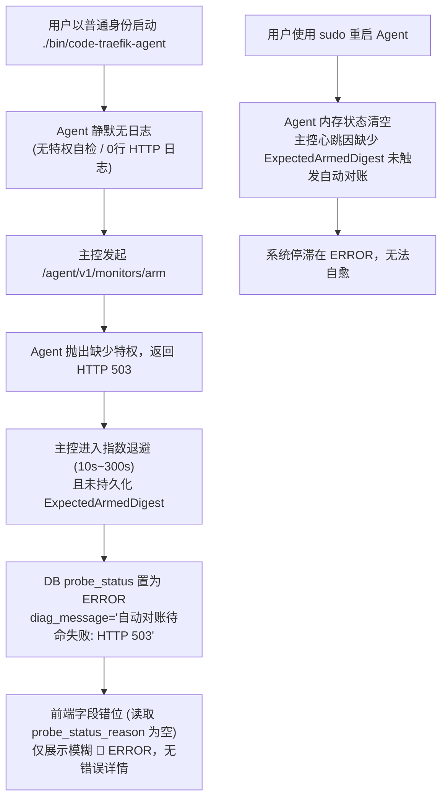

# Agent 宿主机探针可观测性、特权感知与全链路自愈方案设计 🛡️

本文档针对宿主机 Agent 启动缺乏提示、特权缺失静默返回 503、控制台展示模糊 `ERROR` 以及 Agent 重启后无法自动自愈等全链路体验痛点，提出系统级改进与闭环落地设计。

---

## 1. 现状复盘与根因链条 (Root Cause Analysis)

### 四大核心断点
1. **Agent 终端黑盒**：启动无环境检查横幅，运行时请求零日志；
2. **状态语义模糊**：缺少特权被笼统粗暴降级为 `ERROR`，掩盖了核心的 `CAP_DENIED` 语义；
3. **前端透明度不足**：DTO 字段 `diag_message` 与前端 `probe_status_reason` 映射断开，用户看不到 503 原因；
4. **自愈环路中断**：首发失败导致 `expected_armed_digest` 未落盘，且 Agent 重启时只清空租约却未自动补偿挂载。

---

## 2. 系统设计与架构方案 (Architecture Design)

### 模块一：Agent 自身终端增强 (CLI & Dataplane Runtime)
1. **启动前置自检 (Startup Pre-flight Check)**：
   * 在 `cmd/agent/main.go` 启动时，主动调用 `ebpf.LinuxCapabilityChecker.CheckCapabilities()`；
   * 若具备特权（EUID=0 或完整 CapEff）：输出 `[✓] 内核特权完整: EUID=0 / CapDetail: ...`；
   * 若缺少特权：终端输出醒目的黄色/红色警告横幅，明确指出缺少 `CAP_BPF`、`CAP_NET_ADMIN` 等，提示后续探针操作必将失败，并给出具体修复命令（`sudo ...`）。
2. **严格模式参数 (`--require-caps`)**：
   * 支持通过命令行参数要求特权强校验，若不满足则直接以状态码 `1` 退出，拒绝伪在线。
3. **环境体检命令 (`--doctor` / `check`)**：
   * 独立体检模式：检测 Linux 内核版本（>= 5.8）、BPF 文件系统挂载、Procfs 可读性及特权位，输出结构化清单。
4. **请求生命周期审计日志**：
   * 在 `internal/agent/server/http_server.go` 中，对握手、预挂载（`arm`）、监控同步（`sync`）、停止（`stop`）、重放（`replays`）等关键动作打印清晰的标准日志，错误时显式记录原因与 HTTP 状态码。
5. **开箱即用提权脚本 (`demo/start-agent.sh`)**：
   * 提供检测 `$EUID -ne 0` 自动请求 `sudo` 提权的包装脚本。

---

### 模块二：主控端 Hub 状态对账与闭环自愈 (Control Plane Hub)
1. **期望规格 (`ExpectedArmedDigest`) 提前固化**：
   * 在 `AutoRearmAgent` 中，一旦完成待命规格编译，立即将 `expected_armed_digest` 写入 `traefik_agents` 表；
   * 即使本次下发因 503 或网络失败，期望意图已被系统持久化记住。
2. **HTTP 503 结构化诊断解析与 7 态精准落盘**：
   * 解析 Agent 返回的 503 响应体 `{"error": "...", "diagnostics": [...]}`；
   * 若诊断包含 `CAP_DENIED`，将进程 `probe_status` 置为 `models.ProbeStatusCapDenied` (`CAP_DENIED`)，而非笼统的 `ERROR`；
   * 将 Agent 的详细诊断信息如实写入 `diag_message`。
3. **Agent 重启自愈 (Reboot Re-arming)**：
   * 在 `HandleHeartbeat` 检测到 `isRebooted == true` 时，清空旧退避缓存 `rearmBackoffs.Delete(agentID)`，并异步拉起 `AutoRearmAgent` 补齐 Agent 内存状态。
4. **探针立即对账 API**：
   * 新增 `POST /api/agents/:id/probes/rearm`，清除退避并立即触发全量对账，返回最新七态诊断结果。

---

### 模块三：控制台 Web 前端可观测性与体验 (Frontend UX)
1. **字段映射与 7 态徽章补全**：
   * `frontend/src/types/agent.ts` 中补充 `diag_message?: string`；
   * `renderProbeStatusBadge` 支持 `CAP_DENIED` 专属徽章（`🔴 CAP_DENIED`），且 Tooltip 优先透出 `proc.diag_message`。
2. **Agent 卡片特权状态展示**：
   * 在 Agent 卡片元数据区显式展示 `eBPF 特权: 🟢 具备 / 🔴 缺失`，悬浮展示 `cap_detail`。
3. **操作级一键自愈**：
   * 当进程处于 `ERROR` 或 `CAP_DENIED` 时，操作列展示 **`[重试对账]`** 按钮；
   * Agent 详情工具栏提供 **`[🔄 探针立即对账]`** 按钮。

---

## 3. 验收标准与验证矩阵 (Acceptance Criteria)

* [x] **AC-1 (Agent CLI)**：普通用户启动 Agent 时终端输出醒目警告横幅；`--doctor` 正确输出体检报告；`--require-caps` 在无权限时退出。
* [x] **AC-2 (Agent 日志)**：Agent 在处理 `arm` 请求时输出请求与结果日志，失败时输出具体原因。
* [x] **AC-3 (主控 7 态精准解析)**：Agent 报 503 CAP_DENIED 时，主控如实将 `probe_status` 设为 `CAP_DENIED` 并记录 `diag_message`。
* [x] **AC-4 (自愈闭环)**：`expected_armed_digest` 提前固化，Agent 重启或具备特权后心跳自动对账自愈。
* [x] **AC-5 (前端透出与重试)**：悬浮能看到真实 `diag_message`，Agent 卡片展示特权状态，提供一键 `[重试对账]`。
* [x] **AC-6 (工程门禁)**：`make test`、`make lint`、`make build` 100% 零警告通过。
