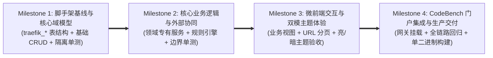

# 业务流量监控与重放 (`code-traefik`) 工程实施路线图与 TDD 验收总则 (Roadmap)

- **文档编号**：`01-roadmap.md`
- **文档版本**：v0.1.0
- **编制日期**：2026-10-27
- **归属阶段**：阶段三/四：TDD 实施规划与质量门禁

---

## 1. 工程递进策略 (TDD Execution Strategy)

基于已冻结的架构设计（[`docs/02-design/01-system-architecture.md`](../02-design/01-system-architecture.md)）与接口契约（[`docs/03-api/01-http-api-contract.md`](../03-api/01-http-api-contract.md)），项目划分为正交递进的里程碑。每个里程碑均遵循 **TDD（测试先行 -> 编码实现 -> 重构验收）** 原则。

---

## 2. 里程碑全景矩阵

| 里程碑 | 作战卡文档 | 核心交付物 | 自动化验收门禁 (Quality Gate) | 状态 |
| :--- | :--- | :--- | :--- | :---: |
| **M1：基础底座与核心模型** | [`02-m1-domain-model-and-api.md`](./02-m1-domain-model-and-api.md) | `config/`, `models/`, `handlers/`, `handlers/item_test.go`, `frontend/` 基础脚手架 | `make test` 与 `make lint` 100% 通过 | ✅ 已就绪 |
| **M2：定制领域模型与 API 扩展** | *(待按需新建 `03-m2-*.md`)* | 新增 `traefik_*` 领域模型、业务 Handler 与 `testdb` 隔离单测 | `TEST_DB_DSN=... make test` 全绿 | ⏳ 待规划 |
| **M3：前端领域视图与交互深耕** | *(待按需新建 `04-m3-*.md`)* | 领域专属 React 页面、抽屉表单、图表看板与样式 | `make lint && make build` 零报错 | ⏳ 待规划 |
| **M4：门户联调与上线交付** | [`docs/06-ops/01-verification-and-deployment-guide.md`](../06-ops/01-verification-and-deployment-guide.md) | `code-bench/config.yaml` 网关挂载与生产二进制包 | 上线前自检清单 100% 达成 | ⏳ 待执行 |

---

## 3. 全局强制质量门禁 (Mandatory Quality Gates)

1. **表前缀合规**：所有 GORM 模型的 `TableName()` 必须以 `traefik_` 开头。
2. **静态与类型检查零容忍**：每次提交前必须通过 `make test`（`go fmt` + `go vet` + `go test`）与 `make lint`（`tsc --noEmit` + `eslint`）。
3. **进程与端口卫生**：任何验证结束后，后台不得残留占用 `:8091` 或 `:5181` 的进程。
