# 架构与活体契约治理 (`code-traefik`) TDD 工程实施路线图与质量门禁

- **文档编号**：`01-roadmap.md`
- **文档版本**：v1.15.0
- **更新日期**：2026-11-14
- **归属阶段**：阶段三/四：TDD 实施路线图与全局门禁 (`04-tasks`)
- **状态**：M1~M26 全部交付完成 (Delivered)
- **上位基线**：[`01-feature-matrix.md`](../01-features/01-feature-matrix.md) (v2.20.0)、[`01-system-architecture.md`](../02-design/01-system-architecture.md) (v1.8.1)、[`03-architecture-elements-and-topology.md`](../02-design/03-architecture-elements-and-topology.md) (v1.9.0)、[`04-control-plane-and-web-console.md`](../02-design/04-control-plane-and-web-console.md) (v1.11.1)、[`05-database-schema.md`](../02-design/05-database-schema.md) (v1.9.0)、[`01-http-api-contract.md`](../03-api/01-http-api-contract.md) (v1.8.0)、[`12-packet-causality-call-tree-and-sequence-ux-adr.md`](../05-adr/12-packet-causality-call-tree-and-sequence-ux-adr.md) (ADR-12 v1.0.0)、[`14-governance-dashboard-golden-suite-and-ci-gate-adr.md`](../05-adr/14-governance-dashboard-golden-suite-and-ci-gate-adr.md) (ADR-14 v1.1.0)、[`15-scalable-topology-focus-and-layout-persistence-adr.md`](../05-adr/15-scalable-topology-focus-and-layout-persistence-adr.md) (ADR-15 v1.3.0)、[`16-multi-implementation-service-contract-adr.md`](../05-adr/16-multi-implementation-service-contract-adr.md) (ADR-16 v2.0.0)、[`17-topology-single-layer-drilldown-and-layout-ux-adr.md`](../05-adr/17-topology-single-layer-drilldown-and-layout-ux-adr.md) (ADR-17 v1.1.0)、[`18-proto-full-lifecycle-and-git-mr-governance-adr.md`](../05-adr/18-proto-full-lifecycle-and-git-mr-governance-adr.md) (ADR-18 v1.3.0)

### 修订记录

| 版本 | 日期 | 作者 | 变更说明 |
| :--- | :--- | :--- | :--- |
| `v1.8.0` | `2026-11-11` | Architecture Team | 同步 ADR-16 (`v1.0.0`)：新增里程碑 `M20`（多实现服务契约建模、实测定位、拓扑表达与重放隔离，状态「待实施」）、特性子项 `F-02.1` / `F-04.4` / `F-05.1`、端到端验收场景 `SC-12`，业务表数量升级为 `19` 张（新增 `traefik_service_contracts`） |
| `v1.9.0` | `2026-11-13` | Architecture Team | 同步 [`ADR-17`](../05-adr/17-topology-single-layer-drilldown-and-layout-ux-adr.md) (`v1.0.0`)：标记 `M20` 为 `✅ 已交付`，新增里程碑 **`M21`**（架构拓扑单层平铺逐级下钻、ELK 正交间距校准、`1:1 border-box` 盒模型、四向智能锚点、按作用域隔离位置记忆及 4 组工具栏/面包屑/可读抽屉升级，状态「待实施」），并更新 `F-04`~`F-04.3` 与 `SC-11` 落位追踪 |
| `v1.10.0` | `2026-11-13` | Architecture Team | 依据 [`ADR-18`](../05-adr/18-proto-full-lifecycle-and-git-mr-governance-adr.md) (`v1.1.0`)：标记 `M21` 为 `✅ 已交付`，规划并拆解 **M22 ~ M25** 四个增量里程碑（`📋 待实施`） |
| `v1.11.0` | `2026-11-13` | Architecture Team | 依据 ADR-18 v1.2.0 架构与可实施性深度检视修订：1. **拆分重载的 M25 为 M25 + M26**（`M25` 聚焦 Git 无状态同步、`GitRepo (1) -> GitProtoBundle (N)` Monorepo 多包模型与只读历史 Diff；`M26` 聚焦 MR 四合一 Webhook 门禁、`SSEBroker(userID)` 定向推送、持久化通知、`LAN code-notifier`/SMTP 邮件触达及 `/dashboard` 合标扩展）；2. 统一秘钥变量 `TRAEFIK_CRYPTO_KEY`、AST 重复阈值 `Jaccard >= 0.85` 与前端 `M22~M26` 增量体积红线 **`<= 150KB gzip`（`<= 500KB` raw）**；3. 明确 `SafeDialer` 支持管理员配置的受信任内网白名单（`outbound_trusted_cidrs` 放行内网 GitLab/LLM 与跨机部署的 `code-notifier`）同时硬阻断云元数据及未授权内网/回环、`settings.go` 敏感字段及审计脱敏改造、`uk_traefik_mr_dedup` 修复 Fast-Forward/Rebase 同 SHA 漏触发、Bot `remote_comment_id` 原位更新、`BASE_LIB` `breaking.go` 反向 import 闭包影响面穿透、`layer_level` `*int` 与 `DISPATCH` 消费方反向校核、`F-32` 程序化矢量 SVG/离屏 Canvas 导出与门户嵌入模式下 `WorkspaceUtilityHeader` `NotificationBell` 挂载策略；核心业务表扩展为 **`30` 张 + `traefik_settings` 共 `31` 张** |
| `v1.12.0` | `2026-11-13` | Architecture Team | 依据 ADR-18 v1.3.0 清除无用的 `code-proto`/`protohub` 数据迁移任务：明确两者未开发完成且从未运行过，彻底取消 `scripts/migrate_protohub_vocab` 与 `PROTOHUB_IMPORT`，`M24` 精简收敛为 P1~P3（原生 `BUILTIN_SEED` 词根初始化 + 规则/词库 CRUD + 零 SQLite 全仓隔离） |
| `v1.13.0` | `2026-11-14` | Engineering Team | **M22 全栈交付完成 (`✅ 已交付`)**：纯 Go `protocompile` 四级虚拟 Resolver 与 `ProtoSourceProvider`、跳过外部导入与剥离外部 `SourceCodeInfo`、`BASE_LIB` 反向 `import` 闭包破坏性雷达、`Subsystem`/`Module` `*int layer_level` 分层守卫与 `DISPATCH` 反向校核 `409` 拦截、`/schemas?tab=graph` 依赖图、在线源码编译与 F-32 纯矢量 SVG/离屏 Canvas PNG 导出全部完成 `SC-13` 与全量 TDD 验证 |
| `v1.14.0` | `2026-11-14` | Engineering Team | **M23 全栈交付完成 (`✅ 已交付`)**：新增 `traefik_proto_doc_symbols` 模型与 `internal/server/protodoc` 全层级注释/`@deprecated`/`@owner`/`@error_code`/Enum 字典/防环 AST 缺省与 `ACTIVE` 黄金样本 JSON/Markdown 导出引擎、`/api/proto-docs/*` 与过渡只读 `/api/proto-schemas/:id/sources` + `/api/proto-files*`、`/schemas` 无侧栏 5 视窗 IA 收口（`?tab=docs` 兼容 `?tab=catalog`）与轻量只读语法高亮/Diff 组件（零 `monaco-editor`、增量体积 `~10KB gzip` 远低于 `150KB gzip` 预算）及 `SC-14` 全量 TDD 验证 |
| `v1.15.0` | `2026-11-14` | Engineering Team | **M24~M26 收官全部交付完成 (`✅ 已交付`)**：M26 补齐 `traefik_mr_check_runs`（`uk_traefik_mr_dedup`）与 `traefik_notifications` 达成 30+1 表基线；交付 `:repoId` Webhook、基线+补丁虚拟树四合一门禁、Bot 原位评论、`Override`（禁止豁免编译错误 + `P1` 审计）、`MAIN_MERGE` 自动入池、`SSEBroker(userID)` 定向推流、跨机 `code-notifier`/SMTP 通知中心、`/schemas?tab=mr-gates`、双模 `NotificationBell` 与 `F-24` `StaticComplianceCard`；通过全量 `go test -race`、Vitest 36/36（169 tests）、`make test && make lint && make build` 与 Vite 增量体积终验（`M21->M26` `+48.74KB gzip` `<= 150KB gzip`） |

---

## 1. 脚手架模板代码清理与双入口重构策略

现有 `code-template` 生成的示例业务代码在阶段四直接删除重写，**不做任何向后兼容保留**：
1. **彻底移除模板占位资产**：
   - 后端：删除 `handlers/item.go`、`handlers/item_test.go`；从 `models/item.go` 移除 `TemplateItem`（`traefik_items` 表）及示例种子数据，重构为 `models/setting.go`（保留 `TraefikSetting` 对应 `traefik_settings` 治理参数表）。
   - 前端：删除 `frontend/src/pages/DashboardPage.tsx` 与 `frontend/src/pages/ItemListPage.tsx`，替换为五大领域工作台。
2. **保留并升级平台底座组件**：
   - 保留 `handlers/health.go`、`handlers/auth.go`、`handlers/settings.go` 及前端 `AdminSettingsPage.tsx`、`ModuleUserContext.tsx`。
   - 将根目录 `main.go` 迁移重构为同仓双可执行入口：`cmd/server/main.go`（`code-traefik-server`，内嵌 `frontend/dist`）与 `cmd/agent/main.go`（`code-traefik-agent`，零数据库、零 `.pb` 依赖）。

---

## 2. M1 ~ M26 里程碑依赖拓扑 (DAG) 与职责边界

```mermaid
flowchart LR
    M1["M1: 协议栈与数据模型底座<br/>(pkg/crosrpc + pkg/agentproto + 13张表/分区)"]
    M2["M2: 架构元素、.pb 与 Agent 管控<br/>(topology/tree + decoder + hub + 控制面 API)"]
    M3["M3: 数据面 Agent 引擎<br/>(cmd/agent + pkg/ebpf + pkg/replay)"]
    M4["M4: 协同录制、一致性验证与回归 Diff<br/>(recorder + consistency + diff + 业务 API)"]
    M5["M5: 微前端工作台与全链路交付<br/>(5大工作台 + 4段解剖抽屉 + SC-01~08 E2E)"]

    M1 ==> M2
    M1 ==> M3
    M2 ==> M4
    M3 ==> M4
    M4 ==> M5
    M5 ==> M6
    M6 ==> M7
    M7 ==> M8
    M8 ==> M9
    M9 ==> M10
    M10 ==> M11
    M11 ==> M12
    M12 ==> M13
    M13 ==> M14
    M14 ==> M15
    M15 ==> M16
    M16 ==> M17
    M17 ==> M18
    M18 ==> M19
    M19 ==> M20
    M20 ==> M21
    M21 ==> M22
    M22 ==> M23
    M23 ==> M24
    M24 ==> M25
    M25 ==> M26
    M6["M6: 分层复合拓扑与一致性画布<br/>(React Flow + ELK Worker + 边汇总 + 去 Agent 物理图)"]
    M7["M7: 契约资产化治理、嵌套服务表与消息体字段树<br/>(两级折叠表 + 字段字典树 + 可视化 Diff 忽略 + 原文件导出)"]
    M8["M8: 控制台信息架构重组与调试工作流闭环<br/>(3组8项菜单 + 录制台账/单包调试重放 + 架构解耦与进程收口)"]
    M9["M9: 协同录制抽屉重构与进程树选择器<br/>(Drawer 侧边栏 + 卡片解挤 + 目标 Agent 选择防呆 + 业务进程树)"]
    M10["M10: 架构物理进程蓝图与 eBPF 自动预挂待命<br/>([逻辑架构|物理进程] + 1:1挂载覆盖 + ARMED零重启录制)"]
    M11["M11: 增强 Protobuf 描述集资产管理<br/>(多.pb文件台账 + 跨集依赖闭包 + 全局单一生效池)"]
    M12["M12: 单进程开箱双录与双工作台录制体验闭环<br/>(全出站透明双录 + 5项链路修复 + 智能预选与双向深链)"]
    M13["M13: 报文因果调用树、时序泳道与闭包重放<br/>(默认树形甘特瀑布 + 跨跳缝合/参数血缘 + ScopedMock闭包)"]
    M14["M14: 平台级契约治理全景大盘与信息架构升维<br/>(置顶/dashboard + 健康分算法 + 漂移/孤儿/防线卡片)"]
    M15["M15: 黄金契约套件资产库与事务固化工作台<br/>(traefik_golden_suites + 事务树一键沉淀 + 权威脱机回归)"]
    M16["M16: 设计态契约破坏性变更阻断雷达<br/>(Protobuf AST 比对 + Tag/类型/删除强阻断 + 下游消费者推导)"]
    M17["M17: CI/CD 自动化强阻断门禁与凭据报告<br/>(POST /api/gates/evaluate + Violation/Diff双重红阻 + MR报告)"]
    M18["M18: 面向业务视角的报文透视与双模解剖抽屉<br/>(业务概览 + 入参出参并排对比 + 耗时瀑布 + 专家折叠)"]
    M19["M19: 大规模拓扑下钻聚焦与双层混合布局持久化<br/>(P1~P7: 五段管线 + 聚焦/邻域/统一守卫 + 降噪 + 位置记忆布局 + 基准/书签)"]
    M20["M20: 多实现服务契约建模与重放隔离<br/>(P1~P6: 接口库契约表 + ContractResolver + IMPL_UNRESOLVED + dst_tag 隔离)"]
    M21["M21: 架构拓扑单层平铺逐级下钻与易用性升级<br/>(P1~P4: 单层裁剪 + ELK 110px/FIRST-LAST + 1:1 border-box + 四向锚点 + 4组工具栏)"]
    M22["M22: 编译底座、分层约束与依赖图谱<br/>(protocompile + 四级Resolver + layer_level正反向 + BASE_LIB传递扩散 + F-32矢量导出)"]
    M23["M23: 活体参考文档中心与轻量只读源码<br/>(F-18 SourceCodeInfo + 黄金样本 + Markdown导出 + 增量<=150KB gzip 只读高亮与Diff)"]
    M24["M24: 安全底座、静态规范引擎、原生词库与AST重复<br/>(TRAEFIK_CRYPTO_KEY/SafeDialer白名单 + 多段命名/BUILTIN_SEED词库/3s LLM + Jaccard>=0.85)"]
    M25["M25: Git无状态同步与Monorepo多Bundle源码库<br/>(GitRepo 1:N Bundle + REST/memfs + SHA256对账 + Commit历史Diff + Tier2 Resolver)"]
    M26["M26: MR四合一门禁、定向通知与合标扩展<br/>(uk_traefik_mr_dedup + 评论原位更新/Override P1 + SSE按userID + LAN code-notifier + F-24)"]
```

| 里程碑 | 状态 | 作战卡文档 | 核心职责与交付边界 | 准出质量门禁 (Exit Gate) |
| :--- | :---: | :--- | :--- | :--- |
| **M1** | ✅ 已交付 | [`02-m1-crosrpc-and-domain-models.md`](./02-m1-crosrpc-and-domain-models.md) | 清理模板 `traefik_items`；实现 `pkg/crosrpc`（24B 公共头、V1~V5 会话头、`LookupRspLayout`、扩展头、`StreamFramer`、`SplitFrames`）、`pkg/agentproto`（56B 二进制信封）、`models/` 13 张核心表与 `traefik_traffic_records` 按日范围分区管理器 | `go test -race ./pkg/... ./models/...` 全绿 + Fuzz 60s 零崩溃 + `testdb` 13 表迁移通过 |
| **M2** | ✅ 已交付 | [`03-m2-arch-proto-and-agent-control.md`](./03-m2-arch-proto-and-agent-control.md) | 三级架构树（咨询锁防成环移动）、模块接口（`{package}.{serviceName}` 与 `PROVIDE` 全局唯一）、`traefik_process_modules` 映射、静态拓扑推导、`.pb` 上传/激活与 `dynamicpb` 解码、公私域 Agent 纳管/`AcquireAgentLeases` 升序排他锁/双向心跳对账与 RBAC 审计 API | `TEST_DB_DSN=... go test -race ./internal/server/... ./handlers/...` 全绿 |
| **M3** | ✅ 已交付 | [`04-m3-agent-dataplane-ebpf-and-replay.md`](./04-m3-agent-dataplane-ebpf-and-replay.md) | `cmd/agent` 受控 HTTP+WS 服务（IP 白名单、`ClaimCode`、64MB 有界缓冲、5m 失联自洁）、`pkg/ebpf`（入站 RingBuf 复制、出站 `connect4` 重定向、`agent_pid` 自环豁免、`/proc` PID 巡检与存量连接诊断）、`pkg/replay`（零 `.pb` `ScopedMockMatcher` 与表驱动头部自愈） | 普通单测 + `//go:build linux && ebpf` 特权测试通过 + `cmd/agent` 零 DB/零 `.pb` 依赖断言通过 |
| **M4** | ✅ 已交付 | [`05-m4-recording-topology-and-diff-engine.md`](./05-m4-recording-topology-and-diff-engine.md) | 多进程协同录制编排、Track A (SSE) / Track B (`ExchangeAssembler` 往返配对双模落盘)、四段报文解剖组装、离线架构一致性六分类验证、跨 Agent 同构重放调度与双层（协议头 + `protoreflect`）回归 Diff 引擎 | `TEST_DB_DSN=... go test -race ./...` 全绿 |
| **M5** | ✅ 已交付 | [`06-m5-microfrontend-and-e2e-delivery.md`](./06-m5-microfrontend-and-e2e-delivery.md) | 架构中心、Agent 看板、`.pb` 工作台、流量监控台（含四段解剖抽屉）、重放工作台（含双层 Diff 抽屉）、`--color-*` 语义主题、URL 5 页滑窗分页、`SC-01`~`SC-08` E2E 回归及双二进制打包交付 | `make test && make lint && make build && make clean` 100% 零警告通过 |
| **M6** | ✅ 已交付 | [`07-m6-hierarchical-topology-canvas.md`](./07-m6-hierarchical-topology-canvas.md) | 分层复合架构拓扑与一致性画布（`ArchCanvas`）：全系统单画布、React Flow v12 + ELK Inline Worker 异步正交布局（含跨层拐点全局换算与拖拽退化）、纯前端边汇总与动态 `VIOLATION`/`UNATTRIBUTED` 叠加、物理视图去 Agent 化与 `SHA-256` 强 `ETag` `GET /api/arch/topology/graph` 契约 | Vitest 纯算法单测覆盖率 `≥ 90%` + `TEST_DB_DSN=... go test -race` 通过 + `make lint && make build` 零警告 |
| **M7** | ✅ 已交付 | [`08-m7-proto-schema-deepening-and-nested-contract-workbench.md`](./08-m7-proto-schema-deepening-and-nested-contract-workbench.md) | Protobuf 契约资产化治理：两级嵌套折叠服务表（服务主行 ➔ 方法子表）、消息体参数字典树反射（Req/Rsp 字段树、Tag、类型高亮与注释透视）、可视化 Diff 忽略字段勾选与多级继承、原始 `.pb` 二进制下载导出及架构认领血缘分析 | `TEST_DB_DSN=... go test -race ./...` 全绿 + `make lint && make build` 零警告 |
| **M8** | ✅ 已交付 | [`09-m8-console-ia-restructuring-and-debug-workflow.md`](./09-m8-console-ia-restructuring-and-debug-workflow.md) | 微前端控制台信息架构重组与调试工作流闭环：3 组 8 项频次金字塔菜单（默认落地 `/record`）与旧深链无损重定向、独立 `流量录制` 素材台账与 `流量调试`（`has_error` 异常过滤 + `SinglePacketReplayDrawer` 单包快速重放原地 Diff）、全屏 `架构拓扑` 与纯逻辑 `架构元素` 解耦、物理进程单点收口至 `Agent 与进程` | `TEST_DB_DSN=... make test` 全绿 + `MenuAndLegacyRoutes` / `RecordingWorkbench` / `SinglePacketReplay` / `TopologyAndArchDecoupling` 单测全绿 + `make lint && make build && make clean` 零警告 |
| **M9** | ✅ 已交付 | [`10-m9-recording-drawer-and-process-tree-selection.md`](./10-m9-recording-drawer-and-process-tree-selection.md) | 协同录制抽屉重构与进程树选择器：全面弃用居中 Modal 迁移至 680px `Drawer`（Sticky 吸底 Footer）、素材归属卡片式单选解挤、宿主 Agent 下拉选择与在线/租约防呆门禁、业务进程树形分层选择（组级全选/半选/折叠与搜索过滤） | `RecordingStartDrawer` 单测全绿 + `make test && make lint && make build` 零警告 |
| **M10** | ✅ 已交付 | [`11-m10-arch-process-blueprint-and-premount-workflow.md`](./11-m10-arch-process-blueprint-and-premount-workflow.md) | 架构物理进程蓝图解耦、多环境 `1:1` 挂载与 eBPF 自动预挂待命：15 表清库重建（`ArchProcessGroup`/`ArchProcess` + 多套 `SHARED`/`PRIVATE` 环境 `1:1` 挂载覆盖 + `FallbackAgentID` 基线兜底 + `ProcessSnapshots` 快照解耦）、零 Agent 物理拓扑与可选环境端点叠加、`/architecture` `[逻辑架构 \| 物理进程]` 双视图树、按需入站读写钩子（待命全机零读写 syscall 损耗）+ 三态 `EgressProxy`（`PASSTHROUGH` 停录不断连 / `CAPTURING` 有序闸门 / `REPLAY_MOCK` 既有连接零外泄接管）、Single-Flight 版本化 `Auto-Rearm`、`/agents` 七态就绪树与 `/record` 零重启抽屉联动 | `TEST_DB_DSN=... make test` (15 表 + 三态代理零外泄单测) + `ArchPhysicalBlueprintWorkbench` / `AgentProcessMountAndReadiness` / `RecordingStartDrawer` 单测全绿 + `make lint && make build && make clean` 零警告 |
| **M11** | ✅ 已交付 | [`12-m11-enhanced-proto-schema-asset-management.md`](./12-m11-enhanced-proto-schema-asset-management.md) | 增强 Protobuf 描述集资产管理与跨集依赖闭包（取消 `F-21` `code-proto` 联动完全内聚自治）：单包上限升至 `16MB`、三级分类 (`BASE_LIB`/`BUSINESS`/`GATEWAY`)、按 `file.Name` 去重与拓扑排序的跨 `.pb` 联合 `protodesc.NewFiles`（仅导自有 `Service`、支持 `0` 接口 `BASE_LIB`、内置 WKT 兜底、`DiffIgnorePaths` 前向继承）、事务咨询锁 + `CompileTrialPool` 试编译防破坏门禁（支持停用下线与批量原子激活）、`/schemas` 双模无侧栏工作台（`?tab=assets` 文件资产台账 + `680px` 透视抽屉 & `?tab=catalog` 按 `Service` 组分页全局契约目录与孤儿治理） | `TEST_DB_DSN=... make test` (跨集闭包 + `CompileTrialPool` + 零 `N+1` 台账单测) + `SchemaAssetLedgerWorkbench` / `ProtoNestedTable` 单测全绿 + `make lint && make build && make clean` 零警告 |
| **M12** | ✅ 已交付 | [`13-m12-bidirectional-capture-and-agent-recording-ux.md`](./13-m12-bidirectional-capture-and-agent-recording-ux.md) | 单进程开箱即用出入站双向采集与双工作台协同录制体验闭环（ADR-11）：目标 PID 默认全出站透明代理拦截（零下游拓扑前置即自动双录 `INGRESS + EGRESS`，`StreamFramer` `bytes.Index` SIMD 紧缩保障非 RPC 流 `<=8KB` 零干扰）、修复 BPF `__be32/__be16` 字节序、`EgressProxy` `SessionOrTaskID` 与真实 `agent_id`、`Direction` 与 `StreamHalf` 正交解耦、存量入站 FD 预热与 `/proc/<pid>/fd` 自有 Inode 诊断、停录路由 `/monitors/:sessionId/stop`、重放历史 `EGRESS` `DstAddr` 并集与写前 `"CSE.TCP"` 零外泄守卫；修复 `GetAgent` 空表，落地两工作台文案消歧、`1..5` 可用进程自动全选、`[🔗 勾选关联下游]` 及 `/agents` ⇄ `/record` 双向一键深链 | `TEST_DB_DSN=... make test` (全出站双录 + 字节序/方向/停录/零外泄单测) + `AgentProcessMountAndReadiness` / `RecordingStartDrawer` 单测全绿 + `make lint && make build && make clean` 零警告 |
| **M13** | ✅ 已交付 | [`14-m13-packet-causality-call-tree-and-sequence-workbench.md`](./14-m13-packet-causality-call-tree-and-sequence-workbench.md) | 报文时序因果树、内联甘特瀑布、全链路时序泳道与事务闭包重放（ADR-12）：`pkg/crosrpc` V03/V04 `ullServerRecvTime/ullServerSendTime` 补齐与 `StreamFramer` 首字节定戳；`ExchangeAssembler` 请求到达瞬间原子分配发起 `SeqNo` 与同连接 `MNG.acProcName` 记忆；新建 `internal/server/callgraph`（DOTR `TraceKey` 权威调用树 + 时间窗降级、多进程 `EgressProxy` `EGRESS ⇔ INGRESS` 跨跳缝合、兄弟 `串行/并发/补偿` 分类、单事务参数血缘与跨事务业务实体生命线）；`/debug` 默认「可折叠调用树 + 内联迷你甘特瀑布条」按根事务不割裂分页（辅以平铺切换）+ 原生 SVG 时序泳道与四段解剖双栏联动抽屉；端到端打通 `RecordID` 级 `ScopedEgressMocks` 因果闭包重放预览、前置状态依赖链勾选回放与泳道故障叠加 | Agent 零 DB/零 `.pb` 依赖断言 + `TEST_DB_DSN=... make test` (`callgraph` 破环/缝合/血缘/Anti-IDOR + `ScopedMock` 隔离单测) + `TransactionCallTreeAndSequence` Vitest 单测全绿 + `make lint && make build && make clean` 零警告 |
| **M14** | ✅ 已交付 | [`15-m14-governance-dashboard-and-ia-restructuring.md`](./15-m14-governance-dashboard-and-ia-restructuring.md) | 平台级契约治理全景大盘与信息架构分步升维（ADR-14 v1.1.0）：`menu.ts` 先行重构为 4 组 9 项（置顶 `/dashboard` 默认落地，零死链空壳页）；实现公私域隔离的**三维封顶健康评分模型（`40+30+30`）**、去重架构漂移雷达、Proto 孤儿清零看板、防劣化回归防线及 `GET /api/dashboard/overview` 聚合 API | `TEST_DB_DSN=... make test` (公私域隔离与子分封顶单测) + `make lint` 全绿 + 大盘组件与深链 Vitest 单测覆盖率 `≥ 90%` |
| **M15** | ✅ 已交付 | [`16-m15-golden-contract-suites-and-curation-workbench.md`](./16-m15-golden-contract-suites-and-curation-workbench.md) | 黄金契约套件自包含快照库与双源重放解耦（ADR-14 v1.1.0）：升级至 **17 张业务表**（`traefik_golden_suites` + **完全自包含深拷贝 `traefik_golden_suite_items`** 免疫 30 天分区 `DROP TABLE`），解耦 `ReplayTask` 双源外键；`/debug` 事务树【🌟 沉淀为黄金契约】抽屉；构建 `/golden-suites` 工作台（补齐第 10 项菜单）、动态掩码清洗与套件一键脱机回归 | `testdb` 17 表迁移与**源分区清理后套件独立回放存活单测**全绿 + 前端套件工作台单测通过 + `make lint && make build` 零警告 |
| **M16** | ✅ 已交付 | [`17-m16-design-time-breaking-change-radar.md`](./17-m16-design-time-breaking-change-radar.md) | 设计态契约破坏性变更阻断雷达与回滚逃生舱（ADR-14 v1.1.0）：基于 `FileDescriptorSet` 实现全维度 AST 比对引擎（覆盖 Service/Method 删改、字段 Tag/类型/`oneof`/`map` 变异、`DescriptorProto.GetReservedRange()` 数字区间核验与枚举篡改）；默认返回结构化 `409 BREAKING_CHANGE_DETECTED` 与下游消费者血缘清单；支持管理员 `allow_breaking + breaking_reason` 紧急回滚逃生与 `P1` 审计 | AST 全规则比对单测覆盖率 `100%` + 下游消费者推导与 `allow_breaking` 回滚审计单测全绿 + 拦截抽屉 Vitest 通过 |
| **M17** | ✅ 已交付 | [`18-m17-ci-cd-quality-gate-and-automated-enforcement.md`](./18-m17-ci-cd-quality-gate-and-automated-enforcement.md) | CI/CD 自动化强阻断门禁、实测边回传与排他锁有界排队（ADR-14 v1.1.0）：Agent 重放回传 `ObservedEgressCalls` 支撑控制面单次闭环判定 `GATED_VIOLATION`；实现 `X-Traefik-CI-Token` SHA-256 `ConstantTimeCompare` 机器鉴权与轮换 API；实现 `POST /api/gates/evaluate`（内置 `wait_lease_seconds` 排队防并发踩踏，正交区分 `503` 环境忙/未就绪 vs `422` 违规/劣化红阻 vs `200` 准出）及 Markdown PR/MR 报告 | 重放实测边 `422 GATED_VIOLATION` / `GATED_BREAKING_DIFF`、并发排队零误杀、`503` 环境隔离及 CI Token 安全单测全绿 |
| **M18** | ✅ 已交付 | [`19-m18-business-centric-packet-inspector-redesign.md`](./19-m18-business-centric-packet-inspector-redesign.md) | 面向业务视角的 RPC 报文透视与双模解剖抽屉重构（F-15.2）：废弃 Wireshark 式二进制反直觉视觉，默认突出点分服务/方法大标题、状态码徽章、TraceID 复制、架构链路与往返总耗时；请求入参 vs 返回结果左右双栏同屏孪生对比（Split View），带 JSON 高亮与一键复制；微秒级阶段耗时彩色甘特拆解；底层 24B 位图/二进制字段/16B Hex 渐进式折叠收纳为专家排错区 | 前端 Vitest 单测覆盖业务总览、入参出参并排、非零业务错误高亮、阶段耗时瀑布、底层折叠区兼容及 XSS 安全防御全绿 + `make lint && make build` 零警告 |
| **M19** | ✅ 已交付 | [`20-m19-scalable-topology-focus-and-layout-persistence.md`](./20-m19-scalable-topology-focus-and-layout-persistence.md) | 大规模架构拓扑渐进式下钻聚焦、多维降噪与双层混合布局持久化（ADR-15 v1.1.0, `F-04.1`~`F-04.3`, `SC-11`），单里程碑内分 7 个子阶段：**P1** 后端 `structure_version`、`MODULE.meta.owner_id`、Graph `gzip` 与第 18 张表 `traefik_topology_layouts`（位置层 `SHARED` 按视图唯一 + 乐观锁、视角层 `PRIVATE` 书签差量）及 7 个布局 API；**P2** 画布管线重构（拆出 `synthesizeOverlay`、显式可见集、拖拽不重排、`fitView` 收紧）；**P3** 聚焦/透明祖先/LCA 外部邻居卡/有向邻域/多维过滤/统一守卫与 Hub/聚光灯纯算法；**P4** 位置记忆 + 局部子树排版 + 自底向上碰撞消解 + 节点集合 Diff + 加载优先级纯算法；**P5** 画布交互与渲染；**P6** `topo_*` URL、书签抽屉、基准发布与草稿闭环；**P7** 大规模数据集、性能单测与 `SC-11` 验收 | `testdb` 18 表迁移与布局 API 并发/RBAC/Anti-IDOR 单测全绿 + 新增纯函数文件 Vitest 行覆盖率 `≥ 90%`（带 `--coverage` 阈值门禁）+ 工作台交互单测全绿 + 管线性能单测达标 + `SC-11` 实测达标 + `make test && make lint && make build` 零警告 |
| **M20** | ✅ 已交付 | [`21-m20-multi-implementation-service-contract.md`](./21-m20-multi-implementation-service-contract.md) | 多实现服务契约（接口库定义 + 多进程实现 + 调度中心分发）建模、实测定位、拓扑表达与重放隔离（ADR-16 v2.0.0, `F-02.1` / `F-04.4` / `F-05.1`, `SC-12`, 修订假设 `A-05` / 新增 `A-09`），分 6 个子阶段：**P1** 第 19 张表 `traefik_service_contracts`、部分唯一索引、契约 CRUD/存量升级 API 与 `A-09` 同契约跨实现进程不相交校验；**P2** 抽取统一 `ContractResolver` 替换 `provideMap`、`endpoint_snapshots` 固化、`dst_contract_id` 三级回退离线回填与重放兼容性；**P3** 第八类一致性状态 `IMPL_UNRESOLVED`、逻辑/物理拓扑 DTO（`REALIZATION` 边、分发边展开、`CONTRACT_LIB` 物理视图过滤）与大盘覆盖率；**P4** Agent Mock `dst_tag` 隔离（保持零 DB 零 `.pb` 红线）；**P5** 前端 `/architecture` 与 `/topology` 表达；**P6** `SC-12` 端到端验收与全量回归（含自定义运行期发布名扩展） | `testdb` 19 表迁移与契约 CRUD/`A-09` 单测全绿 + `ContractResolver`/`IMPL_UNRESOLVED`/拓扑 DTO 单测全绿 + Agent 零 DB/零 `.pb` 红线与 `dst_tag` 隔离单测全绿 + 前端 Vitest 单测全绿 + `SC-12` 端到端通过 + `make test && make lint && make build && make clean` 零警告 |
| **M21** | ✅ 已交付 | [`22-m21-topology-single-layer-drilldown-and-layout-ux.md`](./22-m21-topology-single-layer-drilldown-and-layout-ux.md) | 架构拓扑单层平铺逐级下钻重构、ELK 正交布局校准与全链路易用性升级（ADR-17 v1.0.0, `F-04`~`F-04.3`, `SC-11`），零后端 DDL / API 破坏性变更，分 4 个子阶段：**P1** 单层平铺作用域裁剪（无外层包裹框、仅直属子节点 + LCA 外部传送门卡 + 直接子容器代表收敛）；**P2** ELK 单层正交参数校准（`nodeNodeBetweenLayers=110`、`FIRST/LAST` 列约束）、`1:1 border-box` 尺寸契约、四向智能锚点 `selectOptimalHandles` 与同锚点多边标签偏移；**P3** 按 `(view, focus_scope)` 隔离的位置记忆且仅用户显式固定才锁位、`[✨ 自动整理]`、`${focusScope}::${extId}` 零 DDL 持久化兼容；**P4** 顶部面包屑导航条 + 4 组工具栏 `[⚙️ 筛选与图层]` Popover + Filter Chips + `EdgeDetailDrawer` 中文名可读化与跳转 | 单层裁剪/上卷/四向锚点/作用域位置记忆 Vitest 全绿 + `ArchCanvas` 与工作台组件交互单测全绿 + `SC-11` 达标 + `make test && make lint && make build && make clean` 零警告 |
| **M22** | ✅ 已交付 | [`23-m22-protocompile-layering-and-dependency-graph.md`](./23-m22-protocompile-layering-and-dependency-graph.md) | 纯 Go `protocompile` 编译底座、架构分层逆向依赖校验与 `.pb`/拓扑依赖图谱（ADR-18 v1.2.0, `F-02`/`F-04`/`F-21`/`F-26`/`F-30`/`F-32`, `SC-13`）：**P1** `internal/server/decoder` 引入 `github.com/bufbuild/protocompile`（强制 `SourceInfoStandard`，跨 Bundle 导入保留自有 `SourceCodeInfo` 并裁剪外部导入 `SourceCodeInfo`、提取 Service 严格跳过全部外部依赖）、定义 `ProtoSourceProvider` 抽象（M22 基于已编译描述集、M25 接入 DB 源码）实现四级虚拟 `Resolver`（当次虚拟树 `proto_include_dirs` ➔ DB 同包/`BASE_LIB` 优先 `.proto` ➔ `CompiledRegistry.Files` ➔ WKT 内置）、路径防穿越与 `<= 16MB` 限额、`POST /api/proto-schemas/compile`；**P2** `Subsystem`/`Module` 增 `*int` `layer_level`（`0` 豁免）、`DEPEND` 禁止下层依赖上层 (`ERR_LAYER_VIOLATION`) 与 BFS/DFS 成环拦截 (`ERR_CYCLIC_DEPENDENCY`)、`REALIZATION` 与 `ModuleService`（含 `DISPATCH` 消费方反向校核）层级守卫 (`ERR_REALIZATION_LAYER_INVERSION`)、`breaking.go` 扩展 `BASE_LIB`（0-Service）反向 `import` 闭包下游影响雷达、`TopologyGraphDTO` 输出层级字段；**P3** `/schemas?tab=graph` 挂载 `dependencies-graph` 与 `/topology` 程序化矢量 SVG/离屏 Canvas（PNG）纯前端导出（读取 CSS `--color-*` Token 与边拐点） | `protocompile` 四级虚拟 `Resolver` + 外部跳过/裁剪 + 路径遍历单测全绿 + 分层正反向/成环 `409` + `BASE_LIB` 传递影响单测全绿 + `cmd/agent` 零 `protocompile`/DB 依赖断言通过 + `/schemas?tab=graph` & `/topology` 矢量导出 Vitest 全绿 |
| **M23** | ✅ 已交付 | [`24-m23-living-proto-docs-and-readonly-sources.md`](./24-m23-living-proto-docs-and-readonly-sources.md) | 全注释驱动活体接口参考文档中心与轻量只读源码浏览组件（ADR-18 v1.2.0, `F-18`/`F-28`, `SC-14`）：**P1** 新增第 20 张核心表 `traefik_proto_doc_symbols`（含 GIN/前缀检索索引）与 `internal/server/protodoc`（基于 `SourceCodeInfo` 提取 File/Service/Method/Message/Oneof/Enum 注释、解析 `@deprecated/@owner/@error_code`、精确行号锚点、最大深度 `<=12` 护栏 AST 缺省 JSON 与关联 `GoldenSuiteItem` 真实 JSON 样本、融合 `ADR-16` 定义方/实现方矩阵、`text/markdown` 离线手册导出）；**P2** `/api/proto-docs/{tree,services/:serviceName,export}` 与 schema-backed `GET /api/proto-files*`（暂由 `ProtoSchema` 编译源树映射提供，M25 无缝升级为 `traefik_proto_files` Git 历史库，零悲观锁字段）；**P3** `/schemas` 无侧栏 5 Tab 收口（`?tab=docs` 兼容 `?tab=catalog`）与 `ProtoReadOnlyCodeViewer` / `ProtoCommitDiffView`（100% `--color-*` 语义 Token、禁止引入 `monaco-editor` Worker、严控前端 JS 增量预算 `<= 150KB gzip`） | 全层级注释/Enum/黄金样本匹配/`file.proto#L42` 行号与 Markdown 导出 Go 单测全绿 + Vite 增量 Chunk 体积（`<= 150KB gzip`）断言通过 + 文档中心与只读阅读器 Vitest 全绿 |
| **M24** | ✅ 已交付 | [`25-m24-static-lint-vocabulary-and-duplicate-ast.md`](./25-m24-static-lint-vocabulary-and-duplicate-ast.md) | 加密与内网安全底座、可配置静态规范引擎、原生领域词汇表与带护栏 AST 重复结构检测（ADR-18 v1.3.0, `F-30`/`F-31`, `SC-15`）：**P1** 新建 `internal/server/security`（基于 **`TRAEFIK_CRYPTO_KEY`** 的 AES-256-GCM 凭据加密、`SafeDialer` 硬阻断云元数据/默认拦截私网与回环并支持管理员配置 `outbound_trusted_cidrs` 信任白名单放行内网 GitLab/LLM/跨机 `code-notifier`、恒定时间比对）、改造 `handlers/settings.go` 对 `*_enc` / `*_sha256` 响应掩码与 `commonAudit` 明文脱敏（支持 `outbound_trusted_cidrs` 4096B 长度）、新增 4 张核心表（`traefik_check_rules` 含 `suggestion_template`、`traefik_vocabulary_terms`、`traefik_check_reports`、`traefik_check_violations`）及 `EnsureBuiltinCheckRules` + `EnsureBuiltinVocabularyTerms`（幂等预置 `dophi.order.v1` 多段包名规则、`COMMENT_REQUIRED=WARNING` 与通用基础词根 `BUILTIN_SEED`）；**P2** `internal/server/linter` 规范扫描、`SafeDialer` 保护的 `3s` 硬超时旁路缓存 LLM 词根建议与三护栏 AST 重复探测（统一阈值 **`Jaccard >= 0.85`**、冻结 `DuplicateGroupDTO`）及 `/api/{check-rules,vocabulary-terms,check-reports*}` HTTP API；**P3** 前端 `/schemas` 规则/词库抽屉（含 `aliases`/`description_en`/`similar_terms`/`domain` 维护与 `LLM_SUGGESTED` 审核转正）、`/admin/settings` 脱敏配置区与 Vitest（全仓零 SQLite、零历史迁移工具） | `TRAEFIK_CRYPTO_KEY` AES-GCM + `SafeDialer`（阻断 `169.254.169.254` & 默认私网、放行信任 CIDR）+ `settings.go` 响应与审计脱敏单测全绿 + 内置规则与 `BUILTIN_SEED` 词根幂等初始化及词库 CRUD 单测全绿 + `Empty/IdReq/v1-v2/BASE_LIB` 零误报 (`Jaccard >= 0.85`) 与 `3s` LLM 超时降级单测全绿 + 全仓零 SQLite 依赖断言通过 |
| **M25** | ✅ 已交付 | [`26-m25-git-sync-and-monorepo-bundles.md`](./26-m25-git-sync-and-monorepo-bundles.md) | 无状态 Git 仓库接入、Monorepo `1:N` Compilation Bundle 与只读源码库对账（ADR-18 v1.2.0, `F-21`/`F-28`/`F-29`, `SC-16-A`）：**P1** 新增 4 张核心表：**`traefik_git_repos` (#20)**、**`traefik_git_proto_bundles` (#21, 单仓 `1:N` 挂载 `proto_root_dir` / `proto_include_dirs` / `target_schema_name` UNIQUE / `auto_compile_on_merge` / `auto_activate_on_merge`)**、**`traefik_proto_files` (#22, 无锁字段 + `target_schema_name` + `is_deleted`)**、**`traefik_proto_file_versions` (#23)**，扩展 `ProtoSchema.SourceBundleID`；**P2** `internal/server/gitclient` 无状态 Git REST API / `go-git memfs` 拉取与 `path.Clean` 防穿越、`POST /api/git-repos` 兼容单仓内联建默认 Bundle 并新增 `/api/git-repos/:id/bundles*`、SHA256 增量对账持久化 `ProtoFile`/`ProtoFileVersion` 并将 Tier-2 `DBProtoSourceProvider` 接入四级虚拟 `Resolver`、完整历史 Commit Diff API；**P3** 前端 `/schemas?tab=sources` Git 仓与多 Bundle 配置管理抽屉、联动 M23 `ProtoReadOnlyCodeViewer` & `ProtoCommitDiffView` 浏览真实 Git 提交历史 | `GitRepo (1) -> GitProtoBundle (N)` 单仓多包建模、AES 密钥只写不显、`SafeDialer` 拦截、`go-git memfs`/REST 增量对账与 Tier-2 DB `.proto` 闭环编译单测全绿 + `/schemas?tab=sources` & Commit Diff Vitest 全绿 |
| **M26** | ✅ 已交付 | [`27-m26-mr-gates-notifications-and-compliance-dashboard.md`](./27-m26-mr-gates-notifications-and-compliance-dashboard.md) | MR 四合一静态门禁、`SSEBroker` 定向推送、持久化通知（LAN `code-notifier`/SMTP）与大盘合规扩展（ADR-18 v1.3.0, `F-21`/`F-24`/`F-26`/`F-29`/`F-31`, `SC-16`）：**P1** 新增 2 张核心表（累计 **`30` 张核心业务表 + `traefik_settings`**）：`traefik_mr_check_runs`（`bundle_id`, `mr_url`, `target_head_sha`, `remote_comment_id`, `event_phase`, `uk_traefik_mr_dedup` 修复 Fast-Forward 同 SHA 漏触发）与 `traefik_notifications`（`email_status`）；**P2** `POST /api/webhooks/git-mr/:repoId`（保留归一化 URL 路由兼容）`GitWebhookGuard` 常量时间验签 + `commonAudit.Skip`、基线+Patch 虚拟树精确处理 `DELETED/RENAMED`、异步四合一门禁（`protocompile` + `linter` + `Jaccard >= 0.85` 重复 + `breaking.go` 含 `BASE_LIB` 传递影响）、Git 状态与 `remote_comment_id` 原位评论更新、仅豁免非编译错误 `POST /api/mr-check-runs/:id/override` (`P1` 审计) 与 Merge `GIT_MR_AUTO`；**P3** 升级 `SSEBroker` 按 `userID` 精准投递 `notification.created`、`internal/server/notify` 站内持久收件箱 + 经 `SafeDialer` 信任白名单访问**同内网跨机部署的 `code-notifier`**（`POST /api/notify/email` 必填非空 `markdown_content` 并解析真实收件邮箱，失败仅记日志/`FAILED` 不阻断主流程，支持 SMTP 备用）、Anti-IDOR `/api/notifications*`；**P4** `/schemas?tab=mr-gates`、适配无 sub-app 顶栏门户嵌入 (`WorkspaceUtilityHeader`) 与独立壳 (`StandaloneShell`) 的 `NotificationBell`、`/dashboard` `StaticComplianceCard`（主健康分 `40+30+30` 保持不变） | `uk_traefik_mr_dedup` Fast-Forward 触发 + Mock Git MR 增删改四合一拦截/原位评论/`Override` P1 审计 E2E 全绿 + `SSEBroker(userID)` 不跨用户推送 + `notify` 持久化、非空 `markdown_content` 与跨机 `code-notifier` 离线降级单测全绿 + `F-24` 原 `40+30+30` 零回归 + `M21->M26` Vite 增量 `+48.74KB gzip` (`<=150KB`) + `make test && make lint && make build && make clean` 全绿 |

---

## 3. 特性矩阵 (`F-01`~`F-32`) 与验收场景 (`SC-01`~`SC-16`) 落位映射表

### 3.1 核心特性 (`F-01` ~ `F-32`) TDD 落位追踪

| 特性编号 | 特性名称 | 落位里程碑 | 目标测试文件 | 关键先行测试函数 |
| :--- | :--- | :---: | :--- | :--- |
| **F-01** | 三级架构元素建模 | M1, M2 | `models/models_test.go` `handlers/arch_proto_agent_test.go` | `TestArchHierarchyCRUDAndMoveValidation` `TestDeleteNonEmptyArchElementsConflict` |
| **F-02** | 架构物理进程蓝图、模块服务契约与宿主机 1:1 挂载覆盖 | M1, M2, M8, M10 | `models/models_test.go` `internal/server/topology/graph_topology_test.go` `handlers/arch_proto_agent_test.go` `frontend/src/__tests__/AgentProcessMountAndReadiness.test.tsx` | `TestArchProcessBlueprintAndOneToOneAgentMountConstraints` `TestArchProcessCRUD_ModuleExclusiveBindingAndMountAntiIDOR` `TestModuleServiceProvideGlobalUnique` `testAgentProcessMountDrawer_AutoScanMatchOverridesAndReadinessBadges` |
| **F-02.1** | 多实现服务契约与接口库建模（`CONTRACT_LIB`、`traefik_service_contracts`、`impl_key`、`DISPATCH` 分发依赖与 `A-09` 校验） | M20, M22 | `internal/server/topology/service_contract_test.go` `internal/server/topology/static_topology_test.go` `frontend/src/pages/ArchitectureWorkbenchPage/__tests__/ModuleContractDetailPane.test.tsx` | `TestServiceContract_CRUDAndExclusiveMutex` `TestServiceContract_MultiImplRegistrationAndConstraints` `TestServiceContract_AssertImplProcessDisjoint_A09` `TestServiceContract_ConvertFromExclusive` `TestCompileProcessDownstreams_ExpandDispatchContract` `TestRealizationLayerLevelGuard_InversionConflict409` `TestModuleServiceLayerGuard_DispatchConsumerBackcheck409` |
| **F-03** | Protobuf 描述集注册与全局单一生效池映射 | M2, M11, M22 | `internal/server/decoder/decoder_test.go` `handlers/arch_proto_agent_test.go` | `TestProtoSchemaUploadAndDashServiceName` `TestProtoSchemaActivateConflictAndHistoryImmutability` |
| **F-03.1** | 两级嵌套折叠契约表与按 `Service` 组分页视图 | M7, M11 | `handlers/arch_proto_agent_test.go` `frontend/src/__tests__/ProtoNestedTable.test.tsx` | `TestListProtoServices_ServiceLevelPagination_SourceSchemaBadge_AndUnclaimedFilter` `testServiceGroupRollup_AggregationAndOperationCounting` |
| **F-03.2** | 消息体参数定义字典树查看与源码注释透视（含跨集联合池回退） | M7, M11 | `internal/server/decoder/schema_tree_test.go` `frontend/src/__tests__/MessageSchemaTree.test.tsx` | `TestExtractMessageFieldTree_RecursiveAndComments` `TestCompileTrialPool_BatchActivate_DeactivateReverseDep_AndUnifiedRuntimeDecode` |
| **F-03.3** | 可视化 Diff 忽略字段标记、多级继承与新版本前向继承 | M7, M11 | `internal/server/diff/ignore_rules_test.go` `internal/server/decoder/decoder_test.go` | `TestOperationLevelDiffIgnorePaths_PrecedenceOverService` `TestUploadNewVersion_InheritsDiffIgnorePaths_AndDraftBorrowsInactiveBaseLib` |
| **F-03.4** | 描述集制品库生命周期、原文件安全导出与架构认领血缘 | M7, M11 | `handlers/arch_proto_agent_test.go` | `TestDownloadProtoSchemaBinary_IntegrityAndFilename` `TestProtoSchemaSummary_BloodlineAndOrphanServices` |
| **F-03.5** | 多 `.pb` 描述集文件资产台账、三级分类治理与 `680px` 透视抽屉 | M11, M25, M26 | `models/models_test.go` `handlers/arch_proto_agent_test.go` `frontend/src/__tests__/SchemaAssetLedgerWorkbench.test.tsx` | `TestProtoSchemaConstraints_16MBSize_CategoryEnum_AndBackfillCounts` `TestProtoSchemaLedgerAPI_LatestOnlyGrouping_BatchActivate_Deactivate_GraphAndDownloadHeaders` `testSchemaWorkbench_AssetsLedger_RowNewVersionPreFill_BatchActivateConflictAndInspectDrawer` |
| **F-03.6** | 跨 `.pb` 去重拓扑依赖闭包解析、停用防破坏与批量原子激活 | M11 | `internal/server/decoder/decoder_test.go` `handlers/arch_proto_agent_test.go` | `TestCrossSchemaClosure_DeduplicateBundledBase_ZeroServiceBaseLib_AndOwnFileOpsOnly` `TestCompileTrialPool_BatchActivate_DeactivateReverseDep_AndUnifiedRuntimeDecode` |
| **F-03.7** | 全局服务与接口目录跨 `.pb` 溯源检索与孤儿服务治理 | M11, M23 | `handlers/arch_proto_agent_test.go` `frontend/src/__tests__/ProtoNestedTable.test.tsx` | `TestListProtoServices_ServiceLevelPagination_SourceSchemaBadge_AndUnclaimedFilter` `testGlobalServiceCatalog_ServicePagination_SourceBadge_UnclaimedFilterAndLegacyDeepLink` |
| **F-04** | 分层结构拓扑与一致性画布（含零 Agent 物理拓扑直推、单层正交与图像导出） | M2, M5, M6, M10, M19, M21, M22 | `internal/server/topology/graph_topology_test.go` `frontend/src/__tests__/ArchCanvasRollup.test.ts` `frontend/src/__tests__/TopologyExport.test.tsx` | `TestBuildTopologyGraph_Logical` `TestBuildTopologyGraph_Physical_ZeroAgentsAndCompileDownstreams` `testSingleLayerRollup_InternalBadgeCounting` `testNodeDimensions_ExactMatchWithCssBoxSizing` `testTopologyExport_SVGAndPNGBlobGenerationWithoutServerRoundtrip` |
| **F-04.1** | 单层平铺逐级下钻 (`Focus Scope`)、左右 `FIRST/LAST` 外部传送门卡、有向 N-Hop 邻域与统一规模守卫 | M19, M21 | `internal/server/topology/graph_topology_test.go` `frontend/src/__tests__/ArchCanvasScopeAndFilter.test.ts` `frontend/src/__tests__/TopologyFocusAndPersistenceWorkbench.test.tsx` | `TestBuildTopologyGraph_StructureVersion_IgnoresEdgesMetaAndEnv` `testSingleLayerScope_GlobalShowsTopLevelOnly` `testSingleLayerScope_FocusShowsDirectChildrenAndNoRootBox` `testSingleLayerScope_ExternalPortalsAndDynamicViolation` `testEgoNetwork_DirectionalHops_NoSiblingCallerLeak` `testWorkbench_DrillDownBreadcrumbAndEscBack` |
| **F-04.2** | 四组渐进式工具栏、多维切片过滤、搜索直达聚焦、`1-Hop` 聚光灯、Hub 插头折叠、可读抽屉与语义 LOD | M19, M21 | `internal/server/topology/graph_topology_test.go` `frontend/src/__tests__/ArchCanvasScopeAndFilter.test.ts` `frontend/src/__tests__/TopologyFocusAndPersistenceWorkbench.test.tsx` | `TestBuildTopologyGraph_ModuleOwnerIDInMeta_LogicalAndPhysical` `testToolbar_FourGroupsPopoverAndFilterChips` `testSliceFilters_SubsystemsMyScopeAbnormal_IntersectAndAncestorsKept` `testHubFolding_DistinctCallerThreshold_ViolationExempt_PillWorstStatus` `testSpotlightSet_OneHopWithAncestorContainers` `testSearchFlyTo_AutoSwitchesFocusScopeToParent` `testEdgeDetailDrawer_HumanReadableNamesAndJump` |
| **F-04.3** | 按作用域隔离的位置记忆、仅显式固定才锁定、四向智能锚点、`110px` ELK 层距与双层布局持久化 | M19, M21 | `handlers/topology_layout_test.go` `handlers/arch_proto_agent_test.go` `frontend/src/__tests__/ArchCanvasHybridLayout.test.ts` `frontend/src/__tests__/TopologyFocusAndPersistenceWorkbench.test.tsx` `frontend/src/__tests__/ArchCanvasScale.perf.test.ts` | `TestTopologyLayout_SchemaConstraints_ScopeOwnerAndPartialUniques` `TestTopologyLayout_CanonicalUpsert_RevisionConflictAndReset_RBAC` `TestTopologyLayout_PersonalCRUD_DefaultMutex_QuotaAndAntiIDOR` `testElkFlatGraph_SpacingAndFirstLastConstraints` `testSelectOptimalHandles_VerticalAndReverseAndStandard` `testEdgeSiblingOffsets_ConvergingAtSameHandle` `testLayoutMemory_AutoElkDoesNotPinOrPollute` `testLayoutMemory_ScopedBucketsAndExternalCompositeKey` |
| **F-04.4** | 多实现契约拓扑表达（`«interface»` 库卡、`REALIZATION` 实现图层、`topo_contract_mode=AGG\|EXPAND` 与物理视图去库化展开） | M20 | `internal/server/topology/graph_topology_test.go` `frontend/src/components/ArchCanvas/__tests__/ArchCanvas.test.tsx` | `TestBuildTopologyGraph_LogicalAndPhysicalContractLib` `renders CONTRACT_LIB interface badge, REALIZATION toggle and AGG/EXPAND contract modes` |
| **F-05** | 实测调用拓扑还原与架构一致性验证 | M4, M6 | `internal/server/topology/consistency_test.go` `frontend/src/__tests__/ArchCanvasRollup.test.ts` | `TestResolveSourceModuleThreeTierPriority` `TestVerifySessionTopologySixCategories` `testOverlay_WorstStatusAndDynamicViolationUnattributed` |
| **F-05.1** | 多实现目的实现定位与第八类状态 `IMPL_UNRESOLVED`（`ContractResolver`、`endpoint_snapshots`、`dst_contract_id` 与 `dst_tag` 重放隔离） | M20 | `internal/server/topology/attribution_test.go` `internal/server/topology/consistency_test.go` `pkg/replay/matcher_test.go` `frontend/src/components/ArchCanvas/__tests__/ArchCanvas.test.tsx` | `TestResolveDestinationModule_MultiImplThreeTierFallback` `TestResolveDestinationModule_MultiImplUnresolved` `TestVerifySessionTopology_DispatchAndImplUnresolved` `TestVerifySessionTopology_SpecificImplCrossCallViolation` `TestScopedMockMatcher_DstTagIsolation` `overlays IMPL_UNRESOLVED amber dashed edge and virtual node in physical view` |
| **F-06** | Agent 公私域纳管与动态排他租约 | M2 | `internal/server/hub/hub_test.go` `handlers/arch_proto_agent_test.go` | `TestAgentPublicPrivateScopeAndAntiIDOR` `TestAcquireAgentLeasesMutexAndHeartbeatReconcile` |
| **F-07** | 主控—Agent 受控信道（HTTP + WS） | M1, M3 | `pkg/agentproto/envelope_test.go` `internal/agent/server/server_test.go` | `TestAgentIPAllowlistAndClaimCode` `TestBoundedSessionBufferBackpressureAndGracePurge` |
| **F-08** | 多进程默认自动预挂载 (`ARMED`)、PID 定位与前置存量连接七态就绪诊断 | M3, M10, M12 | `pkg/ebpf/ebpf_unit_test.go` `internal/agent/server/server_test.go` `internal/server/hub/hub_test.go` | `TestProcScanner_OwnSocketInodesOnly_InboundPrewarm_AndProxyExclusion` `TestAgentArmStandby_RevisionGuard_OrderedGatesAndGracefulDrain` `TestAgentProcessMountSync_SingleFlightAutoRearmAndBackoff` |
| **F-09** | Agent 嵌入式 `cilium/ebpf` 采集引擎（目标 PID 全出站透明代理与按需入站钩子） | M3, M10, M12 | `pkg/ebpf/ebpf_unit_test.go` `pkg/ebpf/ebpf_linux_test.go` (`ebpf`) | `TestBPFEndianness_IPv4AndPortSymmetricConversion` `TestIngressReaderAndEgressProxy_ConstantDirection_SessionID_AndNonCrosPassthrough` `TestEgressProxy_ReplayMock_HistoricalEndpointsAndMagicWriteGuardZeroLeakage` |
| **F-10** | `pkg/crosrpc` 分帧头解析（含 V03/V04 阶段时间戳与首字节定戳）与主控解码 | M1, M2, M10, M12, M13 | `pkg/crosrpc/crosrpc_test.go` `pkg/crosrpc/framer_fuzz_test.go` | `TestStreamFramer_NonCrosTrafficBoundedMemory_AndMidStreamResync` `TestRspLayout_V3V4ServerRecvSendTimestamps_AndFirstByteCaptureNs` |
| **F-11** | 任务级单/多进程开箱双录、发起序 `SeqNo`、双轨分发与双模物理分区归档 | M1, M4, M10, M12, M13 | `models/models_test.go` `internal/server/recorder/recorder_test.go` `handlers/recording_replay_test.go` | `TestTrafficRecordsRangePartitionAndDropPurge` `TestExchangeAssembler_ReqInitiationSeqNo_AndMngPeerProcCache` `TestSingleProcessZeroTopology_BidirectionalCapture_StopRelease_AndZeroLeakReplay` |
| **F-12** | 跨环境同构重放编排、`RecordID` 因果闭包 `ScopedMock`、历史 `EGRESS` 闭环与零外泄门禁 | M3, M4, M10, M12, M13 | `internal/server/diff/diff_test.go` `handlers/recording_replay_test.go` | `TestValidateReplayProcessCompatibility_AfterProcessUnmount` `TestReplayRejectsNeedReconnect409_AndZeroDownstreamLeakage` `TestReplayScheduler_ScopedEgressMocksPerRecordID` |
| **F-13** | Agent 零 `.pb` 分层作用域二进制 Mock 与头部自愈 | M3, M13 | `pkg/replay/replay_test.go` | `TestScopedMockMatcherExactAndFallback` `TestReplayExecutor_SetActiveRecordID_MultiTransactionIsolation` `TestHealResponseFramesV1ToV4AndMultiSeg` |
| **F-14** | 协议头级 + Protobuf 字段级双层 Diff | M4 | `internal/server/diff/diff_test.go` | `TestLayer1HeaderDiffAndTimestampExemption` `TestLayer2ProtoSemanticDiffMapRepeatedAndIgnore` |
| **F-15** | 一体化微前端控制台（4 组 10 项菜单、`/schemas` 五视窗与通知中心） | M5, M8, M14, M23, M26 | `frontend/src/__tests__/PacketAnatomyDrawer.test.tsx` `frontend/src/__tests__/ThemeAndPagination.test.tsx` `frontend/src/__tests__/MenuAndLegacyRoutes.test.tsx` | `TestPacketAnatomyDrawerFourSections` `TestPaginationWindowAndThemeTokens` `testMenuStructure_FourGroupsTenItems_ZeroSidebarBloat` `testLegacyDeepLinks_AndCatalogTabAliasRedirect` |
| **F-15.1** | 录制素材资产台账与跨工作台流转 | M8 | `frontend/src/__tests__/RecordingWorkbench.test.tsx` | `testSessionLedger_ActionsAndCrossWorkbenchLinks` |
| **F-15.2** | 独立流量调试工作台、水合发起序与事务闭包重放 | M8, M13 | `handlers/traffic_callgraph_test.go` `frontend/src/__tests__/SinglePacketReplay.test.tsx` | `TestListTrafficRecords_InitiationOrderAndModuleHydration` `TestReplayClosurePreview_AndPrerequisiteEntityChain` |
| **F-15.3** | 架构双视图基线（`[逻辑架构 \| 物理进程]`）与全屏拓扑解耦 | M8, M10 | `frontend/src/__tests__/TopologyAndArchDecoupling.test.tsx` `frontend/src/__tests__/ArchPhysicalBlueprintWorkbench.test.tsx` | `testArchWorkbench_LogicalPhysicalTreeSwitchAndModuleTransfer` |
| **F-15.4** | 协同录制抽屉、智能默认预勾选与跨台引导 | M9, M10, M12 | `frontend/src/__tests__/RecordingStartDrawer.test.tsx` | `testRecordingDrawer_AgentSelectionAndProcessTree` `testTwoWorkbenches_SmartDefaultSelection_CascadeDownstream_AndBidirectionalDeepLinks` |
| **F-15.5** | Agent 架构进程 `1:1` 挂载抽屉、宿主机自动扫描匹配与就绪看板 | M10, M12 | `handlers/arch_proto_agent_test.go` `frontend/src/__tests__/AgentProcessMountAndReadiness.test.tsx` `frontend/src/__tests__/WorkbenchRBAC.test.tsx` | `TestGetAgent_ReturnsPreloadedMountedProcesses_AndAntiIDOR` `testTwoWorkbenches_SmartDefaultSelection_CascadeDownstream_AndBidirectionalDeepLinks` |
| **F-15.6** | 可折叠事务调用树内联甘特瀑布、全链路时序泳道与参数/实体血缘透视 | M13 | `internal/server/callgraph/callgraph_test.go` `handlers/traffic_callgraph_test.go` `frontend/src/pages/TrafficDebugWorkbenchPage/__tests__/TransactionCallTreeAndSequence.test.tsx` | `TestBuildTransactionTrees_DOTR_Stitching_CycleGuard_AndSiblings` `TestExtractParameterLineage_AndEntityChains` `testDebugWorkbench_DefaultCallTreeWaterfall_SequenceSwimlane_AndClosureReplay` |
| **F-16** | RBAC 权限、公私域隔离与操作审计 | M2, M4, M5, M10, M24, M26 | `handlers/arch_proto_agent_test.go` `handlers/recording_replay_test.go` `handlers/git_mr_gate_test.go` `handlers/settings_handler_test.go` | `TestRBACAndPrivateResourceAntiIDOR` `TestAuditLogFieldDiffAndActionEvents` `TestSettingsUpdate_SecretMaskAndAuditRedaction` `TestWebhookAuditSkipAndOverrideP1Audit` |
| **F-18** | 活体接口参考文档中心（`SourceCodeInfo`、标签、`Enum` 字典、黄金 JSON 与 Markdown 导出） | M23 | `internal/server/protodoc/protodoc_test.go` `handlers/proto_doc_handler_test.go` `frontend/src/pages/ProtoSchemaWorkbenchPage/__tests__/LivingProtoDocsPane.test.tsx` | `TestExtractDocs_ServiceMethodEnumTagsAndSourceLineAnchors` `TestBuildDefaultAndGoldenJSON_CycleAndDepth12Guard` `TestExportProtoDocsMarkdown_HeadersAndSections` `testLivingDocsPane_SearchNav_ContractLineage_AndJumpToSourceLine` |
| **F-21** | Git-Only `.proto` 源码全生命周期、纯 Go `protocompile` 编译入池与四级虚拟 `Resolver` | M22, M25, M26 | `internal/server/decoder/protocompile_resolver_test.go` `handlers/proto_compile_test.go` `handlers/git_mr_gate_test.go` | `TestProtoCompile_FourTierVirtualResolverAndSourceInfoStandard` `TestProtoCompile_CrossBundleStripExternalSourceInfoAndSkipServices` `TestProtoCompile_PathTraversalAnd16MBLimitRejected` `TestGitMergeEvent_AutoCompileAndOptionalActivate` |
| **F-24** | 平台级契约治理全景大盘、三维封顶健康指数与静态合标扩展卡片 | M14, M26 | `handlers/dashboard_handler_test.go` `frontend/src/pages/DashboardWorkbenchPage/__tests__/DashboardWorkbench.test.tsx` | `TestGetDashboardOverview_SubScoreCaps_AndExcludePrivateNoise` `TestGetDashboardOverview_StaticComplianceCard_UnchangedMainScoreFormula` `testDashboardCards_RenderDriftRadarOrphanAndStaticCompliance` |
| **F-25** | 黄金契约套件自包含快照库与事务固化治理 | M15 | `models/golden_suite_test.go` `handlers/golden_suite_handler_test.go` `frontend/src/__tests__/GoldenSuiteWorkbench.test.tsx` | `TestGoldenSuiteSelfContainedSnapshot_SurvivesSourcePartitionDrop` `TestCurateTransactionToGoldenSuite_AndDualSourceReplay` `testGoldenSuiteReplay_AssertionSummary` |
| **F-26** | 设计态契约破坏性变更阻断雷达与回滚逃生舱 | M16, M22, M26 | `internal/server/decoder/breaking_change_test.go` `handlers/proto_breaking_test.go` `frontend/src/__tests__/BreakingChangeDrawer.test.tsx` | `TestDetectBreakingChanges_ServiceMethod_Tag_Type_AndReservedRange` `TestFindAffectedDependents_BaseLibTransitiveImportClosure` `TestBlockBreakingProtoActivation_DownstreamBloodline_AndAllowBreakingEscapeHatch` `TestProtoCompile_LinksDirectlyIntoBreakingChangeRadar` |
| **F-27** | CI/CD 自动化强阻断门禁、实测边回传与排他锁排队 | M17 | `pkg/replay/replay_test.go` `handlers/gate_evaluate_test.go` | `TestGateEvaluate_ObservedEgressCallsBlocksViolationWith422` `TestGateEvaluate_ConcurrentLeaseWaitQueue_And503EnvBusy` `TestGateEvaluate_CITokenConstantTimeAuth_AndPassedMarkdown` |
| **F-28** | Git-Only 只读 `.proto` 源码快照、轻量语法高亮与 Commit 历史 Diff | M23, M25 | `handlers/proto_file_handler_test.go` `frontend/src/pages/ProtoSchemaWorkbenchPage/__tests__/ProtoReadOnlyCodeViewer.test.tsx` | `TestProtoFiles_ReadOnlyVersionsDiff_ZeroLockColumns` `testReadOnlyCodeViewer_LineAnchorViolationWavyAndThemeTokens` `testFrontendBundleSizeDelta_Under150KBGzip_NoHeavyEditor` |
| **F-29** | Git 无状态同步、`GitRepo (1:N) GitProtoBundle` 与 MR 四合一静态门禁回写 | M25, M26 | `internal/server/gitclient/gitclient_test.go` `internal/server/security/crypto_ssrf_test.go` `handlers/git_mr_gate_test.go` | `TestSafeDialer_BlocksMetadataAndDefaultPrivate_AllowsTrustedLANAllowlist` `TestGitRepoAndBundle_1ToN_AESGCMRoundtripAndAPIRedaction` `TestVirtualTreeMerge_AppliesAddModifyRenameAndDelete` `TestMRWebhook_FastForwardDedup_ConstantTimeAuth_AndInPlaceCommentUpsert` |
| **F-30** | 分层逆向依赖校验、可配置命名规范、原生领域词汇表与三护栏 AST 重复结构检测 | M22, M24 | `internal/server/topology/layer_guard_test.go` `models/linter_seed_test.go` `internal/server/linter/linter_test.go` `internal/server/linter/duplicate_ast_test.go` | `TestLayerLevelGuard_PreventUpwardDependAndCycles409` `TestModels_BuiltinRulesAndVocabSeedIdempotent` `TestLinter_MultiSegmentPkg_AndCommentRequiredWarningDefault` `TestLinter_LLMFallbackOn3sTimeout_AndCacheHit` `TestDuplicateASTDetector_Jaccard085_ThreeGuardrailsZeroFalsePositive` |
| **F-31** | MR 门禁人工豁免 (`Override`) 审批台与持久化通知中心 (`traefik_notifications` + LAN `code-notifier`/SMTP) | M24, M26 | `handlers/git_mr_gate_test.go` `internal/server/notify/notify_test.go` `handlers/notification_handler_test.go` `frontend/src/components/NotificationBell/__tests__/NotificationBell.test.tsx` | `TestMROverride_BlocksCompileFailed409_AllowsBreakingWithP1Audit` `TestSSEBroker_TargetedUserIDDelivery_NoCrossUserLeak` `TestNotify_PersistInbox_LANCodeNotifierPayload_AndDegradeGracefully` `TestNotifications_AntiIDOR_ReadAndUnreadCount` `testMRGatePane_AndNotificationBell_EmbeddedAndStandalone` |
| **F-32** | `/schemas?tab=graph` 依赖关系图挂载与 `/topology` 程序化矢量 PNG/SVG 导出 | M22 | `frontend/src/pages/ProtoSchemaWorkbenchPage/__tests__/ProtoDependenciesGraphPane.test.tsx` `frontend/src/__tests__/TopologyExport.test.tsx` | `testDependenciesGraphPane_RendersBaseLibClusterAndFilters` `testTopologyExport_ProgrammaticVectorSVGAndCanvasPNGWithTokens` |

### 3.2 端到端业务验收场景 (`SC-01` ~ `SC-16`) 追踪矩阵

| 场景编号 | 场景名称 | 落位里程碑 | 自动化验收测试入口 |
| :--- | :--- | :--- | :--- |
| **SC-01** | 免密探针、未认证拦截与公私域 RBAC 越权 | M2, M5 | `handlers/arch_proto_agent_test.go`: `TestSC01_HealthAuthAndPublicPrivateRBAC` |
| **SC-02** | 架构建模约束与静态拓扑推导 | M2, M5, M10 | `handlers/arch_proto_agent_test.go`: `TestSC02_ArchModelingConstraintsAndStaticTopology` |
| **SC-03** | Agent 纳管、排他租约、信道与白名单 | M2, M3, M5 | `handlers/arch_proto_agent_test.go`: `TestSC03_AgentLeaseChannelAndAllowlist` |
| **SC-04** | CROS RPC 分帧与解码 | M1, M2, M5 | `pkg/crosrpc/crosrpc_test.go`: `TestSC04_CrosRPCFramingAndDynamicDecode` |
| **SC-05** | 单 Agent 多进程协同录制与双模物理分区落盘 | M4, M5, M10 | `handlers/recording_replay_test.go`: `TestSC05_MultiProcessRecordingAndDualModeStorage` |
| **SC-06** | 架构一致性验证 | M4, M5 | `internal/server/topology/consistency_test.go`: `TestSC06_ArchitectureConsistencyVerification` |
| **SC-07** | 跨 Agent 同构进程零 `.pb` 重放与头部自愈 | M3, M4, M5, M10 | `handlers/recording_replay_test.go`: `TestSC07_CrossAgentZeroPBReplayAndHeaderHealing` |
| **SC-08** | 业务突变与 Mock 未命中零外泄检出 | M3, M4, M5, M10 | `handlers/recording_replay_test.go`: `TestSC08_MutationDiffAndMockMissZeroLeakage` |
| **SC-09** | 设计态破坏性变更阻断与下游影响面透视 | M16 | `handlers/proto_breaking_test.go`: `TestSC09_BreakingChangeDetectionAndDownstreamAlert` |
| **SC-10** | CI/CD 质量门禁端到端评估与自动化红阻 | M17 | `handlers/gate_evaluate_test.go`: `TestSC10_CICDQualityGateHardEvaluationAndReport` |
| **SC-11** | 大规模架构拓扑单层下钻聚焦、ELK 正交布局与持久化端到端验收 | M19, M21 | `frontend/src/__tests__/ArchCanvasScale.perf.test.ts`: `testScalePipeline_2775Nodes_10kEdges_P95Budget`；`scripts/seed-large-topology/main.go` + [`06-ops/01-verification-and-deployment-guide.md`](../06-ops/01-verification-and-deployment-guide.md) 浏览器实测记录（单层平铺下钻、ELK 110px 正交排版与 Graph 压缩体积） |
| **SC-12** | 多实现服务契约登记、实测实现定位、拓扑表达与重放隔离闭环 | M20 | `handlers/recording_replay_test.go`: `TestSC12_MultiImplContractDispatchVerifyAndIsolatedMockReplay`（`X` 分发到 `B/C/D` 三进程，录制后三条边分别判定，构造一条地址不匹配产生 `IMPL_UNRESOLVED`，重放 `X` 时 `B/C` Mock 按 `dst_tag` 隔离不串用） |
| **SC-13** | 纯 Go `protocompile` 编译、分层架构拦截、基础库传播雷达与依赖图导出 | M22 | `handlers/proto_compile_test.go`: `TestSC13_ProtoCompileClosureLayerGuardAndGraphExport`；`frontend/src/__tests__/TopologyExport.test.tsx`（虚拟 `.proto` 闭环编译/跨 Bundle 外部导入裁剪 ➔ `F-26` 含 `BASE_LIB` 传递影响联动、下层向上/`DISPATCH` 反向/成环 `409`、`/schemas?tab=graph` 与 `/topology` 程序化矢量 SVG/PNG 导出） |
| **SC-14** | 活体接口参考文档中心与 Git 只读源码溯源 | M23 | `handlers/proto_doc_handler_test.go`: `TestSC14_LivingProtoDocsGoldenSamplesAndMarkdownExport`；`frontend/src/pages/ProtoSchemaWorkbenchPage/__tests__/LivingProtoDocsPane.test.tsx`（`SourceCodeInfo` + `@deprecated/@owner/@error_code` + Enum 字典 + 黄金样本 + `#L42` 只读锚点跳转 + 前端增量 `<= 150KB gzip` 验证） |
| **SC-15** | 可配置静态检查、原生词库校验与带护栏重复结构检测 | M24 | `handlers/lint_vocab_handler_test.go`: `TestSC15_StaticLinterVocabSeedDuplicateGuardrailsAndLLMTimeout`；`models/linter_seed_test.go`（内置规则与 `BUILTIN_SEED` 词根幂等初始化、`aliases`/`description_en` 词库 CRUD、多段包名合规、`COMMENT_REQUIRED=WARNING`、`Jaccard >= 0.85` 3 重防误报 AST 重复探测与 `3s` LLM 超时自动降级） |
| **SC-16** | 无状态 Git 多包同步、MR 四合一静态门禁、`Override` 审计与跨机通知触达 | M25, M26 | `handlers/git_mr_gate_test.go`: `TestSC16_GitStatelessSyncMRGateOverrideAndNotifications`；`handlers/dashboard_handler_test.go`（`TRAEFIK_CRYPTO_KEY` AES-256-GCM 脱敏、`SafeDialer` SSRF 阻断 + `outbound_trusted_cidrs` 信任白名单放行、1:N Monorepo Bundle SHA256 对账与历史 Diff、含删除文件 MR / Fast-Forward 同 SHA 门禁与原位评论更新、`Approve with Override` P1 审计、主干合并编译与 `SSEBroker(userID)`/`traefik_notifications`/LAN `code-notifier` 邮件载荷及大盘合规扩展卡片） |

---

## 4. 全局质量红线与安全验证计划 (Quality Gates & Security Verification Plan)

### 4.1 工程与架构门禁
1. **表名前缀与隔离数据库铁律**：全部 **`30` 张核心业务表**（M1~M20 共 `19` 张；M23 新增 `traefik_proto_doc_symbols`；M24 新增 `traefik_check_rules`、`traefik_vocabulary_terms`、`traefik_check_reports`、`traefik_check_violations`；M25 新增 `traefik_git_repos`、`traefik_git_proto_bundles`、`traefik_proto_files`、`traefik_proto_file_versions`；M26 新增 `traefik_mr_check_runs`、`traefik_notifications`）+ `traefik_settings` 运行配置表（共 **`31` 张 `traefik_*` 模型表**）必须以 `traefik_` 开头；所有数据库单测强制调用 `testdb.SetupIsolatedDB(t)`，严禁将 `TEST_DB_DSN` 指向生产或团队共享库。
2. **主从与命令行隔离防腐门禁**：`go list -deps ./cmd/agent` 输出中严禁出现 `gorm.io`、`code-common/backend/gormdb`、`dynamicpb`、`protoregistry`、`github.com/bufbuild/protocompile`、`github.com/go-git/go-git` 或 `go-billy`（Agent 回传 `ObservedEgressCalls` 仅依赖 `pkg/crosrpc` 二进制头解析）；`go list -deps ./cmd/agent ./cmd/server` 亦严禁引入任何 `sqlite` 驱动，全仓严禁通过 `os/exec` 调用外部 `protoc` 或 `git`。
3. **eBPF 双层测试门禁**：内核探针挂载测试以 `//go:build linux && ebpf` 隔离（无 `CAP_BPF` 时自动 `t.Skip` 并输出原因）；分帧、Mock 匹配、头部自愈与 `/proc` 解析必须在普通非特权环境下 100% 单元测试覆盖。
4. **前端产物体积增量与只读无锁红线**：严禁引入 `monaco-editor` 等 MB 级重型浏览器编辑引擎或在线悲观文件锁字段（`locked`/`locked_by`）；以 M21 交付态构建基线（`__federation_expose_App` ~2.83MB raw / `elk.bundled` ~1.47MB raw）为基准，**`M22~M26` 新增前端静态 JS 构建产物总增量必须严格控制在 `<= 150KB gzip`（`<= 500KB` 未压缩）以内**，所有样式 100% 使用 `--color-*` 语义 Token 兼顾亮暗主题且零 `any`。
5. **后台进程与内核探针卫生**：任何构建、测试或联调结束前，必须确保 `:8091`、`:5181`、`8000`、`8081` 及临时 Mock 端口全部关闭，`bpf_link` 探针 100% 卸载。

### 4.2 安全编码验证计划 (Security Verification Plan)

依据工作区强制安全基线（参见 [`01-system-architecture.md` §6](../02-design/01-system-architecture.md)），各 Milestone 自动化测试必须显式覆盖并验证以下安全控制项：

| 安全领域 | 强制防御措施与验证用例 | 豁免/演进项 (`TODO(security)` 强制注释位) |
| :--- | :--- | :--- |
| **认证、会话与授权 (AuthN/AuthZ)** | 1. 受保护 API 与 `/api/events` 强制经 `AuthMiddleware` 校验 `HS256` JWT（拒绝 `none` 算法，校验 `exp`）；`POST /api/gates/evaluate` 专用 `X-Traefik-CI-Token` 仅在 DB 存 SHA-256 哈希，采用 `crypto/subtle.ConstantTimeCompare` 校验；`POST /api/webhooks/git-mr*` 采用恒定时间签名/Token 验签（`X-Gitlab-Token` / `X-Hub-Signature-256` / `X-Gitea-Signature`）并显式调用 `commonAudit.Skip(c)`； 2. 严禁在 URL Query 中传 Token；`GET/PUT /api/admin/settings`（改造既有 `settings.go`）与 `GET /api/git-repos*` 永不返回密码/Token/Secret 原文、密文或 `commonAudit` 明文 Diff，统一返回脱敏布尔标记； 3. **Anti-IDOR**：`PRIVATE` Agent/进程/录制批次、黄金套件及 **`traefik_notifications` 站内通知收件箱（含 `SSEBroker(userID)` 定向事件推送）**强制核验 `owner_id / recipient_user_id == currentUser.ID`（越权返 `403`）；`POST /api/mr-check-runs/:id/override` 严禁普通用户调用且禁止豁免编译失败 (`compile_passed=false`)。 | 1. `config/config.go`：`// TODO(security): 生产环境接入 KMS 托管 JWT_SECRET、TRAEFIK_CRYPTO_KEY 与数据库凭据` 2. `handlers/auth.go`：`// TODO(security): 企业生产环境启用 OAuth2/OIDC + MFA 与弱口令泄露库检测` 3. 本系统 API 采用 `Authorization: Bearer` / `X-Traefik-CI-Token` 头认证（非 Cookie 会话），天然免疫跨站请求伪造；`cmd/server/main.go` 保留 `// TODO(security): 若未来切换 Cookie 会话须挂载 Double-Submit CSRF Token 中间件`。 |
| **凭据加密、文件编译与路径安全** | 1. Git 访问令牌/Private Key、Webhook Secret 与 `llm_api_key_enc` / `smtp_password_enc` / `code_notifier_token_enc` 强制通过 `internal/server/security` 基于环境变量 **`TRAEFIK_CRYPTO_KEY`** 的 **AES-256-GCM**（独立随机 Nonce）加密落库； 2. `.pb` 上传与 `POST /api/proto-schemas/compile` / Git Compilation Bundle 限制单次总载荷 `<= 16MB`；全部 `.proto` 相对路径与 `proto_include_dirs` 经 `path.Clean` 消毒，**严禁 `..` 路径穿越、前导 `/` 与 `\0`**；纯 Go `protocompile` 内存虚拟编译，**零 `os/exec`**；下载/导出 `.pb` 与 `.md` 强制附带 `X-Content-Type-Options: nosniff`、`Content-Disposition: attachment` 与 `Cache-Control: no-store`； 3. 100% 采用 GORM 参数化预编译查询与排序字段白名单。 | `handlers/proto_handler.go`：`// TODO(security): 接入企业制品防病毒扫描网关对上传描述集与外部提交 .proto 做沙箱扫描`。 |
| **内网信道、Git/LLM/跨机 Notifier SSRF 防护** | 1. 主控 `AgentEndpointGuard` 与统一 `SafeDialer`（用于 Git REST API / `go-git memfs` / MR 回写 / LLM 客户端 / **跨机部署的同内网 `code-notifier`**）**永久硬阻断**云元数据与链路本地段（`169.254.0.0/16`、`fe80::/10`、`100.100.100.200/32`）及多播段；**默认拦截**未授权的回环 (`127.0.0.0/8`)、私网 RFC1918 与 ULA (`fc00::/7`)，但**显式支持通过 `traefik_settings.outbound_trusted_cidrs` 配置受信任内网 CIDR/主机白名单**（放行企业内网 GitLab、内网 LLM 网关及独立机器部署的 `code-notifier`），并在 `DialContext`/`Control` 阶段对解析后的真实目标 IP 二次校验以阻断 DNS 重绑定 SSRF，同时限制跨信任域 HTTP 重定向； 2. LLM 术语辅助请求强制 `3s` 上下文硬超时并旁路降级； 3. Agent 校验 TCP `RemoteAddr` 源 IP 白名单（`--allow-ips`）与 `ClaimCode`；重放未命中规则时内核 `connect4` 执行 Fail-Closed (`EPERM`)。 | `internal/agent/server/http_server.go`：`// TODO(security): F-17 (P1) 引入 X-Traefik-Agent-Token 常量时间比对鉴权与 mTLS`。 |
| **前端防 XSS 与安全响应头** | 1. 保留 `cmd/server/main.go` 已启用的安全头（含 `Content-Security-Policy` 现有 `blob:` 支持仅用于客户端矢量 SVG/PNG 导出）、`X-Content-Type-Options: nosniff`、`X-Frame-Options: SAMEORIGIN`、`Permissions-Policy`，并在独立部署模式通过 `commonServer.Options.CustomMiddlewares` 收敛 CORS 域名白名单覆盖 `code-common` 默认 `*`； 2. `.proto` 只读代码阅读器、Diff 视图、文档注释文本与报文字符串全量依赖 React JSX 自动转义，严禁 `dangerouslySetInnerHTML`、`innerHTML` 或原生 `alert()`/`confirm()`。 | `cmd/server/main.go`：`// TODO(security): 独立部署时按受信任门户域名配置严格 CORS 白名单与滑动窗口 API 限流（并评估生产构建 CSP 收敛 `unsafe-inline`）`。 |
| **测试网络绑定红线** | 所有单测/集成测试中的临时 `Server`、Mock `Agent`、Mock Git API / Mock LLM / Mock Notifier HTTP Server 与测试数据库连接强制绑定 `127.0.0.1`（单元测试显式注入 loopback 豁免），**严禁监听 `0.0.0.0`**。 | - |
