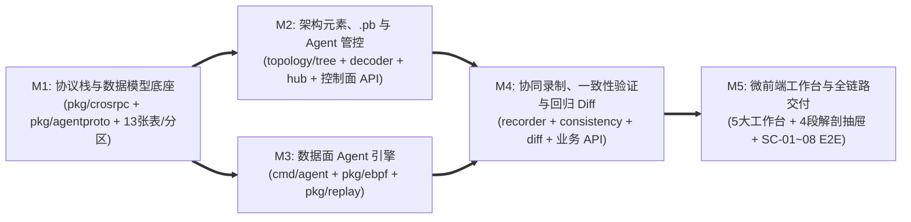

# 业务流量监控与重放 (`code-traefik`) TDD 工程实施路线图与质量门禁

- **文档编号**：`01-roadmap.md`
- **文档版本**：v1.0.0
- **更新日期**：2026-10-29
- **归属阶段**：阶段三/四：TDD 实施路线图与全局门禁 (`04-tasks`)
- **状态**：已冻结 (Frozen)
- **上位基线**：[`01-feature-matrix.md`](../01-features/01-feature-matrix.md)、[`01-system-architecture.md`](../02-design/01-system-architecture.md)、[`01-http-api-contract.md`](../03-api/01-http-api-contract.md)

---

## 1. 脚手架模板代码清理与双入口重构策略

现有 `code-template` 生成的示例业务代码在阶段四直接删除重写，**不做任何向后兼容保留**：
1. **彻底移除模板占位资产**：
   - 后端：删除 `handlers/item.go`、`handlers/item_test.go`；从 `models/item.go` 移除 `TemplateItem`（`traefik_items` 表）及示例种子数据，重构为 `models/setting.go`（保留 `TraefikSetting` 对应 `traefik_settings` 治理参数表）。
   - 前端：删除 `frontend/src/pages/DashboardPage.tsx` 与 `frontend/src/pages/ItemListPage.tsx`，替换为五大领域工作台。
2. **保留并升级平台底座组件**：
   - 保留 `handlers/health.go`、`handlers/auth.go`、`handlers/settings.go` 及前端 `AdminSettingsPage.tsx`、`ModuleUserContext.tsx`。
   - 将根目录 `main.go` 迁移重构为同仓双可执行入口：`cmd/server/main.go`（`code-traefik-server`，内嵌 `frontend/dist`）与 `cmd/agent/main.go`（`code-traefik-agent`，零数据库、零 `.pb` 依赖）。

---

## 2. M1 ~ M5 里程碑依赖拓扑 (DAG) 与职责边界

| 里程碑 | 作战卡文档 | 核心职责与交付边界 | 准出质量门禁 (Exit Gate) |
| :--- | :--- | :--- | :--- |
| **M1** | [`02-m1-crosrpc-and-domain-models.md`](./02-m1-crosrpc-and-domain-models.md) | 清理模板 `traefik_items`；实现 `pkg/crosrpc`（24B 公共头、V1~V5 会话头、`LookupRspLayout`、扩展头、`StreamFramer`、`SplitFrames`）、`pkg/agentproto`（56B 二进制信封）、`models/` 13 张核心表与 `traefik_traffic_records` 按日范围分区管理器 | `go test -race ./pkg/... ./models/...` 全绿 + Fuzz 60s 零崩溃 + `testdb` 13 表迁移通过 |
| **M2** | [`03-m2-arch-proto-and-agent-control.md`](./03-m2-arch-proto-and-agent-control.md) | 三级架构树（咨询锁防成环移动）、模块接口（`{package}-{serviceName}` 与 `PROVIDE` 全局唯一）、`traefik_process_modules` 映射、静态拓扑推导、`.pb` 上传/激活与 `dynamicpb` 解码、公私域 Agent 纳管/`AcquireAgentLeases` 升序排他锁/双向心跳对账与 RBAC 审计 API | `TEST_DB_DSN=... go test -race ./internal/server/... ./handlers/...` 全绿 |
| **M3** | [`04-m3-agent-dataplane-ebpf-and-replay.md`](./04-m3-agent-dataplane-ebpf-and-replay.md) | `cmd/agent` 受控 HTTP+WS 服务（IP 白名单、`ClaimCode`、64MB 有界缓冲、5m 失联自洁）、`pkg/ebpf`（入站 RingBuf 复制、出站 `connect4` 重定向、`agent_pid` 自环豁免、`/proc` PID 巡检与存量连接诊断）、`pkg/replay`（零 `.pb` `ScopedMockMatcher` 与表驱动头部自愈） | 普通单测 + `//go:build linux && ebpf` 特权测试通过 + `cmd/agent` 零 DB/零 `.pb` 依赖断言通过 |
| **M4** | [`05-m4-recording-topology-and-diff-engine.md`](./05-m4-recording-topology-and-diff-engine.md) | 多进程协同录制编排、Track A (SSE) / Track B (`ExchangeAssembler` 往返配对双模落盘)、四段报文解剖组装、离线架构一致性六分类验证、跨 Agent 同构重放调度与双层（协议头 + `protoreflect`）回归 Diff 引擎 | `TEST_DB_DSN=... go test -race ./...` 全绿 |
| **M5** | [`06-m5-microfrontend-and-e2e-delivery.md`](./06-m5-microfrontend-and-e2e-delivery.md) | 架构中心、Agent 看板、`.pb` 工作台、流量监控台（含四段解剖抽屉）、重放工作台（含双层 Diff 抽屉）、`--color-*` 语义主题、URL 5 页滑窗分页、`SC-01`~`SC-08` E2E 回归及双二进制打包交付 | `make test && make lint && make build && make clean` 100% 零警告通过 |

---

## 3. 特性矩阵 (`F-01`~`F-16`) 与验收场景 (`SC-01`~`SC-08`) 落位映射表

### 3.1 核心特性 (`F-01` ~ `F-16`) TDD 落位追踪

| 特性编号 | 特性名称 | 落位里程碑 | 目标测试文件 | 关键先行测试函数 |
| :--- | :--- | :---: | :--- | :--- |
| **F-01** | 三级架构元素建模 | M1, M2 | `models/models_test.go` `handlers/arch_proto_agent_test.go` | `TestArchHierarchyCRUDAndMoveValidation` `TestDeleteNonEmptyArchElementsConflict` |
| **F-02** | 进程部署映射与模块接口契约 | M1, M2 | `internal/server/topology/topology_test.go` `handlers/arch_proto_agent_test.go` | `TestModuleInterfaceProvideGlobalUnique` `TestProcessModuleBindingPublicVsPrivate` |
| **F-03** | Protobuf 描述集注册与接口映射 | M2 | `internal/server/decoder/decoder_test.go` `handlers/arch_proto_agent_test.go` | `TestProtoSchemaUploadAndDashServiceName` `TestProtoSchemaActivateConflictAndHistoryImmutability` |
| **F-04** | 静态架构拓扑视图 | M2, M5 | `internal/server/topology/topology_test.go` `frontend/src/__tests__/WorkbenchRBAC.test.tsx` | `TestBuildStaticTopologyLogicalAndPhysical` |
| **F-05** | 实测调用拓扑还原与架构一致性验证 | M4 | `internal/server/topology/consistency_test.go` | `TestResolveSourceModuleThreeTierPriority` `TestVerifySessionTopologySixCategories` |
| **F-06** | Agent 公私域纳管与动态排他租约 | M2 | `internal/server/hub/hub_test.go` `handlers/arch_proto_agent_test.go` | `TestAgentPublicPrivateScopeAndAntiIDOR` `TestAcquireAgentLeasesMutexAndHeartbeatReconcile` |
| **F-07** | 主控—Agent 受控信道（HTTP + WS） | M1, M3 | `pkg/agentproto/envelope_test.go` `internal/agent/server/server_test.go` | `TestAgentIPAllowlistAndClaimCode` `TestBoundedSessionBufferBackpressureAndGracePurge` |
| **F-08** | 多进程监控供给、PID 定位与存量诊断 | M3 | `pkg/ebpf/ebpf_unit_test.go` `internal/agent/server/server_test.go` | `TestProcScannerPIDResolveAndEstablishedConns` `TestDynamicProcessAddRemoveAndRestartEvent` |
| **F-09** | Agent 嵌入式 `cilium/ebpf` 采集引擎 | M3 | `pkg/ebpf/ebpf_unit_test.go` `pkg/ebpf/ebpf_linux_test.go` (`ebpf`) | `TestEbpfCapabilityCheckAndGracefulCleanup` `TestEbpfSameHostDualProcessLoopbackBypass` |
| **F-10** | `pkg/crosrpc` 分帧头解析与主控解码 | M1, M2 | `pkg/crosrpc/crosrpc_test.go` `pkg/crosrpc/framer_fuzz_test.go` | `TestStreamFramerDirtyResyncFragmentAndOversize` `FuzzStreamFramer` / `TestDynamicPBDecodeAndFallbackHex` |
| **F-11** | 多进程协同录制、双轨分发与分区落盘 | M1, M4 | `models/models_test.go` `internal/server/recorder/recorder_test.go` | `TestTrafficRecordsRangePartitionAndDropPurge` `TestExchangeAssemblerDualModeAndLimitAutoStop` |
| **F-12** | 跨进程同构重放编排与 Agent 本地执行 | M3, M4 | `internal/server/diff/diff_test.go` `handlers/recording_replay_test.go` | `TestValidateReplayProcessCompatibility` `TestCrossAgentReplayExecutionAndStatusAggregation` |
| **F-13** | Agent 零 `.pb` 二进制 Mock 与头部自愈 | M3 | `pkg/replay/replay_test.go` | `TestScopedMockMatcherExactAndFallback` `TestHealResponseFramesV1ToV4AndMultiSeg` |
| **F-14** | 协议头级 + Protobuf 字段级双层 Diff | M4 | `internal/server/diff/diff_test.go` | `TestLayer1HeaderDiffAndTimestampExemption` `TestLayer2ProtoSemanticDiffMapRepeatedAndIgnore` |
| **F-15** | 一体化微前端控制台 | M5 | `frontend/src/__tests__/PacketAnatomyDrawer.test.tsx` `frontend/src/__tests__/ThemeAndPagination.test.tsx` | `TestPacketAnatomyDrawerFourSections` `TestPaginationWindowAndThemeTokens` |
| **F-16** | RBAC 权限、公私域隔离与操作审计 | M2, M4, M5 | `handlers/arch_proto_agent_test.go` `handlers/recording_replay_test.go` | `TestRBACAndPrivateResourceAntiIDOR` `TestAuditLogFieldDiffAndActionEvents` |

### 3.2 端到端业务验收场景 (`SC-01` ~ `SC-08`) 追踪矩阵

| 场景编号 | 场景名称 | 落位里程碑 | 自动化验收测试入口 |
| :--- | :--- | :---: | :--- |
| **SC-01** | 免密探针、未认证拦截与公私域 RBAC 越权 | M2, M5 | `handlers/arch_proto_agent_test.go`: `TestSC01_HealthAuthAndPublicPrivateRBAC` |
| **SC-02** | 架构建模约束与静态拓扑推导 | M2, M5 | `handlers/arch_proto_agent_test.go`: `TestSC02_ArchModelingConstraintsAndStaticTopology` |
| **SC-03** | Agent 纳管、排他租约、信道与白名单 | M2, M3, M5 | `handlers/arch_proto_agent_test.go`: `TestSC03_AgentLeaseChannelAndAllowlist` |
| **SC-04** | CROS RPC 分帧与解码 | M1, M2, M5 | `pkg/crosrpc/crosrpc_test.go`: `TestSC04_CrosRPCFramingAndDynamicDecode` |
| **SC-05** | 单 Agent 多进程协同录制与双模物理分区落盘 | M4, M5 | `handlers/recording_replay_test.go`: `TestSC05_MultiProcessRecordingAndDualModeStorage` |
| **SC-06** | 架构一致性验证 | M4, M5 | `internal/server/topology/consistency_test.go`: `TestSC06_ArchitectureConsistencyVerification` |
| **SC-07** | 跨 Agent 同构进程零 `.pb` 重放与头部自愈 | M3, M4, M5 | `handlers/recording_replay_test.go`: `TestSC07_CrossAgentZeroPBReplayAndHeaderHealing` |
| **SC-08** | 业务突变与 Mock 未命中检出 | M3, M4, M5 | `handlers/recording_replay_test.go`: `TestSC08_MutationDiffAndMockMissZeroLeakage` |

---

## 4. 全局质量红线与安全验证计划 (Quality Gates & Security Verification Plan)

### 4.1 工程与架构门禁
1. **表名前缀与隔离数据库铁律**：全部 13 张业务表 + `traefik_settings` 必须以 `traefik_` 开头；所有数据库单测强制调用 `testdb.SetupIsolatedDB(t)`，严禁将 `TEST_DB_DSN` 指向生产或团队共享库。
2. **主从物理防腐门禁**：`go list -deps ./cmd/agent` 输出中严禁出现 `gorm.io`、`code-common/backend/gormdb`、`dynamicpb` 或 `protoregistry`。
3. **eBPF 双层测试门禁**：内核探针挂载测试以 `//go:build linux && ebpf` 隔离（无 `CAP_BPF` 时自动 `t.Skip` 并输出原因）；分帧、Mock 匹配、头部自愈与 `/proc` 解析必须在普通非特权环境下 100% 单元测试覆盖。
4. **后台进程与内核探针卫生**：任何构建、测试或联调结束前，必须确保 `:8091`、`:5181` 及临时 Mock 端口全部关闭，`bpf_link` 探针 100% 卸载。

### 4.2 安全编码验证计划 (Security Verification Plan)

依据工作区强制安全基线（参见 [`01-system-architecture.md` §6](../02-design/01-system-architecture.md)），各 Milestone 自动化测试必须显式覆盖并验证以下安全控制项：

| 安全领域 | 强制防御措施與验证用例 | 豁免/演进项 (`TODO(security)` 强制注释位) |
| :--- | :--- | :--- |
| **认证、会话与授权 (AuthN/AuthZ)** | 1. 受保护 API 与 `/api/events` 强制经 `AuthMiddleware` 校验 `HS256` JWT（拒绝 `none` 算法，校验 `exp`）； 2. 严禁在 URL Query 中传 Token；登出清空内存态并重载页面； 3. **Anti-IDOR**：所有 `PRIVATE` Agent、进程、录制批次接口在数据层强制核验 `owner_id == currentUser.ID`（越权返 `403`）。 | 1. `config/config.go`：`// TODO(security): 生产环境接入 KMS 托管 JWT_SECRET 与数据库凭据` 2. `handlers/auth.go`：`// TODO(security): 企业生产环境启用 OAuth2/OIDC + MFA 与弱口令泄露库检测` 3. 本系统 API 采用 `Authorization: Bearer` 头认证（非 Cookie 会话），天然免疫跨站请求伪造；`cmd/server/main.go` 保留 `// TODO(security): 若未来切换 Cookie 会话须挂载 Double-Submit CSRF Token 中间件`。 |
| **文件上传、SQL 与命令执行防护** | 1. `.pb` 上传通过 `http.MaxBytesReader` 限制 `<= 4MB`，校验 `FileDescriptorSet` 与 `protodesc.NewFiles`，文件名经 `filepath.Base` 净化，仅存 DB `bytea` 不落盘宿主机文件系统； 2. 100% 采用 GORM 参数化预编译查询与排序字段白名单，屏蔽原始 SQL 报错； 3. Agent 仅通过 Go 标准库只读解析 `/proc`，全仓严禁调用 `os/exec` 拼接外部命令。 | `handlers/proto_handler.go`：`// TODO(security): 接入企业制品防病毒扫描网关对上传描述集做沙箱扫描`。 |
| **内网信道与 SSRF 防护** | 1. 主控 `AgentEndpointGuard` 拦截 `127.0.0.0/8`（非测试模式）、云元数据 `169.254.169.254`、多播段及非 `1024..65535` 端口； 2. Agent 校验 TCP `RemoteAddr` 源 IP 白名单（`--allow-ips`）与 `PRIVATE` Agent 一次性 `ClaimCode`； 3. 重放未命中规则时内核 `connect4` 执行 Fail-Closed (`EPERM`)，严禁外泄至真实下游。 | `internal/agent/server/http_server.go`：`// TODO(security): F-17 (P1) 引入 X-Traefik-Agent-Token 常量时间比对鉴权与 mTLS`。 |
| **前端防 XSS 与安全响应头** | 1. 全局注入 `Content-Security-Policy`（禁止 `script-src` 使用 `unsafe-inline`/`unsafe-eval`）、`X-Content-Type-Options: nosniff`、`X-Frame-Options: SAMEORIGIN`、`Permissions-Policy` 与敏感接口 `Cache-Control: no-store`； 2. 报文字符串全量依赖 React JSX 自动转义，严禁 `dangerouslySetInnerHTML`、`innerHTML`、`console.log` 打印敏感 Token 或使用原生 `alert()`/`confirm()`。 | `cmd/server/main.go`：`// TODO(security): 独立部署时按受信任门户域名配置严格 CORS 白名单与滑动窗口 API 限流`。 |
| **测试网络绑定红线** | 所有单测/集成测试中的临时 `Server`、Mock `Agent`、模拟 TCP 业务进程与测试数据库连接强制绑定 `127.0.0.1`，**严禁监听 `0.0.0.0`**。 | - |
