# 业务流量与接口契约治理 (`code-traefik`) TDD 工程实施路线图与质量门禁

- **文档编号**：`01-roadmap.md`
- **文档版本**：v1.6.0
- **更新日期**：2026-11-05
- **归属阶段**：阶段三/四：TDD 实施路线图与全局门禁 (`04-tasks`)
- **状态**：M1~M13 已交付；M14~M17 契约治理演进规划中 (M14 Next)
- **上位基线**：[`01-feature-matrix.md`](../01-features/01-feature-matrix.md) (v2.12.0)、[`01-system-architecture.md`](../02-design/01-system-architecture.md)、[`01-http-api-contract.md`](../03-api/01-http-api-contract.md)、[`12-packet-causality-call-tree-and-sequence-ux-adr.md`](../05-adr/12-packet-causality-call-tree-and-sequence-ux-adr.md) (ADR-12 v1.0.0)、[`14-governance-dashboard-golden-suite-and-ci-gate-adr.md`](../05-adr/14-governance-dashboard-golden-suite-and-ci-gate-adr.md) (ADR-14 v1.0.0)

---

## 1. 脚手架模板代码清理与双入口重构策略

现有 `code-template` 生成的示例业务代码在阶段四直接删除重写，**不做任何向后兼容保留**：
1. **彻底移除模板占位资产**：
   - 后端：删除 `handlers/item.go`、`handlers/item_test.go`；从 `models/item.go` 移除 `TemplateItem`（`traefik_items` 表）及示例种子数据，重构为 `models/setting.go`（保留 `TraefikSetting` 对应 `traefik_settings` 治理参数表）。
   - 前端：删除 `frontend/src/pages/DashboardPage.tsx` 与 `frontend/src/pages/ItemListPage.tsx`，替换为五大领域工作台。
2. **保留并升级平台底座组件**：
   - 保留 `handlers/health.go`、`handlers/auth.go`、`handlers/settings.go` 及前端 `AdminSettingsPage.tsx`、`ModuleUserContext.tsx`。
   - 将根目录 `main.go` 迁移重构为同仓双可执行入口：`cmd/server/main.go`（`code-traefik-server`，内嵌 `frontend/dist`）与 `cmd/agent/main.go`（`code-traefik-agent`，零数据库、零 `.pb` 依赖）。

---

## 2. M1 ~ M13 里程碑依赖拓扑 (DAG) 与职责边界

```mermaid
flowchart LR
    M1["M1: 协议栈与数据模型底座<br/>(pkg/crosrpc + pkg/agentproto + 13张表/分区)"]
    M2["M2: 架构元素、.pb 与 Agent 管控<br/>(topology/tree + decoder + hub + 控制面 API)"]
    M3["M3: 数据面 Agent 引擎<br/>(cmd/agent + pkg/ebpf + pkg/replay)"]
    M4["M4: 协同录制、一致性验证与回归 Diff<br/>(recorder + consistency + diff + 业务 API)"]
    M5["M5: 微前端工作台与全链路交付<br/>(5大工作台 + 4段解剖抽屉 + SC-01~08 E2E)"]

    M1 ==> M2
    M1 ==> M3
    M2 ==> M4
    M3 ==> M4
    M4 ==> M5
    M5 ==> M6
    M6 ==> M7
    M7 ==> M8
    M8 ==> M9
    M9 ==> M10
    M10 ==> M11
    M11 ==> M12
    M12 ==> M13
    M13 ==> M14
    M14 ==> M15
    M15 ==> M16
    M16 ==> M17
    M6["M6: 分层复合拓扑与一致性画布<br/>(React Flow + ELK Worker + 边汇总 + 去 Agent 物理图)"]
    M7["M7: 契约资产化治理、嵌套服务表与消息体字段树<br/>(两级折叠表 + 字段字典树 + 可视化 Diff 忽略 + 原文件导出)"]
    M8["M8: 控制台信息架构重组与调试工作流闭环<br/>(3组8项菜单 + 录制台账/单包调试重放 + 架构解耦与进程收口)"]
    M9["M9: 协同录制抽屉重构与进程树选择器<br/>(Drawer 侧边栏 + 卡片解挤 + 目标 Agent 选择防呆 + 业务进程树)"]
    M10["M10: 架构物理进程蓝图与 eBPF 自动预挂待命<br/>([逻辑架构|物理进程] + 1:1挂载覆盖 + ARMED零重启录制)"]
    M11["M11: 增强 Protobuf 描述集资产管理<br/>(多.pb文件台账 + 跨集依赖闭包 + 全局单一生效池)"]
    M12["M12: 单进程开箱双录与双工作台录制体验闭环<br/>(全出站透明双录 + 5项链路修复 + 智能预选与双向深链)"]
    M13["M13: 报文因果调用树、时序泳道与闭包重放<br/>(默认树形甘特瀑布 + 跨跳缝合/参数血缘 + ScopedMock闭包)"]
    M14["M14: 平台级契约治理全景大盘与信息架构升维<br/>(置顶/dashboard + 健康分算法 + 漂移/孤儿/防线卡片)"]
    M15["M15: 黄金契约套件资产库与事务固化工作台<br/>(traefik_golden_suites + 事务树一键沉淀 + 权威脱机回归)"]
    M16["M16: 设计态契约破坏性变更阻断雷达<br/>(Protobuf AST 比对 + Tag/类型/删除强阻断 + 下游消费者推导)"]
    M17["M17: CI/CD 自动化强阻断门禁与凭据报告<br/>(POST /api/gates/evaluate + Violation/Diff双重红阻 + MR报告)"]
```

| 里程碑 | 状态 | 作战卡文档 | 核心职责与交付边界 | 准出质量门禁 (Exit Gate) |
| :--- | :---: | :--- | :--- | :--- |
| **M1** | ✅ 已交付 | [`02-m1-crosrpc-and-domain-models.md`](./02-m1-crosrpc-and-domain-models.md) | 清理模板 `traefik_items`；实现 `pkg/crosrpc`（24B 公共头、V1~V5 会话头、`LookupRspLayout`、扩展头、`StreamFramer`、`SplitFrames`）、`pkg/agentproto`（56B 二进制信封）、`models/` 13 张核心表与 `traefik_traffic_records` 按日范围分区管理器 | `go test -race ./pkg/... ./models/...` 全绿 + Fuzz 60s 零崩溃 + `testdb` 13 表迁移通过 |
| **M2** | ✅ 已交付 | [`03-m2-arch-proto-and-agent-control.md`](./03-m2-arch-proto-and-agent-control.md) | 三级架构树（咨询锁防成环移动）、模块接口（`{package}.{serviceName}` 与 `PROVIDE` 全局唯一）、`traefik_process_modules` 映射、静态拓扑推导、`.pb` 上传/激活与 `dynamicpb` 解码、公私域 Agent 纳管/`AcquireAgentLeases` 升序排他锁/双向心跳对账与 RBAC 审计 API | `TEST_DB_DSN=... go test -race ./internal/server/... ./handlers/...` 全绿 |
| **M3** | ✅ 已交付 | [`04-m3-agent-dataplane-ebpf-and-replay.md`](./04-m3-agent-dataplane-ebpf-and-replay.md) | `cmd/agent` 受控 HTTP+WS 服务（IP 白名单、`ClaimCode`、64MB 有界缓冲、5m 失联自洁）、`pkg/ebpf`（入站 RingBuf 复制、出站 `connect4` 重定向、`agent_pid` 自环豁免、`/proc` PID 巡检与存量连接诊断）、`pkg/replay`（零 `.pb` `ScopedMockMatcher` 与表驱动头部自愈） | 普通单测 + `//go:build linux && ebpf` 特权测试通过 + `cmd/agent` 零 DB/零 `.pb` 依赖断言通过 |
| **M4** | ✅ 已交付 | [`05-m4-recording-topology-and-diff-engine.md`](./05-m4-recording-topology-and-diff-engine.md) | 多进程协同录制编排、Track A (SSE) / Track B (`ExchangeAssembler` 往返配对双模落盘)、四段报文解剖组装、离线架构一致性六分类验证、跨 Agent 同构重放调度与双层（协议头 + `protoreflect`）回归 Diff 引擎 | `TEST_DB_DSN=... go test -race ./...` 全绿 |
| **M5** | ✅ 已交付 | [`06-m5-microfrontend-and-e2e-delivery.md`](./06-m5-microfrontend-and-e2e-delivery.md) | 架构中心、Agent 看板、`.pb` 工作台、流量监控台（含四段解剖抽屉）、重放工作台（含双层 Diff 抽屉）、`--color-*` 语义主题、URL 5 页滑窗分页、`SC-01`~`SC-08` E2E 回归及双二进制打包交付 | `make test && make lint && make build && make clean` 100% 零警告通过 |
| **M6** | ✅ 已交付 | [`07-m6-hierarchical-topology-canvas.md`](./07-m6-hierarchical-topology-canvas.md) | 分层复合架构拓扑与一致性画布（`ArchCanvas`）：全系统单画布、React Flow v12 + ELK Inline Worker 异步正交布局（含跨层拐点全局换算与拖拽退化）、纯前端边汇总与动态 `VIOLATION`/`UNATTRIBUTED` 叠加、物理视图去 Agent 化与 `SHA-256` 强 `ETag` `GET /api/arch/topology/graph` 契约 | Vitest 纯算法单测覆盖率 `≥ 90%` + `TEST_DB_DSN=... go test -race` 通过 + `make lint && make build` 零警告 |
| **M7** | ✅ 已交付 | [`08-m7-proto-schema-deepening-and-nested-contract-workbench.md`](./08-m7-proto-schema-deepening-and-nested-contract-workbench.md) | Protobuf 契约资产化治理：两级嵌套折叠服务表（服务主行 ➔ 方法子表）、消息体参数字典树反射（Req/Rsp 字段树、Tag、类型高亮与注释透视）、可视化 Diff 忽略字段勾选与多级继承、原始 `.pb` 二进制下载导出及架构认领血缘分析 | `TEST_DB_DSN=... go test -race ./...` 全绿 + `make lint && make build` 零警告 |
| **M8** | ✅ 已交付 | [`09-m8-console-ia-restructuring-and-debug-workflow.md`](./09-m8-console-ia-restructuring-and-debug-workflow.md) | 微前端控制台信息架构重组与调试工作流闭环：3 组 8 项频次金字塔菜单（默认落地 `/record`）与旧深链无损重定向、独立 `流量录制` 素材台账与 `流量调试`（`has_error` 异常过滤 + `SinglePacketReplayDrawer` 单包快速重放原地 Diff）、全屏 `架构拓扑` 与纯逻辑 `架构元素` 解耦、物理进程单点收口至 `Agent 与进程` | `TEST_DB_DSN=... make test` 全绿 + `MenuAndLegacyRoutes` / `RecordingWorkbench` / `SinglePacketReplay` / `TopologyAndArchDecoupling` 单测全绿 + `make lint && make build && make clean` 零警告 |
| **M9** | ✅ 已交付 | [`10-m9-recording-drawer-and-process-tree-selection.md`](./10-m9-recording-drawer-and-process-tree-selection.md) | 协同录制抽屉重构与进程树选择器：全面弃用居中 Modal 迁移至 680px `Drawer`（Sticky 吸底 Footer）、素材归属卡片式单选解挤、宿主 Agent 下拉选择与在线/租约防呆门禁、业务进程树形分层选择（组级全选/半选/折叠与搜索过滤） | `RecordingStartDrawer` 单测全绿 + `make test && make lint && make build` 零警告 |
| **M10** | ✅ 已交付 | [`11-m10-arch-process-blueprint-and-premount-workflow.md`](./11-m10-arch-process-blueprint-and-premount-workflow.md) | 架构物理进程蓝图解耦、多环境 `1:1` 挂载与 eBPF 自动预挂待命：15 表清库重建（`ArchProcessGroup`/`ArchProcess` + 多套 `SHARED`/`PRIVATE` 环境 `1:1` 挂载覆盖 + `FallbackAgentID` 基线兜底 + `ProcessSnapshots` 快照解耦）、零 Agent 物理拓扑与可选环境端点叠加、`/architecture` `[逻辑架构 \| 物理进程]` 双视图树、按需入站读写钩子（待命全机零读写 syscall 损耗）+ 三态 `EgressProxy`（`PASSTHROUGH` 停录不断连 / `CAPTURING` 有序闸门 / `REPLAY_MOCK` 既有连接零外泄接管）、Single-Flight 版本化 `Auto-Rearm`、`/agents` 七态就绪树与 `/record` 零重启抽屉联动 | `TEST_DB_DSN=... make test` (15 表 + 三态代理零外泄单测) + `ArchPhysicalBlueprintWorkbench` / `AgentProcessMountAndReadiness` / `RecordingStartDrawer` 单测全绿 + `make lint && make build && make clean` 零警告 |
| **M11** | ✅ 已交付 | [`12-m11-enhanced-proto-schema-asset-management.md`](./12-m11-enhanced-proto-schema-asset-management.md) | 增强 Protobuf 描述集资产管理与跨集依赖闭包（取消 `F-21` `code-proto` 联动完全内聚自治）：单包上限升至 `16MB`、三级分类 (`BASE_LIB`/`BUSINESS`/`GATEWAY`)、按 `file.Name` 去重与拓扑排序的跨 `.pb` 联合 `protodesc.NewFiles`（仅导自有 `Service`、支持 `0` 接口 `BASE_LIB`、内置 WKT 兜底、`DiffIgnorePaths` 前向继承）、事务咨询锁 + `CompileTrialPool` 试编译防破坏门禁（支持停用下线与批量原子激活）、`/schemas` 双模无侧栏工作台（`?tab=assets` 文件资产台账 + `680px` 透视抽屉 & `?tab=catalog` 按 `Service` 组分页全局契约目录与孤儿治理） | `TEST_DB_DSN=... make test` (跨集闭包 + `CompileTrialPool` + 零 `N+1` 台账单测) + `SchemaAssetLedgerWorkbench` / `ProtoNestedTable` 单测全绿 + `make lint && make build && make clean` 零警告 |
| **M12** | ✅ 已交付 | [`13-m12-bidirectional-capture-and-agent-recording-ux.md`](./13-m12-bidirectional-capture-and-agent-recording-ux.md) | 单进程开箱即用出入站双向采集与双工作台协同录制体验闭环（ADR-11）：目标 PID 默认全出站透明代理拦截（零下游拓扑前置即自动双录 `INGRESS + EGRESS`，`StreamFramer` `bytes.Index` SIMD 紧缩保障非 RPC 流 `<=8KB` 零干扰）、修复 BPF `__be32/__be16` 字节序、`EgressProxy` `SessionOrTaskID` 与真实 `agent_id`、`Direction` 与 `StreamHalf` 正交解耦、存量入站 FD 预热与 `/proc/<pid>/fd` 自有 Inode 诊断、停录路由 `/monitors/:sessionId/stop`、重放历史 `EGRESS` `DstAddr` 并集与写前 `"CSE.TCP"` 零外泄守卫；修复 `GetAgent` 空表，落地两工作台文案消歧、`1..5` 可用进程自动全选、`[🔗 勾选关联下游]` 及 `/agents` ⇄ `/record` 双向一键深链 | `TEST_DB_DSN=... make test` (全出站双录 + 字节序/方向/停录/零外泄单测) + `AgentProcessMountAndReadiness` / `RecordingStartDrawer` 单测全绿 + `make lint && make build && make clean` 零警告 |
| **M13** | ✅ 已交付 | [`14-m13-packet-causality-call-tree-and-sequence-workbench.md`](./14-m13-packet-causality-call-tree-and-sequence-workbench.md) | 报文时序因果树、内联甘特瀑布、全链路时序泳道与事务闭包重放（ADR-12）：`pkg/crosrpc` V03/V04 `ullServerRecvTime/ullServerSendTime` 补齐与 `StreamFramer` 首字节定戳；`ExchangeAssembler` 请求到达瞬间原子分配发起 `SeqNo` 与同连接 `MNG.acProcName` 记忆；新建 `internal/server/callgraph`（DOTR `TraceKey` 权威调用树 + 时间窗降级、多进程 `EgressProxy` `EGRESS ⇔ INGRESS` 跨跳缝合、兄弟 `串行/并发/补偿` 分类、单事务参数血缘与跨事务业务实体生命线）；`/debug` 默认「可折叠调用树 + 内联迷你甘特瀑布条」按根事务不割裂分页（辅以平铺切换）+ 原生 SVG 时序泳道与四段解剖双栏联动抽屉；端到端打通 `RecordID` 级 `ScopedEgressMocks` 因果闭包重放预览、前置状态依赖链勾选回放与泳道故障叠加 | Agent 零 DB/零 `.pb` 依赖断言 + `TEST_DB_DSN=... make test` (`callgraph` 破环/缝合/血缘/Anti-IDOR + `ScopedMock` 隔离单测) + `TransactionCallTreeAndSequence` Vitest 单测全绿 + `make lint && make build && make clean` 零警告 |
| **M14** | 📋 待实施 | [`15-m14-governance-dashboard-and-ia-restructuring.md`](./15-m14-governance-dashboard-and-ia-restructuring.md) | 平台级契约治理全景大盘与信息架构升维（ADR-14）：`menu.ts` 契约化语义重构，置顶新增 `/dashboard` 默认落地；实现多维契约健康评分模型（`HealthScore` 加权算法）、架构漂移雷达、Proto 资产清零看板、防劣化回归防线及 `GET /api/dashboard/overview` OpenAPI | `make test && make lint` 全绿 + 健康分模型与大盘卡片渲染 Vitest 单测覆盖率 `≥ 90%` |
| **M15** | 📋 规划中 | [`16-m15-golden-contract-suites-and-curation-workbench.md`](./16-m15-golden-contract-suites-and-curation-workbench.md) | 黄金契约套件资产库与事务固化治理（ADR-14）：`traefik_golden_suites` / `traefik_golden_suite_items` 物理建模与 GORM 迁移；在 `/debug` 事务树中实现【🌟 沉淀为黄金契约】流转抽屉；构建 `/golden-suites` 权威套件资产工作台、动态掩码清洗与套件级一键回归验证报告 | `testdb` 模型迁移单测 + 事务沉淀及套件脱机回归断言通过 + `make lint && make build` 零警告 |
| **M16** | 📋 规划中 | [`17-m16-design-time-breaking-change-radar.md`](./17-m16-design-time-breaking-change-radar.md) | 设计态契约破坏性变更阻断雷达（ADR-14）：基于 `FileDescriptorSet` AST 实现语义版本比对引擎（Tag 篡改、类型变异、未保留删除、枚举索引窜改强阻断）；版本升级拦截返回结构化 `409 BREAKING_CHANGE`；依据 `traefik_module_dependencies` 自动推导受影响下游消费者清单与可视化告警 | AST Breaking 比对用例覆盖率 100% + 下游消费者血缘推导单测通过 + 拦截抽屉交互走查通过 |
| **M17** | 📋 规划中 | [`18-m17-ci-cd-quality-gate-and-automated-enforcement.md`](./18-m17-ci-cd-quality-gate-and-automated-enforcement.md) | CI/CD 自动化强阻断质量门禁与凭据报告（ADR-14）：实现高可信 `POST /api/gates/evaluate` OpenAPI 与流水线专用鉴权；绑定被测进程黄金套件自动化回放；严格执行 `Violation`（架构漂移）与 `FAILED`（字段破坏性 Diff）双重红阻断；自动生成带调试跳转链接的结构化 Markdown PR/MR 发布报告 | 注入 Violation 与 FAILED 场景自动化红阻单测全绿 + 合规场景 200 准出单测 + 端到端流水线模拟测试 |

---

## 3. 特性矩阵 (`F-01`~`F-16`, `F-24`~`F-27`) 与验收场景 (`SC-01`~`SC-10`) 落位映射表

### 3.1 核心特性 (`F-01` ~ `F-16`) TDD 落位追踪

| 特性编号 | 特性名称 | 落位里程碑 | 目标测试文件 | 关键先行测试函数 |
| :--- | :--- | :---: | :--- | :--- |
| **F-01** | 三级架构元素建模 | M1, M2 | `models/models_test.go` `handlers/arch_proto_agent_test.go` | `TestArchHierarchyCRUDAndMoveValidation` `TestDeleteNonEmptyArchElementsConflict` |
| **F-02** | 架构物理进程蓝图、模块服务契约与宿主机 1:1 挂载覆盖 | M1, M2, M8, M10 | `models/models_test.go` `internal/server/topology/graph_topology_test.go` `handlers/arch_proto_agent_test.go` `frontend/src/__tests__/AgentProcessMountAndReadiness.test.tsx` | `TestArchProcessBlueprintAndOneToOneAgentMountConstraints` `TestArchProcessCRUD_ModuleExclusiveBindingAndMountAntiIDOR` `TestModuleServiceProvideGlobalUnique` `testAgentProcessMountDrawer_AutoScanMatchOverridesAndReadinessBadges` |
| **F-03** | Protobuf 描述集注册与全局单一生效池映射 | M2, M11 | `internal/server/decoder/decoder_test.go` `handlers/arch_proto_agent_test.go` | `TestProtoSchemaUploadAndDashServiceName` `TestProtoSchemaActivateConflictAndHistoryImmutability` |
| **F-03.1** | 两级嵌套折叠契约表与按 `Service` 组分页视图 | M7, M11 | `handlers/arch_proto_agent_test.go` `frontend/src/__tests__/ProtoNestedTable.test.tsx` | `TestListProtoServices_ServiceLevelPagination_SourceSchemaBadge_AndUnclaimedFilter` `testServiceGroupRollup_AggregationAndOperationCounting` |
| **F-03.2** | 消息体参数定义字典树查看与源码注释透视（含跨集联合池回退） | M7, M11 | `internal/server/decoder/schema_tree_test.go` `frontend/src/__tests__/MessageSchemaTree.test.tsx` | `TestExtractMessageFieldTree_RecursiveAndComments` `TestCompileTrialPool_BatchActivate_DeactivateReverseDep_AndUnifiedRuntimeDecode` |
| **F-03.3** | 可视化 Diff 忽略字段标记、多级继承与新版本前向继承 | M7, M11 | `internal/server/diff/ignore_rules_test.go` `internal/server/decoder/decoder_test.go` | `TestOperationLevelDiffIgnorePaths_PrecedenceOverService` `TestUploadNewVersion_InheritsDiffIgnorePaths_AndDraftBorrowsInactiveBaseLib` |
| **F-03.4** | 描述集制品库生命周期、原文件安全导出与架构认领血缘 | M7, M11 | `handlers/arch_proto_agent_test.go` | `TestDownloadProtoSchemaBinary_IntegrityAndFilename` `TestProtoSchemaSummary_BloodlineAndOrphanServices` |
| **F-03.5** | 多 `.pb` 描述集文件资产台账、三级分类治理与 `680px` 透视抽屉 | M11 | `models/models_test.go` `handlers/arch_proto_agent_test.go` `frontend/src/__tests__/SchemaAssetLedgerWorkbench.test.tsx` | `TestProtoSchemaConstraints_16MBSize_CategoryEnum_AndBackfillCounts` `TestProtoSchemaLedgerAPI_LatestOnlyGrouping_BatchActivate_Deactivate_GraphAndDownloadHeaders` `testSchemaWorkbench_AssetsLedger_RowNewVersionPreFill_BatchActivateConflictAndInspectDrawer` |
| **F-03.6** | 跨 `.pb` 去重拓扑依赖闭包解析、停用防破坏与批量原子激活 | M11 | `internal/server/decoder/decoder_test.go` `handlers/arch_proto_agent_test.go` | `TestCrossSchemaClosure_DeduplicateBundledBase_ZeroServiceBaseLib_AndOwnFileOpsOnly` `TestCompileTrialPool_BatchActivate_DeactivateReverseDep_AndUnifiedRuntimeDecode` |
| **F-03.7** | 全局服务与接口目录跨 `.pb` 溯源检索与孤儿服务治理 | M11 | `handlers/arch_proto_agent_test.go` `frontend/src/__tests__/ProtoNestedTable.test.tsx` | `TestListProtoServices_ServiceLevelPagination_SourceSchemaBadge_AndUnclaimedFilter` `testGlobalServiceCatalog_ServicePagination_SourceBadge_UnclaimedFilterAndLegacyDeepLink` |
| **F-04** | 分层复合架构拓扑与一致性画布（含零 Agent 物理拓扑直推） | M2, M5, M6, M10 | `internal/server/topology/graph_topology_test.go` `frontend/src/__tests__/ArchCanvasRollup.test.ts` | `TestBuildTopologyGraph_Logical` `TestBuildTopologyGraph_Physical_ZeroAgentsAndCompileDownstreams` `testRollup_AllCollapsedAndInternalBadge` `testLayout_ParentFirstOrderAndCompoundBendPoints` |
| **F-05** | 实测调用拓扑还原与架构一致性验证 | M4, M6 | `internal/server/topology/consistency_test.go` `frontend/src/__tests__/ArchCanvasRollup.test.ts` | `TestResolveSourceModuleThreeTierPriority` `TestVerifySessionTopologySixCategories` `testOverlay_WorstStatusAndDynamicViolationUnattributed` |
| **F-06** | Agent 公私域纳管与动态排他租约 | M2 | `internal/server/hub/hub_test.go` `handlers/arch_proto_agent_test.go` | `TestAgentPublicPrivateScopeAndAntiIDOR` `TestAcquireAgentLeasesMutexAndHeartbeatReconcile` |
| **F-07** | 主控—Agent 受控信道（HTTP + WS） | M1, M3 | `pkg/agentproto/envelope_test.go` `internal/agent/server/server_test.go` | `TestAgentIPAllowlistAndClaimCode` `TestBoundedSessionBufferBackpressureAndGracePurge` |
| **F-08** | 多进程默认自动预挂载 (`ARMED`)、PID 定位与前置存量连接七态就绪诊断 | M3, M10, M12 | `pkg/ebpf/ebpf_unit_test.go` `internal/agent/server/server_test.go` `internal/server/hub/hub_test.go` | `TestProcScanner_OwnSocketInodesOnly_InboundPrewarm_AndProxyExclusion` `TestAgentArmStandby_RevisionGuard_OrderedGatesAndGracefulDrain` `TestAgentProcessMountSync_SingleFlightAutoRearmAndBackoff` |
| **F-09** | Agent 嵌入式 `cilium/ebpf` 采集引擎（目标 PID 全出站透明代理与按需入站钩子） | M3, M10, M12 | `pkg/ebpf/ebpf_unit_test.go` `pkg/ebpf/ebpf_linux_test.go` (`ebpf`) | `TestBPFEndianness_IPv4AndPortSymmetricConversion` `TestIngressReaderAndEgressProxy_ConstantDirection_SessionID_AndNonCrosPassthrough` `TestEgressProxy_ReplayMock_HistoricalEndpointsAndMagicWriteGuardZeroLeakage` |
| **F-10** | `pkg/crosrpc` 分帧头解析（含 V03/V04 阶段时间戳与首字节定戳）与主控解码 | M1, M2, M10, M12, M13 | `pkg/crosrpc/crosrpc_test.go` `pkg/crosrpc/framer_fuzz_test.go` | `TestStreamFramer_NonCrosTrafficBoundedMemory_AndMidStreamResync` `TestRspLayout_V3V4ServerRecvSendTimestamps_AndFirstByteCaptureNs` |
| **F-11** | 任务级单/多进程开箱双录、发起序 `SeqNo`、双轨分发与双模物理分区归档 | M1, M4, M10, M12, M13 | `models/models_test.go` `internal/server/recorder/recorder_test.go` `handlers/recording_replay_test.go` | `TestTrafficRecordsRangePartitionAndDropPurge` `TestExchangeAssembler_ReqInitiationSeqNo_AndMngPeerProcCache` `TestSingleProcessZeroTopology_BidirectionalCapture_StopRelease_AndZeroLeakReplay` |
| **F-12** | 跨环境同构重放编排、`RecordID` 因果闭包 `ScopedMock`、历史 `EGRESS` 闭环与零外泄门禁 | M3, M4, M10, M12, M13 | `internal/server/diff/diff_test.go` `handlers/recording_replay_test.go` | `TestValidateReplayProcessCompatibility_AfterProcessUnmount` `TestReplayRejectsNeedReconnect409_AndZeroDownstreamLeakage` `TestReplayScheduler_ScopedEgressMocksPerRecordID` |
| **F-13** | Agent 零 `.pb` 分层作用域二进制 Mock 与头部自愈 | M3, M13 | `pkg/replay/replay_test.go` | `TestScopedMockMatcherExactAndFallback` `TestReplayExecutor_SetActiveRecordID_MultiTransactionIsolation` `TestHealResponseFramesV1ToV4AndMultiSeg` |
| **F-14** | 协议头级 + Protobuf 字段级双层 Diff | M4 | `internal/server/diff/diff_test.go` | `TestLayer1HeaderDiffAndTimestampExemption` `TestLayer2ProtoSemanticDiffMapRepeatedAndIgnore` |
| **F-15** | 一体化微前端控制台（三层频次信息架构） | M5, M8 | `frontend/src/__tests__/PacketAnatomyDrawer.test.tsx` `frontend/src/__tests__/ThemeAndPagination.test.tsx` `frontend/src/__tests__/MenuAndLegacyRoutes.test.tsx` | `TestPacketAnatomyDrawerFourSections` `TestPaginationWindowAndThemeTokens` `testMenuStructure_ThreeGroupsEightItems` `testLegacyDeepLinks_LosslessRedirect` |
| **F-15.1** | 录制素材资产台账与跨工作台流转 | M8 | `frontend/src/__tests__/RecordingWorkbench.test.tsx` | `testSessionLedger_ActionsAndCrossWorkbenchLinks` |
| **F-15.2** | 独立流量调试工作台、水合发起序与事务闭包重放 | M8, M13 | `handlers/traffic_callgraph_test.go` `frontend/src/__tests__/SinglePacketReplay.test.tsx` | `TestListTrafficRecords_InitiationOrderAndModuleHydration` `TestReplayClosurePreview_AndPrerequisiteEntityChain` |
| **F-15.3** | 架构双视图基线（`[逻辑架构 \| 物理进程]`）与全屏拓扑解耦 | M8, M10 | `frontend/src/__tests__/TopologyAndArchDecoupling.test.tsx` `frontend/src/__tests__/ArchPhysicalBlueprintWorkbench.test.tsx` | `testArchWorkbench_LogicalPhysicalTreeSwitchAndModuleTransfer` |
| **F-15.4** | 协同录制抽屉、智能默认预勾选与跨台引导 | M9, M10, M12 | `frontend/src/__tests__/RecordingStartDrawer.test.tsx` | `testRecordingDrawer_AgentSelectionAndProcessTree` `testTwoWorkbenches_SmartDefaultSelection_CascadeDownstream_AndBidirectionalDeepLinks` |
| **F-15.5** | Agent 架构进程 `1:1` 挂载抽屉、宿主机自动扫描匹配与就绪看板 | M10, M12 | `handlers/arch_proto_agent_test.go` `frontend/src/__tests__/AgentProcessMountAndReadiness.test.tsx` `frontend/src/__tests__/WorkbenchRBAC.test.tsx` | `TestGetAgent_ReturnsPreloadedMountedProcesses_AndAntiIDOR` `testTwoWorkbenches_SmartDefaultSelection_CascadeDownstream_AndBidirectionalDeepLinks` |
| **F-15.6** | 可折叠事务调用树内联甘特瀑布、全链路时序泳道与参数/实体血缘透视 | M13 | `internal/server/callgraph/callgraph_test.go` `handlers/traffic_callgraph_test.go` `frontend/src/pages/TrafficDebugWorkbenchPage/__tests__/TransactionCallTreeAndSequence.test.tsx` | `TestBuildTransactionTrees_DOTR_Stitching_CycleGuard_AndSiblings` `TestExtractParameterLineage_AndEntityChains` `testDebugWorkbench_DefaultCallTreeWaterfall_SequenceSwimlane_AndClosureReplay` |
| **F-16** | RBAC 权限、公私域隔离与操作审计 | M2, M4, M5, M10 | `handlers/arch_proto_agent_test.go` `handlers/recording_replay_test.go` | `TestRBACAndPrivateResourceAntiIDOR` `TestAuditLogFieldDiffAndActionEvents` |
| **F-24** | 平台级契约治理全景大盘 | M14 | `handlers/dashboard_handler_test.go` `frontend/src/pages/DashboardPage/__tests__/DashboardWorkbench.test.tsx` | `TestGetDashboardOverview_AggregatedMetricsAndHealthScore` `testDashboardCards_RenderDriftRadarAndOrphanTable` |
| **F-25** | 黄金契约套件资产库与事务固化治理 | M15 | `models/golden_suite_test.go` `handlers/golden_suite_handler_test.go` `frontend/src/__tests__/GoldenSuiteWorkbench.test.tsx` | `TestGoldenSuiteCRUDAndMaskRulesJson` `TestCurateTransactionToGoldenSuite` `testGoldenSuiteReplay_AssertionSummary` |
| **F-26** | 设计态契约破坏性变更阻断雷达 | M16 | `internal/server/decoder/breaking_change_test.go` `handlers/proto_breaking_test.go` `frontend/src/__tests__/BreakingChangeDrawer.test.tsx` | `TestDetectBreakingChanges_TagMutationAndTypeIncompatible` `TestBlockBreakingProtoActivation_WithDownstreamBloodline` |
| **F-27** | CI/CD 自动化强阻断质量门禁 | M17 | `handlers/gate_evaluate_test.go` | `TestGateEvaluate_BlocksViolationWith422` `TestGateEvaluate_BlocksBreakingDiffWith422` `TestGateEvaluate_PassedWithMarkdownReport` |

### 3.2 端到端业务验收场景 (`SC-01` ~ `SC-10`) 追踪矩阵

| 场景编号 | 场景名称 | 落位里程碑 | 自动化验收测试入口 |
| :--- | :--- | :--- | :--- |
| **SC-01** | 免密探针、未认证拦截与公私域 RBAC 越权 | M2, M5 | `handlers/arch_proto_agent_test.go`: `TestSC01_HealthAuthAndPublicPrivateRBAC` |
| **SC-02** | 架构建模约束与静态拓扑推导 | M2, M5, M10 | `handlers/arch_proto_agent_test.go`: `TestSC02_ArchModelingConstraintsAndStaticTopology` |
| **SC-03** | Agent 纳管、排他租约、信道与白名单 | M2, M3, M5 | `handlers/arch_proto_agent_test.go`: `TestSC03_AgentLeaseChannelAndAllowlist` |
| **SC-04** | CROS RPC 分帧与解码 | M1, M2, M5 | `pkg/crosrpc/crosrpc_test.go`: `TestSC04_CrosRPCFramingAndDynamicDecode` |
| **SC-05** | 单 Agent 多进程协同录制与双模物理分区落盘 | M4, M5, M10 | `handlers/recording_replay_test.go`: `TestSC05_MultiProcessRecordingAndDualModeStorage` |
| **SC-06** | 架构一致性验证 | M4, M5 | `internal/server/topology/consistency_test.go`: `TestSC06_ArchitectureConsistencyVerification` |
| **SC-07** | 跨 Agent 同构进程零 `.pb` 重放与头部自愈 | M3, M4, M5, M10 | `handlers/recording_replay_test.go`: `TestSC07_CrossAgentZeroPBReplayAndHeaderHealing` |
| **SC-08** | 业务突变与 Mock 未命中零外泄检出 | M3, M4, M5, M10 | `handlers/recording_replay_test.go`: `TestSC08_MutationDiffAndMockMissZeroLeakage` |
| **SC-09** | 设计态破坏性变更阻断与下游影响面透视 | M16 | `handlers/proto_breaking_test.go`: `TestSC09_BreakingChangeDetectionAndDownstreamAlert` |
| **SC-10** | CI/CD 质量门禁端到端评估与自动化红阻 | M17 | `handlers/gate_evaluate_test.go`: `TestSC10_CICDQualityGateHardEvaluationAndReport` |

---

## 4. 全局质量红线与安全验证计划 (Quality Gates & Security Verification Plan)

### 4.1 工程与架构门禁
1. **表名前缀与隔离数据库铁律**：全部 15 张业务表 + `traefik_settings` 必须以 `traefik_` 开头；所有数据库单测强制调用 `testdb.SetupIsolatedDB(t)`，严禁将 `TEST_DB_DSN` 指向生产或团队共享库。
2. **主从物理防腐门禁**：`go list -deps ./cmd/agent` 输出中严禁出现 `gorm.io`、`code-common/backend/gormdb`、`dynamicpb` 或 `protoregistry`。
3. **eBPF 双层测试门禁**：内核探针挂载测试以 `//go:build linux && ebpf` 隔离（无 `CAP_BPF` 时自动 `t.Skip` 并输出原因）；分帧、Mock 匹配、头部自愈与 `/proc` 解析必须在普通非特权环境下 100% 单元测试覆盖。
4. **后台进程与内核探针卫生**：任何构建、测试或联调结束前，必须确保 `:8091`、`:5181` 及临时 Mock 端口全部关闭，`bpf_link` 探针 100% 卸载。

### 4.2 安全编码验证计划 (Security Verification Plan)

依据工作区强制安全基线（参见 [`01-system-architecture.md` §6](../02-design/01-system-architecture.md)），各 Milestone 自动化测试必须显式覆盖并验证以下安全控制项：

| 安全领域 | 强制防御措施與验证用例 | 豁免/演进项 (`TODO(security)` 强制注释位) |
| :--- | :--- | :--- |
| **认证、会话与授权 (AuthN/AuthZ)** | 1. 受保护 API 与 `/api/events` 强制经 `AuthMiddleware` 校验 `HS256` JWT（拒绝 `none` 算法，校验 `exp`）； 2. 严禁在 URL Query 中传 Token；登出清空内存态并重载页面； 3. **Anti-IDOR**：所有 `PRIVATE` Agent、进程、录制批次接口在数据层强制核验 `owner_id == currentUser.ID`（越权返 `403`）。 | 1. `config/config.go`：`// TODO(security): 生产环境接入 KMS 托管 JWT_SECRET 与数据库凭据` 2. `handlers/auth.go`：`// TODO(security): 企业生产环境启用 OAuth2/OIDC + MFA 与弱口令泄露库检测` 3. 本系统 API 采用 `Authorization: Bearer` 头认证（非 Cookie 会话），天然免疫跨站请求伪造；`cmd/server/main.go` 保留 `// TODO(security): 若未来切换 Cookie 会话须挂载 Double-Submit CSRF Token 中间件`。 |
| **文件上传、SQL 与命令执行防护** | 1. `.pb` 上传通过 `http.MaxBytesReader` 限制 `<= 16MB` 与扩展名白名单，校验 `FileDescriptorSet` 与跨集拓扑 `protodesc.NewFiles`，文件名经 `filepath.Base` 净化，仅存 DB `bytea` 不落盘宿主机文件系统；下载强制附带 `X-Content-Type-Options: nosniff` 与 `Cache-Control: no-store`； 2. 100% 采用 GORM 参数化预编译查询与排序字段白名单，屏蔽原始 SQL 报错； 3. Agent 仅通过 Go 标准库只读解析 `/proc`，全仓严禁调用 `os/exec` 拼接外部命令。 | `handlers/proto_handler.go`：`// TODO(security): 接入企业制品防病毒扫描网关对上传描述集做沙箱扫描`。 |
| **内网信道与 SSRF 防护** | 1. 主控 `AgentEndpointGuard` 拦截 `127.0.0.0/8`（非测试模式）、云元数据 `169.254.169.254`、多播段及非 `1024..65535` 端口； 2. Agent 校验 TCP `RemoteAddr` 源 IP 白名单（`--allow-ips`）与 `PRIVATE` Agent 一次性 `ClaimCode`； 3. 重放未命中规则时内核 `connect4` 执行 Fail-Closed (`EPERM`)，严禁外泄至真实下游。 | `internal/agent/server/http_server.go`：`// TODO(security): F-17 (P1) 引入 X-Traefik-Agent-Token 常量时间比对鉴权与 mTLS`。 |
| **前端防 XSS 与安全响应头** | 1. 全局注入 `Content-Security-Policy`（禁止 `script-src` 使用 `unsafe-inline`/`unsafe-eval`）、`X-Content-Type-Options: nosniff`、`X-Frame-Options: SAMEORIGIN`、`Permissions-Policy` 与敏感接口 `Cache-Control: no-store`； 2. 报文字符串全量依赖 React JSX 自动转义，严禁 `dangerouslySetInnerHTML`、`innerHTML`、`console.log` 打印敏感 Token 或使用原生 `alert()`/`confirm()`。 | `cmd/server/main.go`：`// TODO(security): 独立部署时按受信任门户域名配置严格 CORS 白名单与滑动窗口 API 限流`。 |
| **测试网络绑定红线** | 所有单测/集成测试中的临时 `Server`、Mock `Agent`、模拟 TCP 业务进程与测试数据库连接强制绑定 `127.0.0.1`，**严禁监听 `0.0.0.0`**。 | - |
