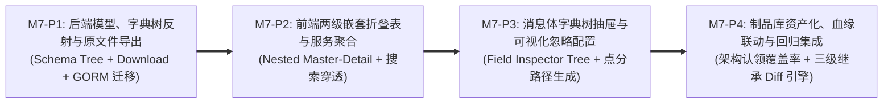

# Milestone 7 作战卡：Protobuf 契约资产化治理、嵌套服务表与消息体字段树 (M7)

- **文档编号**：`08-m7-proto-schema-deepening-and-nested-contract-workbench.md`
- **文档版本**：v1.0.0
- **更新日期**：2026-10-31
- **状态**：📋 待实施 (Backlog - 待按指令启动)
- **归属阶段**：阶段三/四：M7 TDD 任务拆解与验收标准 (`04-tasks`)
- **覆盖特性与场景**：`F-03` (Protobuf 描述集注册与接口映射深化)、`F-03.1` (两级嵌套折叠契约表)、`F-03.2` (消息体参数定义字典树)、`F-03.3` (可视化 Diff 忽略规则与继承)、`F-03.4` (描述集资产库与架构认领血缘)
- **设计参考基线**：[`06-proto-schema-repository-and-field-inspection-adr.md`](../05-adr/06-proto-schema-repository-and-field-inspection-adr.md) (ADR-06)、[`04-control-plane-and-web-console.md` §2.3~§2.4 & §4.4](../02-design/04-control-plane-and-web-console.md)、[`05-database-schema.md` §3.4](../02-design/05-database-schema.md)、[`01-http-api-contract.md` §2.3](../03-api/01-http-api-contract.md)

---

## 1. 渐进式四阶段实施路线 (Phased Execution Plan)

为防范前后端大规模改动导致的联调断裂，M7 严格划分为 **4 个串行可独立编译验证的子阶段（`M7-P1` ~ `M7-P4`）**：



| 阶段编号 | 阶段目标 | 核心实施动作与关键技术红线 | 阶段准出断言 |
| :---: | :--- | :--- | :--- |
| **M7-P1** | **后端模型扩展、字典树反射引擎与原文件导出 API** | 1. 扩展 `models.ProtoSchema`（增加 `proto_files datatypes.JSON`）与 `models.ProtoOperation`（增加 `diff_ignore_paths datatypes.JSON`）；<br>2. 在 `internal/server/decoder/registry.go` 实现 `ExtractMessageFieldTree(desc protoreflect.MessageDescriptor)` 纯反射函数（防环深度上限 12 层，提取 Tag、基本类型、`json_name`、`cardinality` 及 `SourceCodeInfo` 源码注释）；<br>3. 注册并实现 `GET /api/proto-schemas/:id/download`（流式输出原始 `.pb` 二进制，附带安全净化文件名）；<br>4. 注册并实现 `GET /api/proto-operations/:id/schema-tree` 与 `PUT /api/proto-operations/:id/ignore-paths`（写操作完整接入 RBAC 守卫与 `commonAudit` 字段级 Diff）。 | `TEST_DB_DSN=... go test -v -race ./internal/server/decoder/... ./handlers/...` 全绿 |
| **M7-P2** | **前端两级嵌套折叠表重构与聚合服务视图** | 1. 在 `frontend/src/types/schema.ts` 定义 `ServiceContractGroupDTO` 强类型接口（零 `any`）；<br>2. 重构 `OperationMappingTable.tsx`，将平铺列表改造为两级折叠表：外层按 `{package}-{serviceName}` 聚合为主行（展示服务契约全名、所属 Proto 文件、认领模块徽章、Unary/Stream 统计、生效态及折叠箭头）；内层展开展示独享的 RPC 方法子表；<br>3. 实现表头【一键全部展开/全部折叠】；实现跨层搜索过滤：输入关键词自动展开命中服务并高亮匹配方法。 | `npm test -- ProtoNestedTable.test.tsx` 通过，折叠与搜索穿透交互无异常 |
| **M7-P3** | **消息体参数字典树抽屉与可视化 Diff 忽略勾选** | 1. 升级 `OperationDocDrawer.tsx`，提供双栏或 Tab 式请求消息体（Req）与应答消息体（Rsp）全景视窗；<br>2. 实现 `MessageSchemaInspectorTree.tsx` 树形控件：类型彩色徽章（`INT64`、`STRING`、`MESSAGE`、`REPEATED` 等）、字段 Tag、源码注释透视与多层嵌套逐层折叠/展开；<br>3. 实现可视化【忽略对比】复选框：勾选后根据节点层级自动递归推导点分/数组通配路径（如 `header.timestamp`、`items[*].token`），展示路径提示并调用后端接口持久化保存；<br>4. 字段树上被标记忽略的节点赋予醒目的已忽略视觉样式。 | `npm test -- MessageSchemaTree.test.tsx` 通过，点分路径生成算法 100% 覆盖 |
| **M7-P4** | **描述集制品库资产化、架构认领血缘与 Diff 引擎三级继承** | 1. 在 `SchemaVersionList.tsx` 卡片增加【下载 .pb】动作，展示包含的 `.proto` 源码文件名清单；<br>2. 联动架构中心 `traefik_module_services`，计算当前描述集内服务的认领率，高亮标记“未认领孤儿契约”，提供一键跳转架构中心认领链接；<br>3. 升级 `internal/server/diff/engine.go`：将 `ProtoOperation.DiffIgnorePaths` 纳入 Diff 规则合并链，严格遵循 `ReplayTask.ExtraIgnorePaths ∪ Operation.DiffIgnorePaths ∪ ModuleService.DiffIgnorePaths` 三级优先级继承。 | `TEST_DB_DSN=... make test && make lint && make build` 100% 零警告通过 |

---

## 2. 交付包与文件清单 (Deliverable Packages & Files)

| 阶段 | 操作类型 | 包 / 文件路径 | 职责与实现范围 |
| :---: | :---: | :--- | :--- |
| **P1** | **UPDATE** | `models/proto_schema.go` | 在 `ProtoSchema` 增加 `ProtoFiles`，在 `ProtoOperation` 增加 `DiffIgnorePaths`（`datatypes.JSON`） |
| **P1** | **NEW / UPDATE** | `internal/server/decoder/schema_tree.go`<br>`internal/server/decoder/schema_tree_test.go` | 消息体字段反射字典树纯函数库：递归遍历 `protoreflect.MessageDescriptor` 提取字段类型、Tag、规则、注释与标准路径，内置防环保护 |
| **P1** | **UPDATE** | `handlers/proto_handler.go`<br>`handlers/routes.go`<br>`handlers/arch_proto_agent_test.go` | 注册并实现 `DownloadProtoSchema`、`GetOperationSchemaTree`、`UpdateOperationIgnorePaths`，补充 `commonAudit` 审计与隔离数据库单测 |
| **P2** | **NEW** | `frontend/src/types/schema_tree.ts` | 声明 `ProtoFieldNodeDTO`、`OperationSchemaTreeDTO`、`ServiceContractGroupDTO` 等强类型接口 |
| **P2** | **UPDATE** | `frontend/src/pages/ProtoSchemaWorkbenchPage/OperationMappingTable.tsx`<br>`frontend/src/pages/ProtoSchemaWorkbenchPage/ServiceSummaryRow.tsx` (NEW) | 重构为两级嵌套折叠表，实现服务聚合行、子表方法行、一键展开收起与搜索关键词穿透高亮 |
| **P2** | **NEW** | `frontend/src/__tests__/ProtoNestedTable.test.tsx` | 针对服务聚合、RPC 计数、多行独立展开/收起及搜索穿透的组件单元测试套件 |
| **P3** | **NEW / UPDATE** | `frontend/src/pages/ProtoSchemaWorkbenchPage/MessageSchemaInspectorTree.tsx`<br>`frontend/src/pages/ProtoSchemaWorkbenchPage/DiffIgnoreFieldToggle.tsx`<br>`frontend/src/pages/ProtoSchemaWorkbenchPage/OperationDocDrawer.tsx` | 参数字典树可视化控件、类型徽章、源码注释展示、可视化忽略对比复选框及点分路径自动计算 |
| **P3** | **NEW** | `frontend/src/__tests__/MessageSchemaTree.test.tsx` | 针对字典树展开、点分路径生成（含数组通配符 `[*]`）、忽略规则切换与 API 保存的单元测试 |
| **P4** | **UPDATE** | `frontend/src/pages/ProtoSchemaWorkbenchPage/SchemaVersionList.tsx`<br>`frontend/src/api/schema.ts` | 增加 `.pb` 原文件下载、包含 Proto 源文件列表展示、架构认领覆盖率徽章与孤儿契约警示 |
| **P4** | **UPDATE** | `internal/server/diff/engine.go`<br>`internal/server/diff/diff_test.go` | 接入 `Operation.DiffIgnorePaths`，实现三级优先级忽略合并断言与回归测试 |

---

## 3. TDD 先行测试矩阵 (Test-First Matrix)

| 阶段 | 目标测试文件 | 关键测试函数名 | 输入场景与前置条件 | 预期断言结果 (Assertions) |
| :---: | :--- | :--- | :--- | :--- |
| **P1** | `internal/server/decoder/schema_tree_test.go` | `TestExtractMessageFieldTree_Recursive` | 传入包含基本标量、嵌套子 Message、Repeated 数组及 Map 结构的 Protobuf 描述集 | 1. 递归提取出树形节点，Tag 编号及 `INT64`、`STRING`、`MESSAGE` 类型完全准确；<br>2. 预计算路径正确输出为 `parent.child` 与 `items[*].id`；<br>3. 存在循环引用定义时不发生死循环，递归深度平滑截断于 12 层。 |
| **P1** | `internal/server/decoder/schema_tree_test.go` | `TestExtractMessageFieldTree_SourceComments` | 使用带有 `// 注释` 的 proto 编译出的描述集 | 准确提取字段对应文档 `leading_comments`，空注释字段为 `""`。 |
| **P1** | `handlers/arch_proto_agent_test.go` | `TestDownloadProtoSchemaBinary_Integrity` | 上传一段标准 `.pb` 二进制，调用 `GET /api/proto-schemas/:id/download` | 1. 响应状态码 `200`，`Content-Type: application/octet-stream`；<br>2. 响应 Body 的 SHA256 与上传时数据库记录完全一致；<br>3. `Content-Disposition` 携带净化的安全文件名。 |
| **P1** | `handlers/arch_proto_agent_test.go` | `TestUpdateOperationIgnorePaths_ValidationAndAudit` | 针对指定 Operation 更新 `diff_ignore_paths: ["server_time", "items[*].token"]` | 1. 更新成功且持久化到 DB；非法路径（含控制字符/空串）返回 `400`；<br>2. `audit_logs` 表产生一条 `traefik_schema:update_op_ignores` 且包含字段变更快照。 |
| **P2** | `frontend/src/__tests__/ProtoNestedTable.test.tsx` | `testServiceGroupRollup_Aggregation` | 输入属于 3 个服务、共 12 个 Operation 的扁平数据 | 1. 准确聚合为 3 个 Service 主行，各主行内的 RPC 计数（Unary/Stream）完全准确；<br>2. 默认状态处于折叠，点击展开三角后平滑渲染内层方法子表。 |
| **P2** | `frontend/src/__tests__/ProtoNestedTable.test.tsx` | `testNestedTable_SearchPenetration` | 输入搜索词 `"DeductBalance"`（方法名） | 1. 命中该方法的所属服务行自动变为展开态；<br>2. 未命中的服务行自动折叠；匹配的方法名文字高亮显示。 |
| **P3** | `frontend/src/__tests__/MessageSchemaTree.test.tsx` | `testTreeRender_NestedAndPathGeneration` | 传入包含 3 层嵌套的对象树结构，点击勾选第 3 层 `timestamp` 字段 | 1. 树控件正确展示类型徽章与注释；<br>2. 点击复选框后回调函数输出的路径严格等于 `"data.detail.timestamp"`；<br>3. 勾选数组内元素时自动输出通配符 `"orders[*].order_id"`。 |
| **P4** | `internal/server/diff/diff_test.go` | `TestTripleLayerDiffIgnoreInheritance` | 构造基线与实际回放帧，差异字段包含：服务级忽略的 `header.time`、方法级忽略的 `detail.token`、临时追加的 `extra_id` | 1. 三处差异均被三级合并规则识别并过滤，回归对比判定为 `PASS`；<br>2. 未在忽略规则中的字段突变精确判定为 `FAILED`。 |

---

## 4. 验收门禁命令 (Acceptance Criteria)

```bash
# AC-M7-01: 前端两级嵌套表折叠与字段字典树纯算法/组件测试门禁
cd frontend && npm test -- ProtoNestedTable.test.tsx MessageSchemaTree.test.tsx --coverage

# AC-M7-02: 后端字典树反射、原文件下载与方法级忽略路径 CRUD 隔离测试门禁
TEST_DB_DSN="host=127.0.0.1 port=5432 user=postgres password=postgres dbname=postgres sslmode=disable" \
  go test -v -race ./internal/server/decoder/... ./internal/server/diff/... ./handlers/... -run "TestExtractMessageFieldTree|TestDownloadProtoSchema|TestUpdateOperationIgnorePaths|TestTripleLayerDiffIgnore"

# AC-M7-03: 前端 TypeScript 严格类型与 ESLint 校验（零 any、零未使用变量、100% --color-* 语义 Token）
make lint

# AC-M7-04: 全局全量隔离单元测试、双二进制内嵌构建与产物清理门禁
TEST_DB_DSN="host=127.0.0.1 port=5432 user=postgres password=postgres dbname=postgres sslmode=disable" make test && make build && make clean
```

