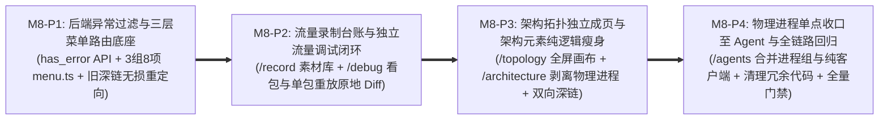

# Milestone 8 作战卡：微前端控制台信息架构重组、“录制-调试-重放”工作流闭环与物理进程单点收口 (M8)

- **文档编号**：`09-m8-console-ia-restructuring-and-debug-workflow.md`
- **文档版本**：v1.0.0
- **更新日期**：2026-11-01
- **状态**：⏳ 待实施 (Planned)
- **归属阶段**：阶段三/四：M8 TDD 任务拆解与验收标准 (`04-tasks`)
- **覆盖特性与场景**：`F-15` (一体化微前端控制台三层频次信息架构)、`F-15.1` (录制素材资产台账与跨工作台流转)、`F-15.2` (独立流量调试工作台与单包快速重放调试)、`F-15.3` (静态架构基线解耦与物理进程单点收口)、`F-02` (进程部署映射收口至 Agent 与进程)、`F-11` / `F-12` (协同录制与单包/批量同构重放联动)
- **设计参考基线**：[`07-console-ia-restructuring-and-workflow-workbench-adr.md`](../05-adr/07-console-ia-restructuring-and-workflow-workbench-adr.md) (ADR-07)、[`04-control-plane-and-web-console.md` §4.1~§4.2 & §4.5](../02-design/04-control-plane-and-web-console.md)、[`01-http-api-contract.md` §2.4~§2.6](../03-api/01-http-api-contract.md)

---

## 1. 渐进式四阶段实施路线 (Phased Execution Plan)

为确保路由重构与页面拆分过程中全仓随时可编译、旧深链零断裂，M8 严格划分为 **4 个串行可独立验证的子阶段（`M8-P1` ~ `M8-P4`）**：



| 阶段编号 | 阶段目标 | 核心实施动作与关键技术红线 | 阶段准出断言 |
| :---: | :--- | :--- | :--- |
| **M8-P1** | **后端 `has_error` 异常报文过滤与前端 3 组 8 项菜单/路由重定向底座** | 1. 扩展 `handlers.ListTrafficRecords` 查询结构体增加 `HasError *bool`（`form:"has_error"`）：当 `has_error=true` 时参数化过滤 `(status_code <> 0 OR exchange_type = 'REQ_ONLY')`，当 `has_error=false` 时过滤 `(status_code = 0 AND exchange_type <> 'REQ_ONLY')`；<br>2. 重构 `frontend/src/menu.ts` 为 **3 组 8 项**（`流量作业`：`流量录制 /record`、`流量调试 /debug`、`流量重放 /replay`；`架构与契约`：`架构拓扑 /topology`、`架构元素 /architecture`、`Proto 契约 /schemas`；`环境与治理`：`Agent 与进程 /agents`、`模块参数配置 /admin/settings`），默认入口设为 `/traefik/record`；<br>3. 重构 `frontend/src/App.tsx`：`StandaloneShell` 直接消费 `traefikMenuConfig` 渲染侧边栏与面包屑（消除双处硬编码）；实现 `LegacyRouteRedirect` 组件支持 `/`、`/sessions` $\rightarrow$ `/record`，`/traffic?...` $\rightarrow$ `/debug?...`，`/architecture?tab=topology\|physical\|verify` $\rightarrow$ `/topology` 100% 保留 Query 参数平滑跳转。 | `TEST_DB_DSN=... go test -v -race ./handlers/... -run TestListTrafficRecords_HasErrorFilter` 与 `npm test -- MenuAndLegacyRoutes.test.tsx` 全绿 |
| **M8-P2** | **拆分构建 `流量录制` 素材台账页与 `流量调试` 单包快速重放闭环** | 1. 新建 `RecordingWorkbenchPage` (`/record`)：`ActiveRecordingBanner`（实时帧计数、A-01 存量长连接重连提示、一键停录与【实时跟流调试】跳 `/debug?session_id=X&live=1`）、`RecordingStartModal`（公私域、多进程勾选与双阈值）、`RecordingSessionTable`（复用 `@code/common` `Pagination`，支持公私域切换及 `[去调试]`、`[发起重放]`、`[架构验证]`、`[发布共享]`、`[删除]` 自定义确认模态框）；<br>2. 将公共四段解剖组件沉淀至 `components/PacketAnatomyDrawer/` 并提供顶部动作插槽；新建 `TrafficDebugWorkbenchPage` (`/debug`)：包含 `DebugSessionContextBar`（批次切换、活跃批次脉冲标识与 SSE `traffic.persisted` 暂停/继续）、`LiveTrafficFilterForm`（含 `has_error` 仅看异常开关与 `trace_id` 串联）、`TrafficRecordTable` 与 **`SinglePacketReplayDrawer`**；<br>3. 实现 `SinglePacketReplayDrawer`：仅对 `direction === 'INGRESS' && is_replayable` 报文开放，自动过滤承载同构模块且 `listen_port > 0` 的可见目标进程（优先推荐本人在线空闲 `PRIVATE` Agent 进程），复用 `POST /api/replay-tasks`（`selected_record_ids: [record.id]`）触发单包重放并在同一抽屉原地渲染 `HeaderAssertionCard`、`ProtoFieldDiffTable` 与 `MockHitMissTimeline`；<br>4. 增强 `ReplayWorkbenchPage` (`/replay`)：识别 `?session_id=X&auto_create=1` 自动唤起 `ReplayTaskCreatorModal` 并预选来源批次。 | `npm test -- RecordingWorkbench.test.tsx SinglePacketReplay.test.tsx PacketAnatomyDrawer.test.tsx` 全绿 |
| **M8-P3** | **剥离全屏 `架构拓扑` 工作台、瘦身纯逻辑 `架构元素` 与静态基线双向深链** | 1. 新建 `TopologyWorkbenchPage` (`/topology`)：移除外层胶囊 Tab，将 100% 工作区视口高度交予 `ArchCanvas`（支持 `?view=LOGICAL\|PHYSICAL` 与 `?session_id=X` 自动叠加六分类架构一致性报告，点击异常边抽样报文可直接唤起公共 `PacketAnatomyDrawer`）；<br>2. 瘦身重构 `ArchitectureWorkbenchPage` (`/architecture`)：彻底移除顶部 `静态建模 / 架构全景图 / 一致性比对` 三胶囊 Tab、移除左树 `逻辑/物理` 模式切换开关以及进程/进程组新建编辑抽屉，收敛为纯粹的「三级逻辑架构树 (`SubsystemGroupTreePanel`) + 模块契约与装载血缘详情 (`ModuleContractDetailPane`)」双栏工作台；<br>3. 打通静态基线双向深链：`ModuleContractDetailPane` 点击服务契约跳 `/schemas?active_only=true&search=<service_name>`，点击装载进程跳 `/agents?scope=<scope>&agent_id=<aid>&process_id=<pid>`；`ProtoSchemaWorkbenchPage` 服务主行点击认领模块徽章跳 `/architecture?subsystem_id=<sid>&group_id=<gid>&module_id=<mid>` 自动展开定位。 | `npm test -- TopologyAndArchDecoupling.test.tsx ProtoNestedTable.test.tsx` 全绿 |
| **M8-P4** | **物理业务进程单点收口至 `Agent 与进程`、死代码清理与全链路回归** | 1. 升级 `AgentManagementPage` (`/agents`) 与 `ProcessModuleBinderModal.tsx`：完整承接 `group_name` 进程分组（从已有分组下拉选择或快捷输入新建分组）、支持 `listen_port = 0`（纯客户端进程）、编辑态正确回填 `editingProcess.process_modules` 已挂载模块 ID 列表、右栏进程表新增「进程分组」展示列，并支持响应 URL `?scope=...&agent_id=...&process_id=...` 自动定位高亮；<br>2. 清理历史冗余文件：删除已被收口替代的 `ArchitectureWorkbenchPage/ProcessDetailPane.tsx` 与旧 `TrafficMonitorWorkbenchPage/` 目录（确保零孤儿引用）；<br>3. 更新并扩充 `WorkbenchRBAC.test.tsx` 与分页/主题回归测试，确保 100% 遵循 `--color-*` 语义 Token、零原生 `alert/confirm`、零 `any`。 | `TEST_DB_DSN=... make test && make lint && make build && make clean` 100% 零警告通过 |

---

## 2. 交付包与文件清单 (Deliverable Packages & Files)

| 阶段 | 操作类型 | 包 / 文件路径 | 职责与实现范围 |
| :---: | :---: | :--- | :--- |
| **P1** | **UPDATE** | `handlers/traffic_handler.go`<br>`handlers/recording_replay_test.go` | 为 `GET /api/traffic-records` 增加 `has_error` 布尔过滤支持（参数化查询 `status_code <> 0 OR exchange_type = 'REQ_ONLY'`）及物理隔离数据库单测 |
| **P1** | **UPDATE** | `frontend/src/menu.ts`<br>`frontend/src/App.tsx`<br>`frontend/src/api/traffic.ts`<br>`frontend/src/types/traffic.ts` | 导出 3 组 8 项 `traefikMenuConfig`（默认 `/traefik/record`）；`StandaloneShell` 改为由 `traefikMenuConfig` 数据驱动；实现 `LegacyRouteRedirect` 带参无损重定向；补充前端 `has_error` 查询类型 |
| **P1** | **NEW** | `frontend/src/__tests__/MenuAndLegacyRoutes.test.tsx` | 校验 3 组 8 项菜单结构、`adminOnly` 标记、默认落地路由及 `/traffic`、`/architecture?tab=*`、`/sessions` 带参重定向断言 |
| **P2** | **MOVE / UPDATE** | `frontend/src/components/PacketAnatomyDrawer/*` | 将四段报文解剖抽屉提取为跨工作台公共组件（供 `/debug` 与 `/topology` 共用），顶栏新增可选【单包重放调试】操作插槽 |
| **P2** | **NEW** | `frontend/src/pages/RecordingWorkbenchPage/RecordingWorkbenchPage.tsx`<br>`frontend/src/pages/RecordingWorkbenchPage/ActiveRecordingBanner.tsx`<br>`frontend/src/pages/RecordingWorkbenchPage/RecordingStartModal.tsx`<br>`frontend/src/pages/RecordingWorkbenchPage/RecordingSessionTable.tsx` | 独立 `流量录制` 工作台 (`/record`)：活跃录制状态卡、A-01 重连诊断、录制素材分页资产台账、公私域发布/删除模态确认及跨页流转快捷动作 |
| **P2** | **NEW** | `frontend/src/pages/TrafficDebugWorkbenchPage/TrafficDebugWorkbenchPage.tsx`<br>`frontend/src/pages/TrafficDebugWorkbenchPage/DebugSessionContextBar.tsx`<br>`frontend/src/pages/TrafficDebugWorkbenchPage/LiveTrafficFilterForm.tsx`<br>`frontend/src/pages/TrafficDebugWorkbenchPage/TrafficRecordTable.tsx`<br>`frontend/src/pages/TrafficDebugWorkbenchPage/SinglePacketReplayDrawer.tsx` | 独立 `流量调试` 工作台 (`/debug`)：历史批次/SSE 实时跟流切换、多维+`has_error` 异常过滤、Trace 串联、单包同构目标进程智能筛选与原地双层 Diff 调试抽屉 |
| **P2** | **UPDATE** | `frontend/src/pages/ReplayWorkbenchPage/ReplayWorkbenchPage.tsx`<br>`frontend/src/pages/ReplayWorkbenchPage/ReplayReportDrawer/*` | 支持 URL `?session_id=X&auto_create=1` 自动预选唤起创建弹窗；导出 `HeaderAssertionCard`、`ProtoFieldDiffTable`、`MockHitMissTimeline` 子视图供 `SinglePacketReplayDrawer` 复用 |
| **P2** | **NEW** | `frontend/src/__tests__/RecordingWorkbench.test.tsx`<br>`frontend/src/__tests__/SinglePacketReplay.test.tsx` | 覆盖录制素材台账分页、发布/删除防误触确认、跨工作台跳转链接，以及单包重放同构进程匹配、`selected_record_ids: [id]` 提交与原地 Diff 渲染 |
| **P3** | **NEW** | `frontend/src/pages/TopologyWorkbenchPage/TopologyWorkbenchPage.tsx` | 全视口独立 `架构拓扑` 工作台 (`/topology`)：承载逻辑/物理复合画布、录制批次六分类一致性叠加与异常边抽样报文解剖联动 |
| **P3** | **UPDATE** | `frontend/src/pages/ArchitectureWorkbenchPage/ArchitectureWorkbenchPage.tsx`<br>`frontend/src/pages/ArchitectureWorkbenchPage/SubsystemGroupTreePanel.tsx`<br>`frontend/src/pages/ArchitectureWorkbenchPage/ModuleContractDetailPane.tsx`<br>`frontend/src/pages/ProtoSchemaWorkbenchPage/ServiceSummaryRow.tsx` | 剥离顶层胶囊 Tab 与物理进程树/进程抽屉，瘦身为纯逻辑三级架构台账；建立 `/architecture` $\leftrightarrow$ `/schemas` 与 `/architecture` $\rightarrow$ `/agents` 血缘深链 |
| **P3** | **NEW** | `frontend/src/__tests__/TopologyAndArchDecoupling.test.tsx` | 验证 `/topology` 全屏画布 URL 参数联动、`/architecture` 纯逻辑树瘦身（不再出现物理进程写入口）及跨页血缘深链定位 |
| **P4** | **UPDATE** | `frontend/src/pages/AgentManagementPage/AgentManagementPage.tsx`<br>`frontend/src/pages/AgentManagementPage/ProcessModuleBinderModal.tsx`<br>`frontend/src/types/agent.ts` | 将物理进程 `group_name`（下拉选择已有进程组 + 快捷新建分组）、`listen_port = 0` 纯客户端支持、`process_modules` 编辑态回填与 URL `agent_id`/`process_id` 定位完整收口至 `/agents` |
| **P4** | **DELETE** | `frontend/src/pages/ArchitectureWorkbenchPage/ProcessDetailPane.tsx`<br>`frontend/src/pages/TrafficMonitorWorkbenchPage/*` | 彻底移除已收口/拆分完毕的旧耦合组件目录，保持代码库整洁单一职责 |
| **P4** | **UPDATE** | `frontend/src/__tests__/WorkbenchRBAC.test.tsx`<br>`frontend/src/__tests__/PacketAnatomyDrawer.test.tsx`<br>`frontend/src/__tests__/ThemeAndPagination.test.tsx` | 同步新组件导入路径，补充公私域 Agent 进程组编辑 RBAC 断言、分页滑窗与语义化主题 Token 门禁断言 |

---

## 3. TDD 先行测试矩阵 (Test-First Matrix)

| 阶段 | 目标测试文件 | 关键测试函数名 | 输入场景与前置条件 | 预期断言结果 (Assertions) |
| :---: | :--- | :--- | :--- | :--- |
| **P1** | `handlers/recording_replay_test.go` | `TestListTrafficRecords_HasErrorFilter` | 在物理隔离库写入 3 条记录：① `UNARY` + `status_code=0`；② `UNARY` + `status_code=5001`；③ `REQ_ONLY` + `status_code=0` | 1. 请求 `?session_id=S&has_error=true` 精确返回记录 ② 与 ③（共 2 条）；<br>2. 请求 `?session_id=S&has_error=false` 仅返回记录 ①（1 条）；<br>3. 非法参数 `?has_error=abc` 返回 `400 Bad Request` 且不泄露 SQL 细节。 |
| **P1** | `frontend/src/__tests__/MenuAndLegacyRoutes.test.tsx` | `testMenuStructure_ThreeGroupsEightItems` | 导入 `traefikMenuConfig` 并校验分组、顺序、路径与权限标识 | 1. 严格包含 `流量作业`、`架构与契约`、`环境与治理` 3 个分组共 8 个子项；<br>2. 模块根默认路径 `path === '/traefik/record'`，仅 `/traefik/admin/settings` 标记 `adminOnly: true`。 |
| **P1** | `frontend/src/__tests__/MenuAndLegacyRoutes.test.tsx` | `testLegacyDeepLinks_LosslessRedirect` | 分别以 `/traffic?session_id=s1&trace_id=t9`、`/architecture?tab=physical&session_id=s1`、`/` 挂载路由 | 1. `/traffic?...` 自动重定向至 `/debug?session_id=s1&trace_id=t9` 参数零丢失；<br>2. `/architecture?tab=physical&session_id=s1` 重定向至 `/topology?view=PHYSICAL&session_id=s1`；<br>3. `/` 自动落地至 `/record`。 |
| **P2** | `frontend/src/__tests__/RecordingWorkbench.test.tsx` | `testSessionLedger_ActionsAndCrossWorkbenchLinks` | 渲染包含 1 条 `RECORDING` 批次与 2 条 `STOPPED`（`PRIVATE` + `SHARED`）批次的 `RecordingWorkbenchPage` | 1. 顶部 `ActiveRecordingBanner` 展示活跃批次帧数与【实时跟流调试】链接（指向 `/debug?session_id=active&live=1`）；<br>2. 台账行 `[去调试]`、`[发起重放]`、`[架构验证]` 分别指向 `/debug`、`/replay?session_id=X&auto_create=1`、`/topology?session_id=X`；<br>3. 普通用户仅对本人 `PRIVATE` 批次可见 `[发布共享]` 与 `[删除]`，点击删除弹出自定义模态确认框（零 `window.confirm`）。 |
| **P2** | `frontend/src/__tests__/SinglePacketReplay.test.tsx` | `testSinglePacketReplay_IsomorphicFilterAndInlineDiff` | 传入 1 条 `INGRESS` (`is_replayable=true`, 模块 `M-Order`) 与 1 条 `EGRESS` 报文；Mock 存在进程 `P-Order-Private`（挂载 `M-Order`, `listen_port=9100`）、`P-Client`（挂载 `M-Order`, `listen_port=0`）与 `P-Pay`（挂载 `M-Pay`, `listen_port=9200`） | 1. 仅 `INGRESS` 可重放报文渲染【单包重放调试】，`EGRESS` 不渲染；<br>2. 打开 `SinglePacketReplayDrawer` 后仅过滤列出同构服务端进程 `P-Order-Private`（自动排除 `listen_port=0` 纯客户端与异构模块 `P-Pay`）；<br>3. 点击执行后精确调用 `POST /api/replay-tasks` 且 `selected_record_ids` 严格等于 `[record.id]`，完成后在抽屉内原地展示协议头断言与字段级 Diff 结果。 |
| **P3** | `frontend/src/__tests__/TopologyAndArchDecoupling.test.tsx` | `testArchWorkbench_PureLogicalAndBloodlineLinks` | 以管理员身份渲染瘦身后的 `/architecture` 并选中挂载了服务与进程的模块 `M-Order` | 1. 页面中不再存在顶部三胶囊 Tab，也不再存在左树「逻辑/物理」切换按钮与新建进程按钮；<br>2. 点击模块服务行契约跳转链接精确导航至 `/schemas?active_only=true&search=...`；<br>3. 点击装载进程徽章精确导航至 `/agents?scope=...&agent_id=...&process_id=...`。 |
| **P4** | `frontend/src/__tests__/WorkbenchRBAC.test.tsx` | `testAgentProcessConsolidation_GroupNameAndRBAC` | 分别以普通用户（操作本人 `PRIVATE` Agent 与公共 `SHARED` Agent）及 `traefik_admin` 渲染 `/agents` 并打开 `ProcessModuleBinderModal` | 1. 普通用户在本人 `PRIVATE` Agent 下可正常通过 `ProcessModuleBinderModal` 选择/新建 `group_name`、设置 `listen_port = 0` 并回填编辑 `module_ids`；<br>2. 普通用户切换到公共 `SHARED` Agent 时，新增/编辑/删除进程按钮全部按 RBAC 隐藏或禁用，仅 `traefik_admin` 可写。 |

---

## 4. 验收门禁命令与安全验证计划 (Acceptance Criteria & Security Verification Plan)

### 4.1 自动化验收门禁命令

```bash
# AC-M8-01: 后端异常报文过滤 (has_error) 与既有录制/重放/RBAC 控制器物理隔离数据库单测
TEST_DB_DSN="host=127.0.0.1 port=5432 user=postgres password=postgres dbname=postgres sslmode=disable" \
  go test -v -race ./handlers/... -run "TestListTrafficRecords|TestSC01|TestSC05|TestSC07|TestSC08"

# AC-M8-02: 前端三层菜单、旧路由无损重定向、录制台账、单包重放调试与进程收口组件测试门禁
cd frontend && npm test -- MenuAndLegacyRoutes.test.tsx RecordingWorkbench.test.tsx SinglePacketReplay.test.tsx TopologyAndArchDecoupling.test.tsx WorkbenchRBAC.test.tsx

# AC-M8-03: 前端 TypeScript 严格类型与 ESLint 校验（零 any、零孤儿死代码、100% --color-* 语义 Token）
make lint

# AC-M8-04: 全局全量隔离单元测试、双二进制内嵌构建与产物清理门禁（确认 :8091 / :5181 零残留进程）
TEST_DB_DSN="host=127.0.0.1 port=5432 user=postgres password=postgres dbname=postgres sslmode=disable" make test && make build && make clean
```

### 4.2 M8 专项安全编码验证计划 (Security Verification Plan)

在遵循 [`01-roadmap.md` §4.2](./01-roadmap.md) 全局安全基线的基础上，M8 实施与代码检视必须逐项核验以下安全红线：

| 安全检查项 | 威胁场景 (CWE) | 强制实施约束与自动化验证断言 |
| :--- | :--- | :--- |
| **1. 单包重放与录制台账防横向越权 (Anti-IDOR)** | CWE-639 (Authorization Bypass Through User-Controlled Key) | `SinglePacketReplayDrawer` 复用 `POST /api/replay-tasks`、`RecordingSessionTable` 调用发布/删除接口时，后端数据层持续强制校验来源 `RecordingSession` 与目标 `Agent/Process` 的 `scope` 及 `owner_id == currentUser.ID`；跨用户提交他人 `PRIVATE` `recordId` 或 `processId` 必须拦截并返回 `403 Forbidden`。 |
| **2. 物理进程单点收口 RBAC 边界** | CWE-285 (Improper Authorization) | 物理进程 CRUD 收口至 `/agents` 后，前端按 `isAdmin \|\| (agent.scope === 'PRIVATE' && agent.owner_id === user.id)` 控制写入口显隐，后端 `handlers/process_handler.go` 强制校验所属 `Agent` 归属权（普通用户写 `SHARED` Agent 进程或他人 `PRIVATE` Agent 进程均返 `403`）。 |
| **3. `has_error` 过滤防 SQL 注入** | CWE-89 (SQL Injection) | `handlers/traffic_handler.go` 必须通过 Gin 强类型 `*bool` 绑定 `has_error`，GORM 查询固定使用预编译表达式 `db.Where("status_code <> 0 OR exchange_type = ?", models.ExchangeReqOnly)`，严禁将原始 Query 字符串拼入 `Where` 子句。 |
| **4. 历史路由重定向防开放重定向 (Anti-Open-Redirect)** | CWE-601 (URL Redirection to Untrusted Site) | `LegacyRouteRedirect` 仅允许映射到代码内静态枚举的本模块相对路径（`/record`、`/debug`、`/topology`），保留参数时使用 `URLSearchParams` 构造相对 `search` 字符串，严禁读取任何外部可控 `next`/`redirect` 参数执行跨站 `window.location` 跳转。 |
| **5. 报文/进程组渲染防 DOM XSS 与原生弹窗禁令** | CWE-79 (Cross-site Scripting) | `TrafficRecordTable`、`SinglePacketReplayDrawer` 与 `ProcessModuleBinderModal`（含用户输入的 `group_name` 与搜索高亮）100% 依赖 React JSX 文本节点自动转义，严禁引入 `dangerouslySetInnerHTML` 或 `innerHTML`；所有删除/停录/解锁确认一律采用受控 React Modal，严禁调用 `alert()` / `confirm()` / `prompt()`。 |
| **6. 测试绑定与端口卫生** | CWE-668 (Exposure of Resource to Wrong Sphere) | 新增单测中的全部测试连接与 Mock 服务强制绑定 `127.0.0.1`（严禁 `0.0.0.0`），验证完毕后确保无任何 `:8091` / `:5181` 残留监听进程。 |
