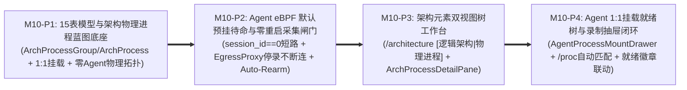

# Milestone 10 作战卡：架构物理进程蓝图解耦、Agent 1:1 挂载覆盖与 eBPF 默认自动预挂待命工作流 (M10)

- **文档编号**：`11-m10-arch-process-blueprint-and-premount-workflow.md`
- **文档版本**：v1.0.0
- **更新日期**：2026-11-02
- **状态**：⏳ 待实施 (Pending Implementation)
- **归属阶段**：阶段三/四：M10 TDD 任务拆解与验收标准 (`04-tasks`)
- **覆盖特性与场景**：`F-02` (架构物理进程蓝图与 Agent 1:1 挂载覆盖)、`F-04` (零 Agent 依赖的静态物理架构拓扑)、`F-08` (多进程监控供给、PID 定位与预挂就绪体检)、`F-09` (Agent eBPF `ARMED` 零拷贝预挂待命与停录不断连引擎)、`F-11` (`0ms` 零重启开启协同录制)、`F-15.3` (`/architecture` `[逻辑架构 | 物理进程]` 双视图树)、`F-15.4` (`/record` 实时就绪联动录制抽屉)、`F-15.5` (`/agents` 同构分组就绪树与 1:1 批量挂载抽屉)、`SC-02`、`SC-05`
- **设计参考基线**：[`09-arch-process-ssot-and-ebpf-premount-standby-adr.md`](../05-adr/09-arch-process-ssot-and-ebpf-premount-standby-adr.md) (ADR-09)、[`01-system-architecture.md` §3~§5](../02-design/01-system-architecture.md)、[`02-data-plane-and-cros-rpc-engine.md` §2](../02-design/02-data-plane-and-cros-rpc-engine.md)、[`03-architecture-elements-and-topology.md` §3~§4](../02-design/03-architecture-elements-and-topology.md)、[`04-control-plane-and-web-console.md` §1 & §4~§5](../02-design/04-control-plane-and-web-console.md)、[`05-database-schema.md` §2~§5](../02-design/05-database-schema.md)、[`01-http-api-contract.md` §2.2, §2.4~§2.7 & §3](../03-api/01-http-api-contract.md)

---

## 1. 渐进式四阶段实施路线 (Phased Execution Plan)

为保障从「单层宿主机自由建进程」平滑升级至「架构物理进程蓝图 SSOT + Agent `1:1` 挂载覆盖 + eBPF 默认自动预挂待命」，M10 严格拆分为 **4 个串行可独立验证的子阶段（`M10-P1` ~ `M10-P4`）**：



| 阶段编号 | 阶段目标 | 核心实施动作与关键技术红线 | 阶段准出断言 |
| :---: | :--- | :--- | :--- |
| **M10-P1** | **数据模型 15 表迁移、架构物理进程蓝图 API 与零 Agent 物理拓扑直推** | 1. 升级 `models/arch.go` 与 `models/agent.go`：新增 `ArchProcessGroup` (`traefik_arch_process_groups`)、`ArchProcess` (`traefik_arch_processes`)，在 `Module` 上固化 `ArchProcessID *uint64` 单一归属 (`A-03`)，移除耦合表 `traefik_process_modules`；在 `Agent` 增加 `BootID`、`ArmedDigest`；将 `Process` (`traefik_processes`) 重构为 `1:1` 挂载实体（强制 `uk_traefik_proc_agent_arch: UNIQUE(agent_id, arch_process_id)` 与 PostgreSQL 部分唯一索引 `uk_traefik_proc_agent_port: UNIQUE(agent_id, effective_listen_port) WHERE effective_listen_port > 0`），提供 `OverrideListenPort`、`OverrideCmdPattern`、`EffectiveListenPort`、`ProbeDesiredState` (`ARMED`/`DISARMED`)、`ProbeStatus` 及诊断快照列；<br>2. 新建 `handlers/arch_process_handler.go`：实现 `/api/arch/process-groups`、`/api/arch/processes/tree`、`/api/arch/processes` CRUD 与 `POST /api/arch/modules/:id/process-binding`；`GET /api/arch/processes/:id` 与 `GET /api/arch/modules/:id` 返回的 `agent_mounts` 强制经 `ScopeReadGuard` 过滤，严防泄露他人 `PRIVATE` Agent；<br>3. 升级 `internal/server/topology/` 与 `internal/server/diff/`：`BuildTopologyGraph(view="PHYSICAL")` 100% 由 `ArchProcessGroup -> ArchProcess -> Module` 直推（零 Agent 注册亦可完整渲染物理拓扑，存在 `SHARED` Agent 挂载时自动富化端点）；`CompileProcessDownstreams` 实现「本机 `Agent` 挂载优先 $\rightarrow$ `SHARED` 基线兜底 $\rightarrow$ `EffectiveExtraDownstreams` 合并」；`ValidateReplayProcessCompatibility` 改为基于 `ArchProcess` 装载模块集合校验同构性。 | `TEST_DB_DSN=... go test -v -race ./models/... ./internal/server/topology/... ./handlers/... -run "TestArchProcess|TestBuildTopologyGraph_Physical|TestCompileProcessDownstreams"` 全绿 |
| **M10-P2** | **Agent eBPF 默认自动预挂待命 (`ARMED`)、零重启采集闸门 (`CAPTURING`) 与心跳自动补挂** | 1. 扩展 `pkg/agentproto`：新增 `ArmStandbyReq`、`HandshakeResp{BootID, ArmedProcessCount, ArmedDigest}` 与扩展 `ProcessDiagStatus{Status, ResolvedPID, EstablishedConns, NeedReconnect}`；保持 `cmd/agent` 零 DB、零 `.pb` 物理防腐；<br>2. 升级 `pkg/ebpf`：`cros_probe.c` 在 `sys_enter_read/write` 命中 `val->session_id == 0` 时立即 `return 0;`（`<20ns` 零 RingBuf 拷贝短路），`connect_observe_ringbuf` 仅在活跃录制态投递事件；`EgressProxy` 支持 `ARMED` 待命纯字节双向 `io.Copy` 透传（跳过 `StreamFramer` 与 WS 投递），并提供 `StartCapture(sessionID)` 与 `StopCapture()` 原子切换（**停止录制时不断开已有业务 TCP 长连接**）；`sched_process_exec` 支持在 `ARMED` 预挂态自动捕获后续新启动 PID 并置为 `READY`；<br>3. 升级 `internal/agent/server`：新增 `PUT /agent/v1/monitors/arm`（不占用 `activeLease` 排他租约，若当前处于活跃租约则返 `409`）与 `GET /agent/v1/monitors/diagnose`；改造 `/monitors/sync`（对已 `ARMED` 进程执行 `0ms` 翻牌 `session_id = S`，对 `DISARMED` 进程即时补挂）与 `/monitors/:sessionId/stop`（无损回退至 `session_id = 0` `ARMED` 待命并释放 `RECORDING` 租约）；重放任务结束/取消后自动恢复原 `ARMED` 待命表；主控失联 `>=5m` 或 `SIGINT/SIGTERM` 触发 `PurgeAllMonitors()` 全量清空探针与代理端口；<br>4. 升级 `internal/server/hub`、`internal/server/recorder` 与 `handlers/process_handler.go`：实现 `PUT /api/agents/:id/process-mounts`、`POST /api/agents/:id/probes/{diagnose,arm-all,disarm-all}`、`POST /api/processes/:id/{arm,disarm}`；在线空闲 Agent 保存挂载后默认自动下发 `/monitors/arm`；心跳对账发现 `ArmedDigest` 不一致或 `BootID` 重启时自动 `Auto-Rearm`，并按可见性广播 SSE `agent.probes_updated`。 | `go test -v -race ./pkg/... ./internal/agent/...` 与 `TEST_DB_DSN=... go test -v -race ./internal/server/hub/... ./internal/server/recorder/... ./handlers/...` 全绿 + `cmd/agent` 依赖纯净度断言通过 |
| **M10-P3** | **`/architecture` 左栏 `[逻辑架构 \| 物理进程]` 双视图树与架构进程蓝图工作台** | 1. 升级 `ArchitectureWorkbenchPage` (`/architecture`)：左栏树顶部新增分段控制器 **`[逻辑架构 \| 物理进程]`**（与 URL `?tree=logical\|physical` 双向同步，绝不恢复旧顶层三胶囊 Tab，绝不在 `/architecture` 混入宿主机 IP 或 Agent 挂载表单）；<br>2. 新建 `ArchProcessTreePanel.tsx`：渲染 `ArchProcessGroup -> ArchProcess` 两级折叠树、默认端口徽标（`:Port` / `纯客户端`）、已装载 FM 数量徽标、顶部「存在 N 个未分配进程的模块」筛选提示，以及 `traefik_admin` 专属的新建/编辑/排序进程组与架构进程入口；<br>3. 新建 `ArchProcessDetailPane.tsx`：编辑标准默认属性（`default_listen_port` `0..65535`、`default_cmd_pattern`、`default_extra_downstreams`）、穿梭框装配功能模块 FM、自动聚合展示对外 `PROVIDE` 与对内/外部 `CONSUME` 服务契约只读视图（深链 `/schemas`），以及底部「跨 Agent 挂载实例血缘表」（深链 `/agents?scope=...&agent_id=...&process_id=...`）；<br>4. 升级 `ModuleContractDetailPane.tsx`：展示所属标准架构进程徽章（管理员可直接切换归属，点击一键切至 `/architecture?tree=physical&arch_process_id=X`）。 | `npm --prefix frontend test -- ArchPhysicalBlueprintWorkbench.test.tsx TopologyAndArchDecoupling.test.tsx` 全绿 |
| **M10-P4** | **`/agents` 1:1 挂载就绪树、`AgentProcessMountDrawer` 批量扫描挂载与 `/record` 零重启录制闭环** | 1. 重构 `AgentManagementPage` 右栏为 `AgentMountedProcessTree.tsx`：按 `ArchProcessGroup` 折叠分组树展示已挂载进程、有效端口与 `已覆盖` 标签、五态探针就绪徽章（`🟢 已预挂就绪` / `🟡 存量连接待重连` / `⚪ 进程待启动` / `⏸ 已手动卸挂` / `🔵 录制采集中`）、【🔄 重新体检】、单进程/组级/整机预挂开关，以及顶栏一键【🎬 用此 Agent 发起录制】（跳 `/record?auto_start=1&agent_id=X`）；<br>2. 新建 `AgentProcessMountDrawer.tsx` 并彻底删除旧 `ProcessModuleBinderModal.tsx`：加载 `GET /api/arch/processes/tree` 供用户勾选挂载标准架构进程（严格 `1:1`），提供【⚡ 自动扫描匹配宿主机进程】调用 `discover-processes` 智能预勾选匹配项并自动填充非默认端口覆盖，勾选行内联展开「本机差异化覆盖」折叠区（`override_listen_port`、`override_cmd_pattern`、`advertise_ip`、`extra_downstreams`），顶部常驻提示深链引导缺失蓝图回 `/architecture?tree=physical` 定义；<br>3. 升级 `RecordingStartDrawer.tsx` (`/record`)：响应 `?auto_start=1&agent_id=X` 自动打开并预选 Agent，复用统一 `ArchProcessGroup -> Process` 分组树组件并内联展示实时就绪徽章、存量长连接黄色提示横幅（不阻断启动，允许一键刷新体检）与零挂载 Agent 跳转 `/agents?agent_id=X&open_mount=1` 引导；<br>4. 完成全套 RBAC、双模 `--color-*` Token、零 `any`、零原生弹窗与 `SC-01`~`SC-08` 端到端回归测试。 | `TEST_DB_DSN=... make test && make lint && make build && make clean` 100% 零警告通过 |

---

## 2. 交付包与文件清单 (Deliverable Packages & Files)

| 阶段 | 操作类型 | 包 / 文件路径 | 职责与实现范围 |
| :---: | :---: | :--- | :--- |
| **P1** | **UPDATE** | `models/arch.go`<br>`models/agent.go`<br>`models/migrate.go`<br>`models/models_test.go` | 新增 `ArchProcessGroup`、`ArchProcess` 模型与 `Module.ArchProcessID`；移除 `ProcessModule` (`traefik_process_modules`)；重构 `Process` 为 `1:1` 架构进程挂载实体（含 `uk_traefik_proc_agent_arch`、部分唯一索引 `uk_traefik_proc_agent_port`、`EffectiveListenPort()`/`EffectiveCmdPattern()` 方法与 `ProbeStatus` 诊断快照列）；`Agent` 增加 `BootID` 与 `ArmedDigest` |
| **P1** | **NEW / UPDATE** | `handlers/arch_process_handler.go`<br>`handlers/arch_handler.go`<br>`handlers/router.go`<br>`handlers/arch_proto_agent_test.go` | 实现 `/api/arch/process-groups`、`/api/arch/processes/tree`、`/api/arch/processes`、`POST /api/arch/modules/:id/process-binding` 及 `ScopeReadGuard` 过滤的 `agent_mounts` 血缘查询与审计日志 |
| **P1** | **UPDATE** | `internal/server/topology/graph_topology.go`<br>`internal/server/topology/static_topology.go`<br>`internal/server/diff/compatibility.go`<br>`internal/server/topology/graph_topology_test.go` | 物理拓扑图改为零 Agent 依赖直推（`SHARED` Agent 挂载可选富化端点）；`CompileProcessDownstreams` 实现同机优先 + `SHARED` 基线兜底；`ValidateReplayProcessCompatibility` 基于 `ArchProcess` 模块集校验 |
| **P2** | **UPDATE** | `pkg/agentproto/types.go`<br>`pkg/ebpf/bpf/cros_probe.c`<br>`pkg/ebpf/egress_proxy.go`<br>`pkg/ebpf/manager.go`<br>`pkg/ebpf/ebpf_unit_test.go`<br>`pkg/ebpf/ebpf_linux_test.go` | 新增 `ArmStandbyReq` 与 `ArmedDigest` 计算；实现 BPF `session_id == 0` `<20ns` 短路、`EgressProxy` 待命纯字节透传与 `StartCapture/StopCapture` 停录不断连热切换、`sched_process_exec` 预挂动态纳管 |
| **P2** | **UPDATE** | `internal/agent/server/http_server.go`<br>`internal/agent/server/session_mgr.go`<br>`internal/agent/server/server_test.go` | 实现 Agent 侧 `PUT /agent/v1/monitors/arm`、`GET /agent/v1/monitors/diagnose`、`/monitors/sync` `0ms` 激活、`/monitors/:sessionId/stop` 无损回退 `ARMED`、重放结束恢复预挂及失联 `>=5m` 全量自洁 |
| **P2** | **UPDATE** | `internal/server/hub/agent_client.go`<br>`internal/server/hub/lease_mgr.go`<br>`internal/server/recorder/orchestrator.go`<br>`handlers/process_handler.go`<br>`handlers/agent_handler.go`<br>`internal/server/hub/hub_test.go` | 实现 `PUT /api/agents/:id/process-mounts`、`/probes/{diagnose,arm-all,disarm-all}`、`/api/processes/:id/{arm,disarm}`；挂载保存默认自动预挂；心跳 `ArmedDigest`/`BootID` `Auto-Rearm` 对账与 SSE `agent.probes_updated` 广播 |
| **P3** | **NEW / UPDATE** | `frontend/src/types/arch.ts`<br>`frontend/src/api/arch.ts`<br>`frontend/src/pages/ArchitectureWorkbenchPage/ArchitectureWorkbenchPage.tsx`<br>`frontend/src/pages/ArchitectureWorkbenchPage/ArchProcessTreePanel.tsx`<br>`frontend/src/pages/ArchitectureWorkbenchPage/ArchProcessDetailPane.tsx`<br>`frontend/src/pages/ArchitectureWorkbenchPage/ModuleContractDetailPane.tsx` | `/architecture` 左栏顶部 `[逻辑架构 \| 物理进程]` 双视图切换（`?tree=logical\|physical`）、物理进程组/标准架构进程管理、穿梭框 FM 装配、聚合服务契约与挂载实例血缘表 |
| **P3** | **NEW** | `frontend/src/__tests__/ArchPhysicalBlueprintWorkbench.test.tsx` | 验证 `/architecture` 逻辑/物理双树切换、标准进程默认配置/纯客户端校验、FM 单一归属绑定及 RBAC 只读/可写控制 |
| **P4** | **NEW / UPDATE** | `frontend/src/types/agent.ts`<br>`frontend/src/api/agent.ts`<br>`frontend/src/pages/AgentManagementPage/AgentManagementPage.tsx`<br>`frontend/src/pages/AgentManagementPage/AgentMountedProcessTree.tsx`<br>`frontend/src/pages/AgentManagementPage/AgentProcessMountDrawer.tsx`<br>`frontend/src/pages/RecordingWorkbenchPage/RecordingWorkbenchPage.tsx`<br>`frontend/src/pages/RecordingWorkbenchPage/RecordingStartDrawer.tsx`<br>`frontend/src/pages/TrafficDebugWorkbenchPage/SinglePacketReplayDrawer.tsx` | `/agents` 分组就绪树台账、五态探针就绪徽章、批量 `1:1` 挂载与 `/proc` 自动扫描匹配覆盖抽屉、手动预挂/卸挂开关，以及 `/record` `RecordingStartDrawer` 实时就绪联动与 `?auto_start=1&agent_id=X` 深链支持 |
| **P4** | **DELETE** | `frontend/src/pages/AgentManagementPage/ProcessModuleBinderModal.tsx` | 彻底移除允许自由手填进程名与随意拆绑模块的旧耦合弹窗，消除双数据源分叉 |
| **P4** | **NEW / UPDATE** | `frontend/src/__tests__/AgentProcessMountAndReadiness.test.tsx`<br>`frontend/src/__tests__/RecordingStartDrawer.test.tsx`<br>`frontend/src/__tests__/WorkbenchRBAC.test.tsx`<br>`frontend/src/__tests__/SinglePacketReplay.test.tsx` | 覆盖 `1:1` 批量挂载、`/proc` 自动扫描匹配与端口覆盖生成、五态探针就绪切换、`RecordingStartDrawer` 就绪徽章与防呆引导及公私域 RBAC 回归测试 |

---

## 3. TDD 先行测试矩阵 (Test-First Matrix)

| 阶段 | 目标测试文件 | 关键测试函数名 | 输入场景与前置条件 | 预期断言结果 (Assertions) |
| :---: | :--- | :--- | :--- | :--- |
| **P1** | `models/models_test.go` | `TestArchProcessBlueprintAndOneToOneAgentMountConstraints` | 在物理隔离库创建 `ArchProcessGroup`、`ArchProcess` (`P1: port=18080`, `P2: port=0`, `P3: port=0`) 与 `Agent-A` | 1. 迁移精确生成 15 张 `traefik_*` 核心业务表且不存在 `traefik_process_modules`；<br>2. 在同一 `Agent-A` 重复挂载 `P1` 触发 `uk_traefik_proc_agent_arch` 唯一约束拦截；<br>3. 在同一 `Agent-A` 同时挂载 `P2(port=0)` 与 `P3(port=0)` 成功通过（部分唯一索引豁免纯客户端 `0` 端口），但将 `P2` 覆盖为 `override_listen_port=18080` 时触发 `uk_traefik_proc_agent_port` 端口冲突拦截。 |
| **P1** | `handlers/arch_proto_agent_test.go` | `TestArchProcessCRUD_ModuleExclusiveBindingAndMountAntiIDOR` | 管理员创建 `ArchProcess` 并绑定 `Module-Order`；用户 A 在本人 `PRIVATE` Agent 挂载该进程，管理员在 `SHARED` Agent 挂载该进程；用户 B 调用 `GET /api/arch/processes/:id` | 1. 尝试将已绑定 `P1` 的 `Module-Order` 再次通过 `POST /api/arch/processes` 绑定至另一进程时返回 `409 Conflict` (`A-03`)；<br>2. 存在挂载实例时 `DELETE /api/arch/processes/:id` 返回 `409 Conflict`；<br>3. 用户 B 查询 `GET /api/arch/processes/:id` 时，`agent_mounts` 仅包含 `SHARED` 挂载实例，绝不泄露用户 A 的 `PRIVATE` Agent 挂载记录；普通用户调用写接口一律返回 `403 Forbidden`。 |
| **P1** | `internal/server/topology/graph_topology_test.go` | `TestBuildTopologyGraph_Physical_ZeroAgentsAndCompileDownstreams` | 仅定义 `ArchProcessGroup -> ArchProcess -> Module` 与服务依赖，数据库中 `0` 台 `Agent`；随后补充 `SHARED` 基线 Agent 与仅挂载单进程的 `PRIVATE` Agent | 1. `0` 台 Agent 时 `BuildTopologyGraph(view="PHYSICAL")` 仍完整输出 `PROCESS_GROUP -> PROCESS -> MODULE` 节点与跨进程调用边；<br>2. `CompileProcessDownstreams` 对同机已挂载目标进程优先解析为本机 `EffectiveIP:EffectiveListenPort`，同机未挂载进程自动回退至 `SHARED` 基线端点并合并 `EffectiveExtraDownstreams`。 |
| **P2** | `pkg/ebpf/ebpf_unit_test.go` | `TestEgressProxy_ArmedPassthroughAndNonDisruptiveCaptureSwitch` | 启动本地 `127.0.0.1` 模拟下游 CROS RPC 服务与 `EgressProxy`（初始 `sessionID = 0` 待命态），建立一条持久 TCP 长连接并连续发送 3 轮请求：第 1 轮待命态 $\rightarrow$ `StartCapture(101)` 发第 2 轮 $\rightarrow$ `StopCapture()` 发第 3 轮 | 1. 3 轮请求在同一条 TCP 长连接上全部成功收到响应，全程 **0 断连重连**；<br>2. 采集回调通道**仅收到第 2 轮**（`sessionID = 101`）的请求与响应帧，第 1 轮与第 3 轮待命态 0 帧上报、0 `StreamFramer` 分配。 |
| **P2** | `internal/agent/server/server_test.go` | `TestAgentArmStandby_ZeroLease_ZeroRestartSyncAndGracePurge` | 向测试 Agent (`127.0.0.1`) 调用 `PUT /agent/v1/monitors/arm` 预挂 2 个进程，随后依次验证 `/handshake`、`/monitors/sync`、`/monitors/:id/stop` 与失联超时自洁 | 1. `/monitors/arm` 返回 `200` 与非空 `ArmedDigest`，此时 `/handshake` 返回 `ActiveLeaseType == ""`（不占排他租约）且 `ArmedProcessCount == 2`；<br>2. `/monitors/sync(session=88)` `0ms` 成功切换至 `CAPTURING` 并锁定 `RECORDING` 租约，期间另一并发 `/monitors/arm` 返回 `409 Conflict`；<br>3. `/monitors/88/stop` 后 `ActiveLeaseType` 恢复 `""` 且 `ArmedProcessCount` 保持 `2`（退回 `ARMED` 待命）；触发 `>=5m` 失联看门狗后 `ArmedProcessCount == 0` 全部探针与端口清空。 |
| **P2** | `internal/server/hub/hub_test.go` | `TestAgentProcessMountSync_AutoArmAndBootIDAutoRearm` | 在线空闲 Agent 调用 `PUT /api/agents/:id/process-mounts` 挂载 2 个架构进程（其中 1 个覆盖端口为 `29090`）；随后模拟 Agent 宿主机重启（`BootID` 变化且 `ArmedDigest` 清空）并执行一次心跳巡检 | 1. `PUT /process-mounts` 自动向 Agent 下发 `/monitors/arm`（有效端口精确为覆盖后的 `29090`），DB `probe_status` 更新为 `READY` / `WAITING_PROC`；<br>2. 模拟 Agent 重启后，主控心跳巡检自动检测 `ArmedDigest` 不一致并完成静默 `Auto-Rearm` 补挂，无需人工干预。 |
| **P3** | `frontend/src/__tests__/ArchPhysicalBlueprintWorkbench.test.tsx` | `testArchWorkbench_LogicalPhysicalTreeSwitchAndModuleTransfer` | 以 `traefik_admin` 渲染 `/architecture`，点击左栏 `[物理进程]` 切换至物理树，选中标准进程 `ord_core_svr` 并编辑默认端口与装载模块 | 1. URL 查询参数同步更新为 `?tree=physical`，左树展示 `ArchProcessGroup -> ArchProcess` 分组树及未分配模块提示；<br>2. 右侧 `ArchProcessDetailPane` 正确展示默认端口、穿梭框已装配 FM、自动聚合的 `PROVIDE/CONSUME` 契约表及挂载 Agent 血缘链接；切换回 `[逻辑架构]` 展示三级逻辑树且模块详情显示所属架构进程徽章。 |
| **P4** | `frontend/src/__tests__/AgentProcessMountAndReadiness.test.tsx` | `testAgentProcessMountDrawer_AutoScanMatchOverridesAndReadinessBadges` | 渲染 `/agents`（含五态就绪徽章分组树），打开 `AgentProcessMountDrawer` 并点击【⚡ 自动扫描匹配宿主机进程】（Mock `/discover-processes` 返回 `ord_core_svr` 监听在非默认端口 `28080`） | 1. 自动扫描准确预勾选 `ord_core_svr`，并自动展开本机差异化覆盖填入 `override_listen_port = 28080`；<br>2. 顶部清晰渲染「缺少目标进程？前往架构元素 -> 物理进程定义」深链；提交时精确调用 `PUT /api/agents/:id/process-mounts`；<br>3. 右栏 `AgentMountedProcessTree` 渲染分组折叠树、`已覆盖 (默认 :18080)` 提示、五态就绪徽章及单进程手动卸挂/恢复预挂交互。 |
| **P4** | `frontend/src/__tests__/RecordingStartDrawer.test.tsx` | `testRecordingDrawer_AutoStartDeepLinkAndProbeReadinessIndicators` | 以 `/record?auto_start=1&agent_id=2` 渲染录制页（Agent 2 挂载了 1 个 `🟢 READY` 进程与 1 个 `🟡 NEED_RECONNECT` 进程；Agent 3 挂载 `0` 个进程） | 1. 页面自动打开 `RecordingStartDrawer` 并预选 Agent 2，树节点清晰展示 `🟢 已就绪` 与 `🟡 待重连` 徽章及顶部黄色非阻断重连提示横幅；<br>2. 切换至零挂载的 Agent 3 时展示空态引导按钮跳转 `/agents?agent_id=3&open_mount=1`。 |

---

## 4. 验收门禁命令与安全验证计划 (Acceptance Criteria & Security Verification Plan)

### 4.1 自动化验收门禁命令

```bash
# AC-M10-01: 数据面 Agent 协议、eBPF 待命纯透传/停录不断连单测与零 DB/零 .pb 物理防腐校验
go test -v -race ./pkg/... ./internal/agent/...
! go list -deps ./cmd/agent | grep -E "gorm\.io|code-common/backend/gormdb|dynamicpb|protoregistry"

# AC-M10-02: 控制面 15 表迁移、架构物理进程蓝图、零 Agent 物理拓扑、1:1 挂载覆盖与自动预挂对账物理隔离数据库单测
TEST_DB_DSN="host=127.0.0.1 port=5432 user=postgres password=postgres dbname=postgres sslmode=disable" \
  go test -v -race ./models/... ./internal/server/... ./handlers/...

# AC-M10-03: 前端架构双视图树、Agent 1:1 批量扫描挂载抽屉与录制就绪联动组件测试门禁
npm --prefix frontend test -- ArchPhysicalBlueprintWorkbench.test.tsx AgentProcessMountAndReadiness.test.tsx RecordingStartDrawer.test.tsx TopologyAndArchDecoupling.test.tsx SinglePacketReplay.test.tsx WorkbenchRBAC.test.tsx

# AC-M10-04: 前端 TypeScript 严格类型与 ESLint 校验（零 any、零死代码、100% --color-* 语义 Token）
make lint

# AC-M10-05: 全量隔离回归测试（含 SC-01~SC-08）、双二进制构建与产物清理门禁（确认 :8091 / :5181 / 临时端口零残留）
TEST_DB_DSN="host=127.0.0.1 port=5432 user=postgres password=postgres dbname=postgres sslmode=disable" make test && make build && make clean
```

### 4.2 M10 专项安全编码验证计划 (Security Verification Plan)

在遵循 [`01-roadmap.md` §4.2](./01-roadmap.md) 全局安全基线的基础上，M10 实施与代码检视必须逐项强制核验以下安全边界：

| 安全检查项 | 威胁场景 (CWE) | 强制实施约束与自动化验证断言 |
| :--- | :--- | :--- |
| **1. 架构蓝图跨 Agent 血缘与预挂体检防横向越权 (Anti-IDOR)** | CWE-639 (Authorization Bypass Through User-Controlled Key) | 1. `GET /api/arch/processes/:id` 与 `GET /api/arch/modules/:id` 返回的 `agent_mounts` 必须在 SQL/服务端按 `ScopeReadGuard` 过滤（普通用户仅可见 `SHARED` 挂载与 `owner_id == currentUser.ID` 的本人 `PRIVATE` 挂载，严禁泄露他人私有 Agent IP/端口/PID）；<br>2. `PUT /api/agents/:id/process-mounts`、`/probes/{diagnose,arm-all,disarm-all}`、`/api/processes/:id/{arm,disarm}` 及 SSE `agent.probes_updated` 事件流严格校验目标 Agent 公私域归属权，越权访问一律返回 `403 Forbidden`。 |
| **2. 架构物理进程 SSOT 与宿主机 `/proc` 扫描 RBAC 分级隔离** | CWE-285 (Improper Authorization) | 1. `/api/arch/process-groups`、`/api/arch/processes` 与 `/api/arch/modules/:id/process-binding` 所有写接口强制挂载 `commonAuth.RequireAdmin("traefik_admin")` 并记录 `commonAudit` 前后快照 Diff；<br>2. `POST /api/agents/:id/probes/diagnose` 允许对 `SHARED` Agent 具备读权限的用户刷新**已挂载标准进程**就绪态，但暴露宿主机全量原始命令行的 `GET /api/agents/:id/discover-processes` 对 `SHARED` Agent 严格维持 `AdminOnly`（`PRIVATE` Agent 仅限 `owner_id` 本人或管理员）。 |
| **3. 1:1 挂载与覆盖参数强类型校验及防 SQL 注入** | CWE-89 (SQL Injection) / CWE-20 (Improper Input Validation) | 1. `override_listen_port` 严格限制在 `0..65535`，`override_cmd_pattern` / `advertise_ip` / `extra_downstreams` 强制校验长度与 `host:port` / IPv4 格式，防止畸形规则注入 `EgressProxy`；<br>2. GORM 查询 100% 采用预编译占位符 `?`，捕获 `uk_traefik_proc_agent_arch` / `uk_traefik_proc_agent_port` 唯一索引冲突时统一映射为脱敏中文 `409 Conflict` JSON，严禁向客户端回显底层 PostgreSQL 表结构或 SQL 堆栈。 |
| **4. Agent 预挂引擎零命令注入与孤儿探针自洁** | CWE-78 (OS Command Injection) / CWE-404 (Improper Resource Shutdown) | 1. Agent `/proc` 扫描匹配与存量连接诊断 100% 使用 Go 标准库只读解析 `/proc/<pid>/cmdline` 与 `/proc/net/tcp`，全仓严禁 `os/exec` 拼接 `ps`/`ss`/`lsof`；<br>2. 即使预挂探针处于 `ARMED` 待命态，一旦主控心跳失联 `>= 5 分钟` 或收到退出信号，Agent 必须无条件执行 `PurgeAllMonitors()` 关闭全部 `EgressProxy` 监听并 `link.Close()` 卸载全部 eBPF 探针。 |
| **5. 前端渲染防 DOM XSS 与受控交互红线** | CWE-79 (Cross-site Scripting) | `ArchProcessTreePanel`、`AgentProcessMountDrawer`（展示宿主机扫描出的原始 `cmdline`）与 `AgentMountedProcessTree` 全量依赖 React JSX 自动转义，严禁 `dangerouslySetInnerHTML` 或 `innerHTML`；所有卸挂/解绑/删除确认均使用受控 React Modal，严禁调用原生 `alert()` / `confirm()` / `prompt()`。 |
| **6. 测试网络绑定与端口卫生** | CWE-668 (Exposure of Resource to Wrong Sphere) | M10 新增的全部 `EgressProxy`、Mock Agent 与测试业务 TCP Listener 强制绑定 `127.0.0.1`（严禁 `0.0.0.0`），测试退出时通过 `t.Cleanup` 100% 关闭套接字与后台 Goroutine。 |

### 4.3 新代码生成自动化安全扫描与审计门禁 (Automated Security Check)

在阶段四实际编写 M10 新增代码文件（如 `handlers/arch_process_handler.go`、`ArchProcessTreePanel.tsx`、`ArchProcessDetailPane.tsx`、`AgentMountedProcessTree.tsx`、`AgentProcessMountDrawer.tsx`）时，交付前必须执行以下两步安全验证：

- **Security Scanner (`run-security-scanner`)**：对全部新建与修改的后端/前端源码运行自动化安全扫描器，检测 XSS、SQL 注入、硬编码密钥及 CWE 高危漏洞；发现问题立即自动修复并复扫清零。
- **Security Audit (`generate-security-audit-report`)**：对新增接口与交互流程执行设计级安全审计（输入校验、公私域 Anti-IDOR 鉴权闭环、探针生命周期资源释放），并在交付报告中记录审计结论与修复明细。
