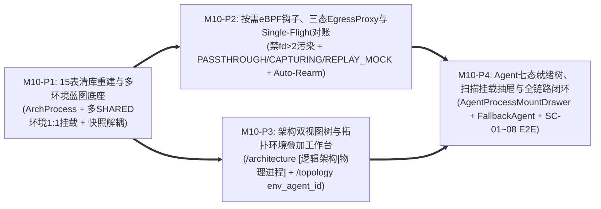

# Milestone 10 作战卡：架构物理进程蓝图解耦、多环境 Agent 1:1 挂载与 eBPF 自动预挂三态代理工作流 (M10)

- **文档编号**：`11-m10-arch-process-blueprint-and-premount-workflow.md`
- **文档版本**：v1.1.0
- **更新日期**：2026-11-02
- **状态**：⏳ 待实施 (Pending Implementation)
- **归属阶段**：阶段三/四：M10 TDD 任务拆解与验收标准 (`04-tasks`)
- **覆盖特性与场景**：`F-02` (架构物理进程蓝图与多环境 Agent 1:1 挂载覆盖)、`F-04` (零 Agent 依赖的静态物理架构拓扑与可选环境端点叠加)、`F-08` (多进程默认自动预挂、PID 定位与七态就绪体检)、`F-09` (按需入站读写钩子 + 三态 `EgressProxy` 停录不断连与重放零外泄引擎)、`F-10` (中途切流严密头校验重同步)、`F-11` (有序闸门 `0ms` 零重启协同录制与快照固化)、`F-12` (重放直连 `409` 硬门禁与卸载解耦同构重放)、`F-15.3` (`/architecture` `[逻辑架构 | 物理进程]` 双视图树)、`F-15.4` (`/record` 七态就绪联动录制抽屉)、`F-15.5` (`/agents` 同构分组就绪树、`FallbackAgentID` 与 1:1 批量扫描挂载抽屉)、`SC-02`、`SC-05`、`SC-07`、`SC-08`
- **设计参考基线**：[`09-arch-process-ssot-and-ebpf-premount-standby-adr.md`](../05-adr/09-arch-process-ssot-and-ebpf-premount-standby-adr.md) (ADR-09 v1.1.0)、[`01-system-architecture.md` §3~§5](../02-design/01-system-architecture.md)、[`02-data-plane-and-cros-rpc-engine.md` §1~§3](../02-design/02-data-plane-and-cros-rpc-engine.md)、[`03-architecture-elements-and-topology.md` §2~§5](../02-design/03-architecture-elements-and-topology.md)、[`04-control-plane-and-web-console.md` §1 & §4~§5](../02-design/04-control-plane-and-web-console.md)、[`05-database-schema.md` §1~§5](../02-design/05-database-schema.md)、[`01-http-api-contract.md` §2.2, §2.4~§2.7 & §3](../03-api/01-http-api-contract.md)

---

## 1. 渐进式四阶段实施路线 (Phased Execution Plan)

为确保 ADR-09 v1.1.0 检视定稿的全部架构决策（**多套 `SHARED` 环境 `1 Agent = 1 套环境`、`IP:Port` 超集拦截与启动出站补偿、停录不断连与三态 `EgressProxy` 重放零外泄、按需入站读写钩子消除 `fd > 2` 污染、清库直接重建零历史迁移脚本**）100% 在 M10 一次性高质量落地，M10 拆分为 **4 个可独立验证的子阶段（`M10-P1` 完成后，`M10-P2` 数据面/管控层与 `M10-P3` 架构蓝图前端可并行推进，最终在 `M10-P4` 合拢闭环）**：



| 阶段编号 | 阶段目标 | 核心实施动作与关键技术红线 | 阶段准出断言 |
| :---: | :--- | :--- | :--- |
| **M10-P1** | **15 表清库重建、多环境架构进程蓝图 API 与快照解耦拓扑引擎** | 1. **清库直接重建迁移 (`models/db.go`)**：本系统处于上线前阶段，不做历史测试数据兼容迁移脚本；`InitSchema` 检测若存在旧 `traefik_process_modules` 表、或 `traefik_processes` 缺少 `arch_process_id` 列、或 `traefik_modules` 残留旧 `process_id` 列，自动执行 `DROP TABLE IF EXISTS` 级联清理旧运行期/进程表（`traefik_replay_items`、`traefik_replay_tasks`、`traefik_traffic_records` 及其分区、`traefik_recording_sessions`、`traefik_process_modules`、`traefik_processes`）并移除 `traefik_modules.process_id`，全新重建 15 张核心 `traefik_*` 表及默认 `TraefikSetting`（`default_probe_desired_state_shared='ARMED'`、`default_probe_desired_state_private='ARMED'`）；<br>2. **15 表模型与约束 (`models/{arch,agent,recording,replay}.go`)**：新增 `ArchProcessGroup`、`ArchProcess` 与 `Module.ArchProcessID *uint64` (`ON DELETE SET NULL`)；`Agent` 新增 `BootID`、`FallbackAgentID *uint64` (`ON DELETE SET NULL`)、`MountsRevision uint64`、`ExpectedArmedDigest`、`ArmedDigest`；`Process` 重构为 `1:1` 挂载实体（强制 `uk_traefik_proc_agent_arch: UNIQUE(agent_id, arch_process_id)` 与部分唯一索引 `uk_traefik_proc_agent_port: UNIQUE(agent_id, effective_listen_port) WHERE effective_listen_port > 0`，**允许不同 `SHARED` 环境 Agent 各自 `1:1` 挂载同一 `ArchProcess`**），固化统一 **7 态 `ProbeStatus`**（`READY`/`NEED_RECONNECT`/`WAITING_PROC`/`MONITORING`/`DISARMED`/`OFFLINE`/`CAP_DENIED`/`ERROR`）；`RecordingSession` 新增 `ProcessSnapshots` (`jsonb`)；`ReplayTask` 新增 `ArchProcessID` 并将 `SourceProcessID`/`TargetProcessID` 改为 `*uint64` (`ON DELETE SET NULL`)，彻底解耦日后卸载挂载实例；<br>3. **架构进程蓝图 API (`handlers/arch_process_handler.go`)**：实现 `/api/arch/process-groups`、`/api/arch/processes/tree`、`/api/arch/processes` CRUD 与 `POST /api/arch/modules/:id/process-binding`；校验 `cmd_pattern`（`<=256` 字符，默认子串或 `re:` 前缀 Go RE2 `regexp.Compile` 预检）；**`PUT /api/arch/processes/:id` 修改默认非零端口时，若某 Agent 未覆盖挂载实例与同机其他进程端口冲突，单事务内自动将该冲突实例 `override_listen_port` 固化为原有效端口**（返回 `auto_pinned_overrides`），绝不死锁蓝图演进；`agent_mounts` 强制经 `ScopeReadGuard` 过滤；<br>4. **多环境拓扑与快照同构校验 (`internal/server/topology/`, `internal/server/diff/`)**：`BuildTopologyGraph(view="PHYSICAL", envAgentID)` 零 Agent 依赖直推（默认输出 `:<default_listen_port>` + `mounted_shared_env_count`，传 `env_agent_id` 时按可见权叠加该环境真实 `EffectiveIP:Port`）；`CompileProcessDownstreams` 实现「① 同机挂载优先 ➔ ② `Agent.FallbackAgentID` 绑定 `SHARED` 环境兜底（未指定且多套 `SHARED` 环境并存时严禁跨环境串绑） ➔ ③ 同机全部已挂载非零端口（满足 `ArmedDownstreams` 超集不变量）+ `EffectiveExtraDownstreams`」；`ValidateReplayProcessCompatibility` 基于 `RecordingSession.ProcessSnapshots` 校验同构性。 | `TEST_DB_DSN=... go test -v -race ./models/... ./internal/server/topology/... ./internal/server/diff/... ./handlers/... -run "TestArchProcess|TestBuildTopologyGraph_Physical|TestCompileProcessDownstreams|TestValidateReplayProcessCompatibility"` 全绿 |
| **M10-P2** | **BPF 缺陷修复、按需入站钩子、三态 `EgressProxy`（停录不断连 + 重放零外泄）与 Single-Flight `Auto-Rearm`** | 1. **主从契约与规范化摘要 (`pkg/agentproto`)**：新增 `ArmStandbyReq{Revision, Processes}`、`ArmStandbyResp{Revision, ArmedDigest, Diagnostics}`、`HandshakeResp{BootID, ArmedProcessCount, ArmedDigest}`、统一 7 态 `ProcessDiagStatus` 与确定性排序 `ComputeArmedDigest`；保持 `cmd/agent` 零 DB、零 `.pb` 物理防腐；<br>2. **BPF C 修复与按需钩子分离 (`pkg/ebpf/bpf/cros_probe.c`, `pkg/ebpf/manager.go`)**：**彻底删除 `handle_rw_enter` 对任意 `fd > 2` 惰性插入 `ing_conn_map` 的历史污染 Bug**，严格仅追踪 `listen_port` 入站 TCP Socket（开录 `/proc` 预热 + `sys_exit_accept4`/`accept` + `sys_enter_close` 清理）；`ARMED` 待命期仅挂载低频 `connect4`、`sock_ops`、`sched_process_{exec,fork,exit}`，**完全不挂载全局 `sys_enter/exit_{read,write,recvfrom,sendto}`**（全机待命 0% 读写 syscall 损耗），仅在 `CAPTURING` 录制期按需动态 `Attach` 并在停录瞬间 `Detach`；补全 `sched_process_fork`（内核继承子 PID）、`sched_process_exec`（`lifecycle_ringbuf` 唤醒用户态匹配 `cmdline` + 2s `ProcWatcher` 诚实对账）与 `sched_process_exit`（清理死 PID 防回绕）；<br>3. **三态 `EgressProxy` 与有序闸门 (`pkg/ebpf/egress_proxy.go`, `pkg/replay/executor.go`, `internal/agent/server/`)**：<br>  - `PASSTHROUGH`：纯字节块透传，**停止录制后不断开客户端与下游 TCP 长连接**，附 `BenchmarkEgressProxy_ArmedPassthrough` 吞吐基准测试；<br>  - `CAPTURING`：开录时实时复扫 `/proc` -> 先开 `EgressProxy` 分帧（`"CSE.TCP"` + `ValidateCommHead` 严密重同步） -> 再预热 `ing_conn_map` 并挂入站读写钩子 -> 扫描 `/proc/<pid>/net/tcp` 补报存量非代理直连出站 `IP:Port` 消除 `VIOLATION` 盲区；停录时先卸入站读写钩子 -> `200ms` 在途应答排空防伪造 `REQ_ONLY` -> 切回 `PASSTHROUGH` 不断连 -> 发 `EVENT_SESSION_DRAINED`；<br>  - `REPLAY_MOCK`（重放零外泄）：主控与 Agent 双重校验目标进程若为 `WAITING_PROC` 或 `NEED_RECONNECT` (`established_conns > 0`) **立即拒绝返 `409 Conflict`**；已 `READY` 进程零重启，原子将 `EgressProxy` 中该进程既有连接切入 `REPLAY_MOCK`（**关闭/物理阻断 `targetConn` 确保 0 字节发往真实下游**，直接路由至 `ScopedMockMatcher` + `HealResponseFrames`），返回 `200 {"status":"RUNNING"}`，重放结束关闭脱离序列的 Mock 连接并恢复 `ARMED`；<br>  - **平滑排空 (`Graceful Drain`)**：`DISARMED` 或 `>=5m` 心跳失联时立即关闭监听并 `Detach` `bpf_link`，存量透传连接平滑排空（`<=60s`）；仅 `SIGINT/SIGTERM` 或 `/agent/v1/purge` 硬关闭；<br>4. **主控 Single-Flight 对账与挂载/探针 API (`internal/server/hub/`, `handlers/{agent,process}_handler.go`)**：支持 `Agent.FallbackAgentID`、带 `expected_revision` 乐观锁的 `PUT /api/agents/:id/process-mounts`、带 `force` 紧急卸挂的 `/probes/disarm-all` 与 `/processes/:id/disarm`；`AgentHub` 按 `rearmMu[agentID]` Single-Flight + `MountsRevision` 版本号 + 指数退避（`10s->30s->60s->300s`）执行 `Auto-Rearm`，Agent 离线时同步将挂载进程置为 `OFFLINE` 并按 `ScopeReadGuard` 推送 SSE `agent.probes_updated`。 | `go test -v -race ./pkg/... ./internal/agent/...` 与 `TEST_DB_DSN=... go test -v -race ./internal/server/... ./handlers/...` 全绿 + `cmd/agent` 零 DB/零 `.pb` 依赖纯净度断言通过 |
| **M10-P3** | **`/architecture` `[逻辑架构 \| 物理进程]` 双视图树与 `/topology` 环境端点可选叠加** | 1. 升级 `ArchitectureWorkbenchPage` (`/architecture`)：左栏树顶部新增分段控制器 **`[逻辑架构 \| 物理进程]`**（与 URL `?tree=logical\|physical` 双向同步，零宿主机 IP 耦合）；<br>2. 新建 `ArchProcessTreePanel.tsx` 与 `ArchProcessDetailPane.tsx`：渲染 `ArchProcessGroup -> ArchProcess` 两级折叠树、默认端口徽标（`:Port` / `纯客户端`）、未分配模块提示；编辑默认端口（`0..65535`）、`default_cmd_pattern`（支持 `re:` 提示）、`default_extra_downstreams`、穿梭框装配 FM 模块（当端口变更触发后端 `auto_pinned_overrides` 时给出清晰非阻断反馈提示）、聚合只读 `PROVIDE/DEPEND` 服务契约表（跳 `/schemas`）与经权限过滤的「多环境挂载血缘表」（跳 `/agents`）；<br>3. 升级 `ModuleContractDetailPane.tsx`：展示与切换所属标准架构进程徽章（一键切至 `?tree=physical&arch_process_id=X`）；<br>4. 升级 `TopologyWorkbenchPage` / `ArchCanvasToolbar.tsx`：在 `PHYSICAL` 视角下提供可选「环境端点叠加」下拉框（默认 `纯架构蓝图` vs 当前可见 `SHARED`/`PRIVATE` 环境 `env_agent_id`）。 | `npm --prefix frontend test -- ArchPhysicalBlueprintWorkbench.test.tsx TopologyAndArchDecoupling.test.tsx` 全绿 |
| **M10-P4** | **`/agents` 多环境七态就绪树、批量扫描挂载抽屉与 `/record` / `/replay` 全链路闭环** | 1. 升级 `AgentManagementPage` 与新建 `AgentMountedProcessTree.tsx`：Agent 新建/编辑弹窗支持配置可选 `fallback_agent_id`（关联公共 `SHARED` 基线环境）；右栏按 `ArchProcessGroup` 分组树渲染已挂载进程、有效端口与 `[本地已覆盖]` 标签、统一 **7 态探针就绪徽章**（`🟢 已就绪` / `🟡 待重连` / `🔵 待进程启动` / `🟣 采集中` / `⚪ 已暂停探针` / `⚫ Agent 离线` / `🔴 权限不足或异常`）、【🔄 重新体检】、按进程/组/整机预挂与暂停（活跃租约下提供受控 Modal 确认 `force=true` 紧急中止卸挂），以及顶栏【前往发起录制 ->】（跳 `/record?auto_start=1&agent_id=X`）；<br>2. 新建 `AgentProcessMountDrawer.tsx` (`680px` Drawer) 并彻底删除旧 `ProcessModuleBinderModal.tsx`：`1:1` 勾选架构进程树、携带 `expected_revision` 防并发覆盖（`409` 时提示刷新）、点击【⚡ 自动扫描宿主机进程并匹配架构树】调用 `/discover-processes` 智能预勾选并自动填入非默认 `override_listen_port`、内联展开本地差异化覆盖区、底部引导缺失蓝图跳 `/architecture?tree=physical`；<br>3. 升级 `RecordingStartDrawer.tsx` (`/record`) 及重放入口 (`ReplayTaskCreatorModal.tsx` / `SinglePacketReplayDrawer.tsx`)：录制抽屉响应 `?auto_start=1&agent_id=X`、展示七态就绪徽章与非阻断重连提示横幅、零挂载跳转 `/agents?agent_id=X&open_mount=1`；重放选择器标注目标进程就绪态并对 `NEED_RECONNECT` / `WAITING_PROC` 给出明确重连/启动防呆提示；<br>4. 完成全套 RBAC、双模 `--color-*` Token、零 `any`、零原生弹窗、`SC-01`~`SC-08` 全链路回归及安全扫描审计。 | `TEST_DB_DSN=... make test && make lint && make build && make clean` 100% 零警告通过 |

---

## 2. 交付包与文件清单 (Deliverable Packages & Files)

| 阶段 | 操作类型 | 包 / 文件路径 | 职责与实现范围 |
| :---: | :---: | :--- | :--- |
| **P1** | **UPDATE** | `models/db.go`<br>`models/arch.go`<br>`models/agent.go`<br>`models/recording.go`<br>`models/replay.go`<br>`models/setting.go`<br>`models/models_test.go` | 旧库结构自动检测与 `DROP TABLE` 清库重建 15 张核心 `traefik_*` 表；新增 `ArchProcessGroup`、`ArchProcess`、`Module.ArchProcessID`；`Agent` 增加 `BootID`、`FallbackAgentID`、`MountsRevision`、`ExpectedArmedDigest`、`ArmedDigest`；重构 `Process` 为多环境 `1:1` 挂载实体（`uk_traefik_proc_agent_arch`、部分唯一索引 `uk_traefik_proc_agent_port`、7 态 `ProbeStatus`）；`RecordingSession.ProcessSnapshots` 与 `ReplayTask`（`ArchProcessID` + `Source/TargetProcessID ON DELETE SET NULL`）；注入默认预挂策略 `TraefikSetting` |
| **P1** | **NEW / UPDATE** | `handlers/arch_process_handler.go`<br>`handlers/arch_handler.go`<br>`handlers/router.go`<br>`handlers/arch_proto_agent_test.go` | 实现 `/api/arch/process-groups`、`/api/arch/processes/tree`、`/api/arch/processes`（含 `re:` RE2 正则预校验与默认端口变更冲突自动固化 `override_listen_port`）、`POST /api/arch/modules/:id/process-binding` 及 `ScopeReadGuard` 过滤的 `agent_mounts` 血缘查询与 `commonAudit` 审计 |
| **P1** | **UPDATE** | `internal/server/topology/graph_topology.go`<br>`internal/server/topology/static_topology.go`<br>`internal/server/diff/compatibility.go`<br>`internal/server/topology/graph_topology_test.go`<br>`internal/server/diff/diff_test.go` | `BuildTopologyGraph(view="PHYSICAL", envAgentID)` 零 Agent 直推 + 可选环境端点叠加；`CompileProcessDownstreams`（同机优先 + `FallbackAgentID` 兜底 + 同机全挂载端口 `ArmedDownstreams` 超集不变量）；基于 `RecordingSession.ProcessSnapshots` 解耦的 `ValidateReplayProcessCompatibility` |
| **P2** | **UPDATE** | `pkg/agentproto/types.go`<br>`pkg/crosrpc/framer.go`<br>`pkg/ebpf/bpf/cros_probe.c`<br>`pkg/ebpf/egress_proxy.go`<br>`pkg/ebpf/manager.go`<br>`pkg/ebpf/proc_scanner.go`<br>`pkg/replay/executor.go`<br>`pkg/ebpf/ebpf_unit_test.go`<br>`pkg/ebpf/ebpf_linux_test.go` | `ArmStandbyReq{Revision, Processes}` 与规范化 `ComputeArmedDigest`；移除 `cros_probe.c` `fd > 2` 惰性污染 Bug，改为按需动态挂载入站 `accept/close/read/write/recvfrom/sendto` + `listen_port` Socket 白名单；实现 `sched_process_{fork,exec,exit}` 生命周期闭环；实现 `EgressProxy` 三态闸门（`PASSTHROUGH` 停录不断连 / `CAPTURING` 有序启停与 `200ms` 排空 + 启动出站 `/proc` 补报 / `REPLAY_MOCK` 既有连接阻断真实下游 0 外泄本地自愈）与 `Graceful Drain` 平滑排空 |
| **P2** | **UPDATE** | `internal/agent/server/http_server.go`<br>`internal/agent/server/session_mgr.go`<br>`internal/agent/server/server_test.go` | 实现 Agent 侧 `PUT /agent/v1/monitors/arm`（校验单调 `Revision`）、`GET /agent/v1/monitors/diagnose`、`/monitors/sync` 实时复扫与有序激活、`/monitors/:sessionId/stop` 不断连回退 `PASSTHROUGH`、`/replays/execute`（`NEED_RECONNECT`/`WAITING_PROC` 返 `409`，成功返 `status:"RUNNING"`）、`>=5m` 失联 `Graceful Drain` 与 `/purge` 硬关闭 |
| **P2** | **UPDATE** | `internal/server/hub/agent_client.go`<br>`internal/server/hub/hub.go`<br>`internal/server/recorder/orchestrator.go`<br>`internal/server/diff/scheduler.go`<br>`handlers/agent_handler.go`<br>`handlers/process_handler.go`<br>`handlers/recording_handler.go`<br>`handlers/replay_handler.go`<br>`internal/server/hub/hub_test.go`<br>`handlers/recording_replay_test.go` | 支持 `Agent.FallbackAgentID`、多 `SHARED` 环境 `1:1` 挂载、`expected_revision` 乐观并发锁、`force=true` 紧急中止卸挂、卸载挂载实例不阻断历史重放；`AgentHub` Single-Flight `rearmMu[agentID]` + 指数退避 `Auto-Rearm` + Agent 离线置 `OFFLINE` + SSE `agent.probes_updated`；录制固化 `ProcessSnapshots`；重放前置校验 `NEED_RECONNECT` 返 `409` |
| **P3** | **NEW / UPDATE** | `frontend/src/types/arch.ts`<br>`frontend/src/api/arch.ts`<br>`frontend/src/pages/ArchitectureWorkbenchPage/ArchitectureWorkbenchPage.tsx`<br>`frontend/src/pages/ArchitectureWorkbenchPage/ArchProcessTreePanel.tsx`<br>`frontend/src/pages/ArchitectureWorkbenchPage/ArchProcessDetailPane.tsx`<br>`frontend/src/pages/ArchitectureWorkbenchPage/ModuleContractDetailPane.tsx`<br>`frontend/src/pages/TopologyWorkbenchPage/TopologyWorkbenchPage.tsx`<br>`frontend/src/components/ArchCanvas/panels/ArchCanvasToolbar.tsx` | `/architecture` 左栏顶部 `[逻辑架构 \| 物理进程]` 双视图切换（`?tree=logical\|physical`）、物理进程组/标准架构进程管理、端口冲突自动固化反馈、穿梭框 FM 装配、聚合服务契约与多环境挂载血缘表；`/topology` 物理视角可选 `env_agent_id` 环境端点叠加下拉框 |
| **P3** | **NEW** | `frontend/src/__tests__/ArchPhysicalBlueprintWorkbench.test.tsx` | 验证 `/architecture` 逻辑/物理双树切换、标准进程默认配置/纯客户端校验、FM 单一归属绑定、`/topology` 环境端点选择器及 RBAC 只读/可写控制 |
| **P4** | **NEW / UPDATE** | `frontend/src/types/agent.ts`<br>`frontend/src/api/agent.ts`<br>`frontend/src/pages/AgentManagementPage/AgentManagementPage.tsx`<br>`frontend/src/pages/AgentManagementPage/AgentMountedProcessTree.tsx`<br>`frontend/src/pages/AgentManagementPage/AgentProcessMountDrawer.tsx`<br>`frontend/src/pages/RecordingWorkbenchPage/RecordingWorkbenchPage.tsx`<br>`frontend/src/pages/RecordingWorkbenchPage/RecordingStartDrawer.tsx`<br>`frontend/src/pages/ReplayWorkbenchPage/ReplayTaskCreatorModal.tsx`<br>`frontend/src/pages/TrafficDebugWorkbenchPage/SinglePacketReplayDrawer.tsx` | `/agents` `fallback_agent_id` 基线环境绑定、同构分组就绪树、统一 7 态探针就绪徽章、批量 `1:1` 挂载与 `/proc` 自动扫描匹配覆盖抽屉（携带 `expected_revision`）、单进程/组/整机预挂与 `force` 紧急卸挂 Modal，以及 `/record` / `/replay` / `/debug` 就绪徽章防呆与 `?auto_start=1&agent_id=X` 深链闭环 |
| **P4** | **DELETE** | `frontend/src/pages/AgentManagementPage/ProcessModuleBinderModal.tsx` | 彻底移除允许自由手填野生进程名与随意拆绑模块的旧耦合弹窗，消除双数据源分叉 |
| **P4** | **NEW / UPDATE** | `frontend/src/__tests__/AgentProcessMountAndReadiness.test.tsx`<br>`frontend/src/__tests__/RecordingStartDrawer.test.tsx`<br>`frontend/src/__tests__/WorkbenchRBAC.test.tsx`<br>`frontend/src/__tests__/SinglePacketReplay.test.tsx` | 覆盖多 `SHARED` 环境挂载、`expected_revision` 乐观锁、`/proc` 自动扫描匹配与端口覆盖生成、7 态探针就绪切换、`force` 紧急卸挂、录制/重放就绪门禁与公私域 RBAC 回归测试 |

---

## 3. TDD 先行测试矩阵 (Test-First Matrix)

| 阶段 | 目标测试文件 | 关键测试函数名 | 输入场景与前置条件 | 预期断言结果 (Assertions) |
| :---: | :--- | :--- | :--- | :--- |
| **P1** | `models/models_test.go` | `TestCleanRebuild15Tables_MultiSharedEnvAndPortPartialUnique` | 在模拟遗留旧 `traefik_process_modules` 表的隔离库执行 `InitSchema`，随后创建 `ArchProcess` (`P1: port=18080`, `P2: port=0`, `P3: port=0`) 及两套公共环境 `SHARED Agent-SIT`、`SHARED Agent-UAT` | 1. 旧表被干净清理重建为精确 15 张核心 `traefik_*` 业务表，且不存在 `traefik_process_modules`；<br>2. `Agent-SIT` 与 `Agent-UAT` **同时 `1:1` 挂载 `P1` 全部成功**（多公共测试环境并存）；同一 `Agent-SIT` 重复挂载 `P1` 触发 `uk_traefik_proc_agent_arch` 唯一约束拦截；<br>3. 同一 Agent 同时挂载 `P2(port=0)` 与 `P3(port=0)` 成功通过，将 `P2` 覆盖为 `18080` 触发 `uk_traefik_proc_agent_port` 拦截。 |
| **P1** | `handlers/arch_proto_agent_test.go` | `TestArchProcessCRUD_AutoPinPortConflict_RegexValidateAndAntiIDOR` | 管理员创建 `ArchProcess P1(:9001)` 与 `P2(:9002)`；`Agent-Dev` 挂载 `P1`(未覆盖 `:9001`) 与 `P2`(本地覆盖 `:19001`)；管理员调用 `PUT /api/arch/processes/:p1` 将 `P1` 默认端口改为 `19001`；普通用户 B 查询 `GET /api/arch/processes/:p1` | 1. `PUT` 成功返回 `200`（不返 `409` 死锁），`Agent-Dev` 上的 `P1` 挂载实例被自动固化 `override_listen_port = 9001` 并出现在 `auto_pinned_overrides` 中；<br>2. 提交非法正则 `default_cmd_pattern: "re:[unclosed"` 返回 `400 Bad Request`；<br>3. 用户 B 查询 `agent_mounts` 绝不泄露用户 A 的 `PRIVATE` Agent 挂载记录。 |
| **P1** | `internal/server/topology/graph_topology_test.go`<br>`internal/server/diff/diff_test.go` | `TestBuildTopologyGraph_Physical_ZeroAgents_EnvOverlayAndFallbackDownstreams`<br>`TestValidateReplayProcessCompatibility_AfterProcessUnmount` | 定义物理进程蓝图，测试 `0` 台 Agent 与 `SIT`、`UAT` 两台 `SHARED` Agent + 绑定 `fallback_agent_id=SIT` 的 `PRIVATE` Agent；并在录制会话生成 `ProcessSnapshots` 后卸载源 `Process` | 1. `0` 台 Agent 时 `PHYSICAL` 拓扑完整出图（`:<default_port>`），传 `env_agent_id=SIT` 时精确叠加 `SIT` 的 `EffectiveIP:Port`；<br>2. `CompileProcessDownstreams` 严格遵循同机优先 -> `FallbackAgentID(SIT)` 兜底（绝不混入 `UAT` 端点），且预挂 `ArmedDownstreams` 包含同机全部已挂载非零端口；<br>3. 卸载源 `Process` (`DELETE /api/processes/:id`) 返回 `200`，且基于该历史 `RecordingSession` 发起跨环境重放依然通过同构校验！ |
| **P2** | `pkg/ebpf/ebpf_unit_test.go` | `TestEgressProxy_ThreeModes_NonDisruptiveStopAndReplayZeroLeakage`<br>`BenchmarkEgressProxy_ArmedPassthrough` | 建立客户端经 `EgressProxy` 到本地 `127.0.0.1` 真实下游的持久长连接，依次执行：① `PASSTHROUGH` 发第 1 轮请求 ➔ ② `StartCapture(101)` 发第 2 轮（含中途半包滑窗重同步） ➔ ③ `StopCapture()` 发第 3 轮 ➔ ④ 切入 `REPLAY_MOCK` 发第 4 轮请求（验证真实下游计数器与本地 Mock 自愈应答） | 1. 第 1~3 轮在同一条 TCP 长连接上全部成功收发、**停录 0 断连**，且仅第 2 轮上报采集帧；<br>2. 第 4 轮切入 `REPLAY_MOCK` 后，**真实下游收到的字节数严格为 `0`（零外泄）**，客户端收到经 `HealResponseFrames` 原地覆写 `ullSNO` 的 Mock 应答；<br>3. `PASSTHROUGH` 基准测试验证转发路径 `0` `StreamFramer` 分配。 |
| **P2** | `internal/agent/server/server_test.go` | `TestAgentArmStandby_RevisionGuard_OrderedGates_Replay409AndGracefulDrain` | 向测试 Agent (`127.0.0.1`) 调用 `/monitors/arm(revision=2)`，测试过期 `revision=1`、`/monitors/sync`、存在 `NEED_RECONNECT` 直连时的 `/replays/execute` 及 5m 失联 `Graceful Drain` | 1. 过期 `revision=1` 返回 `409`；待命态 `/handshake` 返回 `ActiveLeaseType == ""`；<br>2. 目标进程存在 `established_conns > 0` (`NEED_RECONNECT`) 时，`/replays/execute` 立即拒绝返回 `409 Conflict`；`established_conns == 0` 时返回 `200 {"status":"RUNNING"}`；<br>3. 触发 5m 失联看门狗时立即关闭代理监听端口（新建连接拒绝接入代理），已在途的透传流平滑排空不瞬断，而 `/purge` 立即硬关闭一切连接。 |
| **P2** | `internal/server/hub/hub_test.go` | `TestAgentProcessMountSync_SingleFlightAutoRearmAndBackoff` | 并发触发用户手动 `PUT /process-mounts` 与 10s 心跳 `Auto-Rearm`；随后模拟 Agent 返回 `503 CAP_DENIED` 连续探活 | 1. `expected_revision` 乐观锁拦截过期并发写（`409`）；`rearmMu` Single-Flight 确保 Agent 始终收敛至最新 `mounts_revision` 绝不被旧快照倒灌；<br>2. `503 CAP_DENIED` 时 DB 写入 `probe_status = 'CAP_DENIED'` 并按 `10s -> 30s -> 60s` 指数退避，手动调用 `arm-all` 立即重置退避。 |
| **P3** | `frontend/src/__tests__/ArchPhysicalBlueprintWorkbench.test.tsx` | `testArchWorkbench_LogicalPhysicalTreeSwitchAndModuleTransfer` | 以 `traefik_admin` 渲染 `/architecture`，切换至 `[物理进程]` 树编辑标准进程与装载模块；渲染 `/topology?view=PHYSICAL` 切换环境端点选择器 | 1. `?tree=physical` 同步渲染 `ArchProcessGroup -> ArchProcess` 分组树、未分配模块提示、`ArchProcessDetailPane` 聚合契约表与多环境挂载血缘；<br>2. `/topology?view=PHYSICAL` 默认显示纯蓝图端口，切换环境选择器后携带 `env_agent_id` 请求并刷新端点展示。 |
| **P4** | `frontend/src/__tests__/AgentProcessMountAndReadiness.test.tsx`<br>`frontend/src/__tests__/RecordingStartDrawer.test.tsx` | `testAgentProcessMountDrawer_AutoScanMatchOverridesAndSevenStateBadges`<br>`testRecordingDrawer_AutoStartDeepLinkAndProbeReadinessIndicators` | 渲染 `/agents`（含 7 态就绪徽章分组树、`fallback_agent_id` 选择与 `force` 紧急卸挂 Modal），打开 `AgentProcessMountDrawer` 点击【⚡ 自动扫描宿主机进程并匹配架构树】；以及渲染 `/record?auto_start=1&agent_id=2` | 1. 自动扫描准确预勾选匹配架构进程并自动填入非默认 `override_listen_port`，提交携带 `expected_revision`；<br>2. 7 态徽章（含 `OFFLINE` / `CAP_DENIED` / `NEED_RECONNECT`）准确渲染，活跃租约下点击卸挂弹出受控 React 确认框并在确认后传 `force: true`；<br>3. `/record?auto_start=1&agent_id=2` 自动打开抽屉预选 Agent 2 并呈现就绪徽章与零挂载跳转引导。 |

---

## 4. 验收门禁命令与安全验证计划 (Acceptance Criteria & Security Verification Plan)

### 4.1 自动化验收门禁命令

```bash
# AC-M10-01: 数据面 Agent 协议、按需入站钩子、三态 EgressProxy（停录不断连 + 重放零外泄）单测与零 DB/零 .pb 物理防腐校验
go test -v -race ./pkg/... ./internal/agent/...
go test -bench=BenchmarkEgressProxy_ArmedPassthrough -benchmem ./pkg/ebpf/...
! go list -deps ./cmd/agent | grep -E "gorm\.io|code-common/backend/gormdb|dynamicpb|protoregistry"

# AC-M10-02: 控制面 15 表清库重建、多环境 1:1 挂载覆盖、快照解耦重放与 Single-Flight Auto-Rearm 物理隔离数据库单测
TEST_DB_DSN="host=127.0.0.1 port=5432 user=postgres password=postgres dbname=postgres sslmode=disable" \
  go test -v -race ./models/... ./internal/server/... ./handlers/...

# AC-M10-03: 前端架构双视图树、拓扑环境端点选择、Agent 1:1 扫描挂载抽屉与录制/重放七态就绪联动组件测试门禁
npm --prefix frontend test -- ArchPhysicalBlueprintWorkbench.test.tsx AgentProcessMountAndReadiness.test.tsx RecordingStartDrawer.test.tsx TopologyAndArchDecoupling.test.tsx SinglePacketReplay.test.tsx WorkbenchRBAC.test.tsx

# AC-M10-04: 前端 TypeScript 严格类型与 ESLint 校验（零 any、零死代码、100% --color-* 语义 Token）
make lint

# AC-M10-05: 全量隔离回归测试（含 SC-01~SC-08）、双二进制构建与产物清理门禁（确认 :8091 / :5181 / 临时端口零残留）
TEST_DB_DSN="host=127.0.0.1 port=5432 user=postgres password=postgres dbname=postgres sslmode=disable" make test && make build && make clean
```

### 4.2 M10 专项安全编码验证计划 (Security Verification Plan)

在遵循 [`01-roadmap.md` §4.2](./01-roadmap.md) 全局安全基线的基础上，M10 实施与代码检视必须逐项强制核验以下安全边界：

| 安全检查项 | 威胁场景 (CWE) | 强制实施约束与自动化验证断言 |
| :--- | :--- | :--- |
| **1. 多环境挂载血缘、拓扑叠加与预挂体检防横向越权 (Anti-IDOR)** | CWE-639 (Authorization Bypass Through User-Controlled Key) | 1. `GET /api/arch/processes/:id`、`GET /api/arch/modules/:id` 的 `agent_mounts` 以及 `GET /api/arch/topology/graph?env_agent_id=X` 必须在服务端按 `ScopeReadGuard` 过滤校验（越权返 `403`）；<br>2. `Agent.FallbackAgentID` 强制校验只能指向 `SHARED` 域公共环境 Agent（尝试指向他人或个人 `PRIVATE` Agent 一律拦截返 `400/403`）；<br>3. `PUT /api/agents/:id/process-mounts`、`/probes/*`、`/api/processes/*` 及 SSE `agent.probes_updated` 严格校验目标 Agent 公私域归属权，`force=true` 紧急卸挂仅允许当前租约持有人或 `traefik_admin` 执行。 |
| **2. 架构物理进程 SSOT 与宿主机 `/proc` 扫描 RBAC 分级隔离** | CWE-285 (Improper Authorization) | 1. `/api/arch/process-groups`、`/api/arch/processes` 与 `/api/arch/modules/:id/process-binding` 所有写接口强制挂载 `commonAuth.RequireAdmin("traefik_admin")` 并记录 `commonAudit` 前后快照 Diff；<br>2. `POST /api/agents/:id/probes/diagnose` 允许对 `SHARED` Agent 具备读权限的用户刷新**已挂载标准进程**就绪态，但暴露宿主机全量原始命令行的 `GET /api/agents/:id/discover-processes` 对 `SHARED` Agent 严格维持 `AdminOnly`。 |
| **3. 匹配表达式防 ReDoS、参数强校验与防 SQL 注入** | CWE-1333 (Inefficient Regular Expression Complexity) / CWE-89 | 1. `default_cmd_pattern` 与 `override_cmd_pattern` 限制 `<= 256` 字符；`re:` 模式仅允许 Go 标准库线性时间 RE2 `regexp.Compile` 引擎并做前置语法核验，彻底免疫回溯型 ReDoS；<br>2. `override_listen_port` 严格限制在 `0..65535`，`advertise_ip` / `extra_downstreams` 强制校验 IPv4 / `IPv4:Port` 格式；GORM 查询 100% 预编译参数化，唯一约束冲突统一脱敏映射为中文 `409` JSON。 |
| **4. 重放真实下游零外泄、入站 FD 白名单与孤儿探针自洁** | CWE-668 (Exposure of Resource to Wrong Sphere) / CWE-404 | 1. **重放零外泄双保险**：目标进程存在未受控直连（`NEED_RECONNECT`）时 `409` 硬阻断重放；`EgressProxy` 切入 `REPLAY_MOCK` 时立即物理关闭/阻断真实下游 `targetConn`（0 字节外泄），新建未声明出站连接由 BPF `connect4` `MODE_REPLAY` 直接 `EPERM` 阻断；<br>2. **严禁非监听 Socket FD 采集**：BPF 入站采集严禁对任意 `fd > 2` 惰性抓包，彻底杜绝本地敏感配置文件或日志读写字节流入采集管道；<br>3. Agent 100% 通过 Go 标准库只读解析 `/proc`（零 `os/exec`），主控失联 `>= 5 分钟` 立即卸载全部 `bpf_link` 并关闭代理监听端口平滑排空。 |
| **5. 前端渲染防 DOM XSS 与受控交互红线** | CWE-79 (Cross-site Scripting) | `ArchProcessTreePanel`、`AgentProcessMountDrawer`（展示宿主机扫描出的原始 `cmdline`）与 `AgentMountedProcessTree` 全量依赖 React JSX 自动转义，严禁 `dangerouslySetInnerHTML` 或 `innerHTML`；所有紧急卸挂/解绑/删除确认均使用受控 React Modal，严禁原生 `alert()` / `confirm()` / `prompt()`。 |
| **6. 测试网络绑定与端口卫生** | CWE-668 (Exposure of Resource to Wrong Sphere) | M10 新增的全部 `EgressProxy`、Mock Agent 与测试业务 TCP Listener 强制绑定 `127.0.0.1`（严禁 `0.0.0.0`），测试退出时通过 `t.Cleanup` 100% 关闭套接字与后台 Goroutine。 |

### 4.3 新代码生成自动化安全扫描与审计门禁 (Automated Security Check)

在阶段四实际编写 M10 新增与修改源码文件时，交付前必须执行以下两步安全验证：

- **Security Scanner (`run-security-scanner`)**：对全部新建与修改的后端/前端源码运行自动化安全扫描器，检测 XSS、SQL 注入、硬编码密钥及 CWE 高危漏洞；发现问题立即自动修复并复扫清零。
- **Security Audit (`generate-security-audit-report`)**：对新增接口与交互流程执行设计级安全审计（输入校验、公私域 Anti-IDOR 鉴权闭环、重放零外泄与探针生命周期资源释放），并在交付报告中记录审计结论与修复明细。
