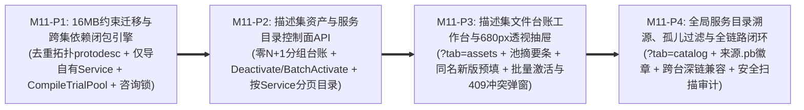

# Milestone 11 作战卡：增强 Protobuf 描述集资产管理、跨集依赖闭包解析与双模契约工作台 (M11)

- **文档编号**：`12-m11-enhanced-proto-schema-asset-management.md`
- **文档版本**：v1.0.0
- **更新日期**：2026-11-02
- **状态**：⏳ 待实施 (Approved for M11)
- **归属阶段**：阶段三/四：M11 TDD 任务拆解与验收标准 (`04-tasks`)
- **覆盖特性与场景**：`F-03` (全局单一生效池与跨集联合编译解码)、`F-03.1` (按 `Service` 组分页的全局嵌套契约目录)、`F-03.2` (跨集联合池与历史草稿回退的消息字段字典树)、`F-03.3` (描述集版本演进 `DiffIgnorePaths` 前向自动继承)、`F-03.4` (安全响应头加固的原文件导出与架构认领血缘)、`F-03.5` (多 `.pb` 描述集文件资产台账、三级分类、`16MB` 限额与 `680px` 透视抽屉)、`F-03.6` (跨 `.pb` 去重拓扑依赖闭包、`CompileTrialPool` 停用/激活预编译防破坏门禁与批量原子切换)、`F-03.7` (全局服务目录跨 `.pb` 溯源检索与孤儿服务治理)、`F-15` (`/schemas` 双视角无侧栏工作台)、`F-16` (`traefik_admin` RBAC 与 `commonAudit` 审计)、`SC-04`
- **设计参考基线**：[`10-enhanced-proto-schema-file-management-adr.md`](../05-adr/10-enhanced-proto-schema-file-management-adr.md) (ADR-10 v1.1.0)、[`01-feature-matrix.md` §3.1 (`F-03`~`F-03.7`, `F-21 CANCELLED`)](../01-features/01-feature-matrix.md)、[`01-system-architecture.md` §6](../02-design/01-system-architecture.md)、[`04-control-plane-and-web-console.md` §2.1~§2.4 & §4.1~§4.4](../02-design/04-control-plane-and-web-console.md)、[`05-database-schema.md` §3.4 & §4~§5](../02-design/05-database-schema.md)、[`01-http-api-contract.md` §2.3 & §3](../03-api/01-http-api-contract.md)

---

## 1. 渐进式四阶段实施路线 (Phased Execution Plan)

围绕业务冻结的三项前提（**取消 `F-21` `code-proto` 联动完全内聚自治、全环境/全 Agent 共享全局单一生效池 `Single Active Schema Pool`、超大微服务系统几十/上百个拆包 `.pb` 与 `BASE_LIB` 公共底座并存**）以及 ADR-10 v1.1.0 检视修复的 10 项架构关键点，M11 拆分为 **4 个顺序递进、每阶段均可独立自动化验证的子阶段（`M11-P1` ➔ `M11-P2` ➔ `M11-P3` ➔ `M11-P4`）**：



| 阶段编号 | 阶段目标 | 核心实施动作与关键技术红线 | 阶段准出断言 |
| :---: | :--- | :--- | :--- |
| **M11-P1** | **`traefik_proto_schemas` 约束平滑迁移与跨 `.pb` 依赖闭包联合编译引擎** | 1. **数据模型与显式 PostgreSQL `CHECK` 迁移 (`models/proto_schema.go`, `models/db.go`)**：`ProtoSchema` 新增 `Category` (`BASE_LIB`/`BUSINESS`/`GATEWAY`，默认 `'BUSINESS'`，**严禁冗余 `is_base_lib` 列**)、`ProtoFileCount`、`ServiceCount`、`ExternalImports` (`jsonb []string`)，单包上限扩展至 `16MB (16,777,216 bytes)`；因 GORM `AutoMigrate` 不会自动更新已有 `CHECK` 约束，`InitSchema` 必须显式 `DROP CONSTRAINT IF EXISTS chk_traefik_proto_size` 后重建 `<= 16777216` 约束、幂等创建 `chk_traefik_proto_category` 及 `idx_traefik_proto_schemas_cat_active`，并对存量 `proto_file_count = 0 AND jsonb_array_length(proto_files) > 0` 记录执行一次性幂等统计回填；保持 `cmd/agent` 零 `.pb` 物理防腐；<br>2. **按 `file.Name` 去重与拓扑排序的跨集依赖闭包 (`internal/server/decoder/registry.go`)**：兼容两种真实企业 `protoc` 产物（带 `--include_imports` 内嵌公共 proto vs 不带 `--include_imports` 仅含外部引用）。按 **`Target OwnFiles > 已生效 BASE_LIB > 其他已生效 Schema > 宿主二进制内置 google/protobuf/* WKT 兜底`** 优先级以 `file.Name` 去重合并 `FileDescriptorProto` 并按 `Dependency` 有向无环图做拓扑排序后调用 `protodesc.NewFiles`（彻底杜绝 `file already registered` 报错与缺 `timestamp.proto` 误报）；**严禁将外部依赖中的文件写入本包 `ProtoFiles`**，未在包内定义（或已归属生效 `BASE_LIB`）的 `Dependency` 统一归入 `ExternalImports`；<br>3. **仅提取自有 `Service`、原生支持 `0` 接口 `BASE_LIB` 与 `DiffIgnorePaths` 前向继承**：`extractOperationsFromDescriptor` **仅从本包自有 `own_proto_files` 提取 `ProtoOperation`**（防止 `--include_imports` 把父包 Service 重复导入子包引发激活 `409`），允许 `OperationCount == 0` 的纯公共 Message/Enum 基础库入库激活；上传已存在 `name` 的新版本时，自动按 `(service_name, operation)` 从同名当前 `is_active = true`（若无则取最大历史 `version`）前向拷贝非空 `DiffIgnorePaths`；支持**两阶段上传校验**（`auto_activate=false` 草稿允许借用最新未激活 `BASE_LIB` 通过静态校验，`auto_activate=true` 严格要求与当前生效池自洽）；<br>4. **事务级咨询锁、`CompileTrialPool(S_next)` 预编译门禁与运行时联合类型池 (`registry.go`, `schema_tree.go`)**：所有改变描述集元信息或生效态的事务（`Upload`/`Activate`/`BatchActivate`/`Deactivate`/`Delete`）首句执行 `SELECT pg_advisory_xact_lock(hashtext('traefik_proto_schema_registry'))` 串行化防并发 TOCTOU；`Activate`、`BatchActivate`（禁止同请求含同名多版本）与 `Deactivate` 在提交前强制构造候选生效池 $S_{\text{next}}$ 执行 **`CompileTrialPool(S_next)` 试编译**——同时核验 ① 跨集 `(service_name, operation)` 零重叠（冲突返 `409 conflicts`）与 ② 仅凭 $S_{\text{next}} \cup \text{WKT}$ 联合 `protodesc.NewFiles` 100% 通过且全部 `Req/RspMessageFullName` 可解析（破坏反向依赖返 `409 broken_dependents`）；`Reload()` 在 `reloadMu` 保护下将全体 `is_active = true` 描述集联合编译为单一 `CompiledRegistry.Files (*protoregistry.Files)`，`GetOperationSchemaTree` 对已生效包直接复用 `CompiledRegistry.Files`，对未生效历史/草稿包自动合并当前生效池（及最新 `BASE_LIB`）构建临时闭包反射字段树。 | `TEST_DB_DSN=... go test -v -race ./models/... ./internal/server/decoder/...` 全绿 + `! go list -deps ./cmd/agent \| grep -E "dynamicpb\|protoregistry"` 通过 |
| **M11-P2** | **描述集文件台账、生命周期管控与按 `Service` 分页目录 REST API** | 1. **上传限额与元数据编辑 (`handlers/proto_handler.go`, `handlers/routes.go`)**：`POST /api/proto-schemas` 升级 `http.MaxBytesReader` 至 `16MB`、支持 `category` 表单字段与扩展名白名单校验（`.pb`/`.desc`/`.protoset`/`.bin`）；新增 `PATCH /api/proto-schemas/:id` 编辑 `category` 与 `description`；<br>2. **零 `N+1` 文件资产台账查询 (`GET /api/proto-schemas`)**：默认显式排除 `descriptor_bytes` 大字段；支持 `latest_only`（默认 `true` 按 `name` 聚合优先返回 `is_active=true` 否则返回最大 `version` 并附带 `version_count`；传 `latest_only=false&name=xxx` 拉取某资产完整历史版本栈）、`category`、`is_active`、`search`（参数化 `ILIKE` 匹配 `name`/`source_filename`/`proto_files`）与白名单排序 `sort_by` (`updated_at`/`name`/`file_size`/`service_count`)；**单次批量 SQL 聚合计算** `claimed_service_count`/`claimed_ratio` 与动态解析 `resolved_dependencies`（按 `external_imports` 匹配生效池 `proto_files`，标记 `READY` 或 `MISSING`），同时在响应顶层返回 `pool_summary` 全局生效池摘要；<br>3. **停用下线、批量原子激活、依赖图与下载安全头**：实现 `POST /api/proto-schemas/:id/deactivate`、`POST /api/proto-schemas/batch-activate`（复用 `CompileTrialPool` 返回结构化 `409 {error, conflicts, broken_dependents}`）及 `GET /api/proto-schemas/dependencies-graph`（返回全局生效池节点与 `import` 有向边列表）；加固 `GET /api/proto-schemas/:id/download` 响应头（净化文件名防 Header 注入，强制 `Content-Type: application/octet-stream`、`X-Content-Type-Options: nosniff`、`Cache-Control: no-store`）；全量写接口挂载 `commonAuth.RequireAdmin("traefik_admin")` 并写入 `commonAudit` 前后快照 Diff；<br>4. **按 `Service` 组分页的全局服务目录 (`GET /api/proto-services`)**：按 `service_name` 组级稳定分页（`page`/`page_size`，绝不将同一 Service 的方法拆断到两页），支持 `schema_id`、`category`、`claimed_status` (`ALL`/`CLAIMED`/`UNCLAIMED`) 与 `search`（穿透匹配 `service_name`/`operation`/`message_full_name`），一次批量关联回填每个 Service 的 `source_schema`、`claimed_by_module` 认领血缘及完整 `operations[]`。 | `TEST_DB_DSN=... go test -v -race ./handlers/... -run "TestProtoSchema\|TestListProtoServices\|TestUpdateOperationIgnorePaths\|TestDownloadProtoSchema"` 全绿 |
| **M11-P3** | **`/schemas` 文件资产台账主视图、池摘要栏、`680px` 透视抽屉与批量激活/冲突弹窗** | 1. **重构 `/schemas` 顶层双模无侧栏布局 (`ProtoSchemaWorkbenchPage.tsx`, 删除旧 `SchemaVersionList.tsx`)**：废弃原 `280px` 窄侧栏，升级为顶层分段标签 **`[🗂️ 描述集文件台账]`** (`?tab=assets`，默认主页) 与 **`[🔍 全局服务与接口目录]`** (`?tab=catalog`)，搭配持久常驻的 **`SchemaPoolSummaryBar.tsx`**（展示生效 `.pb` 数、公共基础库数、生效总服务/方法数、架构认领覆盖率及未解析外部依赖告警徽章）；<br>2. **文件资产台账表 (`SchemaAssetLedgerTable.tsx`)**：支持分类胶囊筛选（`全部` / `🧱 基础库` / `📦 业务域` / `🌐 网关`）、状态筛选、关键字防抖检索、行复选框与 **`[⚡ 批量激活选中项]`**；单行清晰呈现 `name`、当前版本与 `共 N 个版本` 徽标、`category` 标签、原始文件名与字节大小、`.proto / Service / Method` 统计、依赖状态胶囊（`✅ N 项就绪` / `⚠️ 缺 <file>` / `独立无外部依赖`）、认领进度条，以及行级快捷操作 **`[🔍 透视/历史]`**、**`[⬆️ 上传新版本]`**（打开弹窗自动预填锁定 `name` 与默认继承 `category`）、`[激活/停用]`、`[⬇️ 下载]`；<br>3. **升级上传弹窗与新增冲突诊断弹窗 (`SchemaUploadModal.tsx`, `SchemaConflictModal.tsx`)**：上传弹窗补充 `category` 三选一卡片、`16MB` 大小与扩展名实时预检、同名新版模式提示（“将自动生成下一版本号并继承同名接口 Diff 忽略规则”）；当激活/批量激活/停用收到后端 `409` 时，以受控 `SchemaConflictModal` 结构化展示跨包 `(service_name, operation)` 冲突对照表 (`conflicts`) 或缺失/受影响下游依赖表 (`broken_dependents`)；<br>4. **单资产透视与多版本演进抽屉 (`SchemaAssetInspectDrawer.tsx`, `680px` Drawer)**：内设 3 个子面板——`[包含源文件与服务]`（按自有 `.proto` 折叠展示定义的 Service/Method，一键跳至 `?tab=catalog&schema_id=X`）、`[跨包依赖关系]`（区分就绪依赖与缺失导入 `.proto`）、`[历史版本与回滚]`（调用 `latest_only=false&name=xxx` 加载完整版本栈，支持任意历史版本切换激活、编辑分类/备注、停用与受控 Modal 确认删除）。 | `npm --prefix frontend test -- SchemaAssetLedgerWorkbench.test.tsx` 全绿 |
| **M11-P4** | **`/schemas` 全局服务与接口目录升级、跨工作台深链无损兼容与全链路交付门禁** | 1. **全局服务与接口目录对接 `GET /api/proto-services` (`OperationMappingTable.tsx`, `ServiceSummaryRow.tsx`)**：切换为后端按 `Service` 组级稳定分页驱动（URL 同步 `page`/`page_size`/`schema_id`/`claimed_status`/`search`），保留全部展开/收起、点击方法打开 `OperationDocDrawer` 查看字段字典树与勾选 `DiffIgnorePaths` 能力；在每个 `ServiceSummaryRow` 新增 **来源 `.pb` 溯源徽章 `[📦 <schemaName> v<ver>]`**（点击直接唤起 `SchemaAssetInspectDrawer` 定位该 `.pb`）与架构模块认领深链（已认领跳 `/architecture`，未认领高亮 `⚠️ 孤儿服务`），工具栏提供 **`[仅看未认领孤儿服务]`** 快捷过滤开关与按归属 `.pb` 下拉筛选；<br>2. **跨工作台深链无损自动路由 (`ProtoSchemaWorkbenchPage.tsx`)**：当从 `/architecture`（`ModuleContractDetailPane` / `ArchProcessDetailPane`）或流量解剖抽屉携带 `?service_name=...`、`?schema_id=...` 或历史兼容参数 `?active_only=true&search=...`（且未显式指定 `tab=assets`）进入 `/schemas` 时，自动切入 `tab=catalog` 并精准预填过滤条件展开目标服务；<br>3. **主题、RBAC、E2E 回归与安全审计闭环**：严格校验双模 `--color-*` 语义 Token、非 `traefik_admin` 只读视图隐藏全部写入口（保留透视、字典树与下载）、零 `any`、零原生弹窗，完成全套前后端回归单测、双二进制构建清理及新代码安全扫描与审计报告。 | `TEST_DB_DSN=... make test && make lint && make build && make clean` 100% 零警告通过 |

---

## 2. 交付包与文件清单 (Deliverable Packages & Files)

| 阶段 | 操作类型 | 包 / 文件路径 | 职责与实现范围 |
| :---: | :---: | :--- | :--- |
| **P1** | **UPDATE** | `models/proto_schema.go`<br>`models/db.go`<br>`models/models_test.go` | `ProtoSchema` 扩展 `Category` (`ProtoSchemaCategory`)、`ProtoFileCount`、`ServiceCount`、`ExternalImports` 与 `MaxProtoSchemaBytes = 16 * 1024 * 1024`；`InitSchema` 显式升级 `chk_traefik_proto_size (<= 16777216)`、新增 `chk_traefik_proto_category`、`idx_traefik_proto_schemas_cat_active` 及历史记录统计值幂等回填 |
| **P1** | **UPDATE** | `internal/server/decoder/registry.go`<br>`internal/server/decoder/schema_tree.go`<br>`internal/server/decoder/decoder_test.go`<br>`internal/server/decoder/schema_tree_test.go` | 按 `file.Name` 优先级去重 + DAG 拓扑排序的跨集 `protodesc.NewFiles` 与内置 `google/protobuf/*` WKT 兜底；仅从 `own_proto_files` 提取 `ProtoOperation` 并支持 `0` 接口 `BASE_LIB`；同名新版本 `DiffIgnorePaths` 前向继承；事务咨询锁 `pg_advisory_xact_lock` + `reloadMu`；`CompileTrialPool(S_next)` 支撑 `Activate` / `BatchActivate` / `Deactivate` 冲突与反向依赖预检；`Reload()` 联合构建单一 `CompiledRegistry.Files` 及未生效版本字段树合并回退 |
| **P2** | **UPDATE** | `handlers/proto_handler.go`<br>`handlers/routes.go`<br>`handlers/arch_proto_agent_test.go` | `16MB` `MaxBytesReader` 与文件扩展名校验；`GET /api/proto-schemas`（`latest_only` 分组、零 `N+1` 批量计算认领率与动态 `resolved_dependencies`、白名单排序与 `pool_summary`）；`PATCH /api/proto-schemas/:id`、`POST /api/proto-schemas/:id/deactivate`、`POST /api/proto-schemas/batch-activate`、`GET /api/proto-schemas/dependencies-graph`、`GET /api/proto-services`（按 `Service` 组分页与 `UNCLAIMED` 过滤）；下载安全头（`nosniff` + `no-store`）与 `commonAudit` 审计记录 |
| **P3** | **NEW / UPDATE** | `frontend/src/types/schema.ts`<br>`frontend/src/types/schema_tree.ts`<br>`frontend/src/api/schema.ts`<br>`frontend/src/pages/ProtoSchemaWorkbenchPage/ProtoSchemaWorkbenchPage.tsx`<br>`frontend/src/pages/ProtoSchemaWorkbenchPage/SchemaPoolSummaryBar.tsx`<br>`frontend/src/pages/ProtoSchemaWorkbenchPage/SchemaAssetLedgerTable.tsx`<br>`frontend/src/pages/ProtoSchemaWorkbenchPage/SchemaAssetInspectDrawer.tsx`<br>`frontend/src/pages/ProtoSchemaWorkbenchPage/SchemaUploadModal.tsx`<br>`frontend/src/pages/ProtoSchemaWorkbenchPage/SchemaConflictModal.tsx`<br>`frontend/src/pages/ProtoSchemaWorkbenchPage/index.ts` | 冻结 `ProtoSchemaLedgerItemDTO`、`ProtoPoolSummaryDTO`、`ServiceContractGroupDTO` 及冲突/反向依赖 DTO；重构 `/schemas` 为无窄侧栏的 `[🗂️ 描述集文件台账 \| 🔍 全局服务与接口目录]` 双标签工作台；实现池摘要栏、分类/搜索/多选批量激活台账表、行级预填上传新版本、`680px` 资产透视与版本回滚抽屉及 `409` 结构化冲突诊断弹窗 |
| **P3** | **DELETE** | `frontend/src/pages/ProtoSchemaWorkbenchPage/SchemaVersionList.tsx`<br>`frontend/src/__tests__/SchemaVersionList.test.tsx` | 彻底移除最多只能平铺几个 `.pb` 的旧 `280px` 窄侧栏列表组件及其耦合旧单测，由 `SchemaAssetLedgerTable` + `SchemaAssetInspectDrawer` + `SchemaAssetLedgerWorkbench.test.tsx` 全面替代 |
| **P3** | **NEW** | `frontend/src/__tests__/SchemaAssetLedgerWorkbench.test.tsx` | 验证文件资产台账分组展示、池摘要栏、分类筛选、同名新版本预填上传、批量激活、`409` 冲突/反向依赖诊断弹窗、`680px` 透视抽屉版本回滚/停用/删除受控确认 |
| **P4** | **UPDATE** | `frontend/src/pages/ProtoSchemaWorkbenchPage/OperationMappingTable.tsx`<br>`frontend/src/pages/ProtoSchemaWorkbenchPage/ServiceSummaryRow.tsx`<br>`frontend/src/__tests__/ProtoNestedTable.test.tsx`<br>`frontend/src/__tests__/TopologyAndArchDecoupling.test.tsx`<br>`frontend/src/__tests__/WorkbenchRBAC.test.tsx` | 全局服务与接口目录对接 `GET /api/proto-services` 按 `Service` 组分页；`ServiceSummaryRow` 增加来源 `.pb` 溯源徽章（点击唤起透视抽屉）与模块认领血缘；提供 `UNCLAIMED` 孤儿服务一键过滤；兼容 `/architecture` 既有 `/schemas?active_only=true&search=...` 等深链自动切入 `catalog` 视角及 RBAC 只读断言 |

---

## 3. TDD 先行测试矩阵 (Test-First Matrix)

| 阶段 | 目标测试文件 | 关键测试函数名 | 输入场景与前置条件 | 预期断言结果 (Assertions) |
| :---: | :--- | :--- | :--- | :--- |
| **P1** | `models/models_test.go` | `TestProtoSchemaConstraints_16MBSize_CategoryEnum_AndBackfillCounts` | 在预先带有旧 `<= 4MB` `chk_traefik_proto_size` 约束与 `proto_file_count = 0` 存量行的隔离库执行 `InitSchema`，测试写入 `8MB` `BASE_LIB` 描述集、`> 16MB` 超限记录与非法 `category = 'UNKNOWN'` | 1. 旧 `4MB` 约束被自动升级，`8MB` 记录成功落库，存量行 `proto_file_count` 被准确回填；<br>2. `> 16MB` 触发 `chk_traefik_proto_size` 拦截，非法 `category` 触发 `chk_traefik_proto_category` 拦截。 |
| **P1** | `internal/server/decoder/decoder_test.go` | `TestCrossSchemaClosure_DeduplicateBundledBase_ZeroServiceBaseLib_AndOwnFileOpsOnly` | 构造：① `0` Service 纯公共消息包 `common-base.pb` (`common/base.proto`，引用 `google/protobuf/timestamp.proto` 但未手工上传 WKT)；② 不带 `--include_imports` 拆包编译的 `order.pb`（外部依赖 `common/base.proto`）；③ 带 `--include_imports` 打包了 `common/base.proto`（且 `base.proto` 含 `HealthService`）的 `payment.pb` | 1. `common-base.pb` (`OperationCount == 0`, `Category = BASE_LIB`) 无需手工上传 `timestamp.proto` 即可成功入库并激活；<br>2. `order.pb` 借用已生效 `common-base.pb` 拓扑编译成功，`OwnProtoFiles = ["order/order.proto"]`，`ExternalImports = ["common/base.proto", "google/protobuf/timestamp.proto"]`；<br>3. `payment.pb` 按 `file.Name` 去重合并**不报 `file already registered`**，且仅提取 `payment.proto` 自有 Service（不重复提取 `base.proto` 的 `HealthService`），与 `common-base.pb` 并存激活零误报 `409`！ |
| **P1** | `internal/server/decoder/decoder_test.go` | `TestUploadNewVersion_InheritsDiffIgnorePaths_AndDraftBorrowsInactiveBaseLib` | 1. `order v1` 已对 `(order.OrderService, CreateOrder)` 配置 `diff_ignore_paths = ["header.timestamp", "trace_id"]`，上传 `order v2`（含同名方法与新增方法）；<br>2. 先以 `auto_activate=false` 上传未激活草稿 `trade-base v1 (BASE_LIB)`，再以 `auto_activate=false` 上传依赖它的 `trade-biz v1` | 1. `order v2` 的 `CreateOrder` 自动前向继承 `["header.timestamp", "trace_id"]`，新增方法默认 `[]`；<br>2. `trade-biz v1` 草稿借用未激活 `trade-base v1` 顺利入库，但单独激活 `trade-biz v1` 时被 `CompileTrialPool` 拦截返 `409 broken_dependents`。 |
| **P1** | `internal/server/decoder/decoder_test.go`<br>`internal/server/decoder/schema_tree_test.go` | `TestCompileTrialPool_BatchActivate_DeactivateReverseDep_AndUnifiedRuntimeDecode` | 调用 `BatchActivate([trade-base v1, trade-biz v1])`；随后：① 尝试 `Deactivate(trade-base v1)`；② 上传删除了 `Money` Message 的 `trade-base v2` 并尝试单独 `Activate(trade-base v2)`；③ 使用 `DecodePayloadToJSON` 解码 `trade-biz` 报文并分别对激活态 `v1` 与草稿态 `v2` 调用 `GetOperationSchemaTree` | 1. `BatchActivate` 单事务原子激活两包，`Reload()` 构建统一 `CompiledRegistry.Files`，`DecodePayloadToJSON` 完整解码含 `trade-base` 嵌套消息的业务报文；<br>2. `Deactivate(trade-base v1)` 与破坏性升级 `Activate(trade-base v2)` 均被 `CompileTrialPool` 拦截回滚，精确返回 `broken_dependents: [{schema_name: "trade-biz"}]`；<br>3. 激活态与未激活草稿态的拆包描述集调用 `GetOperationSchemaTree` 均 100% 展开嵌套字段字典树（零 `404`）。 |
| **P2** | `handlers/arch_proto_agent_test.go` | `TestProtoSchemaLedgerAPI_LatestOnlyGrouping_BatchActivate_Deactivate_GraphAndDownloadHeaders` | 上传 `base` (`v1`, `v2` active) 与 `order` (`v1` active, `v2` draft) 等多包，绑定模块认领其中一个 Service，依次测试 `GET /api/proto-schemas`（默认 `latest_only=true` 与 `latest_only=false&name=base`）、`PATCH /:id`、`POST /:id/deactivate`、`POST /batch-activate`、`GET /dependencies-graph`、`>16MB` 上传与 `GET /:id/download` | 1. `latest_only=true` 每个 `name` 仅返 1 行（`base` 返 `v2` 且 `version_count=2`，不含 `descriptor_bytes`），`claimed_ratio`、`resolved_dependencies` 与 `pool_summary` 准确；<br>2. `PATCH` 更新 `category` 记录 `commonAudit`；`deactivate` 被依赖基础库返 `409 broken_dependents`，先停用 `order` 再停用 `base` 返回 `200`；`dependencies-graph` 返回准确 DAG 边；<br>3. `>16MB` 或 `.exe` 扩展名上传被拒绝；`/download` 包含 `X-Content-Type-Options: nosniff`、`Cache-Control: no-store` 与净化的 `Content-Disposition`。 |
| **P2** | `handlers/arch_proto_agent_test.go` | `TestListProtoServices_ServiceLevelPagination_SourceSchemaBadge_AndUnclaimedFilter` | 注册 3 个 `.pb` 共导出 5 个 `Service`（每个 Service 含 3 个方法，共 15 个方法），认领其中 2 个 `Service`，请求 `GET /api/proto-services?page=1&page_size=2` 与 `?claimed_status=UNCLAIMED` | 1. `page=1&page_size=2` 返回 `total=5` 且精确返回前 2 个完整 `Service`（共 6 个 `operations`，绝不截断单个 Service 的方法列表），携带准确 `source_schema` 与 `claimed_by_module`；<br>2. `claimed_status=UNCLAIMED` 精确返回剩余 3 个未认领孤儿 `Service`。 |
| **P3** | `frontend/src/__tests__/SchemaAssetLedgerWorkbench.test.tsx` | `testSchemaWorkbench_AssetsLedger_RowNewVersionPreFill_BatchActivateConflictAndInspectDrawer` | 以 `traefik_admin` 渲染 `/schemas`（默认 `tab=assets`），验证池摘要条与分类筛选；点击某行 `[⬆️ 上传新版本]`；勾选两项执行 `[⚡ 批量激活选中项]`（模拟 `409` 冲突响应与 `200` 成功响应）；点击 `[🔍 透视/历史]` 打开 `680px` 抽屉执行历史版本回滚与停用 | 1. 摘要条准确显示生效 `.pb` 数、基础库数与认领率；点击行级 `[⬆️ 上传新版本]` 打开弹窗且 `name` 与 `category` 自动锁定/预填；<br>2. 批量激活遇 `409` 时弹出受控 `SchemaConflictModal` 渲染 `conflicts` 与 `broken_dependents` 明细；<br>3. `SchemaAssetInspectDrawer` 完整渲染源文件列表、跨包依赖状态及历史版本栈，回滚/停用/删除全流程零原生 `confirm/alert`。 |
| **P4** | `frontend/src/__tests__/ProtoNestedTable.test.tsx`<br>`frontend/src/__tests__/WorkbenchRBAC.test.tsx` | `testGlobalServiceCatalog_ServicePagination_SourceBadge_UnclaimedFilterAndLegacyDeepLink` | 渲染 `/schemas?tab=catalog` 与历史深链 `/schemas?active_only=true&search=order.OrderService`，测试来源 `.pb` 徽章点击、孤儿服务开关、字段树 Diff 忽略勾选及普通非管理员只读访问 | 1. 历史深链自动切入 `tab=catalog` 并命中目标服务；每个 `ServiceSummaryRow` 渲染 `[📦 <name> v<ver>]` 徽章，点击直接打开对应 `SchemaAssetInspectDrawer`；<br>2. 开启 `[仅看未认领孤儿服务]` 携带 `claimed_status=UNCLAIMED` 刷新目录；<br>3. 普通研发用户隐藏上传/激活/停用/批量激活/分类编辑与 Diff 忽略保存按钮，仍可浏览台账、展开字段字典树与下载 `.pb`。 |

---

## 4. 验收门禁命令与安全验证计划 (Acceptance Criteria & Security Verification Plan)

### 4.1 自动化验收门禁命令

```bash
# AC-M11-01: 主从物理防腐红线校验（确认 Agent 依然零 DB、零 dynamicpb/protoregistry 依赖）
! go list -deps ./cmd/agent | grep -E "gorm\.io|code-common/backend/gormdb|dynamicpb|protoregistry"

# AC-M11-02: 后端 16MB 约束迁移、跨集去重拓扑编译、CompileTrialPool 预检与零 N+1 API 物理隔离数据库单测
TEST_DB_DSN="host=127.0.0.1 port=5432 user=postgres password=postgres dbname=postgres sslmode=disable" \
  go test -v -race ./models/... ./internal/server/decoder/... ./internal/server/diff/... ./handlers/...

# AC-M11-03: 前端双视角契约工作台（文件资产台账 + 680px 透视抽屉 + 全局服务目录 + 深链兼容 + RBAC）组件测试门禁
npm --prefix frontend test -- SchemaAssetLedgerWorkbench.test.tsx ProtoNestedTable.test.tsx MessageSchemaTree.test.tsx TopologyAndArchDecoupling.test.tsx WorkbenchRBAC.test.tsx

# AC-M11-04: 前端 TypeScript 严格类型与 ESLint 校验（零 any、零死代码、100% --color-* 语义 Token）
make lint

# AC-M11-05: 全量隔离回归测试（含 SC-01~SC-08）、双二进制打包验证与清理门禁（确认 :8091 / :5181 / 临时端口零残留）
TEST_DB_DSN="host=127.0.0.1 port=5432 user=postgres password=postgres dbname=postgres sslmode=disable" make test && make build && make clean
```

### 4.2 M11 专项安全编码验证计划 (Security Verification Plan)

在遵循 [`01-roadmap.md` §4.2](./01-roadmap.md) 全局安全基线的基础上，M11 实施与代码检视必须逐项强制核验以下安全边界：

| 安全检查项 | 威胁场景 (CWE) | 强制实施约束与自动化验证断言 |
| :--- | :--- | :--- |
| **1. `16MB` 流式上传防 DoS、二进制结构核验与零宿主机落盘** | CWE-400 (Uncontrolled Resource Consumption) / CWE-434 (Unrestricted Upload of File with Dangerous Type) | 1. `POST /api/proto-schemas` 在读取 Multipart 流前强制使用 `http.MaxBytesReader(w, r.Body, 16*1024*1024)` 限流，超限立即断开返 `413/400` 防止大包撑爆控制面内存；<br>2. 校验上传文件扩展名白名单（`.pb`/`.desc`/`.protoset`/`.bin`），原始文件名经 `filepath.Base` 净化并剔除控制字符后仅作展示元数据；内容必须通过 `proto.Unmarshal` (`FileDescriptorSet`) + 跨集拓扑 `protodesc.NewFiles` 强类型校验，并强制校验 `descriptors` 非空，仅存入 PostgreSQL `bytea` 列，**绝不写入控制面宿主机文件系统**（彻底杜绝路径穿越与 WebShell 落地）。 |
| **2. 二进制下载防响应头注入与防 MIME 嗅探** | CWE-113 (HTTP Response Splitting) / CWE-79 | `GET /api/proto-schemas/:id/download` 拼装 `Content-Disposition: attachment; filename="..."` 时，对 `name` 严格执行白名单字符净化（剔除 `"`、`\`、`\r`、`\n` 等特殊字符），并强制附带 `Content-Type: application/octet-stream`、`X-Content-Type-Options: nosniff` 与 `Cache-Control: no-store`。 |
| **3. 台账/服务目录检索与动态排序防 SQL 注入** | CWE-89 (SQL Injection) | `GET /api/proto-schemas` 与 `GET /api/proto-services` 的 `search`、`category`、`name`、`claimed_status` 过滤 100% 采用 GORM `?` 预编译占位符绑定；`sort_by` 与 `sort_order` 必须经服务端硬编码列名白名单字典（`updated_at` / `name` / `file_size` / `service_count` + `ASC` / `DESC`）映射后方可执行，严禁将前端入参直接拼接进 `Order(...)`；所有数据库约束错误统一脱敏为中文业务 JSON。 |
| **4. 全局契约 SSOT 管理员 RBAC、事务咨询锁防并发竞争与操作审计** | CWE-285 (Improper Authorization) / CWE-362 (Concurrent Execution using Shared Resource with Improper Synchronization) | 1. `.pb` 描述集属全局公共契约 SSOT，全部写接口（上传、分类/备注编辑、激活、批量激活、停用、删除、Diff 忽略路径保存）强制挂载 `commonAuth.RequireAdmin("traefik_admin")` 并调用 `commonAudit` 记录完整操作前/后快照 Diff（剔除 `descriptor_bytes` 二进制大字段防撑爆审计表）；<br>2. 所有写事务强制获取 `pg_advisory_xact_lock(hashtext('traefik_proto_schema_registry'))`，内存类型池切换持有 `reloadMu`，彻底消除并发激活/停用导致的方法双写冲突或悬空依赖竞争。 |
| **5. 前端渲染 `.proto` 源码注释/文件名防 DOM XSS 与受控交互** | CWE-79 (Cross-site Scripting) | `SchemaAssetLedgerTable`、`SchemaAssetInspectDrawer`、`SchemaConflictModal` 与 `MessageSchemaInspectorTree` 渲染用户上传的文件名、`description`、`.proto` 路径及 `SourceCodeInfo` 源码注释时，100% 依赖 React JSX 自动转义，严禁使用 `dangerouslySetInnerHTML` 或 `innerHTML`；所有停用、版本切换、批量激活与删除确认一律采用受控 React Modal，严禁原生 `alert()` / `confirm()` / `prompt()`。 |
| **6. 主从物理防腐与测试网络绑定卫生** | CWE-668 (Exposure of Resource to Wrong Sphere) | `cmd/agent` 严禁引入任何 `.pb` 动态反射库（`dynamicpb` / `protoregistry` / `protodesc`）；M11 单测中所有测试 HTTP Server 与数据库连接强制绑定 `127.0.0.1`（严禁 `0.0.0.0`），测试结束 `t.Cleanup` 100% 释放资源。 |

### 4.3 新代码生成自动化安全扫描与审计门禁 (Automated Security Check)

在阶段四实际编写 M11 新增与修改源码文件时，交付前必须执行以下两步安全验证：

- **Security Scanner (`run-security-scanner`)**：对全部新建与修改的后端/前端源码运行自动化安全扫描器，检测 XSS、SQL 注入、硬编码密钥及 CWE 高危漏洞；发现问题立即自动修复并复扫清零。
- **Security Audit (`generate-security-audit-report`)**：对新增多 `.pb` 上传/下载、跨集依赖预编译与批量激活/停用流程执行设计级安全审计（输入限流校验、RBAC 鉴权闭环、并发咨询锁一致性与安全响应头），并在交付报告中记录审计结论与修复明细。
