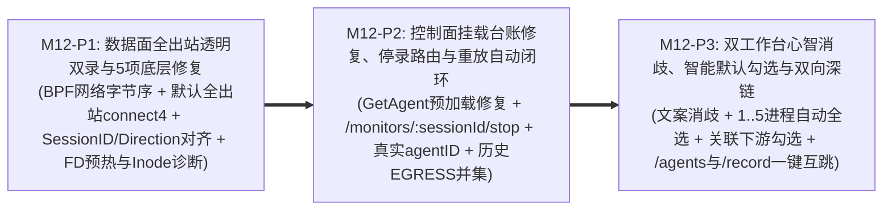

# Milestone 12 作战卡：单进程开箱即用出入站双录 (`INGRESS + EGRESS`)、数据面链路修复与双工作台协同录制体验优化 (M12)

- **文档编号**：`13-m12-bidirectional-capture-and-agent-recording-ux.md`
- **文档版本**：v1.0.0
- **更新日期**：2026-11-04
- **状态**：✅ 已实施交付 (Completed)
- **归属阶段**：阶段三/四：M12 TDD 任务拆解与验收标准 (`04-tasks`)
- **覆盖特性与场景**：`F-08` (基于进程自有 Socket Inode 的精准七态存量连接诊断)、`F-09` (目标 PID 默认全出站透明代理、BPF 网络字节序契约、存量入站 FD 预热与 `Direction` 不变量)、`F-10` (`StreamFramer` `bytes.Index` SIMD 滑窗紧缩)、`F-11` (单/多进程零拓扑前置开箱双录、会话与真实 `agent_id` 归属、停录路由修复)、`F-12` (重放期历史 `EGRESS` `DstAddr` 自动并集与写前 `"CSE.TCP"` 魔术字零外泄守卫)、`F-15.4` (协同录制抽屉文案消歧、`1..5` 可用进程智能默认全选、`[🔗 勾选关联下游]` 与空状态引导)、`F-15.5` (`/agents` 挂载列表预加载修复、`open_mount=1` 自动唤起与 `[🎬 发起录制]` 双向深链)、`F-16` (公私域 Anti-IDOR 守卫)、`SC-05`、`SC-07`、`SC-08`
- **设计参考基线**：[`11-single-process-bidirectional-capture-and-recording-ux-adr.md`](../05-adr/11-single-process-bidirectional-capture-and-recording-ux-adr.md) (ADR-11 v1.0.0)、[`01-feature-matrix.md`](../01-features/01-feature-matrix.md) (v2.9.3)、[`01-system-architecture.md` §4.2~§4.4](../02-design/01-system-architecture.md)、[`02-data-plane-and-cros-rpc-engine.md` §1.4 & §2~§3](../02-design/02-data-plane-and-cros-rpc-engine.md)、[`04-control-plane-and-web-console.md` §1.2~§1.3 & §4.5](../02-design/04-control-plane-and-web-console.md)、[`01-http-api-contract.md` §2.4 & §3](../03-api/01-http-api-contract.md)

---

## 1. 渐进式三阶段实施路线 (Phased Execution Plan)

围绕 ADR-11 冻结的三项架构决策（**目标 PID 默认全出站透明代理与重放期历史 `EGRESS` 自动闭环、数据面五项底层不变量修复与进程自有 FD 精准诊断、`/agents` ⇄ `/record` 双工作台职责消歧与零额外勾选联动**），M12 拆分为 **3 个顺序递进、每阶段均可独立执行红-绿-重构（Red ➔ Green ➔ Refactor）自动化验证的子阶段（`M12-P1` ➔ `M12-P2` ➔ `M12-P3`）**：



| 阶段编号 | 阶段目标 | 核心实施动作与关键技术红线 | 阶段准出断言 |
| :---: | :--- | :--- | :--- |
| **M12-P1** | **数据面目标 PID 默认全出站双录、SIMD 滑窗紧缩与五项底层契约修复** | 1. **`StreamFramer` SIMD 滑窗与内存上界加固 (`pkg/crosrpc/framer.go`)**：将魔术字搜索升级为 `bytes.Index(f.buf, magicPrefixBytes)` + 尾部原地紧缩（扫描未命中时保留尾部 `keep = min(len(f.buf), 6)` 字节，执行原地拷贝 `copy(f.buf[:keep], f.buf[len(f.buf)-keep:])` 与收缩 `f.buf = f.buf[:keep]`，无 `"CSE.TCP"` 的 DB/HTTP 旁路流缓冲恒定 `<= 8KB`，彻底消除切片底层数组向后漂移扩容与内存钉死泄漏）；<br>2. **BPF 网络字节序契约与默认全出站 `connect4` (`pkg/ebpf/endian.go`, `pkg/ebpf/bpf/cros_probe.c`, `pkg/ebpf/manager.go`)**：封装 `ipv4ToBPFBe32` / `bpfBe32ToIPv4` / `htons` / `ntohs` 并执行 `go generate ./pkg/ebpf` 重新生成 BPF 绑定；`cros_connect4` 在 `MODE_RECORDING` 下对 `target_pids_map` 目标 PID 发起的全部 IPv4 TCP 连接默认透明重定向至 `127.0.0.1:cfg->proxy_port`（豁免 `agent_pid`、目的端口等于自身非零监听端口 `bpf_htons(tp->listen_port)`（不限目的 IP，杜绝自连死锁），以及目的为 `127.0.0.1:{proxy_port, mock_port}` 的连接；未命中 `downstream_rules_map` 时仅异步写 `connect_observe_ringbuf` 观测事件），在 `MODE_REPLAY` 下统一重定向至物理零外拨的 `127.0.0.1:cfg->mock_port`；<br>3. **`Direction` 与 `StreamHalf` 正交解耦及 `SessionOrTaskID` 注入 (`ingress_reader.go`, `egress_proxy.go`)**：`IngressReader` 按 `(PID, ConnSeq, rw_dir)` 隔离收发 `StreamFramer`，输出信封恒定设置 `Direction = DirectionIngress (1)` 且四元组固定 `Src=客户端, Dst=监听端`；`EgressProxy` 新增原子 `activeSessionID`（`StartCapture(sessionID)` 注入、停录排空后清零），双向协程输出信封恒定设置 `SessionOrTaskID = activeSessionID`、`Direction = DirectionEgress (2)` 且四元组固定 `Src=客户端, Dst=origDst`；`REPLAY_MOCK` 态下对未命中 Mock 端点集的同进程既有连接启用写前 `"CSE.TCP"` 魔术字守卫（检出 CROS RPC 帧立即切断 `targetConn` 转交 `ScopedMockMatcher`）；<br>4. **存量入站 FD 预热与基于 `/proc/<pid>/fd` 自有 Inode 的存量连接诊断 (`proc_scanner.go`, `manager.go`)**：实现 `ScanProcessEstablishedSockets(pid)` 仅采集归属该 `pid` 自有 `socket:[inode]` 的 `TCP_ESTABLISHED` 连接；`SyncMonitors` 开录时将 `local_port == spec.ListenPort` 的存量入站连接预写入 `ing_conn_map`；`DiagnoseEstablishedConns` 排除入站端口与 `127.0.0.1:proxyPort` 后统计未代理直连出站连接（`downstreams` 为空时统计该进程全部未代理直连出站连接），彻底杜绝 `agent_pid` 同机回源连接导致的假阳性 `NEED_RECONNECT`；全量消除 `_ = err` 静默忽略。 | `go test -v -race ./pkg/crosrpc/... ./pkg/ebpf/... ./pkg/replay/... ./internal/agent/...` 全绿 + `! go list -deps ./cmd/agent \| grep -E "gorm\.io\|dynamicpb\|protoregistry"` 通过 |
| **M12-P2** | **控制面 `GetAgent` 挂载预加载修复、停录路由对齐、真实 `agent_id` 透传与重放历史 `EGRESS` 闭环** | 1. **修复 `/agents` 挂载列表空表缺陷 (`handlers/agent_handler.go`)**：重构 `GetAgent` 与 `BatchUpdateProcessMounts` 查询，统一使用 `Preload("ArchProcess.Group").Preload("ArchProcess.Modules").Where("agent_id = ?", agent.ID).Order("effective_listen_port ASC, id ASC")`，显式校验 `err != nil` 返回 `500`（严禁 `_ =` 吞错），并对每项挂载实例调用 `FillFromArchProcess()` 回填 `code`/`name`/`group_name`/`listen_port`/`cmd_pattern`/`has_override`；<br>2. **停录控制面路由对齐与真实 `agent_id` 落盘 (`internal/server/recorder/orchestrator.go`, `assembler.go`)**：修复 `stopSessionInternal` 请求 URL 为 `POST /agent/v1/monitors/{sessionId}/stop`，确保停录后 Agent 立即退回 `PASSTHROUGH` 并释放本地 `RECORDING` 租约；`readAgentStream` 将当前信道关联的真实 `agt.ID` 传入 `ExchangeAssembler.Feed(agt.ID, env, payload)` 落盘，废除硬编码 `agentID: 1`；<br>3. **单进程零拓扑素材离线重放自动闭环 (`internal/server/diff/`)**：构造 `ExecuteReplayReq` 与执行前置直连门禁时，自动提取源录制批次中属于 `source_process_id` 的全部历史 `EGRESS` 记录 `DstAddr (IP:Port)`，与 `CompileProcessDownstreams(target)` 去重合并写入 `ProcessSpec.Downstreams`，使未声明任何 `ModuleDependency` 的单进程双录素材直接支持 0 外泄离线重放。 | `TEST_DB_DSN=... go test -v -race ./internal/server/... ./handlers/...` 全绿 |
| **M12-P3** | **`/agents` ⇄ `/record` 双工作台职责消歧、智能默认预勾选与双向深链闭环** | 1. **`/agents` 常驻待命层文案澄清与深链能力 (`AgentManagementPage.tsx`)**：页面与右栏副标题明确区分「环境进程部署映射与常驻待命探针（配置一次 · 零损耗待命）」；右栏顶栏新增 **`[🎬 发起录制]`** 按钮（当 Agent `ONLINE`、无活跃租约且 `processes.length > 0` 时启用），点击导航至 `/record?auto_start=1&agent_id=<id>`；解析 URL `?agent_id=<id>&open_mount=1`（严格进行 Anti-IDOR 鉴权：当前用户具备写权限时自动滑出 `AgentProcessMountDrawer`，只读用户仅高亮锚定卡片并友好提示无权限，关闭或清理时清除 `open_mount` 参数）；<br>2. **`/record` URL 自动唤起与空状态挂载深链 (`RecordingWorkbenchPage.tsx`, `RecordingStartDrawer.tsx`)**：`RecordingWorkbenchPage` 解析 `?auto_start=1&agent_id=<id>` 自动打开 `RecordingStartDrawer` 并传入预选 `agent_id`（关闭抽屉时自动清除一次性 `auto_start` 参数防止刷新重复弹出）；当所选 Agent 下 `processes.length === 0` 时，抽屉内渲染带主行动按钮 **`[前往挂载架构进程 →]`** 的引导卡片，一键跳转 `/agents?scope=<scope>&agent_id=<id>&open_mount=1`；<br>3. **智能默认勾选、关联下游级联勾选与文案消歧 (`RecordingStartDrawer.tsx`)**：选择器标题更新为「本次采集目标进程（从已挂载进程中圈定范围 · 默认同时录制入口 INGRESS 与出口 EGRESS）」；打开抽屉或切换 Agent 时对可用进程（`probe_desired_state !== 'DISARMED'`）执行智能默认勾选——**可用数 `1 <= N <= 5` 默认自动全选（单进程开箱 0 次额外点击），`N > 5` 默认自动勾选 `probe_status === 'READY'` 进程**；`DISARMED` 进程置灰禁选；工具栏提供 `[全选可用]`、`[仅选就绪]`、`[🔗 勾选关联下游]`（直接复用挂载实例已填充的 `ArchProcess.Modules` 元数据与本地拓扑缓存级联勾选同机下游，避免 N+1 异步网络往返）与 `[清空]`；全量使用 `--color-*` 语义 Token、零 `any`、零原生弹窗。 | `npm --prefix frontend test -- AgentProcessMountAndReadiness.test.tsx RecordingStartDrawer.test.tsx RecordingWorkbench.test.tsx WorkbenchRBAC.test.tsx` 全绿 + `make test && make lint && make build && make clean` 零警告通过 |

---

## 2. 交付包与文件清单 (Deliverable Packages & Files)

| 阶段 | 操作类型 | 包 / 文件路径 | 职责与实现范围 |
| :---: | :---: | :--- | :--- |
| **P1** | **UPDATE** | `pkg/crosrpc/framer.go`<br>`pkg/crosrpc/crosrpc_test.go` | `StreamFramer.Write` 升级 `bytes.Index` SIMD 魔术字定位与尾部 `0..6` 字节原地紧缩，保障非 CROS RPC 透传长连接 `cap(buf) <= 8192` 恒定内存上界 |
| **P1** | **NEW / UPDATE** | `pkg/ebpf/endian.go`<br>`pkg/ebpf/bpf/cros_probe.c`<br>`pkg/ebpf/cros_probe_bpfel.go` (及生成的 BPF 绑定)<br>`pkg/ebpf/manager.go`<br>`pkg/ebpf/ingress_reader.go`<br>`pkg/ebpf/egress_proxy.go`<br>`pkg/ebpf/proc_scanner.go`<br>`pkg/ebpf/ebpf_unit_test.go`<br>`pkg/ebpf/ebpf_linux_test.go` | 统一 `__be32` / `__be16` 字节序纯函数；`cros_connect4` 目标 PID 默认全出站重定向（`MODE_RECORDING` 导 `proxy_port`、`MODE_REPLAY` 导 `mock_port`）与自环豁免；`IngressReader` 隔离 `(pid, conn_seq, rw_dir)` 且恒定输出 `DirectionIngress`；`EgressProxy` 原子注入 `activeSessionID`、恒定输出 `DirectionEgress` 并实现 `REPLAY_MOCK` 写前 `"CSE.TCP"` 魔术字守卫；`ProcScanner` 按 `/proc/<pid>/fd` 自有 Socket Inode 预热存量入站 FD 与精准诊断未代理直连出站连接 |
| **P2** | **UPDATE** | `handlers/agent_handler.go`<br>`handlers/arch_proto_agent_test.go` | 修复 `GetAgent` 与 `BatchUpdateProcessMounts` 的 `ArchProcess.Group` / `ArchProcess.Modules` 预加载、`effective_listen_port` 排序、`FillFromArchProcess()` 派生字段填充与显式错误处理 |
| **P2** | **UPDATE** | `internal/server/recorder/orchestrator.go`<br>`internal/server/recorder/assembler.go`<br>`internal/server/recorder/recorder_test.go`<br>`internal/server/diff/` (重放调度器)<br>`internal/server/diff/diff_test.go`<br>`handlers/recording_replay_test.go` | 修复停录请求路径为 `POST /agent/v1/monitors/{sessionId}/stop`；`Orchestrator` 向 `ExchangeAssembler` 透传真实 `agt.ID`；重放调度器自动合并源批次历史 `EGRESS` `DstAddr` 构建 Mock 端点集，打通单进程零拓扑双录与零外泄重放 E2E |
| **P3** | **UPDATE** | `frontend/src/pages/AgentManagementPage/AgentManagementPage.tsx`<br>`frontend/src/pages/RecordingWorkbenchPage/RecordingWorkbenchPage.tsx`<br>`frontend/src/pages/RecordingWorkbenchPage/RecordingStartDrawer.tsx`<br>`frontend/src/__tests__/AgentProcessMountAndReadiness.test.tsx`<br>`frontend/src/__tests__/RecordingStartDrawer.test.tsx`<br>`frontend/src/__tests__/RecordingWorkbench.test.tsx` | 两工作台职责文案消歧；`/agents` 新增 `[🎬 发起录制]` 与 `?open_mount=1` 自动抽屉；`/record` 解析 `?auto_start=1&agent_id=X` 自动唤起并清理一次性参数、空挂载态跳回 `/agents`；`RecordingStartDrawer` 实现 `1..5` 可用进程默认全选、`>5` 默认选 `READY`、`DISARMED` 禁选及 `[🔗 勾选关联下游]` |

---

## 3. TDD 先行测试矩阵 (Test-First Matrix)

| 阶段 | 目标测试文件 | 关键测试函数名 | 输入场景与前置条件 | 预期断言结果 (Assertions) |
| :---: | :--- | :--- | :--- | :--- |
| **P1** | `pkg/crosrpc/crosrpc_test.go` | `TestStreamFramer_NonCrosTrafficBoundedMemory_AndMidStreamResync` | 向 `StreamFramer` 连续写入 `4MB` 模拟 PostgreSQL/HTTP 纯随机非 `"CSE.TCP"` 字节流，随后拼入 1 条合法 `CROS RPC REQ` 帧 | 1. 前 `4MB` 期间产出 `0` 帧，且 `cap(framer.buf)` 全程严格 `<= 8192`（无底层大容量切片钉死）；<br>2. 紧随其后的合法 `CROS RPC REQ` 帧被 100% 无损切出。 |
| **P1** | `pkg/ebpf/ebpf_unit_test.go` | `TestBPFEndianness_IPv4AndPortSymmetricConversion` | 输入 `127.0.0.1`、`192.168.56.18` 与端口 `9001`、`19091`，执行 `ipv4ToBPFBe32` / `bpfBe32ToIPv4` 与 `htons` / `ntohs` 往返校验 | 1. 小端架构下 `ipv4ToBPFBe32(127.0.0.1) == 0x0100007f`（与内核 `bpf_htonl(0x7f000001)` 内存布局逐字节一致）；<br>2. `htons(9001) == 0x2923` 且 `ntohs(htons(9001)) == 9001`。 |
| **P1** | `pkg/ebpf/ebpf_unit_test.go` | `TestIngressReaderAndEgressProxy_ConstantDirection_SessionID_AndNonCrosPassthrough` | 1. 向 `IngressReader` 喂入同一连接 `rw_dir=1 (REQ)` 与 `rw_dir=2 (RSP)` 分片；<br>2. 启动 `EgressProxy`（`StartCapture(sessionID=88)`），同时接入一条 CROS RPC 往返连接与一条模拟 SQL 回显连接；随后执行 `StopCapture` 验证连接存活性 | 1. `IngressReader` 产出的 REQ 与 RSP 信封 `Direction` 恒为 `DirectionIngress (1)`；<br>2. `EgressProxy` 产出的出站 REQ 与出站 RSP 信封 `Direction` 恒为 `DirectionEgress (2)` 且 `SessionOrTaskID == 88`；<br>3. SQL 连接数据双向原样透传无损且产出 `0` 条信封帧；`StopCapture` 后两条底层 TCP 连接均保持不断开。 |
| **P1** | `pkg/ebpf/ebpf_unit_test.go` | `TestEgressProxy_ReplayMock_HistoricalEndpointsAndMagicWriteGuardZeroLeakage` | 目标进程在 `ARMED` 期建立 2 条代理长连接：连接 A 指向已知下游 `:9002`，连接 B 指向未声明端点 `:9003`（先发非 RPC SQL 字节，再突变发出 `"CSE.TCP"` RPC 请求帧）；切入 `REPLAY_MOCK` | 1. 连接 A 切入 `REPLAY_MOCK` 后命中本地 Mock 自愈应答，真实 `:9002` 收到 `0` 字节；<br>2. 连接 B 发送非 RPC 字节可正常透传，一旦发送 `"CSE.TCP"` 帧立即被写前守卫拦截切断 `targetConn` 并记为 `MOCK_MISS`，真实 `:9003` 收到 **`0` 字节 CROS RPC 流量**！ |
| **P1** | `pkg/ebpf/ebpf_unit_test.go` | `TestProcScanner_OwnSocketInodesOnly_InboundPrewarm_AndProxyExclusion` | 构造伪 `/proc` 目录：同网络命名空间内同时存在 `agent_pid` 连向 `:9002` 的 Socket、无关进程 Socket、目标 `pid` 在 `:9001` 的已建立入站 Socket、目标 `pid` 连向 `127.0.0.1:proxyPort` 的已代理出站 Socket，以及 1 条预挂前直连 `:9005` 的 Socket | 1. 入站预热精准提取 `:9001` 对应的 `(pid, fd)` 且不混入普通文件或出站 FD；<br>2. `DiagnoseEstablishedConns`（`downstreams=[]`）严格排除 `agent_pid` 连接、无关进程连接、入站 `:9001` 连接与已代理 `proxyPort` 连接，仅对 `:9005` 计数 `established_conns = 1`；移除 `:9005` 后立即返回 `established_conns = 0 (READY)`。 |
| **P2** | `handlers/arch_proto_agent_test.go` | `TestGetAgent_ReturnsPreloadedMountedProcesses_AndAntiIDOR` | 管理员在 `SHARED` Agent 挂载 1 个绑定了 `Group` 与 2 个 `Module`（且带本地覆盖端口 `:19001`）的 `ArchProcess`，普通用户 A 挂载本人 `PRIVATE` Agent 进程；分别调用 `GET /api/agents/:id` | 1. `GET /api/agents/:id` 返回 `processes` 长度为 `1`（修复空表 Bug），完整包含 `group_name`、`arch_process.modules`、`listen_port = 19001`、`has_override = true`；<br>2. 普通用户 B 访问用户 A 的 `PRIVATE` Agent 返回 `403 Forbidden`。 |
| **P2** | `handlers/recording_replay_test.go` | `TestSingleProcessZeroTopology_BidirectionalCapture_StopRelease_AndZeroLeakReplay` | 注册 `agent.ID = 7`（非 `1`），仅挂载 **1 个进程 `sut-order:9001`**（不创建任何 `ModuleDependency`、不填 `extra_downstreams`）：① 发起录制，驱动 `外部 -> sut-order -> 未纳管下游 :9002` 完成一次调用后调用 `POST /api/recording-sessions/:id/stop`；② 关闭真实 `:9002`，对该单进程批次发起离线重放 | 1. `traefik_traffic_records` 中在当前 `session_id` 下同时落盘 1 条 `INGRESS` 完整往返与 1 条 `EGRESS` 完整往返，且 `agent_id == 7`（非硬编码 `1`）；<br>2. 停录调用命中 Agent `/agent/v1/monitors/{sessionId}/stop` (`200 OK`)，Agent 本地与主控 DB 租约均恢复空闲 `IDLE`；<br>3. 重放任务自动将历史 `EGRESS` 的 `127.0.0.1:9002` 纳入 Mock 端点集，重放断言为 `PASS` 且真实下游零连接零外泄！ |
| **P3** | `frontend/src/__tests__/AgentProcessMountAndReadiness.test.tsx`<br>`frontend/src/__tests__/RecordingStartDrawer.test.tsx` | `testTwoWorkbenches_SmartDefaultSelection_CascadeDownstream_AndBidirectionalDeepLinks` | 1. 在 `/agents` 渲染已挂载 1 个进程的在线空闲 Agent，点击 `[🎬 发起录制]`；<br>2. 在 `/record?auto_start=1&agent_id=1` 验证抽屉自动滑出与单进程默认全选；测试 `6` 个进程大环境下仅默认勾选 `READY` 进程、`DISARMED` 禁选、`[🔗 勾选关联下游]` 级联补选；<br>3. 切换至 `0` 挂载进程的 Agent 点击 `[前往挂载架构进程 →]` 跳回 `/agents?...&open_mount=1` | 1. `/agents` 正确渲染已挂载进程行与常驻待命消歧文案，点击 `[🎬 发起录制]` 跳转 `/record?auto_start=1&agent_id=1`；<br>2. 抽屉自动打开且 `1` 个可用进程已默认勾选（底部显示 `已选 1 个业务进程`，可直接点击启动），关闭抽屉后 URL 中 `auto_start` 被清除；`>5` 进程时仅勾选 `READY`；点击 `[🔗 勾选关联下游]` 自动勾上依赖目标进程；<br>3. 空挂载态点击引导按钮跳转 `/agents?...&open_mount=1` 并对有写权限用户自动打开挂载抽屉（普通用户对 `SHARED` Agent 不误弹写抽屉）。 |

---

## 4. 验收门禁命令与安全验证计划 (Acceptance Criteria & Security Verification Plan)

### 4.1 自动化验收门禁命令

```bash
# AC-M12-00: BPF 对象生成与 Go 绑定产物一致性校验（确认内核 C 与 Go 产物 100% 同步）
go generate ./pkg/ebpf && git diff --exit-code pkg/ebpf/cros_probe_bpf*.go

# AC-M12-01: 主从物理防腐红线校验（确认 Agent 依然零 DB、零 dynamicpb/protoregistry 依赖）
! go list -deps ./cmd/agent | grep -E "gorm\.io|code-common/backend/gormdb|dynamicpb|protoregistry"

# AC-M12-02: 严禁静默忽略 error 代码卫生检查（排除测试桩外无新增违规 `_ =` 吞错）
go vet ./...

# AC-M12-03: 数据面协议栈、BPF 字节序、三态全出站 EgressProxy 与 /proc 自有 FD 诊断单测门禁
go test -v -race ./pkg/crosrpc/... ./pkg/agentproto/... ./pkg/ebpf/... ./pkg/replay/... ./internal/agent/...

# AC-M12-04: 控制面 GetAgent 预加载、单进程零拓扑双录、停录路由与历史 EGRESS 重放物理隔离数据库单测门禁
TEST_DB_DSN="host=127.0.0.1 port=5432 user=postgres password=postgres dbname=postgres sslmode=disable" \
  go test -v -race ./models/... ./internal/server/... ./handlers/...

# AC-M12-05: 前端双工作台智能预选、级联勾选、双向深链与 RBAC 只读门禁
npm --prefix frontend test -- AgentProcessMountAndReadiness.test.tsx RecordingStartDrawer.test.tsx RecordingWorkbench.test.tsx WorkbenchRBAC.test.tsx

# AC-M12-06: 全量隔离回归测试（SC-01~SC-08）、TypeScript/ESLint 零警告、双二进制构建与端口/进程清理门禁
TEST_DB_DSN="host=127.0.0.1 port=5432 user=postgres password=postgres dbname=postgres sslmode=disable" \
  make test && make lint && make build && make clean
```

### 4.2 M12 专项安全编码验证计划 (Security Verification Plan)

在严格继承 [`01-roadmap.md` §4.2](./01-roadmap.md) 全局安全基线（保留全部既有 `TODO(security)` 注释位）的基础上，M12 实施与代码检视必须逐项强制核验以下 6 项安全控制：

| 安全检查项 | 威胁场景 (CWE) | 强制实施约束与自动化验证断言 |
| :--- | :--- | :--- |
| **1. 全出站透明代理宿主机隔离与防自环死锁** | CWE-835 (Infinite Loop) / CWE-668 (Exposure of Resource to Wrong Sphere) | 1. `cros_connect4` **仅**拦截显式登记于 `target_pids_map` 的被纳管业务 PID，宿主机其余系统进程/守护进程 `100%` 原样放行（Non-Goal 6）；<br>2. 内核态强制豁免 `pid == cfg->agent_pid`、目的端口等于自身非零监听端口 `bpf_htons(tp->listen_port)`（无论目的 IP 为 `127.0.0.1` 还是宿主机局域网物理 IP，直接放行杜绝自连死锁），以及目的为 `127.0.0.1:{proxy_port, mock_port}` 的连接；用户态 `EgressProxy` 在 `nat_tuple_map` 查无记录或 `orig_dst` 指向 `EgressProxy/MockServer` 自身端口时立即拒绝回拨，双重杜绝代理自环风暴。 |
| **2. 重放模式 100% 物理零外泄铁律 (`Zero-Leakage Fail-Closed`)** | CWE-200 / 测试流量打穿真实外部环境风险 | 1. 重放启动前强制核验目标进程自有 FD 无指向 Mock 端点集（`CompileProcessDownstreams ∪ 历史 EGRESS DstAddr`）的未代理直连连接（违者返 `409 Conflict`）；<br>2. `MODE_REPLAY` 下新建连接统一导向绝不外拨的本地 `MockServer`，既有 `EgressProxy` 连接实施「命中端点集立即断 `targetConn` + 其余连接写前 `"CSE.TCP"` 魔术字拦截」双保险，确保任何 CROS RPC 请求 `0` 字节流向真实下游。 |
| **3. 非 CROS RPC 大流量旁路防内存耗尽 (DoS 防护)** | CWE-400 (Uncontrolled Resource Consumption) | `StreamFramer` 采用 `bytes.Index` SIMD 扫描与原地切片紧缩（`keep = min(len(f.buf), 6)` 原地拷贝紧缩），对持续数 GB 的非 CROS RPC 透传连接（如数据库备份流、大文件 HTTP 传输）保证单连接缓冲恒定 `<= 8KB`，且受 `GlobalFramerBudgetPool (64MB)` 与 `BoundedSessionBuffer (64MB)` 双重硬上限约束。 |
| **4. 公私域 Agent 与跨页 URL 深链防越权 (Anti-IDOR & RBAC)** | CWE-639 (Authorization Bypass Through User-Controlled Key) | 1. `GET /api/agents/:id`、发起录制与重放接口严格执行 `ScopeReadGuard` / `ScopeWriteGuard` 参数化查询（普通用户访问他人 `PRIVATE` Agent 返回 `403`）；<br>2. 前端解析 `?agent_id=X&open_mount=1` 与 `?auto_start=1&agent_id=X` 时必须先以整数白名单校验 `agent_id`，且仅当用户具备写权限（`SHARED` 需 `isModuleAdmin`，`PRIVATE` 需本人）时才允许打开 `AgentProcessMountDrawer`（无写权限用户仅高亮锚定卡片并友好提示无编辑权限，严禁弹窗）；严禁在 URL Query 中携带任何 Token 或敏感凭据。 |
| **5. 前端安全渲染、语义主题与受控交互** | CWE-79 (Cross-site Scripting) | 渲染来自 `/proc` 或报文的 `cmdline`、`diag_message`、`service_name` 等不可信字符串时 100% 依赖 React JSX 自动转义，严禁 `dangerouslySetInnerHTML` / `innerHTML` 及原生 `alert()` / `confirm()`；新增按钮与提示条 100% 使用 `var(--color-*)` 语义 Token。 |
| **6. `/proc` 只读安全解析与测试网络绑定卫生** | CWE-78 (OS Command Injection) / CWE-668 | `ProcScanner` 仅通过 Go 标准库 `os.Open` / `os.ReadDir` / `os.Readlink` 只读访问 `/proc`，全仓严禁 `os/exec` 外部命令调用；所有单测中的临时 TCP 服务端、Mock Agent 与模拟下游强制绑定 `127.0.0.1`（严禁 `0.0.0.0`），测试结束 `t.Cleanup` 100% 关闭套接字与后台协程。 |

### 4.3 阶段四实施代码安全扫描与审计门禁 (Automated Security Check)

在用户检视批准本文档并进入阶段四编码实施后，提交前必须执行：
- **Security Scanner (`run-security-scanner`)**：对全部修改的 Go / C / TypeScript 源码执行静态安全扫描，确保 0 项高/中危漏洞残留；
- **Security Audit (`generate-security-audit-report`)**：输出包含数据面全出站重定向隔离性、重放零外泄守卫及公私域 Anti-IDOR 核验结论的安全审计报告。

