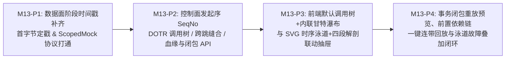

# M13 作战卡：报文时序因果树、内联甘特瀑布、全链路时序泳道与事务闭包重放

- **里程碑编号**：`M13`
- **状态**：✅ 已完成 (Completed)
- **前置依赖**：`M1 ~ M12` 已完成交付（单/多进程开箱即用双录与重放零外泄闭环就绪）
- **关联特性**：`F-10`、`F-11`、`F-12`、`F-13`、`F-15.2`、`F-15.6`、`SC-04`、`SC-05`、`SC-07`
- **关联设计规范**：[`12-packet-causality-call-tree-and-sequence-ux-adr.md`](../05-adr/12-packet-causality-call-tree-and-sequence-ux-adr.md) (ADR-12 v1.0.0)、[`02-data-plane-and-cros-rpc-engine.md`](../02-design/02-data-plane-and-cros-rpc-engine.md) (v1.5.0)、[`04-control-plane-and-web-console.md`](../02-design/04-control-plane-and-web-console.md) (v1.7.0)、[`05-database-schema.md`](../02-design/05-database-schema.md) (v1.3.2)、[`01-http-api-contract.md`](../03-api/01-http-api-contract.md) (v1.3.0)

---

## 1. 里程碑目标与分阶段 TDD 推进计划

针对 `独立流量调试工作台` (`/debug`) 在多报文联调中存在的「子调用 `EGRESS` 排在父调用 `INGRESS` 之前因果倒挂、层级与并发/补偿关系湮灭、连接级 `ullSNO` 混淆与架构链路未水合、参数血缘与跨事务状态依赖不可见、以及重放未按 `RecordID` 隔离局部 `ScopedMock`」五大痛点，依托生产环境默认开启的 DOTR `RPC_EXTEND_HEAD_TYPE_TRACE_KEY` 扩展头，将全量交付拆分为 **4 个串行 TDD 子阶段（`M13-P1` ➔ `M13-P4`）** 推进（每个子阶段内部严格执行 `Red -> Green -> Refactor`）：



### 1.1 `M13-P1`：数据面协议阶段耗时补齐、首字节定戳与 `RecordID` 级 `ScopedMock` 协议打通
1. **`pkg/crosrpc` V03/V04 服务端时间戳与首字节定戳**：
   - 在 `pkg/crosrpc/session_head.go` 的 `RspLayout`（`188B` V03 与 `200B` V04）中补齐 `ServerRecvTimeOffset: 40`（`40..47`, 8B BE）与 `ServerSendTimeOffset: 48`（`48..55`, 8B BE），`RspHead` 新增 `ServerRecvTime uint64`、`ServerSendTime uint64`；
   - 在 `pkg/crosrpc/framer.go` 新增 `WriteAt(chunk []byte, arrivalNs int64) []StampedFrame`（保留原 `Write` 兼容入口）：在 `SyncMagic -> ReadCommHead` 定位到帧首字节瞬间锁存 `frameStartNs = arrivalNs` 作为输出帧时间戳，消除大请求分片导致的父子时间戳逆序；
   - `pkg/ebpf/ingress_reader.go` 与 `pkg/ebpf/egress_proxy.go` 接入 `WriteAt`，将帧首字节到达时刻写入 56B 二进制信封 `CapturedAtNs`。
2. **`pkg/agentproto` & `pkg/replay` & `cmd/agent` 分层作用域重放打通（零 DB、零 `.pb`，支持请求+应答成对精确匹配）**：
   - `pkg/agentproto/protocol.go` 新增 `ReplayIngressItem{RecordID uint64, RawReq []byte}`，定义下游出站 Mock 成对规则 `MockRuleDownstream{ReqPacket []byte, RspPackets [][]byte}`（同时携带出站请求帧与应答帧列表，彻底消除下游 Mock 仅带应答帧导致的精确匹配失效与并发参数错配）；
   - 在 `ExecuteReplayReq` 中新增 `IngressItems []ReplayIngressItem`、`ScopedEgressMocks map[uint64][]MockRuleDownstream` 与 `GlobalFallbackMocks []MockRuleDownstream`（向后兼容保留旧平铺 `IngressRequests [][]byte` / `EgressMocks [][]byte`）；
   - `pkg/replay` 与 `cmd/agent` 重放执行器：初始化时解析每个 `MockRuleDownstream.ReqPacket` 的 `ServiceName`、`Operation` 与 `ReqPayload`（计算 SHA256 注册精确键 `exactKey = methodKey + ":" + hex(sha256(reqPayload))`），并将 `rule.RspPackets` 注册至 `matcher.AddScopedMock(recID, svc, op, reqPayload, rule.RspPackets)`；在每条 `IngressItem` 写入连接前调用 `matcher.SetActiveRecordID(item.RecordID)`。这样被测程序在重放运行时发起下游调用时，计算实际请求载荷哈希即可 100% 精确命中自身因果闭包的下游应答，彻底根治同一事务内并发/多次调用同一接口时的 FIFO 错配与张冠李戴。

### 1.2 `M13-P2`：控制面发起序修正、慢轨载荷解码、DOTR 调用树、跨进程缝合、数据流血缘与闭包 API
1. **慢轨解码器接入、真实 `payload_json` 落盘、发起序 `SeqNo` 与轻量摘要 (`models/` & `internal/server/recorder/` & `handlers/common.go`)**：
   - `handlers/common.go` 与 `internal/server/recorder/assembler.go`：将 `dec *decoder.Registry` 依赖注入 `NewExchangeAssembler`；
   - `internal/server/recorder/assembler.go`：
     - 慢轨聚合生成记录时，调用 `dec.DecodePayloadToJSON` 完成请求与应答载荷解析，真实填充 `item.reqJSON` 与 `item.rspJSON`，使落盘的 `payload_json` 成为合法的 `{"req": {...}, "rsp": {...}}`（彻底修复 `assembler` 未赋值 `reqJSON` 导致落盘恒为 `{"req":null,"rsp":null}` 的文档与实现脱节问题）；
     - 每个活跃 `session_id` 维护 `atomic.Int64` 计数器 `sessionSeq`，**在 `REQ` 到达创建 `pendingExchange` 瞬间（以及 `ONEWAY` / `MNG` / `RSP_ORPHAN` 到达瞬间）立即分配 `seq_no = sessionSeq.Add(1)`**；在 Worker 连接字典中缓存 `MNG.acProcName` 对端进程名；
     - 基于真实解码后的载荷提取顶层业务软错误状态（`code != 0` 或 `success == false`）与实体键值（如 `order_id`、`quote_id` 等），向既有 `headers_json` 注入轻量 `meta: { peer_proc_name, biz_error, biz_status_summary, produced_entities, consumed_entities }`；
   - `models/db.go` 与 `models/partition_manager.go` 为 `traefik_traffic_records` 幂等补齐复合索引 `idx_traefik_tr_session_req_ns (session_id, req_captured_at_ns, id)`（零破坏性表结构变更）；
   - `internal/server/recorder/anatomy.go`：基于 `RspHead.ServerRecvTime`、`RspHead.ServerSendTime` 与 `ServerEnqueue` 自动计算 `networkAndFramingUs`、`queueWaitUs`、`serverExecUs` 与 `serverProcessUs`。
2. **新建调用图与血缘引擎 (`internal/server/callgraph/`)**：
   - `hydrate.go`：批量水合 `src_module_name / dst_module_name / process_name / arch_process_name / peer_proc_name`，并按连接首次出现顺序生成紧凑短编号 `Conn#1, Conn#2, ...`；
   - `stitch.go`：实现多进程 `EgressProxy` 下的跨跳 `P1.EGRESS ⇔ P2.INGRESS` 合并缝合（优先 `(TraceID, SpanID/FatherSpanID, ServiceName, Operation)` 精确匹配，无 Trace 时回退 `(ServiceName, Operation, ReqPayloadSHA256, DstPort, |ΔReqNs| <= 50ms)` 指纹匹配，计算 `net_hop_us`）；
   - `tree.go`：基于 DOTR `TraceKey` 构建任意深度调用树（无 Trace 孤儿 `EGRESS` 回退同进程 `[ReqNs - 500μs, RspNs + 500μs]` 最内层入口包含窗），强制实施 `visited` 破环保护、`max_depth = 16`、`max_children = 200`；自动分类同层兄弟 `SEQUENTIAL | PARALLEL | COMPENSATION`、归一化甘特瀑布百分比 `[offset_pct, width_pct]`、计算自身净耗时 `self_exec_us` 与关键路径，并实现「子节点命中搜索时完整保留祖先链 + 按根事务不割裂分页」；
   - `lineage.go`：基于已真实解码的载荷实现单事务按需参数数据流血缘提取（扫描深度 `<= 6`、单报文标量上限 `<= 500`）与跨事务有状态业务实体生命线构建（识别 `PRODUCER` 写创建 $\rightarrow$ `CONSUMER` 读/改/删，过滤 `user_id / tenant_id / page` 等环境噪声词表），以及 `BuildReplayClosure` / `BuildReplayClosurePreview`。
3. **重放调度升级与 HTTP API 控制器 (`internal/server/diff/` & `handlers/`)**：
   - `internal/server/diff/scheduler.go`：重构重放包构建逻辑，调用 `callgraph.BuildReplayClosure` 按 `selected_record_ids` 切分 `IngressItems`，提取成对的 `eg.RawReqPacket` 与 `eg.RawRspPacket` 组装 `ScopedEgressMocks[recordID][]MockRuleDownstream` 与 `GlobalFallbackMocks []MockRuleDownstream`；
   - `handlers/traffic_handler.go`：
     - `GET /api/traffic-records`：排序修正为 `ORDER BY req_captured_at_ns ASC, seq_no ASC, id ASC`（支持 `sort_dir=asc|desc` 白名单），返回完整水合 `TrafficRecordSummary`（严禁查询 `raw_*_packet` `bytea` 列）；
     - 新增 `GET /api/recording-sessions/:id/transactions`（`ScopeReadGuard`，轻量列投影 + 按根事务分页返回 `TransactionTreeGroupDTO[]` 与 `EntityLifecycleChainDTO[]`）；
     - 新增 `GET /api/recording-sessions/:id/transactions/:rootRecordId/sequence`（`ScopeReadGuard`，支持可选 `replay_task_id` 叠加且双重校验任务可见性，返回 `TransactionSequenceDTO`）；
     - 新增 `GET /api/traffic-records/:id/replay-closure`（`ScopeReadGuard`，返回 `ReplayClosurePreviewDTO`）。

### 1.3 `M13-P3`：前端默认「可折叠事务调用树 + 内联迷你甘特瀑布」与时序泳道联动工作台
1. **类型契约与 API 客户端 (`frontend/src/types/traffic.ts` & `frontend/src/api/traffic.ts`)**：
   - 严格按 [`04-control-plane-and-web-console.md` §4.6](../02-design/04-control-plane-and-web-console.md) 补齐零 `any` 接口定义与请求封装。
2. **默认调用树瀑布主表与平铺切换 (`TrafficDebugWorkbenchPage/`)**：
   - URL Search Params 新增 `?view=tree|flat`（缺省 `tree`）、`entity_key`、`seq_root_id`；`DebugSessionContextBar` 提供 `[🌳 事务调用树 | 📋 原始时序平铺]` 分段切换与 `[全部展开 / 全部折叠]`；
   - 新增 `EntityLifecycleFilterStrip.tsx`：展示批次识别出的有状态业务实体胶囊（如 `order_id=ORD_9981 · 3笔`），点击一键过滤该实体完整生命周期；
   - 新增 `TransactionCallTreeTable.tsx` + `InlineWaterfallBar.tsx`：按根事务对接标准 5 页滑动窗口 `Pagination`（`15/25/50/100`，默认 `25`），展示树状层级缩进、跨跳合并徽章 `[P1 ➔ P2]`、兄弟 `并发 / 串行 / 🔄补偿` 标签、`Conn#k · SNO`、水合架构链路、内联甘特瀑布条（100% 使用 `--color-*` 语义 Token，仅 `left/width` 百分比使用真动态内联 style）及协议+业务双态状态码；
   - 升级 `TrafficRecordTable.tsx`（`?view=flat`）：展示发起序 `#Seq`、`Conn#k · SNO`、水合架构链路与双态状态码。
3. **交互式 UML 全链路时序泳道 + 四段解剖双栏联动抽屉 (`TransactionSequenceDrawer.tsx` + `SequenceSwimlaneCanvas.tsx`)**：
   - 宽屏抽屉内左栏采用**纯原生 React SVG** 绘制参与者泳道、同步/异步/返回箭头、V03/V04 三段耗时色柱（网络 / 排队 / 执行）及可开关的参数传递血缘弧线（`rsp.lock_id ➔ req.lock_id`）；
   - 点击任意泳道步骤，右栏内嵌 `PacketAnatomyDrawer` 零延迟联动切换对应报文（跨跳缝合步骤支持切换客户端 `EGRESS` / 服务端 `INGRESS` 视角）并高亮血缘关联字段。

### 1.4 `M13-P4`：事务闭包重放预览、前置状态依赖链勾选回放与泳道故障定位叠加
1. **升级 `SinglePacketReplayDrawer.tsx` 为事务闭包重放抽屉**：
   - 打开抽屉时请求 `GET /api/traffic-records/:id/replay-closure`：清晰列出本次将自动隔离挂载的专属下游 `ScopedEgressMocks` 清单（及 `REQ_ONLY` 风险提示）；
   - 当 `prerequisite_chain` 非空时，渲染温和醒目的状态前置依赖提示卡，提供复选框 **`[☑ 按序连带回放前置依赖事务链 (共 K 笔)]`**，勾选时将 `recommended_record_ids` 按发起序传入 `POST /api/replay-tasks`。
2. **重放结果与时序泳道图故障叠加闭环**：
   - 重放任务完成后，在重放结果区提供 **`[📊 在时序泳道图中查看故障定位]`** 按钮，唤起 `TransactionSequenceDrawer`（携带 `replay_task_id`），在对应下游泳道边上直观标红 `MOCK_MISS` 或在入口返回边上标示 `RSP_DIFF (N 处字段差异)`。

---

## 2. 交付包与文件清单

| 所属分层 | 目标包 / 文件路径 | 核心变更职责 |
| :--- | :--- | :--- |
| **共享协议栈** | `pkg/crosrpc/session_head.go`, `pkg/crosrpc/framer.go`, `pkg/crosrpc/*_test.go` | V03/V04 `RspLayout` 补齐 `ServerRecvTimeOffset(40)` / `ServerSendTimeOffset(48)`；`StreamFramer.WriteAt` 帧首字节到达定戳 |
| **主从协议与采集/重放** | `pkg/agentproto/protocol.go`, `pkg/ebpf/ingress_reader.go`, `pkg/ebpf/egress_proxy.go`, `pkg/replay/executor.go` (或 `cmd/agent`), `pkg/replay/*_test.go` | 首字节纳秒时间戳入信封；`ExecuteReplayReq` 新增 `IngressItems` + `MockRuleDownstream` 成对出站规则（`ReqPacket` + `RspPackets`）+ `ScopedEgressMocks` + `GlobalFallbackMocks`；基于 `ReqPacket` 注册 `exactKey` 杜绝事务内并发/同名错配；注入前 `SetActiveRecordID(recordID)` |
| **数据库索引与录制慢轨** | `models/recording.go`, `models/db.go`, `models/partition_manager.go`, `handlers/common.go`, `internal/server/recorder/assembler.go`, `internal/server/recorder/anatomy.go` | `handlers/common.go` 向 `NewExchangeAssembler` 注入 `dec *decoder.Registry`；慢轨聚合生成记录时真实解码请求与应答，落盘真实 `payload_json: {"req": {...}, "rsp": {...}}`（彻底修复 `reqJSON` 恒为 `null` 问题）；`REQ` 到达瞬间原子分配 `seq_no`；连接级 `MNG.acProcName` 缓存与载荷业务状态 `headers_json.meta` 注入；幂等创建 `idx_traefik_tr_session_req_ns`；三段耗时解剖 |
| **控制面调用图与血缘引擎** | `internal/server/callgraph/{hydrate.go,stitch.go,tree.go,lineage.go,closure.go,callgraph_test.go}` | 架构模块/进程批量水合、`Conn#k` 短编号、跨进程 `EGRESS⇔INGRESS` 缝合、DOTR 调用树 + 时间窗降级、兄弟分类、基于已解码真实载荷的参数血缘与跨事务实体链、重放闭包成对抽取规则 |
| **重放调度与 HTTP API** | `internal/server/diff/scheduler.go`, `handlers/traffic_handler.go`, `handlers/routes.go`, `handlers/traffic_callgraph_test.go` | 重放包成对抽取出站请求帧与应答帧组装 `MockRuleDownstream` 并按 `RecordID` 切分 `ScopedEgressMocks`；平铺接口发起序修复与水合；新增 `/transactions`、`/sequence`、`/replay-closure` 三大受保护接口 |
| **微前端调试工作台** | `frontend/src/types/traffic.ts`, `frontend/src/api/traffic.ts`, `frontend/src/components/PacketAnatomyDrawer/SessionHeadDetailCard.tsx`, `frontend/src/pages/TrafficDebugWorkbenchPage/{TrafficDebugWorkbenchPage.tsx,DebugSessionContextBar.tsx,EntityLifecycleFilterStrip.tsx,TransactionCallTreeTable.tsx,InlineWaterfallBar.tsx,TrafficRecordTable.tsx,TransactionSequenceDrawer.tsx,SequenceSwimlaneCanvas.tsx,SinglePacketReplayDrawer.tsx,TrafficDebugWorkbenchPage.css}` | 默认可折叠调用树 + 内联甘特瀑布主表、平铺切换、实体链胶囊过滤、纯原生 SVG 时序泳道 + 四段解剖联动抽屉、事务闭包预览与前置依赖链勾选回放 |
| **前端组件单测** | `frontend/src/pages/TrafficDebugWorkbenchPage/__tests__/TransactionCallTreeAndSequence.test.tsx` | 覆盖默认树视图渲染、平铺切换、瀑布条百分比、SVG 泳道与参数血缘开关、闭包重放前置依赖链勾选及 XSS 转义安全断言 |

---

## 3. TDD 先行测试矩阵 (Test-First Matrix)

| 用例编号 | 测试层级 | 目标测试文件 | 核心输入与预期断言（先红后绿） |
| :--- | :---: | :--- | :--- |
| **`T-M13-01`** | Go Unit | `pkg/crosrpc/session_head_test.go` | 构造 `188B` (V03) 与 `200B` (V04) 应答帧写入偏移 `40..47` (`ullServerRecvTime`) 与 `48..55` (`ullServerSendTime`)，断言 `ParseFrame` 精确还原两字段，且 V01 (`156B`) / V02 (`164B`) 返回 `0` 无越界 |
| **`T-M13-02`** | Go Unit | `pkg/crosrpc/framer_test.go` | 将 1 帧大请求拆为 3 个分片分别在 $t_1=100, t_2=200, t_3=350$ 调用 `WriteAt`，断言凑齐输出的 `StampedFrame.CapturedAtNs == 100`（首字节到达时刻）；粘包双帧分片正确继承分片时刻 |
| **`T-M13-03`** | Go Unit | `pkg/replay/scoped_executor_test.go` | **出站 Mock 请求+应答成对规则与精确匹配防错配**：① 构造同一入口请求内并发调用两次同一接口 `InventoryService.LockStock`（入参分别针对 `SKU-101` 与 `SKU-102`，返回不同锁定应答），下发携带成对 `{ReqPacket, RspPackets}` 的 `MockRuleDownstream`；断言 Agent 依据运行时入参的 Payload SHA256 100% 精确命中各自对应的 Mock 应答，并发颠倒到达时仍零张冠李戴；② 构造两笔不同入口请求 `RecordID=101, 102` 验证跨 RecordID 作用域隔离与全局兜底匹配 |
| **`T-M13-04`** | Go Unit | `internal/server/recorder/assembler_test.go` | **慢轨解码落盘与发起序单调自增**：注入注入已注册 Schema 的父 `INGRESS REQ` ($t=10\text{ms}$) $\rightarrow$ 子 `EGRESS REQ` ($t=12\text{ms}$) $\rightarrow$ 子 `EGRESS RSP` ($t=15\text{ms}$) $\rightarrow$ 父 `INGRESS RSP` ($t=25\text{ms}$)；断言落盘的 `payload_json` 含有真实解码的 `req` 与 `rsp` JSON 字典（绝非 `null`）；断言父记录 `SeqNo=1 < 子记录 SeqNo=2`；同连接前置 `MNG` 帧 `acProcName="api-gw"` 正确注入后续记录 `headers_json.meta.peer_proc_name`，业务异常正确标记 `biz_error` |
| **`T-M13-05`** | Go Unit | `internal/server/callgraph/callgraph_test.go` | **DOTR 建树、并发/补偿分类与破环防爆**：① 输入带 `TraceID/SpanID/FatherSpanID` 的三级调用集（含重叠并发子调用与异常后 `ReleaseStock`），断言树结构、`PARALLEL` / `COMPENSATION` 标记及瀑布 `offset_pct/width_pct` 100% 准确；② 构造 `SpanA <-> SpanB` 恶意循环 `FatherSpanID` 与 30 层超深链，断言无死循环且安全截断于 `max_depth = 16` |
| **`T-M13-06`** | Go Unit | `internal/server/callgraph/callgraph_test.go` | **多进程 `EgressProxy` 跨跳缝合**：输入 `Proc_Order (EGRESS, EphemeralPort=51234)` 与 `Proc_Inv (INGRESS, EphemeralPort=58901)`（同 `TraceID/SpanID` 不同四元组），断言精确缝合为单跳复合节点并算出 `net_hop_us`；验证无 Trace 场景下的 SHA256 指纹兜底缝合 |
| **`T-M13-07`** | Go Unit | `internal/server/callgraph/callgraph_test.go` | **参数血缘与跨事务实体链**：① 单事务内验证 `LockStock.rsp.lock_id="LK_01" -> ConfirmStock.req.lock_id="LK_01"` 生成血缘边，且低熵布尔/`0`/`1` 不产生伪边；② 跨事务验证 `CreateOrder.rsp.order_id="ORD_9"` (`PRODUCER`) $\rightarrow$ `GetOrder` / `CancelOrder` (`CONSUMER`) 串联，且 `user_id` 环境字段被噪声过滤 |
| **`T-M13-08`** | Go Integration (`testdb`) | `handlers/traffic_callgraph_test.go` | 使用 `testdb.SetupIsolatedDB(t)` 写入真实混合顺序批次：① `GET /api/traffic-records` 严格按发起序返回且水合模块名与 `Conn#k`；② `GET /api/recording-sessions/:id/transactions` 按根事务分页绝不劈裂父子，搜子方法 `LockStock` 保留父 `CreateOrder` 根行；③ `GET /api/recording-sessions/:id/transactions/:rootId/sequence` 与 `/replay-closure` 返回完整泳道血缘及前置依赖链 |
| **`T-M13-09`** | Go Security (`testdb`) | `handlers/traffic_callgraph_test.go` | **公私域 Anti-IDOR 越权拦截**：用户 B 访问用户 A 的 `PRIVATE` 批次 `/transactions`、`/sequence`、`/replay-closure`，或在公开批次 `/sequence?replay_task_id=X` 中传入用户 A 的私有重放任务 ID，全部拦截返回 `403 Forbidden` |
| **`T-M13-10`** | Go Arch Gate | `cmd/agent/deps_test.go` | 执行 `go list -deps ./cmd/agent ./pkg/crosrpc ./pkg/agentproto ./pkg/replay`，断言零 `gorm`、零 `dynamicpb`、零 `internal/server` 依赖 |
| **`T-M13-11`** | Frontend Vitest | `TransactionCallTreeAndSequence.test.tsx` | 默认挂载 `/debug?session_id=1` 渲染 `TransactionCallTreeTable` 与 `InlineWaterfallBar`，点击切换 `?view=flat` 同步 URL Search Params；点击 `[📊 时序泳道]` 渲染 SVG 泳道与参数血缘开关，点击步骤联动刷新四段解剖 |
| **`T-M13-12`** | Frontend Vitest | `TransactionCallTreeAndSequence.test.tsx` | 打开 `CancelOrder` 的 `SinglePacketReplayDrawer` 展示专属 `ScopedEgressMocks` 列表与前置 `CreateOrder` 依赖提示，勾选连带回放后提交 `selected_record_ids: ["101", "105"]`；注入含 `<script><svg onload=alert(1)>` 的恶意方法名/实体值断言纯文本安全渲染零执行 |

---

## 4. 强制安全验证计划 (Mandatory Security Verification Plan)

依据工作区安全编码规范（`mandatory-secure-web-skills`），`M13` 阶段四实施与检视必须逐项通过以下安全控制验证：

1. **前端树表与 SVG 时序泳道防存储型/反射型 XSS（CWE-79）**：
   - 来自网络报文的 `service_name`、`operation`、`peer_proc_name` (`MNG.acProcName`)、状态摘要 `biz_status_summary` 以及参数血缘 `sample_value` / 实体键值 `entity_value` 全部视为**不可信外部输入**；
   - `SequenceSwimlaneCanvas.tsx` 强制 100% 使用 React 原生 `<svg>` / `<g>` / `<text>` / `<path>` JSX 元素构建图形，**严禁引入任何拼接 SVG 字符串后赋给 `dangerouslySetInnerHTML`、`innerHTML`、`outerHTML` 的逻辑，严禁在节点点击中使用 `javascript:` URI 或原生 `alert()` / `confirm()`**；`sample_value` 在服务端截断至 `<= 64` 字符。
2. **有界递归与防算法复杂度拒绝服务（CWE-400 / Anti-DoS）**：
   - 网络流量中的 `SpanID / FatherSpanID` 可被畸形客户端伪造为自环或互环：`callgraph.BuildTransactionTrees` 强制维护 `visited map[uint64]bool` 破环集合，限制最大树深度 `max_depth = 16`、单根事务返回子节点数 `max_children = 200`；
   - `ExtractParameterLineage` 限制仅对单事务 `<= 200` 条记录按需执行，单 JSON 树递归深度硬上限 `<= 6` 层、单报文提取标量叶节点硬上限 `<= 500` 个，杜绝超大嵌套 Protobuf 载荷引发 CPU / 内存峰值毛刺。
3. **公私域防横向越权（CWE-639 / Anti-IDOR）与参数化查询（CWE-89）**：
   - 新增的 `GET /api/recording-sessions/:id/transactions`、`GET /api/recording-sessions/:id/transactions/:rootRecordId/sequence` 与 `GET /api/traffic-records/:id/replay-closure` 全部挂载 `ScopeReadGuard` 校验录制批次 `owner_id` 归属；当 `/sequence` 附带可选 `replay_task_id` 时，**额外独立校验当前用户对该 `ReplayTask` 的读取权限**，严禁借公开批次跨权窥探他人重放结果；
   - 所有数据库过滤（`entity_key`、`keyword`、`trace_id` 等）100% 采用 GORM 参数化预编译占位符，`sort_dir` 严格执行 `"asc" | "desc"` 白名单校验，严禁任何 SQL 字符串拼接。
4. **主从物理防腐、双模主题 Token 与测试环境隔离红线**：
   - `pkg/agentproto` 与 `pkg/replay` 仅传递 `uint64` ID 与 `[][]byte` 原始字节流，严禁向 Agent 侧泄漏任何数据库模型或 `.pb` 依赖；保留全仓既有 `TODO(security)` 标记；
   - 所有新增 CSS（`.code-debug-*`、`.code-seq-*`）100% 消费 `theme.css` 的 `--color-*` 语义 Token，严禁硬编码 `#fff`、`#000` 或静态内联样式，确保亮色/暗色双主题高对比度可读；
   - 所有 Go 单测强制绑定 `127.0.0.1` 并通过 `testdb.SetupIsolatedDB(t)` 创建临时隔离库，验证完成后关闭全部临时进程，确保 `:8091` / `:5181` 等物理端口零残留占用。

---

## 5. 里程碑自动化验收门禁 (Acceptance Criteria)

阶段四实施完成并提交前，必须 100% 零错误、零警告通过以下命令序列：

```bash
# 1. Agent 物理防腐依赖红线核验（零 gorm、零 dynamicpb、零 internal/server）
cd /home/fugui/codes/code-traefik && \
  ! go list -deps ./cmd/agent ./pkg/crosrpc ./pkg/agentproto ./pkg/ebpf ./pkg/replay | grep -E "gorm|dynamicpb|protoregistry|code-traefik/internal/server|code-traefik/models"

# 2. 后端代码格式、静态检查、竞态检测与物理隔离数据库全量单测
cd /home/fugui/codes/code-traefik && \
  TEST_DB_DSN="host=127.0.0.1 port=5432 user=postgres password=postgres dbname=postgres sslmode=disable" make test && \
  go test -race ./pkg/... ./internal/...

# 3. 前端 TypeScript 严格类型门禁（零 any）、ESLint 门禁与 Vitest 组件单测
cd /home/fugui/codes/code-traefik && make lint && cd frontend && npx vitest run

# 4. 前后端全栈单二进制打包与构建产物清理验证（确认零后台残留进程）
cd /home/fugui/codes/code-traefik && make build && make clean
```
