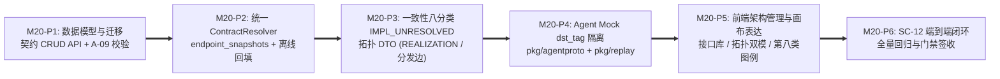

# M20 实施任务卡：多实现服务契约建模、实测定位、拓扑表达与重放隔离 (Multi-Implementation Service Contract)

> **文档版本**：`v1.0.0`
> **创建日期**：`2026-11-11`
> **最后更新**：`2026-11-13`
> **所属阶段**：阶段四 — 研发实施与 TDD 门禁 (Implementation & TDD Gate)
> **里程碑编号**：`M20 — 多实现服务契约（接口库定义 + 多进程实现 + 调度中心分发）建模、实测定位、拓扑表达与重放隔离`
> **覆盖需求范围**：`F-02.1`（多实现服务契约与接口库建模）、`F-04.4`（多实现契约拓扑表达）、`F-05.1`（多实现目的实现定位与第八类状态 `IMPL_UNRESOLVED`）、`SC-12`（X 分发到 B/C/D 三进程，录制后三条边分别判定，构造一条地址不匹配产生 `IMPL_UNRESOLVED`，重放 X 时 B/C Mock 不串用）、修订假设 `A-05` 与新增 `A-09`、第 19 张核心业务表 `traefik_service_contracts`
> **前置依赖**：`M19`（大规模拓扑图聚焦探索与布局持久化闭环）、[`../05-adr/16-multi-implementation-service-contract-adr.md`](../05-adr/16-multi-implementation-service-contract-adr.md) (`v2.0.0`)
> **当前状态**：✅ **已交付 (Delivered)**（含 `ADR-16 v2.0.0` 自定义运行期发布名扩展）

### 修订记录

| 版本 | 日期 | 作者 | 变更说明 |
| :--- | :--- | :--- | :--- |
| `v1.0.0` | `2026-11-11` | Architecture Team | 初版发布：依据已采纳 ADR-16 (`v1.0.0`) 落盘 M20 六阶段拆分（P1~P6）、TDD 测试用例矩阵与准出门禁 |

---

## 1. 里程碑目标与六阶段交付拆解 (Phased Execution Plan)

M20 旨在彻底解决 CROS 架构中「接口定义与多实现分离（头文件库模块 `A` 仅定义 `.pb` 接口且不编译进单一进程，业务模块 `B/C/D` 在不同进程中各自实现同一 `ascServiceName`，调度模块 `X` 根据入参或配置向 `B/C/D` 分发调用）」导致的建模冲突、实测流量归因歧义、拓扑语义失真与重放 Mock 串用问题。通过引入第 19 张核心业务表 `traefik_service_contracts`、抽取统一 `ContractResolver`、扩展第八类一致性状态 `IMPL_UNRESOLVED` 以及 Agent 侧基于 `dst_tag` 的轻量级 Mock 隔离（严守 Agent 零 DB、零 `.pb` 红线），在不破坏既有「独占服务（`EXCLUSIVE`）」零配置心智的前提下，实现多实现服务契约的完整治理闭环。

本里程碑按 **6 个递进子阶段（P1 ~ P6）** 推进，严禁跳步：



| 子阶段 | 阶段名称 | 核心交付内容 | 估算改动规模 |
| :--- | :--- | :--- | :--- |
| **M20-P1** | **数据模型与迁移 + 契约 CRUD API + A-09 校验** | 新增第 19 张表 `traefik_service_contracts`（`models/arch.go`、`models/db.go`）；扩展 `traefik_modules.module_kind`、`traefik_module_services.{contract_id,impl_key}` 部分唯一索引、`traefik_module_dependencies.contract_id` 三选一 XOR 约束、`traefik_recording_sessions.endpoint_snapshots`、`traefik_traffic_records.dst_contract_id`（含 `models/partition_manager.go` 分区母表幂等迁移）；实现契约 CRUD 与存量独占服务一键升级 API（`internal/server/topology/service_contract.go`、`handlers/arch_handler.go`）；落盘 `A-09` 同契约跨实现进程不相交校验 `AssertContractImplProcessDisjoint`。 | ~550 LOC |
| **M20-P2** | **抽取统一 `ContractResolver` + `endpoint_snapshots` + `dst_contract_id` 离线回填** | 新增 `internal/server/topology/contract_resolver.go` 替换全仓裸 `provideMap map[string]uint64` 单值映射；在 `internal/server/recorder/orchestrator.go` 启动会话时调用 `CompileProcessEndpointSnapshots` 固化 `endpoint_snapshots`；改造 `attribution.go`、`assembler.go`、`static_topology.go`、`diff/compatibility.go`、`diff/scheduler.go`、`decoder/breaking.go`，实现三级回退目的模块定位与 `dst_contract_id` 离线/实时双路径回填。 | ~600 LOC |
| **M20-P3** | **一致性八分类 `IMPL_UNRESOLVED` + 拓扑 DTO (`REALIZATION` / 分发边展开) + 大盘覆盖率** | 在 `internal/server/topology/consistency.go` 新增第 8 类状态 `IMPL_UNRESOLVED`、静态 `DISPATCH` 依赖展开、具体实现越界调用 `VIOLATION` 判定与进程维度实测校验；在 `internal/server/topology/graph_topology.go` 输出逻辑视图 `CONTRACT_LIB` 节点、`REALIZATION` 边及携带 `{contract_id, impl_key, definer_module_id}` 的调用边，物理视图隐藏 `CONTRACT_LIB` 并恒展开进程调用边；在 `internal/server/dashboard/overview.go` 补充多实现契约实现覆盖率统计。 | ~500 LOC |
| **M20-P4** | **Agent Mock `dst_tag` 隔离（严守零 DB、零 `.pb` 红线）** | 在 `pkg/agentproto/protocol.go` 的 `DownstreamEndpoint` 与 `MockRuleDownstream` 扩展 `DstTag string`；在 `internal/server/callgraph/closure.go` 与 `internal/server/diff/scheduler.go` 下发目标实现 `ArchProcess.Code` 作为 `dst_tag`；在 `pkg/replay/matcher.go`、`pkg/replay/executor.go` 与 `pkg/ebpf/egress_proxy.go` 实现 `service:operation@dst_tag` 优先匹配 + 无标签回退。 | ~320 LOC |
| **M20-P5** | **前端架构工作台与拓扑画布表达** | `/architecture` 支持模块类型切换（`BUSINESS` / `CONTRACT_LIB`）、库模块「定义的接口」页签（契约登记、实现矩阵、分发调用方、存量独占升级）、`PROVIDE` 自动切换「实现契约」并必填 `impl_key`、`DEPEND` 区分「依赖接口（分发）/依赖具体实现」；`/topology` 支持 `«interface»` 虚线节点、`REALIZATION` 独立图层开关、`topo_contract_mode=AGG\|EXPAND` 聚合/展开切换、第八类 `IMPL_UNRESOLVED` 琥珀色虚线（复用 `--color-warning`）及「实现待定」虚拟节点；`/dashboard` 展示契约实现覆盖率。 | ~750 LOC |
| **M20-P6** | **`SC-12` 端到端验收与全量回归** | 编写 `TestSC12_MultiImplContractDispatchVerifyAndIsolatedMockReplay` 端到端集成测试，完整覆盖 `X -> B/C/D` 分发录制、三条边独立判定、地址不匹配触发 `IMPL_UNRESOLVED`、重放 `X` 时 `B/C` 同名接口 Mock 按 `dst_tag` 严格隔离不串用，并通过全套构建、单测、依赖防腐门禁与前端 Lint 门禁。 | ~300 LOC |

### 1.1 交付物文件清单 (Deliverables Inventory)

| 端侧 | 动作 | 文件路径 | 职责说明 |
| :--- | :--- | :--- | :--- |
| **后端 (Go)** | 修改 | `models/arch.go` | 新增第 19 张表模型 `ServiceContract` (`traefik_service_contracts`)；`Module` 新增 `ModuleKind` (`BUSINESS`/`CONTRACT_LIB`)；`ModuleService` 新增 `ContractID`、`ImplKey` 并移除 `ServiceName` 全局唯一标签；`ModuleDependency` 新增 `ContractID`。 |
| **后端 (Go)** | 修改 | `models/recording.go` | 新增 `EndpointSnapshotItem` 结构体；`RecordingSession` 新增 `EndpointSnapshots datatypes.JSON`；`TrafficRecord` 新增 `DstContractID *uint64`。 |
| **后端 (Go)** | 修改 | `models/db.go` | `AutoMigrate` 注册 `&ServiceContract{}`（共 19 张业务表）；幂等下发 `chk_traefik_modules_kind`、`chk_traefik_modules_lib_no_proc`、`chk_traefik_svc_contract_mode`、`uk_traefik_mod_svc_name_excl`、`uk_traefik_mod_svc_contract_impl`、`uk_traefik_mod_svc_contract_mod`、`chk_traefik_mod_svc_contract_impl`、`chk_traefik_dep_target_xor`、`uk_traefik_dep_consumer_contract` 约束与部分唯一索引。 |
| **后端 (Go)** | 修改 | `models/partition_manager.go` | `EnsureParentTable` 幂等迁移 `ALTER TABLE traefik_traffic_records ADD COLUMN IF NOT EXISTS dst_contract_id BIGINT` 及部分索引 `idx_traefik_tr_dst_contract`。 |
| **后端 (Go)** | **新增** | `internal/server/topology/service_contract.go` | 多实现服务契约 CRUD、独占服务与多实现契约全局互斥锁（`pg_advisory_xact_lock(hashtext(service_name))`）、存量独占服务一键转多实现契约事务、`A-09` 同契约跨实现进程不相交校验 `AssertContractImplProcessDisjoint`。 |
| **后端 (Go)** | **新增** | `internal/server/topology/service_contract_test.go` | P1 数据模型约束、契约 CRUD、并发互斥与 `A-09` 进程绑定冲突单元测试。 |
| **后端 (Go)** | **新增** | `internal/server/topology/contract_resolver.go` | 统一契约解析器 `ContractResolver`（聚合独占服务映射 `ExclusiveMap` 与多实现契约映射 `Contracts`/`ImplByProc`/`ImplByMod`），彻底替代散落的 `provideMap map[string]uint64`。 |
| **后端 (Go)** | 修改 | `internal/server/topology/attribution.go` | 接入 `ContractResolver` 与 `RecordingSession.EndpointSnapshots`；重构 `ResolveDestinationModule`（三级回退：录制期快照 -> 当前进程树端点 -> 观测源端口回溯）输出 `(dstModID, dstContractID)`；重构 `ResolveSourceModule` 展开 `DISPATCH` 依赖；升级 `OfflineBatchAttribution` 批量回填 `dst_module_id` 与 `dst_contract_id`。 |
| **后端 (Go)** | 修改 | `internal/server/topology/attribution_test.go` | P2 多实现目的模块定位、三级回退与 `IMPL_UNRESOLVED` 归因单元测试。 |
| **后端 (Go)** | 修改 | `internal/server/topology/static_topology.go` | `CreateModuleService`/`CreateModuleDependency` 支持 `contract_id` 与 `impl_key`；`CompileProcessDownstreams` 展开 `DISPATCH` 依赖（`contract_id`）至全部实现模块所属进程并填充 `DstTag: archProc.Code`；新增 `CompileProcessEndpointSnapshots` 供录制启动时固化端点快照；升级 `BuildStaticTopology`。 |
| **后端 (Go)** | 修改 | `internal/server/topology/tree.go` | `CreateModule`/`UpdateModule` 支持 `module_kind`（校验 `CONTRACT_LIB` 禁止挂载 `arch_process_id`）；`BindModuleProcess` 挂载进程时调用 `AssertContractImplProcessDisjoint` 执行 `A-09` 校验。 |
| **后端 (Go)** | 修改 | `internal/server/topology/claimable_service.go` | 可认领服务列表标识已登记为多实现契约的 `service_name`（提示走「实现多实现契约」并提供 `contract_id`、`impl_key_label`）。 |
| **后端 (Go)** | 修改 | `internal/server/recorder/orchestrator.go` | `StartSession` 在生成录制配置时调用 `CompileProcessEndpointSnapshots` 写入 `RecordingSession.EndpointSnapshots`；构造注入 `ContractResolver` 的实时帧归因解析器。 |
| **后端 (Go)** | 修改 | `internal/server/recorder/assembler.go` | 扩展 `DestinationResolver` 接口或上下文，使实时拼装 `TrafficRecord` 时能根据 `(sessionID, processID, direction, dstAddr, serviceName)` 同步写入 `DstModuleID` 与 `DstContractID`。 |
| **后端 (Go)** | 修改 | `internal/server/diff/compatibility.go` | `ValidateReplayProcessCompatibility` 接入 `ContractResolver`：多实现契约 `INGRESS` 流量以录制时的 `source_process_id` 快照（`sourceSnap`）定位实现模块，再校验目标重放进程是否包含该实现模块，避免假阴性阻断。 |
| **后端 (Go)** | 修改 | `internal/server/diff/scheduler.go` | 传入 `ContractResolver` 完成重放进程兼容性校验；构建 `ReplayTaskConfig` 时为 `DownstreamEndpoints` 与 `ScopedEgressMocks` 注入目标实现 `ArchProcess.Code` 作为 `DstTag`。 |
| **后端 (Go)** | 修改 | `internal/server/callgraph/closure.go` | 导出 `MockRuleDownstream` 时，根据 `TrafficRecord.DstModuleID` 查找目标实现模块所属 `ArchProcess.Code` 填充 `DstTag`。 |
| **后端 (Go)** | 修改 | `internal/server/decoder/breaking.go` | `FindAffectedDependents` 通过 `ContractResolver` 识别受影响的 `traefik_service_contracts`，将全部实现模块、全部 `DISPATCH` 消费模块及具体实现消费模块纳入破坏性变更告警范围。 |
| **后端 (Go)** | 修改 | `internal/server/topology/consistency.go` | 新增 `StatusImplUnresolved VerificationStatus = "IMPL_UNRESOLVED"`；展开 `DISPATCH` 依赖为具体实现边 `(X -> B/C/D, contract_id, impl_key)`；识别具体实现越界调用为 `VIOLATION`；汇总 `DstContractID != nil && DstModuleID == nil` 产出 `IMPL_UNRESOLVED` 诊断结果；升级 `VerifyProcessObservedCalls`。 |
| **后端 (Go)** | 修改 | `internal/server/topology/consistency_test.go` | P3 一致性八分类 `IMPL_UNRESOLVED`、`DISPATCH` 依赖展开与越界调用 `VIOLATION` 单元测试。 |
| **后端 (Go)** | 修改 | `internal/server/topology/graph_topology.go` | `LOGICAL` 视图输出 `CONTRACT_LIB` 节点元数据、`REALIZATION` 实现边及携带 `{contract_id, impl_key, definer_module_id}` 的调用边；`PHYSICAL` 视图过滤掉 `CONTRACT_LIB`（不入 `undeployed_container`），恒展开进程间调用边并在实现模块 `meta.implements` 暴露实现清单。 |
| **后端 (Go)** | 修改 | `internal/server/topology/graph_topology_test.go` | P3 逻辑/物理拓扑图 DTO、`REALIZATION` 边与 `CONTRACT_LIB` 过滤单元测试。 |
| **后端 (Go)** | 修改 | `internal/server/dashboard/overview.go` | 大盘统计扩展多实现契约数、已关联实现模块契约数及契约实现覆盖率指标。 |
| **后端 (Go)** | 修改 | `handlers/arch_handler.go` | 新增 `ListServiceContracts`、`GetServiceContract`、`CreateServiceContract`、`UpdateServiceContract`、`DeleteServiceContract`、`ConvertExclusiveToMultiImplContract` 控制器；扩展模块/服务/依赖 DTO。 |
| **后端 (Go)** | 修改 | `handlers/routes.go` | 注册 `/api/arch/service-contracts` 读写与转换路由（写接口挂载 `requireAdmin`）。 |
| **后端 (Go)** | 修改 | `handlers/recording_replay_test.go` | 新增 `TestSC12_MultiImplContractDispatchVerifyAndIsolatedMockReplay` 端到端验收单测。 |
| **Agent (Go)** | 修改 | `pkg/agentproto/protocol.go` | `DownstreamEndpoint` 与 `MockRuleDownstream` 新增 `DstTag string` (`json:"dst_tag,omitempty"`)。 |
| **Agent (Go)** | 修改 | `pkg/replay/matcher.go` | `ScopedMockMatcher` 支持端点标签表 `SetEndpointTags`、带标签规则注册 `service:operation@dst_tag` 及 `MatchAndHealWithDst(liveReq, dstAddr)` 优先匹配 `@dst_tag` + 无标签回退。 |
| **Agent (Go)** | 修改 | `pkg/replay/matcher_test.go` | P4 同名接口不同 `dst_tag` Mock 隔离与无标签回退单元测试。 |
| **Agent (Go)** | 修改 | `pkg/replay/executor.go` | 启动重放时向 `ScopedMockMatcher` 注入 `DownstreamEndpoints` 的 `IP:Port -> DstTag` 映射及 `MockRuleDownstream.DstTag`。 |
| **Agent (Go)** | 修改 | `pkg/ebpf/egress_proxy.go` | `handleConn` 提取 BPF NAT 原始目标地址 `origAddr` 传入 `matcher.MatchAndHealWithDst(frame, origAddr)`。 |
| **前端 (TS/React)** | 修改 | `frontend/src/types/arch.ts`、`topology_graph.ts`、`traffic.ts`、`dashboard.ts` | 同步 `ModuleKind`、`ServiceContractDTO`、`VerificationStatus`（含 `IMPL_UNRESOLVED`）、`GraphEdgeKind`（含 `REALIZATION`）、`TopoContractMode` (`AGG` \| `EXPAND`) 等类型契约。 |
| **前端 (TS/React)** | 修改 | `frontend/src/api/arch.ts` | 新增 `/api/arch/service-contracts` CRUD 与存量独占升级 API 客户端函数。 |
| **前端 (TS/React)** | 修改 | `frontend/src/pages/ArchitectureWorkbenchPage/index.tsx`、`SubsystemGroupTreePanel.tsx`、`ModuleContractDetailPane.tsx` | 模块表单支持「模块类型」选择；`CONTRACT_LIB` 详情展示「定义的接口」页签（契约登记、实现矩阵、分发调用方、一键转多实现）；`PROVIDE` 抽屉自动切换「实现契约」并要求 `impl_key`；`DEPEND` 抽屉区分「依赖接口（分发）/依赖具体实现」。 |
| **前端 (TS/React)** | 修改 | `frontend/src/components/ArchCanvas/index.tsx`、`ArchCanvasToolbar.tsx`、`nodes/ModuleNode.tsx`、`edges/RollupEdge.tsx`、`panels/ArchSummaryBar.tsx`、`model/overlay.ts`、`model/rollup.ts`、`model/subgraph.ts`、`model/metrics.ts` | `«interface»` 库卡渲染、`REALIZATION` 独立图层开关（不参与 Tarjan 环路检测与调用聚合）、`topo_contract_mode=AGG\|EXPAND` 切换、第八类 `IMPL_UNRESOLVED` 琥珀色虚线（`--color-warning`）与「实现待定」虚拟节点。 |
| **前端 (TS/React)** | 修改 | `frontend/src/pages/DashboardWorkbenchPage.tsx` | 治理大盘展示多实现契约实现覆盖率卡片与进度明细。 |

---

## 2. 各阶段技术实现规范与契约细则

### 2.1 M20-P1：数据模型与迁移 + 契约 CRUD API + A-09 校验

1. **模块角色区分 (`traefik_modules.module_kind`)**：
   - `Module` 新增 `ModuleKind string`（枚举 `'BUSINESS'` | `'CONTRACT_LIB'`，默认 `'BUSINESS'`）。
   - 数据库约束 `chk_traefik_modules_kind CHECK (module_kind IN ('BUSINESS', 'CONTRACT_LIB'))` 与 `chk_traefik_modules_lib_no_proc CHECK (module_kind = 'BUSINESS' OR arch_process_id IS NULL)`：`CONTRACT_LIB` 模块严禁直接绑定 `arch_process_id`（违反返 `400 Bad Request`），亦不可声明 `PROVIDE` 或 `DEPEND`。
2. **第 19 张核心表 `traefik_service_contracts` (`models/arch.go`)**：
   - 字段：`id`、`service_name`（`uk_traefik_svc_contract_name` 全局唯一，满足 `^[A-Za-z0-9._-]{1,63}$` 且已在激活 `.pb` 描述符集中存在）、`definer_module_id`（外键指向 `module_kind = 'CONTRACT_LIB'` 的模块，`ON DELETE RESTRICT`）、`provide_mode`（默认 `'MULTI_IMPL'`）、`impl_key_label`（如 `"业务类型 biz_type"`）、`description`、`created_by`、`updated_by`、`created_at`、`updated_at`。
3. **`traefik_module_services` 双模唯一性演进**：
   - 新增 `contract_id BIGINT NULL`（外键关联 `traefik_service_contracts(id) ON DELETE RESTRICT`）与 `impl_key VARCHAR(64) NOT NULL DEFAULT ''`（校验正则 `^[A-Za-z0-9._-]{1,64}$`）。
   - 移除原有的无条件唯一索引 `uk_traefik_mod_svc_name`，改为 3 条部分唯一索引与 1 条检查约束：
     - `uk_traefik_mod_svc_name_excl ON traefik_module_services (service_name) WHERE contract_id IS NULL`（独占服务保持全局唯一）；
     - `uk_traefik_mod_svc_contract_impl ON traefik_module_services (contract_id, impl_key) WHERE contract_id IS NOT NULL`（同一契约下 `impl_key` 唯一）；
     - `uk_traefik_mod_svc_contract_mod ON traefik_module_services (contract_id, module_id) WHERE contract_id IS NOT NULL`（同一模块对同一契约最多一条实现）；
     - `chk_traefik_mod_svc_contract_impl CHECK ((contract_id IS NULL AND impl_key = '') OR (contract_id IS NOT NULL AND impl_key <> ''))`。
   - **跨表互斥并发锁**：创建独占 `ModuleService`（`contract_id IS NULL`）或登记 `ServiceContract` 时，必须在同一数据库事务内先执行 `SELECT pg_advisory_xact_lock(hashtext(?))`（参数为 `service_name`），再互查对方表是否已占用该 `service_name`；若冲突返 `409 Conflict`。
4. **`traefik_module_dependencies` 三选一 XOR 演进**：
   - 新增 `contract_id BIGINT NULL`（外键关联 `traefik_service_contracts(id) ON DELETE CASCADE`）。
   - 检查约束 `chk_traefik_dep_target_xor CHECK (num_nonnulls(service_id, contract_id) + (CASE WHEN is_external THEN 1 ELSE 0 END) = 1)`：
     - `service_id != NULL`：依赖独占服务或依赖多实现契约的**某一个具体实现**；
     - `contract_id != NULL`：**分发依赖 (`DISPATCH`)**，表示调用方根据运行时条件向该契约的所有已登记实现模块分发调用；
     - `is_external = true`：外部第三方服务依赖。
   - 新增部分唯一索引 `uk_traefik_dep_consumer_contract ON traefik_module_dependencies (consumer_module_id, contract_id) WHERE contract_id IS NOT NULL`。
5. **契约 CRUD 与存量独占服务一键升级 API**：
   - `GET /api/arch/service-contracts`：支持 `?definer_module_id=`、`?service_name=`、`?search=` 过滤，返回契约列表及每个契约的实现数 `impl_count`、已挂载进程实现数 `deployed_impl_count`、分发调用方数 `dispatch_consumer_count`。
   - `GET /api/arch/service-contracts/:id`：返回契约详情、实现矩阵 `implementations`（含 `service_id`、`impl_key`、`module_id`、`module_name`、`arch_process_id`、`arch_process_name`、`owner`）与分发消费方列表 `dispatch_consumers`。
   - `POST /api/arch/service-contracts`、`PUT /api/arch/service-contracts/:id`、`DELETE /api/arch/service-contracts/:id`（管理接口挂载 `requireAdmin`；删除时若仍存在关联实现或依赖则返 `409 Conflict`）。
   - `POST /api/arch/service-contracts/convert`（`requireAdmin`，对应 ADR-16 §7.4）：单事务内将既有独占 `ModuleService` 升级为 `ServiceContract`（指定 `definer_module_id`、`impl_key_label`、首个实现的 `impl_key` 及是否将既有消费依赖切换为 `DISPATCH`）。
6. **`A-09` 同契约跨实现进程不相交校验 (`AssertContractImplProcessDisjoint`)**：
   - 在 `CreateModuleService`（当 `contract_id != nil` 且当前模块已绑定 `arch_process_id`）及 `BindModuleProcess`/`CreateModule`/`UpdateModule`（当目标进程非空且模块含有多实现契约实现）时，检查同一 `contract_id` 的不同实现模块是否指向同一个 `arch_process_id`；若冲突，拒绝保存并返回 `409 Conflict`（提示：`"同一进程内不支持挂载同一服务契约的多个实现模块，请合入单一模块或拆分标准架构进程"`）。

### 2.2 M20-P2：抽取统一 `ContractResolver` + `endpoint_snapshots` + `dst_contract_id` 离线回填

1. **统一 `ContractResolver` (`internal/server/topology/contract_resolver.go`)**：
   - 提供 `LoadContractResolver(ctx, db) (*ContractResolver, error)`，一次性加载独占服务映射 `ExclusiveByName map[string]ExclusiveServiceInfo` 与多实现契约映射 `ContractsByName map[string]*MultiImplContractInfo`（内含 `ContractID`、`DefinerModuleID`、`ImplByModuleID map[uint64]ContractImplInfo`、`ImplByArchProcessID map[uint64]ContractImplInfo`）。
   - 替换 `attribution.go`、`consistency.go`、`graph_topology.go`、`diff/compatibility.go`、`diff/scheduler.go`、`decoder/breaking.go` 中的 `provideMap map[string]uint64`。
2. **录制会话端点快照 (`traefik_recording_sessions.endpoint_snapshots`)**：
   - 在 `static_topology.go` 新增 `CompileProcessEndpointSnapshots(ctx, db, envID, targetArchProcID) ([]models.EndpointSnapshotItem, error)`：不仅收集本环境全部 `EnvironmentProcess(advertise_ip:listen_port -> arch_process_id)`，还展开目标进程声明的 `DISPATCH` 依赖（`contract_id`）及具体 `service_id` 依赖所对应的下游进程端点，并在 `orchestrator.go` 的 `StartSession` 时序列化存入 `RecordingSession.EndpointSnapshots`。
   - 同步升级 `CompileProcessDownstreams`：当模块声明 `DISPATCH` 依赖（`dep.ContractID != nil`）时，自动遍历该契约下的全部实现模块及其所属 `ArchProcess`，将对应环境进程的 `advertise_ip:listen_port` 加入下游白名单，并填入 `DstTag: archProc.Code`。
3. **多实现目的模块三级回退定位 (`ResolveDestinationModule` v2)**：
   - 针对 `service_name` 命中 `ContractsByName` 的多实现契约流量：
     - **方向 `INGRESS`**：被录制进程自身即为服务端实现进程。用 `session.TargetProcess.ArchProcessID` 查 `ImplByArchProcessID` 定位唯一实现模块 `M_impl`，返回 `(&M_impl.ModuleID, &contract.ContractID)`。
     - **方向 `EGRESS`**：被录制进程作为客户端向外发起调用，按三级回退解析 `dst_addr (IP:Port)` 所属的远端 `arch_process_id`：
       1. **优先级 1**：查 `session.EndpointSnapshots` 中 `endpoint == dst_addr` 的 `arch_process_id`；
       2. **优先级 2**：查当前 `traefik_environment_processes`（同 `env_id`）中 `advertise_ip:listen_port == dst_addr` 的 `arch_process_id`（兼容通配 IP 如 `0.0.0.0:Port` 在单机环境下的唯一端口匹配）；
       3. **优先级 3**：查同 `session_id` 内是否存在 `src_addr == dst_addr`（或观测进程端口吻合）且已关联 `arch_process_id` 的记录。
       - 解析出远端 `arch_process_id` 后，查 `ImplByArchProcessID` 命中唯一实现模块 `M_impl`，返回 `(&M_impl.ModuleID, &contract.ContractID)`；若无法定位实现模块，则返回 `(nil, &contract.ContractID)`（即保留 `dst_contract_id` 供 P3 归入 `IMPL_UNRESOLVED`，绝不误判为 `EXTERNAL_UNDECLARED`）。
   - `OfflineBatchAttribution` 与实时 `ExchangeAssembler` 均使用该算法同时写入 `dst_module_id` 与 `dst_contract_id`。
4. **重放进程兼容性校验升级 (`internal/server/diff/compatibility.go`)**：
   - `ValidateReplayProcessCompatibility` 扫描历史录制会话的 `INGRESS` 流量时：若 `service_name` 属于多实现契约，先在录制时的源进程模块快照 `sourceSnap` 中查找实现该契约的模块 `M_impl`，再校验目标重放进程 `targetSnap` 是否包含 `M_impl`（而非要求目标进程包含该契约在全系统的所有实现模块）。

### 2.3 M20-P3：一致性八分类 `IMPL_UNRESOLVED` + 拓扑 DTO (`REALIZATION` / 分发边展开)

1. **一致性验证八分类 (`internal/server/topology/consistency.go`)**：
   - 新增常量 `StatusImplUnresolved VerificationStatus = "IMPL_UNRESOLVED"`。
   - **静态依赖展开**：构建静态期望集时，若消费模块 `X` 声明了 `DISPATCH` 依赖 `(X, contract_id)`，则遍历该契约当前的全部实现模块 `B_i`，展开为期望边 `(X -> B_i, service_name, contract_id, impl_key)`：
     - 实测命中 `B_i` $\rightarrow$ `(X -> B_i)` 标为 `VERIFIED`；
     - 实测未命中 `B_i`（如本次录制未触发某分支） $\rightarrow$ `(X -> B_i)` 标为 `UNCOVERED`；
     - 若 `X` 仅声明了对具体实现 `B` 的依赖（`service_id = S_B`），但实测调用了同契约的另一实现 `C` $\rightarrow$ `(X -> C)` 标为 `VIOLATION`（未声明跨实现调用）。
   - **`IMPL_UNRESOLVED` 聚合与排他语义**：
     - 对所有 `dst_contract_id IS NOT NULL AND dst_module_id IS NULL` 的实测记录，按 `(src_module_id, dst_contract_id, dst_addr)` 聚合生成 `Status: IMPL_UNRESOLVED` 的 `ConsistencyEdgeResult`（`TargetModuleID` 设为契约定义库模块 `DefinerModuleID`，`Detail` 给出修复指引：`"检测到对多实现契约 <service_name> 的实测调用（对端 <dst_addr>），但未能匹配任何已登记实现进程；请为该环境的对端进程配置 advertise_ip 或挂载对应架构进程"`）。
     - `IMPL_UNRESOLVED` 流量不计入具体实现边的 `VERIFIED`，也不扩大 `UNCOVERED` 分母。
2. **逻辑与物理拓扑图 DTO (`internal/server/topology/graph_topology.go`)**：
   - **逻辑视图 (`LOGICAL`)**：
     - `CONTRACT_LIB` 模块作为 `MODULE` 节点返回，`meta` 包含 `module_kind: "CONTRACT_LIB"`、`contract_count`、`impl_count`。
     - 实现模块 `B` 的 `meta` 包含 `module_kind: "BUSINESS"` 及 `implements: [{contract_id, service_name, impl_key, definer_module_id}]`。
     - 输出 `REALIZATION` 边：`ID: "edge_realize_mod_<b>_mod_<a>"`，`SourceID: "mod_<b>"`，`TargetID: "mod_<a>"`，`Kind: "REALIZATION"`，`Services: [service_name]`。
     - 输出调用边：展开的契约调用边携带 `contract_id`、`impl_key` 与 `definer_module_id` 元数据，使前端可在 `AGG`（聚合指向库模块 `mod_<a>`）与 `EXPAND`（展开指向各实现模块 `mod_<b>`）之间 0ms 切换，无需重新请求后端。
   - **物理视图 (`PHYSICAL`)**：
     - **过滤 `CONTRACT_LIB` 模块**：`CONTRACT_LIB` 模块不渲染为节点，且绝不归入 `undeployed_container`（消除「接口库永远显示为未部署模块」的噪音）。
     - 分发调用在物理视图下恒展开为真实的进程间调用边 `proc_<PX> -> proc_<PB>` / `proc_<PC>`。

### 2.4 M20-P4：Agent Mock `dst_tag` 隔离（严守零 DB、零 `.pb` 红线）

1. **控制面协议扩展 (`pkg/agentproto/protocol.go`)**：
   - `DownstreamEndpoint` 新增 `DstTag string` (`json:"dst_tag,omitempty"`)；
   - `MockRuleDownstream` 新增 `DstTag string` (`json:"dst_tag,omitempty"`)；
   - `ComputeArmedDigest` 将 `DstTag` 纳入确定性摘要计算，保证配置变更可被幂等识别。
2. **控制面下发组装 (`closure.go` & `scheduler.go`)**：
   - `ExportCallGraphClosure` 在构造 `ScopedEgressMocks` 与 `GlobalFallbackMocks` 时，若 `TrafficRecord.DstModuleID != nil`，查询该目标模块绑定的 `ArchProcess.Code` 填入 `MockRuleDownstream.DstTag`。
   - `CompileProcessDownstreams` 在构造 `DownstreamEndpoint` 时，将下游 `ArchProcess.Code` 填入 `DownstreamEndpoint.DstTag`。
3. **Agent 侧匹配器升级 (`pkg/replay/matcher.go`、`executor.go`、`pkg/ebpf/egress_proxy.go`)**：
   - `ScopedMockMatcher` 新增 `endpointTags map[string]string`（记录 `"IP:Port" -> dst_tag`）及 `SetEndpointTags(endpoints []agentproto.DownstreamEndpoint)`。
   - 注册带 `DstTag` 的规则时，以 `service:operation@dst_tag` 作为带标签键存入 `scopedBuckets` / `globalBuckets`（无 `DstTag` 的规则保持 `service:operation` 键）。
   - `MatchAndHealWithDst(liveReq *crosrpc.ParsedFrame, dstAddr string)`：
     1. 根据 `dstAddr`（由 `egress_proxy.go` 从 BPF `so_original_dst` 获取的原始目标 `IP:Port`，或 `dstAddr` 本身即为 `dst_tag`）查找 `dstTag`；
     2. 若 `dstTag != ""`，优先在 `service:operation@dst_tag` 桶中执行 `EXACT_HASH` $\rightarrow$ `ULLSNO_HEALED` $\rightarrow$ `ORDER_FALLBACK` 匹配；
     3. 若未命中（或规则未带标签），回退到无标签桶 `service:operation`，100% 兼容存量独占服务重放。
   - **防腐红线自检**：`pkg/agentproto`、`pkg/replay`、`pkg/ebpf`、`cmd/agent` 全程仅操作字符串标签 `dst_tag` 与 `IP:Port`，零数据库驱动、零 `dynamicpb` 引入。

### 2.5 M20-P5：前端架构工作台与拓扑画布表达

1. **架构管理工作台 (`/architecture`)**：
   - **模块新建/编辑弹窗**：增加「模块类型 (`module_kind`)」单选Segmented控件：`业务功能模块 (BUSINESS)`（默认） | `接口契约库 (CONTRACT_LIB，仅定义 .pb 契约，不绑定特定进程)`；选中 `CONTRACT_LIB` 时自动隐藏并清空「所属标准架构进程」选择器。
   - **`CONTRACT_LIB` 模块详情面板 (`ModuleContractDetailPane.tsx`)**：隐藏常规的「提供服务 / 消费依赖」双栏，切换为专属的 **「定义的接口 (Service Contracts)」** 页签：
     - 支持从激活 `.pb` 服务列表中选择 `service_name` 登记为多实现契约，填写 `impl_key_label` 与说明，或触发「从存量独占服务升级为多实现契约」向导；
     - 展示 **实现矩阵表格**：列包含 `[实现标识 impl_key, 实现模块, 所属标准进程, 负责人, 最近验证状态]`；
     - 展示 **分发调用方列表**：列出所有通过 `DISPATCH` 依赖该契约的上游消费模块。
   - **`BUSINESS` 模块 `PROVIDE` 登记抽屉**：当用户在服务下拉框选中的 `service_name` 已在某 `CONTRACT_LIB` 登记为多实现契约时，表单顶部自动切换为蓝底提示横幅 `「实现多实现契约（定义于：<库模块名>）」`，并展示必填输入框 `实现分支标识 (impl_key)`（Placeholder 动态读取该契约的 `impl_key_label`）。
   - **`BUSINESS` 模块 `DEPEND` 登记抽屉**：针对多实现契约，提供单选切换：
     - `⚡ 依赖接口（运行时分发到全部实现 DISPATCH）` $\rightarrow$ 提交 `contract_id`；
     - `🎯 依赖具体实现` $\rightarrow$ 二级下拉选择具体实现模块 `[impl_key] 模块名 (进程名)`，提交对应的 `service_id`。
2. **全景拓扑画布 (`/topology`)**：
   - **`«interface»` 库模块节点 (`ModuleNode.tsx`)**：当 `meta.module_kind === 'CONTRACT_LIB'` 时，采用虚线边框（`border-style: dashed`）、顶部展示 `«interface»` 徽标与 `N 契约 / M 实现` 计数标签。
   - **`REALIZATION` 实现边与图层开关 (`ArchCanvasToolbar.tsx`、`RollupEdge.tsx`、`metrics.ts`)**：
     - 渲染为 UML 浅灰虚线 + 空心三角箭头（指向 `CONTRACT_LIB` 模块）；
     - 工具栏新增 `[◁⋯ 实现关系]` 开关（URL 参数 `topo_realization=1|0`，逻辑视图默认开启，物理视图隐藏）；
     - `REALIZATION` 边严格排除在 Tarjan SCC 循环依赖检测（`metrics.ts`）、调用边聚合（`rollup.ts`）与一致性状态染色之外。
   - **契约调用显示模式 (`topo_contract_mode=AGG|EXPAND`)**：
     - 逻辑视图工具栏提供 `契约调用: [聚合到接口 | 展开到实现]` 切换（默认 `AGG`）：
       - `AGG` 模式：将 `X` 对同一契约各实现的调用汇聚为一条 `X ➔ A (接口库)` 边，边徽标显示 `pkg.IfaceSvc ×3 实现`，状态取各实现边的最差优先级状态；
       - `EXPAND` 模式：隐藏 `X ➔ A` 聚合边（除非存在 `IMPL_UNRESOLVED`），直接绘制 `X ➔ B`、`X ➔ C`、`X ➔ D` 三条具体调用边，边标签显示 `pkg.IfaceSvc [impl_key]`。
     - 物理视图恒为 `EXPAND`（直接绘制进程间调用边 `PX ➔ PB/PC/PD`）。
   - **第八类一致性状态 `IMPL_UNRESOLVED` (`overlay.ts`、`ArchSummaryBar.tsx`)**：
     - 视觉编码：琥珀色长虚线（直接复用现有语义 Token `var(--color-warning)`，`strokeDasharray: '8 4'`），图例与汇总栏新增第 8 项 `实现待定 (N)`（纳入「仅看异常 `ABNORMAL`」过滤集）；
     - 逻辑视图下挂载于 `X ➔ A (接口库)` 契约边上（`EXPAND` 模式下仅当存在 `IMPL_UNRESOLVED` 时保留该条琥珀色虚线边）；
     - 物理视图下（因 `A` 不存在）动态挂载于 `PX ➔ [虚拟节点: 实现待定 pkg.IfaceSvc]`，点击边或虚拟节点在右侧抽屉展示未解析的 `dst_addr` 列表与一键修复指引。
3. **架构治理大盘 (`/dashboard`)**：
   - 在 `DashboardWorkbenchPage.tsx` 新增/扩展「多实现契约实现覆盖率」指标展示（已登记契约数、已落地实现契约数、覆盖率百分比）。

### 2.6 M20-P6：`SC-12` 端到端验收与全量回归

1. **端到端验收测试 (`TestSC12_MultiImplContractDispatchVerifyAndIsolatedMockReplay`)**：
   - 在 `handlers/recording_replay_test.go` 中构建完整业务拓扑：
     - 创建接口契约库模块 `A` (`module_kind = 'CONTRACT_LIB'`)，登记多实现契约 `demo.v1.OrderProcessor`；
     - 创建业务模块 `B` (`impl_key = "b"`，绑定进程 `ProcB` `10.0.0.2:9001`)、`C` (`impl_key = "c"`，绑定进程 `ProcC` `10.0.0.3:9001`)、`D` (`impl_key = "d"`，绑定进程 `ProcD` `10.0.0.4:9001`)；
     - 创建调度中心模块 `X`（绑定进程 `ProcX` `10.0.0.1:9000`），声明对 `demo.v1.OrderProcessor` 的 `DISPATCH` 依赖（`contract_id`）；
     - 启动针对 `ProcX` 的录制会话，注入 1 条 `INGRESS` 触发流量与 3 条 `EGRESS` 流量：
       1. `dst_addr = 10.0.0.2:9001`（命中 `B`，响应载荷 `"from_B"`）；
       2. `dst_addr = 10.0.0.3:9001`（命中 `C`，响应载荷 `"from_C"`）；
       3. `dst_addr = 10.0.0.99:9001`（未知地址，未匹配任何实现进程）；
     - 执行离线归因与一致性验证，断言：
       - `X -> B` 为 `VERIFIED`；
       - `X -> C` 为 `VERIFIED`；
       - `X -> D` 为 `UNCOVERED`；
       - `10.0.0.99:9001` 产出 `Status == "IMPL_UNRESOLVED"`（`dst_contract_id != nil && dst_module_id == nil`），且不产生 `EXTERNAL_UNDECLARED`；
     - 发起重放任务并校验生成的 `ReplayTaskConfig` 与 `ScopedMockMatcher`：
       - 下游 `10.0.0.2:9001` (`dst_tag = ProcB.Code`) 与 `10.0.0.3:9001` (`dst_tag = ProcC.Code`) 的同名接口 Mock 响应严格隔离，请求 `10.0.0.2:9001` 必返 `"from_B"`，请求 `10.0.0.3:9001` 必返 `"from_C"`，绝不串用。

---

## 3. TDD 先行测试用例矩阵 (Test-First Specification)

### 3.1 M20-P1 测试矩阵（数据模型、契约 CRUD 与 A-09 校验）

| 测试函数名 | 所在测试文件 | 验证目标与核心断言 |
| :--- | :--- | :--- |
| `TestServiceContract_CRUDAndExclusiveMutex` | `internal/server/topology/service_contract_test.go` | 验证在 `CONTRACT_LIB` 模块下登记多实现契约成功；非 `CONTRACT_LIB` 模块登记契约被拒绝 (`400`)；已被独占服务占用的 `service_name` 登记契约返 `409 Conflict`；已被契约占用的 `service_name` 创建无 `contract_id` 独占服务返 `409 Conflict`。 |
| `TestServiceContract_MultiImplRegistrationAndConstraints` | `internal/server/topology/service_contract_test.go` | 验证多个业务模块 `B/C/D` 针对同一 `contract_id` 以不同 `impl_key` 登记 `PROVIDE` 成功；同一 `contract_id` 重复 `impl_key` 返 `409`；同一模块对同一 `contract_id` 重复登记返 `409`；`CONTRACT_LIB` 模块绑定 `arch_process_id` 或声明 `PROVIDE`/`DEPEND` 返 `400`。 |
| `TestServiceContract_AssertImplProcessDisjoint_A09` | `internal/server/topology/service_contract_test.go` | 验证假设 `A-09`：当模块 `B` 与模块 `C` 实现了同一 `contract_id` 时，无论是登记服务时已在同一 `arch_process_id`，还是后续通过 `BindModuleProcess`/`UpdateModule` 绑定到同一 `arch_process_id`，均被 `AssertContractImplProcessDisjoint` 拦截并返 `409 Conflict`。 |
| `TestServiceContract_ConvertFromExclusive` | `internal/server/topology/service_contract_test.go` | 验证存量独占 `ModuleService` 单事务升级为 `ServiceContract` + 首个实现记录（保留原 `service_id` 历史关联），并支持将既有消费依赖原子切换为 `DISPATCH` (`contract_id`)。 |

### 3.2 M20-P2 测试矩阵（`ContractResolver`、端点快照与兼容性校验）

| 测试函数名 | 所在测试文件 | 验证目标与核心断言 |
| :--- | :--- | :--- |
| `TestResolveDestinationModule_MultiImplThreeTierFallback` | `internal/server/topology/attribution_test.go` | 验证多实现契约 `EGRESS` 流量按「会话 `endpoint_snapshots` $\rightarrow$ 当前环境进程表 $\rightarrow$ 观测源端口回溯」三级回退精准定位 `dst_module_id` 与 `dst_contract_id`；当环境进程事后改绑 IP 时，历史会话仍凭 `endpoint_snapshots` 保持幂等归因。 |
| `TestResolveDestinationModule_MultiImplUnresolved` | `internal/server/topology/attribution_test.go` | 验证当 `EGRESS` 流量的 `dst_addr` 无法匹配任何实现进程时，返回 `dst_module_id = nil, dst_contract_id = &contract.ID`，且 `OfflineBatchAttribution` 正确落库 `dst_contract_id`。 |
| `TestCompileProcessDownstreams_ExpandDispatchContract` | `internal/server/topology/static_topology_test.go` | 验证当进程所属模块声明了 `DISPATCH` 依赖 (`contract_id`) 时，`CompileProcessDownstreams` 自动展开该契约的所有实现模块进程端点，并填充正确的 `DstTag: archProc.Code`。 |
| `TestValidateReplayProcessCompatibility_MultiImplIngress` | `internal/server/diff/compatibility_test.go` | 验证多实现契约的 `INGRESS` 录制流量在重放兼容性校验中，仅要求目标重放进程包含录制源进程所搭载的那一个实现模块 `M_impl`，不会因未包含其他进程的实现模块而误报 `422`。 |
| `TestFindAffectedDependents_MultiImplContract` | `internal/server/decoder/breaking_test.go` | 验证 `.pb` 发生破坏性变更时，受影响列表完整包含多实现契约的定义库模块、全部实现模块、全部 `DISPATCH` 消费模块与具体实现消费模块。 |

### 3.3 M20-P3 测试矩阵（一致性八分类 `IMPL_UNRESOLVED` 与拓扑图 DTO）

| 测试函数名 | 所在测试文件 | 验证目标与核心断言 |
| :--- | :--- | :--- |
| `TestVerifySessionTopology_DispatchAndImplUnresolved` | `internal/server/topology/consistency_test.go` | 验证 `DISPATCH` 依赖展开为 `X -> B/C/D`：命中 `B/C` 判为 `VERIFIED`，未触发 `D` 判为 `UNCOVERED`，未知对端地址判为第 8 类 `IMPL_UNRESOLVED`（不计入 `EXTERNAL_UNDECLARED`）。 |
| `TestVerifySessionTopology_SpecificImplCrossCallViolation` | `internal/server/topology/consistency_test.go` | 验证当 `X` 仅声明依赖具体实现 `B`（`service_id = S_B`），但实测调用了同契约的另一实现 `C` 时，判定 `X -> C` 为 `VIOLATION`。 |
| `TestBuildTopologyGraph_LogicalAndPhysicalContractLib` | `internal/server/topology/graph_topology_test.go` | 验证 `LOGICAL` 视图包含 `CONTRACT_LIB` 节点、`REALIZATION` 边及携带 `{contract_id, impl_key, definer_module_id}` 的调用边；验证 `PHYSICAL` 视图完全不渲染 `CONTRACT_LIB`（且不放入 `undeployed_container`），调用边恒展开为进程间边。 |

### 3.4 M20-P4 测试矩阵（Agent Mock `dst_tag` 隔离）

| 测试函数名 | 所在测试文件 | 验证目标与核心断言 |
| :--- | :--- | :--- |
| `TestScopedMockMatcher_DstTagIsolation` | `pkg/replay/matcher_test.go` | 验证同一 `session_id` 下同名 `service:operation` 注入 `dst_tag="proc_b"` 与 `dst_tag="proc_c"` 两条 Mock 规则及 `IP:Port -> dst_tag` 端点表后，`MatchAndHealWithDst(req, "10.0.0.2:9001")` 与 `MatchAndHealWithDst(req, "10.0.0.3:9001")` 各自精准返回对应实现的响应载荷，绝不串用。 |
| `TestScopedMockMatcher_DstTagFallbackToUntagged` | `pkg/replay/matcher_test.go` | 验证未携带 `DstTag` 的存量独占服务 Mock 规则在 `MatchAndHealWithDst` 下平滑回退至无标签桶 `service:operation`，保持 100% 向后兼容。 |
| `TestAgentBinaryZeroDBAndZeroPBDependency` | `cmd/agent/deps_test.go` | 验证引入 `dst_tag` 后，`cmd/agent` 依赖树依然零 `gorm`、零 `pgx`、零 `dynamicpb`/`protoregistry`。 |

### 3.5 M20-P5 测试矩阵（前端工作台与拓扑画布表达）

| 测试用例名 | 所在测试文件 | 验证目标与核心断言 |
| :--- | :--- | :--- |
| `renders CONTRACT_LIB interface badge, REALIZATION toggle and AGG/EXPAND contract modes` | `frontend/src/components/ArchCanvas/__tests__/ArchCanvas.test.tsx` | 验证 `CONTRACT_LIB` 节点渲染虚线边框与 `«interface»` 徽标；验证 `[◁⋯ 实现关系]` 开关控制 `REALIZATION` 边显隐且不影响循环依赖计数；验证 `topo_contract_mode=AGG\|EXPAND` 在逻辑视图下正确切换聚合边 `X ➔ A` 与展开边 `X ➔ B/C/D`。 |
| `overlays IMPL_UNRESOLVED amber dashed edge and virtual node in physical view` | `frontend/src/components/ArchCanvas/__tests__/ArchCanvas.test.tsx` | 验证第 8 类状态 `IMPL_UNRESOLVED` 渲染为琥珀色虚线（`--color-warning`），汇总栏显示 `实现待定 (N)`，且物理视图下动态生成 `实现待定` 虚拟终点节点。 |
| `handles CONTRACT_LIB contract tab and auto-switches PROVIDE form to contract implementation` | `frontend/src/pages/ArchitectureWorkbenchPage/__tests__/ModuleContractDetailPane.test.tsx` | 验证 `CONTRACT_LIB` 模块展示「定义的接口」页签与实现矩阵；验证 `BUSINESS` 模块在 `PROVIDE` 抽屉选择已登记契约的 `service_name` 时自动切换为「实现契约」模式并校验必填 `impl_key`。 |

### 3.6 M20-P6 测试矩阵（`SC-12` 端到端验收）

| 测试函数名 | 所在测试文件 | 验证目标与核心断言 |
| :--- | :--- | :--- |
| `TestSC12_MultiImplContractDispatchVerifyAndIsolatedMockReplay` | `handlers/recording_replay_test.go` | 端到端验证 `SC-12`：契约库 `A` + 实现模块 `B/C/D` + 调度模块 `X (DISPATCH)` $\rightarrow$ 录制后 `X->B`/`X->C` 为 `VERIFIED`、`X->D` 为 `UNCOVERED`、未知地址为 `IMPL_UNRESOLVED` $\rightarrow$ 重放 `X` 时 `B/C` Mock 响应按 `dst_tag` 严格隔离不串用。 |

### 3.7 安全验证计划 (Security Verification Plan)

| 威胁编号 | 威胁场景与 CWE 分类 | 防御措施与自动化验证断言 |
| :--- | :--- | :--- |
| **SEC-M20-01** | **越权篡改多实现服务契约或执行独占升级 (CWE-862 / Broken Access Control)** | `/api/arch/service-contracts` 下的所有写接口（`POST`、`PUT`、`DELETE`、`/api/arch/service-contracts/convert`）强制挂载 `commonAuth.RequireAdmin("traefik_admin")` 中间件，普通角色调用必返 `403 Forbidden`。 |
| **SEC-M20-02** | **恶意注入非法 `service_name` 或 `impl_key` 污染拓扑/Agent 标签 (CWE-20 / Improper Input Validation)** | `service_name` 强制校验 `^[A-Za-z0-9._-]{1,63}$` 且必须存在于激活 `.pb` 描述符集中；`impl_key` 强制校验 `^[A-Za-z0-9._-]{1,64}$`，拒绝包含 `@`、`:`、空白或控制字符的输入，防止污染 Agent `service:operation@dst_tag` 匹配键。 |
| **SEC-M20-03** | **并发竞态绕过独占服务与多实现契约互斥约束 (CWE-362 / Race Condition)** | 在登记 `ServiceContract`、创建/编辑 `ModuleService`（含自定义运行期服务名）及 `/convert`、`/attach` 的数据库事务内，统一通过按字典序排列的参数化 `SELECT pg_advisory_xact_lock(hashtext(?))` 串行化相关 `service_name` 唯一性检查。 |

---

## 4. v2.0 演进增量说明（见 `ADR-16 v2.0.0`）

> 在 M20 基础上，`ADR-16 v2.0.0` 进一步支持“同一 `CONTRACT_LIB` 接口契约下各实现业务模块自由定义唯一运行期发布服务名”（如契约名为 `SyncService`，实现模块发布 `DH_SyncService` / `KH_SyncService` 等）：
> 1. `traefik_module_services` 新增 `is_custom_service_name` 列，唯一索引升级为 `(service_name) WHERE contract_id IS NULL OR is_custom_service_name = true`。
> 2. `AssertContractImplProcessDisjoint`（`A-09`）收窄至同契约共享名实现（`is_custom_service_name = false`），自定义唯一名实现允许共署同一 `ArchProcess`。
> 3. 服务端 `decoder.Registry` 构建运行期 `ServiceAliases`（`published -> contract`）与按运行期服务名细化 `ServiceIgnores`，单份 LIB `.pb` 即可解码、Diff 全部派生服务；Agent 侧零 `.pb`/零数据库防腐红线保持不变。
> 4. 新增 `POST /api/arch/service-contracts/:id/attach`（存量独占服务平滑归入 LIB 契约），完善 `ContractResolver` Tier 1b、`OfflineBatchAttribution`、`consistency.go`、`graph_topology.go` 与前端双端支持。

---

## 4. 里程碑准出质量门禁与自动化验收命令 (Exit Gate & AC)

M20 实施完成后，必须顺序执行并通过以下全部自动化门禁命令（零失败、零 Warning）：

- [ ] **AC-M20-01（多实现契约建模、归因、一致性与拓扑后端单测门禁）**：
  ```bash
  go test -v -race ./internal/server/topology/... ./internal/server/diff/... ./internal/server/decoder/... ./internal/server/callgraph/... ./internal/server/dashboard/...
  ```
- [ ] **AC-M20-02（Agent `dst_tag` Mock 隔离与主从物理防腐红线门禁）**：
  ```bash
  go test -v -race ./pkg/agentproto/... ./pkg/replay/... ./cmd/agent/...
  go list -deps ./cmd/agent | grep -E "gorm|pgx|dynamicpb|protoregistry" && exit 1 || echo "Agent 零 DB 零 .pb 防腐红线通过"
  ```
- [ ] **AC-M20-03（`SC-12` 端到端验收与物理隔离库全量单测门禁）**：
  ```bash
  TEST_DB_DSN="host=127.0.0.1 port=5432 user=postgres password=PWD dbname=postgres sslmode=disable" make test
  ```
- [ ] **AC-M20-04（前端 Vitest 组件单测门禁）**：
  ```bash
  cd frontend && npx vitest run src/components/ArchCanvas/__tests__/ArchCanvas.test.tsx src/pages/ArchitectureWorkbenchPage/__tests__/ModuleContractDetailPane.test.tsx
  ```
- [ ] **AC-M20-05（前端 TypeScript 类型检查与 ESLint 零告警门禁）**：
  ```bash
  make lint
  ```
- [ ] **AC-M20-06（前后端生产级打包与双二进制构建门禁）**：
  ```bash
  make build && make clean
  ```
