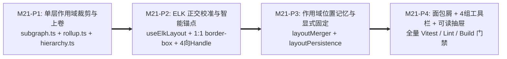

# M21 实施任务卡：架构拓扑单层平铺逐级下钻、ELK 正交布局校准与全链路易用性升级

> **文档版本**：`v1.0.0`
> **创建日期**：`2026-11-13`
> **最后更新**：`2026-11-13`
> **所属阶段**：阶段四 — 研发实施与 TDD 门禁 (Implementation & TDD Gate)
> **里程碑编号**：`M21 — 架构拓扑单层平铺逐级下钻重构、ELK 正交布局校准与全链路易用性升级`
> **覆盖需求范围**：`F-04`（分层结构拓扑画布）、`F-04.1`（单层平铺逐级下钻、`FIRST/LAST` 外部传送门卡与面包屑导航）、`F-04.2`（四组收敛工具栏、筛选 Popover、Filter Chips、搜索直达聚焦与可读边详情抽屉）、`F-04.3`（按作用域隔离的位置记忆、仅显式拖拽/图钉固定才锁定、`1:1 border-box`、四向智能锚点与多边标签防叠）、`SC-11`（大规模拓扑端到端验收）
> **前置依赖**：`M19`、`M20`（✅ 已交付）、[`../05-adr/17-topology-single-layer-drilldown-and-layout-ux-adr.md`](../05-adr/17-topology-single-layer-drilldown-and-layout-ux-adr.md) (`v1.0.0`)
> **当前状态**：⏳ **待实施 (Planned)**

### 修订记录

| 版本 | 日期 | 作者 | 变更说明 |
| :--- | :--- | :--- | :--- |
| `v1.0.0` | `2026-11-13` | Architecture Team | 初版发布：依据已采纳 ADR-17 (`v1.0.0`) 落盘 M21 四阶段拆分（P1~P4）、交付物清单、TDD 先行测试用例矩阵与自动化准出门禁（后端零 DDL / 零 API 破坏性变更，纯前端与测试改造） |

---

## 1. 里程碑目标与四阶段交付拆解 (Phased Execution Plan)

M21 依据 [`ADR-17`](../05-adr/17-topology-single-layer-drilldown-and-layout-ux-adr.md) (`v1.0.0`) 彻底解决拓扑画布「框中框嵌套拥挤、子容器 ELK 20px 挤压节点标签、CSS `content-box` 尺寸偏差与 Handle 悬空、跨作用域位置记忆污染、纵向固定句柄回头弯、工具栏过载及边抽屉仅显示内部 ID」等系统性痛点，围绕用户**“只看当前关注层级的直接内部成员及跨界外部上下游，一层一层下钻进入”**的心智模型，实施纯前端架构与交互精修（100% 向后兼容既有 `traefik_topology_layouts` 表与 `/api/arch/topology/*` 接口，零数据库或后端契约破坏）。

本里程碑严格按 **4 个递进子阶段（P1 ~ P4）** 推进（每个阶段先写红测试 Red ➔ 实现变绿 Green ➔ 重构清洁 Refactor）：



| 子阶段 | 阶段名称 | 核心交付内容 | 估算改动规模 |
| :--- | :--- | :--- | :---: |
| **M21-P1** | **单层平铺裁剪与代表节点上卷引擎** | 重构 `model/subgraph.ts`、`model/rollup.ts` 与 `model/hierarchy.ts`：废除同屏多级展开树计算；全局层仅展示 `depth === 0` 顶层节点，聚焦态下不输出聚焦根外框、仅输出 `parent_id === focusNodeId` 的直接子节点 + LCA 外部传送门卡（带 `UPSTREAM`/`DOWNSTREAM`/`BIDIRECTIONAL` 方向标记）；实现更深后代向直接子容器的收敛映射 `repOverrides` 及同直接子容器内边计数徽章；保留有向 N-Hop 邻域与多维切片组合并向上投影至当前层代表节点；更新 `ArchCanvasScopeAndFilter.test.ts` 与 `ArchCanvasRollup.test.ts`。 | ~450 LOC |
| **M21-P2** | **ELK 单层正交参数校准、`1:1 border-box` 与四向智能锚点路由** | 重构 `layout/useElkLayout.ts`、`layout/layoutProcessor.ts`、`ArchCanvas.css`、`nodes/*.tsx` 与 `edges/RollupEdge.tsx`：切换为纯扁平单层 `layered` 参数（`nodeNodeBetweenLayers=110`、`nodeNode=48`、`edgeNode=36`、`edgeEdge=24`）；为 `ExternalContextNode` 注入 `elk.layered.layering.layerConstraint = FIRST / LAST`；全节点统一切换 `box-sizing: border-box` 且 CSS 宽高与 ELK 常量 `1:1` 对齐（Container `260×96`、Module `240×88`、ExtCtx `240×104`、External `216×72`）；四类节点各挂载 `top/right/bottom/left` 4 个 `<Handle>`，实现 `selectOptimalHandles` 动态最优锚点选择与 `SmoothStep` 同锚点多边标签确定性错位；拖拽中执行坐标钳制避免卡片跳位。 | ~520 LOC |
| **M21-P3** | **按 `(view, focus_scope)` 隔离的位置记忆与显式固定持久化** | 重构 `layout/layoutMerger.ts`、`layout/layoutPersistence.ts` 与 `ArchCanvas.tsx`：移除 `onPositionsComputed` 自动落锁坐标逻辑（`AGG/EXPAND`、`REALIZATION`、过滤切换及 `[✨ 自动整理]` 对未固定节点重新走 ELK）；按 `focusScope` 分桶管理内存位置记忆与 `localStorage` 草稿；仅用户拖拽或点击 `📌` 图钉触发节点固定与同层单层 `resolveOverlapsBottomUp`（`32px` 间距）；外部传送门卡持久化使用 `${focusScope}::${extId}` 复合键（满足 `len <= 128` 零 DDL 兼容）；更新 `ArchCanvasHybridLayout.test.ts`。 | ~380 LOC |
| **M21-P4** | **面包屑导航、4 组工具栏 Popover、可读边详情抽屉与端到端门禁** | 新增 `panels/TopologyBreadcrumbBar.tsx`，重构 `panels/ArchCanvasToolbar.tsx`、`panels/EdgeDetailDrawer.tsx`、`pages/TopologyWorkbenchPage/index.tsx` 及 `ArchCanvas.tsx`：删去层级滑杆、`[全展]` 与滚轮语义展开；工具栏收敛为 4 组 + `[⚙️ 筛选与图层 (N)]` Popover + Filter Chips；双击容器/`[进入 ▸]` 直接下钻、双击外部传送门卡/点击 `[↗ 跳转至该域]` 切换聚焦、空白双击/`Esc`/`Backspace` 逐级回退；搜索命中深层节点自动聚焦到其父容器并 `fitView` 脉冲高亮；`EdgeDetailDrawer` 解析节点中文名/类型徽章并提供跳转按钮；更新全套前端单测与通过 `make test && make lint && make build` 门禁。 | ~600 LOC |

---

### 1.1 交付物文件清单 (Deliverables Inventory)

| 端侧 | 动作 | 文件路径 | 职责说明 |
| :--- | :--- | :--- | :--- |
| **前端模型** | 修改 | `frontend/src/components/ArchCanvas/model/hierarchy.ts` | 新增 `getBreadcrumbNodes`、`getDirectChildren` 与单层直接子祖先查找函数 `findDirectChildUnderFocus`。 |
| **前端模型** | 修改 | `frontend/src/components/ArchCanvas/model/subgraph.ts` | 重构 `scopeAndFilter` 为单层平铺可见集计算：聚焦根不进画布、仅保留直属子节点 + `resolveExternalRep` 外部传送门卡、`repOverrides` 映射与统一守卫计数。 |
| **前端模型** | 修改 | `frontend/src/components/ArchCanvas/model/rollup.ts` | 接入 `repOverrides` 执行单层代表节点边上卷、同直属子容器内部边汇总计数、保持 `AGG/EXPAND` 与 `REALIZATION` 隔离。 |
| **前端布局** | 修改 | `frontend/src/components/ArchCanvas/layout/useElkLayout.ts` | 统一切换为单层 `layered` 正交排版（`nodeNodeBetweenLayers=110`、`FIRST/LAST` 列约束）与 `1:1` 节点尺寸表 constants (`NODE_DIMENSIONS`)。 |
| **前端布局** | 修改 | `frontend/src/components/ArchCanvas/layout/layoutProcessor.ts` | 扁平节点映射（无 `parentId` 嵌套）；新增 `selectOptimalHandles` 4 向动态锚点选择与 `computeEdgeSiblingOffsets` 同锚点多边偏移分组。 |
| **前端布局** | 修改 | `frontend/src/components/ArchCanvas/layout/layoutMerger.ts` | 拆出 `ScopedPositionBucket`（按 `focusScope` 分桶），仅 `pinnedIds` / 手动拖拽锁位，未固定节点随筛选与整理重走 ELK，支持单层 `resolveOverlapsBottomUp` 与节点集合 Diff。 |
| **前端布局** | 修改 | `frontend/src/components/ArchCanvas/layout/layoutPersistence.ts` | 支持 `${focusScope}::${extId}` 外部传送门卡复合键读写、按 `(view, focusScope)` 隔离草稿读写与增量合并。 |
| **前端节点与边** | 修改 | `frontend/src/components/ArchCanvas/nodes/ContainerNode.tsx`、`ModuleNode.tsx`、`ExternalContextNode.tsx`、`ExternalNode.tsx` | 四类节点统一挂载 `top`/`right`/`bottom`/`left` 四向 `<Handle>`；`ContainerNode` 主操作聚焦 `[进入 ▸]`；移除多行撑破高度文本，超出单行省略号并配 `title`。 |
| **前端节点与边** | 修改 | `frontend/src/components/ArchCanvas/edges/RollupEdge.tsx` | 接入四向 `sourcePosition` / `targetPosition` 与 `siblingOffset` 胶囊标签位移，避免同锚点标签重叠。 |
| **前端画布与样式** | 修改 | `frontend/src/components/ArchCanvas/ArchCanvas.tsx`、`ArchCanvas.css` | 统一 `box-sizing: border-box` 与 `260×96 / 240×88 / 240×104 / 216×72` 严密尺寸；绑定双击下钻、空白双击/`Esc`/`Backspace` 回退上一级；拖拽实时状态更新而不自动写入永久锁。 |
| **前端工具栏与面板** | **新增** | `frontend/src/components/ArchCanvas/panels/TopologyBreadcrumbBar.tsx` | 顶部层级面包屑条（`[← 返回上一级]` + 路径链接 + 当前层统计胶囊 + `[🌐 返回全局]`）。 |
| **前端工具栏与面板** | 修改 | `frontend/src/components/ArchCanvas/panels/ArchCanvasToolbar.tsx` | 收敛为 4 个控制组，移除深度滑杆/`全展`/滚轮开关，新增 `[⚙️ 筛选与图层 (N)]` Popover 与栏末可单删 Filter Chips；搜索直达父容器聚焦。 |
| **前端工具栏与面板** | 修改 | `frontend/src/components/ArchCanvas/panels/EdgeDetailDrawer.tsx` | 通过 `nodeMap` 解析并呈现源/目标节点中文名称、Code 与类型徽章，并新增 `[🎯 进入源域]` / `[🎯 进入目标域]` 快捷跳转。 |
| **前端页面** | 修改 | `frontend/src/pages/TopologyWorkbenchPage/index.tsx` | 清理废弃 URL 状态（`depth`），对齐 `?focus=` / `?topo_*` 同步逻辑，衔接单层 `ScopedGraph` 与作用域隔离布局持久化状态。 |
| **前端测试** | 修改 | `frontend/src/__tests__/ArchCanvasScopeAndFilter.test.ts`、`ArchCanvasRollup.test.ts`、`ArchCanvasHybridLayout.test.ts`、`TopologyFocusAndPersistenceWorkbench.test.tsx`、`frontend/src/components/ArchCanvas/__tests__/ArchCanvas.test.tsx` | 按 TDD 先行编写并覆盖单层直属可见、左右 `FIRST/LAST`、四向智能锚点、同锚点标签偏移、`1:1` 尺寸、作用域隔离位置记忆及 4 组工具栏/抽屉可读性断言。 |

---

## 2. TDD 先行测试用例矩阵 (Red-Green-Refactor Test Matrix)

### 2.1 M21-P1：单层作用域裁剪与上卷纯算法单测
| 用例标识 | 验证点 | 核心断言 |
| :--- | :--- | :--- |
| `testSingleLayerScope_GlobalShowsTopLevelOnly` | 全局层 (`focusNodeId=null`) 可见集 | 多层级树（子系统 -> 2级功能组 -> 模块）下 `visibleIds` 仅含 `depth === 0` 顶层节点；全为顶级平铺，无子孙节点。 |
| `testSingleLayerScope_FocusShowsDirectChildrenAndNoRootBox` | 聚焦下钻单层直属节点规则 | `focusNodeId = 'sub_1'` 时，`sub_1` 自身不在 `visibleIds` 中；`visibleIds` 内部节点严格满足 `parent_id === 'sub_1'`（`relativeDepth === 1`）；深层后代通过 `repOverrides` 精确映射到对应直属功能组。 |
| `testSingleLayerScope_ExternalPortalsAndDynamicViolation` | 跨界 LCA 外部传送门卡与方向分类 | 与聚焦域内深层节点存在调用或动态 `VIOLATION` / `IMPL_UNRESOLVED` 边的外部节点均按 LCA 收敛生成传送门卡，零丢边，并精确标定 `UPSTREAM` / `DOWNSTREAM` / `BIDIRECTIONAL`。 |
| `testSingleLayerRollup_InternalBadgeCounting` | 同直接子容器内部边收敛计数 | 同一直接子组内的多条模块依赖在 `rollup` 后不输出自环边，转为该子组卡的 `internalEdgeCount` 徽章累加。 |

### 2.2 M21-P2：ELK 单层参数、`1:1 border-box` 与四向智能锚点单测
| 用例标识 | 验证点 | 核心断言 |
| :--- | :--- | :--- |
| `testElkFlatGraph_SpacingAndFirstLastConstraints` | ELK 选项注入校验 | `buildElkGraph` 输出扁平无子容器的根 `layoutOptions` 含 `nodeNodeBetweenLayers = '110'`、`nodeNode = '48'`、`edgeNode = '36'`；`UPSTREAM` 外部传送门卡含 `layerConstraint: 'FIRST'`，`DOWNSTREAM` 含 `LAST`。 |
| `testNodeDimensions_ExactMatchWithCssBoxSizing` | CSS `1:1 border-box` 与常量契约 | 校验 `NODE_DIMENSIONS`（`260×96`, `240×88`, `240×104`, `216×72`）并在 `ArchCanvas.css` 存在对应 `box-sizing: border-box` 规则保护。 |
| `testSelectOptimalHandles_VerticalAndReverseAndStandard` | 四向智能锚点选择纯函数 | 源在正上方/正下方时选中 `bottom->top` / `top->bottom`；源在右侧时选中 `left->right`；标准左到右选中 `right->left`。 |
| `testEdgeSiblingOffsets_ConvergingAtSameHandle` | 多边同锚点汇聚标签错位 | 3 条汇聚于同一节点 `left` 锚点的 `SmoothStep` 边获得的偏移数组互不相等（对称分布如 `-26, 0, +26`）。 |

### 2.3 M21-P3：按作用域隔离的位置记忆与显式固定单测
| 用例标识 | 验证点 | 核心断言 |
| :--- | :--- | :--- |
| `testLayoutMemory_AutoElkDoesNotPinOrPollute` | ELK 自动坐标不落锁 | `onPositionsComputed` 后 `pinnedIds` 仍为空；切换 `AGG -> EXPAND` 或激活 `REALIZATION` 时重新调用 ELK，不会标记全图退化。 |
| `testLayoutMemory_ScopedBucketsAndExternalCompositeKey` | 按 `(view, focus_scope)` 隔离与 `${focusScope}::${extId}` 持久化 | 在 `sub_1` 中拖动 `ext_ctx_sub_2` 仅写入 `sub_1::ext_ctx_sub_2`，切换至 `sub_3` 视图时 `sub_3::ext_ctx_sub_2` 不受影响；点击 `[✨ 自动整理]` 保留所有 `pinned` 节点坐标并重排未固定节点。 |

### 2.4 M21-P4：工作台 UX 交互与可读性组件单测
| 用例标识 | 验证点 | 核心断言 |
| :--- | :--- | :--- |
| `testWorkbench_DrillDownBreadcrumbAndEscBack` | 双击下钻、面包屑直跳与 `Esc` 逐级返回 | 渲染全局后双击 `sub_1`（或点击 `[进入 ▸]`）切换 `focusScope='sub_1'` 并显示面包屑 `全系统全景 > sub_1` 与当前层统计胶囊；触发 `Esc` 或点击 `[← 返回上一级]` 无损回到上一级。 |
| `testToolbar_FourGroupsPopoverAndFilterChips` | 4 组工具栏与 Filter Chips | 页面**不存在**旧版层级滑杆、`全展` 与滚轮展开按钮；点击 `[⚙️ 筛选与图层]` 勾选「仅看我负责的」和切换 `EXPAND`，栏上渲染两个可单独点击 `×` 关闭的 Filter Chip。 |
| `testSearchFlyTo_AutoSwitchesFocusScopeToParent` | 搜索深层节点直达其父容器层 | 搜索并选中位于 `grp_1` 下的 `mod_101` 时，`focusScope` 自动切换至 `grp_1` 并发起聚焦脉冲高亮。 |
| `testEdgeDetailDrawer_HumanReadableNamesAndJump` | 边详情抽屉中文名解析与跳转 | 打开边抽屉时头部显示模块/容器中文名称、Code 及类型徽章（断言**不直接显示裸 `mod_101` ID 作为主标题**），点击 `[🎯 进入目标域]` 正确切换聚焦。 |

---

## 3. 里程碑准出质量门禁与自动化验收命令 (Exit Gate & AC)

M21 实施完成后，必须顺序执行并通过以下全部门禁（零失败、零 Warning）：

- [ ] **AC-M21-01（单层裁剪、ELK 布局与作用域持久化纯算法 Vitest + 覆盖率门禁）**：
  ```bash
  cd frontend && npx vitest run --coverage \
    src/__tests__/ArchCanvasScopeAndFilter.test.ts \
    src/__tests__/ArchCanvasRollup.test.ts \
    src/__tests__/ArchCanvasHybridLayout.test.ts
  ```
- [ ] **AC-M21-02（拓扑画布组件、工作台面包屑/工具栏/抽屉全量 Vitest 单测）**：
  ```bash
  cd frontend && npx vitest run \
    src/components/ArchCanvas/__tests__/ArchCanvas.test.tsx \
    src/__tests__/TopologyFocusAndPersistenceWorkbench.test.tsx \
    src/__tests__/ArchCanvasScale.perf.test.ts
  ```
- [ ] **AC-M21-03（前端全量测试、TypeScript 类型检查与 ESLint 零告警门禁）**：
  ```bash
  make lint && cd frontend && npx vitest run
  ```
- [ ] **AC-M21-04（后端无回归 + 单二进制生产构建与环境清理门禁）**：
  ```bash
  make test && make build && make clean
  ```
