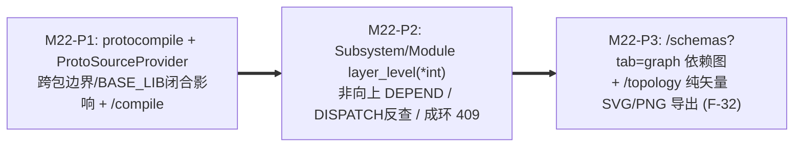

# M22 实施任务卡：纯 Go `protocompile` 编译底座、架构分层逆向依赖校验与依赖图谱 (`F-32`)

> **文档版本**：`v1.1.0`
> **创建日期**：`2026-11-13`
> **最后更新**：`2026-11-13`
> **所属阶段**：阶段四 — 研发实施与 TDD 门禁 (Implementation & TDD Gate)
> **里程碑编号**：`M22 — 纯 Go protocompile 编译底座、架构分层校验与契约/拓扑依赖可视化导出`
> **覆盖需求范围**：`F-02.1`（`REALIZATION` 层级约束与 `DISPATCH` 消费方校核）、`F-03`（描述集编译入池与跨包边界隔离）、`F-04`（拓扑图程序化矢量导出与层级元数据）、`F-21`（Git-Only `.proto` 编译底座）、`F-26`（`BASE_LIB` 传递闭包影响分析与编译联动）、`F-30`（架构分层方向校验）、`F-32`（`/schemas?tab=graph` 挂载与 `/topology` 纯矢量 SVG/Canvas PNG 导出）、`SC-13`
> **前置依赖**：`M1~M21`（✅ 已交付）、[`../05-adr/18-proto-full-lifecycle-and-git-mr-governance-adr.md`](../05-adr/18-proto-full-lifecycle-and-git-mr-governance-adr.md) (`v1.2.0`)
> **当前状态**：📋 **已定稿待实施 (Planned)**

### 修订记录

| 版本 | 日期 | 作者 | 变更说明 |
| :--- | :--- | :--- | :--- |
| `v1.0.0` | `2026-11-13` | Architecture Team | 初版发布：依据 ADR-18 (`v1.1.0`) 拆解 M22 三个递进子阶段（P1~P3）、全栈交付清单、安全边界、`testdb` 隔离 TDD 测试矩阵与自动化准出门禁 |
| `v1.1.0` | `2026-11-13` | Architecture Team | 依据 ADR-18 (`v1.2.0`) 检视修订：1. 新增 `decoder.ProtoSourceProvider` 抽象隔离 M22 与 M25 DB 源码依赖；2. 强制跨包编译跳过全部 `external_imports` 操作抽取且剥离外部导入文件 `SourceCodeInfo` 防 16MB 膨胀；3. `breaking.go` (`FindAffectedDependents`) 补齐 `BASE_LIB` 0-Service 变更的反向 `import` 闭包追踪；4. 明确 `layer_level` 更新 DTO 采用 `*int` 区分未传与显式 `0`、绑定 `ContractID` 反向校验 `DISPATCH` 消费方与 DIP 语义；5. `F-32` 导出禁用 `<foreignObject>` 改用纯矢量 `<svg>` + 离屏 Canvas |

---

## 1. 里程碑目标与三阶段交付拆解 (Phased Execution Plan)

M22 为后续 M23~M26 构建无外部 `protoc` 二进制依赖的统一编译、影响面扩散分析与架构分层治理地基：
1. 在控制面引入纯 Go **`github.com/bufbuild/protocompile`**（自有源文件开启 `SourceInfoStandard`），配合四级确定性虚拟 `Resolver`（经 `decoder.ProtoSourceProvider` 抽象解耦 `M22` 与 `M25`）、路径安全消毒、**跳过 `external_imports` 并剥离外部导入文件 `SourceCodeInfo` 防 16MB 膨胀**，以及 `decoder/breaking.go` 的 **`BASE_LIB` 反向 `import` 闭包穿透**；
2. 在逻辑架构模型 `traefik_subsystems` 与 `traefik_modules` 中增量引入可选层级字段 `layer_level`（PUT 入参使用 `*int` 区分未传与显式 `0`）与有效继承算法，对模块依赖 (`DEPEND`)、契约实现 (`REALIZATION` + 绑定 `ContractID` 时反向校验 `DISPATCH` 消费方) 及层级重调操作施加非向上依赖及内部有向防环双重门禁；
3. 补齐后端已就绪但前端未挂载的 `GET /api/proto-schemas/dependencies-graph` 接口面板（`/schemas?tab=graph`），并在 `/topology` 工具栏落地零服务端请求、**禁 `<foreignObject>`** 的客户端程序化纯矢量 SVG + 离屏 Canvas PNG 导出能力（`F-32`），严守 `M22~M26` 前端总增量 `<= 150KB gzip`。

本里程碑按 **3 个递进子阶段（P1 ~ P3）** 推进（每个阶段严格遵循 `Red -> Green -> Refactor` TDD 循环）：



| 子阶段 | 阶段名称 | 核心交付内容 | 估算改动规模 |
| :--- | :--- | :--- | :---: |
| **M22-P1** | **纯 Go `protocompile` 抽象编译器、跨包边界与 `BASE_LIB` 扩散雷达** | 更新 `go.mod` 引入 `github.com/bufbuild/protocompile`；扩展 `models/proto_schema.go` 增加 `SourceType`（`UPLOAD_PB` / `ONLINE_COMPILE` / `GIT_SYNC` / `GIT_MR_AUTO`）、`GitRepoID`、`SourceBundleID`、`SourceCommitSHA`、`SourceMRIID`（先留可空指针列，待 M25 关联 `GitRepo`/`GitProtoBundle`）；在 `internal/server/decoder` 新增 `compile.go` 与 `ProtoSourceProvider` 接口（M22 由已编译源码缓存实现，M25 接入 `traefik_proto_files`），实现安全 POSIX 相对路径清洗（拦截前导 `/`、`..`、`\0` 与 `> 16MB` 总源码上限）、四级虚拟 `Resolver`（① 当次虚拟树+`proto_include_dirs` ➔ ② `ProtoSourceProvider` `BASE_LIB` 优先 ➔ ③ `CompiledRegistry.Files` ➔ ④ `google/protobuf/*` WKT），**自有文件保留 `SourceInfoStandard`、外部 `external_imports` 文件在生成 `FileDescriptorSet` 前剥离 `SourceCodeInfo` 且 `extractOperationsFromDescriptor` 跳过全部 `external_imports` 杜绝服务重复归属冲突**；升级 `breaking.go` (`FindAffectedDependents`)：当 `Violation.ServiceName == ""` 时沿 `CompiledRegistry.Files` 反向递归遍历 `import` 闭包定位下游 `Service -> ModuleService -> Consumer`；新增 `POST /api/proto-schemas/compile` (`AdminOnly`, 审计 `traefik_schema:compile`)；同步巩固 `cmd/agent` 依赖隔离断言（严禁引入 `protocompile`）。 | ~620 LOC |
| **M22-P2** | **架构 `layer_level` 分层方向约束、`DISPATCH` 反查与成环拦截 (`F-30`)** | 扩展 `models/arch.go`（`Subsystem.LayerLevel`、`Module.LayerLevel`，默认 `0` 表示未指定）及有效层级计算函数 `EffectiveLayer(sub, mod)`；更新 PUT 请求 DTO 采用 **`*int`（`nil` 保持原值，显式 `0` 置为不限制）**；重构 `internal/server/topology` 与 `handlers/arch_handler.go`：① `POST /api/arch/modules/:id/dependencies`、`PUT /api/arch/subsystems/:id` 与 `PUT /api/arch/modules/:id` 事务内校验 `consumer_eff_layer >= provider_eff_layer`（任一端 `0` 跳过），违者返 `409 ERR_LAYER_VIOLATION`；② 新增 BFS/DFS 有向环检测（仅针对内部 `DEPEND`，外部系统依赖明确豁免），成环返 `409 ERR_CYCLIC_DEPENDENCY`；③ `POST /api/arch/modules/:id/services` 与 `PUT /api/arch/module-services/:serviceId` 增加 **`impl_eff_layer >= contract_lib_eff_layer` 校验（DIP 说明：下层业务模块不得实现上层接口库，接口库应处于同层或更底层）** 并**反向校验绑定该 `ContractID` 全部既有 `DISPATCH` 消费方均满足 `consumer_eff_layer >= impl_eff_layer`**，违者返 `409 ERR_REALIZATION_LAYER_INVERSION` / `ERR_LAYER_VIOLATION`；④ `GET /api/arch/topology/graph` 在 `SUBSYSTEM` 与 `MODULE` 节点 `meta` 中透出 `layer_level` 与 `effective_layer_level`。 | ~460 LOC |
| **M22-P3** | **契约依赖图挂载与拓扑画布程序化纯矢量导出 (`F-32`)** | 更新 `frontend/src/types/schema.ts`、`types/topology_graph.ts` 与 `api/schema.ts`：补全 `ProtoSourceType`、`layer_level`（表单区分未设/显式 `0`）、`effective_layer_level` 及 `compileProtoSchemaBundle`；新增 `frontend/src/pages/ProtoSchemaWorkbenchPage/ProtoDependenciesGraphPane.tsx` 复用既有 `@xyflow/react` + `elkjs`（与 M21 同款零新大包体，全量 M22~M26 JS 增量严守 **`<= 150KB gzip`**）挂载 `/schemas?tab=graph`；在 `frontend/src/components/ArchCanvas/panels/ArchCanvasToolbar.tsx` 与 `exportUtils.ts` 实现 `[📷 导出拓扑图 (SVG/PNG)]`：基于节点坐标/标签/边数据与 `getComputedStyle` 解析当前明暗 `--color-*` 变量**程序化构造纯矢量 `<svg>`** 并通过离屏 2x `<canvas>` 光栅化导出 PNG `Blob`（**严禁使用易触发 Canvas 污染或丢失变量的 `<foreignObject>`**，且零后端导出请求），同时检查宿主/`cmd/server` CSP 安全头放行 `blob:`；完善 `ArchitectureWorkbenchPage` `layer_level` 配置控件。 | ~560 LOC |

---

### 1.1 交付物文件清单 (Deliverables Inventory)

| 端侧 | 动作 | 文件路径 | 职责说明 |
| :--- | :--- | :--- | :--- |
| **后端依赖** | 修改 | `go.mod` / `go.sum` | 仅在控制面服务端依赖树引入 `github.com/bufbuild/protocompile`，确保 `cmd/agent` 零引用 |
| **后端模型** | 修改 | `models/proto_schema.go`、`models/arch.go` | `ProtoSchema` 新增 `source_type`、`git_repo_id`、`source_bundle_id`、`source_commit_sha`、`source_mr_iid`；`Subsystem` 与 `Module` 新增 `layer_level` |
| **后端编译** | 新增/修改 | `internal/server/decoder/protocompile.go`、`registry.go`、`breaking.go` | `ProtoSourceProvider` 抽象、四级虚拟 `Resolver`、POSIX 路径消毒、跨包跳过 `external_imports` 与外部 `SourceCodeInfo` 剥离、`BASE_LIB` 反向 `import` 闭包扩散影响分析 |
| **后端拓扑** | 修改 | `internal/server/topology/static_topology.go`、`graph_topology.go`、`service_contract.go` | `*int` `layer_level` 更新区分、抽离 `CheckLayerAndCycleConstraints`（含 `DISPATCH` 消费方反向校核）统一核验非向上 `DEPEND`、内部有向防环与 `REALIZATION` `impl >= contract_lib` |
| **后端接口** | 修改 | `handlers/proto_handler.go`、`handlers/arch_handler.go`、`handlers/routes.go`、`cmd/server/main.go` | 新增 `POST /api/proto-schemas/compile`；扩展 `GET /api/proto-schemas`；加固层级与环路 `409` 拦截；`cmd/server` 放行客户端 SVG/PNG 导出 `blob:` CSP |
| **后端测试** | 新增/修改 | `internal/server/decoder/protocompile_resolver_test.go` (新增)、`handlers/proto_compile_test.go` (新增)、`internal/server/topology/layer_guard_test.go` (新增)、`handlers/arch_proto_agent_test.go` | 覆盖 `SC-13` 四级 Resolver、路径遍历拦截、`layer_level` / `REALIZATION` / 环路 `409`、`F-26` 衔接与 `cmd/agent` 依赖隔离 |
| **前端工作台** | 新增/修改 | `frontend/src/types/schema.ts`、`types/topology_graph.ts`、`api/schema.ts`、`pages/ProtoSchemaWorkbenchPage/ProtoDependenciesGraphPane.tsx` (新增)、`ProtoSchemaWorkbenchPage.tsx`、`SchemaUploadModal.tsx`、`components/ArchCanvas/panels/ArchCanvasToolbar.tsx`、`pages/ArchitectureWorkbenchPage/*` | `/schemas?tab=graph` 依赖图可视化、`在线源码编译` 提交入口、`layer_level` 表单配置与 `/topology` SVG/PNG 客户端导出 |
| **前端测试** | 新增/修改 | `frontend/src/pages/ProtoSchemaWorkbenchPage/__tests__/ProtoDependenciesGraphPane.test.tsx` (新增)、`frontend/src/__tests__/TopologyExport.test.tsx` (新增) | 验证依赖图集群渲染/过滤跳链与零服务端请求的 SVG/PNG `Blob` 导出 |

---

## 2. 核心技术设计细化与红线约束

1. **四级虚拟 `Resolver` 与跨包编译边界（严禁逃逸到宿主机本地磁盘）**：
   - `protocompile.Compiler.Resolver` 严禁直接使用宿主机 OS 文件系统 `os.Open`：所有候选路径经 `path.Clean` 归一化并校验拒绝前导 `/`、`..` 与 `\0` 字节；
   - 按 **`whence` 内存虚拟文件集合 -> `proto_include_dirs` 候选前缀拼接 -> `decoder.ProtoSourceProvider` DB 源码（`BASE_LIB` 优先，M22 使用已编译源码缓存、M25 无缝对接 `traefik_proto_files`）-> 全局生效 `CompiledRegistry.Files` 描述符 -> 内置 WKT（`google/protobuf/*.proto`）** 严格顺序解析；
   - **跨包契约边界与 `16MB` 防膨胀**：`extractOperationsFromDescriptor` **跳过全部 `external_imports` 中的文件**（不限 `BASE_LIB`，跨业务/网关包导入亦不得重复抽取服务名造成 `(service, operation)` 冲突）；同时仅自有源文件保留完整 `SourceCodeInfo`（`SourceInfoStandard`），**外部导入依赖在写入 `DescriptorBytes` 前剥离 `SourceCodeInfo`**，防止大型公共包连带突破 `16MB` 数据库制品上限；
   - **`BASE_LIB` 0-Service 破坏性变更扩散追踪**：`decoder/breaking.go` (`FindAffectedDependents`) 当检出 `Violation.ServiceName == ""`（如修改 `BASE_LIB` 公共 `Message` 字段号/类型或 `Enum` 值）时，沿全局 `CompiledRegistry.Files` 反向递归查找所有直接或传递 `import` 该文件的业务 `.proto` 所导出的 `Service` -> 关联 `ModuleService` -> 下游消费者及负责人，杜绝影响雷达返回空列表。
2. **有效层级计算与三类 `409` 精确判定法则**：
   - **继承公式**：`EffectiveLayer(m)` 若 `m.LayerLevel > 0` 取 `m.LayerLevel`，否则继承所属 `Subsystem.LayerLevel`；PUT 请求 DTO 字段采用 **`*int`** 语义（`nil` 保持原值，显式传入 `0` 重置为未分层豁免）；任意一端 `EffectiveLayer == 0` 时豁免层间高度比较（但**内部依赖 `DEPEND` 的有向环检测仍需在所有层级生效**）。
   - **方向判定与 `DISPATCH` 反向校核**：对于 `consumer -> provider`，必须满足 `consumer_eff_layer >= provider_eff_layer`（数值越小越底层，数值越大越上层）；对 `REALIZATION`，要求 `impl_module_eff_layer >= contract_lib_eff_layer`（依据 DIP，接口库应被同层或上层业务实现，下层不得实现上层契约库）；**将多实现 `ModuleService` 绑定 `ContractID` 或调整 `ArchProcess`/模块层级时，同步反向校验引用该 `ContractID` 的所有既有 `DISPATCH` 消费方均满足 `consumer_eff_layer >= impl_eff_layer`**，违者原子回滚返 `409 ERR_LAYER_VIOLATION` / `ERR_REALIZATION_LAYER_INVERSION`。

---

## 3. TDD 先行测试用例矩阵 (TDD Test-First Matrix)

> 所有后端 DB 测试强制使用 `testdb.SetupIsolatedDB(t)` 并开启 `-race`；所有 Mock/测试服务仅绑定 `127.0.0.1`。

| 测试文件 | 核心测试函数 (Red -> Green) | 断言覆盖范围与边界条件 |
| :--- | :--- | :--- |
| `internal/server/decoder/protocompile_resolver_test.go` | `TestProtoCompile_FourTierResolver_ExternalSkipAndStripSourceInfo` | 验证 4 级顺序（含 `ProtoSourceProvider` `BASE_LIB` 优先）；断言导入外部 `.pb`/`.proto` 时：`extractOperationsFromDescriptor` 跳过全部 `external_imports` 无重复服务、自有文件保留完整 `SourceCodeInfo` 且外部依赖 `SourceCodeInfo` 已剥离 |
| `internal/server/decoder/protocompile_resolver_test.go` | `TestProtoCompile_PathTraversalAnd16MBLimitRejected` & `TestBreaking_BaseLibMessageChangePropagatesViaReverseImports` | 注入 `../etc/passwd`、`/abs/a.proto`、`a\x00b.proto` 与超过 `16MB` 总源码被拒；构造 `BASE_LIB` `common.proto` 删除字段 (`ServiceName == ""`)，断言沿反向 `import` 闭包精准找出下游 `TradeService` 所在模块与负责人 |
| `handlers/proto_compile_test.go` | `TestProtoCompile_LinksDirectlyIntoBreakingChangeRadar` | 调用 `POST /api/proto-schemas/compile` 编译 `v1`（`source_type='ONLINE_COMPILE'`）并激活后，提交删字段的 `v2` 并传 `auto_activate=true`，断言触发 `F-26` 返回 `409 BREAKING_CHANGE_DETECTED` + 受影响下游；普通用户请求返回 `403`；记录 `traefik_schema:compile` 审计日志 |
| `handlers/proto_compile_test.go` | `TestSC13_ProtoCompileClosureLayerGuardAndGraphExport` | **SC-13 端到端后端部分**：编译多文件包 -> 校验与 `CompileTrialPool` 联动 -> `layer_level` 越层与成环全拦截 -> 校验 `GET /api/arch/topology/graph` 返回 `layer_level` 与 `effective_layer_level` |
| `internal/server/topology/layer_guard_test.go` | `TestLayerLevelGuard_PointerReset_DispatchBackcheck_AndCycles409` | 构造 `Infra(10) -> Biz(20)` 依赖返 `409`；`PUT` 省略 `layer_level` 时保留原层级、显式传 `0` 解除限制；为已有 `DISPATCH` 消费方 (`layer=15`) 的契约绑定 `layer=20` 实现模块触发 `409 ERR_LAYER_VIOLATION`；`A->B->C->A` 有向环返 `409 ERR_CYCLIC_DEPENDENCY` |
| `internal/server/topology/layer_guard_test.go` | `TestRealizationLayerLevelGuard_InversionConflict409` | 构造 `CONTRACT_LIB` 设 `layer_level=20`、实现业务模块设 `layer_level=10`，调用契约实现登记触发 `409 ERR_REALIZATION_LAYER_INVERSION`；实现模块改为 `20` 或 `30` 后成功 |
| `frontend/src/pages/ProtoSchemaWorkbenchPage/__tests__/ProtoDependenciesGraphPane.test.tsx` | `testDependenciesGraphPane_RendersBaseLibClusterAndFilters` | Mock `GET /api/proto-schemas/dependencies-graph`，验证 `BASE_LIB` 底座群集节点渲染、按分类筛选与点击节点跳链至 `?tab=assets&schema_id=` |
| `frontend/src/__tests__/TopologyExport.test.tsx` | `testTopologyExport_PureVectorSVGAndCanvasPNG_NoForeignObject` | 验证点击 `/topology` 工具栏 `[导出 SVG]` / `[导出 PNG]` 生成纯矢量 SVG（源码不含 `<foreignObject>`）与离屏 Canvas PNG `Blob`，断言过程发送 **0 次 HTTP 请求**、正确解析深浅 `--color-*` 变量、无硬编码 `#000`/`#fff` |

---

## 4. 自动化准出质量门禁与验收命令 (Exit Gate & Acceptance Commands)

```bash
# 1. 隔离防腐静态断言：cmd/agent 严禁引入 protocompile / gorm / dynamicpb
go list -deps ./cmd/agent | grep -E 'protocompile|gorm\.io|dynamicpb|go-git|sqlite' && exit 1 || echo "OK: cmd/agent isolated"

# 2. 全仓严禁 os/exec 调用外部 protoc 或 git 命令
grep -rnE 'exec\.Command\(["`'"'"']?(protoc|git)' cmd/ internal/ handlers/ models/ pkg/ && exit 1 || echo "OK: zero external protoc/git exec"

# 3. 后端隔离数据库与竞争检测全绿（M22 新增与既有单测）
TEST_DB_DSN="host=127.0.0.1 port=5432 user=postgres password=CodeShield618! dbname=postgres sslmode=disable" \
  go test -race ./internal/server/decoder/... ./internal/server/topology/... ./handlers/... ./models/...

# 4. 全量标准工程门禁（含 tsc --noEmit / eslint / vitest / go build / make clean）
make test && make lint && make build && make clean
```
