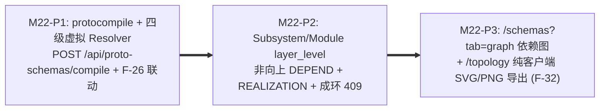

# M22 实施任务卡：纯 Go `protocompile` 编译底座、架构分层逆向依赖校验与依赖图谱 (`F-32`)

> **文档版本**：`v1.0.0`
> **创建日期**：`2026-11-13`
> **最后更新**：`2026-11-13`
> **所属阶段**：阶段四 — 研发实施与 TDD 门禁 (Implementation & TDD Gate)
> **里程碑编号**：`M22 — 纯 Go protocompile 编译底座、架构分层校验与契约/拓扑依赖可视化导出`
> **覆盖需求范围**：`F-02.1`（`REALIZATION` 层级约束）、`F-03`（描述集编译入池与版本演进）、`F-04`（拓扑图导出与层级元数据）、`F-21`（Git-Only `.proto` 编译底座）、`F-26`（编译产物无缝接入 AST 破坏性变更检测）、`F-30`（架构分层方向校验）、`F-32`（`/schemas?tab=graph` 挂载与 `/topology` SVG/PNG 导出）、`SC-13`
> **前置依赖**：`M1~M21`（✅ 已交付）、[`../05-adr/18-proto-full-lifecycle-and-git-mr-governance-adr.md`](../05-adr/18-proto-full-lifecycle-and-git-mr-governance-adr.md) (`v1.1.0`)
> **当前状态**：📋 **已定稿待实施 (Planned)**

### 修订记录

| 版本 | 日期 | 作者 | 变更说明 |
| :--- | :--- | :--- | :--- |
| `v1.0.0` | `2026-11-13` | Architecture Team | 初版发布：依据 ADR-18 (`v1.1.0`) 拆解 M22 三个递进子阶段（P1~P3）、全栈交付清单、安全边界、`testdb` 隔离 TDD 测试矩阵与自动化准出门禁 |

---

## 1. 里程碑目标与三阶段交付拆解 (Phased Execution Plan)

M22 为后续 M23~M25 构建无外部 `protoc` 二进制依赖的统一编译与架构分层治理地基：
1. 在控制面引入纯 Go **`github.com/bufbuild/protocompile`**（强制开启 `SourceInfoStandard`），配合四级确定性虚拟 `Resolver` 与路径安全消毒机制，实现将虚拟 `.proto` 源文件包直接内存编译为无损 `FileDescriptorSet` 并复用到 `CompileTrialPool`、`DiffIgnorePaths` 继承与 `F-26` 破坏性雷达中（`POST /api/proto-schemas/compile`）；
2. 在逻辑架构模型 `traefik_subsystems` 与 `traefik_modules` 中增量引入可选层级字段 `layer_level` 与有效继承算法，对模块依赖 (`DEPEND`)、契约实现 (`REALIZATION`) 及层级重调操作施加非向上依赖及内部有向防环双重门禁；
3. 补齐后端已就绪但前端未挂载的 `GET /api/proto-schemas/dependencies-graph` 接口面板（`/schemas?tab=graph`），并在 `/topology` 工具栏落地零服务端请求的客户端 SVG/PNG 导出能力（`F-32`）。

本里程碑按 **3 个递进子阶段（P1 ~ P3）** 推进（每个阶段严格遵循 `Red -> Green -> Refactor` TDD 循环）：



| 子阶段 | 阶段名称 | 核心交付内容 | 估算改动规模 |
| :--- | :--- | :--- | :---: |
| **M22-P1** | **纯 Go `protocompile` 抽象编译器与在线源码编译入池** | 更新 `go.mod` 引入 `github.com/bufbuild/protocompile`；扩展 `models/proto_schema.go` 增加 `SourceType`（`UPLOAD_PB` / `ONLINE_COMPILE` / `GIT_SYNC` / `GIT_MR_AUTO`）、`GitRepoID`、`SourceCommitSHA`、`SourceMRIID`（暂留指针列等待 M25 关联）；在 `internal/server/decoder` 新增 `compile.go`，实现安全 POSIX 相对路径清洗（拦截前导 `/`、`..`、`\0` 与 `> 16MB` 总源码上限）、开启 `WithSourceInfoMode(protocompile.SourceInfoStandard)` 的四级虚拟 `Resolver`（① 当次编译虚拟目录树+`proto_include_dirs` ➔ ② 指定仓/同命名空间 DB 最新主干 `.proto` ➔ ③ `CompiledRegistry.Files` 全局生效描述符 ➔ ④ `google/protobuf/*` WKT），并与 `CompileTrialPool`、`F-26` AST 破坏性检测及 `DiffIgnorePaths` 继承对接；新增 `POST /api/proto-schemas/compile` (`AdminOnly`, 审计 `traefik_schema:compile`) 并扩展 `GET /api/proto-schemas` `source_type` / `git_repo_id` 筛选；同步在 `cmd/agent` 加固依赖隔离断言（严禁引入 `protocompile`）。 | ~520 LOC |
| **M22-P2** | **架构 `layer_level` 分层方向约束与成环拦截 (`F-30` 架构部分)** | 扩展 `models/arch.go`（`Subsystem.LayerLevel`、`Module.LayerLevel`，默认 `0` 表示未指定）及有效层级计算函数 `EffectiveLayer(sub, mod)`；重构 `internal/server/topology` 与 `handlers/arch_handler.go`：① `POST /api/arch/modules/:id/dependencies` 与 `PUT /api/arch/subsystems/:id` / `PUT /api/arch/modules/:id` 事务内校验 `consumer_eff_layer >= provider_eff_layer`（跳过任一方 `eff_layer == 0`），违者返 `409 ERR_LAYER_VIOLATION` 附冲突链路详情；② 新增 BFS/DFS 有向环检测（仅针对内部 `DEPEND`，外部系统依赖明确豁免），成环返 `409 ERR_CYCLIC_DEPENDENCY`；③ `POST /api/arch/modules/:id/services` 与 `PUT /api/arch/module-services/:serviceId` 增加 `impl_eff_layer >= contract_lib_eff_layer` 校验，违者返 `409 ERR_REALIZATION_LAYER_INVERSION`；④ `GET /api/arch/topology/graph` 在 `SUBSYSTEM` 与 `MODULE` 节点 `meta` 中透出 `layer_level` 与 `effective_layer_level`。 | ~430 LOC |
| **M22-P3** | **契约依赖图挂载与拓扑画布 SVG/PNG 导出 (`F-32`)** | 更新 `frontend/src/types/schema.ts`、`types/topology_graph.ts` 与 `api/schema.ts`：补全 `ProtoSourceType`、`layer_level`、`effective_layer_level` 及 `compileProtoSchemaBundle` 请求方法；新增 `frontend/src/pages/ProtoSchemaWorkbenchPage/ProtoDependenciesGraphPane.tsx` 复用 `@xyflow/react` + `elkjs` 挂载 `/schemas?tab=graph`（按 `BASE_LIB` / `BUSINESS` / `GATEWAY` 分色、节点高亮过滤、点击直跳 `?tab=assets&schema_id=` 与导出 PNG/SVG）；在 `frontend/src/components/ArchCanvas/panels/ArchCanvasToolbar.tsx` 补齐 `[📷 导出拓扑图 (SVG/PNG)]` 纯客户端渲染下载（通过 SVG DOM 序列化与 Canvas 光栅化生成 `Blob` 下载，严禁向服务端发额外导出请求，并在 `cmd/server` CSP 安全头为 `img-src`/`connect-src` 收敛放行 `blob:`）；完善 `ArchitectureWorkbenchPage` `layer_level` 配置控件（全部样式严格采用 `--color-*` Token）。 | ~540 LOC |

---

### 1.1 交付物文件清单 (Deliverables Inventory)

| 端侧 | 动作 | 文件路径 | 职责说明 |
| :--- | :--- | :--- | :--- |
| **后端依赖** | 修改 | `go.mod` / `go.sum` | 仅在控制面服务端依赖树引入 `github.com/bufbuild/protocompile`，确保 `cmd/agent` 零引用 |
| **后端模型** | 修改 | `models/proto_schema.go`、`models/arch.go` | `ProtoSchema` 新增 `source_type`、`git_repo_id`、`source_commit_sha`、`source_mr_iid`；`Subsystem` 与 `Module` 新增 `layer_level` |
| **后端编译** | 新增 | `internal/server/decoder/protocompile.go` | 四级虚拟 `Resolver`、`proto_include_dirs` POSIX 路径消毒（防 `..`/绝对路径/`\0`）、`<= 16MB` 总量限制、`SourceInfoStandard` 编译与 `CompileTrialPool` 衔接 |
| **后端拓扑** | 修改 | `internal/server/topology/static_topology.go`、`graph_topology.go`、`service_contract.go` | 抽离 `CheckLayerAndCycleConstraints` 统一核验非向上 `DEPEND`、内部有向防环与 `REALIZATION` `impl >= contract_lib`；`TopologyGraphDTO` 透出 `layer_level` |
| **后端接口** | 修改 | `handlers/proto_handler.go`、`handlers/arch_handler.go`、`handlers/routes.go`、`cmd/server/main.go` | 新增 `POST /api/proto-schemas/compile`；扩展 `GET /api/proto-schemas`；加固层级与环路 `409` 拦截；`cmd/server` 放行客户端 SVG/PNG 导出 `blob:` CSP |
| **后端测试** | 新增/修改 | `internal/server/decoder/protocompile_resolver_test.go` (新增)、`handlers/proto_compile_test.go` (新增)、`internal/server/topology/layer_guard_test.go` (新增)、`handlers/arch_proto_agent_test.go` | 覆盖 `SC-13` 四级 Resolver、路径遍历拦截、`layer_level` / `REALIZATION` / 环路 `409`、`F-26` 衔接与 `cmd/agent` 依赖隔离 |
| **前端工作台** | 新增/修改 | `frontend/src/types/schema.ts`、`types/topology_graph.ts`、`api/schema.ts`、`pages/ProtoSchemaWorkbenchPage/ProtoDependenciesGraphPane.tsx` (新增)、`ProtoSchemaWorkbenchPage.tsx`、`SchemaUploadModal.tsx`、`components/ArchCanvas/panels/ArchCanvasToolbar.tsx`、`pages/ArchitectureWorkbenchPage/*` | `/schemas?tab=graph` 依赖图可视化、`在线源码编译` 提交入口、`layer_level` 表单配置与 `/topology` SVG/PNG 客户端导出 |
| **前端测试** | 新增/修改 | `frontend/src/pages/ProtoSchemaWorkbenchPage/__tests__/ProtoDependenciesGraphPane.test.tsx` (新增)、`frontend/src/__tests__/TopologyExport.test.tsx` (新增) | 验证依赖图集群渲染/过滤跳链与零服务端请求的 SVG/PNG `Blob` 导出 |

---

## 2. 核心技术设计细化与红线约束

1. **四级虚拟 `Resolver` 查找优先级（严禁逃逸到宿主机本地磁盘）**：
   - `protocompile.Compiler.Resolver` 严禁直接使用宿主机 OS 文件系统 `os.Open`：所有候选路径经 `path.Clean` 归一化并由正则/前缀校验拒绝 `strings.HasPrefix(p, "/")`、`strings.Contains(p, "..")` 与 `\0` 字节；
   - 按 **`whence` 内存虚拟文件集合 -> `proto_include_dirs` 候选前缀拼接 -> DB 最新有效 `traefik_proto_files`（M25 上线前为空跳过）-> 全局生效 `CompiledRegistry.Files` 描述符（无需源码兼容早期手工 `.pb` BASE_LIB）-> 内置 WKT（`google/protobuf/*.proto`）** 严格顺序解析；
   - 全仓禁止 `os/exec` 调用外部 `protoc` 进程；`Compiler` 编译选项**必须显式开启 `SourceInfoStandard`**，确保 `FileDescriptorProto.SourceCodeInfo` 完整落库，支撑 `M23` 活体文档中心直接读取历史或新编译 `.pb`。
2. **有效层级计算与三类 `409` 精确判定法则**：
   - **继承公式**：`EffectiveLayer(m)` 若 `m.LayerLevel > 0` 取 `m.LayerLevel`，否则继承所属 `Subsystem.LayerLevel`；任意一端 `EffectiveLayer == 0` 时不施加层间高度比较（但**内部依赖 `DEPEND` 的有向环检测仍需在所有层级生效**）。
   - **方向判定**：对于 `consumer -> provider`，必须满足 `consumer_eff_layer >= provider_eff_layer`（定义规范：数值越小越靠基础底座层如 `10=Infra`，数值越大越靠业务接入层如 `30=Gateway`；高层可调同层或底层，底层严禁调用高层）；对多实现分发依赖 `contract_id`，逐一核对契约当前全部实现模块（取最小/全部校验）；对接口实现 `REALIZATION`，要求 `impl_module_eff_layer >= definer_contract_lib_eff_layer`。
   - **原子修改保护**：修改 `Subsystem.LayerLevel` 或 `Module.LayerLevel` 时，在事务内反向重验关联全部既有 `DEPEND` 与 `REALIZATION` 边；若修改将引发既有边层级倒挂，整体回滚返回 `409 ERR_LAYER_VIOLATION` 并附破坏清单。

---

## 3. TDD 先行测试用例矩阵 (TDD Test-First Matrix)

> 所有后端 DB 测试强制使用 `testdb.SetupIsolatedDB(t)` 并开启 `-race`；所有 Mock/测试服务仅绑定 `127.0.0.1`。

| 测试文件 | 核心测试函数 (Red -> Green) | 断言覆盖范围与边界条件 |
| :--- | :--- | :--- |
| `internal/server/decoder/protocompile_resolver_test.go` | `TestProtoCompile_FourTierVirtualResolverAndSourceInfoStandard` | 验证 4 级查找顺序（本地包 -> `proto_include_dirs` 跨目录 -> 全局生效 `.pb` `BASE_LIB` -> `google/protobuf/timestamp.proto` WKT）；断言生成 `FileDescriptorSet` 保留 `SourceCodeInfo` 注释与精确行号 |
| `internal/server/decoder/protocompile_resolver_test.go` | `TestProtoCompile_PathTraversalAnd16MBLimitRejected` | 注入 `../etc/passwd`、`/abs/a.proto`、`a\x00b.proto` 与超过 `16MB` 总源码，断言返回明确错误 (`PATH_TRAVERSAL_DENIED` / 超限拦截) 且零 OS 磁盘读取 |
| `handlers/proto_compile_test.go` | `TestProtoCompile_LinksDirectlyIntoBreakingChangeRadar` | 调用 `POST /api/proto-schemas/compile` 编译 `v1`（`source_type='ONLINE_COMPILE'`）并激活后，提交删字段的 `v2` 并传 `auto_activate=true`，断言触发 `F-26` 返回 `409 BREAKING_CHANGE_DETECTED` + 受影响下游；普通用户请求返回 `403`；记录 `traefik_schema:compile` 审计日志 |
| `handlers/proto_compile_test.go` | `TestSC13_ProtoCompileClosureLayerGuardAndGraphExport` | **SC-13 端到端后端部分**：编译多文件包 -> 校验与 `CompileTrialPool` 联动 -> `layer_level` 越层与成环全拦截 -> 校验 `GET /api/arch/topology/graph` 返回 `layer_level` 与 `effective_layer_level` |
| `internal/server/topology/layer_guard_test.go` | `TestLayerLevelGuard_PreventUpwardDependAndCycles409` | 构造 `Infra(10) -> Biz(20)` 依赖返回 `409 ERR_LAYER_VIOLATION`；`Biz(20) -> Infra(10)` 放行；构造 `A -> B -> C -> A` 有向环返 `409 ERR_CYCLIC_DEPENDENCY`；外部系统依赖豁免环路与层级拦截；调低已被高层依赖或已上升层级导致倒挂时原子回滚返 `409` |
| `internal/server/topology/layer_guard_test.go` | `TestRealizationLayerLevelGuard_InversionConflict409` | 构造 `CONTRACT_LIB` 设 `layer_level=20`、实现业务模块设 `layer_level=10`，调用契约实现登记触发 `409 ERR_REALIZATION_LAYER_INVERSION`；实现模块改为 `20` 或 `30` 后成功 |
| `frontend/src/pages/ProtoSchemaWorkbenchPage/__tests__/ProtoDependenciesGraphPane.test.tsx` | `testDependenciesGraphPane_RendersBaseLibClusterAndFilters` | Mock `GET /api/proto-schemas/dependencies-graph`，验证 `BASE_LIB` 底座群集节点渲染、按分类筛选与点击节点跳链至 `?tab=assets&schema_id=` |
| `frontend/src/__tests__/TopologyExport.test.tsx` | `testTopologyExport_SVGAndPNGBlobGenerationWithoutServerRoundtrip` | 验证点击 `/topology` 工具栏 `[导出 SVG]` / `[导出 PNG]` 生成有效 `Blob` 并触发下载链接，断言过程发送 **0 次 HTTP 请求**、深浅主题 `--color-*` 变量计算正常解析、无硬编码 `#000`/`#fff` |

---

## 4. 自动化准出质量门禁与验收命令 (Exit Gate & Acceptance Commands)

```bash
# 1. 隔离防腐静态断言：cmd/agent 严禁引入 protocompile / gorm / dynamicpb
go list -deps ./cmd/agent | grep -E 'protocompile|gorm\.io|dynamicpb|go-git|sqlite' && exit 1 || echo "OK: cmd/agent isolated"

# 2. 全仓严禁 os/exec 调用外部 protoc 或 git 命令
grep -rnE 'exec\.Command\(["`'"'"']?(protoc|git)' cmd/ internal/ handlers/ models/ pkg/ && exit 1 || echo "OK: zero external protoc/git exec"

# 3. 后端隔离数据库与竞争检测全绿（M22 新增与既有单测）
TEST_DB_DSN="host=127.0.0.1 port=5432 user=postgres password=CodeShield618! dbname=postgres sslmode=disable" \
  go test -race ./internal/server/decoder/... ./internal/server/topology/... ./handlers/... ./models/...

# 4. 全量标准工程门禁（含 tsc --noEmit / eslint / vitest / go build / make clean）
make test && make lint && make build && make clean
```
