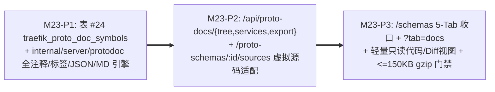

# M23 实施任务卡：全注释驱动活体接口参考文档中心与轻量只读源码浏览 (`F-18`, `F-28`)

> **文档版本**：`v1.1.0`
> **创建日期**：`2026-11-13`
> **最后更新**：`2026-11-13`
> **所属阶段**：阶段四 — 研发实施与 TDD 门禁 (Implementation & TDD Gate)
> **里程碑编号**：`M23 — 活体接口参考文档中心 (Reference Docs) 与轻量只读源码浏览`
> **覆盖需求范围**：`F-03.7`（契约目录与参考文档收口兼容）、`F-15`（`/schemas` 无侧栏 5 视窗 IA 与 `?tab=catalog` 兼容）、`F-18`（活体接口参考文档中心与 Markdown 导出）、`F-28`（轻量级只读源码阅读器、行号锚点与只读 Diff，零前端重型编辑器）、`SC-14`
> **前置依赖**：`M22`（`protocompile` + `SourceInfoStandard`）、[`../05-adr/18-proto-full-lifecycle-and-git-mr-governance-adr.md`](../05-adr/18-proto-full-lifecycle-and-git-mr-governance-adr.md) (`v1.2.0`)
> **当前状态**：✅ **已交付 (Delivered)**

### 修订记录

| 版本 | 日期 | 作者 | 变更说明 |
| :--- | :--- | :--- | :--- |
| `v1.0.0` | `2026-11-13` | Architecture Team | 初版发布：依据 ADR-18 (`v1.1.0`) 拆解 M23 三阶段交付计划 |
| `v1.1.0` | `2026-11-13` | Architecture Team | 依据 ADR-18 (`v1.2.0`) 检视修订：1. 对齐数据库全局序号，标注 `traefik_proto_doc_symbols` 为**第 24 张**核心业务表；2. 明确 M25 上线前由 `/api/proto-schemas/:id/sources` 虚拟适配器先行为 M23 `#L42` 行号锚点供给源码原文，避免功能悬空；3. 将模糊 `< 1.5MB` 修正为基于 M21 基线产物的 **`<= 150KB gzip`（`<= 500KB` 原始文本）增量上限** |

---

## 1. 里程碑目标与三阶段交付拆解 (Phased Execution Plan)

M23 基于 M22 编译与既有 `.pb` 生成的自有 `SourceCodeInfo`，正式兑现 **`F-18` 活体接口参考文档中心**，并将 `/schemas` 重组为无冗余侧边栏的 5 视窗工作台（向后兼容 `?tab=catalog` 旧书签）：
1. 新增核心业务表 **`traefik_proto_doc_symbols`**（全局表序 **#24**），存储按 `ProtoSchema` 提取的服务、RPC 方法、Message、Enum（含全量枚举值注释）文档摘要、精确源码行号范围（`start_line`/`end_line`）及结构化注解标签（`@deprecated`、`@owner`、`@error_code`）；
2. 构建 **`internal/server/protodoc`** 文档引擎：同时生成面向接入方的两种报文参考样本（AST 类型推导缺省 JSON + 自动关联 `traefik_golden_suite_items` 真实脱敏黄金样本）、实时聚合 `ADR-16` 定义方（`CONTRACT_LIB`）与多实现方血缘矩阵，并支持导出离线 `text/markdown` 接口手册；
3. 前端上线 `?tab=docs` 接口参考文档视图与共享的轻量级只读语法着色器/Diff 查看组件（`ProtoReadOnlyCodeViewer.tsx`、`ProtoCommitDiffView.tsx`；M23 先通过 `/api/proto-schemas/:id/sources` 虚拟适配显示已编译源码 `#L42` 行定位，M25 接入持久化 Git `traefik_proto_files`），**严禁引入 `monaco-editor` 等 MB 级在线编辑依赖或悲观锁机制**，严守相对 M21 基线（`__federation_expose_App` ~2.83MB、`elk.bundled` ~1.47MB）的新增 JS 增量 **`<= 150KB gzip`（`<= 500KB` 原始）** 与 `--color-*` 亮暗双模适配。

本里程碑按 **3 个递进子阶段（P1 ~ P3）** 推进（每个阶段严格遵循 `Red -> Green -> Refactor` TDD 循环）：



| 子阶段 | 阶段名称 | 核心交付内容 | 估算改动规模 |
| :--- | :--- | :--- | :---: |
| **M23-P1** | **`traefik_proto_doc_symbols` 数据表与 `protodoc` 萃取引擎** | 新增模型 `models/proto_doc.go`（全局表序 **#24** `traefik_proto_doc_symbols`，注册进 `models/db.go` 迁移，建 `uk_traefik_pdoc_schema_kind_full` 联合唯一索引与全文检索索引）；新建 `internal/server/protodoc` 包：① 解析 `FileDescriptorProto.SourceCodeInfo.Location` 精确还原 File / Service / Method / Message / Field / Oneof / Enum / EnumValue 注释、`start_line`（`span[0]+1`）与 `end_line`；② 结构化解析 `@deprecated`、`@owner`、`@error_code`（支持 `<code> <label> - <desc>` 多行写法）；③ 递归生成带有 **`max_depth <= 12` 与访问路径环路检测（防自递归死循环）** 的 AST 默认 JSON 示例（`int64/uint64/fixed64` 依 Protobuf JSON 规范输出字符串示例）；④ 按 `(service_name, operation)` 关联查询当前生效 `ACTIVE` `traefik_golden_suite_items`，借助既有 `CompiledRegistry` 解码真实黄金请求/应答 JSON 样本；⑤ 汇总输出 `text/markdown` 完整离线说明书（含目录、Method 表格、Enum 字典表、错误码矩阵与示例对比）。 | ~640 LOC |
| **M23-P2** | **文档中心 HTTP API、源码适配接口与编译/激活钩子联动** | 新建 `handlers/proto_doc_handler.go` 并注册至 `handlers/routes.go`（均受 `AuthMiddleware` JWT 保护）：① `GET /api/proto-docs/tree`（支持 `subsystem_id`/`category`/`schema_id`/`include_deprecated`/`search` 聚合树检索，兼容关联架构认领所属子系统）；② `GET /api/proto-docs/services/:serviceName`（返回 `ProtoServiceDocDetailDTO`，融合 `ServiceContractLineageDTO`、方法文档、跨文件嵌套类型跳链与 `Enum` 全量字典）；③ `GET /api/proto-docs/export`（`text/markdown; charset=utf-8`，附带 `Content-Disposition: attachment`、`X-Content-Type-Options: nosniff`、`Cache-Control: no-store` 防 MIME 嗅探）；④ `GET /api/proto-schemas/:id/sources`（M23 过渡只读源码适配器：从已编译缓存/描述集符号重构或读取对应源文本供 `#L42` 行定位，M25 上线后平滑桥接 `GET /api/proto-files/:id`）；在 `POST /api/proto-schemas`、`/compile`、`/activate`、`/batch-activate` 中触发异步/同事务 `protodoc.RebuildForSchema` 增量刷新 `traefik_proto_doc_symbols`；补充既有手工 `.pb` 无源码场景下的平滑降级展示。 | ~480 LOC |
| **M23-P3** | **`/schemas` 五视窗 IA 升级、活体文档工作台与轻量只读代码视图** | 改造 `frontend/src/pages/ProtoSchemaWorkbenchPage/ProtoSchemaWorkbenchPage.tsx`：菜单保持 4 组 10 项零膨胀，顶部导航收敛为 5 个 URL 驱动视窗（`?tab=docs|sources|mr-gates|assets|graph`，并无缝将旧 `?tab=catalog` 重映射/兼容跳转至 `?tab=docs` 保持深链可用）；新增 `LivingProtoDocsPane.tsx`、`ServiceReferenceDocView.tsx`（`@deprecated` 醒目横幅、RPC 入出参树、Enum 值表、缺省 vs 黄金样本切换、架构血缘跳转与 Markdown 一键导出）；新增轻量只读高亮组件 `ProtoReadOnlyCodeViewer.tsx` 与 `ProtoCommitDiffView.tsx`（纯 TypeScript `.proto` 词法高亮 + `#L42` 行定位高亮 + 违规波浪线插槽，100% `--color-*` 语义 Token、严禁 `dangerouslySetInnerHTML`、**严禁引入 `monaco-editor`**，在 `M23` 先接入只读源码抽屉预览 `#L` 跳转并在 `M25` 直接复用至 `?tab=sources` Git 文件视图）。 | ~780 LOC |

---

### 1.1 交付物文件清单 (Deliverables Inventory)

| 端侧 | 动作 | 文件路径 | 职责说明 |
| :--- | :--- | :--- | :--- |
| **后端模型** | 新增/修改 | `models/proto_doc.go` (新增)、`models/db.go` | 定义并自动迁移表 **#24** `ProtoDocSymbol` (`traefik_proto_doc_symbols`) |
| **后端引擎** | 新增 | `internal/server/protodoc/extractor.go`、`sample_json.go`、`markdown_export.go`、`extractor_service.go` (新增) | `SourceCodeInfo` AST 萃取、Tag 解析、黄金/缺省 JSON 构造、`ADR-16` 血缘查询与 Markdown 生成 |
| **后端接口** | 新增/修改 | `handlers/proto_doc_handler.go` (新增)、`handlers/proto_handler.go`、`handlers/routes.go` | `/api/proto-docs/{tree,services/:serviceName,export}`、`/api/proto-schemas/:id/sources` 虚拟适配及编译/激活后索引联动刷新 |
| **后端测试** | 新增 | `internal/server/protodoc/protodoc_test.go`、`handlers/proto_doc_handler_test.go` | 覆盖 `SC-14` 注释/Tag/Enum/黄金样本/递归防死循环、Markdown 导出响应头与防 SQL 注入检索引擎 |
| **前端工作台** | 新增/修改 | `frontend/src/api/schema.ts`、`types/schema.ts`、`pages/ProtoSchemaWorkbenchPage/ProtoSchemaWorkbenchPage.tsx`、`LivingProtoDocsPane.tsx` (新增)、`ServiceReferenceDocView.tsx` (新增)、`ProtoReadOnlyCodeViewer.tsx` (新增)、`ProtoCommitDiffView.tsx` (新增)、相关 CSS 文件 | 5 Tab 重组与 `?tab=catalog` 兼容、活体参考文档工作台、纯 React/TS 轻量只读语法高亮与只读 Diff 视图 |
| **前端测试** | 新增 | `frontend/src/pages/ProtoSchemaWorkbenchPage/__tests__/LivingProtoDocsPane.test.tsx`、`ProtoReadOnlyCodeViewer.test.tsx` | 验证文档树过滤、`@deprecated/@owner/@error_code`、黄金样本切页、`#L42` 行高亮与 relative M21 增量 `<= 150KB gzip` |

---

## 2. 核心技术设计细化与红线约束

1. **Git-Only 只读无锁红线与前端包体预算**：
   - `frontend/package.json` **严禁加入 `monaco-editor`、`codemirror` 全套 LSP Worker 或在线源码保存按钮**；`ProtoReadOnlyCodeViewer` 仅通过纯函数词法切片 + React JSX `<span>` 渲染关键字、类型、字面量与注释（天然依赖 React 转义防御 XSS，禁止 `dangerouslySetInnerHTML`）；
   - Vite 构建产物与既有 M21 基线（`__federation_expose_App` ~2.83MB / `elk.bundled` ~1.47MB）相比，M22~M26 累计新增 JS 体积增量严格 **`<= 150KB gzip`（`<= 500KB` 原始文本）**（CSS 使用既有 `--color-*` 语义 Token）。
2. **注释与标签容错规范**：
   - 当某 `.proto` 来自早期手工 `.pb` 且缺失 `SourceCodeInfo` 时，`protodoc` 仍基于反射提取完整的类型签名、Field Tag、Enum 枚举名称/数字与缺省 JSON 样例（注释置空、源码行号置 `0` 并在前端降级提示），不阻断 `/schemas?tab=docs` 服务展示；
   - JSON 样本生成器遇到递归树消息（如 `Node.children`）必须在当前嵌套路径已有同名类型或 `depth > 12` 时截断为 `{}` / `[]` 并附加省略注释，绝不允许栈溢出。
3. **跨工作台深链契约**：
   - `?tab=docs` 点击源码锚点（例如 `order.proto#L42`）在 M25 前通过 `GET /api/proto-schemas/:id/sources` 虚拟源码适配器打开只读代码抽屉并定位 `#L42`，M25 接入持久化 Git `traefik_proto_files` 后无损深链 `?tab=sources&file_id=<id>#L42`；点击架构血缘直接深链 `/topology?focus=mod_<id>` 与 `/architecture?tree=logical&module_id=<id>`。

---

## 3. TDD 先行测试用例矩阵 (TDD Test-First Matrix)

| 测试文件 | 核心测试函数 (Red -> Green) | 断言覆盖范围与边界条件 |
| :--- | :--- | :--- |
| `internal/server/protodoc/protodoc_test.go` | `TestExtractDocs_ServiceMethodEnumTagsAndSourceLineAnchors` | 使用 M22 `protocompile` 编译含多级注释、`@deprecated`、`@owner`、`@error_code`、`oneof`、`map` 与 `enum` 的测试 `.proto`，断言 `ProtoDocSymbol` 精确捕获中文说明、全部 `@` 标签及一致 `start_line` |
| `internal/server/protodoc/protodoc_test.go` | `TestBuildDefaultAndGoldenJSON_CycleAndDepth12Guard` | 验证自递归 Message `Node -> Node` 不会 panic/死循环；`int64` 以 string 规范输出；关联 `traefik_golden_suite_items` 时优先 decoded 展示真实入参/出参 JSON（仅引用 `ACTIVE` 套件） |
| `internal/server/protodoc/protodoc_test.go` | `TestExportProtoDocsMarkdown_HeadersAndSections` | 校验导出的 Markdown 包含目录、Service/Method 入出参字段表、`Enum` 枚举表、`@error_code` 字典表及 JSON 示例块，且不泄露敏感字节流 |
| `handlers/proto_doc_handler_test.go` | `TestSC14_LivingProtoDocsGoldenSamplesAndMarkdownExport` | `testdb.SetupIsolatedDB(t)` 下端到端编译入池 + 绑定黄金样本 + 登记多实现 `ServiceContract` -> 调用 `/api/proto-docs/tree`、`/services/:serviceName`（验证多实现列表 + `CONTRACT_LIB` 定义方）与 `/export`（检查 `X-Content-Type-Options: nosniff`、`Content-Disposition` 与未登录 `401` 拦截） |
| `frontend/src/pages/ProtoSchemaWorkbenchPage/__tests__/LivingProtoDocsPane.test.tsx` | `testLivingDocsPane_SearchNav_ContractLineage_AndJumpToSourceLine` | 渲染文档树搜索、`@deprecated` 横幅、黄金 JSON 与缺省 JSON 切换、架构跳链及 legacy `?tab=catalog` 兼容回跳至 `docs` 视图 |
| `frontend/src/pages/ProtoSchemaWorkbenchPage/__tests__/ProtoReadOnlyCodeViewer.test.tsx` | `testReadOnlyCodeViewer_LineAnchorViolationWavyAndThemeTokens` | 验证行号 `#L42` 高亮滚动锚点、只读属性（无 `<textarea>`/`contentEditable`）、亮暗 `--color-*` 样式类名以及 JSX 对恶意 `<script>` 注释内容的转义防 XSS |

---

## 4. 自动化准出质量门禁与验收命令 (Exit Gate & Acceptance Commands)

```bash
# 1. 严禁重型编辑依赖与不安全 HTML 渲染断言
grep -E '"(monaco-editor|@monaco-editor/react|codemirror)"' frontend/package.json && exit 1 || echo "OK: zero heavy editor"
grep -rn 'dangerouslySetInnerHTML' frontend/src/pages/ProtoSchemaWorkbenchPage/ && exit 1 || echo "OK: XSS safe JSX"

# 2. 后端 M23 文档萃取与 API 隔离单测（带竞争检测）
TEST_DB_DSN="host=127.0.0.1 port=5432 user=postgres password=CodeShield618! dbname=postgres sslmode=disable" \
  go test -race ./internal/server/protodoc/... ./handlers/... ./models/...

# 3. 全量标准工程门禁与相对 M21 产物体积增量预算检查 (<= 150KB gzip / <= 500KB 原文)
make test && make lint && make build
ls -lh frontend/dist/assets/
make clean
```
