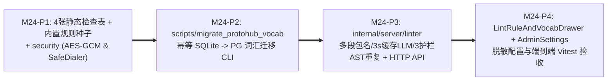

# M24 实施任务卡：可配置静态规范引擎、领域词汇表迁移与三护栏 AST 重复结构检测 (`F-30`, `F-31`)

> **文档版本**：`v1.0.0`
> **创建日期**：`2026-11-13`
> **最后更新**：`2026-11-13`
> **所属阶段**：阶段四 — 研发实施与 TDD 门禁 (Implementation & TDD Gate)
> **里程碑编号**：`M24 — 静态规范引擎、protohub 词汇迁移、旁路 LLM 辅助与三护栏 AST 重复消息检测`
> **覆盖需求范围**：`F-30`（可配置命名规则、领域词汇表、`protohub` 迁移、`3s` 旁路熔断 LLM、三护栏 AST 重复消息公共抽取建议）、`F-31`（规则/词汇治理前端交互底座）、`SC-15`
> **前置依赖**：`M22`（`protocompile`）、`M23`（`SourceCodeInfo`）、[`../05-adr/18-proto-full-lifecycle-and-git-mr-governance-adr.md`](../05-adr/18-proto-full-lifecycle-and-git-mr-governance-adr.md) (`v1.1.0`)
> **当前状态**：📋 **已定稿待实施 (Planned)**

### 修订记录

| 版本 | 日期 | 作者 | 变更说明 |
| :--- | :--- | :--- | :--- |
| `v1.0.0` | `2026-11-13` | Architecture Team | 初版发布：依据 ADR-18 (`v1.1.0`) 拆解 M24 四阶段交付计划（P1~P4）、4 张静态治理数据表、独立 SQLite 迁移 CLI、三护栏 AST 去重算法、AES-GCM/SSRF 安全基线与 TDD 验证门禁 |

---

## 1. 里程碑目标与四阶段交付拆解 (Phased Execution Plan)

M24 将静态设计规范、领域术语统一与跨服务重复结构体识别内聚收口至 `code-traefik` 控制面（彻底废弃独立部署且正则脆性强的 `protohub` 原型）：
1. 在数据库中新增 4 张核心表（`traefik_check_rules`、`traefik_vocabulary_terms`、`traefik_check_reports`、`traefik_check_violations`），内置兼容 `dophi.order.v1` 多段式包名与 `COMMENT_REQUIRED = WARNING` 默认级别的默认规则种子；
2. 交付完全独立于 `cmd/server` 的一次性 CLI 工具 **`scripts/migrate_protohub_vocab`**，从 `protohub` SQLite `vocabulary_terms` 无损幂等迁移词库至 PostgreSQL（严守 `cmd/server` 零 SQLite 运行时依赖）；
3. 构建 **`internal/server/security`**（AES-256-GCM 加解密与 `SafeDialer` SSRF 防护拨号器）与 **`internal/server/linter`**（正则表达式规则校验 + 词根切分查库 + `3s` 硬超时本地 TTL 缓存可选 LLM 降级 + 带三重防误报护栏的 AST 重复 Message 探测）；
4. 提供 `/api/check-rules`、`/api/vocabulary-terms`、`/api/check-reports{/scan,,/:id}` 全套接口，以及 `/schemas` 规则/词库抽屉与 `/admin/settings` 脱敏 LLM 配置区。

本里程碑按 **4 个递进子阶段（P1 ~ P4）** 推进（每个阶段严格遵循 `Red -> Green -> Refactor` TDD 循环）：



| 子阶段 | 阶段名称 | 核心交付内容 | 估算改动规模 |
| :--- | :--- | :--- | :---: |
| **M24-P1** | **静态检查四表、内置默认规则与安全底座 (`security`)** | 新增 `models/linter.go`（表 #25 `CheckRule`、表 #26 `VocabularyTerm`、表 #27 `CheckReport`、表 #28 `CheckViolation`）并接入 `models/db.go` 幂等迁移；实现 `EnsureBuiltinCheckRules`（预置 `PKG_NAMING` 支持 `^[a-z][a-z0-9_]*(\.[a-z][a-z0-9_]*)*(\.v[0-9]+)?$` 多段兼容包名、`MSG_PASCAL_CASE`、`FIELD_SNAKE_CASE`、`ENUM_UPPER_SNAKE_WITH_PREFIX`、`COMMENT_REQUIRED` 默认 `WARNING` 不误杀、`VOCAB_STANDARD_TERM`、`DUPLICATE_MESSAGE` 默认 `WARNING`）；新建 `internal/server/security`（AES-256-GCM 密文封装 `EncryptSecret`/`DecryptSecret`、禁止回环/RFC1918/云元数据 DNS 重绑定校验的 `SafeDialer`、`ConstantTimeCompare` 辅助）；升级 `handlers/settings.go` 对保留密钥字段（含新增 `llm_api_key_enc` 与 M25 预留 `smtp_password_enc`）在 `GET /api/admin/settings` 中强制脱敏（仅返 `llm_key_configured` 等布尔标识，禁止普通配置直改）。 | ~560 LOC |
| **M24-P2** | **`protohub` SQLite 词汇表独立幂等迁移 CLI** | 新建 `scripts/migrate_protohub_vocab/main.go`（独立子包/CLI）：仅在该独立 CLI 内读取 `--sqlite-path`（默认指向遗留 `protohub/storage/protohub.db` 中的 `vocabulary_terms(id, term, description, category, created_at)` 表），规范化小写 `term` 与拆分别名后执行 `INSERT INTO traefik_vocabulary_terms ... ON CONFLICT (term) DO NOTHING`（设置 `source='PROTOHUB_IMPORT'`, `is_approved=true`），支持 `--dry-run` 预检并输出迁移计数；新增 `cmd/server` 编译依赖门禁断言：严禁任何 `sqlite` / `mattn/go-sqlite3` / `modernc.org/sqlite` 渗入 `cmd/server` 或 `cmd/agent`。 | ~240 LOC |
| **M24-P3** | **`linter` 引擎（规范、词汇、`3s` 缓存 LLM、三护栏 AST 重复）与 HTTP API** | 新建 `internal/server/linter`：① `rules_eval.go`：对 `protoreflect.FileDescriptor`（兼容 M22/M23 编译包、指定 `SchemaID` 反序列化产物及直接上传文本解析）逐层执行正则/结构/注释校验并输出精确 `(file_path, line, column, rule_code, severity, suggestion)`；② `vocab_llm.go`：按 `_` 与 camelCase 拆分标识符为词元检查 `traefik_vocabulary_terms`，命中 `aliases` 即建议替换；未命中生僻缩写先查进程内 `(token, vocab_hash)` TTL 缓存，开启 `llm_enabled` 时通过 `SafeDialer` 发起 `context.WithTimeout(..., 3*time.Second)` 请求并可选落库 `is_approved=false, source='LLM_SUGGESTED'` 待审词根；**LLM 超时/异常/未开启均自动降级记录 `TIMEOUT_FALLBACK`/`ERROR_FALLBACK`/`SKIPPED` 零阻塞**；③ `duplicate_ast.go`：读取真实 AST 字段类型与标准化字段名构成规范结构指纹，严格实施**三重防误报护栏**（仅检测 `field_count >= 3`；跳过同包跨版本演进如 `dophi.order.v1` vs `dophi.order.v2` 与已入 `BASE_LIB` 结构体；先按规范化类型签名倒排桶预筛候选对再计算相似度）；新建 `handlers/lint_vocab_handler.go` 交付 `/api/check-rules*`、`/api/vocabulary-terms*`、`/api/check-reports{/scan,,/:id}`（对接 `commonAudit` `traefik_linter:*` 动作）。 | ~860 LOC |
| **M24-P4** | **规则/词库工作台抽屉、LLM 脱敏设置与端到端 Vitest** | 扩展 `frontend/src/api/schema.ts`、`api/settings.ts`、`types/schema.ts`：新增零 `any` TS 类型与 API；新增 `frontend/src/pages/ProtoSchemaWorkbenchPage/LintRuleAndVocabDrawer.tsx`（含静态检查规则矩阵启用/禁用/严重度调级、内置规则防误删提示、标准词根/同义词维护、`LLM_SUGGESTED` 建议一键审核转正 `[✓ 纳为标准]`、手动全量/单仓扫描与重复 Message 抽提簇对比卡片）；更新 `frontend/src/pages/AdminSettingsPage.tsx` 挂载 LLM 开关、Endpoint、Model 及「只写不回显」密钥输入占位；完善全量 Jest/Vitest（100% `--color-*` 亮暗双模适配与 `15/25/50/100` 默认 `25` URL 分页）。 | ~620 LOC |

---

### 1.1 交付物文件清单 (Deliverables Inventory)

| 端侧 | 动作 | 文件路径 | 职责说明 |
| :--- | :--- | :--- | :--- |
| **后端安全** | 新增 | `internal/server/security/crypto.go`、`ssrf.go` | AES-256-GCM 凭据加密、`SafeDialer` 出站 SSRF/DNS 重绑定校验拨号器、恒定时间比较封装 |
| **后端模型** | 新增/修改 | `models/linter.go` (新增)、`models/db.go`、`models/setting.go` | 表 #25~#28 (`CheckRule`, `VocabularyTerm`, `CheckReport`, `CheckViolation`) 及内置规则初始化种子 |
| **独立迁移** | 新增 | `scripts/migrate_protohub_vocab/main.go`、`migrate_test.go` | 独立 CLI 从 `protohub` SQLite 无损幂等迁移 `vocabulary_terms`，严格隔离 SQLite 驱动 |
| **后端引擎** | 新增 | `internal/server/linter/rules_eval.go`、`vocab_llm.go`、`duplicate_ast.go`、`scanner.go` | 多段命名/注释正则引擎、词元分词+缓存+3s 超时可选 LLM、三护栏倒排桶 AST 重复结构体探测器 |
| **后端接口** | 新增/修改 | `handlers/lint_vocab_handler.go` (新增)、`handlers/settings.go`、`handlers/routes.go` | `/api/check-rules*`、`/api/vocabulary-terms*`、`/api/check-reports*` 与 `GET/PUT /api/admin/settings` 密钥脱敏改造 |
| **后端测试** | 新增/修改 | `internal/server/security/crypto_ssrf_test.go`、`internal/server/linter/linter_test.go`、`duplicate_ast_test.go`、`handlers/lint_vocab_handler_test.go`、`scripts/migrate_protohub_vocab/migrate_test.go` | 覆盖 `SC-15`、规则验证、三护栏去重、3s LLM 降级、`SafeDialer` 黑洞与 `cmd/server` 零 SQLite 断言 |
| **前端工作台** | 新增/修改 | `frontend/src/types/schema.ts`、`api/schema.ts`、`pages/ProtoSchemaWorkbenchPage/LintRuleAndVocabDrawer.tsx` (新增)、`pages/AdminSettingsPage.tsx` | 静态规则与词汇抽屉、重复消息簇对比抽提视图、脱敏 LLM 配置区 |
| **前端测试** | 新增 | `frontend/src/pages/ProtoSchemaWorkbenchPage/__tests__/LintRuleAndVocabDrawer.test.tsx` | 验证规则开关与 `WARNING` 提示、词汇 aliases 增删、LLM 待审词根转正与重复结构抽提卡片渲染 |

---

## 2. 核心技术设计细化与红线约束

1. **三护栏 AST 重复结构体检测算法 (`internal/server/linter/duplicate_ast.go`)**：
   - **数据结构**：从真实编译后的 `protoreflect.MessageDescriptor`（禁止使用脆弱文本正则，杜绝把所有类型退化为 `'unknown'` 的虚高误报）提取每个非 `map_entry` Message 的规范特征：
     - `FieldCount = len(msg.Fields())`
     - `PackagePrefix`（如去掉尾部 `.v[0-9]+$` 后的规范命名空间前缀）
     - `SchemaCategory`（所属描述集分类：`BASE_LIB | BUSINESS | GATEWAY`）
     - `Tokens = normalize(CanonicalTypeName + ":" + normalizeFieldName)`（使用真实 `Kind`/`FullName` + 小写归一化字段名，而非 `'unknown'`）。
   - **三重硬过滤护栏**：
     1. `FieldCount < 3` **强制跳过**（过滤掉 `Empty`、`IdReq`、`PageReq`、`CommonRsp` 等高频微小结构体）；
     2. 属于 **`BASE_LIB`** 制品内的公共 Message 之间及自身不重复报错（公共库本来就是被提取复用的目标）；两消息若同属相同归一化包前缀的相邻版本（如 `dophi.order.v1.OrderDTO` 与 `dophi.order.v2.OrderDTO`），**强制豁免**；
     3. 先建立 `token -> []MessageIndex` 倒排桶，仅当两消息共享至少 `max(2, ceil(0.5*minLen))` 个桶命中特征时才进入真实 Jaccard/加权重合度比较，默认阈值 `similarity >= 0.80`，单扫描硬设计算上限与 `context.Context` 取消检查。
2. **可选 LLM 旁路检查与密钥只写红线**：
   - 外部 LLM 端点受 `SafeDialer` 保护（单测可通过显式注入测试 `127.0.0.1` 白名单 Mock 端点覆盖超时行为，默认生产模式阻断 `127.0.0.0/8` / 私网 / `169.254.169.254`）；
   - LLM 请求严禁阻塞 HTTP `/api/check-reports/scan` 或 M25 MR Webhook 主链路超过 `3s`；超时或 5xx 时立即记录 `LLMStatus = "TIMEOUT_FALLBACK" | "ERROR_FALLBACK"` 并完整返回确定性词典与规则结果；
   - `GET /api/admin/settings` 对 `llm_api_key_enc` 等加密凭据仅返 `llm_key_configured: true|false` 及非敏感字段，绝不在响应、日志或审计快照中回显明文或 AES 密文。

---

## 3. TDD 先行测试用例矩阵 (TDD Test-First Matrix)

| 测试文件 | 核心测试函数 (Red -> Green) | 断言覆盖范围与边界条件 |
| :--- | :--- | :--- |
| `internal/server/linter/linter_test.go` | `TestLinter_MultiSegmentPkg_AndCommentRequiredWarningDefault` | 验证 `dophi.order.v1` 多段包名与带数字后缀命名 100% 通过；缺失字段/枚举注释触发 `COMMENT_REQUIRED` 且严重度为 `WARNING`（不导致 `CheckReport.Passed = false`）；`FIELD_SNAKE_CASE` 违规触发 `ERROR` 与精确行号 |
| `internal/server/linter/linter_test.go` | `TestLinter_LLMFallbackOn3sTimeout_AndCacheHit` | 挂载绑定 `127.0.0.1` 的慢速 Mock LLM（`Sleep 4s`）：断言扫查在 `<= 3.2s` 返回，主规则+词汇检查完整通过且 `LLMStatus == "TIMEOUT_FALLBACK"`；二次挂载快速 Mock（`200ms`）：第一次命中并写缓存后，同 `(token, vocab_hash)` 第二次请求零网络外呼（命中内存缓存） |
| `internal/server/linter/duplicate_ast_test.go` | `TestDuplicateASTDetector_ThreeGuardrailsZeroFalsePositive` | 构造对比集合：`IdReq` (`1` 字段)、`PageReq` (`2` 字段)、`BASE_LIB` `Money`、`dophi.order.v1.Order` vs `dophi.order.v2.Order`、以及两个不同服务中结构 85% 相似且有 5 个字段的真实 `TradeSummary`/`DealSummary`（并验证不同类型但同名字段不误判）；断言前 4 组 **0 误报**，跨服务真实重复组精确聚合且建议迁移至 `BASE_LIB` |
| `scripts/migrate_protohub_vocab/migrate_test.go` | `TestMigrateProtohubVocab_IdempotentSQLiteToPostgres` | 使用临时只读 SQLite `vocabulary_terms` DB 导入 `testdb.SetupIsolatedDB(t)` PostgreSQL，连续执行两次验证全量条数、分类、`source="PROTOHUB_IMPORT"` 完全一致且二次重跑零冲突报错 |
| `handlers/lint_vocab_handler_test.go` | `TestSC15_StaticLinterVocabMigrationDuplicateGuardrailsAndLLMTimeout` | **SC-15 集成端到端**：验证内置规则禁止 `DELETE` (`409`) 仅允许 `PUT enabled=false`、词库 `aliases` 增删与 `AuditLog` 记录、触发 `POST /api/check-reports/scan`、验证非管理员写规则返回 `403` 及 `/api/admin/settings` 密钥只写不返显 |
| `frontend/src/pages/ProtoSchemaWorkbenchPage/__tests__/LintRuleAndVocabDrawer.test.tsx` | `testLintRuleAndVocabDrawer_RuleToggleVocabApproveAndDuplicateClusters` | 验证规则开关调级、词汇新增与待审建议转正、手动扫描后渲染重复 Message 公共抽取建议与 `--color-*` 语义样式类 |

---

## 4. 自动化准出质量门禁与验收命令 (Exit Gate & Acceptance Commands)

```bash
# 1. cmd/server 与 cmd/agent 严禁引入 SQLite 运行时依赖
go list -deps ./cmd/server ./cmd/agent | grep -iE 'sqlite|protohub' && exit 1 || echo "OK: zero SQLite runtime in binaries"

# 2. M24 引擎、迁移工具、安全模块与 handler 竞争检测全绿
TEST_DB_DSN="host=127.0.0.1 port=5432 user=postgres password=CodeShield618! dbname=postgres sslmode=disable" \
  go test -race ./internal/server/security/... ./internal/server/linter/... ./scripts/migrate_protohub_vocab/... ./handlers/... ./models/...

# 3. 全量标准工程门禁
make test && make lint && make build && make clean
```
