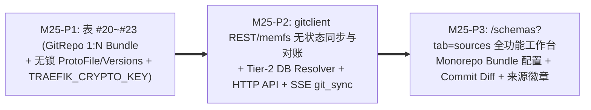

# M25 实施任务卡：Git 无状态同步、Monorepo 1:N Bundles 与只读源码浏览器 (`F-21`, `F-28`, `F-29`)

> **文档版本**：`v1.0.0`
> **创建日期**：`2026-11-13`
> **最后更新**：`2026-11-13`
> **所属阶段**：阶段四 — 研发实施与 TDD 门禁 (Implementation & TDD Gate)
> **里程碑编号**：`M25 — Git 仓库纳管、Monorepo 1:N Compilation Bundles、无状态同步对账与只读源码浏览器`
> **覆盖需求范围**：`F-21`（Git 全量同步触发 `.proto` 编译入池）、`F-28`（Git-Only 无写锁只读快照表、`ProtoReadOnlyCodeViewer` 真实连线与历史 Commit Diff）、`F-29`（Git 仓 1:N Compilation Bundle 建模、REST / `go-git memfs` 无状态增量拉取与只读 SHA256 对账）、`SC-16`（同步与 Monorepo 交付部分）
> **前置依赖**：`M22~M24`、[`../05-adr/18-proto-full-lifecycle-and-git-mr-governance-adr.md`](../05-adr/18-proto-full-lifecycle-and-git-mr-governance-adr.md) (`v1.2.0`)
> **当前状态**：📋 **已定稿待实施 (Planned)**

### 修订记录

| 版本 | 日期 | 作者 | 变更说明 |
| :--- | :--- | :--- | :--- |
| `v1.0.0` | `2026-11-13` | Architecture Team | 初版发布：依据 ADR-18 (`v1.2.0`) 将原超重 M25 拆分为 M25（Git 同步、Monorepo 1:N Bundles 与只读源码工作台）与 M26（MR 门禁、通知与合规大盘）两个可独立验收闭环的里程碑 |

---

## 1. 里程碑目标与三阶段交付拆解 (Phased Execution Plan)

M25 将上游 Git 仓库与控制面的 `.proto` 编译、活体文档、静态体检及源码浏览器正式联通，且原生支持企业级 Monorepo 单仓多协议子目录体系：
1. 新增 **4 张核心业务表**（`#20 traefik_git_repos`、`#21 traefik_git_proto_bundles`、`#22 traefik_proto_files` [严格无任何 `locked`/`file_lock` 写锁字段，含 `bundle_id`、`target_schema_name`、`latest_version_id`、`is_deleted`]、`#23 traefik_proto_file_versions`），并为 `ProtoSchema` 绑定 `source_bundle_id` 关联外键；
2. 构建 **`internal/server/gitclient`** 同步与对账核心：通过 GitLab/GitHub/Gitea REST API 或 `go-git/v5` + `billy/memfs` 纯内存稀疏拉取 `.proto`（全程走 `SafeDialer` + `outbound_trusted_cidrs`，零宿主机磁盘 clone），记录真实 Commit SHA/作者/提交时间到 `ProtoFileVersion` 与软删除对账，并将 `decoder.ProtoSourceProvider` 第二层正式接驳 PostgreSQL `traefik_proto_files`（`BASE_LIB` 优先）；
3. 交付 `/api/git-repos*`（含 `/bundles*` Monorepo 包管理、`/sync`、`/consistency`、`/branches`）与 `/api/proto-files*`（取代 M23 临时虚拟适配），上线前端 `/schemas?tab=sources` 全功能只读源码工作台（复用 M23 `ProtoReadOnlyCodeViewer` / `ProtoCommitDiffView`，支持历史提交对比与 `#L` 锚点）。

本里程碑按 **3 个递进子阶段（P1 ~ P3）** 推进（每个阶段严格遵循 `Red -> Green -> Refactor` TDD 循环）：



| 子阶段 | 阶段名称 | 核心交付内容 | 估算改动规模 |
| :--- | :--- | :--- | :---: |
| **M25-P1** | **Git 仓 / Bundle 四表建模与凭据加密加固** | 新增 `models/git_repo.go`（表 #20 `GitRepo`、表 #21 `GitProtoBundle` 含 `target_schema_name` 全局唯一约束、表 #22 `ProtoFile` 含 `bundle_id`/`target_schema_name`/`latest_version_id`/`is_deleted` 且**严禁存在 `locked`/`locked_by` 字段**、表 #23 `ProtoFileVersion`）；在 `models/db.go` 注册四表自动迁移、`uk_traefik_pfile_bundle_path (bundle_id, file_path) WHERE is_deleted = false` 部分唯一索引，以及 `ProtoSchema.git_repo_id`/`source_bundle_id` `ON DELETE SET NULL` 外键；`go.mod` 引入 `github.com/go-git/go-git/v5` 与 `github.com/go-git/go-billy/v5`（同步更新 `cmd/agent` 依赖隔离断言禁止 Agent 引入 `go-git`/`go-billy`）；基于 M24 `TRAEFIK_CRYPTO_KEY` 为 `GitRepo` 凭据与 Webhook Secret 落库提供加密辅助与响应脱敏映射（仅返 `has_credentials`、`credential_hint`、`has_webhook_secret`）。 | ~480 LOC |
| **M25-P2** | **`gitclient` 无状态同步/对账、DB Tier-2 解析与源码 HTTP API** | 新建 `internal/server/gitclient`（`provider_rest.go` 适配 GitLab/GitHub/Gitea REST API 与认证 Header、`memfs_sync.go` 基于 `go-git` + `billy/memfs` 纯内存浅拉取、POSIX 路径消毒 `path.Clean` 拦截 `..`、及多 Bundle 过滤）；实现 **`SyncBundle` 全量幂等同步事务**（对新增/变更文件递增 `CurrentVersion` 写入 `ProtoFileVersion` 并回填 `latest_version_id`、对远端已删文件标记 `IsDeleted=true`；按 `TargetSchemaName` 调用 `protocompile` 编译写入 `ProtoSchema(source_type="GIT_SYNC", source_bundle_id=...)` 并联动 M23 `protodoc.RebuildForSchema` 与 M24 静态体检 `CheckReport`，最后推送 SSE `git_sync.completed`）；实现 `ComputeConsistency` 只读 SHA256 对比（`in_sync` / `modified` / `remote_only` / `db_only`）；升级 **`decoder.DBProtoSourceProvider`** 读取未软删除 `traefik_proto_files`（`BASE_LIB` 优先）；新建 `handlers/git_repo_handler.go` & `handlers/proto_file_handler.go` 交付 `/api/git-repos*`（`POST` 支持单仓内联默认 Bundle，并支持 `/api/git-repos/:id/bundles*` 增删改查）与 `/api/proto-files*`（列表/正文+Violation 叠加/历史版本/Unified Commit Diff），并对齐 M23 文档源码锚点无损深链 `?tab=sources&file_id=<id>#L42`。 | ~960 LOC |
| **M25-P3** | **`/schemas?tab=sources` 工作台、Monorepo 抽屉与来源徽章** | 扩展 `frontend/src/api/schema.ts`、`types/schema.ts`（对齐 `GitRepoDTO.bundles` / `GitProtoBundleDTO` 等零 `any` 接口）；新建 `frontend/src/pages/ProtoSchemaWorkbenchPage/GitSourcesWorkbenchPane.tsx`（Git 仓脱敏表单抽屉、Monorepo 1:N Bundle 管理列表、一键全仓/单 Bundle 同步进度反馈、`[一致性对账]` 差异弹层、左仓库/Bundle 目录树 + 右侧复用 M23 `ProtoReadOnlyCodeViewer` 与 `ProtoCommitDiffView` 查看历史 Commit Unified Diff 与行号 `#L` 高亮，**全程零编辑/加锁 UI**）；更新 `SchemaAssetLedgerTable.tsx` 补全 `UPLOAD_PB` / `ONLINE_COMPILE` / `GIT_SYNC` / `GIT_MR_AUTO` 来源徽章与 `Commit SHA` 展示（严守相对 M21 基线累计增量 `<= 150KB gzip` 与 `--color-*` 双模 Token）。 | ~620 LOC |

---

### 1.1 交付物文件清单 (Deliverables Inventory)

| 端侧 | 动作 | 文件路径 | 职责说明 |
| :--- | :--- | :--- | :--- |
| **后端依赖** | 修改 | `go.mod` / `go.sum` | 引入 `github.com/go-git/go-git/v5` 与 `github.com/go-git/go-billy/v5`（严格限控制面） |
| **后端模型** | 新增/修改 | `models/git_repo.go` (新增)、`models/proto_schema.go`、`models/db.go` | 表 #20~#23 (`GitRepo`, `GitProtoBundle`, `ProtoFile`, `ProtoFileVersion`) 及 `ProtoSchema.SourceBundleID` 迁移 |
| **后端编译** | 修改 | `internal/server/decoder/protocompile.go` | 提供 `DBProtoSourceProvider` 实现 `Tier 2` DB `.proto` 解析（优先读取 `BASE_LIB` 非删除快照） |
| **后端 Git 同步** | 新增 | `internal/server/gitclient/provider_rest.go`、`memfs_sync.go`、`sync_service.go` (新增) | REST / `go-git memfs` 无状态拉取、Monorepo Bundle 目录筛选、软删/版本快照同步、SHA256 对账 |
| **后端接口** | 新增/修改 | `handlers/git_repo_handler.go`、`handlers/proto_file_handler.go` (均新增)、`handlers/routes.go` | `/api/git-repos*`（含 `/bundles*`）与 `/api/proto-files*`（只读列表/详情/版本/Commit Diff）及 SSE `git_sync.completed` |
| **后端测试** | 新增 | `internal/server/gitclient/sync_test.go`、`handlers/git_repo_handler_test.go`、`handlers/proto_file_handler_test.go` | 覆盖 `1:N` Monorepo 同步、软删除与版本历史、SHA256 对账、凭据脱敏、`SafeDialer`、`ProtoFile` 零锁字段 |
| **前端工作台** | 新增/修改 | `frontend/src/types/schema.ts`、`api/schema.ts`、`pages/ProtoSchemaWorkbenchPage/GitSourcesWorkbenchPane.tsx` (新增)、`SchemaAssetLedgerTable.tsx`、`LivingProtoDocsPane.tsx` | `?tab=sources` 仓/Bundle 表单抽屉、只读源码与 Commit Diff 对照、来源徽章、文档源码深链正式接驳 |
| **前端测试** | 新增 | `frontend/src/pages/ProtoSchemaWorkbenchPage/__tests__/GitSourcesWorkbenchPane.test.tsx` | 验证 Monorepo Bundle 切换、一致性对账弹窗、只读 Commit Diff 与 `#L42` 行高亮 |

---

## 2. 核心技术设计细化与红线约束

1. **Monorepo `GitRepo (1) -> GitProtoBundle (N)` 与单仓便捷创建**：
   - 支持两种创建方式：单协议仓调用 `POST /api/git-repos` 时若同时附带单个默认 `bundle` / 目录参数，事务内自动创建 1 条默认 `GitProtoBundle` 降低使用门槛；Monorepo 仓可通过 `POST /api/git-repos/:id/bundles` 挂载多个互不重叠的子目录 Bundle（各自拥有全局唯一的 `target_schema_name`、独立的 `proto_root_dir` / `proto_include_dirs`、`target_category` 与 `subsystem_id`），复用同一套 Git 凭据与 Webhook 密钥。
2. **Git-Only 只读快照缓存与 `go-git memfs` 零盘原则**：
   - 控制面**严禁**执行 `os/exec` 外部 `git` 命令或在容器本地 `/tmp` 保存完整 `.git` 长期工作目录；REST API 与 `go-git/v5` + `billy/memfs` 全程受 `internal/server/security.SafeDialer`（含 `outbound_trusted_cidrs` 支持内网 GitLab）与 `maxTotalBytes <= 16MB`、单仓并发同步互斥锁保护；
   - `traefik_proto_files` 绝对不允许任何 `locked`/`locked_by` 字段；文件从 Git 移除后置 `IsDeleted = true` 并保留 `traefik_proto_file_versions` 历史版本，使得 `?tab=docs` 与历史静态报告跳链永不 404，同时 `DBProtoSourceProvider` 仅向 `protocompile` 暴露 `is_deleted = false` 的活跃源码。

---

## 3. TDD 先行测试用例矩阵 (TDD Test-First Matrix)

| 测试文件 | 核心测试函数 (Red -> Green) | 断言覆盖范围与边界条件 |
| :--- | :--- | :--- |
| `internal/server/gitclient/sync_test.go` | `TestSyncRepoMonorepoBundles_VersionsSoftDeleteAndConsistency` | 使用绑定 `127.0.0.1` 的 `httptest.Server` Mock Git API（测试注入 WhiteList）：构造单仓 2 个 Bundle（`common-proto` `BASE_LIB` + `order-proto` `BUSINESS`）触发全量同步 ➔ 验证各生成独立 `ProtoSchema(source_type="GIT_SYNC")`、历史 Commit `ProtoFileVersion` 递增、删除仓内某 `.proto` 后重跑同步标记 `IsDeleted=true` 而非硬删历史；运行 `ComputeConsistency` 精确识别 `in_sync`/`modified`/`remote_only`/`db_only` |
| `internal/server/decoder/protocompile_resolver_test.go` | `TestDBProtoSourceProvider_ResolvesBaseLibAndIgnoresSoftDeleted` | 在 `testdb.SetupIsolatedDB(t)` 下插入 `BASE_LIB` `common.proto` 与已标记 `is_deleted=true` 的废弃文件，验证 `Tier 2` 精确解析前者且绝不误加载已软删文件 |
| `handlers/git_repo_handler_test.go` | `TestGitRepoAndBundles_AESEncryptionRedaction_AuditAndSync` | 验证创建/更新仓库后 `GET /api/git-repos` 返 `has_credentials=true`、`credential_hint` 且绝不含密文/明文；普通用户写接口返 `403`；`TargetSchemaName` 跨仓/跨 Bundle 冲突返 `409`；触发 `/sync` 后推送 `git_sync.completed` SSE 事件 |
| `handlers/proto_file_handler_test.go` | `TestProtoFiles_ReadOnlyVersionsDiff_ZeroLockColumns` | `testdb.SetupIsolatedDB(t)` 下断言 `traefik_proto_files` 表结构中**不存在 `locked`/`locked_by` 列**；验证列表分页（`15/25/50/100`）、详情叠加静态检查 `violations`、多版本 `content` 与 `unified_diff` 接口 |
| `frontend/src/pages/ProtoSchemaWorkbenchPage/__tests__/GitSourcesWorkbenchPane.test.tsx` | `testGitSourcesPane_MonorepoBundles_ConsistencyAndCommitDiff` | 验证 Git 仓与 Bundle 表单脱敏占位、一致性差异统计展示、只读语法高亮 `#L42` 行高亮（零可编辑 `<textarea>`）、Commit Unified Diff 展示及 `UPLOAD_PB`/`GIT_SYNC` 来源徽章 |

---

## 4. 自动化准出质量门禁与验收命令 (Exit Gate & Acceptance Commands)

```bash
# 1. Agent 依赖隔离与零外部 git exec 静态断言
go list -deps ./cmd/agent | grep -E 'gorm\.io|dynamicpb|protocompile|go-git|go-billy|sqlite' && exit 1 || echo "OK: cmd/agent isolated"
grep -rnE 'exec\.Command\(["`'"'"']?(protoc|git)' cmd/ internal/ handlers/ models/ pkg/ && exit 1 || echo "OK: zero external protoc/git exec"

# 2. M25 隔离数据库 + 竞争检测单测
TEST_DB_DSN="host=127.0.0.1 port=5432 user=postgres password=CodeShield618! dbname=postgres sslmode=disable" \
  go test -race ./internal/server/gitclient/... ./internal/server/decoder/... ./handlers/... ./models/...

# 3. 全量标准工程门禁
make test && make lint && make build && make clean
```
