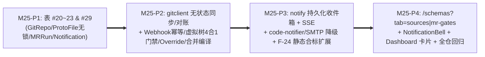

# M25 实施任务卡：Git 无状态同步、MR 四合一门禁、豁免审计与持久化通知中心 (`F-21`, `F-24`, `F-28`, `F-29`, `F-31`)

> **文档版本**：`v1.0.0`
> **创建日期**：`2026-11-13`
> **最后更新**：`2026-11-13`
> **所属阶段**：阶段四 — 研发实施与 TDD 门禁 (Implementation & TDD Gate)
> **里程碑编号**：`M25 — Git 无状态同步、四合一 MR 静态门禁、Override P1 审计、持久化通知与静态合标大盘`
> **覆盖需求范围**：`F-21`（Git/MR 触发 `.proto` 全生命周期自动编译入池）、`F-24`（大盘新增独立静态合标扩展卡片，严格保持 `40+30+30` 健康分公式不变）、`F-28`（Git 只读快照表、`ProtoReadOnlyCodeViewer` 真实连线与只读 Commit Diff）、`F-29`（Git 仓纳管、`Compilation Bundle` 无状态增量同步与 SHA256 对账、MR 虚拟文件树四合一设计态预检与远端状态回写）、`F-31`（MR 门禁审批台、`Approve with Override` 强阻断护栏、`traefik_notifications` 持久收件箱 + SSE + `code-notifier`/SMTP 降级外发）、`SC-16`
> **前置依赖**：`M22~M24`、[`../05-adr/18-proto-full-lifecycle-and-git-mr-governance-adr.md`](../05-adr/18-proto-full-lifecycle-and-git-mr-governance-adr.md) (`v1.1.0`)
> **当前状态**：📋 **已定稿待实施 (Planned)**

### 修订记录

| 版本 | 日期 | 作者 | 变更说明 |
| :--- | :--- | :--- | :--- |
| `v1.0.0` | `2026-11-13` | Architecture Team | 初版发布：依据 ADR-18 (`v1.1.0`) 拆解 M25 四阶段收官计划（P1~P4）、完成 29 张核心 `traefik_*` 业务表拼图、Git 无状态同步与删减文件虚拟树算法、`Approve with Override` P1 审计、持久化通知及大盘合规扩展门禁 |

---

## 1. 里程碑目标与四阶段交付拆解 (Phased Execution Plan)

M25 完成 **`ADR-18`** 的全链路闭环交付，彻底打通上游 Git 仓库到下游 `.pb` 全局生效池、文档中心、架构拓扑与运维通知：
1. 新增最后 5 张核心业务表（`traefik_git_repos`、`traefik_mr_check_runs`、`traefik_proto_files` [严禁悲观锁字段]、`traefik_proto_file_versions`、`traefik_notifications`），使系统达成 **`29` 张核心业务表 + `traefik_settings` 运行配置表** 的完整持久化基线；
2. 构建 **`internal/server/gitclient`**：通过 GitLab/GitHub/Gitea REST API 或 `go-git/v5` 纯内存文件系统 (`billy/memfs`) 零宿主机磁盘 clone 同步 `.proto` 快照与执行只读 SHA256 对账；实现针对 MR 的「主干基线 + Patch 合成（含对 `DELETED`/`RENAMED` 文件的精确移除）」虚拟目录树四合一门禁（编译 -> 规范/词库 -> AST 重复 -> `F-26` 破坏性与下游 `ArchModule` 影响面）及 Merge 后自动编译入池/可选自动激活；
3. 提供受恒定时间验签与 `(git_repo_id, head_commit_sha)` 幂等保护的 `POST /api/webhooks/git-mr`、严禁绕过语法编译失败的管理员 `POST /api/mr-check-runs/:id/override` (`AuditLevelP1`)，以及基于 PostgreSQL 的 **`internal/server/notify`** 站内通知中心（联动 SSE + `code-notifier` `POST /api/notify/email` / SMTP 异步降级通道）；
4. 补全前端 `/schemas?tab=sources`、`?tab=mr-gates`、顶栏全局 `NotificationBell` 与 `/dashboard` 独立静态合标卡片（严守 `40+30+30` 原有健康分测试零退化）。

本里程碑按 **4 个递进子阶段（P1 ~ P4）** 推进（每个阶段严格遵循 `Red -> Green -> Refactor` TDD 循环）：



| 子阶段 | 阶段名称 | 核心交付内容 | 估算改动规模 |
| :--- | :--- | :--- | :---: |
| **M25-P1** | **最后 5 张核心表与凭据安全配置强化** | 新增 `models/git_repo.go`（表 #20 `GitRepo`、表 #21 `MRCheckRun`、表 #22 `ProtoFile` **强制不含 `locked`/`locked_by` 字段**、表 #23 `ProtoFileVersion`）与 `models/notification.go`（表 #29 `Notification`）；在 `models/db.go` 注册 5 表迁移并为 `traefik_proto_schemas.git_repo_id` 配置外键 `ON DELETE SET NULL` 审计安全约束；扩展 `handlers/settings.go` 对 `smtp_password_enc` 执行只写不返显保护，支持存储 `code_notifier_enabled`、`code_notifier_url`（校验 `SafeDialer`）、`smtp_*` 等通知参数；`go.mod` 添加 `github.com/go-git/go-git/v5` 与 `go-billy/v5` 并更新 `cmd/agent` 依赖隔离断言（禁止 Agent 引入 Git 客户端）。 | ~520 LOC |
| **M25-P2** | **`gitclient` 无状态同步、MR 虚拟树四合一门禁与 `Override`** | 新建 `internal/server/gitclient`（`provider_rest.go` 适配 GitLab/GitHub/Gitea/Generic、`memfs_sync.go` 内存 sparse 拉取与路径消毒 `path.Clean`、`virtual_tree.go` 主干+MR Patch 合并算法精准剔除 `DELETED` / 迁移 `RENAMED`、及 Commit Status / MR Markdown Comment 回写器，全程走 `SafeDialer`）；新建 `handlers/git_repo_handler.go` & `handlers/proto_file_handler.go` & `handlers/mr_gate_handler.go`：① `/api/git-repos*` CRUD（AES-256-GCM 密文落库、响应脱敏返 `has_credentials`/`credential_hint`/`has_webhook_secret`）、`POST /:id/sync` 异步拉取+`protocompile` 写入 `ProtoSchema(source_type="GIT_SYNC")`+刷新 `ProtoDocSymbol`+静态 `CheckReport`+推 SSE `git_sync.completed`、`GET /:id/consistency` 纯只读 SHA256 差异对比、`GET /:id/branches`；② `GET /api/proto-files*`（列表/正文/违规标注/行号/历史版本/Unified Diff）；③ `POST /api/webhooks/git-mr`（`GitWebhookGuard` + `subtle.ConstantTimeCompare` 验签 + **`commonAudit.Skip(c)`** + `(git_repo_id, head_commit_sha)` 强幂等去重 + `202 Accepted` 异步 Worker：MR 事件跑四合一预检，主干 Merge 事件触发 `source_type="GIT_MR_AUTO"` 自动编译并按 `auto_activate_on_merge` 通过 `CompileTrialPool`/`F-26` 后自动生效或告警）；④ `POST /api/mr-check-runs/:id/override`（仅 `AdminOnly`、要求 `status == "FAILED"` 且 **`compile_passed == true`**，写 `AuditLevelP1`、回写远端状态与触发 `MR_GATE_OVERRIDDEN` 通知）与 `POST /:id/rerun`。 | ~1250 LOC |
| **M25-P3** | **`notify` 通知投递引擎、Anti-IDOR 收件箱与 `F-24` 合标扩展** | 新建 `internal/server/notify`（站内表落库优先保证 + 触发 SSE `notification.created` 按目标用户精准推流 + 异步协程基于 `SafeDialer` 投递工作区 `code-notifier` `POST /api/notify/email`（精确构造 `NotifyPayload{task_id, task_type, task_display_name, repo_name, branch, recipients, subject, summary, markdown_content, markdown_filename, report_url}`）或降级 SMTP，超时/离线失败回写 `external_dispatch_status="FAILED"` 与 `external_retry_count` 且**绝不阻断 Webhook 或主流程**）；新建 `handlers/notification_handler.go` 实现 `/api/notifications*`（严格 `WHERE recipient_user_id = currentUser.ID` 防横向越权 `403`）；升级 `internal/server/dashboard/overview.go` 聚合计算 `static_compliance: StaticComplianceDTO` 挂入 `GET /api/dashboard/overview`（**原有 `health_score` `40+30+30` 算法与单测 100% 不动**）。 | ~520 LOC |
| **M25-P4** | **前端 `?tab=sources` / `mr-gates` / `NotificationBell` / `StaticComplianceCard`** | 扩展 `frontend/src/api/{schema,dashboard,notifications}.ts` 与 `types/`（零 `any`）；新建 `ProtoSchemaWorkbenchPage/GitSourcesWorkbenchPane.tsx`（Git 仓脱敏表单抽屉、一键同步、一致性对账差异弹层、左目录树 + 右复用 `ProtoReadOnlyCodeViewer`/`ProtoCommitDiffView` 支持行号锚点 `#L42` 与历史 Diff）、`MRGateWorkbenchPane.tsx`（四合一门禁详情同屏展示 Diff + 违规表 + `F-26` 下游影响模块 + 管理员 `[⚠️ Override 豁免]` 弹窗（`compile_passed=false` 置灰禁用并标注原因））、`ProtoSchemaWorkbenchPage/SchemaAssetLedgerTable.tsx` 补齐 `source_type` 来源徽章与 `Commit SHA` 标签；在共享布局顶栏新增 `components/NotificationBell/{NotificationBellPopover,NotificationInboxDrawer}.tsx`（SSE 增量角标 + 分页历史通知与一键已读跳转）；在 `DashboardWorkbenchPage` 新增 `StaticComplianceCard`（100% `--color-*` Token 适配亮暗主题，包体增幅保持 `< 1.5MB`）。 | ~880 LOC |

---

### 1.1 交付物文件清单 (Deliverables Inventory)

| 端侧 | 动作 | 文件路径 | 职责说明 |
| :--- | :--- | :--- | :--- |
| **后端依赖** | 修改 | `go.mod` / `go.sum` | 引入 `github.com/go-git/go-git/v5` 与 `github.com/go-git/go-billy/v5`（严格限控制面） |
| **后端模型** | 新增/修改 | `models/git_repo.go` (新增)、`models/notification.go` (新增)、`models/db.go`、`models/setting.go` | 表 #20~#23 (`GitRepo`, `MRCheckRun`, `ProtoFile`, `ProtoFileVersion`) 与表 #29 (`Notification`) 自动迁移 |
| **后端 Git/MR** | 新增 | `internal/server/gitclient/provider_rest.go`、`memfs_sync.go`、`virtual_tree.go`、`mr_runner.go` (新增) | REST / `go-git memfs` 无状态拉取、对账、虚拟文件树合并（含删除剔除）、四合一流水线、状态回写 |
| **后端通知** | 新增 | `internal/server/notify/dispatcher.go`、`code_notifier.go`、`smtp.go` (新增) | PostgreSQL 站内通知、SSE `notification.created`、`code-notifier` HTTP Webhook 与 SMTP 降级 |
| **后端接口/看板** | 新增/修改 | `handlers/git_repo_handler.go`、`proto_file_handler.go`、`mr_gate_handler.go`、`notification_handler.go` (均新增)、`handlers/routes.go`、`handlers/sse_handler.go`、`handlers/settings.go`、`internal/server/dashboard/overview.go` | 全量 §2.9 路由组 + `SSE` 新事件 + `StaticComplianceDTO` + 通知配置密钥脱敏 |
| **后端测试** | 新增/修改 | `internal/server/gitclient/gitclient_test.go` (新增)、`internal/server/notify/notify_test.go` (新增)、`handlers/git_mr_gate_test.go` (新增)、`handlers/proto_file_handler_test.go` (新增)、`handlers/notification_handler_test.go` (新增)、`handlers/dashboard_handler_test.go` | 覆盖 `SC-16` 端到端 Mock Git/MR/Webhook 闭环、删除文件虚拟树、`Override` P1 审计、Anti-IDOR 与大盘不变性 |
| **前端工作台** | 新增/修改 | `frontend/src/api/{schema,dashboard,notifications}.ts`、`types/schema.ts`、`pages/ProtoSchemaWorkbenchPage/{GitSourcesWorkbenchPane,MRGateWorkbenchPane,SchemaAssetLedgerTable}.tsx`、`components/NotificationBell/{NotificationBellPopover,NotificationInboxDrawer}.tsx`、`pages/DashboardWorkbenchPage/*`、`pages/AdminSettingsPage.tsx` | `?tab=sources` & `mr-gates` 工作区、`NotificationBell`、来源徽章、`StaticComplianceCard`、`code-notifier`/SMTP 脱敏设置 |
| **前端测试** | 新增/修改 | `frontend/src/pages/ProtoSchemaWorkbenchPage/__tests__/GitSourcesAndMRGatePane.test.tsx` (新增)、`frontend/src/components/NotificationBell/__tests__/NotificationBell.test.tsx` (新增)、`frontend/src/pages/DashboardWorkbenchPage/__tests__/DashboardWorkbench.test.tsx` | 验证源码只读 Diff/同步对账、MR 豁免防编译绕过 UI 门禁、SSE 未读数与合规卡片 |

---

## 2. 核心技术设计细化与红线约束

1. **MR 虚拟目录树精确合成与防并发雪崩**：
   - MR 检查**严格不覆盖写主干表 `traefik_proto_files`**。工作协程从 DB 加载当前默认分支最新 `ProtoFile` 集合（映射 `relPath -> []byte`），按 MR ChangedFiles 列表中序应用 Patch：
     - `ADDED` / `MODIFIED`：经 `path.Clean` 验证无穿越后从源分支最新 `head_commit_sha` 拉取替换；
     - `RENAMED`：`delete(virtualTree, old_path)` 后写入 `new_path`；
     - `DELETED`：**显式执行 `delete(virtualTree, path)` 移出编译树**，确保被删除契约被下游引用时 `protocompile` 与 `F-26` 能精确检出失效 (`missing import` / `service removed`)。
   - **Webhook 幂等去重**：`INSERT INTO traefik_mr_check_runs (git_repo_id, head_commit_sha, ...) ON CONFLICT (git_repo_id, head_commit_sha) DO NOTHING`；若受影响行数为 `0`，立即返回 `202 Accepted {accepted: true, duplicate: true}` 不重复触发 Worker 消耗资源。
2. **禁止绕过编译失败的 `Override` P1 门禁**：
   - 仅 `traefik_admin` 可调用 `POST /api/mr-check-runs/:id/override`；接口首检 **`run.CompilePassed == true`**，若编译阶段已 fail，硬返回 `409 ERR_MR_OVERRIDE_FORBIDDEN_COMPILE_FAILED`；通过时写入 **`AuditLevelP1`** (`traefik_mr_gate:override_mr_gate`) 并在向 Git 平台回写 Passed 状态时明确注明审批人与 `override_reason`。
3. **跨仓库协议与工作区 `code-notifier` 精确契约**：
   - `code_notifier_url` 默认指向同主机或可配白名单地址，外发请求严格携带 JSON 结构：`{task_id, task_type, task_display_name, repo_name, branch, recipients: {to, cc}, subject, summary, markdown_content, markdown_filename, report_url}`（与工作区 `code-notifier` `:8081` `POST /api/notify/email` 契约字段 100% 对齐）；当 `code-notifier` 离线拒绝连接或超时时，站内表 `traefik_notifications` 保持完整可用并置 `external_dispatch_status = "FAILED"`，不引发事务回滚。
4. **`F-24` 健康分公式神圣不可侵犯**：
   - 大盘主卡片三维健康分保持 **`40 (架构一致性) + 30 (契约覆盖率) + 30 (回归防线)`** 绝对不变，原有 `TestGetDashboardOverview_SubScoreCaps_AndExcludePrivateNoise` 测试用例无需改动即全绿；`static_compliance` 作为独立扩展模块展示合标率与未解决异常计数。

---

## 3. TDD 先行测试用例矩阵 (TDD Test-First Matrix)

| 测试文件 | 核心测试函数 (Red -> Green) | 断言覆盖范围与边界条件 |
| :--- | :--- | :--- |
| `internal/server/security/crypto_ssrf_test.go` | `TestSafeDialer_BlocksLoopbackAndMetadataSSRF` & `TestGitRepoCredentials_AESGCMRoundtripAndAPIRedaction` | 验证 `127.0.0.1`、`169.254.169.254`、`10.0.0.1` 默认被 `SafeDialer` 拦截；AES-256-GCM 加解密一致且每次 Nonce 唯一；序列化 DTO 绝不泄露 Token/Secret 原文及密文 |
| `internal/server/gitclient/gitclient_test.go` | `TestVirtualTreeMerge_AppliesAddModifyRenameAndDelete` | 启动绑定 `127.0.0.1` 的 `httptest.Server` Mock Git API：构造含 `ADDED`、`MODIFIED`、`RENAMED` 与 **`DELETED`** 四个 `.proto` 变更的 MR，断言 `virtual_tree` 精确删除旧文件后交付 `protocompile` 编译报错与 `F-26` 检测成功 |
| `handlers/git_mr_gate_test.go` | `TestMRWebhook_ConstantTimeAuth_HeadSHAIdempotent_AndWriteback` | 验证伪造/错误 `X-Gitlab-Token`/`X-Hub-Signature-256` 返回 `401/403`；正确签名连续发送两次同 `(repo_id, head_sha)` Webhook 仅执行 `1` 次跑批 (`duplicate=true`) 且产生 **`0` 条误审计** (`commonAudit.Skip`)；校验 Git 平台 Commit Status / Comment 回写内容正确 |
| `handlers/git_mr_gate_test.go` | `TestMROverride_BlocksCompileFailed409_AllowsBreakingWithP1Audit` | 验证 `compile_passed=false` 时调用 `/override` 返回 `409 ERR_MR_OVERRIDE_FORBIDDEN_COMPILE_FAILED`；非管理员返 `403`；仅 `breaking_passed=false` 时传入 `override_reason` 成功流转 `OVERRIDDEN`、触发 `P1` 审计记录与通知 |
| `handlers/git_mr_gate_test.go` | `TestGitMergeEvent_AutoCompileAndOptionalActivate` & `TestSC16_GitStatelessSyncMRGateOverrideAndNotifications` | **SC-16 全链路集成**：含 `ProtoFile` 同步与只读 SHA256 对账 (`in_sync/modified/remote_only/db_only`) ➔ 含删除文件的 MR 阻塞 ➔ Override P1 ➔ Merge 事件自动生成 `source_type="GIT_MR_AUTO"` 新版 `ProtoSchema` + 刷新 `ProtoDocSymbol` + 大盘 `StaticComplianceDTO` 更新 |
| `handlers/proto_file_handler_test.go` | `TestProtoFiles_ReadOnlyVersionsDiff_ZeroLockColumns` | `testdb.SetupIsolatedDB(t)` 下断言 `traefik_proto_files` 表结构中**不存在 `locked`/`locked_by` 列**；验证多版本 `content` 与 `unified_diff` 接口及分页白名单 (`15/25/50/100`) |
| `internal/server/notify/notify_test.go` & `handlers/notification_handler_test.go` | `TestNotify_PersistInbox_AndDegradeGracefullyWhenCodeNotifierOffline` & `TestNotifications_AntiIDOR_ReadAndUnreadCount` | Mock `code-notifier` 返回 `503` 或连接拒绝时，站内通知依然 100% 落库且标记 `FAILED` 不阻塞；用户 A 访问/已读用户 B 通知返回 `403 Forbidden` |
| `handlers/dashboard_handler_test.go` | `TestGetDashboardOverview_StaticComplianceCard_UnchangedMainScoreFormula` | 断言 M24 扫描后 `static_compliance` 准确统计合标率/违规数/重复组/30 天门禁通过率，同时旧 `health_score` `40+30+30` 结果完全一致 |
| `frontend/src/.../GitSourcesAndMRGatePane.test.tsx` & `NotificationBell.test.tsx` | `testMRGatePane_AndNotificationBellSSERealtimeUpdate` | 验证 `?tab=sources` 对账弹层/Commit Diff 对比、`?tab=mr-gates` 编译错误禁止点击豁免弹窗、以及顶栏 `NotificationBell` 收到 `notification.created` SSE 后角标加一并可跳转 MR 详情 |

---

## 4. 自动化准出质量门禁与验收命令 (Exit Gate & Acceptance Commands)

```bash
# 1. 表数量、无悲观锁字段与依赖隔离静态断言
go list -deps ./cmd/agent | grep -E 'gorm\.io|dynamicpb|protocompile|go-git|go-billy|sqlite' && exit 1 || echo "OK: cmd/agent isolated"
go list -deps ./cmd/server | grep -iE 'sqlite|protohub' && exit 1 || echo "OK: cmd/server zero SQLite"

# 2. 全量后端隔离数据库 + 竞争检测测试（29 张业务表 + traefik_settings）
TEST_DB_DSN="host=127.0.0.1 port=5432 user=postgres password=CodeShield618! dbname=postgres sslmode=disable" \
  go test -race ./...

# 3. 全量前端检查、包体增量预算核对与二进制可编译洁净门禁
make test && make lint && make build
du -sh frontend/dist/assets/
make clean

# 4. 后台进程与端口卫生复检（确保无残留进程占用物理端口）
ss -tlnp 2>/dev/null | grep -E ':8091|:8092|:5181' || echo "OK: all dev ports clean"
```
