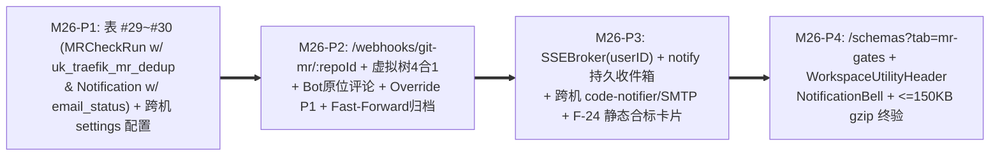

# M26 实施任务卡：Git MR 四合一门禁、Override 审计、定向持久通知与合规大盘 (`F-21`, `F-24`, `F-29`, `F-31`)

> **文档版本**：`v1.0.0`
> **创建日期**：`2026-11-13`
> **最后更新**：`2026-11-13`
> **所属阶段**：阶段四 — 研发实施与 TDD 门禁 (Implementation & TDD Gate)
> **里程碑编号**：`M26 — Git MR 虚拟树四合一门禁、Override P1 审计、SSE 定向持久通知、跨机 code-notifier 与大盘合规扩展`
> **覆盖需求范围**：`F-21`（MR 合并自动编译入池与可选激活）、`F-24`（大盘新增独立静态合标扩展卡片，严格保持 `40+30+30` 健康分公式不变）、`F-29`（Webhook 验签/幂等去重、受影响 Bundle MR 虚拟文件树四合一门禁、Bot 评论原位更新、`BASE_LIB` 传递影响扩散与 Merge 入库）、`F-31`（MR 门禁审批台、`Approve with Override` 强阻断护栏、`traefik_notifications` 持久收件箱 + `SSEBroker(userID)` 定向推送 + 同内网跨机 `code-notifier`/SMTP 邮件）、`SC-16`（MR 门禁与通知闭环部分）
> **前置依赖**：`M22~M25`、[`../05-adr/18-proto-full-lifecycle-and-git-mr-governance-adr.md`](../05-adr/18-proto-full-lifecycle-and-git-mr-governance-adr.md) (`v1.2.0`)
> **当前状态**：📋 **已定稿待实施 (Planned)**

### 修订记录

| 版本 | 日期 | 作者 | 变更说明 |
| :--- | :--- | :--- | :--- |
| `v1.0.0` | `2026-11-13` | Architecture Team | 初版发布：承接原 M25 拆出的 MR 门禁、通知引擎、双模顶栏通知铃铛与大盘静态合标收官阶段；完成 `30` 张核心业务表 + `traefik_settings`（共 `31` 张表）闭环；落地按 `:repoId` Webhook、防 Fast-Forward 同 SHA 误丢 `uk_traefik_mr_dedup`、`remote_comment_id` 原位更新、`SSEBroker(userID)` 定向推送及**跨机部署 `code-notifier` LAN 邮件投递契约** |

---

## 1. 里程碑目标与四阶段交付拆解 (Phased Execution Plan)

M26 为 **`ADR-18` v1.2.0** 的收官交付里程碑，完成最后 2 张核心表并将前置编译/文档/静态体检/Git 同步能力串联为自动化 DevSecOps 质量门禁与团队协同闭环：
1. 新增最后 **2 张核心业务表**（`#29 traefik_mr_check_runs`、`#30 traefik_notifications`），达成 **`30` 张核心 `traefik_*` 业务表 + `traefik_settings` 运行配置表（共 `31` 张物理表）** 的完整基线；
2. 构建 MR 四合一静态门禁与合并自动发布引擎：按受影响 `GitProtoBundle` 构造精确剔除 `DELETED`/`RENAMED` 的 MR 虚拟目录树，串行执行 **编译 -> 规范/词库/LLM -> 倒排桶 AST 重复 (`Jaccard >= 0.85`) -> `F-26` 破坏性与 `BASE_LIB` 反向 `import` 闭包下游影响雷达**；支持管理员在**仅非编译错误 (`compile_passed=true`)** 前提下执行 **`Approve with Override`**（`AuditLevelP1`），Merge 后触发 `MAIN_MERGE` 自动编译（`source_type='GIT_MR_AUTO'`）与可选无冲突自动激活；
3. 升级 `hub.SSEBroker` 支持 `userID` 定向推流，构建 **`internal/server/notify`** 持久通知中心与**同内网独立部署跨机 `code-notifier`**（`POST <code_notifier_url>/api/notify/email` + `SafeDialer` 白名单放行 + 非空 `markdown_content` 强校验 + `users` 表真实邮箱解析）及 SMTP 备用降级；
4. 交付前端 `/schemas?tab=mr-gates`、双模共享 `NotificationBell`（接入 **`WorkspaceUtilityHeader`** 门户嵌入态右上角工具头 + **`StandaloneShell`** 独立外壳顶栏）、以及 `/dashboard` 独立 **`StaticComplianceCard`**，并完成 **`M22~M26` 全链路包体 `<= 150KB gzip` 增量终验**。

本里程碑按 **4 个递进子阶段（P1 ~ P4）** 推进（每个阶段严格遵循 `Red -> Green -> Refactor` TDD 循环）：



| 子阶段 | 阶段名称 | 核心交付内容 | 估算改动规模 |
| :--- | :--- | :--- | :---: |
| **M26-P1** | **最后 2 张核心表与通知/白名单安全配置完善** | 新增 `models/mr_gate.go`（表 #29 `MRCheckRun`：含 `bundle_id`、`event_phase` (`'MR_GATE'|'MAIN_MERGE'`)、`mr_url`、`target_head_sha`、`remote_comment_id`）与 `models/notification.go`（表 #30 `Notification`：含 `external_channel`、`email_status` (`SKIPPED|PENDING|SENT|FAILED`)、`email_error`）；在 `models/db.go` `DO $$ ... END $$` 块创建表达式唯一索引 **`uk_traefik_mr_dedup ON (git_repo_id, COALESCE(bundle_id, 0), event_phase, head_commit_sha, target_head_sha)`** 与通知索引 `idx_traefik_notif_user_read`；完善 `handlers/settings.go` 对 `code_notifier_enabled`、`code_notifier_url`、`code_notifier_token_enc`（AES-256-GCM）、`outbound_trusted_cidrs` 与 `smtp_*` 参数的写入校验、脱敏读取与 `***REDACTED***` 审计掩码。 | ~380 LOC |
| **M26-P2** | **MR Webhook、虚拟树四合一门禁、`Override` 与主干 Merge 自动编译** | 完善 `internal/server/gitclient` 新增 `virtual_tree.go` 与 `mr_runner.go`：① 给定仓库与受影响 `GitProtoBundle` 列表，从 DB 读取活跃基线文件并精准应用 MR `ADDED`/`MODIFIED`/`RENAMED`（删旧加新）/`DELETED`（显式 `delete`）；② 串行运行 M22~M24 全栈能力输出 `MRCheckRun` 并将 `remote_comment_id` 回存实现同 MR 新 Push **Bot 评论原位 PATCH 更新**不刷屏；③ 新建 `handlers/mr_gate_handler.go`：主路线 **`POST /api/webhooks/git-mr/:repoId`**（兼容 URL 归一化免密路由 `POST /api/webhooks/git-mr`），执行 `GitWebhookGuard` 常量时间验签 + **`commonAudit.Skip(c)`** + 按 `(repo_id, COALESCE(bundle_id, 0), event_phase, head_sha, target_head_sha)` 幂等插入返回 `202 Accepted` 异步执行（**通过 `event_phase='MAIN_MERGE'` 与 `target_head_sha` 彻底避免 Fast-Forward/Rebase 同 SHA Merge 事件被 MR 阶段去重误丢**）；④ 实现 `POST /api/mr-check-runs/:id/override`（仅 `AdminOnly`、校验 `status == "FAILED"` 且 **`compile_passed == true`**，写入 **`AuditLevelP1`**、回写远端状态与评论、触发通知）与 `POST /:id/rerun`。 | ~960 LOC |
| **M26-P3** | **`SSEBroker(userID)`、`notify`（跨机 `code-notifier`/SMTP）与 `F-24` 合标扩展** | 升级 `internal/server/hub/sse_broker.go` 为每位已认证 SSE 连接绑定 `userID` 并提供 `BroadcastToUsers(userIDs, event, payload)`，确保 `notification.created` 与 `mr_gate.completed` 严格按目标用户精准投递；新建 `internal/server/notify`（`dispatcher.go`、`code_notifier.go`、`smtp.go`）：① 先落库 PostgreSQL `traefik_notifications` 并经 `SSEBroker` 实时推送；② 收件人邮箱从 `users` 表解析真实有效地址并过滤空/非法地址；③ 当开启 `code_notifier_enabled` 且管理员已在 `/admin/settings` 配置 `code_notifier_url` 与 `outbound_trusted_cidrs`（指向**独立物理机/同内网另一台主机**上的 `code-notifier`）时，经 **`SafeDialer`** 异步请求 `POST <code_notifier_url>/api/notify/email`（构造完整 `NotifyPayload`，严格校验**非空 `markdown_content`** + HTML 正文 + 唯一 `idempotency_key` + `source_app: "code-traefik"`）；若未配 `code-notifier` 但配置了 SMTP 则回落 SMTP 发送；网络超时/`4xx`/`5xx` 仅回写 `email_status="FAILED"` 与 `email_error`，**绝不阻塞主流程**；新建 `handlers/notification_handler.go`（`WHERE recipient_user_id = currentUser.ID` 防 IDOR）；升级 `internal/server/dashboard/overview.go` 计算 `static_compliance` 挂入 `/api/dashboard/overview`（**原有 `health_score` `40+30+30` 零改动**）。 | ~640 LOC |
| **M26-P4** | **前端 `?tab=mr-gates`、`WorkspaceUtilityHeader` 通知铃铛与包体终验** | 扩展 `frontend/src/api/{schema,dashboard,notifications}.ts` 与 `types/`（对齐 `MRCheckRunDTO` 与 `NotificationItemDTO.email_status`，零 `any`）；新建 `ProtoSchemaWorkbenchPage/MRGateWorkbenchPane.tsx`（四合一门禁清单 + Bundle 分页筛选、同屏展开 Diff/违规列表/`F-26` + `BASE_LIB` 受影响依赖者列表、管理员 `[⚠️ Override 豁免]` 弹窗——`compile_passed=false` 置灰禁用并说明不可绕过编译错误）；在 `components/NotificationBell/{NotificationBellPopover,NotificationInboxDrawer}.tsx` 与共享 **`WorkspaceUtilityHeader`** / **`StandaloneShell`** 顶部双模挂载未读角标铃铛（门户嵌入态与独立开发态均可见、零侵入宿主左侧栏）；在 `DashboardWorkbenchPage` 新增 `StaticComplianceCard`（100% `--color-*` Token）；最终实测全量 Vite 构建包体相对 M21 基线增量 **`<= 150KB gzip`**。 | ~680 LOC |

---

### 1.1 交付物文件清单 (Deliverables Inventory)

| 端侧 | 动作 | 文件路径 | 职责说明 |
| :--- | :--- | :--- | :--- |
| **后端模型** | 新增/修改 | `models/mr_gate.go`、`models/notification.go` (均新增)、`models/db.go`、`models/setting.go` | 表 #29 (`MRCheckRun`) 与表 #30 (`Notification`)、`uk_traefik_mr_dedup` 表达式索引迁移 |
| **后端 MR 门禁** | 新增 | `internal/server/gitclient/virtual_tree.go`、`mr_runner.go` | 受影响 Bundle 判定、虚拟文件树合并（含删除剔除）、四合一流水线、`remote_comment_id` 原位更新 |
| **后端通知/推送** | 新增/修改 | `internal/server/hub/sse_broker.go`、`internal/server/notify/{dispatcher,code_notifier,smtp}.go` (均新增) | `BroadcastToUsers` 用户定向 SSE、PG 持久化通知、跨机 LAN `code-notifier` HTTP 客户端与 SMTP 兜底 |
| **后端接口/看板** | 新增/修改 | `handlers/mr_gate_handler.go`、`notification_handler.go` (均新增)、`handlers/routes.go`、`handlers/sse_handler.go`、`handlers/settings.go`、`internal/server/dashboard/overview.go` | `:repoId` Webhook + Override + 通知 Anti-IDOR API + `StaticComplianceDTO` + 跨机通知配置脱敏 |
| **后端测试** | 新增/修改 | `internal/server/gitclient/mr_gate_test.go`、`internal/server/notify/notify_test.go`、`handlers/mr_gate_handler_test.go`、`handlers/notification_handler_test.go`、`handlers/dashboard_handler_test.go` | 覆盖 `SC-16`、Fast-Forward 同 SHA 合并、原位评论更新、Override P1、跨机 `code-notifier` 契约与失败降级、大盘不变性 |
| **前端工作台** | 新增/修改 | `frontend/src/api/{notifications,dashboard,schema}.ts`、`types/`、`pages/ProtoSchemaWorkbenchPage/MRGateWorkbenchPane.tsx` (新增)、`components/NotificationBell/*`、`components/WorkspaceUtilityHeader/*`、`StandaloneShell.tsx`、`pages/DashboardWorkbenchPage/*`、`pages/AdminSettingsPage.tsx` | `?tab=mr-gates`、双模顶栏 `NotificationBell`、`StaticComplianceCard`、`code-notifier` + `outbound_trusted_cidrs` 设置项 |
| **前端测试** | 新增/修改 | `frontend/src/pages/ProtoSchemaWorkbenchPage/__tests__/MRGateWorkbenchPane.test.tsx`、`frontend/src/components/NotificationBell/__tests__/NotificationBell.test.tsx`、`frontend/src/pages/DashboardWorkbenchPage/__tests__/DashboardWorkbench.test.tsx` | 验证 MR 豁免防编译绕过门禁、嵌入+独立双模顶栏铃铛、SSE 用户定向增量、合规卡片与包体增量 `<= 150KB gzip` |

---

## 2. 核心技术设计细化与红线约束

1. **MR 虚拟目录树精确合成、Fast-Forward 防漏跑与评论原位更新**：
   - MR 检查**严格不覆盖写主干表 `traefik_proto_files`**。工作协程先根据 MR `ChangedFiles` 所属路径前缀匹配受影响的 `GitProtoBundle`（支持一次 MR 同时触发多个 Bundle 检查），分别加载对应 Bundle 的活跃基准源码（`is_deleted = false`）并应用 Patch：
     - `ADDED` / `MODIFIED`：经 `path.Clean` 验证后从 `head_commit_sha` 拉取覆盖；
     - `RENAMED`：`delete(virtualTree, old_path)` 后写入 `new_path`；
     - `DELETED`：**显式 `delete(virtualTree, path)` 移出编译树**，确保下游引用缺失能精确被 `protocompile` 拦截；
   - **防 Fast-Forward 同 SHA 误丢去重**：MR 阶段写入 `event_phase = 'MR_GATE'`；合并入主干分支事件写入 `event_phase = 'MAIN_MERGE'` 与当前主干基线 `target_head_sha`，通过 `uk_traefik_mr_dedup (git_repo_id, COALESCE(bundle_id, 0), event_phase, head_commit_sha, target_head_sha)` 精准去重，即使发生 Fast-Forward 合并 `head_commit_sha` 未变也能可靠触发合并入池编译；
   - **Bot 评论原位更新**：回写 MR Markdown 报告后保存 `remote_comment_id`；同 MR 再次推流产生新 Commit 时优先 `PATCH/PUT` 更新既有 Bot 评论，仅更新失败时降级发新评论，保持 MR 页面整洁。
2. **禁止绕过编译失败的 `Override` P1 门禁**：
   - 仅 `traefik_admin` 可调用 `POST /api/mr-check-runs/:id/override`；接口首检 **`run.CompilePassed == true`**，若编译阶段已 fail，硬返回 `409 ERR_MR_OVERRIDE_FORBIDDEN_COMPILE_FAILED`；通过时写入 **`AuditLevelP1`** (`traefik_mr_gate:override_mr_gate`) 并向 Git 平台回写审批人、`override_reason` 与 Passed 状态。
3. **跨机部署 `code-notifier` 与 `outbound_trusted_cidrs` 安全协同契约**：
   - **`code-notifier` 部署在同内网另一台主机上**负责邮件实际投递。管理员需在 `/admin/settings` 配置 `code_notifier_enabled=true`、`code_notifier_url`（例如 `http://192.168.56.20:8081`）、可选 `code_notifier_token`（`TRAEFIK_CRYPTO_KEY` AES-256-GCM 加密），**并将该主机 IP/CIDR 配置进 `traefik_settings.outbound_trusted_cidrs`** 供 `SafeDialer` 放行；
   - 控制面异步投递 `POST <code_notifier_url>/api/notify/email` 时，经 `SafeDialer` 验证放行后构造精确 `NotifyPayload`：
     - `recipients.to/cc` 必须从 `users` 表解析真实有效邮箱地址并剔除空值/占位符；
     - **必填非空 `markdown_content`**（发包前强制断言 `len(strings.TrimSpace(payload.MarkdownContent)) > 0`，100% 满足 `code-notifier` 服务端校验）+ `html_content` + 唯一 `idempotency_key` + `source_app: "code-traefik"`；
   - 网络不可达、DNS 失败或返回 `4xx/5xx` 仅回写 `traefik_notifications.email_status = "FAILED"` 与 `email_error`，站内通知表与 SSE 定向推流 100% 不受影响，绝不阻塞 Webhook 主流程。
4. **`F-24` 健康分公式与双模通知铃铛边界**：
   - 大盘主卡片三维健康分保持 **`40 (架构一致性) + 30 (契约覆盖率) + 30 (回归防线)`** 绝对不变，原有单测无需改动即全绿；
   - 门户嵌入模式（`isEmbedded=true`）无权直接修改宿主门户顶栏 DOM，因此 `NotificationBell` 通过渲染在子应用内容区顶部的轻量 **`WorkspaceUtilityHeader`** 挂载（并在独立开发模式下同步挂载于 `StandaloneShell` 顶栏），保证两种运行模式下员工均可实时接收 MR 门禁与影响范围告警。

---

## 3. TDD 先行测试用例矩阵 (TDD Test-First Matrix)

| 测试文件 | 核心测试函数 (Red -> Green) | 断言覆盖范围与边界条件 |
| :--- | :--- | :--- |
| `internal/server/gitclient/mr_gate_test.go` | `TestVirtualTreeMerge_AppliesAddModifyRenameAndDelete_AndUpsertsBotComment` | 启动绑定测试白名单 `127.0.0.1` 的 `httptest.Server` Mock Git API：构造含 `ADDED`、`MODIFIED`、`RENAMED` 与 **`DELETED`** 的 MR 变更，验证虚拟树正确删旧文件使 `protocompile` 报错；第二次 Push 断言命中 `remote_comment_id` 原位 `PATCH` 更新评论 |
| `handlers/mr_gate_handler_test.go` | `TestMRWebhook_RepoIDAuth_DedupFastForwardNotDropped_AndAuditSkip` | 验证 `:repoId` 路由 + 错误 HMAC/Token 返回 `401/403`；同 `(repo_id, bundle_id, 'MR_GATE', head_sha)` 重放返 `duplicate=true` 且产生 **`0` 条审计 (`commonAudit.Skip`)**；而同 `head_commit_sha` 随后发生 **Fast-Forward Merge (`event_phase='MAIN_MERGE'`) 100% 放行触发自动编译**不被吞掉 |
| `handlers/mr_gate_handler_test.go` | `TestMROverride_BlocksCompileFailed409_AllowsBreakingWithP1Audit` | 验证 `compile_passed=false` 时调用 `/override` 返回 `409 ERR_MR_OVERRIDE_FORBIDDEN_COMPILE_FAILED`；非管理员返 `403`；仅 `breaking_passed=false` 时传入 `override_reason` 成功流转 `OVERRIDDEN`、写 `P1` 审计并向 `BASE_LIB` 传递影响消费者发送通知 |
| `handlers/mr_gate_handler_test.go` | `TestSC16_EndToEndMRGateOverrideAutoMergeAndNotificationFlow` | **SC-16 端到端**：Monorepo MR 含破坏性变更被阻塞 ➔ 管理员 Override P1 ➔ Merge 触发 `GIT_MR_AUTO` 自动编译入池 ➔ 刷新 `ProtoDocSymbol` ➔ 触发用户定向 SSE 与站内通知落库 ➔ `/api/dashboard/overview` 统计刷新 |
| `internal/server/notify/notify_test.go` & `handlers/notification_handler_test.go` | `TestNotify_CrossHostCodeNotifierPayload_SSRFAllowlist_AndOfflineGracefulDegrade` | Mock **同内网远端主机**（测试白名单纳入 `127.0.0.1` 模拟跨机 IP）`code-notifier` `POST /api/notify/email`：① 断言请求体含非空 `markdown_content`、HTML、唯一 `idempotency_key` 与真实收件邮箱；② 当 `code-notifier` 返回 `503` 或连接拒绝时，站内 `traefik_notifications` 100% 落库且置 `email_status="FAILED"` 不阻塞；③ 验证未列入 `outbound_trusted_cidrs` 的内网地址被 `SafeDialer` 拒绝；④ 验证用户 A 读取/已读用户 B 通知返 `403` 与 `SSEBroker` 不会把 A 的私信推给用户 B |
| `handlers/dashboard_handler_test.go` | `TestGetDashboardOverview_StaticComplianceCard_UnchangedMainScoreFormula` | 断言 M24/M26 扫描后 `static_compliance` 准确统计合标率/违规数/重复组/30 天门禁通过率，同时旧 `health_score` `40+30+30` 结果完全一致 |
| `frontend/src/.../MRGateWorkbenchPane.test.tsx` & `NotificationBell.test.tsx` | `testMRGatePane_AndDualModeNotificationBellSSE` | 验证 `?tab=mr-gates` 编译错误禁止点击豁免弹窗、`BASE_LIB` 传递受影响消费者列表；验证嵌入态 `WorkspaceUtilityHeader` 与独立态 `StandaloneShell` 均渲染 `NotificationBell` 且收到 `notification.created` SSE 后角标加一并深链至 MR 详情 |

---

## 4. 自动化准出质量门禁与验收命令 (Exit Gate & Acceptance Commands)

```bash
# 1. 表数量(30核心+1设置)、无悲观锁字段与依赖隔离静态断言
go list -deps ./cmd/agent | grep -E 'gorm\.io|dynamicpb|protocompile|go-git|go-billy|sqlite' && exit 1 || echo "OK: cmd/agent isolated"
go list -deps ./cmd/server | grep -iE 'sqlite' && exit 1 || echo "OK: cmd/server zero SQLite"

# 2. 全量后端隔离数据库 + 竞争检测测试（30 张业务表 + traefik_settings）
TEST_DB_DSN="host=127.0.0.1 port=5432 user=postgres password=CodeShield618! dbname=postgres sslmode=disable" \
  go test -race ./...

# 3. 全量前端检查、相对 M21 基线产物体积增量预算核对 (<= 150KB gzip / <= 500KB 原文) 与可编译门禁
make test && make lint && make build
ls -lh frontend/dist/assets/
make clean

# 4. 后台进程与端口卫生复检（确保无残留进程占用物理端口）
ss -tlnp 2>/dev/null | grep -E ':8091|:8092|:5181' || echo "OK: all dev ports clean"
```
