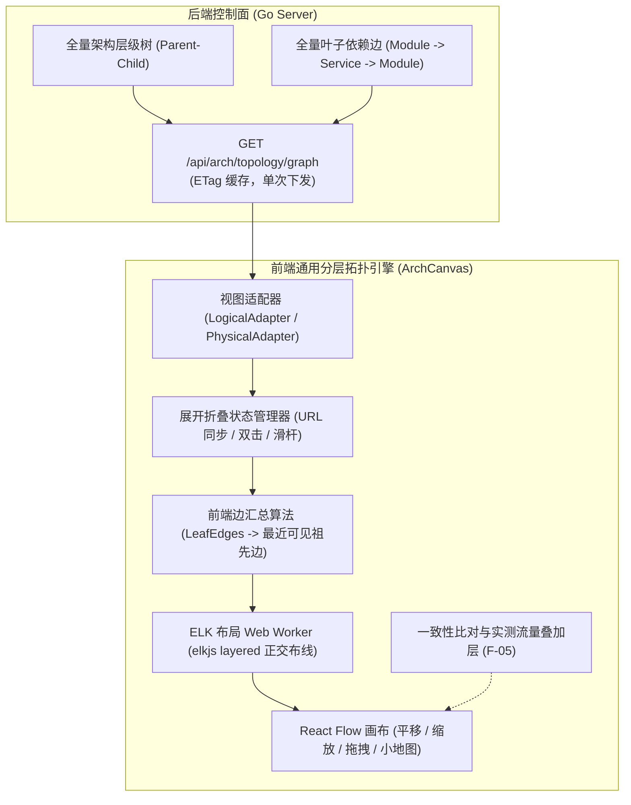

# ADR-05: 分层复合架构拓扑画布重设计、去 Agent 物理建模与一致性比对融合

- **文档编号**：`05-hierarchical-topology-canvas-redesign.md`
- **日期**：2026-10-31
- **状态**：已采纳 (Accepted)
- **关联特性**：`F-04`（静态架构拓扑视图）、`F-05`（实测调用拓扑还原与架构一致性验证）
- **关联作战卡**：[`docs/04-tasks/07-m6-hierarchical-topology-canvas.md`](../04-tasks/07-m6-hierarchical-topology-canvas.md) (M6)

---

## 1. 背景与问题陈述 (Context & Problem Statement)

在原有设计中，架构工作台（`ArchitectureWorkbenchPage`）的静态拓扑视图存在若干关键局限：
1. **局部孤岛视野**：前端拓扑仅支持按单个子系统查看（传 `subsystem_id`），无法展示全系统级宏观依赖，跨子系统的核心调用关系被物理割裂；
2. **扁平化降维失真**：系统、功能组、模块在原有画布中被降维平铺为同级圆点并简单环形排列，无法体现架构设计的「包含（Containment）与边界」语义；
3. **交互能力缺失**：固定尺寸 SVG 无法平移、缩放、按层级折叠展开或拖拽，随着服务模块增多，连线交叉严重失控；
4. **物理视图概念混淆**：此前物理视图将 `Agent` 节点作为拓扑容器，导致用户混淆了“数据面无状态探测器”与“业务物理部署边界”；
5. **一致性验证孤立**：实测流量比对结果位于独立页签，脱离了直观的架构拓扑图，用户无法一眼感知哪条架构边发生了漂移越权。

---

## 2. 核心架构决策矩阵 (Decisions & Trade-offs)

| # | 决策项 | 决策结论 | 架构落地含义与选型权衡 |
| :---: | :--- | :--- | :--- |
| **1** | **技术选型** | **React Flow (`@xyflow/react`) + ELK.js** | 采用 React Flow 作为交互渲染底座，ELK (`elkjs/lib/elk-worker`) 在 Web Worker 中负责分层复合图（Nested Compound Graph）正交折线布局计算，DOM 节点样式严格基于 CSS Design Tokens。 |
| **2** | **展开收起交互** | **双击 + 层级滑杆显式展开，语义自动展开作为可选开关** | 默认由用户双击容器节点或调节顶部工具栏 `层级滑杆 (L0 ~ Ln)` 进行展开/折叠，保证布局绝对稳定受控；基于视口面积占比的滚轮自动展开做成工具栏复选开关（默认关闭）。 |
| **3** | **布局持久化策略** | **手动拖动后的排版不保存** | 画布节点的手动拖拽调整仅作为当前会话的临时观察态，不落库也不存 localStorage；提供“重置布局”按钮随时一键恢复至 ELK 全局最优布局。 |
| **4** | **物理部署视图模型** | **严格收敛为「进程组 (`ProcessGroup`) → 进程 (`Process`) → 模块 (`Module`)」** | **彻底剔除 Agent 节点**。Agent 仅作为数据面无状态探测器与 eBPF 采集端点，不属于系统业务架构的构成元素。物理图只体现进程的分组归属、监听端点 (`AdvertiseIP:ListenPort`) 与承载模块。 |
| **5** | **一致性验证整合** | **「架构一致性比对」合并为拓扑画布的“叠加层 (Overlay)”** | 取消割裂的独立页签。在静态拓扑画布（逻辑/物理）上一键挂载选定的录制批次（`session_id`），直接将六分类结果（VERIFIED / VIOLATION / UNCOVERED / NOT_MONITORED / NOT_OBSERVABLE / UNATTRIBUTED）渲染在拓扑边上。 |
| **6** | **架构图去 Agent 化** | **架构图中与 Agent 彻底解耦** | 后端拓扑 Graph 数据契约与前端节点模型中彻底移除 `AGENT` 节点类型，架构设计与物理拓扑只关注业务逻辑与网络服务进程。 |

---

## 3. 总体架构：通用分层复合图引擎

无论是逻辑架构视图还是物理部署视图，底层统一抽象为**分层复合图（Hierarchical Compound Graph）**，由同一套引擎驱动，仅输入的数据适配器（Adapter）不同：



### 核心机制：
1. **全系统单画布与前端边汇总 (Rollup)**：后端一次性下发全系统层级树与原子叶子边（模块间确切依赖）。任意层级（子系统间、功能组间、进程组间、进程间）的有向依赖均由前端纯函数根据当前节点的展开/折叠状态实时计算上卷，展开与收起零网络延迟。
2. **锚点保持 (Anchor Retention)**：展开/折叠某容器节点时，记录该节点在屏幕视口中的绝对坐标，重新排版后平滑补正视口平移量，确保目标容器“原地缩放”，消除全图突跳感。
3. **几何 LOD (Level of Detail)**：滚轮缩放仅通过 CSS 类名切换文字、徽章与元数据可见性，不触发昂贵的 JS 重新布局计算。

---

## 4. 逻辑架构视图详细设计

### 4.1 逻辑层级定义
```text
System (全局根)
 ├── Subsystem (L0: 业务子系统，矩形大容器)
 │    ├── FunctionalGroup L1 (L1: 一级功能组容器)
 │    │    ├── FunctionalGroup L2...L8 (多级功能组自嵌套容器)
 │    │    └── Module (叶子卡片: 最小业务功能模块)
 │    └── Module (直接挂载在子系统下的模块)
 └── External Systems (虚拟占位容器)
      ├── ExternalSystem_1 (按 external_system 名称聚合，如 WeChatPay)
      └── ExternalSystem_2 (如 UnionPay)
```

### 4.2 节点与边视觉规范
- **子系统/功能组容器**：采用带有标题栏的双线圆角矩形，标题栏展示编码、名称、折叠状态 `[+]`/`[-]`、内部模块数及内部依赖总数。
- **模块叶子卡片**：实体卡片，展示模块编码、名称、负责人及服务供给数。未绑定物理进程的模块外框显示为警示虚线。
- **逻辑依赖边**：
  - **跨子系统依赖**：粗实线，着色采用 `--color-primary`，线上徽章标明聚合依赖数；
  - **子系统内跨组依赖**：细实线，着色采用 `--color-border-hover`；
  - **外部系统依赖**：虚线，着色采用 `--color-warning`；
  - **架构循环依赖**：经前端 Tarjan SCC 检出的强连通环路标为 `--color-danger` 红色加粗并闪烁。

---

## 5. 物理部署视图详细设计（彻底去 Agent 化）

### 5.1 物理层级定义
```text
System (全局部署视图)
 ├── ProcessGroup (L0: 进程组容器，按 Process.group_name 聚合，如 "交易核心集群"、"风控计算集群")
 │    └── Process (L1: 物理运行进程容器，显示进程名与 ListenPort)
 │         └── Module (L2: 进程承载的功能模块实例)
 ├── Undeployed (虚拟容器: 尚未绑定任何物理进程的孤立模块)
 └── External Endpoints (外部网络端点容器，按 Process.extra_downstreams 聚合)
```

### 5.2 物理节点与边视觉规范
- **进程组容器**：深色调背景容器，汇总组内运行进程数与总承载模块数。
- **进程容器**：展示进程名称、网络监听端点（如 `192.168.56.20:9001`）及进程承载的模块清单。
- **物理调用边**：
  - **跨进程组调用**：实线，标注目标端点与聚合 RPC 契约数；
  - **组内跨进程调用**：细实线；
  - **进程内调用 (`INTRA_PROCESS`)**：当展开至模块级别时呈现为内部细线；在进程折叠时，收敛为进程卡片右上角的 **「内部调用: n」** 徽章（严格符合 A-04 不经 Socket 的物理语义）；
  - **未部署异常边**：指向“未部署”容器的调用标为红色虚线警告。

---

## 6. 架构一致性验证叠加层 (Consistency Overlay)

### 6.1 交互融合设计
1. **工作台顶部工具栏**：
   - 视图切换 Pills 保留：`[逻辑架构视图]`、`[物理部署视图]`。
   - 增加 **「架构一致性比对」下拉激活器**：用户可选择一个已完成的录制批次（`session_id`），或选择“关闭比对”。
2. **六分类状态上卷算法**：
   - 当两个折叠容器之间存在多条底层模块依赖时，汇总边的比对状态采用**最差优先级收敛**：
     $$\text{VIOLATION} > \text{UNATTRIBUTED} > \text{UNCOVERED} > \text{NOT\_MONITORED} > \text{NOT\_OBSERVABLE} > \text{VERIFIED}$$
   - 只要底层有 1 条越权调用，整条汇总边即呈现红色告警，点击汇总边展开抽屉可查看明细。
3. **边点击联动四段解剖**：
   - 在比对叠加模式下，点击任何一条边，右侧滑出抽屉列出包含的所有接口；点击 `VIOLATION` 或 `VERIFIED` 接口的采样流量，可直接调用既有 `PacketAnatomyDrawer` 检视四段二进制报文。

---

## 7. 技术架构选型与后端 Graph API 契约

### 7.1 技术栈锁定
- **渲染基座**：`@xyflow/react` (React Flow v12)
- **复合排版引擎**：`elkjs`（通过 `elkjs/lib/elk-worker` 独立 Web Worker 异步计算，配置 `elk.hierarchyHandling: "INCLUDE_CHILDREN"`, `elk.algorithm: "layered"`, `elk.direction: "RIGHT"`）
- **样式与主题**：100% 采用 CSS 变量（`--color-bg-surface`、`--color-border-primary` 等），零绝对色值硬编码，完美适配亮/暗主题。

### 7.2 后端 Graph API 契约 (`GET /api/arch/topology/graph`)
- **Query 参数**：`view=LOGICAL|PHYSICAL`
- **返回结构**：
  - `nodes`: 包含全量节点列表，字段含 `id`, `type`, `parent_id`, `ancestors[]`, `code`, `name`, `depth`, `meta`；
  - `edges`: 包含全量底层叶子边，字段含 `id`, `src`, `dst`, `kind`, `services[]`；
  - `model_version`: 静态架构变更版本戳，支持 HTTP `ETag` 与 `If-None-Match: 304 Not Modified`。
- **无 Agent 保障**：`view=PHYSICAL` 下，节点类型仅限于 `PROCESS_GROUP`、`PROCESS`、`MODULE`、`UNDEPLOYED_CONTAINER` 及 `EXTERNAL_ENDPOINT`，彻底剔除 `AGENT`。

---

## 8. 实施里程碑规划 (M6)

详见作战卡 [`07-m6-hierarchical-topology-canvas.md`](../04-tasks/07-m6-hierarchical-topology-canvas.md)：
- **M6-1 后端 Graph API 与模型重构**：实现 `GET /api/arch/topology/graph`，完成去 Agent 化物理模型与全量叶子依赖输出，具备 ETag 缓存支持；
- **M6-2 前端分层引擎与纯函数算法库**：实现 `hierarchy.ts`、`rollup.ts`、`metrics.ts`（Tarjan SCC），TDD 100% 单元测试覆盖；
- **M6-3 React Flow + ELK Worker 画布框架**：封装 `ArchCanvas`、嵌套容器节点组件与正交折线边组件，实现双击下钻与层级滑杆；
- **M6-4 交互完善与定位工具**：实现全图搜索、选中高亮、节点检视面板、边明细抽屉及 URL 状态同步；
- **M6-5 物理部署视图适配与运行态接入**：实现 `physicalAdapter.ts`，接入端点标注与进程内调用角标；
- **M6-6 一致性比对叠加层与业务闭环**：实现批次选择、六分类状态上卷、流量热力及与 `PacketAnatomyDrawer` 的联动。

---

## 9. 后果与收益评估 (Consequences)

### 正向收益 (Positive)
1. **全局架构全景可控**：支持从最高级子系统/进程组依赖一览全局，亦可逐层下钻至具体模块接口细节；
2. **语义更纯粹**：去 Agent 化让物理拓扑回归业务网络本质，架构师与运维人员直面真实微服务进程与监听端口；
3. **闭环体验提升**：一致性比对直接在架构图上高亮漂移边，架构违规调用无所遁形，并可无缝调出四段报文解剖。

### 潜在代价与应对 (Trade-offs & Mitigations)
1. **依赖包体积增加**：引入 `@xyflow/react` 与 `elkjs` 会增加前端构建体积（约 1.5MB）。通过 Vite 动态 `React.lazy()` 独立 Chunk 拆分，仅在用户访问拓扑工作台时异步加载；
2. **嵌套图排版开销**：通过 Web Worker 异步计算并配合锚点平滑过渡动画，确保 300 节点内排版时间控制在 200ms 以内。
