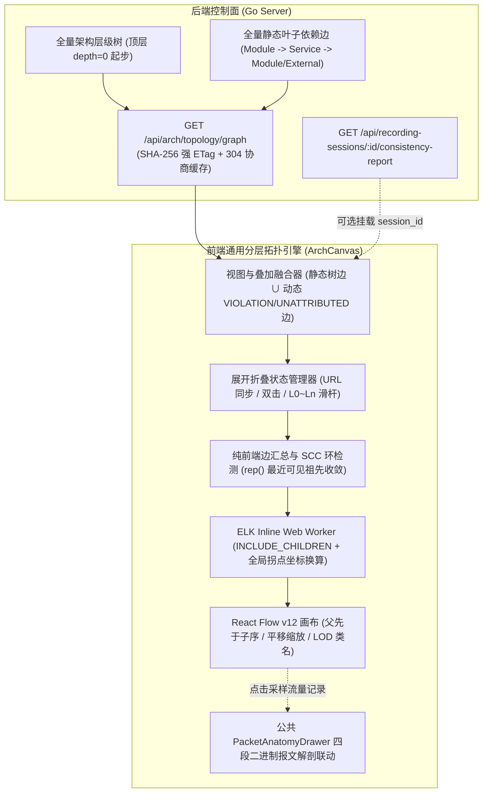

# ADR-05: 分层复合架构拓扑画布重设计、去 Agent 物理建模与一致性比对融合

- **文档编号**：`05-hierarchical-topology-canvas-redesign.md`
- **文档版本**：v1.1.0
- **日期**：2026-10-31
- **状态**：已采纳 (Accepted)
- **关联特性**：`F-04`（静态架构拓扑视图）、`F-05`（实测调用拓扑还原与架构一致性验证）
- **关联设计**：[`docs/02-design/03-architecture-elements-and-topology.md` §4~§5](../02-design/03-architecture-elements-and-topology.md)、[`docs/02-design/04-control-plane-and-web-console.md` §4](../02-design/04-control-plane-and-web-console.md)
- **关联作战卡**：[`docs/04-tasks/07-m6-hierarchical-topology-canvas.md`](../04-tasks/07-m6-hierarchical-topology-canvas.md) (M6)

---

## 1. 背景与问题陈述 (Context & Problem Statement)

在原有设计中，架构工作台（`ArchitectureWorkbenchPage`）的静态拓扑视图存在若干关键局限：
1. **局部孤岛视野**：前端拓扑仅支持按单个子系统查看（传 `subsystem_id`），无法展示全系统级宏观依赖，跨子系统的核心调用关系被物理割裂；
2. **扁平化降维失真**：子系统、功能组、模块在原有画布中被降维平铺为同级圆点并简单环形排列，无法体现架构设计的「包含（Containment）与边界」语义；
3. **交互能力缺失**：固定尺寸（`720×480`）SVG 无法平移、缩放、按层级折叠展开或拖拽，随着服务模块增多，连线交叉严重失控；
4. **物理视图概念混淆**：此前物理视图将 `Agent` 节点作为拓扑容器，导致用户混淆了“数据面无状态采集探针”与“业务物理部署边界”；
5. **一致性验证孤立**：实测流量比对结果位于独立纯表格页签（`tab=verify`），脱离了直观的架构拓扑图，用户无法一眼感知哪条架构边发生了漂移越权。

---

## 2. 核心架构决策矩阵 (Decisions & Trade-offs)

| # | 决策项 | 决策结论 | 架构落地含义与选型权衡 |
| :---: | :--- | :--- | :--- |
| **1** | **技术选型** | **React Flow (`@xyflow/react` v12) + ELK.js** | 采用 React Flow v12 作为交互渲染底座（原生 `parentId` 嵌套容器支持），ELK 在内联 Web Worker（`?worker&inline`）中负责分层复合图正交折线布局计算，DOM 节点样式严格基于平台 `--color-*` Design Tokens。 |
| **2** | **展开收起交互** | **双击 + 层级滑杆显式展开，语义自动展开作为可选开关** | 默认由用户双击容器节点或调节顶部工具栏 `层级滑杆 (L0 ~ Ln)` 进行展开/折叠，保证布局绝对稳定受控；基于视口面积占比的滚轮自动展开做成工具栏复选开关（默认关闭）。 |
| **3** | **布局持久化策略** | **手动拖动后的排版不保存，拖拽边动态跟随** | 画布节点的手动拖拽调整仅作为当前会话的临时观察态，不落库也不存 `localStorage`；拖拽节点关联的边自动从静态 ELK 拐点退化为动态 `SmoothStep` 正交线跟随连接点，提供“重置布局”按钮随时一键恢复 ELK 全局最优排版。 |
| **4** | **物理部署视图模型** | **严格收敛为「进程组 (`ProcessGroup`) → 进程 (`Process`) → 模块 (`Module`)」** | **彻底剔除 Agent 节点**。Agent 仅作为数据面无状态探测器与 eBPF 采集载体，不属于系统业务架构的构成元素。物理图只体现进程的分组归属、有效监听端点 (`EffectiveIP:ListenPort`) 与承载模块。 |
| **5** | **一致性验证整合** | **「架构一致性比对」合并为拓扑画布的“动态叠加层 (Overlay)”** | 取消割裂的独立验证页签并清理旧版冗余组件。在拓扑画布上一键挂载选定的录制批次（`session_id`），支持动态合成未声明 `VIOLATION` 违规边与 `UNATTRIBUTED` 归属边，直接在拓扑边上渲染六分类状态并穿透四段报文解剖。 |
| **6** | **架构图去 Agent 化** | **拓扑契约与前端模型同 Agent 彻底解耦** | 后端 `GET /api/arch/topology/graph` 响应节点与 `meta` 中彻底移除 `AGENT` 节点类型及 `agent_id` 字段，架构设计与物理拓扑只关注业务逻辑与网络服务进程。 |

---

## 3. 总体架构：通用分层复合图引擎

无论是逻辑架构视图还是物理部署视图，底层统一抽象为**无外层冗余根框的分层复合有向图（Hierarchical Compound Graph）**，由同一套引擎驱动，仅视图数据与一致性边映射策略不同：



### 核心运行机制：
1. **全系统单画布与前端边汇总 (Rollup)**：后端一次性下发全系统层级节点（顶层 `depth=0` 直接为子系统或进程组，不下发无意义的外层 `SYSTEM` 巨框）与原子叶子边。任意折叠层级下的容器间有向依赖均由前端纯函数实时计算上卷，展开与收起零网络延迟。
2. **锚点保持 (Anchor Retention)**：展开/折叠某容器节点时，记录该节点在屏幕视口中的绝对坐标，ELK 重新排版后平滑补正视口平移量 `(panX, panY)`，确保目标容器“原地缩放”，消除全图突跳感。
3. **几何 LOD (Level of Detail)**：滚轮缩放仅通过视口缩放阈值切换顶层 CSS 类名（如 `.code-arch-canvas--lod-low` 控制次要徽章与副标题显隐），不触发昂贵的 JS 重排版。

---

## 4. 逻辑架构视图详细设计 (`view=LOGICAL`)

### 4.1 逻辑层级定义与数据库外键对齐
```text
(画布根视口 Viewport)
 ├── Subsystem (depth=0 / L0: 业务子系统大容器，如 TRADE_SYS, RISK_SYS)
 │    └── FunctionalGroup L1 (depth=1 / L1: 一级功能组容器)
 │         ├── FunctionalGroup L2...L8 (depth=2..8: 多级自嵌套功能组容器)
 │         │    └── Module (叶子卡片: 最小契约功能模块)
 │         └── Module (挂载于一级功能组下的模块)
 ├── ExternalContainer (depth=0 / L0: 外部依赖系统容器，仅存在外部依赖时生成)
 │    ├── ExternalSystem_1 (叶子节点: 按 external_system 名称聚合，如 WeChatPay)
 │    └── ExternalSystem_2 (如 UnionPay)
 └── UnregisteredInterface (动态虚拟告警节点: 仅在一致性叠加层检出调用未登记接口时注入)
```

> [!NOTE]
> **与 `traefik_modules` 外键强约束对齐**：依据 `models/arch.go`，`Module.GroupID` 为 `NOT NULL` 外键，合法业务模块必挂载于某级 `FunctionalGroup`（`L1..L8`）下。前端 `hierarchy.ts` 对缺失父功能组的异常数据保留回退挂载至所属 `sub_<SubsystemID>` 的防御性容错，后端无需改动表结构。

### 4.2 节点与边视觉规范
- **子系统/功能组容器**：带有标题栏的圆角矩形容器，标题栏展示编码、名称、展开/折叠按钮 `[+]`/`[-]`、内部模块总数及折叠态「内部依赖: `N`」徽章。
- **模块叶子卡片**：实体卡片，展示模块编码、名称、负责人及对外 `PROVIDE` 服务数；尚未在公共基线环境绑定物理进程（`process_id == null`）的模块边框呈现为 `--color-warning` 警示虚线。
- **逻辑依赖边（100% 遵循 `theme.css` 语义 Token）**：
  - **跨子系统依赖**：粗实线，着色采用 `var(--color-primary)`，线上徽章标明聚合契约数；
  - **子系统内跨组/模块依赖**：标准实线，着色采用 `var(--color-border-hover)`；
  - **外部系统依赖**：虚线，着色采用 `var(--color-warning)`；
  - **架构循环依赖**：经前端 Tarjan SCC 检出的强连通环路标为 `var(--color-danger)` 红色加粗告警。

---

## 5. 物理部署视图详细设计（`view=PHYSICAL`，彻底去 Agent 化）

### 5.1 物理层级定义
```text
(画布根视口 Viewport)
 ├── ProcessGroup (depth=0 / L0: 进程组容器，按 Process.group_name 聚合，空值归一为 "默认进程组")
 │    └── Process (depth=1 / L1: 物理运行进程容器，展示进程名与 EffectiveIP:ListenPort)
 │         └── Module (depth=2 / L2: 该公共进程承载的功能模块实例)
 ├── UndeployedContainer (depth=0 / L0: "未部署模块"虚拟容器，收纳未挂载至任何 SHARED 进程的孤立模块)
 │    └── Module (depth=1: 未部署模块叶子卡片)
 └── ExternalContainer (depth=0 / L0: 外部依赖与网络端点容器，按需生成)
      ├── ExternalSystem (承接模块声明的 is_external=true 业务外部系统，如 WeChatPay)
      └── ExternalEndpoint (承接 Process.extra_downstreams 登记的固定 IPv4:Port 端点)
```

### 5.2 去 Agent 化端点推导与视觉规范
- **`EffectiveIP` 服务端内聚推导（零 Agent 泄露）**：由于用户在创建进程时 `AdvertiseIP` 允许留空，后端 `BuildTopologyGraph` 在内部查询 `SHARED` 进程时自动结合 `Process.AdvertiseIP`（优先）与所属 `Agent.Endpoint` 解析出的宿主机 IP 合成完整 `meta.endpoint`（如 `"192.168.56.20:9001"`），避免前端出现 `:9001` 残缺端口，同时**严禁在响应节点或 `meta` 中输出 `AGENT` 节点及 `agent_id` 字段**。
- **双模主题容器着色**：进程组容器采用 `var(--color-bg-elevated)` 背景与 `var(--color-border-primary)` 边框（严禁硬编码深色固定色值，确保亮色/暗色主题双模通透），汇总组内进程数与承载模块总数。
- **物理调用边**：
  - **跨进程组 / 组内跨进程调用**：正交实线，标注聚合 RPC 服务契约数；
  - **进程内调用 (`INTRA_PROCESS`)**：当进程展开至 `L2` 模块级时渲染为内部细虚线；当进程处于折叠态（`L0`/`L1`）时，自动收敛为进程容器右上角的 **「进程内调用: `n`」** 徽章（严格契合 `A-04` 不经内核 Socket 的物理语义）；
  - **未部署异常边**：源或目的端落在 `UndeployedContainer` 内的依赖边标为 `var(--color-danger)` 红色虚线警告。

---

## 6. 架构一致性验证叠加层 (Consistency Overlay)

### 6.1 动态违规边合成、归属降级与状态上卷算法
由于静态 `GraphEdge` 仅包含架构师已声明的 `DEPEND` 契约，当用户在拓扑工作台顶部选择某个已完成录制批次（`session_id`，下拉项显式标注 `[SHARED]` / `[PRIVATE]` 作用域）挂载 `ConsistencyReportDTO` 时，叠加引擎执行以下三步融合：

1. **静态边匹配与动态异常边合成**：
   - **`VERIFIED / UNCOVERED / NOT_MONITORED / NOT_OBSERVABLE`**：按公共架构元素键 `(src_module_id, dst_module_id, service_name)` 精确匹配至静态叶子边（即使选定的是复用公共模块的 `PRIVATE` 录制批次亦可无损映射）；
   - **`VIOLATION`（未声明越权调用，静态图中无此边）**：前端动态合成为临时告警叶子边并并入 `rollup` 输入边集触发 ELK 增量重排；若 `dst_module_id == null`（调用了未登记接口），自动注入虚拟目标节点 `VIRTUAL_UNREGISTERED_INTERFACE`（「未登记接口」）承接告警连线；
   - **`UNATTRIBUTED`（多模块共进程待定归属，`src_module_id == null`）**：
     - **物理视图 (`PHYSICAL`)**：若 `src_process_id` 命中画布公共进程 `proc_<id>`，直接以该进程节点作为源端参与上卷；若来自 `PRIVATE` 私有进程，则通过 `candidate_module_ids` 映射至对应候选模块的公共物理容器；
     - **逻辑视图 (`LOGICAL`)**：计算 `candidate_module_ids` 在逻辑层级树中的**最近公共祖先（LCA，如所属功能组或子系统）**作为源节点生成待定归属边；若候选模块跨多个顶层子系统无单一容器祖先，则归集至画布顶部一致性摘要栏的「待定归属 (`N`)」可点击徽章抽屉中展示，杜绝丢边或空指针异常。
2. **六分类最差状态优先级收敛**：
   当折叠容器间聚合了多条底层边时，汇总边状态严格按最差告警优先级收敛：
   $$\text{VIOLATION} \succ \text{UNATTRIBUTED} \succ \text{UNCOVERED} \succ \text{NOT\_MONITORED} \succ \text{NOT\_OBSERVABLE} \succ \text{VERIFIED}$$
   只要底层含 1 条越权调用，顶层汇总边立即呈现 `var(--color-danger)` 红色加粗脉冲告警，边标签同步展示实测调用总次数（如 `∑calls: 1,420`）。
3. **四段二进制报文解剖无缝联动**：
   将既有 `PacketAnatomyDrawer` 抽离提升至公共组件目录 `frontend/src/components/PacketAnatomyDrawer/`。在叠加模式下点击任一汇总边滑出 `EdgeDetailDrawer`，点击包含 `sample_traffic_record_id` 的接口行即可异步拉取 `GET /api/traffic-records/:id/anatomy` 原地唤起四段报文解剖抽屉。

---

## 7. 技术栈约束、微前端工程防御与 Graph API 契约

### 7.1 前端工程关键防御策略
1. **微前端安全的 ELK Inline Web Worker**：
   - 采用 Vite `import ElkWorker from './elk.worker?worker&inline'` 编译为内联 `blob:` Worker（`cmd/server/main.go` CSP 已放行 `blob:`），彻底规避 CodeBench 门户 Module Federation 跨路径加载独立 Worker 脚本引发的 `SecurityError`；
   - 在 `useElkLayout.ts` 中提供非浏览器环境（Vitest Node 单测）的同步 `ELK` 降级调用封装，保障布局坐标转换逻辑可被 100% 自动化测试。
2. **React Flow v12 复合坐标系与拖拽回退定律**：
   - **父先于子拓扑序（Parent-First Order）**：输出给 `<ReactFlow nodes={...}>` 的数组必须按树深度 `depth` 升序排列（父容器必先于其 `parentId` 子节点出现），父容器预留 `elk.padding: '[top=44,left=16,bottom=16,right=16]'` 容纳标题栏；
   - **跨层折线拐点全局坐标换算**：ELK `INCLUDE_CHILDREN` 模式下，跨容器边的 `sections[0].bendPoints` 位于该边所属 `containingNode`（最近公共祖先）局部坐标系中，必须在布局后处理阶段累加所属容器的全局绝对偏移 `(absX, absY)` 后再交由自定义 `<RollupEdge>` 渲染；
   - **手动拖拽平滑退化**：用户拖动任一节点触发 `onNodeDrag` 时，关联边自动切换为基于节点实时 Handle 坐标的 `getSmoothStepPath` 动态正交路径，避免静态拐点悬空断裂。
3. **`cssCodeSplit: false` 下的样式隔离与按需分包**：
   - 所有自定义样式与对 `.react-flow__*` 默认控件的 `--color-*` 覆写严格收敛在 `.code-arch-canvas` 作用域内，设置 `proOptions={{ hideAttribution: true }}`；
   - `ArchitectureWorkbenchPage` 通过 `React.lazy(() => import('./ArchTopologyTabPane'))` 异步加载拓扑画布模块。

### 7.2 后端 Graph API 与强一致性 `ETag` 契约 (`GET /api/arch/topology/graph`)
- **Query 参数**：`view=LOGICAL|PHYSICAL`（默认 `LOGICAL`，非法值返 `400`）。
- **内容指纹强 `ETag`（防硬删除漏判）**：
  - 鉴于 `ModuleDependency`、`ModuleService`、`ProcessModule` 等存在物理硬删除（`DELETE`）或无 `updated_at` 列，严禁仅依赖 `MAX(updated_at)` 计算版本；
  - 后端对构建完成的规范化 `nodes` 与 `edges` 结构计算 `SHA-256` 摘要，生成 `model_version` 字符串（如 `"v1-LOGICAL-9f86d081884c7d65"`）及响应头 `ETag: "v1-LOGICAL-9f86d081884c7d65"` + `Cache-Control: private, no-cache`；若请求头 `If-None-Match` 命中则立即返回 `304 Not Modified`（空包体）。
- **前端 `304` 协商缓存客户端**：在 `frontend/src/api/arch.ts` 实现专用 `getTopologyGraph(view)`，内置内存 `Map<View, { etag: string; data: TopologyGraphDTO }>` 并直接处理 `response.status === 304`（规避 `@code/common` 通用 `apiFetch` 将非 `2xx` 的 `304` 抛出异常的问题）。

---

## 8. 渐进式实施里程碑拆解 (M6 四阶段路线)

详见作战卡 [`07-m6-hierarchical-topology-canvas.md`](../04-tasks/07-m6-hierarchical-topology-canvas.md)：
- **M6-P1（后端 Graph API 与强 ETag 门禁）**：实现 `graph_topology.go`（零 Agent 物理树、`EffectiveIP` 回退、内容 `SHA-256` `ETag`）与 `GET /api/arch/topology/graph` 路由及隔离库单测；
- **M6-P2（前端 Vitest 基建与纯函数模型库）**：引入并配置 `vitest` + `@xyflow/react` + `elkjs`，兼容既有前端断言脚本，实现 `hierarchy.ts`、`rollup.ts`（含动态 `VIOLATION` 合成与 `UNATTRIBUTED` LCA 归属）、`metrics.ts`（Tarjan SCC），达成 `>= 90%` 覆盖率；
- **M6-P3（ELK Inline Worker 与 React Flow v12 复合画布底座）**：实现 `elk.worker.ts`、`useElkLayout.ts`（父先于子排序、跨层拐点全局坐标换算、锚点保持、拖拽动态退化）、嵌套容器/模块/折线边组件、双击下钻与 `L0~Ln` 层级滑杆；
- **M6-P4（搜索抽屉、一致性叠加层与全链路收尾）**：抽离公共 `PacketAnatomyDrawer`，实现 `ArchTopologyTabPane`（`React.lazy` 分包）、工具栏/搜索定位/边明细抽屉、一致性叠加联动，清理旧版 `StaticTopologyCanvas` 与 `ConsistencyVerifyOverlay` 并兼容旧 URL 参数。

---

## 9. 后果与收益评估 (Consequences)

### 正向收益 (Positive)
1. **全局架构全景可控**：支持从顶层子系统/进程组一览全系统宏观依赖，亦可逐层原地展开下钻至具体模块契约细节；
2. **领域语义纯粹**：去 Agent 化让物理拓扑聚焦真实微服务进程组与网络监听端口，彻底消除数据面采集器概念干扰；
3. **验证排障一体化**：未声明的 `VIOLATION` 违规调用直接在拓扑图上动态标红呈现，一键下钻四段二进制报文解剖。

### 潜在代价与应对 (Trade-offs & Mitigations)
1. **依赖包体积增加**：引入 `@xyflow/react` 与 `elkjs` 会增加前端构建体积，通过 `React.lazy()` 路由标签级按需加载与 `SHA-256` `ETag` 缓存控制首屏与重复请求开销；
2. **复合图坐标与排版复杂度**：通过内联 Web Worker 异步计算、全局坐标统一换算纯函数及手动拖拽 `SmoothStep` 自动退化机制，确保 300 节点内排版耗时 `< 200ms` 且交互丝滑无断线。
