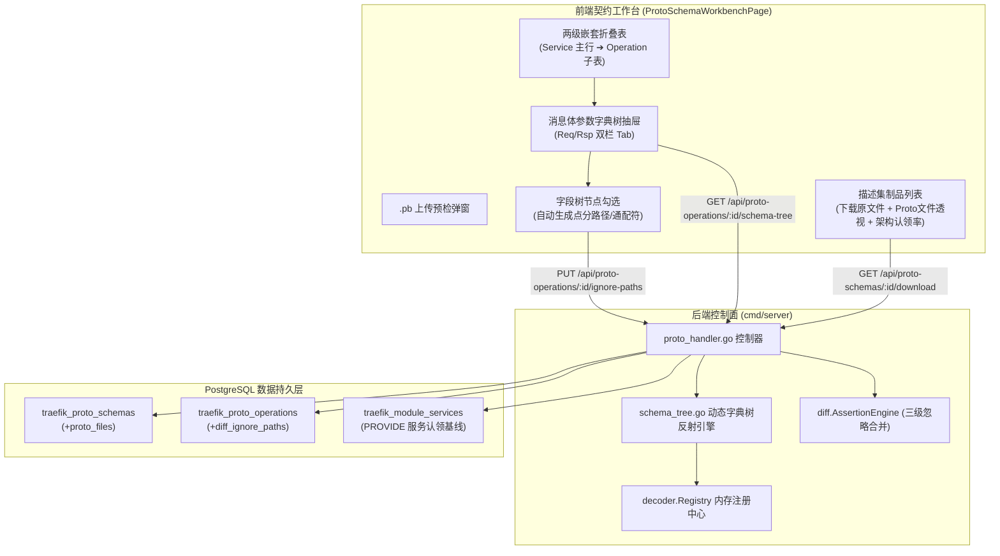

# ADR-06: Protobuf 契约资产化治理、嵌套服务表重构与消息体字段树 Diff 忽略设计

- **文档编号**：`06-proto-schema-repository-and-field-inspection-adr.md`
- **文档版本**：v1.0.0
- **日期**：2026-10-31
- **状态**：已采纳 (Accepted)
- **关联特性**：`F-03`（Protobuf 描述集注册与接口映射）、`F-03.1`（两级嵌套折叠契约表）、`F-03.2`（消息体参数定义字典树）、`F-03.3`（可视化 Diff 忽略规则与继承）、`F-03.4`（描述集资产库与架构认领血缘）
- **关联设计**：[`docs/02-design/04-control-plane-and-web-console.md` §2.3~§2.4 & §4.4](../02-design/04-control-plane-and-web-console.md)、[`docs/02-design/05-database-schema.md` §3.4](../02-design/05-database-schema.md)、[`docs/03-api/01-http-api-contract.md` §2.3](../03-api/01-http-api-contract.md)
- **关联作战卡**：[`docs/04-tasks/08-m7-proto-schema-deepening-and-nested-contract-workbench.md`](../04-tasks/08-m7-proto-schema-deepening-and-nested-contract-workbench.md) (M7)

---

## 1. 背景与问题陈述 (Context & Problem Statement)

随着微服务架构与 RPC 接口的迅速扩充，以及架构中心基础元素（子系统 ➔ 模块 ➔ 进程 ➔ 供给/依赖服务）趋于稳定成熟，原有的 Protobuf 描述集工作台（`ProtoSchemaWorkbenchPage`）暴露出若干严重制约开发与质量回归体验的痛点：

1. **表格平铺刷屏导致信息过载**：原有设计将全部 Operation 接口平铺展示，同一个 `service_name`（如 `demo.account-AccountService`）在数十行中无意义地重复刷屏。面对企业级成百上千个 RPC 契约时，极度缺乏“服务”边界的聚合感知；
2. **描述集资产处于“黑盒状态”**：上传 `.pb` 后，原二进制文件无法导出或下载，难以本地利用工具联调；同时用户无法得知该描述集中包含哪些 `.proto` 源码文件及其依赖关系；
3. **消息体参数定义不可见**：契约详情抽屉仅展示了 `ReqMessageFullName` 与 `RspMessageFullName` 的字符串名称，无法查看内部包含哪些字段、字段类型、字段序号 Tag 以及嵌套结构；
4. **回归对比忽略规则全凭手工盲写**：在流量回放对比中，时间戳、动态 Token 等字段需要排除。原有方式要求用户在模块服务上手写点分路径（如 `header.timestamp`），不仅拼写与大小写极易出错，而且无法精细化到具体方法（Operation）级别；
5. **与架构元素缺乏血缘闭环**：描述集中的服务哪些被架构模块认领、哪些是“未认领孤儿契约”，缺乏量化统计与双向索引，导致契约与系统架构基线脱节。

---

## 2. 核心架构决策矩阵 (Decisions & Trade-offs)

| # | 决策项 | 决策结论 | 选型权衡与落地含义 |
| :---: | :--- | :--- | :--- |
| **1** | **表格交互形态** | **主-子两级嵌套折叠表 (Nested Master-Detail)** | **外层主行按服务聚合**：以 `{package}-{serviceName}` 聚合为主行，展示服务全名、所属源 Proto 文件、认领模块、RPC 方法数（Unary/Stream 分布）与一键折叠；**展开后展示方法子表**。支持表头全局展开/折叠及搜索穿透高亮。彻底消除服务前缀刷屏。 |
| **2** | **参数透视机制** | **服务端基于 `protodesc` 动态遍历生成字段字典树** | 控制面 `Registry` 依托缓存的 `protoregistry.Files` 动态提取 Message 的多层字段节点（名称、Tag、基本类型、修饰符、注释及预计算点分路径），内置 12 层防死循环深度截断。前端通过树形控件交互展开，零前端 `dynamicpb` 依赖。 |
| **3** | **Diff 忽略配置** | **字段树可视化勾选 + 路径自动生成 + 三级优先级继承** | 用户在字段树节点上一键勾选【忽略对比】，前端自动递归拼接规范路径（如 `orders[*].created_at`）；后端持久化至 `ProtoOperation.DiffIgnorePaths`；断言引擎按 `Task.Extra ∪ Operation ∪ Service` 三级合并生效。 |
| **4** | **描述集制品库** | **全生命周期资产化管理（下载导出 + 包含源码透视 + 架构血缘）** | 提供原 `.pb` 二进制流下载接口；解析并展示所含全部 `.proto` 文件列表；联动 `traefik_module_services` 统计认领覆盖率，高亮孤儿契约并支持快捷认领。 |

---

## 3. 总体架构拓扑与交互模型

---

## 4. 架构收益与风险缓解 (Benefits & Risk Mitigation)

### 4.1 架构收益 (Positive Consequences)
1. **认知负荷骤降**：数十上百个 RPC 接口收敛至清晰的服务聚合维度，主表行数减少 70%~90%，结构层级分明；
2. **契约即文档 (Living Documentation)**：无需寻找外部 Wiki 或翻阅 Proto 源码，直接在控制台一站式透视全部消息体参数定义、数据类型与源码注释；
3. **零拼写错误的精准回归断言**：通过在字典树上直观点击完成对比忽略配置，杜绝拼写错误导致的伪回归失败或误放行；
4. **架构治理与契约血缘闭环**：清晰暴露未认领契约，保障架构设计基线与运行态 RPC 契约强一致。

### 4.2 潜在风险与应对策略 (Risks & Mitigation)
1. **大体积复杂 Message 递归反射性能开销**：
   - *风险*：若某些业务 Message 包含极端深层的对象嵌套或自引用，可能导致反射耗时或死循环栈溢出。
   - *缓解措施*：在 `ExtractMessageFieldTree` 递归中引入严格的循环引用检测集合（`visitedTypeSet`）与硬性深度上限（`maxDepth = 12`），超出深度作为叶子节点截断并标记 `is_truncated = true`。
2. **两级嵌套表折叠状态与 URL 状态同步**：
   - *风险*：用户翻页或检索时，若未记忆展开状态会导致界面闪烁与用户迷失。
   - *缓解措施*：前端采用 `expandedServiceKeys` Set 本地维护展开项，检索时自动推导命中服务的集合并合并至展开状态，同时支持表头一键【全部展开/收起】。

