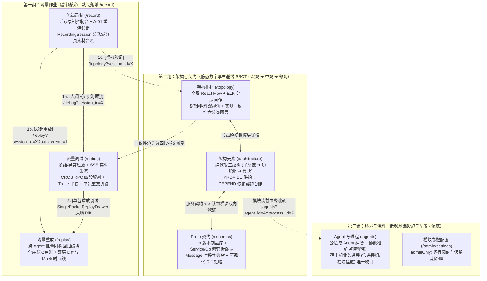

# ADR-07: 微前端控制台信息架构重组、“录制-调试-重放”高频工作流闭环与物理进程单点收口设计

- **文档编号**：`07-console-ia-restructuring-and-workflow-workbench-adr.md`
- **文档版本**：v1.0.0
- **日期**：2026-11-01
- **状态**：已采纳 (Accepted)
- **关联特性**：`F-02`（进程部署映射与模块服务契约依赖）、`F-04`（分层复合架构拓扑与一致性画布）、`F-11`（任务级多进程协同录制）、`F-12`（跨进程同构重放编排）、`F-15`（一体化微前端控制台）、`F-15.1`（录制素材资产台账与跨页流转）、`F-15.2`（独立流量调试台与单包快速重放调试）、`F-15.3`（架构静态基线解耦与物理进程单点收口）
- **关联设计**：[`docs/02-design/04-control-plane-and-web-console.md` §4](../02-design/04-control-plane-and-web-console.md)、[`docs/03-api/01-http-api-contract.md` §2.4~§2.6](../03-api/01-http-api-contract.md)
- **关联作战卡**：[`docs/04-tasks/09-m8-console-ia-restructuring-and-debug-workflow.md`](../04-tasks/09-m8-console-ia-restructuring-and-debug-workflow.md) (M8)

---

## 1. 背景与问题陈述 (Context & Problem Statement)

经过 M1~M7 的迭代，`code-traefik` 的数据面采集/重放、分层拓扑画布（M6）与 Protobuf 契约字典树（M7）已全面成型。然而，控制台原有菜单结构（`流量与架构` + `资源与治理` 2 组 6 项）沿袭了早期研发里程碑的功能堆砌顺序，在实际研发与测试日常使用中暴露出 **5 个结构性矛盾**：

1. **`架构中心与拓扑` (`/architecture`) 严重超载（“一页塞四事、三层套娃切换”）**：
   单一入口同时承载了 ① 三级逻辑架构与模块服务契约建模、② 物理业务进程 CRUD、③ 静态架构全景拓扑图、④ 基于录制批次的实测流量一致性验证 4 类职责，界面出现「顶部胶囊 Tab ➔ 左树逻辑/物理开关 ➔ 画布工具栏批次叠加」3 层嵌套切换，不仅单页状态沉重，而且多层顶栏严重挤压了拓扑画布的可视高度。
2. **静态架构基线被人为割裂，且低频建模页占据默认落地首页**：
   `架构元素` 与 `Proto 描述集` 同属系统的**静态数字孪生基线（SSOT）**，共享相同的 RBAC 权限模型（`traefik_admin` 维护、普通研发只读查阅）并在代码上强耦合（服务认领与 Diff 忽略路径继承），但在菜单中却被 `录制` 与 `重放` 两个动态菜单隔开；同时，低频编辑的 `/architecture` 被设为进入 `/traefik` 的默认首页，偏离了日常 90% 的流量作业场景。
3. **物理业务进程 (`Process`) 双入口重复与权限口径割裂**：
   `Agent` 纳管属于低频基础设施操作，但物理业务进程 (`traefik_processes`) 却在 `架构中心 -> 物理架构树`（仅管理员可写）与 `Agent 纳管 -> 右栏进程映射`（支持普通用户配置个人 `PRIVATE` Agent 进程）两处重复实现 CRUD，且 `ProcessModuleBinderModal` 尚未同步 `group_name` 进程分组能力，造成维护入口困惑。
4. **高频研发作业（“录制 ➔ 调试 ➔ 重放”）存在功能粘连与资产台账缺失**：
   原有 `/traffic`（`协同录制与流量解剖`）将有状态的“排他租约录制启停控制”与无状态的“报文剖析调试”强行绑在一页，`RecordingSession` 仅以顶部窄下拉框呈现，缺乏独立的**录制素材资产台账**（无法直观总览各批次监控进程、帧数、归属人及执行发布/删除/跨页流转）。
5. **“报文调试”到“单包验证重放”存在动线断层**：
   研发人员在四段报文解剖抽屉中定位到某条 `INGRESS` 异常报文并修复代码后，无法一键针对该单条报文发起快速重放验证，被迫切往 `/replay` 弹窗并在仅加载前 50 条的列表中人工翻找流水号 `ullSNO`。

---

## 2. 核心架构决策矩阵 (Decisions & Trade-offs)

| # | 决策项 | 决策结论 | 选型权衡与架构落地含义 |
| :---: | :--- | :--- | :--- |
| **1** | **菜单分组与频次金字塔** | **重构为「`流量作业` ➔ `架构与契约` ➔ `环境与治理`」三组八项，4~6 字精炼命名** | 严格按使用频次由高到低排列：第一组 `流量作业`（`流量录制`、`流量调试`、`流量重放`）置顶并设 `/record` 为默认落地页；第二组 `架构与契约`（`架构拓扑`、`架构元素`、`Proto 契约`）聚合全部静态 SSOT 基线；第三组 `环境与治理`（`Agent 与进程`、`模块参数配置`）将低频基础设施沉底。侧边栏缩进下零折行。 |
| **2** | **录制与调试正交拆分** | **拆分为独立的 `流量录制` (`/record`) 与 `流量调试` (`/debug`)** | `流量录制` 专注**批次生命周期与素材库台账**（活跃录制横幅、A-01 重连诊断、公私域分页台账与跨页流转动作）；`流量调试` 专注**深度看包与问题定位**（历史批次/活跃 SSE 实时跟流切换、`has_error` 异常过滤、四段解剖、Trace 串联与重解码）。 |
| **3** | **调试能力边界界定** | **落地“抓包解剖 + 单包快速重放调试”闭环（零 Agent 协议改造）** | 在 `流量调试` 列表与解剖抽屉中对可重放 `INGRESS` 报文提供 **「单包重放调试」**，直接复用控制面 `POST /api/replay-tasks`（`selected_record_ids: [recordId]`）投递至同构目标进程并原地抽屉展示双层 Diff 与 Mock 命中明细；不依赖录制包的在线手填 JSON 主动组包调接口归入 `F-23 (P2)` 远期规划，确保数据面零 `.pb` 防腐红线不被破坏。 |
| **4** | **架构中心解耦与组内序** | **拆分为全屏 `架构拓扑` (`/topology`) 与纯逻辑 `架构元素` (`/architecture`)，组内按「宏观 ➔ 中观 ➔ 微观」排列** | `架构与契约` 组按查阅者认知缩放顺序排列为 **`架构拓扑`（宏观全景与一致性图层）➔ `架构元素`（中观三级逻辑树与服务归属）➔ `Proto 契约`（微观方法与字段字典树）**。`架构拓扑` 剥离外层胶囊 Tab 释放 100% 视口高度；`架构元素` 彻底剥离顶层 Tab 与物理进程树，体积与复杂度减半，并与 `Proto 契约` 建立双向深链互跳。 |
| **5** | **物理进程单点收口** | **物理业务进程 (`Process`) CRUD 统一收口至 `Agent 与进程` (`/agents`)** | 顺应 `Agent (1) ➔ Process (N) ➔ Module (M)` 的物理外键归属与公私域 RBAC 模型，移除 `架构元素` 中的进程/进程组 CRUD 抽屉与 `ProcessDetailPane`；将 `group_name`（进程组下拉选择与快捷新建）及纯客户端 `listen_port = 0` 支持完整合并至 `ProcessModuleBinderModal`。`架构元素` 仅展示模块进程装载血缘并深链跳往 `/agents`，`架构拓扑` 保留物理进程部署视图画布。 |
| **6** | **路由兼容与单一菜单源** | **旧深链 URL 100% 带参平滑重定向，`StandaloneShell` 由 `menu.ts` 驱动** | `/` 与 `/sessions` 重定向至 `/record`；`/traffic?...` 无损保留 Query 参数重定向至 `/debug?...`；`/architecture?tab=topology\|physical\|verify` 带 `view` 与 `session_id` 重定向至 `/topology`。独立模式侧边栏直接消费 `traefikMenuConfig` 渲染，杜绝双处硬编码漂移。 |

---

## 3. 总体信息架构拓扑与跨工作台流转动线

---

## 4. 架构收益与风险缓解 (Benefits & Risk Mitigation)

### 4.1 架构收益 (Positive Consequences)
1. **直击高频研发主链路**：开发者进入系统即达 `流量录制` 台账，沿着 `录制 ➔ 调试（看包/单包复现）➔ 批量重放回归` 顺畅流转，消除跨菜单迷失与人工翻找 `ullSNO` 的摩擦；
2. **页面职责单一与代码大幅瘦身**：`ArchitectureWorkbenchPage` 剥离拓扑画布与物理进程 CRUD 后回归纯逻辑架构编辑器，`TopologyWorkbenchPage` 获得沉浸式全视口画布空间；
3. **静态元数据高度内聚**：`架构拓扑`、`架构元素`、`Proto 契约` 同组相邻并支持双向深链，兼顾普通研发“从宏观拓扑到微观字段”的查阅流与管理员的契约治理流；
4. **彻底消除进程双入口与权限不一致**：所有业务进程与模块挂载统一在 `Agent 与进程` 维护，天然对齐 `SHARED`（管理员维护公共基线）与 `PRIVATE`（普通研发自管个人调试进程）的公私域安全边界。

### 4.2 潜在风险与应对策略 (Risks & Mitigation)
1. **录制进行中“边录边看包”的连贯性风险**：
   - *风险*：拆分 `流量录制` 与 `流量调试` 后，用户在启动录制后可能希望立即观察实时抓到的报文流。
   - *缓解措施*：`流量录制` 顶部的活跃录制横幅实时刷新已捕获帧数与进程诊断状态，并提供醒目的 **【实时跟流调试】** 按钮，一键跳转 `/debug?session_id=<active_id>&live=1` 自动激活 SSE 实时流追踪；在 `流量调试` 顶栏若当前批次处于 `RECORDING` 态，同样展示录制中脉冲标识与快捷停录操作。
2. **存量收藏夹、外链与测试用例的旧路由断裂风险**：
   - *风险*：已有文档、用户书签或测试代码可能指向 `/traffic` 或 `/architecture?tab=topology`。
   - *缓解措施*：在 `App.tsx` 路由层内置声明式 `LegacyRouteRedirect` 组件，完整保留 `location.search` 查询参数执行 `replace` 无损跳转，并通过单元测试 100% 锁定新旧路由映射行为。
